이 문서는 **decontam 완료 후 저장된 phyloseq 객체**
`./Phyloseq/phy_F270R240_260812_v4.rds`를 불러오는 단계부터 시작합니다.
원자료 import, ASV table 구성 및 decontam 과정은 포함하지 않습니다. 저장된 객체에서
control sample을 제외하고 rarefaction한 뒤, 통계 분석과 각 패널 생성 및 최종 Figure
저장까지 수행합니다.

## Statistical revision
Swab-system comparisons are performed separately by anatomical site using Friedman
tests with participant as the block. Post-hoc two-sided Wilcoxon signed-rank tests
are aligned explicitly by participant ID (normal approximation, exact = FALSE);
BH adjustment covers the ten system pairs within each endpoint and site.
All pairwise results are reported, including those with a nonsignificant omnibus
test. The five participants are the independent biological units. Across-site
DNA/read comparisons use the mean of the two sites within participant and system.
Participant-level plots are descriptive: five swabs are not five independent
replicate participants. The original tree, counts, and preprocessing are retained.
Permutation analyses use 9,999 permutations and seed 42.

# Packages and plotting helper functions


``` r
project_library <- file.path(getwd(), "R_library")
if (dir.exists(project_library)) .libPaths(c(project_library, .libPaths()))
suppressPackageStartupMessages({
  library(phyloseq)
  library(vegan)
  library(dplyr)
  library(tidyr)
  library(tibble)
  library(ggplot2)
  library(patchwork)
  library(ComplexUpset)
  library(pheatmap)
  library(RColorBrewer)
  library(ggpubr)
})


# Functions used directly in the final manuscript figures

theme_manuscript <- function(base_size = 8) {
  theme_classic(base_size = base_size) +
    theme(
      text = element_text(colour = "black"),
      axis.title = element_text(size = 9, face = "bold", colour = "black"),
      axis.text = element_text(size = 8, colour = "black"),
      plot.title = element_text(size = 10, face = "bold", hjust = 0.5,
                                margin = margin(b = 4)),
      plot.subtitle = element_text(size = 9, face = "bold", hjust = 0.5,
                                   margin = margin(b = 3)),
      strip.background = element_blank(),
      strip.text = element_text(size = 9, face = "bold"),
      legend.title = element_text(size = 9, face = "bold"),
      legend.text = element_text(size = 8),
      panel.grid = element_blank(),
      plot.margin = margin(6, 6, 6, 6)
    )
}


# Shared repeated-measures statistics: used for alpha diversity, taxa, DNA and reads.
repeated_results <- list()
repeated_test <- function(data, value, endpoint, site) {
  d <- data %>% transmute(subject_id = as.character(subject_id),
                         Type = as.character(Type), Value = .data[[value]])
  if (anyNA(d$subject_id) || anyNA(d$Type)) stop("Missing participant or method ID")
  if (anyDuplicated(d[c("subject_id", "Type")]))
    stop("Duplicate participant/type cells: ", endpoint, " / ", site)
  expected_subjects <- sort(unique(as.character(sample_data(phy)$subject_id)))
  d <- d %>% complete(subject_id = expected_subjects, Type = paste0("Type ", 1:5))
  wide <- d %>% pivot_wider(names_from = Type, values_from = Value) %>% arrange(subject_id)
  required <- paste0("Type ", 1:5)
  if (!all(required %in% names(wide))) stop("Missing sampling system: ", endpoint)
  keep <- complete.cases(wide[, required]) &
    apply(as.matrix(wide[, required]), 1, function(z) all(is.finite(z)))
  excluded <- paste(wide$subject_id[!keep], collapse = ";")
  m <- as.matrix(wide[keep, required])
  if (nrow(m) < 2) stop("Fewer than two complete participants: ", endpoint)
  constant <- all(apply(m, 1, function(z) length(unique(z)) == 1))
  ft <- if (!constant) friedman.test(m) else NULL
  omnibus <- data.frame(site_group = site, Endpoint = endpoint,
    n_complete = nrow(m), excluded_participants = excluded,
    method = "Friedman chi-squared approximation",
    statistic = if (constant) 0 else unname(ft$statistic),
    df = 4, p = if (constant) 1 else ft$p.value,
    Kendall_W = if (constant) 0 else unname(ft$statistic)/(nrow(m)*4))
  pair_rows <- lapply(combn(required, 2, simplify = FALSE), function(pair) {
    x <- m[, pair[1]]; y <- m[, pair[2]]
    wt <- if (all(x == y)) NULL else suppressWarnings(wilcox.test(x, y,
                              paired = TRUE, exact = FALSE))
    data.frame(site_group = site, Endpoint = endpoint, group1 = pair[1],
      group2 = pair[2], n_pairs = length(x),
      median_paired_difference = median(x-y),
      p = if (is.null(wt)) 1 else wt$p.value)
  })
  pairs <- bind_rows(pair_rows) %>%
    mutate(p.adj = p.adjust(p, "BH"),
           p.adj.signif = case_when(p.adj < .001 ~ "***", p.adj < .01 ~ "**",
                                   p.adj < .05 ~ "*", TRUE ~ "ns"))
  out <- list(omnibus = omnibus, pairs = pairs)
  repeated_results[[paste(site, endpoint, sep = "::")]] <<- out
  out
}

alpha_plot <- function(data, x_var, fill_var, shape_var, site_title,
                       y_title = NULL, paired = TRUE, show_legend = FALSE) {
  set.seed(42)
  p <- ggplot(
    data,
    aes(x = .data[[x_var]], y = Value,
        fill = .data[[fill_var]], shape = .data[[shape_var]])
  ) +
    geom_boxplot(
      aes(group = interaction(.data[[x_var]], Index)),
      width = 0.65, outlier.shape = NA, colour = "black", linewidth = 0.45
    ) +
    geom_point(
      position = position_jitter(width = 0.08),
      size = 1.7, colour = "black"
    ) +
    facet_wrap(~Index, scales = "free_y", nrow = 1) +
    labs(
      x = NULL, y = y_title, title = site_title,
      fill = ifelse(fill_var == "subject_id", "Participant", "Sampling type"),
      shape = ifelse(shape_var == "subject_id", "Participant", "Sampling type")
    ) +
    theme_manuscript()


  if (x_var == "Type") {
    labels <- list(); comparisons_out <- list()
    for (metric in unique(as.character(data$Index))) {
      current <- filter(data, as.character(Index) == metric)
      test <- repeated_test(current, "Value", paste0("Alpha: ", metric),
                            as.character(current$site_group[1]))
      span <- max(diff(range(current$Value)), 0.1)
      labels[[metric]] <- data.frame(Index = metric, Type = "Type 3",
        y = max(current$Value) + span*.15,
        label = paste0("Friedman p = ", format.pval(test$omnibus$p, digits = 3)))
      sig <- filter(test$pairs, p.adj < .05)
      if (nrow(sig)) {
        sig$Index <- metric
        sig$y.position <- max(current$Value) + span*(.35 + seq_len(nrow(sig))*.12)
        comparisons_out[[metric]] <- sig
      }
    }
    p <- p + geom_text(data = bind_rows(labels),
      aes(x = Type, y = y, label = label), inherit.aes = FALSE, size = 2.5)
    if (length(comparisons_out)) p <- p + ggpubr::stat_pvalue_manual(
      bind_rows(comparisons_out), label = "p.adj.signif", inherit.aes = FALSE)
  }
  if (!show_legend) p <- p + theme(legend.position = "none")
  p
}

beta_plot <- function(ps, site, distance_method, test_variable,
                      colour_variable, shape_variable,
                      strata_variable = NULL, site_title,
                      metric_title, show_legend = TRUE) {
  keep <- sample_names(ps)[as.character(sample_data(ps)$site_group) == site]
  ps_site <- prune_samples(keep, ps)
  ps_site <- prune_taxa(taxa_sums(ps_site) > 0, ps_site)

  distance_object <- phyloseq::distance(ps_site, method = distance_method)
  ordination <- ordinate(ps_site, method = "PCoA", distance = distance_method)
  explained <- ordination$values$Relative_eig[1:2] * 100

  coordinates <- data.frame(ordination$vectors[, 1:2], check.names = FALSE)
  coordinates$sample_name <- rownames(coordinates)
  metadata <- data.frame(sample_data(ps_site), check.names = FALSE)
  metadata$sample_name <- rownames(metadata)
  coordinates <- left_join(coordinates, metadata, by = "sample_name")
  coordinates <- left_join(coordinates, swab_key, by = "swab_type2")

  set.seed(42)
  model_formula <- reformulate(test_variable, response = "distance_object")
  if (test_variable == "subject_id") {
    permanova <- adonis2(model_formula, data = metadata, permutations = 0)
  } else if (is.null(strata_variable)) {
    permanova <- adonis2(
      model_formula, data = metadata, permutations = 9999
    )
  } else {
    permanova <- adonis2(
      model_formula, data = metadata, permutations = 9999,
      strata = metadata[[strata_variable]]
    )
  }

  # Participant patterns are descriptive; replicate swabs are not independent people.
  if (test_variable == "subject_id") permanova[1, "Pr(>F)"] <- NA_real_
  r2 <- permanova$R2[1]
  p_value <- permanova$`Pr(>F)`[1]
  p_label <- ifelse(is.na(p_value), "not tested (descriptive)", ifelse(
    p_value < 0.001, "<0.001",
    format(round(p_value, 3), nsmall = 3)
  ))

  p <- ggplot(
    coordinates,
    aes(
      x = Axis.1, y = Axis.2,
      colour = .data[[colour_variable]],
      shape = .data[[shape_variable]]
    )
  ) +
    geom_vline(xintercept = 0, colour = "grey80") +
    geom_hline(yintercept = 0, colour = "grey80") +
    geom_point(size = 2, alpha = 0.75) +
    stat_ellipse(aes(group = .data[[colour_variable]]), linewidth = 0.55) +
    labs(
      x = paste0("PCoA 1 (", round(explained[1], 1), "%)"),
      y = paste0("PCoA 2 (", round(explained[2], 1), "%)"),
      title = site_title,
      subtitle = metric_title,
      colour = ifelse(
        colour_variable == "subject_id", "Participant", "Sampling type"
      ),
      shape = ifelse(
        shape_variable == "subject_id", "Participant", "Sampling type"
      )
    ) +
    annotate(
      "text", x = -Inf, y = -Inf, hjust = -0.10, vjust = -0.25, size = 2.7,
      label = paste0(
        "PERMANOVA:\nR2 = ", round(r2, 3),
        ", p-value = ", p_label
      )
    ) +
    theme_manuscript() +
    theme(aspect.ratio = 1)

  if (!show_legend) p <- p + theme(legend.position = "none")

  list(
    plot = p,
    permanova = data.frame(
      site = site_title,
      distance = metric_title,
      variable = test_variable,
      R2 = r2,
      F = permanova$F[1],
      p_value = p_value
    ),
    coordinates = coordinates
  )
}

taxa_plot <- function(melt, taxa, tax_otu, x_axis, phylum_or = NULL) {
  # Original taxon grouping, ordering, and phylum-specific colour logic.
  tax_tab <- unique(melt[, c("OTU", "Phylum", taxa)])
  tax_tab2 <- tax_tab[tax_tab$OTU %in% tax_otu, ]
  tax_phylum <- unique(tax_tab2$Phylum)

  plot_data <- melt
  plot_data[!plot_data$Phylum %in% tax_phylum, "Phylum"] <- "Other"
  plot_data[!plot_data$Phylum %in% tax_phylum, taxa] <- "Other"

  if (taxa != "Species") {
    for (phylum in tax_phylum) {
      selected_taxa <- tax_tab2[tax_tab2$Phylum == phylum, taxa]
      plot_data[
        plot_data$Phylum == phylum & !plot_data[, taxa] %in% selected_taxa,
        taxa
      ] <- paste0(phylum, "_Other")
    }
    for (phylum in tax_phylum) {
      selected_taxa <- tax_tab2[tax_tab2$Phylum == phylum, taxa]
      for (taxon in selected_taxa) {
        plot_data[plot_data[, taxa] == taxon, taxa] <- paste0(phylum, "_", taxon)
      }
    }
  } else {
    for (phylum in tax_phylum) {
      selected_taxa <- tax_tab2[tax_tab2$Phylum == phylum, taxa]
      replace_rows <- plot_data$Phylum == phylum & !plot_data[, taxa] %in% selected_taxa
      plot_data[replace_rows, taxa] <- "Other"
      plot_data[replace_rows, "Phylum"] <- "Other"
    }
  }

  abundance_summary <- plot_data[
    plot_data$Phylum %in% tax_phylum,
    c("Abundance", "Phylum", taxa)
  ] %>%
    group_by(Phylum, !!rlang::sym(taxa)) %>%
    summarise(sum.Abundance = sum(Abundance), .groups = "drop") %>%
    arrange(-sum.Abundance) %>%
    ungroup() %>%
    as.data.frame()

  phylum_order <- unique(abundance_summary$Phylum)
  plot_data$Phylum <- factor(plot_data$Phylum, levels = c(sort(phylum_order), "Other"))
  taxon_order <- abundance_summary %>% arrange(Phylum) %>% pull(!!rlang::sym(taxa))
  plot_data[, taxa] <- factor(plot_data[, taxa], levels = c(taxon_order, "Other"))

  phylum_color_map <- c(
    Actinobacteria = "Reds", Actinobacteriota = "Reds", Actinomycetota = "Reds",
    Firmicutes = "Blues", Bacillota = "Blues", Firmicutes_A = "Blues",
    Firmicutes_B = "BuGn", Firmicutes_C = "PuBu", Firmicutes_D = "YlGnBu",
    Bacteroidetes = "Purples", Bacteroidota = "Purples",
    Proteobacteria = "Greens", Pseudomonadota = "Greens",
    Fusobacteria = "YlOrBr", Fusobacteriota = "YlOrBr",
    Ascomycota = "RdPu", Basidiomycota = "YlOrBr"
  )
  other_palettes <- c("BrBG", "Spectral", "BrBG", "PuOr")
  categories <- abundance_summary %>%
    arrange(-sum.Abundance) %>% arrange(Phylum) %>% count(Phylum, name = "n_taxa")
  unlisted_phyla <- setdiff(categories$Phylum, names(phylum_color_map))
  if (length(unlisted_phyla) > 0) {
    phylum_color_map <- c(
      phylum_color_map,
      setNames(rep(other_palettes, length.out = length(unlisted_phyla)), unlisted_phyla)
    )
  }

  colour_list <- vector("list", nrow(categories))
  names(colour_list) <- categories$Phylum
  for (phylum in categories$Phylum) {
    n_taxa <- categories$n_taxa[categories$Phylum == phylum]
    palette_name <- phylum_color_map[[phylum]]
    if (n_taxa == 1) {
      colour_list[[phylum]] <- rev(brewer.pal(9, palette_name)[5])
    } else if (n_taxa == 2) {
      colour_list[[phylum]] <- rev(brewer.pal(9, palette_name)[c(3, 7)])
    } else if (n_taxa <= 9) {
      colour_list[[phylum]] <- rev(brewer.pal(n_taxa, palette_name))
    } else {
      colour_list[[phylum]] <- colorRampPalette(rev(brewer.pal(9, palette_name)))(n_taxa)
    }
  }
  colour_code <- c(unlist(colour_list, use.names = FALSE), "#D3D3D3")

  if (!is.null(phylum_or)) {
    sample_order <- plot_data %>%
      group_by(!!rlang::sym(x_axis)) %>% data.frame() %>%
      mutate(Abundance = Abundance / sum(Abundance)) %>%
      filter(Phylum %in% phylum_or) %>%
      group_by(!!rlang::sym(x_axis)) %>%
      summarise(Abundance = sum(Abundance), .groups = "drop") %>%
      arrange(Abundance) %>% pull(!!rlang::sym(x_axis)) %>% as.character()
    plot_data[, x_axis] <- factor(plot_data[, x_axis], levels = sample_order)
  }

  p <- ggplot(
    plot_data,
    aes(x = !!rlang::sym(x_axis), y = Abundance, fill = !!rlang::sym(taxa))
  ) +
    geom_bar(stat = "identity", position = "fill") +
    labs(y = "Relative abundance") +
    scale_fill_manual(values = colour_code) +
    theme_manuscript() +
    theme(axis.text.x = element_text(angle = 45, hjust = 1), legend.title = element_blank())

  list(
    plot = p,
    data = list(df = plot_data, summary_df = abundance_summary),
    color = colour_code
  )
}

prepare_upset_data <- function(ps, site = NULL, mean_abundance_cutoff = 0.001) {
  ps_genus <- tax_glom(ps, taxrank = "Genus", NArm = FALSE)
  if (!is.null(site)) {
    keep <- sample_names(ps_genus)[
      as.character(sample_data(ps_genus)$site_group) == site
    ]
    ps_genus <- prune_samples(keep, ps_genus)
  }
  ps_genus <- prune_taxa(taxa_sums(ps_genus) > 0, ps_genus)

  ps_relative <- transform_sample_counts(ps_genus, function(x) x / sum(x))
  mean_relative <- taxa_sums(ps_relative) / nsamples(ps_relative)
  keep_taxa <- taxa_names(ps_relative)[mean_relative >= mean_abundance_cutoff]
  ps_genus <- prune_taxa(keep_taxa, ps_genus)

  metadata <- data.frame(sample_data(ps_genus), check.names = FALSE)
  otu <- as(otu_table(ps_genus), "matrix")
  if (!taxa_are_rows(ps_genus)) otu <- t(otu)

  presence <- sapply(swab_key$swab_type2, function(system) {
    samples <- rownames(metadata)[metadata$swab_type2 == system]
    rowSums(otu[, samples, drop = FALSE] > 0) > 0
  })
  presence <- data.frame(presence, check.names = FALSE)
  colnames(presence) <- as.character(swab_key$Type)
  presence$taxon_id <- rownames(presence)
  presence$Genus <- as.character(tax_table(ps_genus)[presence$taxon_id, "Genus"])

  system_columns <- paste0("Type ", 1:5)
  shared_ids <- presence$taxon_id[
    rowSums(presence[, system_columns, drop = FALSE]) == 5
  ]
  total_reads <- sum(otu)
  shared_reads <- sum(otu[shared_ids, , drop = FALSE])

  list(
    data = presence,
    summary = data.frame(
      subset = ifelse(is.null(site), "Total", site),
      retained_genera = nrow(presence),
      shared_by_all_five_genera = length(shared_ids),
      mean_abundance_cutoff = mean_abundance_cutoff,
      total_reads = total_reads,
      reads_from_shared_genera = shared_reads,
      shared_genus_relative_abundance_pct = 100 * shared_reads / total_reads
    )
  )
}

upset_plot <- function(upset_data, title, unit_label = "genera") {
  shared_label <- sprintf(
    "%d shared genera (%.1f%% of reads)",
    upset_data$summary$shared_by_all_five_genera,
    upset_data$summary$shared_genus_relative_abundance_pct
  )

  p <- ComplexUpset::upset(
    upset_data$data,
    intersect = paste0("Type ", 1:5),
    name = "Sampling system",
    min_size = 0,
    sort_sets = FALSE,
    sort_intersections_by = "cardinality",
    width_ratio = 0.2,
    themes = ComplexUpset::upset_default_themes(
      axis.title.x = element_text()
    ),
    base_annotations = list(
      "Intersection size" = intersection_size(
        counts = TRUE,
        bar_number_threshold = 1,
        text_colors = c(on_background = "black", on_bar = "black"),
        text_mapping = aes(
          label = ifelse(
            `Type 1` & `Type 2` & `Type 3` & `Type 4` & `Type 5`,
            "",
            exclusive_intersection_size
          )
        ),
        # Keep every count horizontal and centred above its bar.
        text = list(size = 3.3, angle = 0, hjust = 0.5, vjust = -0.65)
      ) +
        geom_text(
          aes(
            y = exclusive_intersection_size,
            label = ifelse(
              `Type 1` & `Type 2` & `Type 3` & `Type 4` & `Type 5`,
              shared_label,
              NA_character_
            )
          ),
          stat = "unique", colour = "black", size = 3.3,
          hjust = 0, vjust = -0.65, nudge_x = -0.45, na.rm = TRUE
        ) +
        scale_y_continuous(expand = expansion(mult = c(0, 0.30)))
    )
  )

  p <- p +
    labs(title = paste0(
      title, " (n=", upset_data$summary$retained_genera, " ", unit_label, ")"
    )) +
    theme_bw(base_size = 8) +
    theme(
      plot.title = element_text(face = "bold"),
      panel.grid = element_blank(),
      axis.title.x = element_text(),
      axis.text.x = element_text(angle = 45, hjust = 1, vjust = 1)
    )
  p
}
```

# Import post-decontam phyloseq RDS and prepare analysis data


``` r
# -----------------------------------------------------------------------------
# 1. Start from the saved post-decontam phyloseq object
# -----------------------------------------------------------------------------

# This is the post-decontam RDS used as the starting point in the original Rmd.
phy <- readRDS("./Phyloseq/phy_F270R240_260812_v4.rds")

# Remove controls, then remove singleton ASVs (total abundance = 1)
# across the 50 true samples, following the filtering sensitivity analysis.
phy_true_unfiltered <- subset_samples(phy, control_status == "sample") %>%
  prune_taxa(taxa_sums(.) > 0, .)

phy <- prune_taxa(taxa_sums(phy_true_unfiltered) > 1, phy_true_unfiltered)

filter_summary <- data.frame(
  analysis = "canonical_singleton",
  retention_rule = "taxa_sums > 1",
  samples = nsamples(phy),
  asvs_before_filter = ntaxa(phy_true_unfiltered),
  asvs_after_filter = ntaxa(phy),
  asvs_removed = ntaxa(phy_true_unfiltered) - ntaxa(phy),
  reads_before_filter = sum(sample_sums(phy_true_unfiltered)),
  reads_after_filter = sum(sample_sums(phy)),
  reads_removed = sum(sample_sums(phy_true_unfiltered)) - sum(sample_sums(phy)),
  reads_retained_pct = 100 * sum(sample_sums(phy)) / sum(sample_sums(phy_true_unfiltered))
)

# Rarefy the post-decontam sample object using the existing analysis settings.
set.seed(42)
phy_rar <- rarefy_even_depth(
  phy,
  sample.size = min(sample_sums(phy)),
  rngseed = 42,
  replace = FALSE,
  verbose = FALSE
)

project_root <- sub("[/\\\\]+$", "", getwd())
figure_dir <- file.path(project_root, "Figures", "statistic_v2")
table_dir <- file.path(project_root, "Tables", "statistic_v2")
dir.create(figure_dir, recursive = TRUE, showWarnings = FALSE)
dir.create(table_dir, recursive = TRUE, showWarnings = FALSE)
write.csv(filter_summary, file.path(table_dir, "feature_filter_summary.csv"), row.names = FALSE)

swab_key <- data.frame(
  swab_type2 = c("Copan", "Puritan_gel", "Puritan_buffer", "Omni", "Eswab"),
  Type = factor(paste0("Type ", 1:5), levels = paste0("Type ", 1:5))
)

type_col <- setNames(brewer.pal(5, "Set2"), paste0("Type ", 1:5))
subject_col <- setNames(
  brewer.pal(5, "Set1"),
  sort(unique(as.character(sample_data(phy)$subject_id)))
)

# Verify one biological observation per participant, anatomical site and method.
design <- data.frame(sample_data(phy), check.names = FALSE)
stopifnot(!anyNA(design[c("subject_id", "site_group", "swab_type2")]))
stopifnot(!anyDuplicated(design[c("subject_id", "site_group", "swab_type2")]))
design_audit <- design %>% count(subject_id, site_group, swab_type2, name = "n")
write.csv(design_audit, file.path(table_dir, "Repeated_measure_design_audit.csv"), row.names = FALSE)

meta_rar <- data.frame(sample_data(phy_rar), check.names = FALSE)
meta_rar$sample_name <- sample_names(phy_rar)
meta_rar <- left_join(meta_rar, swab_key, by = "swab_type2")

# -----------------------------------------------------------------------------
```

# Figure 1 — bacterial diversity across sampling systems


``` r
# 2. Figure 1: beta and alpha diversity across sampling systems
# -----------------------------------------------------------------------------

# 1. Data processing
alpha_data <- estimate_richness(
  phy_rar, measures = c("Shannon", "Observed")
) %>%
  rownames_to_column("sample_name") %>%
  mutate(sample_name = sub("^X", "", sample_name)) %>%
  left_join(meta_rar, by = "sample_name") %>%
  pivot_longer(
    c(Shannon, Observed),
    names_to = "Index",
    values_to = "Value"
  ) %>%
  mutate(
    Index = factor(
      Index,
      levels = c("Shannon", "Observed"),
      labels = c("Shannon index", "Observed ASVs")
    )
  )

# 2. Beta-diversity statistics and plots
f1_A_result <- beta_plot(
  phy_rar, "Antecubital", "unifrac", "swab_type2",
  "Type", "subject_id", "subject_id",
  "Antecubital fossa", "Unweighted UniFrac", FALSE
)
f1_B_result <- beta_plot(
  phy_rar, "Antecubital", "wunifrac", "swab_type2",
  "Type", "subject_id", "subject_id",
  "Antecubital fossa", "Weighted UniFrac", TRUE
)
f1_C_result <- beta_plot(
  phy_rar, "Forehead", "unifrac", "swab_type2",
  "Type", "subject_id", "subject_id",
  "Forehead", "Unweighted UniFrac", FALSE
)
f1_D_result <- beta_plot(
  phy_rar, "Forehead", "wunifrac", "swab_type2",
  "Type", "subject_id", "subject_id",
  "Forehead", "Weighted UniFrac", TRUE
)

f1_A <- f1_A_result$plot + scale_colour_manual(values = type_col, drop = FALSE)
f1_B <- f1_B_result$plot + scale_colour_manual(values = type_col, drop = FALSE)
f1_C <- f1_C_result$plot + scale_colour_manual(values = type_col, drop = FALSE)
f1_D <- f1_D_result$plot + scale_colour_manual(values = type_col, drop = FALSE)

Figure1_PERMANOVA <- bind_rows(
  f1_A_result$permanova,
  f1_B_result$permanova,
  f1_C_result$permanova,
  f1_D_result$permanova
)

# 3. Alpha-diversity plots
f1_E <- alpha_plot(
  filter(alpha_data, site_group == "Antecubital"),
  x_var = "Type", fill_var = "Type", shape_var = "subject_id",
  site_title = "Antecubital fossa", paired = TRUE
) + scale_fill_manual(values = type_col, drop = FALSE)

f1_F <- alpha_plot(
  filter(alpha_data, site_group == "Forehead"),
  x_var = "Type", fill_var = "Type", shape_var = "subject_id",
  site_title = "Forehead", paired = TRUE
) + scale_fill_manual(values = type_col, drop = FALSE)

# 4. Assemble and inspect
Figure1 <- (
  wrap_elements(full = (f1_A | f1_B)) /
    wrap_elements(full = (f1_C | f1_D)) /
    (f1_E | f1_F)
) +
  plot_layout(heights = c(1, 1, 0.62)) +
  plot_annotation(tag_levels = list(c("A", "B", "C", "D"))) &
  theme(plot.tag = element_text(size = 16, face = "bold"))

print(Figure1)
```

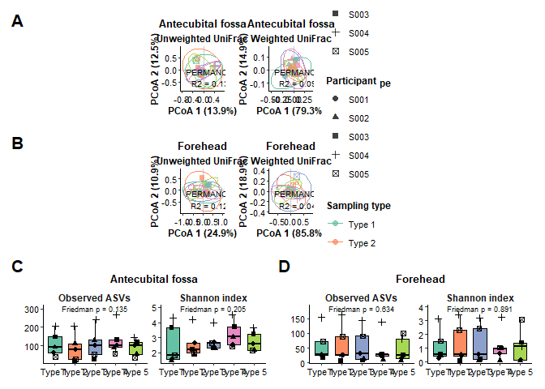<!-- -->

``` r
print(Figure1_PERMANOVA)
```

```
##                site           distance   variable         R2         F p_value
## 1 Antecubital fossa Unweighted UniFrac swab_type2 0.13231158 0.7624372  0.4375
## 2 Antecubital fossa   Weighted UniFrac swab_type2 0.09670523 0.5352916  0.1660
## 3          Forehead Unweighted UniFrac swab_type2 0.12007370 0.6822941  0.5132
## 4          Forehead   Weighted UniFrac swab_type2 0.04794978 0.2518238  0.8691
```

``` r
# 5. Save the inspected objects
ggsave(
  file.path(figure_dir, "Figure1_bacterial_diversity.png"),
  plot = Figure1, width = 9, height = 10.2, dpi = 600,
  bg = "white", limitsize = FALSE
)
ggsave(
  file.path(figure_dir, "Figure1_bacterial_diversity.tiff"),
  plot = Figure1, width = 9, height = 10.2, dpi = 600,
  compression = "lzw", bg = "white", limitsize = FALSE
)
write.csv(
  Figure1_PERMANOVA,
  file.path(table_dir, "Figure1_PERMANOVA.csv"),
  row.names = FALSE
)
```


# Figure 2 — bacterial community composition


``` r
# 3. Figure 2: bacterial community composition
# -----------------------------------------------------------------------------
# 1. Data processing
phy_genus <- tax_glom(phy, taxrank = "Genus", NArm = FALSE)
phy_genus_relative <- transform_sample_counts(phy_genus, function(x) x / sum(x))

mean_genus_abundance <- taxa_sums(phy_genus_relative) / nsamples(phy_genus_relative)
major_genus_ids <- names(mean_genus_abundance)[mean_genus_abundance > 0.01]

genus_tax_plot <- taxa_plot(
  melt = psmelt(phy_genus),
  taxa = "Genus",
  tax_otu = major_genus_ids,
  x_axis = "swab_type2",
  phylum_or = "Actinobacteriota"
)

genus_composition_data <- genus_tax_plot$data$df %>%
  left_join(swab_key, by = "swab_type2")

genus_relative_data <- psmelt(phy_genus_relative) %>%
  left_join(swab_key, by = "swab_type2") %>%
  mutate(Genus = as.character(Genus))

selected_skin_genera <- c("Cutibacterium", "Staphylococcus", "Streptococcus")
selected_genus_data <- genus_relative_data %>%
  filter(Genus %in% selected_skin_genera)

# 2. Visualisation
f2_A <- ggplot(
  filter(genus_composition_data, site_group == "Antecubital"),
  aes(Type, Abundance, fill = Genus)
) +
  geom_col(position = "fill", width = 0.88) +
  scale_fill_manual(values = genus_tax_plot$color) +
  scale_y_continuous(labels = scales::percent_format(accuracy = 1), expand = c(0, 0)) +
  labs(x = NULL, y = "Antecubital relative abundance (%)", fill = "Genus", tag = "A") +
  guides(fill = guide_legend(keyheight = unit(4.8, "mm"), keywidth = unit(7, "mm"))) +
  theme_manuscript() +
  theme(axis.text.x = element_text(angle = 45, hjust = 1, vjust = 1),
        legend.text = element_text(size = 6),
        legend.key.height = unit(4.8, "mm"), legend.key.width = unit(7, "mm"),
        plot.tag = element_text(size = 14, face = "bold"))

f2_B <- ggplot(
  filter(genus_composition_data, site_group == "Forehead"),
  aes(Type, Abundance, fill = Genus)
) +
  geom_col(position = "fill", width = 0.88) +
  scale_fill_manual(values = genus_tax_plot$color) +
  scale_y_continuous(labels = scales::percent_format(accuracy = 1), expand = c(0, 0)) +
  labs(x = NULL, y = "Forehead relative abundance (%)", fill = "Genus", tag = "B") +
  guides(fill = guide_legend(keyheight = unit(4.8, "mm"), keywidth = unit(7, "mm"))) +
  theme_manuscript() +
  theme(axis.text.x = element_text(angle = 45, hjust = 1, vjust = 1),
        legend.text = element_text(size = 6),
        legend.key.height = unit(4.8, "mm"), legend.key.width = unit(7, "mm"),
        plot.tag = element_text(size = 14, face = "bold"))

f2_C <- ggplot(
  filter(selected_genus_data, site_group == "Antecubital"),
  aes(Type, Abundance * 100, fill = Type)
) +
  geom_boxplot(width = 0.68, outlier.shape = NA, colour = "black") +
  geom_point(aes(shape = subject_id), colour = "black",
             position = position_jitter(width = 0.08), size = 1.5) +
  facet_wrap(~Genus, nrow = 1, scales = "free_y") +
  scale_fill_manual(values = type_col, drop = FALSE) +
  labs(x = "Type", y = "Antecubital relative abundance (%)",
       fill = "Sampling type", shape = "Participant", tag = "C") +
  theme_manuscript() +
  theme(strip.text = element_text(face = "italic"), legend.position = "none",
        plot.tag = element_text(size = 14, face = "bold"))

f2_D <- ggplot(
  filter(selected_genus_data, site_group == "Forehead"),
  aes(Type, Abundance * 100, fill = Type)
) +
  geom_boxplot(width = 0.68, outlier.shape = NA, colour = "black") +
  geom_point(aes(shape = subject_id), colour = "black",
             position = position_jitter(width = 0.08), size = 1.5) +
  facet_wrap(~Genus, nrow = 1, scales = "free_y") +
  scale_fill_manual(values = type_col, drop = FALSE) +
  labs(x = "Type", y = "Forehead relative abundance (%)",
       fill = "Sampling type", shape = "Participant", tag = "D") +
  theme_manuscript() +
  theme(strip.text = element_text(face = "italic"), legend.position = "bottom",
        plot.tag = element_text(size = 14, face = "bold"))

# Friedman labels for the selected-genus panels, using participant-aligned data.
genus_labels <- list()
for (site in c("Antecubital", "Forehead")) {
  for (genus in unique(as.character(selected_genus_data$Genus))) {
    current <- selected_genus_data %>%
      filter(site_group == site, as.character(Genus) == genus) %>%
      group_by(subject_id, Type) %>%
      summarise(Abundance = sum(Abundance), .groups = "drop")
    result <- repeated_test(current, "Abundance", paste0("Selected genus: ", genus), site)
    genus_labels[[paste(site, genus)]] <- data.frame(site_group = site, Genus = genus,
      Type = "Type 3", y = max(current$Abundance)*100 + 3,
      label = paste0("Friedman p = ", format.pval(result$omnibus$p, digits = 3)))
  }
}
genus_labels <- bind_rows(genus_labels)
f2_C <- f2_C + geom_text(data = filter(genus_labels, site_group == "Antecubital"),
  aes(x = Type, y = y, label = label), inherit.aes = FALSE, size = 2.5)
f2_D <- f2_D + geom_text(data = filter(genus_labels, site_group == "Forehead"),
  aes(x = Type, y = y, label = label), inherit.aes = FALSE, size = 2.5)

# 3. Assemble and inspect
Figure2 <- (
  (f2_A | f2_B) /
    wrap_elements(full = f2_C) /
    wrap_elements(full = f2_D)
)

print(Figure2)
```

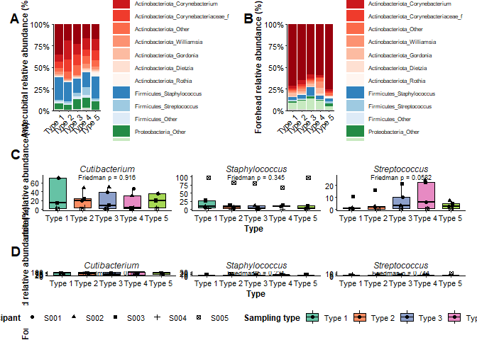<!-- -->

``` r
print(genus_composition_data)
```

```
##                                   OTU      Sample Abundance   sample_id
## 1    2c38d9d5742202da694d4721608fd637 001FhRUSw_1     30448 001FhRUSw_1
## 2    2c38d9d5742202da694d4721608fd637 001FhRUSw_2     24683 001FhRUSw_2
## 3    2c38d9d5742202da694d4721608fd637 002FhRUSw_2     23402 002FhRUSw_2
## 4    2c38d9d5742202da694d4721608fd637 001FhLUSw_3     21994 001FhLUSw_3
## 5    2c38d9d5742202da694d4721608fd637   001FhCUSw     20755   001FhCUSw
## 6    2c38d9d5742202da694d4721608fd637 002FhLUSw_4     19854 002FhLUSw_4
## 7    2c38d9d5742202da694d4721608fd637 002FhLUSw_3     19342 002FhLUSw_3
## 8    2c38d9d5742202da694d4721608fd637   002FhCUSw     18202   002FhCUSw
## 9    2c38d9d5742202da694d4721608fd637   004FhCUSw     17714   004FhCUSw
## 10   28791a195fb16e432f328fc38c217a16 005AcRUSw_1     17077 005AcRUSw_1
## 11   2c38d9d5742202da694d4721608fd637 001AcRUSw_1     16128 001AcRUSw_1
## 12   2c38d9d5742202da694d4721608fd637 002AcRUSw_1     15692 002AcRUSw_1
## 13   2c38d9d5742202da694d4721608fd637 005FhRUSw_1     15645 005FhRUSw_1
## 14   28791a195fb16e432f328fc38c217a16   005AcCUSw     15348   005AcCUSw
## 15   28791a195fb16e432f328fc38c217a16 005AcRUSw_2     14674 005AcRUSw_2
## 16   2c38d9d5742202da694d4721608fd637 001FhLUSw_4     13377 001FhLUSw_4
## 17   19045d0398e54e66ed333ad6780ae0d4 003FhLUSw_3     11966 003FhLUSw_3
## 18   2c38d9d5742202da694d4721608fd637 002FhRUSw_1     11479 002FhRUSw_1
## 19   2c38d9d5742202da694d4721608fd637 005FhLUSw_3     11391 005FhLUSw_3
## 20   2c38d9d5742202da694d4721608fd637 002AcLUSw_3     11243 002AcLUSw_3
## 21   2c38d9d5742202da694d4721608fd637 005FhLUSw_4     11038 005FhLUSw_4
## 22   b5abf1472c7313362f3234de5c1a8efa 001AcRUSw_2      9910 001AcRUSw_2
## 23   28791a195fb16e432f328fc38c217a16 005AcLUSw_3      9741 005AcLUSw_3
## 24   2c38d9d5742202da694d4721608fd637 002AcRUSw_2      9543 002AcRUSw_2
## 25   2c38d9d5742202da694d4721608fd637 001AcLUSw_4      9238 001AcLUSw_4
## 26   19045d0398e54e66ed333ad6780ae0d4 003FhRUSw_2      8945 003FhRUSw_2
## 27   2c38d9d5742202da694d4721608fd637   005FhCUSw      8716   005FhCUSw
## 28   28791a195fb16e432f328fc38c217a16 005AcLUSw_4      8393 005AcLUSw_4
## 29   19045d0398e54e66ed333ad6780ae0d4 003FhLUSw_4      8308 003FhLUSw_4
## 30   2c38d9d5742202da694d4721608fd637 005FhRUSw_2      8260 005FhRUSw_2
## 31   28791a195fb16e432f328fc38c217a16 005FhLUSw_3      7687 005FhLUSw_3
## 32   2c38d9d5742202da694d4721608fd637 001AcLUSw_3      6958 001AcLUSw_3
## 33   19045d0398e54e66ed333ad6780ae0d4 003FhRUSw_1      6606 003FhRUSw_1
## 34   2c38d9d5742202da694d4721608fd637   001AcCUSw      6182   001AcCUSw
## 35   04ae6d4e93605dc0fd87868b6069bbbf 002AcRUSw_2      6102 002AcRUSw_2
## 36   0de497e4baa9d071845afc073d10fba6 004FhLUSw_4      6033 004FhLUSw_4
## 37   13b8688bc0b096a8da1566d3bb25a9db 004FhLUSw_4      5707 004FhLUSw_4
## 38   2c38d9d5742202da694d4721608fd637 004FhLUSw_4      4905 004FhLUSw_4
## 39   b5abf1472c7313362f3234de5c1a8efa   001AcCUSw      4764   001AcCUSw
## 40   65c9fb2233a8c0d21e99ba69d13d1e6d 004AcLUSw_3      4671 004AcLUSw_3
## 41   b5abf1472c7313362f3234de5c1a8efa 001AcLUSw_4      4468 001AcLUSw_4
## 42   b5abf1472c7313362f3234de5c1a8efa 001AcLUSw_3      4298 001AcLUSw_3
## 43   04ae6d4e93605dc0fd87868b6069bbbf 002AcLUSw_3      4234 002AcLUSw_3
## 44   b5abf1472c7313362f3234de5c1a8efa 005FhLUSw_3      4046 005FhLUSw_3
## 45   28791a195fb16e432f328fc38c217a16 003AcRUSw_1      3949 003AcRUSw_1
## 46   04ae6d4e93605dc0fd87868b6069bbbf   001AcCUSw      3819   001AcCUSw
## 47   19045d0398e54e66ed333ad6780ae0d4   003FhCUSw      3792   003FhCUSw
## 48   dc4c06e76c80792a6dd6a5170e96a392 003AcLUSw_4      3744 003AcLUSw_4
## 49   2c38d9d5742202da694d4721608fd637 004FhRUSw_1      3545 004FhRUSw_1
## 50   b5abf1472c7313362f3234de5c1a8efa 005FhRUSw_2      3449 005FhRUSw_2
## 51   2c38d9d5742202da694d4721608fd637 004FhRUSw_2      3395 004FhRUSw_2
## 52   b5abf1472c7313362f3234de5c1a8efa 001AcRUSw_1      3353 001AcRUSw_1
## 53   b5abf1472c7313362f3234de5c1a8efa 004AcRUSw_2      3351 004AcRUSw_2
## 54   443fb2d16fc7d839c24c5a7a7826dec6   002AcCUSw      3251   002AcCUSw
## 55   0de497e4baa9d071845afc073d10fba6 004FhRUSw_1      3242 004FhRUSw_1
## 56   b5abf1472c7313362f3234de5c1a8efa 005AcRUSw_2      3216 005AcRUSw_2
## 57   2c38d9d5742202da694d4721608fd637 001AcRUSw_2      3194 001AcRUSw_2
## 58   f88845e22ed4975c40c05e8f527554b3 004AcLUSw_3      3066 004AcLUSw_3
## 59   04ae6d4e93605dc0fd87868b6069bbbf 001AcLUSw_3      2980 001AcLUSw_3
## 60   04ae6d4e93605dc0fd87868b6069bbbf 002AcRUSw_1      2900 002AcRUSw_1
## 61   2c38d9d5742202da694d4721608fd637   002AcCUSw      2880   002AcCUSw
## 62   0de497e4baa9d071845afc073d10fba6 004FhRUSw_2      2829 004FhRUSw_2
## 63   04ae6d4e93605dc0fd87868b6069bbbf 003AcLUSw_4      2811 003AcLUSw_4
## 64   0de497e4baa9d071845afc073d10fba6 004FhLUSw_3      2676 004FhLUSw_3
## 65   b5abf1472c7313362f3234de5c1a8efa 004AcRUSw_1      2659 004AcRUSw_1
## 66   b5abf1472c7313362f3234de5c1a8efa 005FhRUSw_1      2627 005FhRUSw_1
## 67   13b8688bc0b096a8da1566d3bb25a9db 004FhRUSw_2      2599 004FhRUSw_2
## 68   04ae6d4e93605dc0fd87868b6069bbbf 003AcRUSw_1      2447 003AcRUSw_1
## 69   28791a195fb16e432f328fc38c217a16 002AcLUSw_3      2441 002AcLUSw_3
## 70   2c38d9d5742202da694d4721608fd637   003AcCUSw      2403   003AcCUSw
## 71   515ecf421a951bc274a7daaa791dc894   004AcCUSw      2359   004AcCUSw
## 72   13b8688bc0b096a8da1566d3bb25a9db 004AcRUSw_1      2347 004AcRUSw_1
## 73   04ae6d4e93605dc0fd87868b6069bbbf   003AcCUSw      2335   003AcCUSw
## 74   dc4c06e76c80792a6dd6a5170e96a392   005FhCUSw      2331   005FhCUSw
## 75   b5abf1472c7313362f3234de5c1a8efa   004AcCUSw      2323   004AcCUSw
## 76   13b8688bc0b096a8da1566d3bb25a9db 004FhLUSw_3      2261 004FhLUSw_3
## 77   04ae6d4e93605dc0fd87868b6069bbbf 003AcLUSw_3      2230 003AcLUSw_3
## 78   2c38d9d5742202da694d4721608fd637 003AcRUSw_1      2168 003AcRUSw_1
## 79   443fb2d16fc7d839c24c5a7a7826dec6   005FhCUSw      2124   005FhCUSw
## 80   28791a195fb16e432f328fc38c217a16 003AcLUSw_4      2098 003AcLUSw_4
## 81   04ae6d4e93605dc0fd87868b6069bbbf 001AcLUSw_4      2094 001AcLUSw_4
## 82   13b8688bc0b096a8da1566d3bb25a9db 004AcLUSw_4      2070 004AcLUSw_4
## 83   28791a195fb16e432f328fc38c217a16 002AcRUSw_1      2018 002AcRUSw_1
## 84   2c38d9d5742202da694d4721608fd637 002AcLUSw_4      2018 002AcLUSw_4
## 85   b5abf1472c7313362f3234de5c1a8efa 003AcLUSw_4      1982 003AcLUSw_4
## 86   65c9fb2233a8c0d21e99ba69d13d1e6d 004AcLUSw_4      1956 004AcLUSw_4
## 87   04ae6d4e93605dc0fd87868b6069bbbf 003AcRUSw_2      1939 003AcRUSw_2
## 88   b5abf1472c7313362f3234de5c1a8efa   003AcCUSw      1931   003AcCUSw
## 89   b5abf1472c7313362f3234de5c1a8efa 004AcLUSw_3      1914 004AcLUSw_3
## 90   28791a195fb16e432f328fc38c217a16 005FhRUSw_2      1894 005FhRUSw_2
## 91   28791a195fb16e432f328fc38c217a16 001AcLUSw_4      1886 001AcLUSw_4
## 92   04ae6d4e93605dc0fd87868b6069bbbf 001AcRUSw_2      1879 001AcRUSw_2
## 93   dc4c06e76c80792a6dd6a5170e96a392 001AcLUSw_3      1830 001AcLUSw_3
## 94   b5abf1472c7313362f3234de5c1a8efa 005AcLUSw_4      1820 005AcLUSw_4
## 95   2c38d9d5742202da694d4721608fd637 004FhLUSw_3      1812 004FhLUSw_3
## 96   2c38d9d5742202da694d4721608fd637 003AcRUSw_2      1809 003AcRUSw_2
## 97   c25c933a077c8f1489487077ae49d897 005FhLUSw_3      1807 005FhLUSw_3
## 98   28791a195fb16e432f328fc38c217a16 002FhRUSw_2      1770 002FhRUSw_2
## 99   33a077fde7c403e6b08c5b967e3df0a1 004AcRUSw_2      1659 004AcRUSw_2
## 100  2c38d9d5742202da694d4721608fd637   003FhCUSw      1639   003FhCUSw
## 101  daca34875367c76ab8b8452940d60fdf 004AcLUSw_4      1634 004AcLUSw_4
## 102  13b8688bc0b096a8da1566d3bb25a9db 004FhRUSw_1      1626 004FhRUSw_1
## 103  aa57923408765fc46bc15cbeaa7491a6 004AcRUSw_1      1619 004AcRUSw_1
## 104  28791a195fb16e432f328fc38c217a16 002AcRUSw_2      1609 002AcRUSw_2
## 105  daca34875367c76ab8b8452940d60fdf 004FhLUSw_4      1598 004FhLUSw_4
## 106  5dac0955f00d983d7557e718591f0f42   003AcCUSw      1592   003AcCUSw
## 107  28791a195fb16e432f328fc38c217a16   005FhCUSw      1591   005FhCUSw
## 108  28791a195fb16e432f328fc38c217a16 005FhRUSw_1      1576 005FhRUSw_1
## 109  b5abf1472c7313362f3234de5c1a8efa 002AcLUSw_3      1575 002AcLUSw_3
## 110  dc4c06e76c80792a6dd6a5170e96a392 002AcLUSw_4      1540 002AcLUSw_4
## 111  dc4c06e76c80792a6dd6a5170e96a392 003AcRUSw_1      1520 003AcRUSw_1
## 112  0de497e4baa9d071845afc073d10fba6 004AcLUSw_4      1498 004AcLUSw_4
## 113  b5abf1472c7313362f3234de5c1a8efa 004AcLUSw_4      1461 004AcLUSw_4
## 114  873b0b68e099323e1d2ca5d17606a11d   004AcCUSw      1419   004AcCUSw
## 115  65c9fb2233a8c0d21e99ba69d13d1e6d   004AcCUSw      1415   004AcCUSw
## 116  0de497e4baa9d071845afc073d10fba6   004AcCUSw      1389   004AcCUSw
## 117  04ae6d4e93605dc0fd87868b6069bbbf 001AcRUSw_1      1380 001AcRUSw_1
## 118  13b8688bc0b096a8da1566d3bb25a9db 003AcLUSw_4      1350 003AcLUSw_4
## 119  b5abf1472c7313362f3234de5c1a8efa   004FhCUSw      1338   004FhCUSw
## 120  0de497e4baa9d071845afc073d10fba6 004AcRUSw_1      1336 004AcRUSw_1
## 121  b5abf1472c7313362f3234de5c1a8efa 005AcLUSw_3      1334 005AcLUSw_3
## 122  28791a195fb16e432f328fc38c217a16   003AcCUSw      1303   003AcCUSw
## 123  5dac0955f00d983d7557e718591f0f42   005FhCUSw      1282   005FhCUSw
## 124  dc4c06e76c80792a6dd6a5170e96a392 003AcLUSw_3      1232 003AcLUSw_3
## 125  04ae6d4e93605dc0fd87868b6069bbbf   004AcCUSw      1231   004AcCUSw
## 126  28791a195fb16e432f328fc38c217a16 001AcRUSw_1      1231 001AcRUSw_1
## 127  28791a195fb16e432f328fc38c217a16 003FhLUSw_4      1229 003FhLUSw_4
## 128  b0ce3a4407f76fe40d761ea266b304ff 004AcLUSw_4      1218 004AcLUSw_4
## 129  dc4c06e76c80792a6dd6a5170e96a392 001AcLUSw_4      1208 001AcLUSw_4
## 130  daca34875367c76ab8b8452940d60fdf 004AcRUSw_1      1201 004AcRUSw_1
## 131  dc4c06e76c80792a6dd6a5170e96a392 003AcRUSw_2      1191 003AcRUSw_2
## 132  515ecf421a951bc274a7daaa791dc894 004AcRUSw_1      1169 004AcRUSw_1
## 133  ada74c108a4de9611526f0c0c7ad4fc9   005FhCUSw      1140   005FhCUSw
## 134  04ae6d4e93605dc0fd87868b6069bbbf 001FhRUSw_2      1118 001FhRUSw_2
## 135  28791a195fb16e432f328fc38c217a16 004FhLUSw_4      1110 004FhLUSw_4
## 136  0df52bde0ac287bb20a6c5a9a66201f2 005AcLUSw_4      1065 005AcLUSw_4
## 137  515ecf421a951bc274a7daaa791dc894 004AcLUSw_4      1064 004AcLUSw_4
## 138  04ae6d4e93605dc0fd87868b6069bbbf 001FhLUSw_3      1038 001FhLUSw_3
## 139  2bec1063c452ea81ad6d1f8ea021d50d 004AcLUSw_4      1025 004AcLUSw_4
## 140  13b8688bc0b096a8da1566d3bb25a9db   004AcCUSw      1013   004AcCUSw
## 141  b5abf1472c7313362f3234de5c1a8efa 003AcRUSw_1      1011 003AcRUSw_1
## 142  0de497e4baa9d071845afc073d10fba6 004AcLUSw_3       939 004AcLUSw_3
## 143  aa57923408765fc46bc15cbeaa7491a6 004AcRUSw_2       920 004AcRUSw_2
## 144  28791a195fb16e432f328fc38c217a16 003AcRUSw_2       915 003AcRUSw_2
## 145  73664aa4932bcfe5379274e489d0bf1c   004AcCUSw       910   004AcCUSw
## 146  04ae6d4e93605dc0fd87868b6069bbbf 004AcRUSw_2       882 004AcRUSw_2
## 147  2bec1063c452ea81ad6d1f8ea021d50d 004FhLUSw_4       854 004FhLUSw_4
## 148  13b8688bc0b096a8da1566d3bb25a9db 004AcRUSw_2       853 004AcRUSw_2
## 149  daca34875367c76ab8b8452940d60fdf 004FhLUSw_3       848 004FhLUSw_3
## 150  f3c298b72522fa8756d13ae50332f012 003AcRUSw_1       828 003AcRUSw_1
## 151  04ae6d4e93605dc0fd87868b6069bbbf   005FhCUSw       808   005FhCUSw
## 152  515ecf421a951bc274a7daaa791dc894 004AcLUSw_3       768 004AcLUSw_3
## 153  daca34875367c76ab8b8452940d60fdf 004AcRUSw_2       765 004AcRUSw_2
## 154  28791a195fb16e432f328fc38c217a16 001FhLUSw_4       757 001FhLUSw_4
## 155  97402210ae7735706d9a9a42b71b8fda 004AcLUSw_3       755 004AcLUSw_3
## 156  28791a195fb16e432f328fc38c217a16 001FhLUSw_3       752 001FhLUSw_3
## 157  72558b780028629aa73abc3c75849338 002AcLUSw_3       741 002AcLUSw_3
## 158  73664aa4932bcfe5379274e489d0bf1c 004AcLUSw_3       739 004AcLUSw_3
## 159  2c38d9d5742202da694d4721608fd637 004AcRUSw_2       729 004AcRUSw_2
## 160  28791a195fb16e432f328fc38c217a16 001AcLUSw_3       728 001AcLUSw_3
## 161  5dac0955f00d983d7557e718591f0f42 003AcLUSw_4       727 003AcLUSw_4
## 162  ada74c108a4de9611526f0c0c7ad4fc9 003AcLUSw_4       710 003AcLUSw_4
## 163  daca34875367c76ab8b8452940d60fdf   004AcCUSw       708   004AcCUSw
## 164  28791a195fb16e432f328fc38c217a16 004AcRUSw_1       704 004AcRUSw_1
## 165  f88845e22ed4975c40c05e8f527554b3 004AcRUSw_2       694 004AcRUSw_2
## 166  2bec1063c452ea81ad6d1f8ea021d50d   004AcCUSw       687   004AcCUSw
## 167  2bec1063c452ea81ad6d1f8ea021d50d 004AcLUSw_3       675 004AcLUSw_3
## 168  4748e8a42d43b5abde091a50264f9a92   004AcCUSw       674   004AcCUSw
## 169  13b8688bc0b096a8da1566d3bb25a9db   003AcCUSw       670   003AcCUSw
## 170  1b5f84de8f1ac02d81de16f9b8ae2d0e 004AcLUSw_4       650 004AcLUSw_4
## 171  28791a195fb16e432f328fc38c217a16 002AcLUSw_4       646 002AcLUSw_4
## 172  0df52bde0ac287bb20a6c5a9a66201f2 002AcLUSw_3       643 002AcLUSw_3
## 173  443fb2d16fc7d839c24c5a7a7826dec6 003AcLUSw_4       634 003AcLUSw_4
## 174  f889bb2bb25f73012084bb11ae950a17 004AcRUSw_2       628 004AcRUSw_2
## 175  dc4c06e76c80792a6dd6a5170e96a392 002AcLUSw_3       619 002AcLUSw_3
## 176  0df52bde0ac287bb20a6c5a9a66201f2   005FhCUSw       613   005FhCUSw
## 177  2c38d9d5742202da694d4721608fd637 003AcLUSw_4       604 003AcLUSw_4
## 178  515ecf421a951bc274a7daaa791dc894   001AcCUSw       603   001AcCUSw
## 179  daca34875367c76ab8b8452940d60fdf 004AcLUSw_3       602 004AcLUSw_3
## 180  72558b780028629aa73abc3c75849338 003AcRUSw_1       601 003AcRUSw_1
## 181  33a077fde7c403e6b08c5b967e3df0a1 004AcLUSw_3       597 004AcLUSw_3
## 182  28791a195fb16e432f328fc38c217a16   004AcCUSw       596   004AcCUSw
## 183  b5abf1472c7313362f3234de5c1a8efa 004FhLUSw_4       593 004FhLUSw_4
## 184  04ae6d4e93605dc0fd87868b6069bbbf   002AcCUSw       592   002AcCUSw
## 185  dc4c06e76c80792a6dd6a5170e96a392 004FhRUSw_1       591 004FhRUSw_1
## 186  04ae6d4e93605dc0fd87868b6069bbbf 001FhLUSw_4       587 001FhLUSw_4
## 187  04ae6d4e93605dc0fd87868b6069bbbf 002FhRUSw_2       573 002FhRUSw_2
## 188  47197ee817bb57421f861e8b877e0588 002AcLUSw_4       572 002AcLUSw_4
## 189  04ae6d4e93605dc0fd87868b6069bbbf 004AcRUSw_1       571 004AcRUSw_1
## 190  2bec1063c452ea81ad6d1f8ea021d50d 004AcRUSw_2       571 004AcRUSw_2
## 191  b5abf1472c7313362f3234de5c1a8efa 003AcRUSw_2       569 003AcRUSw_2
## 192  1b5f84de8f1ac02d81de16f9b8ae2d0e 004AcRUSw_1       568 004AcRUSw_1
## 193  28791a195fb16e432f328fc38c217a16   001AcCUSw       567   001AcCUSw
## 194  daca34875367c76ab8b8452940d60fdf 004FhRUSw_2       563 004FhRUSw_2
## 195  73664aa4932bcfe5379274e489d0bf1c 004AcLUSw_4       562 004AcLUSw_4
## 196  85c44a334114a5e2ca8dbe7d74e191d7 004AcLUSw_3       561 004AcLUSw_3
## 197  dc4c06e76c80792a6dd6a5170e96a392   002AcCUSw       561   002AcCUSw
## 198  2c38d9d5742202da694d4721608fd637   004AcCUSw       553   004AcCUSw
## 199  13b8688bc0b096a8da1566d3bb25a9db 003AcRUSw_1       551 003AcRUSw_1
## 200  a1d949f27725f089c27c233027c5f692 004FhLUSw_4       550 004FhLUSw_4
## 201  dc4c06e76c80792a6dd6a5170e96a392   003AcCUSw       548   003AcCUSw
## 202  28791a195fb16e432f328fc38c217a16 001FhRUSw_1       540 001FhRUSw_1
## 203  72558b780028629aa73abc3c75849338 003AcLUSw_4       538 003AcLUSw_4
## 204  2c38d9d5742202da694d4721608fd637 003AcLUSw_3       537 003AcLUSw_3
## 205  0df52bde0ac287bb20a6c5a9a66201f2 002AcRUSw_2       528 002AcRUSw_2
## 206  2c38d9d5742202da694d4721608fd637 003FhLUSw_4       528 003FhLUSw_4
## 207  daca34875367c76ab8b8452940d60fdf 004FhRUSw_1       517 004FhRUSw_1
## 208  28791a195fb16e432f328fc38c217a16 004FhLUSw_3       508 004FhLUSw_3
## 209  dc4c06e76c80792a6dd6a5170e96a392 002AcRUSw_2       508 002AcRUSw_2
## 210  0de497e4baa9d071845afc073d10fba6 004AcRUSw_2       496 004AcRUSw_2
## 211  2c38d9d5742202da694d4721608fd637 003FhRUSw_1       493 003FhRUSw_1
## 212  c123804c63e25b6390ad734e64c31e6c 004AcRUSw_1       493 004AcRUSw_1
## 213  b5abf1472c7313362f3234de5c1a8efa 003AcLUSw_3       488 003AcLUSw_3
## 214  0df52bde0ac287bb20a6c5a9a66201f2 001AcLUSw_3       486 001AcLUSw_3
## 215  a8ebe6695f3741b63f135708fa4c894d 004AcLUSw_4       486 004AcLUSw_4
## 216  28791a195fb16e432f328fc38c217a16 001FhRUSw_2       484 001FhRUSw_2
## 217  2bec1063c452ea81ad6d1f8ea021d50d 004FhRUSw_2       480 004FhRUSw_2
## 218  b5abf1472c7313362f3234de5c1a8efa   005FhCUSw       479   005FhCUSw
## 219  041a808460c3e20eb708113a5ae6533d 004AcRUSw_1       478 004AcRUSw_1
## 220  b5abf1472c7313362f3234de5c1a8efa 004FhRUSw_2       466 004FhRUSw_2
## 221  daca34875367c76ab8b8452940d60fdf   004FhCUSw       460   004FhCUSw
## 222  cec2b7d32bc35658a948ffb4c0357677 004AcLUSw_3       459 004AcLUSw_3
## 223  04ae6d4e93605dc0fd87868b6069bbbf 004AcLUSw_4       454 004AcLUSw_4
## 224  303f5cdac869c2dc02db6ebe1323e12a 004FhRUSw_2       454 004FhRUSw_2
## 225  04ae6d4e93605dc0fd87868b6069bbbf 001FhRUSw_1       453 001FhRUSw_1
## 226  515ecf421a951bc274a7daaa791dc894 004FhRUSw_1       448 004FhRUSw_1
## 227  856925f916eba95f669698c572f88d93 001AcRUSw_1       446 001AcRUSw_1
## 228  28791a195fb16e432f328fc38c217a16 002FhRUSw_1       443 002FhRUSw_1
## 229  2c87af46c878a9884a0e448e106cfe42 004FhRUSw_1       442 004FhRUSw_1
## 230  78f43f7e335424a99400a11453add8ab 003AcRUSw_2       437 003AcRUSw_2
## 231  2c38d9d5742202da694d4721608fd637 004AcLUSw_4       433 004AcLUSw_4
## 232  dc4c06e76c80792a6dd6a5170e96a392   001AcCUSw       433   001AcCUSw
## 233  97402210ae7735706d9a9a42b71b8fda 004AcRUSw_2       429 004AcRUSw_2
## 234  b5abf1472c7313362f3234de5c1a8efa 002AcRUSw_2       429 002AcRUSw_2
## 235  65c9fb2233a8c0d21e99ba69d13d1e6d 004AcRUSw_2       418 004AcRUSw_2
## 236  b5abf1472c7313362f3234de5c1a8efa 003FhLUSw_4       408 003FhLUSw_4
## 237  04ae6d4e93605dc0fd87868b6069bbbf 004AcLUSw_3       403 004AcLUSw_3
## 238  13b8688bc0b096a8da1566d3bb25a9db 004AcLUSw_3       403 004AcLUSw_3
## 239  303f5cdac869c2dc02db6ebe1323e12a 004FhLUSw_4       403 004FhLUSw_4
## 240  85c44a334114a5e2ca8dbe7d74e191d7 004AcLUSw_4       402 004AcLUSw_4
## 241  443fb2d16fc7d839c24c5a7a7826dec6 003AcRUSw_1       401 003AcRUSw_1
## 242  a1d949f27725f089c27c233027c5f692 004FhRUSw_2       399 004FhRUSw_2
## 243  28791a195fb16e432f328fc38c217a16 001AcRUSw_2       398 001AcRUSw_2
## 244  8c78f224069832cd7fd7e9efcf616ab9 004AcRUSw_2       390 004AcRUSw_2
## 245  b5abf1472c7313362f3234de5c1a8efa 002AcRUSw_1       388 002AcRUSw_1
## 246  5dac0955f00d983d7557e718591f0f42 004AcLUSw_3       387 004AcLUSw_3
## 247  33a077fde7c403e6b08c5b967e3df0a1 004AcRUSw_1       384 004AcRUSw_1
## 248  2c38d9d5742202da694d4721608fd637 005AcLUSw_4       383 005AcLUSw_4
## 249  2c38d9d5742202da694d4721608fd637 004AcRUSw_1       381 004AcRUSw_1
## 250  b5abf1472c7313362f3234de5c1a8efa 001FhRUSw_2       380 001FhRUSw_2
## 251  33a077fde7c403e6b08c5b967e3df0a1 004FhLUSw_4       366 004FhLUSw_4
## 252  a8ebe6695f3741b63f135708fa4c894d 004AcRUSw_2       365 004AcRUSw_2
## 253  28791a195fb16e432f328fc38c217a16   004FhCUSw       360   004FhCUSw
## 254  04ae6d4e93605dc0fd87868b6069bbbf 002AcLUSw_4       357 002AcLUSw_4
## 255  873b0b68e099323e1d2ca5d17606a11d 004AcLUSw_3       357 004AcLUSw_3
## 256  b7b3626747fe84c91b5f419eea29bbdf 004AcLUSw_3       357 004AcLUSw_3
## 257  515ecf421a951bc274a7daaa791dc894 004FhRUSw_2       356 004FhRUSw_2
## 258  2bec1063c452ea81ad6d1f8ea021d50d 004FhRUSw_1       354 004FhRUSw_1
## 259  dc4c06e76c80792a6dd6a5170e96a392 005FhRUSw_1       353 005FhRUSw_1
## 260  04ae6d4e93605dc0fd87868b6069bbbf 004FhLUSw_4       352 004FhLUSw_4
## 261  0de497e4baa9d071845afc073d10fba6   004FhCUSw       352   004FhCUSw
## 262  b5abf1472c7313362f3234de5c1a8efa 005AcRUSw_1       352 005AcRUSw_1
## 263  b5abf1472c7313362f3234de5c1a8efa 005FhLUSw_4       351 005FhLUSw_4
## 264  0df52bde0ac287bb20a6c5a9a66201f2 005FhRUSw_1       346 005FhRUSw_1
## 265  2bec1063c452ea81ad6d1f8ea021d50d   004FhCUSw       338   004FhCUSw
## 266  d8a7df9e8bf0ac6efceee3f0424a5090 004AcLUSw_4       338 004AcLUSw_4
## 267  28791a195fb16e432f328fc38c217a16 003FhLUSw_3       334 003FhLUSw_3
## 268  b5abf1472c7313362f3234de5c1a8efa 004FhLUSw_3       331 004FhLUSw_3
## 269  b0ce3a4407f76fe40d761ea266b304ff 004AcRUSw_1       326 004AcRUSw_1
## 270  72558b780028629aa73abc3c75849338 002AcLUSw_4       323 002AcLUSw_4
## 271  0df52bde0ac287bb20a6c5a9a66201f2 001AcRUSw_2       320 001AcRUSw_2
## 272  30e001262d5e22bc9879c1a6b14058cc 004AcLUSw_3       320 004AcLUSw_3
## 273  0df52bde0ac287bb20a6c5a9a66201f2 005FhRUSw_2       317 005FhRUSw_2
## 274  2bec1063c452ea81ad6d1f8ea021d50d 004AcRUSw_1       314 004AcRUSw_1
## 275  72558b780028629aa73abc3c75849338 003AcLUSw_3       314 003AcLUSw_3
## 276  65c9fb2233a8c0d21e99ba69d13d1e6d 004AcRUSw_1       309 004AcRUSw_1
## 277  f88845e22ed4975c40c05e8f527554b3 004AcLUSw_4       309 004AcLUSw_4
## 278  b0ce3a4407f76fe40d761ea266b304ff 004AcRUSw_2       307 004AcRUSw_2
## 279  f5f63b20073a5689ec99521de809cfa9   004AcCUSw       305   004AcCUSw
## 280  a8ebe6695f3741b63f135708fa4c894d 004AcRUSw_1       302 004AcRUSw_1
## 281  b5abf1472c7313362f3234de5c1a8efa 001FhLUSw_3       300 001FhLUSw_3
## 282  cb87c4f867a6bf086284e61be0ec2f63 004AcRUSw_1       300 004AcRUSw_1
## 283  2bec1063c452ea81ad6d1f8ea021d50d 004FhLUSw_3       297 004FhLUSw_3
## 284  f3c298b72522fa8756d13ae50332f012 005AcLUSw_4       292 005AcLUSw_4
## 285  443fb2d16fc7d839c24c5a7a7826dec6 002AcRUSw_2       291 002AcRUSw_2
## 286  b76595ac6cd24bb842f1374a9733e373 004FhLUSw_4       290 004FhLUSw_4
## 287  c123804c63e25b6390ad734e64c31e6c 004AcLUSw_4       287 004AcLUSw_4
## 288  04ae6d4e93605dc0fd87868b6069bbbf   004FhCUSw       284   004FhCUSw
## 289  dc4c06e76c80792a6dd6a5170e96a392 005FhRUSw_2       283 005FhRUSw_2
## 290  6cba61242453f471b9c15fdcb5026986 004AcRUSw_1       278 004AcRUSw_1
## 291  a1d949f27725f089c27c233027c5f692 004FhLUSw_3       277 004FhLUSw_3
## 292  72558b780028629aa73abc3c75849338 004AcRUSw_1       275 004AcRUSw_1
## 293  4748e8a42d43b5abde091a50264f9a92 004AcLUSw_3       271 004AcLUSw_3
## 294  f3c298b72522fa8756d13ae50332f012 003AcLUSw_4       271 003AcLUSw_4
## 295  b7b3626747fe84c91b5f419eea29bbdf 004FhRUSw_2       267 004FhRUSw_2
## 296  04ae6d4e93605dc0fd87868b6069bbbf 004FhRUSw_2       266 004FhRUSw_2
## 297  84739218645d09374bcecea50306c590   003AcCUSw       266   003AcCUSw
## 298  443fb2d16fc7d839c24c5a7a7826dec6 002AcLUSw_3       265 002AcLUSw_3
## 299  dc4c06e76c80792a6dd6a5170e96a392 001AcRUSw_2       264 001AcRUSw_2
## 300  28791a195fb16e432f328fc38c217a16 003FhRUSw_1       263 003FhRUSw_1
## 301  cec2b7d32bc35658a948ffb4c0357677 004AcLUSw_4       263 004AcLUSw_4
## 302  303f5cdac869c2dc02db6ebe1323e12a 004FhRUSw_1       262 004FhRUSw_1
## 303  443fb2d16fc7d839c24c5a7a7826dec6   003AcCUSw       258   003AcCUSw
## 304  a1d949f27725f089c27c233027c5f692   004AcCUSw       257   004AcCUSw
## 305  dc4c06e76c80792a6dd6a5170e96a392 004FhLUSw_4       257 004FhLUSw_4
## 306  4748e8a42d43b5abde091a50264f9a92 004AcLUSw_4       254 004AcLUSw_4
## 307  28791a195fb16e432f328fc38c217a16 004AcRUSw_2       252 004AcRUSw_2
## 308  04ae6d4e93605dc0fd87868b6069bbbf 004FhLUSw_3       250 004FhLUSw_3
## 309  0df52bde0ac287bb20a6c5a9a66201f2 005AcLUSw_3       250 005AcLUSw_3
## 310  28791a195fb16e432f328fc38c217a16 004FhRUSw_2       250 004FhRUSw_2
## 311  8c78f224069832cd7fd7e9efcf616ab9 004AcLUSw_4       250 004AcLUSw_4
## 312  01cef7193e22002921dd48ed9ba9882b 004AcLUSw_4       249 004AcLUSw_4
## 313  5325c97ed1a497a5a586815b59aed735 003AcLUSw_4       246 003AcLUSw_4
## 314  5dac0955f00d983d7557e718591f0f42 004AcRUSw_2       246 004AcRUSw_2
## 315  f889bb2bb25f73012084bb11ae950a17 004AcLUSw_3       245 004AcLUSw_3
## 316  dc4c06e76c80792a6dd6a5170e96a392 002AcRUSw_1       243 002AcRUSw_1
## 317  01cef7193e22002921dd48ed9ba9882b 004FhLUSw_4       241 004FhLUSw_4
## 318  13b8688bc0b096a8da1566d3bb25a9db   001AcCUSw       240   001AcCUSw
## 319  806198a51c28a0e3cbb56fd6251ea18e 003AcRUSw_2       239 003AcRUSw_2
## 320  c123804c63e25b6390ad734e64c31e6c 004AcLUSw_3       234 004AcLUSw_3
## 321  0df52bde0ac287bb20a6c5a9a66201f2 001FhRUSw_2       233 001FhRUSw_2
## 322  04ae6d4e93605dc0fd87868b6069bbbf 005FhLUSw_3       230 005FhLUSw_3
## 323  f3c298b72522fa8756d13ae50332f012 003AcLUSw_3       229 003AcLUSw_3
## 324  d8a7df9e8bf0ac6efceee3f0424a5090 004AcRUSw_1       228 004AcRUSw_1
## 325  04ae6d4e93605dc0fd87868b6069bbbf 005FhRUSw_1       227 005FhRUSw_1
## 326  f88845e22ed4975c40c05e8f527554b3 004AcRUSw_1       226 004AcRUSw_1
## 327  fa5d10d0f5b3457021cf635a8268b986 004AcRUSw_1       221 004AcRUSw_1
## 328  a1d949f27725f089c27c233027c5f692 004AcLUSw_3       211 004AcLUSw_3
## 329  b5abf1472c7313362f3234de5c1a8efa 004FhRUSw_1       207 004FhRUSw_1
## 330  daca34875367c76ab8b8452940d60fdf 005FhRUSw_2       207 005FhRUSw_2
## 331  8c78f224069832cd7fd7e9efcf616ab9 004FhLUSw_4       206 004FhLUSw_4
## 332  97402210ae7735706d9a9a42b71b8fda 004AcRUSw_1       206 004AcRUSw_1
## 333  e7a499f9a323eb7371e4433ae24c2ba5 005AcLUSw_3       205 005AcLUSw_3
## 334  6e52e1651130d2a07800abe723ea721e 003AcLUSw_4       204 003AcLUSw_4
## 335  303f5cdac869c2dc02db6ebe1323e12a 004AcLUSw_4       199 004AcLUSw_4
## 336  a1d949f27725f089c27c233027c5f692 004FhRUSw_1       199 004FhRUSw_1
## 337  33a077fde7c403e6b08c5b967e3df0a1 004AcLUSw_4       198 004AcLUSw_4
## 338  0df52bde0ac287bb20a6c5a9a66201f2 004FhLUSw_4       197 004FhLUSw_4
## 339  0df52bde0ac287bb20a6c5a9a66201f2 002AcRUSw_1       195 002AcRUSw_1
## 340  13b8688bc0b096a8da1566d3bb25a9db   004FhCUSw       193   004FhCUSw
## 341  515ecf421a951bc274a7daaa791dc894 004AcRUSw_2       192 004AcRUSw_2
## 342  0df52bde0ac287bb20a6c5a9a66201f2 001AcLUSw_4       191 001AcLUSw_4
## 343  13b8688bc0b096a8da1566d3bb25a9db 001AcLUSw_3       189 001AcLUSw_3
## 344  2c38d9d5742202da694d4721608fd637 005AcLUSw_3       189 005AcLUSw_3
## 345  2babd2316a955b8126c1d574928eded1 004AcLUSw_3       188 004AcLUSw_3
## 346  72558b780028629aa73abc3c75849338 004AcRUSw_2       188 004AcRUSw_2
## 347  28791a195fb16e432f328fc38c217a16   002AcCUSw       187   002AcCUSw
## 348  443fb2d16fc7d839c24c5a7a7826dec6 003AcLUSw_3       187 003AcLUSw_3
## 349  d8a7df9e8bf0ac6efceee3f0424a5090 004AcRUSw_2       186 004AcRUSw_2
## 350  04ae6d4e93605dc0fd87868b6069bbbf 005FhRUSw_2       185 005FhRUSw_2
## 351  0df52bde0ac287bb20a6c5a9a66201f2   001AcCUSw       184   001AcCUSw
## 352  04ae6d4e93605dc0fd87868b6069bbbf 002FhRUSw_1       182 002FhRUSw_1
## 353  45e3f3f280507375f3d96c07e56be4c3 002AcLUSw_4       182 002AcLUSw_4
## 354  f5f63b20073a5689ec99521de809cfa9 004AcLUSw_3       182 004AcLUSw_3
## 355  b7b3626747fe84c91b5f419eea29bbdf 004AcLUSw_4       180 004AcLUSw_4
## 356  515ecf421a951bc274a7daaa791dc894 004FhLUSw_4       179 004FhLUSw_4
## 357  0df52bde0ac287bb20a6c5a9a66201f2 001FhLUSw_3       176 001FhLUSw_3
## 358  28791a195fb16e432f328fc38c217a16   001FhCUSw       176   001FhCUSw
## 359  28791a195fb16e432f328fc38c217a16 003AcLUSw_3       175 003AcLUSw_3
## 360  72558b780028629aa73abc3c75849338 003AcRUSw_2       175 003AcRUSw_2
## 361  b0ce3a4407f76fe40d761ea266b304ff 004AcLUSw_3       175 004AcLUSw_3
## 362  5dac0955f00d983d7557e718591f0f42 003AcRUSw_1       172 003AcRUSw_1
## 363  443fb2d16fc7d839c24c5a7a7826dec6 001AcLUSw_4       171 001AcLUSw_4
## 364  73664aa4932bcfe5379274e489d0bf1c 004AcRUSw_2       171 004AcRUSw_2
## 365  85c44a334114a5e2ca8dbe7d74e191d7 004AcRUSw_1       171 004AcRUSw_1
## 366  13b8688bc0b096a8da1566d3bb25a9db 003AcLUSw_3       169 003AcLUSw_3
## 367  443fb2d16fc7d839c24c5a7a7826dec6 002AcLUSw_4       168 002AcLUSw_4
## 368  443fb2d16fc7d839c24c5a7a7826dec6 002AcRUSw_1       167 002AcRUSw_1
## 369  443fb2d16fc7d839c24c5a7a7826dec6 001AcLUSw_3       167 001AcLUSw_3
## 370  515ecf421a951bc274a7daaa791dc894   005FhCUSw       165   005FhCUSw
## 371  a1d949f27725f089c27c233027c5f692 004AcLUSw_4       165 004AcLUSw_4
## 372  a354591ad123e5f645c3694abf4089f4 004AcLUSw_3       164 004AcLUSw_3
## 373  fa5d10d0f5b3457021cf635a8268b986 004AcLUSw_3       164 004AcLUSw_3
## 374  0df52bde0ac287bb20a6c5a9a66201f2 001FhLUSw_4       163 001FhLUSw_4
## 375  85c44a334114a5e2ca8dbe7d74e191d7 004FhLUSw_4       163 004FhLUSw_4
## 376  28791a195fb16e432f328fc38c217a16 004AcLUSw_4       161 004AcLUSw_4
## 377  303f5cdac869c2dc02db6ebe1323e12a 004AcRUSw_2       161 004AcRUSw_2
## 378  13b8688bc0b096a8da1566d3bb25a9db   003FhCUSw       160   003FhCUSw
## 379  04ae6d4e93605dc0fd87868b6069bbbf   003FhCUSw       159   003FhCUSw
## 380  303f5cdac869c2dc02db6ebe1323e12a 004AcRUSw_1       159 004AcRUSw_1
## 381  28791a195fb16e432f328fc38c217a16 004AcLUSw_3       158 004AcLUSw_3
## 382  5325c97ed1a497a5a586815b59aed735 004AcLUSw_4       158 004AcLUSw_4
## 383  e7a499f9a323eb7371e4433ae24c2ba5 005AcLUSw_4       158 005AcLUSw_4
## 384  856925f916eba95f669698c572f88d93   001AcCUSw       157   001AcCUSw
## 385  13b8688bc0b096a8da1566d3bb25a9db 003AcRUSw_2       155 003AcRUSw_2
## 386  1b5f84de8f1ac02d81de16f9b8ae2d0e 004AcLUSw_3       155 004AcLUSw_3
## 387  5325c97ed1a497a5a586815b59aed735 004AcRUSw_1       155 004AcRUSw_1
## 388  da9d2bcf5ad7eb890398dee9beaf9949 004AcRUSw_2       153 004AcRUSw_2
## 389  5325c97ed1a497a5a586815b59aed735 004AcRUSw_2       152 004AcRUSw_2
## 390  2c38d9d5742202da694d4721608fd637 004AcLUSw_3       151 004AcLUSw_3
## 391  b5abf1472c7313362f3234de5c1a8efa 001FhLUSw_4       149 001FhLUSw_4
## 392  04ae6d4e93605dc0fd87868b6069bbbf   001FhCUSw       147   001FhCUSw
## 393  33a077fde7c403e6b08c5b967e3df0a1 004FhRUSw_2       147 004FhRUSw_2
## 394  04ae6d4e93605dc0fd87868b6069bbbf 002FhLUSw_3       145 002FhLUSw_3
## 395  28791a195fb16e432f328fc38c217a16 002FhLUSw_3       144 002FhLUSw_3
## 396  0df52bde0ac287bb20a6c5a9a66201f2 005FhLUSw_3       143 005FhLUSw_3
## 397  d28702f527ca84119434a5d089dea094 004FhRUSw_1       143 004FhRUSw_1
## 398  d8a7df9e8bf0ac6efceee3f0424a5090 004AcLUSw_3       141 004AcLUSw_3
## 399  72558b780028629aa73abc3c75849338 004AcLUSw_3       140 004AcLUSw_3
## 400  6e52e1651130d2a07800abe723ea721e 004AcRUSw_2       139 004AcRUSw_2
## 401  b5abf1472c7313362f3234de5c1a8efa 001FhRUSw_1       139 001FhRUSw_1
## 402  01cef7193e22002921dd48ed9ba9882b 004AcLUSw_3       137 004AcLUSw_3
## 403  74aa557dd13c317520912ce37b152b31 004AcRUSw_1       136 004AcRUSw_1
## 404  fa5d10d0f5b3457021cf635a8268b986 004AcRUSw_2       136 004AcRUSw_2
## 405  6cba61242453f471b9c15fdcb5026986 004AcLUSw_4       134 004AcLUSw_4
## 406  f889bb2bb25f73012084bb11ae950a17 004AcLUSw_4       134 004AcLUSw_4
## 407  ada74c108a4de9611526f0c0c7ad4fc9 002AcRUSw_1       133 002AcRUSw_1
## 408  dc4c06e76c80792a6dd6a5170e96a392 001AcRUSw_1       132 001AcRUSw_1
## 409  856925f916eba95f669698c572f88d93 001FhLUSw_3       130 001FhLUSw_3
## 410  2c38d9d5742202da694d4721608fd637 005AcRUSw_1       129 005AcRUSw_1
## 411  72558b780028629aa73abc3c75849338 004AcLUSw_4       128 004AcLUSw_4
## 412  04ae6d4e93605dc0fd87868b6069bbbf 004FhRUSw_1       127 004FhRUSw_1
## 413  28791a195fb16e432f328fc38c217a16 005FhLUSw_4       126 005FhLUSw_4
## 414  b5abf1472c7313362f3234de5c1a8efa   002AcCUSw       126   002AcCUSw
## 415  5dac0955f00d983d7557e718591f0f42 004AcLUSw_4       125 004AcLUSw_4
## 416  6e52e1651130d2a07800abe723ea721e   003AcCUSw       125   003AcCUSw
## 417  5dac0955f00d983d7557e718591f0f42   003FhCUSw       124   003FhCUSw
## 418  72558b780028629aa73abc3c75849338 002AcRUSw_2       123 002AcRUSw_2
## 419  04ae6d4e93605dc0fd87868b6069bbbf   005AcCUSw       119   005AcCUSw
## 420  46ec4ed0a75b0fcf231f1e4ff262fa8d 002AcLUSw_3       119 002AcLUSw_3
## 421  01cef7193e22002921dd48ed9ba9882b 004FhRUSw_2       116 004FhRUSw_2
## 422  ada74c108a4de9611526f0c0c7ad4fc9 003AcLUSw_3       116 003AcLUSw_3
## 423  0df52bde0ac287bb20a6c5a9a66201f2 001AcRUSw_1       115 001AcRUSw_1
## 424  2c38d9d5742202da694d4721608fd637   005AcCUSw       115   005AcCUSw
## 425  926726e3e0db3f70863c3e8a1f495968 004AcLUSw_4       115 004AcLUSw_4
## 426  515ecf421a951bc274a7daaa791dc894 003AcLUSw_3       113 003AcLUSw_3
## 427  873b0b68e099323e1d2ca5d17606a11d 004AcLUSw_4       113 004AcLUSw_4
## 428  74aa557dd13c317520912ce37b152b31 004AcLUSw_4       112 004AcLUSw_4
## 429  ada74c108a4de9611526f0c0c7ad4fc9 003AcRUSw_1       112 003AcRUSw_1
## 430  72558b780028629aa73abc3c75849338 005FhLUSw_3       111 005FhLUSw_3
## 431  f889bb2bb25f73012084bb11ae950a17 004AcRUSw_1       111 004AcRUSw_1
## 432  13b8688bc0b096a8da1566d3bb25a9db 001AcRUSw_2       110 001AcRUSw_2
## 433  b5abf1472c7313362f3234de5c1a8efa   003FhCUSw       110   003FhCUSw
## 434  303f5cdac869c2dc02db6ebe1323e12a 004FhLUSw_3       109 004FhLUSw_3
## 435  dc4c06e76c80792a6dd6a5170e96a392 005FhLUSw_3       109 005FhLUSw_3
## 436  0df52bde0ac287bb20a6c5a9a66201f2 004FhRUSw_2       108 004FhRUSw_2
## 437  28791a195fb16e432f328fc38c217a16 002FhLUSw_4       108 002FhLUSw_4
## 438  fd06b5bd8feab452ba90c4c2eb3729ac 004AcLUSw_4       108 004AcLUSw_4
## 439  13b8688bc0b096a8da1566d3bb25a9db 001AcLUSw_4       107 001AcLUSw_4
## 440  1b5f84de8f1ac02d81de16f9b8ae2d0e   005FhCUSw       106   005FhCUSw
## 441  4ceaf0eaf760e1d547cc7b69a0caf8af 005FhRUSw_2       106 005FhRUSw_2
## 442  b5abf1472c7313362f3234de5c1a8efa   005AcCUSw       105   005AcCUSw
## 443  515ecf421a951bc274a7daaa791dc894 004FhLUSw_3       104 004FhLUSw_3
## 444  5bd3af0138e11ba03030ffee3ff0d14d 004FhLUSw_4       104 004FhLUSw_4
## 445  ada74c108a4de9611526f0c0c7ad4fc9 002AcRUSw_2       104 002AcRUSw_2
## 446  3444f19e0cb194dfbd485cc396c59f71   002AcCUSw       103   002AcCUSw
## 447  75867d7a16d9647ce25057cc21524cd3   005FhCUSw       103   005FhCUSw
## 448  ada74c108a4de9611526f0c0c7ad4fc9   003AcCUSw       103   003AcCUSw
## 449  19045d0398e54e66ed333ad6780ae0d4 003AcRUSw_1       102 003AcRUSw_1
## 450  30e001262d5e22bc9879c1a6b14058cc 004AcLUSw_4       102 004AcLUSw_4
## 451  72558b780028629aa73abc3c75849338 004FhLUSw_4       102 004FhLUSw_4
## 452  75867d7a16d9647ce25057cc21524cd3 004AcLUSw_4       102 004AcLUSw_4
## 453  81e7661c8ebb6e0fc435211e9aa6a47c 002AcRUSw_2       102 002AcRUSw_2
## 454  abd0febc117d23cd49b9d4ef431153bc   005FhCUSw       102   005FhCUSw
## 455  f3c298b72522fa8756d13ae50332f012 005FhLUSw_3       101 005FhLUSw_3
## 456  f88845e22ed4975c40c05e8f527554b3 004FhRUSw_2       101 004FhRUSw_2
## 457  2235fb3906484370e48c37388c4cd746 005FhLUSw_3       100 005FhLUSw_3
## 458  4748e8a42d43b5abde091a50264f9a92 004AcRUSw_1       100 004AcRUSw_1
## 459  73664aa4932bcfe5379274e489d0bf1c 004AcRUSw_1       100 004AcRUSw_1
## 460  da9d2bcf5ad7eb890398dee9beaf9949 004AcLUSw_4        99 004AcLUSw_4
## 461  81e7661c8ebb6e0fc435211e9aa6a47c   005FhCUSw        98   005FhCUSw
## 462  f3c298b72522fa8756d13ae50332f012 002AcLUSw_3        98 002AcLUSw_3
## 463  04ae6d4e93605dc0fd87868b6069bbbf 002FhLUSw_4        96 002FhLUSw_4
## 464  5dac0955f00d983d7557e718591f0f42 003AcRUSw_2        96 003AcRUSw_2
## 465  74aa557dd13c317520912ce37b152b31 004FhLUSw_4        96 004FhLUSw_4
## 466  85c44a334114a5e2ca8dbe7d74e191d7 004FhLUSw_3        96 004FhLUSw_3
## 467  ada74c108a4de9611526f0c0c7ad4fc9   001AcCUSw        96   001AcCUSw
## 468  04ae6d4e93605dc0fd87868b6069bbbf 005AcLUSw_3        94 005AcLUSw_3
## 469  4ceaf0eaf760e1d547cc7b69a0caf8af   005FhCUSw        94   005FhCUSw
## 470  dc4c06e76c80792a6dd6a5170e96a392 005AcRUSw_1        94 005AcRUSw_1
## 471  f88845e22ed4975c40c05e8f527554b3 004FhLUSw_4        94 004FhLUSw_4
## 472  2c38d9d5742202da694d4721608fd637 005AcRUSw_2        93 005AcRUSw_2
## 473  81e7661c8ebb6e0fc435211e9aa6a47c 002AcRUSw_1        93 002AcRUSw_1
## 474  fa5d10d0f5b3457021cf635a8268b986 004AcLUSw_4        93 004AcLUSw_4
## 475  72558b780028629aa73abc3c75849338 005AcLUSw_3        92 005AcLUSw_3
## 476  81e7661c8ebb6e0fc435211e9aa6a47c 005FhRUSw_1        92 005FhRUSw_1
## 477  856925f916eba95f669698c572f88d93 001AcLUSw_4        92 001AcLUSw_4
## 478  93e5a7a097bc4ddfb97c9908b7e32efd 002AcLUSw_3        92 002AcLUSw_3
## 479  dc4c06e76c80792a6dd6a5170e96a392 004FhRUSw_2        92 004FhRUSw_2
## 480  443fb2d16fc7d839c24c5a7a7826dec6   001AcCUSw        91   001AcCUSw
## 481  515ecf421a951bc274a7daaa791dc894   004FhCUSw        91   004FhCUSw
## 482  72558b780028629aa73abc3c75849338   005FhCUSw        91   005FhCUSw
## 483  85c44a334114a5e2ca8dbe7d74e191d7   004AcCUSw        91   004AcCUSw
## 484  dc4c06e76c80792a6dd6a5170e96a392 004AcLUSw_3        91 004AcLUSw_3
## 485  28791a195fb16e432f328fc38c217a16   003FhCUSw        89   003FhCUSw
## 486  b5abf1472c7313362f3234de5c1a8efa 002AcLUSw_4        89 002AcLUSw_4
## 487  85c44a334114a5e2ca8dbe7d74e191d7 004AcRUSw_2        87 004AcRUSw_2
## 488  a8ebe6695f3741b63f135708fa4c894d 004AcLUSw_3        87 004AcLUSw_3
## 489  74aa557dd13c317520912ce37b152b31 004AcRUSw_2        86 004AcRUSw_2
## 490  81e7661c8ebb6e0fc435211e9aa6a47c 004AcLUSw_3        86 004AcLUSw_3
## 491  85c44a334114a5e2ca8dbe7d74e191d7 004FhRUSw_2        86 004FhRUSw_2
## 492  a1d949f27725f089c27c233027c5f692   004FhCUSw        86   004FhCUSw
## 493  01cef7193e22002921dd48ed9ba9882b 004FhLUSw_3        85 004FhLUSw_3
## 494  28791a195fb16e432f328fc38c217a16   002FhCUSw        85   002FhCUSw
## 495  dc4c06e76c80792a6dd6a5170e96a392   004AcCUSw        85   004AcCUSw
## 496  8bad83080a2375457f0c9a882b0518b9 004AcLUSw_4        84 004AcLUSw_4
## 497  a1d949f27725f089c27c233027c5f692 004AcRUSw_1        84 004AcRUSw_1
## 498  dc4c06e76c80792a6dd6a5170e96a392 005AcLUSw_3        84 005AcLUSw_3
## 499  5325c97ed1a497a5a586815b59aed735 004FhLUSw_4        82 004FhLUSw_4
## 500  f3c298b72522fa8756d13ae50332f012 005AcLUSw_3        82 005AcLUSw_3
## 501  a13dce895add088f18d0e430280854b1 003AcLUSw_4        81 003AcLUSw_4
## 502  a354591ad123e5f645c3694abf4089f4 004AcLUSw_4        81 004AcLUSw_4
## 503  c123804c63e25b6390ad734e64c31e6c   005FhCUSw        81   005FhCUSw
## 504  303f5cdac869c2dc02db6ebe1323e12a   004AcCUSw        80   004AcCUSw
## 505  33a077fde7c403e6b08c5b967e3df0a1 004FhRUSw_1        80 004FhRUSw_1
## 506  72558b780028629aa73abc3c75849338 004FhRUSw_2        80 004FhRUSw_2
## 507  f88845e22ed4975c40c05e8f527554b3   004AcCUSw        80   004AcCUSw
## 508  0de497e4baa9d071845afc073d10fba6   005FhCUSw        79   005FhCUSw
## 509  dc4c06e76c80792a6dd6a5170e96a392 004AcLUSw_4        79 004AcLUSw_4
## 510  f5f63b20073a5689ec99521de809cfa9 004AcLUSw_4        79 004AcLUSw_4
## 511  28791a195fb16e432f328fc38c217a16 004FhRUSw_1        78 004FhRUSw_1
## 512  303f5cdac869c2dc02db6ebe1323e12a 004AcLUSw_3        78 004AcLUSw_3
## 513  aa84576af3343730c84146140496a807   001AcCUSw        78   001AcCUSw
## 514  dc4c06e76c80792a6dd6a5170e96a392   005AcCUSw        77   005AcCUSw
## 515  dc4c06e76c80792a6dd6a5170e96a392 004FhLUSw_3        77 004FhLUSw_3
## 516  2babd2316a955b8126c1d574928eded1 004FhLUSw_4        76 004FhLUSw_4
## 517  46ec4ed0a75b0fcf231f1e4ff262fa8d 003AcLUSw_4        76 003AcLUSw_4
## 518  6e52e1651130d2a07800abe723ea721e 004AcRUSw_1        76 004AcRUSw_1
## 519  5325c97ed1a497a5a586815b59aed735 003AcRUSw_1        75 003AcRUSw_1
## 520  46ec4ed0a75b0fcf231f1e4ff262fa8d 001AcLUSw_3        74 001AcLUSw_3
## 521  04ae6d4e93605dc0fd87868b6069bbbf 003FhRUSw_1        73 003FhRUSw_1
## 522  205b8ebbe28117767c6974e1c4e05f03 004AcLUSw_3        73 004AcLUSw_3
## 523  33a077fde7c403e6b08c5b967e3df0a1 004FhLUSw_3        72 004FhLUSw_3
## 524  e7a499f9a323eb7371e4433ae24c2ba5 005FhRUSw_2        72 005FhRUSw_2
## 525  f3c298b72522fa8756d13ae50332f012 002AcRUSw_2        72 002AcRUSw_2
## 526  b42d663cf6e4bf6e9916cf88ac74a818   005FhCUSw        71   005FhCUSw
## 527  026a1823043132ceb767cb524b84af87 004AcRUSw_2        70 004AcRUSw_2
## 528  0df52bde0ac287bb20a6c5a9a66201f2 004FhLUSw_3        70 004FhLUSw_3
## 529  719f736c916092f6d392c5a46e1091ea   005FhCUSw        70   005FhCUSw
## 530  73664aa4932bcfe5379274e489d0bf1c 004FhRUSw_2        70 004FhRUSw_2
## 531  8c78f224069832cd7fd7e9efcf616ab9   004AcCUSw        70   004AcCUSw
## 532  ada74c108a4de9611526f0c0c7ad4fc9 004FhRUSw_1        69 004FhRUSw_1
## 533  de2b4b14636d09e2d4611f822ab82457   005FhCUSw        69   005FhCUSw
## 534  0df52bde0ac287bb20a6c5a9a66201f2 001FhRUSw_1        68 001FhRUSw_1
## 535  6e52e1651130d2a07800abe723ea721e   004AcCUSw        68   004AcCUSw
## 536  856925f916eba95f669698c572f88d93 001AcLUSw_3        68 001AcLUSw_3
## 537  fe278eabfc85664fcf6e9acd8162be2d 004FhRUSw_1        68 004FhRUSw_1
## 538  6e52e1651130d2a07800abe723ea721e 004FhRUSw_2        67 004FhRUSw_2
## 539  84739218645d09374bcecea50306c590   003FhCUSw        67   003FhCUSw
## 540  ada74c108a4de9611526f0c0c7ad4fc9 002AcLUSw_3        67 002AcLUSw_3
## 541  c123804c63e25b6390ad734e64c31e6c 004AcRUSw_2        67 004AcRUSw_2
## 542  dc4c06e76c80792a6dd6a5170e96a392 002FhRUSw_1        67 002FhRUSw_1
## 543  b42d663cf6e4bf6e9916cf88ac74a818 004AcRUSw_1        66 004AcRUSw_1
## 544  fe278eabfc85664fcf6e9acd8162be2d 004FhRUSw_2        66 004FhRUSw_2
## 545  6e52e1651130d2a07800abe723ea721e 004AcLUSw_4        65 004AcLUSw_4
## 546  8f120cf4ec104620d09446cdfbd8b7e9   005FhCUSw        65   005FhCUSw
## 547  a1e2b28fb788c9542caf556c169bd434 004AcLUSw_4        65 004AcLUSw_4
## 548  baec25fd95d764324fe292e10e6f1620 004AcLUSw_4        65 004AcLUSw_4
## 549  c213f9d573bc251e6187c95f276feca6 004AcRUSw_1        65 004AcRUSw_1
## 550  e7a499f9a323eb7371e4433ae24c2ba5 003AcRUSw_1        65 003AcRUSw_1
## 551  fa5d10d0f5b3457021cf635a8268b986   005FhCUSw        65   005FhCUSw
## 552  01cef7193e22002921dd48ed9ba9882b 004FhRUSw_1        63 004FhRUSw_1
## 553  026a1823043132ceb767cb524b84af87 004AcLUSw_3        63 004AcLUSw_3
## 554  6cba61242453f471b9c15fdcb5026986 004AcLUSw_3        63 004AcLUSw_3
## 555  72558b780028629aa73abc3c75849338 005FhRUSw_2        63 005FhRUSw_2
## 556  f88845e22ed4975c40c05e8f527554b3 004FhRUSw_1        63 004FhRUSw_1
## 557  fe3c004d8197f1b22882116b5be2deda 003AcRUSw_1        63 003AcRUSw_1
## 558  0df52bde0ac287bb20a6c5a9a66201f2   002AcCUSw        62   002AcCUSw
## 559  6e52e1651130d2a07800abe723ea721e 003AcRUSw_1        62 003AcRUSw_1
## 560  aa57923408765fc46bc15cbeaa7491a6 004AcLUSw_4        62 004AcLUSw_4
## 561  c25c933a077c8f1489487077ae49d897 004FhLUSw_4        62 004FhLUSw_4
## 562  0df52bde0ac287bb20a6c5a9a66201f2 003AcRUSw_1        61 003AcRUSw_1
## 563  5dac0955f00d983d7557e718591f0f42 005FhRUSw_2        61 005FhRUSw_2
## 564  b7b3626747fe84c91b5f419eea29bbdf 004AcRUSw_2        61 004AcRUSw_2
## 565  daca34875367c76ab8b8452940d60fdf 005FhRUSw_1        61 005FhRUSw_1
## 566  daca34875367c76ab8b8452940d60fdf   005FhCUSw        61   005FhCUSw
## 567  db1e0886cb9529333a47b8ff4347c63b 004FhLUSw_4        61 004FhLUSw_4
## 568  dc4c06e76c80792a6dd6a5170e96a392 002FhRUSw_2        61 002FhRUSw_2
## 569  01cef7193e22002921dd48ed9ba9882b 004AcRUSw_2        60 004AcRUSw_2
## 570  443fb2d16fc7d839c24c5a7a7826dec6   004AcCUSw        60   004AcCUSw
## 571  46ec4ed0a75b0fcf231f1e4ff262fa8d 004FhRUSw_1        60 004FhRUSw_1
## 572  5d7c35adf23e3104ee8e2886a1194c17 003AcLUSw_4        60 003AcLUSw_4
## 573  6e52e1651130d2a07800abe723ea721e   003FhCUSw        60   003FhCUSw
## 574  81e7661c8ebb6e0fc435211e9aa6a47c   003AcCUSw        60   003AcCUSw
## 575  81e7661c8ebb6e0fc435211e9aa6a47c 002AcLUSw_3        60 002AcLUSw_3
## 576  c123804c63e25b6390ad734e64c31e6c 004FhLUSw_4        60 004FhLUSw_4
## 577  41fbe47dd5c90d3ffeac5d5f7c2cc30d 004FhRUSw_2        59 004FhRUSw_2
## 578  443fb2d16fc7d839c24c5a7a7826dec6 004FhLUSw_3        59 004FhLUSw_3
## 579  515ecf421a951bc274a7daaa791dc894   003AcCUSw        59   003AcCUSw
## 580  5325c97ed1a497a5a586815b59aed735 005FhRUSw_2        59 005FhRUSw_2
## 581  74aa557dd13c317520912ce37b152b31 004FhRUSw_1        59 004FhRUSw_1
## 582  8f120cf4ec104620d09446cdfbd8b7e9 004FhLUSw_4        59 004FhLUSw_4
## 583  c14e1054ccbbabd5f6ed8a6dab092c54   005FhCUSw        59   005FhCUSw
## 584  e04521050f0d75fa388bddc4f2f34e56 005FhRUSw_1        59 005FhRUSw_1
## 585  ee5be990233f99eded70433e365148ee 004FhRUSw_1        59 004FhRUSw_1
## 586  0db1ad2d6b4b45fa3e3e40aa9f5ee692 004FhRUSw_2        58 004FhRUSw_2
## 587  46ec4ed0a75b0fcf231f1e4ff262fa8d 002AcRUSw_2        57 002AcRUSw_2
## 588  b42d663cf6e4bf6e9916cf88ac74a818 003AcLUSw_4        57 003AcLUSw_4
## 589  21673413c8312614eaf4f3f0e9ac6eba 004AcLUSw_3        56 004AcLUSw_3
## 590  74aa557dd13c317520912ce37b152b31 004AcLUSw_3        56 004AcLUSw_3
## 591  35d4cbfddf6c9639a996a7877cd4f0f2 004AcLUSw_4        55 004AcLUSw_4
## 592  41fbe47dd5c90d3ffeac5d5f7c2cc30d   005FhCUSw        55   005FhCUSw
## 593  75867d7a16d9647ce25057cc21524cd3 004AcLUSw_3        55 004AcLUSw_3
## 594  bff2858a173d483d7604323d8fc9a6e9 004AcLUSw_4        55 004AcLUSw_4
## 595  4748e8a42d43b5abde091a50264f9a92 004FhLUSw_4        54 004FhLUSw_4
## 596  7a1929bf9979112b01541e3fc354d129 002AcLUSw_4        54 002AcLUSw_4
## 597  b765346d065e508c6263c505decbb3f2   005FhCUSw        54   005FhCUSw
## 598  db1e0886cb9529333a47b8ff4347c63b 004FhRUSw_2        54 004FhRUSw_2
## 599  dc4c06e76c80792a6dd6a5170e96a392 004AcRUSw_2        54 004AcRUSw_2
## 600  19045d0398e54e66ed333ad6780ae0d4   003AcCUSw        53   003AcCUSw
## 601  8ada8a5b8f21a7dc546f16c295fd64f4 004AcRUSw_1        53 004AcRUSw_1
## 602  b42d663cf6e4bf6e9916cf88ac74a818 004AcRUSw_2        53 004AcRUSw_2
## 603  4748e8a42d43b5abde091a50264f9a92   004FhCUSw        52   004FhCUSw
## 604  81e7661c8ebb6e0fc435211e9aa6a47c 004FhRUSw_2        52 004FhRUSw_2
## 605  e7a499f9a323eb7371e4433ae24c2ba5 004AcRUSw_1        52 004AcRUSw_1
## 606  72558b780028629aa73abc3c75849338 005AcLUSw_4        51 005AcLUSw_4
## 607  8bad83080a2375457f0c9a882b0518b9 004FhLUSw_4        51 004FhLUSw_4
## 608  d233b6edb8f37e7f43a781f4ed7c7a7e 004FhLUSw_4        51 004FhLUSw_4
## 609  dc4c06e76c80792a6dd6a5170e96a392 005AcLUSw_4        51 005AcLUSw_4
## 610  e04521050f0d75fa388bddc4f2f34e56 004AcRUSw_2        51 004AcRUSw_2
## 611  6e52e1651130d2a07800abe723ea721e 004AcLUSw_3        50 004AcLUSw_3
## 612  abdb10ef959af94d4fc7574d556e3633 005FhLUSw_4        50 005FhLUSw_4
## 613  b42d663cf6e4bf6e9916cf88ac74a818   004AcCUSw        50   004AcCUSw
## 614  cb87c4f867a6bf086284e61be0ec2f63 004AcRUSw_2        50 004AcRUSw_2
## 615  f3c298b72522fa8756d13ae50332f012 004AcLUSw_4        50 004AcLUSw_4
## 616  41fbe47dd5c90d3ffeac5d5f7c2cc30d 004AcRUSw_2        49 004AcRUSw_2
## 617  47197ee817bb57421f861e8b877e0588   002AcCUSw        49   002AcCUSw
## 618  6e52e1651130d2a07800abe723ea721e 002AcLUSw_4        49 002AcLUSw_4
## 619  81e7661c8ebb6e0fc435211e9aa6a47c 004FhLUSw_4        49 004FhLUSw_4
## 620  b7efbc42c9ff68fc2a12b5046976cfe6 004FhLUSw_4        49 004FhLUSw_4
## 621  dc4c06e76c80792a6dd6a5170e96a392 004AcRUSw_1        49 004AcRUSw_1
## 622  f889bb2bb25f73012084bb11ae950a17 004FhRUSw_2        49 004FhRUSw_2
## 623  0df52bde0ac287bb20a6c5a9a66201f2   003AcCUSw        48   003AcCUSw
## 624  30e001262d5e22bc9879c1a6b14058cc 004FhLUSw_4        48 004FhLUSw_4
## 625  443fb2d16fc7d839c24c5a7a7826dec6 002FhRUSw_2        48 002FhRUSw_2
## 626  8c78f224069832cd7fd7e9efcf616ab9 004FhRUSw_1        48 004FhRUSw_1
## 627  e582ed5906dc643509303e1e7de0e8e9   003AcCUSw        48   003AcCUSw
## 628  443fb2d16fc7d839c24c5a7a7826dec6 004AcLUSw_3        47 004AcLUSw_3
## 629  5325c97ed1a497a5a586815b59aed735 004AcLUSw_3        47 004AcLUSw_3
## 630  73664aa4932bcfe5379274e489d0bf1c   004FhCUSw        47   004FhCUSw
## 631  84b98c898e7a9a2d3f9b1be2df4908c7 002AcRUSw_1        47 002AcRUSw_1
## 632  856925f916eba95f669698c572f88d93 004AcLUSw_4        47 004AcLUSw_4
## 633  adcae3f5a43e4dca840c01d62e6416a5 004AcRUSw_2        47 004AcRUSw_2
## 634  baec25fd95d764324fe292e10e6f1620 003AcLUSw_4        47 003AcLUSw_4
## 635  f7c6068b3dede3a9d48719319aa5cc1e   005FhCUSw        47   005FhCUSw
## 636  3f23ceb1ef108f7ce9cc7e5665c1f6af 004AcRUSw_2        46 004AcRUSw_2
## 637  443fb2d16fc7d839c24c5a7a7826dec6 005FhRUSw_2        46 005FhRUSw_2
## 638  5325c97ed1a497a5a586815b59aed735   005FhCUSw        46   005FhCUSw
## 639  5d7c35adf23e3104ee8e2886a1194c17 003AcRUSw_1        46 003AcRUSw_1
## 640  b90d5c735e4f9bea8175e5eabfd3caab 001AcRUSw_2        46 001AcRUSw_2
## 641  baec25fd95d764324fe292e10e6f1620 005AcLUSw_4        46 005AcLUSw_4
## 642  13b8688bc0b096a8da1566d3bb25a9db 002AcLUSw_3        45 002AcLUSw_3
## 643  2c38d9d5742202da694d4721608fd637 003FhRUSw_2        45 003FhRUSw_2
## 644  6cba61242453f471b9c15fdcb5026986 005FhRUSw_1        45 005FhRUSw_1
## 645  73948445c2534487d73c1402eb9ca852 003AcLUSw_3        45 003AcLUSw_3
## 646  81e7661c8ebb6e0fc435211e9aa6a47c   004AcCUSw        45   004AcCUSw
## 647  82504c984bcb5a584c737c78906bd2bf 005AcLUSw_4        45 005AcLUSw_4
## 648  a1d949f27725f089c27c233027c5f692 004AcRUSw_2        45 004AcRUSw_2
## 649  2e914ff49c78ff61df377999bbc52463 004AcRUSw_2        44 004AcRUSw_2
## 650  ada74c108a4de9611526f0c0c7ad4fc9 005FhRUSw_2        44 005FhRUSw_2
## 651  b5abf1472c7313362f3234de5c1a8efa 002FhRUSw_1        44 002FhRUSw_1
## 652  f62c486b44892e1e1254d83edcef4f0b 005FhRUSw_2        44 005FhRUSw_2
## 653  0db1ad2d6b4b45fa3e3e40aa9f5ee692 004FhLUSw_4        43 004FhLUSw_4
## 654  0db1ad2d6b4b45fa3e3e40aa9f5ee692 004FhRUSw_1        43 004FhRUSw_1
## 655  15287379f901b0787b04f6432a2f8bcf 004AcLUSw_3        43 004AcLUSw_3
## 656  443fb2d16fc7d839c24c5a7a7826dec6 002FhRUSw_1        43 002FhRUSw_1
## 657  c123804c63e25b6390ad734e64c31e6c 004FhLUSw_3        43 004FhLUSw_3
## 658  026a1823043132ceb767cb524b84af87 004AcLUSw_4        42 004AcLUSw_4
## 659  0df52bde0ac287bb20a6c5a9a66201f2 003AcLUSw_4        42 003AcLUSw_4
## 660  4748e8a42d43b5abde091a50264f9a92 004FhRUSw_2        42 004FhRUSw_2
## 661  515ecf421a951bc274a7daaa791dc894 003AcLUSw_4        42 003AcLUSw_4
## 662  5325c97ed1a497a5a586815b59aed735 004FhRUSw_1        42 004FhRUSw_1
## 663  856925f916eba95f669698c572f88d93 005FhLUSw_3        42 005FhLUSw_3
## 664  f3c298b72522fa8756d13ae50332f012 004AcRUSw_1        42 004AcRUSw_1
## 665  33a077fde7c403e6b08c5b967e3df0a1   004AcCUSw        41   004AcCUSw
## 666  c3241e1fde3826e45858fd4cd3f070d5 005FhLUSw_3        41 005FhLUSw_3
## 667  d233b6edb8f37e7f43a781f4ed7c7a7e 004AcLUSw_4        41 004AcLUSw_4
## 668  fab4e6f2ff0d67c9da977d16fc3cb422 003AcLUSw_3        41 003AcLUSw_3
## 669  054a3d89b18fe9efb721eae0b64f969b   004AcCUSw        40   004AcCUSw
## 670  0de497e4baa9d071845afc073d10fba6 003AcLUSw_4        40 003AcLUSw_4
## 671  11aa9d4b0a51ee2a4e2a067c3db710f6 004FhRUSw_2        40 004FhRUSw_2
## 672  18ceb20f4a0682ada2a5849583d8a6eb 004AcRUSw_1        40 004AcRUSw_1
## 673  46ec4ed0a75b0fcf231f1e4ff262fa8d   001AcCUSw        40   001AcCUSw
## 674  85c44a334114a5e2ca8dbe7d74e191d7 004FhRUSw_1        40 004FhRUSw_1
## 675  8c78f224069832cd7fd7e9efcf616ab9 004FhRUSw_2        40 004FhRUSw_2
## 676  93e5a7a097bc4ddfb97c9908b7e32efd 002AcLUSw_4        40 002AcLUSw_4
## 677  a47b8216f72af411c683bfe0846aa555 004AcRUSw_2        40 004AcRUSw_2
## 678  b510eab43bc2ae3ce44ca3332afb6774   005FhCUSw        40   005FhCUSw
## 679  fe3c004d8197f1b22882116b5be2deda 005FhLUSw_3        40 005FhLUSw_3
## 680  17a056ac493560449848261b2f51d68f 003AcLUSw_4        39 003AcLUSw_4
## 681  21967f8f24338037507b06be0cbaa356 004AcLUSw_4        39 004AcLUSw_4
## 682  33a077fde7c403e6b08c5b967e3df0a1   003AcCUSw        39   003AcCUSw
## 683  81e7661c8ebb6e0fc435211e9aa6a47c 002AcLUSw_4        39 002AcLUSw_4
## 684  b765346d065e508c6263c505decbb3f2 002AcRUSw_1        39 002AcRUSw_1
## 685  d8a7df9e8bf0ac6efceee3f0424a5090 004FhRUSw_1        39 004FhRUSw_1
## 686  04ae6d4e93605dc0fd87868b6069bbbf   002FhCUSw        38   002FhCUSw
## 687  46ec4ed0a75b0fcf231f1e4ff262fa8d   002AcCUSw        38   002AcCUSw
## 688  46ec4ed0a75b0fcf231f1e4ff262fa8d 002AcRUSw_1        38 002AcRUSw_1
## 689  5dac0955f00d983d7557e718591f0f42 004AcRUSw_1        38 004AcRUSw_1
## 690  74aa557dd13c317520912ce37b152b31 004FhRUSw_2        38 004FhRUSw_2
## 691  84739218645d09374bcecea50306c590 004FhLUSw_4        38 004FhLUSw_4
## 692  856925f916eba95f669698c572f88d93 004FhRUSw_2        38 004FhRUSw_2
## 693  a2e29f5d7001469edc6a394262a51f75 005FhLUSw_3        38 005FhLUSw_3
## 694  b230581a663e0797c9116d2661cab125 005FhLUSw_3        38 005FhLUSw_3
## 695  b76595ac6cd24bb842f1374a9733e373 004FhRUSw_1        38 004FhRUSw_1
## 696  e863f60c2b404781ce435283c0b37574 002AcLUSw_4        38 002AcLUSw_4
## 697  f3c298b72522fa8756d13ae50332f012 004AcRUSw_2        38 004AcRUSw_2
## 698  13b8688bc0b096a8da1566d3bb25a9db 002AcRUSw_2        37 002AcRUSw_2
## 699  41fbe47dd5c90d3ffeac5d5f7c2cc30d 005AcLUSw_3        37 005AcLUSw_3
## 700  443fb2d16fc7d839c24c5a7a7826dec6 004FhLUSw_4        37 004FhLUSw_4
## 701  5d3f0656e47a33688c5d82c089cee67a 005FhLUSw_3        37 005FhLUSw_3
## 702  5dac0955f00d983d7557e718591f0f42 002AcRUSw_2        37 002AcRUSw_2
## 703  5dac0955f00d983d7557e718591f0f42 004FhRUSw_1        37 004FhRUSw_1
## 704  5dac0955f00d983d7557e718591f0f42 004FhLUSw_3        37 004FhLUSw_3
## 705  97402210ae7735706d9a9a42b71b8fda   001AcCUSw        37   001AcCUSw
## 706  b76595ac6cd24bb842f1374a9733e373 004AcLUSw_3        37 004AcLUSw_3
## 707  c213f9d573bc251e6187c95f276feca6 004FhLUSw_3        37 004FhLUSw_3
## 708  c213f9d573bc251e6187c95f276feca6 003AcLUSw_4        37 003AcLUSw_4
## 709  cb87c4f867a6bf086284e61be0ec2f63 004AcLUSw_4        37 004AcLUSw_4
## 710  e04521050f0d75fa388bddc4f2f34e56   005FhCUSw        37   005FhCUSw
## 711  0df52bde0ac287bb20a6c5a9a66201f2 002AcLUSw_4        36 002AcLUSw_4
## 712  13fb1106cb988b93d742c82bb067cd7c 002AcRUSw_1        36 002AcRUSw_1
## 713  1b5f84de8f1ac02d81de16f9b8ae2d0e 003AcLUSw_4        36 003AcLUSw_4
## 714  baec25fd95d764324fe292e10e6f1620 002AcLUSw_3        36 002AcLUSw_3
## 715  e7a499f9a323eb7371e4433ae24c2ba5 005FhLUSw_3        36 005FhLUSw_3
## 716  f72abff20162a869f7fb14c9b9468835 004AcLUSw_4        36 004AcLUSw_4
## 717  fe3c004d8197f1b22882116b5be2deda 002AcRUSw_2        36 002AcRUSw_2
## 718  261dfeeb6c011ef257861b2a0fe3bb7d 005FhRUSw_2        35 005FhRUSw_2
## 719  41fbe47dd5c90d3ffeac5d5f7c2cc30d 003AcRUSw_1        35 003AcRUSw_1
## 720  443fb2d16fc7d839c24c5a7a7826dec6 004AcRUSw_2        35 004AcRUSw_2
## 721  5dac0955f00d983d7557e718591f0f42 005AcLUSw_3        35 005AcLUSw_3
## 722  67ea33e6e92c2b3175cf2c5bd905476b 004FhLUSw_4        35 004FhLUSw_4
## 723  72558b780028629aa73abc3c75849338   004AcCUSw        35   004AcCUSw
## 724  c213f9d573bc251e6187c95f276feca6 004AcLUSw_3        35 004AcLUSw_3
## 725  fab4e6f2ff0d67c9da977d16fc3cb422 003AcLUSw_4        35 003AcLUSw_4
## 726  04ae6d4e93605dc0fd87868b6069bbbf 003FhRUSw_2        34 003FhRUSw_2
## 727  0db1ad2d6b4b45fa3e3e40aa9f5ee692 004AcLUSw_4        34 004AcLUSw_4
## 728  2c38d9d5742202da694d4721608fd637 003FhLUSw_3        34 003FhLUSw_3
## 729  403eadaf52132415552a3a9990cf2070 005AcLUSw_4        34 005AcLUSw_4
## 730  6899a05aba1c79bb03f4b1df326b5884   002AcCUSw        34   002AcCUSw
## 731  74aa557dd13c317520912ce37b152b31 004FhLUSw_3        34 004FhLUSw_3
## 732  7db7de8a510d8e855bc4f30b30e33de0 005FhRUSw_1        34 005FhRUSw_1
## 733  84739218645d09374bcecea50306c590 005FhLUSw_3        34 005FhLUSw_3
## 734  8c78f224069832cd7fd7e9efcf616ab9 004AcLUSw_3        34 004AcLUSw_3
## 735  9ac455d7d7a26fed46036043403628e6 004FhLUSw_4        34 004FhLUSw_4
## 736  ada74c108a4de9611526f0c0c7ad4fc9 001AcLUSw_3        34 001AcLUSw_3
## 737  c123804c63e25b6390ad734e64c31e6c 005FhLUSw_4        34 005FhLUSw_4
## 738  d4841fd1d61b4703cdd6ce863db17fea 004AcRUSw_1        34 004AcRUSw_1
## 739  f3c298b72522fa8756d13ae50332f012 001AcRUSw_1        34 001AcRUSw_1
## 740  0cdb0219ef84707001971bd8592d6a11 002AcRUSw_1        33 002AcRUSw_1
## 741  261dfeeb6c011ef257861b2a0fe3bb7d 003AcLUSw_4        33 003AcLUSw_4
## 742  873b0b68e099323e1d2ca5d17606a11d 005FhRUSw_2        33 005FhRUSw_2
## 743  aa84576af3343730c84146140496a807 004FhRUSw_2        33 004FhRUSw_2
## 744  b0ce3a4407f76fe40d761ea266b304ff 004FhRUSw_1        33 004FhRUSw_1
## 745  caa5248c2660878fac2218b81b13b8e0   005FhCUSw        33   005FhCUSw
## 746  f889bb2bb25f73012084bb11ae950a17 004FhLUSw_4        33 004FhLUSw_4
## 747  18ceb20f4a0682ada2a5849583d8a6eb 004FhLUSw_3        32 004FhLUSw_3
## 748  67ea33e6e92c2b3175cf2c5bd905476b 003AcLUSw_4        32 003AcLUSw_4
## 749  8f120cf4ec104620d09446cdfbd8b7e9 004FhRUSw_2        32 004FhRUSw_2
## 750  b510eab43bc2ae3ce44ca3332afb6774 005FhRUSw_1        32 005FhRUSw_1
## 751  c3241e1fde3826e45858fd4cd3f070d5   005FhCUSw        32   005FhCUSw
## 752  daca34875367c76ab8b8452940d60fdf   005AcCUSw        32   005AcCUSw
## 753  dc4c06e76c80792a6dd6a5170e96a392 001FhLUSw_3        32 001FhLUSw_3
## 754  0de497e4baa9d071845afc073d10fba6   003AcCUSw        31   003AcCUSw
## 755  3f23ceb1ef108f7ce9cc7e5665c1f6af 005AcLUSw_4        31 005AcLUSw_4
## 756  443fb2d16fc7d839c24c5a7a7826dec6 001AcRUSw_2        31 001AcRUSw_2
## 757  443fb2d16fc7d839c24c5a7a7826dec6 005AcRUSw_1        31 005AcRUSw_1
## 758  443fb2d16fc7d839c24c5a7a7826dec6 002FhLUSw_4        31 002FhLUSw_4
## 759  49bf16e6c356ce0fafd1a644e47ce762   001FhCUSw        31   001FhCUSw
## 760  5dac0955f00d983d7557e718591f0f42 005FhRUSw_1        31 005FhRUSw_1
## 761  5dac0955f00d983d7557e718591f0f42 004FhLUSw_4        31 004FhLUSw_4
## 762  6e52e1651130d2a07800abe723ea721e   001AcCUSw        31   001AcCUSw
## 763  72558b780028629aa73abc3c75849338   003AcCUSw        31   003AcCUSw
## 764  75867d7a16d9647ce25057cc21524cd3 004FhRUSw_2        31 004FhRUSw_2
## 765  9366c1f1fa59361f62f702f094ae0c21 004FhRUSw_1        31 004FhRUSw_1
## 766  ada74c108a4de9611526f0c0c7ad4fc9 004AcLUSw_4        31 004AcLUSw_4
## 767  b42d663cf6e4bf6e9916cf88ac74a818 002AcLUSw_4        31 002AcLUSw_4
## 768  baec25fd95d764324fe292e10e6f1620 005FhRUSw_1        31 005FhRUSw_1
## 769  c25c933a077c8f1489487077ae49d897   003AcCUSw        31   003AcCUSw
## 770  fe3c004d8197f1b22882116b5be2deda 005FhRUSw_2        31 005FhRUSw_2
## 771  04ae6d4e93605dc0fd87868b6069bbbf 005AcLUSw_4        30 005AcLUSw_4
## 772  0de497e4baa9d071845afc073d10fba6 005FhRUSw_1        30 005FhRUSw_1
## 773  19045d0398e54e66ed333ad6780ae0d4 003AcLUSw_4        30 003AcLUSw_4
## 774  34f93d4b535472fbbe0ae88becfe4254 004AcRUSw_2        30 004AcRUSw_2
## 775  5bd3af0138e11ba03030ffee3ff0d14d 004FhRUSw_1        30 004FhRUSw_1
## 776  8565dacf1db3e048ac63f478454923c7 004AcRUSw_2        30 004AcRUSw_2
## 777  8bad83080a2375457f0c9a882b0518b9 004AcLUSw_3        30 004AcLUSw_3
## 778  93e5a7a097bc4ddfb97c9908b7e32efd 002AcRUSw_1        30 002AcRUSw_1
## 779  a5dd882b4a1e48909e5c51966530bf29 004FhRUSw_2        30 004FhRUSw_2
## 780  cea0a6f8b58238977831021560f03baf 004AcRUSw_2        30 004AcRUSw_2
## 781  f3c298b72522fa8756d13ae50332f012 005FhRUSw_2        30 005FhRUSw_2
## 782  fe3c004d8197f1b22882116b5be2deda 003AcLUSw_4        30 003AcLUSw_4
## 783  3f23ceb1ef108f7ce9cc7e5665c1f6af 005FhRUSw_1        29 005FhRUSw_1
## 784  515ecf421a951bc274a7daaa791dc894   001FhCUSw        29   001FhCUSw
## 785  58eb82260a9cf04183552f4c539e2fac 004AcRUSw_2        29 004AcRUSw_2
## 786  79ab60724f24643048b657b079f00b4b 004FhLUSw_4        29 004FhLUSw_4
## 787  da903c8d827a0808b8325dd9585b5c08 004FhLUSw_4        29 004FhLUSw_4
## 788  db1e0886cb9529333a47b8ff4347c63b 004AcLUSw_4        29 004AcLUSw_4
## 789  f3c298b72522fa8756d13ae50332f012 002AcRUSw_1        29 002AcRUSw_1
## 790  fe64ec7791e1fcd2d40f449b7ec5b4bb 004FhRUSw_1        29 004FhRUSw_1
## 791  fe64ec7791e1fcd2d40f449b7ec5b4bb 004AcRUSw_2        29 004AcRUSw_2
## 792  0df52bde0ac287bb20a6c5a9a66201f2   004FhCUSw        28   004FhCUSw
## 793  30e001262d5e22bc9879c1a6b14058cc 004FhRUSw_2        28 004FhRUSw_2
## 794  30e001262d5e22bc9879c1a6b14058cc 004AcRUSw_2        28 004AcRUSw_2
## 795  33a077fde7c403e6b08c5b967e3df0a1 005FhRUSw_1        28 005FhRUSw_1
## 796  443fb2d16fc7d839c24c5a7a7826dec6   005AcCUSw        28   005AcCUSw
## 797  46ec4ed0a75b0fcf231f1e4ff262fa8d 003AcRUSw_1        28 003AcRUSw_1
## 798  4748e8a42d43b5abde091a50264f9a92 004FhRUSw_1        28 004FhRUSw_1
## 799  4748e8a42d43b5abde091a50264f9a92 004AcRUSw_2        28 004AcRUSw_2
## 800  82504c984bcb5a584c737c78906bd2bf 005FhRUSw_2        28 005FhRUSw_2
## 801  84f932f291b157ef5aaf93a5ea82ebb2 005AcLUSw_4        28 005AcLUSw_4
## 802  856925f916eba95f669698c572f88d93 001AcRUSw_2        28 001AcRUSw_2
## 803  a1d949f27725f089c27c233027c5f692 003AcLUSw_4        28 003AcLUSw_4
## 804  b0ce3a4407f76fe40d761ea266b304ff 004FhLUSw_3        28 004FhLUSw_3
## 805  baec25fd95d764324fe292e10e6f1620   004AcCUSw        28   004AcCUSw
## 806  e075d7d3b6ae899ef1e8ccba4cd5114e 003AcLUSw_4        28 003AcLUSw_4
## 807  e8a982d893c071c22434b8c9bdcaa162 005FhRUSw_2        28 005FhRUSw_2
## 808  2dba47ded95ae634746f33d9c695e7f9 004FhRUSw_2        27 004FhRUSw_2
## 809  302bf7a5ed63144059d0db8f906a743f 004AcLUSw_3        27 004AcLUSw_3
## 810  72558b780028629aa73abc3c75849338 004FhLUSw_3        27 004FhLUSw_3
## 811  87a6bbed6ceb02ec381f45db5ed37984 005FhRUSw_2        27 005FhRUSw_2
## 812  8de58ef371630c3e4c24d74a8f7ecf2a 002AcRUSw_2        27 002AcRUSw_2
## 813  b733b3851a774a99efd0dd4c1d92054c 005AcLUSw_4        27 005AcLUSw_4
## 814  c213f9d573bc251e6187c95f276feca6 004AcLUSw_4        27 004AcLUSw_4
## 815  e7a499f9a323eb7371e4433ae24c2ba5 002AcRUSw_1        27 002AcRUSw_1
## 816  ec6e497c2bea91ad44fad5bd08f3a5d2 004FhRUSw_2        27 004FhRUSw_2
## 817  f8e719549495b584e09aed57e8d9b853 003AcLUSw_4        27 003AcLUSw_4
## 818  0df52bde0ac287bb20a6c5a9a66201f2   004AcCUSw        26   004AcCUSw
## 819  13b8688bc0b096a8da1566d3bb25a9db   001FhCUSw        26   001FhCUSw
## 820  2c87af46c878a9884a0e448e106cfe42 004FhLUSw_4        26 004FhLUSw_4
## 821  58eb82260a9cf04183552f4c539e2fac 005FhLUSw_3        26 005FhLUSw_3
## 822  713362abd8c4912d6c7d4caa1e766625 004AcLUSw_3        26 004AcLUSw_3
## 823  72558b780028629aa73abc3c75849338 002AcRUSw_1        26 002AcRUSw_1
## 824  a47b8216f72af411c683bfe0846aa555 004FhLUSw_4        26 004FhLUSw_4
## 825  aa84576af3343730c84146140496a807 004AcLUSw_4        26 004AcLUSw_4
## 826  ada74c108a4de9611526f0c0c7ad4fc9 001AcLUSw_4        26 001AcLUSw_4
## 827  b765346d065e508c6263c505decbb3f2 002AcLUSw_3        26 002AcLUSw_3
## 828  daca34875367c76ab8b8452940d60fdf 005FhLUSw_3        26 005FhLUSw_3
## 829  e7a499f9a323eb7371e4433ae24c2ba5 004AcLUSw_3        26 004AcLUSw_3
## 830  f889bb2bb25f73012084bb11ae950a17   004FhCUSw        26   004FhCUSw
## 831  0df52bde0ac287bb20a6c5a9a66201f2 005FhLUSw_4        25 005FhLUSw_4
## 832  13b8688bc0b096a8da1566d3bb25a9db 001AcRUSw_1        25 001AcRUSw_1
## 833  30d17b384b5e354005c2cb37d6aaf069 004AcLUSw_4        25 004AcLUSw_4
## 834  46ec4ed0a75b0fcf231f1e4ff262fa8d 004FhLUSw_4        25 004FhLUSw_4
## 835  5e75994e109e5e60edd869e18ac9e50a 004AcLUSw_3        25 004AcLUSw_3
## 836  72558b780028629aa73abc3c75849338 001AcRUSw_1        25 001AcRUSw_1
## 837  84b98c898e7a9a2d3f9b1be2df4908c7 002AcLUSw_4        25 002AcLUSw_4
## 838  a1e2b28fb788c9542caf556c169bd434 004FhLUSw_4        25 004FhLUSw_4
## 839  b42d663cf6e4bf6e9916cf88ac74a818 004AcLUSw_4        25 004AcLUSw_4
## 840  b76595ac6cd24bb842f1374a9733e373 004FhRUSw_2        25 004FhRUSw_2
## 841  e7a499f9a323eb7371e4433ae24c2ba5 005FhRUSw_1        25 005FhRUSw_1
## 842  f3c298b72522fa8756d13ae50332f012   003AcCUSw        25   003AcCUSw
## 843  fab4e6f2ff0d67c9da977d16fc3cb422   004AcCUSw        25   004AcCUSw
## 844  01cef7193e22002921dd48ed9ba9882b 003AcLUSw_4        24 003AcLUSw_4
## 845  0df52bde0ac287bb20a6c5a9a66201f2 004FhRUSw_1        24 004FhRUSw_1
## 846  17a056ac493560449848261b2f51d68f   004AcCUSw        24   004AcCUSw
## 847  19045d0398e54e66ed333ad6780ae0d4 005FhRUSw_2        24 005FhRUSw_2
## 848  21673413c8312614eaf4f3f0e9ac6eba 004AcRUSw_2        24 004AcRUSw_2
## 849  403eadaf52132415552a3a9990cf2070   005FhCUSw        24   005FhCUSw
## 850  5325c97ed1a497a5a586815b59aed735 004FhRUSw_2        24 004FhRUSw_2
## 851  670ff01449495039c6e52f5f0fe307b1 005FhRUSw_1        24 005FhRUSw_1
## 852  72558b780028629aa73abc3c75849338 001AcLUSw_3        24 001AcLUSw_3
## 853  81e7661c8ebb6e0fc435211e9aa6a47c 004AcRUSw_2        24 004AcRUSw_2
## 854  856925f916eba95f669698c572f88d93 004AcLUSw_3        24 004AcLUSw_3
## 855  856925f916eba95f669698c572f88d93 001FhLUSw_4        24 001FhLUSw_4
## 856  856925f916eba95f669698c572f88d93 001FhRUSw_2        24 001FhRUSw_2
## 857  8de58ef371630c3e4c24d74a8f7ecf2a 002AcLUSw_3        24 002AcLUSw_3
## 858  97402210ae7735706d9a9a42b71b8fda 004AcLUSw_4        24 004AcLUSw_4
## 859  97402210ae7735706d9a9a42b71b8fda   001FhCUSw        24   001FhCUSw
## 860  b5abf1472c7313362f3234de5c1a8efa 002FhRUSw_2        24 002FhRUSw_2
## 861  b76595ac6cd24bb842f1374a9733e373   004AcCUSw        24   004AcCUSw
## 862  d31a407f8ea48b0ffb218c273e96aca7 004AcRUSw_1        24 004AcRUSw_1
## 863  e7a499f9a323eb7371e4433ae24c2ba5 001AcRUSw_2        24 001AcRUSw_2
## 864  f7734641299f704d4883f5df11e8e3ab 004AcRUSw_2        24 004AcRUSw_2
## 865  3444f19e0cb194dfbd485cc396c59f71 002AcLUSw_4        23 002AcLUSw_4
## 866  38ce145ffdcca956e2be1b6f332f8afb 004AcLUSw_4        23 004AcLUSw_4
## 867  543ac8da8a84103fde70c9ee9ccf3aeb 003AcLUSw_4        23 003AcLUSw_4
## 868  5dac0955f00d983d7557e718591f0f42 002AcLUSw_3        23 002AcLUSw_3
## 869  75195c7c5253e5a13cb2176aa9f782c2 002AcRUSw_2        23 002AcRUSw_2
## 870  75867d7a16d9647ce25057cc21524cd3 005FhRUSw_2        23 005FhRUSw_2
## 871  856925f916eba95f669698c572f88d93 001FhRUSw_1        23 001FhRUSw_1
## 872  926726e3e0db3f70863c3e8a1f495968 004AcRUSw_2        23 004AcRUSw_2
## 873  aa84576af3343730c84146140496a807   003AcCUSw        23   003AcCUSw
## 874  aa84576af3343730c84146140496a807   004AcCUSw        23   004AcCUSw
## 875  b230581a663e0797c9116d2661cab125 004FhRUSw_2        23 004FhRUSw_2
## 876  bb22e6d2b4e7939ff1edc50cab5c9130 005FhRUSw_1        23 005FhRUSw_1
## 877  e3cf88a0fc4731af23d477c14f7f8de6 004AcRUSw_2        23 004AcRUSw_2
## 878  e582ed5906dc643509303e1e7de0e8e9 004AcLUSw_3        23 004AcLUSw_3
## 879  e7a499f9a323eb7371e4433ae24c2ba5   001AcCUSw        23   001AcCUSw
## 880  f889bb2bb25f73012084bb11ae950a17 003AcLUSw_4        23 003AcLUSw_4
## 881  1b5f84de8f1ac02d81de16f9b8ae2d0e 005AcLUSw_3        22 005AcLUSw_3
## 882  2babd2316a955b8126c1d574928eded1 004AcLUSw_4        22 004AcLUSw_4
## 883  3e50658e9b489006be4573114ca22b59 002AcLUSw_4        22 002AcLUSw_4
## 884  50a12e0b6a6399f107bdfcadc93a8cc4 005AcLUSw_4        22 005AcLUSw_4
## 885  5325c97ed1a497a5a586815b59aed735   003AcCUSw        22   003AcCUSw
## 886  5bd3af0138e11ba03030ffee3ff0d14d 004AcRUSw_2        22 004AcRUSw_2
## 887  5dac0955f00d983d7557e718591f0f42   001AcCUSw        22   001AcCUSw
## 888  73664aa4932bcfe5379274e489d0bf1c 004FhLUSw_3        22 004FhLUSw_3
## 889  75867d7a16d9647ce25057cc21524cd3 004AcRUSw_2        22 004AcRUSw_2
## 890  8c78f224069832cd7fd7e9efcf616ab9   004FhCUSw        22   004FhCUSw
## 891  93e5a7a097bc4ddfb97c9908b7e32efd 005FhRUSw_2        22 005FhRUSw_2
## 892  978d54ee5abc9bf229fa247683b8d7f2 001AcRUSw_1        22 001AcRUSw_1
## 893  ada74c108a4de9611526f0c0c7ad4fc9 005AcRUSw_1        22 005AcRUSw_1
## 894  be765e929e8c9e7845dc8abd26cbda3e 004AcRUSw_2        22 004AcRUSw_2
## 895  cb87c4f867a6bf086284e61be0ec2f63 002AcLUSw_3        22 002AcLUSw_3
## 896  f62c486b44892e1e1254d83edcef4f0b   004AcCUSw        22   004AcCUSw
## 897  f889bb2bb25f73012084bb11ae950a17 004FhRUSw_1        22 004FhRUSw_1
## 898  01a417c3176de0348b0ca6ceefbd4491 003AcRUSw_1        21 003AcRUSw_1
## 899  0adf67a3e396926259316a14f66e7ca1 002AcLUSw_3        21 002AcLUSw_3
## 900  126f3c073f21d6632d9d256142537db3 004AcLUSw_4        21 004AcLUSw_4
## 901  46ec4ed0a75b0fcf231f1e4ff262fa8d 001AcLUSw_4        21 001AcLUSw_4
## 902  543ac8da8a84103fde70c9ee9ccf3aeb 002AcRUSw_2        21 002AcRUSw_2
## 903  5bd3af0138e11ba03030ffee3ff0d14d 004FhLUSw_3        21 004FhLUSw_3
## 904  65c9fb2233a8c0d21e99ba69d13d1e6d 005FhLUSw_3        21 005FhLUSw_3
## 905  777af065fba986b3744a73d72c79c51d 004FhLUSw_4        21 004FhLUSw_4
## 906  856925f916eba95f669698c572f88d93 005FhRUSw_2        21 005FhRUSw_2
## 907  906baa19422f87b92ad2957fae66a741 004AcLUSw_4        21 004AcLUSw_4
## 908  9e0c133b35d63be7741321765a951d0e 005AcLUSw_4        21 005AcLUSw_4
## 909  aa84576af3343730c84146140496a807 004FhRUSw_1        21 004FhRUSw_1
## 910  ada74c108a4de9611526f0c0c7ad4fc9 001AcRUSw_2        21 001AcRUSw_2
## 911  b66b3e7d5986ed8721f7bd4f6538105c   004AcCUSw        21   004AcCUSw
## 912  b9879da874f023629c4384ada519ba98 005FhLUSw_3        21 005FhLUSw_3
## 913  c25c933a077c8f1489487077ae49d897 004AcRUSw_1        21 004AcRUSw_1
## 914  d233b6edb8f37e7f43a781f4ed7c7a7e 005AcLUSw_3        21 005AcLUSw_3
## 915  dc4c06e76c80792a6dd6a5170e96a392 001FhRUSw_2        21 001FhRUSw_2
## 916  f3c298b72522fa8756d13ae50332f012 002FhRUSw_1        21 002FhRUSw_1
## 917  01a417c3176de0348b0ca6ceefbd4491 003AcLUSw_4        20 003AcLUSw_4
## 918  1b5f84de8f1ac02d81de16f9b8ae2d0e   004AcCUSw        20   004AcCUSw
## 919  21aa4b4f658decb90eb33740ce2886c0   004AcCUSw        20   004AcCUSw
## 920  30d17b384b5e354005c2cb37d6aaf069 005FhLUSw_3        20 005FhLUSw_3
## 921  65c9fb2233a8c0d21e99ba69d13d1e6d 004FhRUSw_1        20 004FhRUSw_1
## 922  6e52e1651130d2a07800abe723ea721e 004FhRUSw_1        20 004FhRUSw_1
## 923  75867d7a16d9647ce25057cc21524cd3   001AcCUSw        20   001AcCUSw
## 924  79c2d824228c4d17533d54fa05f593ed   005FhCUSw        20   005FhCUSw
## 925  81e7661c8ebb6e0fc435211e9aa6a47c 004FhRUSw_1        20 004FhRUSw_1
## 926  82504c984bcb5a584c737c78906bd2bf 004FhRUSw_2        20 004FhRUSw_2
## 927  856925f916eba95f669698c572f88d93 005AcLUSw_3        20 005AcLUSw_3
## 928  978d54ee5abc9bf229fa247683b8d7f2 001AcRUSw_2        20 001AcRUSw_2
## 929  a47b8216f72af411c683bfe0846aa555 004AcLUSw_3        20 004AcLUSw_3
## 930  aa84576af3343730c84146140496a807 004AcLUSw_3        20 004AcLUSw_3
## 931  d233b6edb8f37e7f43a781f4ed7c7a7e 004AcLUSw_3        20 004AcLUSw_3
## 932  daca34875367c76ab8b8452940d60fdf   003AcCUSw        20   003AcCUSw
## 933  dc4c06e76c80792a6dd6a5170e96a392 001FhRUSw_1        20 001FhRUSw_1
## 934  e7a499f9a323eb7371e4433ae24c2ba5   004FhCUSw        20   004FhCUSw
## 935  f3c298b72522fa8756d13ae50332f012 002AcLUSw_4        20 002AcLUSw_4
## 936  fe278eabfc85664fcf6e9acd8162be2d 005FhRUSw_1        20 005FhRUSw_1
## 937  1422aef8849148a9b52ce185862dc22f 004FhRUSw_2        19 004FhRUSw_2
## 938  2babd2316a955b8126c1d574928eded1 004AcRUSw_1        19 004AcRUSw_1
## 939  2babd2316a955b8126c1d574928eded1 004FhRUSw_2        19 004FhRUSw_2
## 940  3d321b478b7fd39dc8ac6c68a827a622 003AcLUSw_4        19 003AcLUSw_4
## 941  4ed1aaefaefe8f38b7f6a4c1fd82d1ba 004AcLUSw_3        19 004AcLUSw_3
## 942  58eb82260a9cf04183552f4c539e2fac 004AcLUSw_3        19 004AcLUSw_3
## 943  5dac0955f00d983d7557e718591f0f42   005AcCUSw        19   005AcCUSw
## 944  72558b780028629aa73abc3c75849338 002FhRUSw_1        19 002FhRUSw_1
## 945  7a1929bf9979112b01541e3fc354d129 004FhRUSw_2        19 004FhRUSw_2
## 946  856925f916eba95f669698c572f88d93   003AcCUSw        19   003AcCUSw
## 947  856925f916eba95f669698c572f88d93 004FhLUSw_3        19 004FhLUSw_3
## 948  856925f916eba95f669698c572f88d93   005FhCUSw        19   005FhCUSw
## 949  873b0b68e099323e1d2ca5d17606a11d 005FhLUSw_3        19 005FhLUSw_3
## 950  94280c1f9f716fbaaac5ea7d1925a3ac 004FhLUSw_4        19 004FhLUSw_4
## 951  a433a2d87737d2dbf73ad13321f67911 005AcLUSw_4        19 005AcLUSw_4
## 952  c213f9d573bc251e6187c95f276feca6 004FhRUSw_1        19 004FhRUSw_1
## 953  db1e0886cb9529333a47b8ff4347c63b 004AcLUSw_3        19 004AcLUSw_3
## 954  dc4c06e76c80792a6dd6a5170e96a392 005FhLUSw_4        19 005FhLUSw_4
## 955  026a1823043132ceb767cb524b84af87   004FhCUSw        18   004FhCUSw
## 956  0df52bde0ac287bb20a6c5a9a66201f2 004AcRUSw_1        18 004AcRUSw_1
## 957  21aa4b4f658decb90eb33740ce2886c0 005FhRUSw_1        18 005FhRUSw_1
## 958  39b80e4af59dd44a181b5a148a6f8a0d 001AcRUSw_2        18 001AcRUSw_2
## 959  40b48ec694b884aa93cc33fbfb00d625 004AcLUSw_4        18 004AcLUSw_4
## 960  5325c97ed1a497a5a586815b59aed735 005FhRUSw_1        18 005FhRUSw_1
## 961  543ac8da8a84103fde70c9ee9ccf3aeb 003AcRUSw_1        18 003AcRUSw_1
## 962  6e52e1651130d2a07800abe723ea721e   005FhCUSw        18   005FhCUSw
## 963  73664aa4932bcfe5379274e489d0bf1c 001AcLUSw_3        18 001AcLUSw_3
## 964  82504c984bcb5a584c737c78906bd2bf 004FhRUSw_1        18 004FhRUSw_1
## 965  892feb56530bc24bd758934e83f18b92 004AcLUSw_3        18 004AcLUSw_3
## 966  8ada8a5b8f21a7dc546f16c295fd64f4 004AcRUSw_2        18 004AcRUSw_2
## 967  8bad83080a2375457f0c9a882b0518b9 004AcRUSw_1        18 004AcRUSw_1
## 968  a0cd40d7714e666b1d764840b3cdf319 002AcRUSw_1        18 002AcRUSw_1
## 969  aa84576af3343730c84146140496a807 003AcRUSw_1        18 003AcRUSw_1
## 970  b0ce3a4407f76fe40d761ea266b304ff   001AcCUSw        18   001AcCUSw
## 971  b510eab43bc2ae3ce44ca3332afb6774 005FhRUSw_2        18 005FhRUSw_2
## 972  b5abf1472c7313362f3234de5c1a8efa   001FhCUSw        18   001FhCUSw
## 973  c3241e1fde3826e45858fd4cd3f070d5 004FhRUSw_1        18 004FhRUSw_1
## 974  d78c7661f8e59acd50c80e8f2fd19582   005FhCUSw        18   005FhCUSw
## 975  d8a7df9e8bf0ac6efceee3f0424a5090   001AcCUSw        18   001AcCUSw
## 976  db1e0886cb9529333a47b8ff4347c63b   004AcCUSw        18   004AcCUSw
## 977  e582ed5906dc643509303e1e7de0e8e9   003FhCUSw        18   003FhCUSw
## 978  e7a499f9a323eb7371e4433ae24c2ba5 001AcRUSw_1        18 001AcRUSw_1
## 979  e7a499f9a323eb7371e4433ae24c2ba5 004FhLUSw_4        18 004FhLUSw_4
## 980  ee5be990233f99eded70433e365148ee 004FhLUSw_4        18 004FhLUSw_4
## 981  f3c298b72522fa8756d13ae50332f012 001AcLUSw_4        18 001AcLUSw_4
## 982  fe00e9dc2b0d57671c5d87b12972291f 005FhRUSw_2        18 005FhRUSw_2
## 983  fe3c004d8197f1b22882116b5be2deda   003AcCUSw        18   003AcCUSw
## 984  fe3c004d8197f1b22882116b5be2deda 002AcLUSw_3        18 002AcLUSw_3
## 985  05fcdbf22abe66e94b0ede4dfd85ca1e 004FhLUSw_4        17 004FhLUSw_4
## 986  11aa9d4b0a51ee2a4e2a067c3db710f6 004AcRUSw_1        17 004AcRUSw_1
## 987  18ceb20f4a0682ada2a5849583d8a6eb 004AcLUSw_3        17 004AcLUSw_3
## 988  2e9cafa6d587316096144e3d099fb30a 002AcRUSw_2        17 002AcRUSw_2
## 989  30e001262d5e22bc9879c1a6b14058cc 004AcRUSw_1        17 004AcRUSw_1
## 990  33a077fde7c403e6b08c5b967e3df0a1   003FhCUSw        17   003FhCUSw
## 991  3859ddfb4885964844ff7ada513a2597 004AcLUSw_4        17 004AcLUSw_4
## 992  4748e8a42d43b5abde091a50264f9a92 004FhLUSw_3        17 004FhLUSw_3
## 993  4ca87931296e46e2741cdfd5d76d51e4 003FhLUSw_4        17 003FhLUSw_4
## 994  545e02d32bf168637a36e7689eb58894 004AcRUSw_2        17 004AcRUSw_2
## 995  6cba61242453f471b9c15fdcb5026986 005FhLUSw_3        17 005FhLUSw_3
## 996  75867d7a16d9647ce25057cc21524cd3 004AcRUSw_1        17 004AcRUSw_1
## 997  82504c984bcb5a584c737c78906bd2bf 005FhLUSw_4        17 005FhLUSw_4
## 998  84f932f291b157ef5aaf93a5ea82ebb2 004AcRUSw_2        17 004AcRUSw_2
## 999  873b0b68e099323e1d2ca5d17606a11d 005AcLUSw_4        17 005AcLUSw_4
## 1000 873b0b68e099323e1d2ca5d17606a11d 004AcRUSw_1        17 004AcRUSw_1
## 1001 8accb7ac69a09173bb86ac2883b7dff7 004AcLUSw_3        17 004AcLUSw_3
## 1002 8bad83080a2375457f0c9a882b0518b9 004AcRUSw_2        17 004AcRUSw_2
## 1003 8f120cf4ec104620d09446cdfbd8b7e9 004AcLUSw_3        17 004AcLUSw_3
## 1004 9e3c906dc28276c52554085ff636a2a8 002AcRUSw_1        17 002AcRUSw_1
## 1005 a1d949f27725f089c27c233027c5f692 002AcLUSw_3        17 002AcLUSw_3
## 1006 aa84576af3343730c84146140496a807 004AcRUSw_2        17 004AcRUSw_2
## 1007 ada74c108a4de9611526f0c0c7ad4fc9   002AcCUSw        17   002AcCUSw
## 1008 b76595ac6cd24bb842f1374a9733e373 004AcLUSw_4        17 004AcLUSw_4
## 1009 baec25fd95d764324fe292e10e6f1620 004AcRUSw_1        17 004AcRUSw_1
## 1010 bd70ff86d44ce073392ba44cc682ed77 003AcRUSw_1        17 003AcRUSw_1
## 1011 c123804c63e25b6390ad734e64c31e6c   004AcCUSw        17   004AcCUSw
## 1012 d233b6edb8f37e7f43a781f4ed7c7a7e 004FhRUSw_1        17 004FhRUSw_1
## 1013 d31a407f8ea48b0ffb218c273e96aca7 004FhRUSw_2        17 004FhRUSw_2
## 1014 dc4c06e76c80792a6dd6a5170e96a392 002FhLUSw_3        17 002FhLUSw_3
## 1015 e582ed5906dc643509303e1e7de0e8e9 003AcRUSw_1        17 003AcRUSw_1
## 1016 e7a499f9a323eb7371e4433ae24c2ba5 004AcRUSw_2        17 004AcRUSw_2
## 1017 f3c298b72522fa8756d13ae50332f012 001AcRUSw_2        17 001AcRUSw_2
## 1018 ff4a81e61c87662b972b90e3ab36e375 004FhLUSw_4        17 004FhLUSw_4
## 1019 19045d0398e54e66ed333ad6780ae0d4 005FhRUSw_1        16 005FhRUSw_1
## 1020 1fe1d90a93ffe8b8c2b7b32be0e750ea 005FhRUSw_2        16 005FhRUSw_2
## 1021 20f150dfe46c537edc5310399040afb8 004AcLUSw_4        16 004AcLUSw_4
## 1022 3444f19e0cb194dfbd485cc396c59f71 002AcLUSw_3        16 002AcLUSw_3
## 1023 3647fcaddec766838b3532f38d53e49b 003AcRUSw_1        16 003AcRUSw_1
## 1024 3f23ceb1ef108f7ce9cc7e5665c1f6af 004AcRUSw_1        16 004AcRUSw_1
## 1025 3f23ceb1ef108f7ce9cc7e5665c1f6af 003AcRUSw_1        16 003AcRUSw_1
## 1026 443fb2d16fc7d839c24c5a7a7826dec6 004AcLUSw_4        16 004AcLUSw_4
## 1027 443fb2d16fc7d839c24c5a7a7826dec6 005AcLUSw_3        16 005AcLUSw_3
## 1028 515ecf421a951bc274a7daaa791dc894 003FhLUSw_4        16 003FhLUSw_4
## 1029 515ecf421a951bc274a7daaa791dc894 001AcLUSw_4        16 001AcLUSw_4
## 1030 65c9fb2233a8c0d21e99ba69d13d1e6d 004FhRUSw_2        16 004FhRUSw_2
## 1031 75195c7c5253e5a13cb2176aa9f782c2 002AcRUSw_1        16 002AcRUSw_1
## 1032 78f43f7e335424a99400a11453add8ab 004AcLUSw_4        16 004AcLUSw_4
## 1033 81e7661c8ebb6e0fc435211e9aa6a47c   004FhCUSw        16   004FhCUSw
## 1034 856925f916eba95f669698c572f88d93   004AcCUSw        16   004AcCUSw
## 1035 85c44a334114a5e2ca8dbe7d74e191d7   004FhCUSw        16   004FhCUSw
## 1036 92439753fa9d8bf5da75e3ee7c14e69f 003AcRUSw_1        16 003AcRUSw_1
## 1037 93e5a7a097bc4ddfb97c9908b7e32efd 004AcLUSw_3        16 004AcLUSw_3
## 1038 ada74c108a4de9611526f0c0c7ad4fc9 005AcLUSw_4        16 005AcLUSw_4
## 1039 ada74c108a4de9611526f0c0c7ad4fc9 002AcLUSw_4        16 002AcLUSw_4
## 1040 baec25fd95d764324fe292e10e6f1620   001AcCUSw        16   001AcCUSw
## 1041 c8f0916f6fd2f533a204b73879084a4f 005FhRUSw_1        16 005FhRUSw_1
## 1042 e04521050f0d75fa388bddc4f2f34e56 004FhRUSw_2        16 004FhRUSw_2
## 1043 e9725fc74685ef05a1ba39435294042c 004AcRUSw_2        16 004AcRUSw_2
## 1044 f3c298b72522fa8756d13ae50332f012   004FhCUSw        16   004FhCUSw
## 1045 f889bb2bb25f73012084bb11ae950a17   004AcCUSw        16   004AcCUSw
## 1046 029c76efcff7044afc7a4d56e859c483 004AcRUSw_2        15 004AcRUSw_2
## 1047 05fcdbf22abe66e94b0ede4dfd85ca1e 002AcRUSw_1        15 002AcRUSw_1
## 1048 2babd2316a955b8126c1d574928eded1 004AcRUSw_2        15 004AcRUSw_2
## 1049 300837fe392a9506546f1970bd365d4b 004FhRUSw_1        15 004FhRUSw_1
## 1050 4599f62c522946dffd848e0b0d9fca4b 002AcLUSw_3        15 002AcLUSw_3
## 1051 515ecf421a951bc274a7daaa791dc894 002AcRUSw_2        15 002AcRUSw_2
## 1052 67ea33e6e92c2b3175cf2c5bd905476b 004AcRUSw_1        15 004AcRUSw_1
## 1053 67ea33e6e92c2b3175cf2c5bd905476b 003AcRUSw_1        15 003AcRUSw_1
## 1054 67ebdb997e828699fa913b0ed18ba924 004AcRUSw_2        15 004AcRUSw_2
## 1055 69ff34f58e584c0b1b02a7bcfdf855fd 004FhRUSw_2        15 004FhRUSw_2
## 1056 81e7661c8ebb6e0fc435211e9aa6a47c 004AcLUSw_4        15 004AcLUSw_4
## 1057 8459d7cb3a2b19a181aa31512f398869 001AcLUSw_4        15 001AcLUSw_4
## 1058 84739218645d09374bcecea50306c590 005AcLUSw_3        15 005AcLUSw_3
## 1059 873b0b68e099323e1d2ca5d17606a11d   004FhCUSw        15   004FhCUSw
## 1060 8c78f224069832cd7fd7e9efcf616ab9 003AcRUSw_1        15 003AcRUSw_1
## 1061 93e5a7a097bc4ddfb97c9908b7e32efd 003AcRUSw_1        15 003AcRUSw_1
## 1062 a0cd40d7714e666b1d764840b3cdf319 004AcLUSw_3        15 004AcLUSw_3
## 1063 a1d949f27725f089c27c233027c5f692 002AcRUSw_2        15 002AcRUSw_2
## 1064 b7b3626747fe84c91b5f419eea29bbdf 004FhRUSw_1        15 004FhRUSw_1
## 1065 c123804c63e25b6390ad734e64c31e6c 004FhRUSw_1        15 004FhRUSw_1
## 1066 c25c933a077c8f1489487077ae49d897 004AcLUSw_4        15 004AcLUSw_4
## 1067 c67f047c0ed1a8beade5ac9b982881e5 004FhRUSw_1        15 004FhRUSw_1
## 1068 d27a5dbc45888651009c7373394586e2 004AcRUSw_2        15 004AcRUSw_2
## 1069 daca34875367c76ab8b8452940d60fdf 005FhLUSw_4        15 005FhLUSw_4
## 1070 db1e0886cb9529333a47b8ff4347c63b 004AcRUSw_2        15 004AcRUSw_2
## 1071 e075d7d3b6ae899ef1e8ccba4cd5114e 004FhRUSw_1        15 004FhRUSw_1
## 1072 ee5be990233f99eded70433e365148ee 004AcLUSw_4        15 004AcLUSw_4
## 1073 f62c486b44892e1e1254d83edcef4f0b 001AcLUSw_3        15 001AcLUSw_3
## 1074 fa5d10d0f5b3457021cf635a8268b986   003AcCUSw        15   003AcCUSw
## 1075 fa5d10d0f5b3457021cf635a8268b986   004FhCUSw        15   004FhCUSw
## 1076 04ae6d4e93605dc0fd87868b6069bbbf 005FhLUSw_4        14 005FhLUSw_4
## 1077 0cbd1ae79969bad86b80d96bf2b6b814 004FhLUSw_3        14 004FhLUSw_3
## 1078 0df52bde0ac287bb20a6c5a9a66201f2 002FhRUSw_1        14 002FhRUSw_1
## 1079 10338681707ca5771140ff6bd4937dd3 005FhRUSw_2        14 005FhRUSw_2
## 1080 2e728bead79d32a1b0788c8f2d3d8420 004AcRUSw_2        14 004AcRUSw_2
## 1081 443fb2d16fc7d839c24c5a7a7826dec6 002FhLUSw_3        14 002FhLUSw_3
## 1082 46ec4ed0a75b0fcf231f1e4ff262fa8d 005AcLUSw_4        14 005AcLUSw_4
## 1083 46ec4ed0a75b0fcf231f1e4ff262fa8d 001AcRUSw_2        14 001AcRUSw_2
## 1084 4748e8a42d43b5abde091a50264f9a92 001AcRUSw_2        14 001AcRUSw_2
## 1085 49bd242006920acb2126ab0ceac5df84 004FhRUSw_2        14 004FhRUSw_2
## 1086 515ecf421a951bc274a7daaa791dc894 002AcLUSw_4        14 002AcLUSw_4
## 1087 515ecf421a951bc274a7daaa791dc894 005FhRUSw_2        14 005FhRUSw_2
## 1088 5d7c35adf23e3104ee8e2886a1194c17 005FhLUSw_3        14 005FhLUSw_3
## 1089 5e28fbbd337c610b6bc1e4b000c0342f 005FhLUSw_3        14 005FhLUSw_3
## 1090 639fa34b4e7141c951ee83fd68fe2b47 004FhRUSw_2        14 004FhRUSw_2
## 1091 66b7507662a94e6fba998da71404a5b8 004AcRUSw_2        14 004AcRUSw_2
## 1092 6726658e6ed1b518f3cdae63d51007c1 004FhRUSw_2        14 004FhRUSw_2
## 1093 69ff34f58e584c0b1b02a7bcfdf855fd 002AcRUSw_2        14 002AcRUSw_2
## 1094 6e52e1651130d2a07800abe723ea721e 002AcLUSw_3        14 002AcLUSw_3
## 1095 6e84be0d93bffb85cad87ffe27fc41f9 002AcLUSw_3        14 002AcLUSw_3
## 1096 72558b780028629aa73abc3c75849338 001AcRUSw_2        14 001AcRUSw_2
## 1097 856925f916eba95f669698c572f88d93 005FhLUSw_4        14 005FhLUSw_4
## 1098 93e5a7a097bc4ddfb97c9908b7e32efd 004AcRUSw_2        14 004AcRUSw_2
## 1099 9ae36e9a8e7cceb827cfd1fa46652a45 004FhRUSw_1        14 004FhRUSw_1
## 1100 a8ebe6695f3741b63f135708fa4c894d 004FhLUSw_3        14 004FhLUSw_3
## 1101 b42d663cf6e4bf6e9916cf88ac74a818   001FhCUSw        14   001FhCUSw
## 1102 b42d663cf6e4bf6e9916cf88ac74a818 001AcLUSw_3        14 001AcLUSw_3
## 1103 b733b3851a774a99efd0dd4c1d92054c 004AcRUSw_1        14 004AcRUSw_1
## 1104 d0bbb3cf6f8c4d7a6fdd6a81d94daa81 002AcLUSw_3        14 002AcLUSw_3
## 1105 d127837f1b6ab3f7bdad8d8d125f0b08 002AcRUSw_1        14 002AcRUSw_1
## 1106 d8a7df9e8bf0ac6efceee3f0424a5090 003AcRUSw_1        14 003AcRUSw_1
## 1107 f3c298b72522fa8756d13ae50332f012   004AcCUSw        14   004AcCUSw
## 1108 f7c6068b3dede3a9d48719319aa5cc1e 004FhRUSw_2        14 004FhRUSw_2
## 1109 01cef7193e22002921dd48ed9ba9882b 004AcRUSw_1        13 004AcRUSw_1
## 1110 07f823ed91fe424a88e175a9101db80f 002AcLUSw_3        13 002AcLUSw_3
## 1111 0df52bde0ac287bb20a6c5a9a66201f2 005AcRUSw_2        13 005AcRUSw_2
## 1112 126f3c073f21d6632d9d256142537db3 002AcRUSw_2        13 002AcRUSw_2
## 1113 19045d0398e54e66ed333ad6780ae0d4 004FhLUSw_3        13 004FhLUSw_3
## 1114 3444f19e0cb194dfbd485cc396c59f71 003AcLUSw_4        13 003AcLUSw_4
## 1115 39b80e4af59dd44a181b5a148a6f8a0d 001AcRUSw_1        13 001AcRUSw_1
## 1116 41fbe47dd5c90d3ffeac5d5f7c2cc30d 005FhLUSw_4        13 005FhLUSw_4
## 1117 46ec4ed0a75b0fcf231f1e4ff262fa8d 005AcLUSw_3        13 005AcLUSw_3
## 1118 71c05ef4f89bfda417762c6a3a199da5 002AcRUSw_2        13 002AcRUSw_2
## 1119 75867d7a16d9647ce25057cc21524cd3 004FhLUSw_4        13 004FhLUSw_4
## 1120 79efcc373159c11685c8a7343b8e0cd9   003AcCUSw        13   003AcCUSw
## 1121 81e7661c8ebb6e0fc435211e9aa6a47c   002AcCUSw        13   002AcCUSw
## 1122 84b98c898e7a9a2d3f9b1be2df4908c7 002AcRUSw_2        13 002AcRUSw_2
## 1123 892feb56530bc24bd758934e83f18b92 004FhLUSw_4        13 004FhLUSw_4
## 1124 8accb7ac69a09173bb86ac2883b7dff7 004AcLUSw_4        13 004AcLUSw_4
## 1125 906baa19422f87b92ad2957fae66a741 004FhRUSw_1        13 004FhRUSw_1
## 1126 94280c1f9f716fbaaac5ea7d1925a3ac   004AcCUSw        13   004AcCUSw
## 1127 a4bfcc56025d3266ec1c86c82e266e12 004FhRUSw_2        13 004FhRUSw_2
## 1128 a7382b45b4ef915003f6e6983632974f 004AcLUSw_4        13 004AcLUSw_4
## 1129 a8ebe6695f3741b63f135708fa4c894d 004FhRUSw_2        13 004FhRUSw_2
## 1130 aa84576af3343730c84146140496a807 004AcRUSw_1        13 004AcRUSw_1
## 1131 ada74c108a4de9611526f0c0c7ad4fc9 001AcRUSw_1        13 001AcRUSw_1
## 1132 b237acb7c9ea317b7038f24d96d5d302 003AcRUSw_1        13 003AcRUSw_1
## 1133 b765346d065e508c6263c505decbb3f2 003AcRUSw_1        13 003AcRUSw_1
## 1134 b7efbc42c9ff68fc2a12b5046976cfe6 004AcLUSw_4        13 004AcLUSw_4
## 1135 baec25fd95d764324fe292e10e6f1620 001AcRUSw_2        13 001AcRUSw_2
## 1136 bb22e6d2b4e7939ff1edc50cab5c9130 004FhRUSw_1        13 004FhRUSw_1
## 1137 bb22e6d2b4e7939ff1edc50cab5c9130 003AcLUSw_4        13 003AcLUSw_4
## 1138 c213f9d573bc251e6187c95f276feca6 004FhRUSw_2        13 004FhRUSw_2
## 1139 c25c933a077c8f1489487077ae49d897 002AcLUSw_3        13 002AcLUSw_3
## 1140 dcf66aa40723a77eaf2bb42cb2c63f73   001AcCUSw        13   001AcCUSw
## 1141 ec838891faa3317f3afcd2d38b4e1923 002AcRUSw_2        13 002AcRUSw_2
## 1142 f3c298b72522fa8756d13ae50332f012   001AcCUSw        13   001AcCUSw
## 1143 f62c486b44892e1e1254d83edcef4f0b 001AcLUSw_4        13 001AcLUSw_4
## 1144 f62c486b44892e1e1254d83edcef4f0b 004AcLUSw_4        13 004AcLUSw_4
## 1145 fd06b5bd8feab452ba90c4c2eb3729ac 004AcRUSw_2        13 004AcRUSw_2
## 1146 fe00e9dc2b0d57671c5d87b12972291f 004FhRUSw_2        13 004FhRUSw_2
## 1147 13b8688bc0b096a8da1566d3bb25a9db 003FhLUSw_4        12 003FhLUSw_4
## 1148 19045d0398e54e66ed333ad6780ae0d4 004FhRUSw_2        12 004FhRUSw_2
## 1149 1a7e4f61cb855f1cf44b93f02d1e46e3 005FhLUSw_3        12 005FhLUSw_3
## 1150 1c5d6c2c9b4a7166c7cb496fca023c12 004AcRUSw_1        12 004AcRUSw_1
## 1151 261dfeeb6c011ef257861b2a0fe3bb7d   004AcCUSw        12   004AcCUSw
## 1152 34085f1836e0fbc2e8a1843a65e93757 002AcRUSw_1        12 002AcRUSw_1
## 1153 3444f19e0cb194dfbd485cc396c59f71 002AcRUSw_2        12 002AcRUSw_2
## 1154 443fb2d16fc7d839c24c5a7a7826dec6 005FhLUSw_3        12 005FhLUSw_3
## 1155 50a12e0b6a6399f107bdfcadc93a8cc4 004FhRUSw_2        12 004FhRUSw_2
## 1156 543ac8da8a84103fde70c9ee9ccf3aeb 001AcLUSw_3        12 001AcLUSw_3
## 1157 71c05ef4f89bfda417762c6a3a199da5 003AcRUSw_1        12 003AcRUSw_1
## 1158 7515c96cc69c940c2521d2ed4ac90adc 004AcLUSw_4        12 004AcLUSw_4
## 1159 76c7175da051546f4e9a9e16b80491d0 005FhLUSw_3        12 005FhLUSw_3
## 1160 777af065fba986b3744a73d72c79c51d 005FhRUSw_1        12 005FhRUSw_1
## 1161 81e7661c8ebb6e0fc435211e9aa6a47c 003AcRUSw_1        12 003AcRUSw_1
## 1162 84b98c898e7a9a2d3f9b1be2df4908c7 003AcRUSw_1        12 003AcRUSw_1
## 1163 8bad83080a2375457f0c9a882b0518b9 004FhLUSw_3        12 004FhLUSw_3
## 1164 8c78f224069832cd7fd7e9efcf616ab9 004FhLUSw_3        12 004FhLUSw_3
## 1165 92439753fa9d8bf5da75e3ee7c14e69f 002AcLUSw_3        12 002AcLUSw_3
## 1166 978d54ee5abc9bf229fa247683b8d7f2 003AcRUSw_1        12 003AcRUSw_1
## 1167 9b21b487cca15d9243173e6003fe5f67 005AcLUSw_4        12 005AcLUSw_4
## 1168 a13dce895add088f18d0e430280854b1 001AcLUSw_3        12 001AcLUSw_3
## 1169 a1e2b28fb788c9542caf556c169bd434 005FhLUSw_4        12 005FhLUSw_4
## 1170 a2e29f5d7001469edc6a394262a51f75 001AcRUSw_1        12 001AcRUSw_1
## 1171 a8ebe6695f3741b63f135708fa4c894d   004AcCUSw        12   004AcCUSw
## 1172 b03c414290fa278a0f09d9b4c819ac40 005AcLUSw_3        12 005AcLUSw_3
## 1173 b230581a663e0797c9116d2661cab125 004FhRUSw_1        12 004FhRUSw_1
## 1174 b237acb7c9ea317b7038f24d96d5d302 002AcLUSw_3        12 002AcLUSw_3
## 1175 b765346d065e508c6263c505decbb3f2 002AcRUSw_2        12 002AcRUSw_2
## 1176 bb22e6d2b4e7939ff1edc50cab5c9130 002AcRUSw_2        12 002AcRUSw_2
## 1177 bb22e6d2b4e7939ff1edc50cab5c9130 005AcLUSw_3        12 005AcLUSw_3
## 1178 f5f63b20073a5689ec99521de809cfa9 004AcRUSw_1        12 004AcRUSw_1
## 1179 0de497e4baa9d071845afc073d10fba6 003AcRUSw_1        11 003AcRUSw_1
## 1180 0df52bde0ac287bb20a6c5a9a66201f2 004AcRUSw_2        11 004AcRUSw_2
## 1181 17a056ac493560449848261b2f51d68f   003AcCUSw        11   003AcCUSw
## 1182 17a056ac493560449848261b2f51d68f 002AcRUSw_2        11 002AcRUSw_2
## 1183 17a056ac493560449848261b2f51d68f 002AcLUSw_4        11 002AcLUSw_4
## 1184 27325c30c47914898ef234447825ab83 002AcRUSw_1        11 002AcRUSw_1
## 1185 28791a195fb16e432f328fc38c217a16 003FhRUSw_2        11 003FhRUSw_2
## 1186 29426558992083b53aba3b5adfb62ebc 001AcRUSw_2        11 001AcRUSw_2
## 1187 2babd2316a955b8126c1d574928eded1   004FhCUSw        11   004FhCUSw
## 1188 2bec1063c452ea81ad6d1f8ea021d50d   001AcCUSw        11   001AcCUSw
## 1189 303f5cdac869c2dc02db6ebe1323e12a   005FhCUSw        11   005FhCUSw
## 1190 33a077fde7c403e6b08c5b967e3df0a1   001AcCUSw        11   001AcCUSw
## 1191 39b80e4af59dd44a181b5a148a6f8a0d 005FhRUSw_1        11 005FhRUSw_1
## 1192 39b80e4af59dd44a181b5a148a6f8a0d 004AcRUSw_2        11 004AcRUSw_2
## 1193 39b80e4af59dd44a181b5a148a6f8a0d 002AcLUSw_3        11 002AcLUSw_3
## 1194 403eadaf52132415552a3a9990cf2070 005FhRUSw_1        11 005FhRUSw_1
## 1195 41fbe47dd5c90d3ffeac5d5f7c2cc30d 004FhLUSw_4        11 004FhLUSw_4
## 1196 4518e5b3f462a669d90839f07bd8c881 004AcRUSw_2        11 004AcRUSw_2
## 1197 4599f62c522946dffd848e0b0d9fca4b 002AcRUSw_1        11 002AcRUSw_1
## 1198 46b0ba5afe1e2b9268573006c628405a 002AcLUSw_3        11 002AcLUSw_3
## 1199 46ec4ed0a75b0fcf231f1e4ff262fa8d   003AcCUSw        11   003AcCUSw
## 1200 46ec4ed0a75b0fcf231f1e4ff262fa8d 002AcLUSw_4        11 002AcLUSw_4
## 1201 4ceaf0eaf760e1d547cc7b69a0caf8af 002AcRUSw_1        11 002AcRUSw_1
## 1202 4e9ca07dcaec7e38e8c0689eb78540e3 004AcLUSw_3        11 004AcLUSw_3
## 1203 515ecf421a951bc274a7daaa791dc894 001AcLUSw_3        11 001AcLUSw_3
## 1204 58eb82260a9cf04183552f4c539e2fac 004AcLUSw_4        11 004AcLUSw_4
## 1205 5dac0955f00d983d7557e718591f0f42 002AcLUSw_4        11 002AcLUSw_4
## 1206 67ea33e6e92c2b3175cf2c5bd905476b 004AcRUSw_2        11 004AcRUSw_2
## 1207 6cba61242453f471b9c15fdcb5026986 004AcRUSw_2        11 004AcRUSw_2
## 1208 73664aa4932bcfe5379274e489d0bf1c 002AcRUSw_2        11 002AcRUSw_2
## 1209 7515c96cc69c940c2521d2ed4ac90adc 003AcLUSw_4        11 003AcLUSw_4
## 1210 777af065fba986b3744a73d72c79c51d 001AcLUSw_4        11 001AcLUSw_4
## 1211 7a1929bf9979112b01541e3fc354d129 004FhLUSw_3        11 004FhLUSw_3
## 1212 84f932f291b157ef5aaf93a5ea82ebb2   003AcCUSw        11   003AcCUSw
## 1213 8de58ef371630c3e4c24d74a8f7ecf2a 001AcRUSw_2        11 001AcRUSw_2
## 1214 8f120cf4ec104620d09446cdfbd8b7e9 004AcLUSw_4        11 004AcLUSw_4
## 1215 8f120cf4ec104620d09446cdfbd8b7e9   004AcCUSw        11   004AcCUSw
## 1216 93e5a7a097bc4ddfb97c9908b7e32efd 004FhLUSw_3        11 004FhLUSw_3
## 1217 ada74c108a4de9611526f0c0c7ad4fc9 004AcLUSw_3        11 004AcLUSw_3
## 1218 b5abf1472c7313362f3234de5c1a8efa 003FhRUSw_1        11 003FhRUSw_1
## 1219 b765346d065e508c6263c505decbb3f2 004FhLUSw_3        11 004FhLUSw_3
## 1220 c89aa29e55284c3120bbcee0177c18b9 005FhRUSw_1        11 005FhRUSw_1
## 1221 d27a5dbc45888651009c7373394586e2 004AcLUSw_4        11 004AcLUSw_4
## 1222 daca34875367c76ab8b8452940d60fdf 005AcLUSw_3        11 005AcLUSw_3
## 1223 db1e0886cb9529333a47b8ff4347c63b   004FhCUSw        11   004FhCUSw
## 1224 e582ed5906dc643509303e1e7de0e8e9 003AcLUSw_4        11 003AcLUSw_4
## 1225 ec838891faa3317f3afcd2d38b4e1923 004AcRUSw_2        11 004AcRUSw_2
## 1226 fa5d10d0f5b3457021cf635a8268b986 005AcLUSw_4        11 005AcLUSw_4
## 1227 01cef7193e22002921dd48ed9ba9882b   004FhCUSw        10   004FhCUSw
## 1228 04ae6d4e93605dc0fd87868b6069bbbf 003FhLUSw_3        10 003FhLUSw_3
## 1229 05fcdbf22abe66e94b0ede4dfd85ca1e 004FhRUSw_1        10 004FhRUSw_1
## 1230 0cdb0219ef84707001971bd8592d6a11 002AcLUSw_3        10 002AcLUSw_3
## 1231 0db1ad2d6b4b45fa3e3e40aa9f5ee692   004AcCUSw        10   004AcCUSw
## 1232 0df52bde0ac287bb20a6c5a9a66201f2 002FhLUSw_4        10 002FhLUSw_4
## 1233 126f3c073f21d6632d9d256142537db3 004AcLUSw_3        10 004AcLUSw_3
## 1234 13b8688bc0b096a8da1566d3bb25a9db   002AcCUSw        10   002AcCUSw
## 1235 1dd2d03bf672608a258cb4ef5543cad2   001AcCUSw        10   001AcCUSw
## 1236 205b8ebbe28117767c6974e1c4e05f03 004AcLUSw_4        10 004AcLUSw_4
## 1237 2c87af46c878a9884a0e448e106cfe42 003AcRUSw_1        10 003AcRUSw_1
## 1238 2c87af46c878a9884a0e448e106cfe42 004FhRUSw_2        10 004FhRUSw_2
## 1239 394b62243678d5f00cbfb8f1c4a6ee6d 005AcLUSw_4        10 005AcLUSw_4
## 1240 39b80e4af59dd44a181b5a148a6f8a0d 001AcLUSw_3        10 001AcLUSw_3
## 1241 403eadaf52132415552a3a9990cf2070 003FhRUSw_1        10 003FhRUSw_1
## 1242 41fbe47dd5c90d3ffeac5d5f7c2cc30d 004AcRUSw_1        10 004AcRUSw_1
## 1243 41fbe47dd5c90d3ffeac5d5f7c2cc30d 004FhRUSw_1        10 004FhRUSw_1
## 1244 4748e8a42d43b5abde091a50264f9a92 003AcLUSw_4        10 003AcLUSw_4
## 1245 488029799c26f2d7eaf7df8899ad7c34 005FhRUSw_2        10 005FhRUSw_2
## 1246 50a12e0b6a6399f107bdfcadc93a8cc4 003AcRUSw_1        10 003AcRUSw_1
## 1247 5325c97ed1a497a5a586815b59aed735 003FhRUSw_1        10 003FhRUSw_1
## 1248 5325c97ed1a497a5a586815b59aed735 005AcLUSw_4        10 005AcLUSw_4
## 1249 5cbed13e671ef6879845c96f0efcfcae 004FhLUSw_3        10 004FhLUSw_3
## 1250 5d7c35adf23e3104ee8e2886a1194c17 005FhRUSw_2        10 005FhRUSw_2
## 1251 69ff34f58e584c0b1b02a7bcfdf855fd 002AcRUSw_1        10 002AcRUSw_1
## 1252 72558b780028629aa73abc3c75849338 001FhLUSw_3        10 001FhLUSw_3
## 1253 72558b780028629aa73abc3c75849338 004FhRUSw_1        10 004FhRUSw_1
## 1254 806198a51c28a0e3cbb56fd6251ea18e 005FhLUSw_4        10 005FhLUSw_4
## 1255 82504c984bcb5a584c737c78906bd2bf 004AcRUSw_2        10 004AcRUSw_2
## 1256 82504c984bcb5a584c737c78906bd2bf 004FhLUSw_3        10 004FhLUSw_3
## 1257 84739218645d09374bcecea50306c590   002AcCUSw        10   002AcCUSw
## 1258 873b0b68e099323e1d2ca5d17606a11d 004FhRUSw_2        10 004FhRUSw_2
## 1259 89080b3c5ba6bf78d58df159a692470f 002AcLUSw_4        10 002AcLUSw_4
## 1260 8fa0171ff9cdc7f7e3d869c458a4a73a 002AcRUSw_2        10 002AcRUSw_2
## 1261 ada74c108a4de9611526f0c0c7ad4fc9   005AcCUSw        10   005AcCUSw
## 1262 ada74c108a4de9611526f0c0c7ad4fc9 004AcRUSw_2        10 004AcRUSw_2
## 1263 b230581a663e0797c9116d2661cab125 004AcRUSw_1        10 004AcRUSw_1
## 1264 baec25fd95d764324fe292e10e6f1620 004AcRUSw_2        10 004AcRUSw_2
## 1265 bb22e6d2b4e7939ff1edc50cab5c9130 002AcLUSw_3        10 002AcLUSw_3
## 1266 c16345411b2428ad706dd067e17bd77d 004AcRUSw_1        10 004AcRUSw_1
## 1267 c9b3032f54d5eae836e9bbc111d61d57 004AcRUSw_1        10 004AcRUSw_1
## 1268 d5a4ec4339c4955f94811de7690ef425 004FhRUSw_1        10 004FhRUSw_1
## 1269 dc4c06e76c80792a6dd6a5170e96a392 001FhLUSw_4        10 001FhLUSw_4
## 1270 ec6e497c2bea91ad44fad5bd08f3a5d2 004AcLUSw_3        10 004AcLUSw_3
## 1271 ed198d2e3e59eb9b4f0cef8d45e05e98 004FhRUSw_2        10 004FhRUSw_2
## 1272 ee5be990233f99eded70433e365148ee 001AcLUSw_4        10 001AcLUSw_4
## 1273 f0a2510f876ac61a2018bf5abf3db6a2 004FhLUSw_4        10 004FhLUSw_4
## 1274 f3c298b72522fa8756d13ae50332f012 003FhLUSw_4        10 003FhLUSw_4
## 1275 f62c486b44892e1e1254d83edcef4f0b 003AcRUSw_1        10 003AcRUSw_1
## 1276 f889bb2bb25f73012084bb11ae950a17   003AcCUSw        10   003AcCUSw
## 1277 0adf67a3e396926259316a14f66e7ca1 005FhLUSw_4         9 005FhLUSw_4
## 1278 13b8688bc0b096a8da1566d3bb25a9db 002AcLUSw_4         9 002AcLUSw_4
## 1279 1b5f84de8f1ac02d81de16f9b8ae2d0e 004FhLUSw_3         9 004FhLUSw_3
## 1280 1fe1d90a93ffe8b8c2b7b32be0e750ea 004FhRUSw_2         9 004FhRUSw_2
## 1281 261dfeeb6c011ef257861b2a0fe3bb7d 005FhLUSw_4         9 005FhLUSw_4
## 1282 2dba47ded95ae634746f33d9c695e7f9 004FhRUSw_1         9 004FhRUSw_1
## 1283 39b80e4af59dd44a181b5a148a6f8a0d 001AcLUSw_4         9 001AcLUSw_4
## 1284 3f23ceb1ef108f7ce9cc7e5665c1f6af 003AcLUSw_4         9 003AcLUSw_4
## 1285 41fbe47dd5c90d3ffeac5d5f7c2cc30d 004AcLUSw_4         9 004AcLUSw_4
## 1286 41fbe47dd5c90d3ffeac5d5f7c2cc30d 004AcLUSw_3         9 004AcLUSw_3
## 1287 443fb2d16fc7d839c24c5a7a7826dec6 001AcRUSw_1         9 001AcRUSw_1
## 1288 443fb2d16fc7d839c24c5a7a7826dec6 004AcRUSw_1         9 004AcRUSw_1
## 1289 46ec4ed0a75b0fcf231f1e4ff262fa8d 002FhRUSw_2         9 002FhRUSw_2
## 1290 46ec4ed0a75b0fcf231f1e4ff262fa8d 004FhRUSw_2         9 004FhRUSw_2
## 1291 515ecf421a951bc274a7daaa791dc894 002AcLUSw_3         9 002AcLUSw_3
## 1292 5325c97ed1a497a5a586815b59aed735   004AcCUSw         9   004AcCUSw
## 1293 5325c97ed1a497a5a586815b59aed735 005FhLUSw_3         9 005FhLUSw_3
## 1294 5d7c35adf23e3104ee8e2886a1194c17 004AcLUSw_3         9 004AcLUSw_3
## 1295 5dac0955f00d983d7557e718591f0f42   004AcCUSw         9   004AcCUSw
## 1296 6899a05aba1c79bb03f4b1df326b5884 002FhLUSw_3         9 002FhLUSw_3
## 1297 72558b780028629aa73abc3c75849338   004FhCUSw         9   004FhCUSw
## 1298 72558b780028629aa73abc3c75849338   001AcCUSw         9   001AcCUSw
## 1299 78f43f7e335424a99400a11453add8ab 004AcRUSw_1         9 004AcRUSw_1
## 1300 78f43f7e335424a99400a11453add8ab 003AcRUSw_1         9 003AcRUSw_1
## 1301 7a1929bf9979112b01541e3fc354d129 004AcRUSw_2         9 004AcRUSw_2
## 1302 84739218645d09374bcecea50306c590 002AcRUSw_1         9 002AcRUSw_1
## 1303 8565dacf1db3e048ac63f478454923c7 004AcLUSw_4         9 004AcLUSw_4
## 1304 856925f916eba95f669698c572f88d93 004FhRUSw_1         9 004FhRUSw_1
## 1305 856925f916eba95f669698c572f88d93 003AcRUSw_1         9 003AcRUSw_1
## 1306 858b9292b21db7fe07ea3cc766b912dc 005FhLUSw_3         9 005FhLUSw_3
## 1307 8de58ef371630c3e4c24d74a8f7ecf2a 001AcLUSw_4         9 001AcLUSw_4
## 1308 92981a4f9e607d7f28d045957da39fcf 004FhRUSw_2         9 004FhRUSw_2
## 1309 94280c1f9f716fbaaac5ea7d1925a3ac 004FhLUSw_3         9 004FhLUSw_3
## 1310 94ba1d038ff0bdf31a29042ca50df39d 004FhRUSw_2         9 004FhRUSw_2
## 1311 9e0c133b35d63be7741321765a951d0e 005AcLUSw_3         9 005AcLUSw_3
## 1312 a13dce895add088f18d0e430280854b1 004FhLUSw_3         9 004FhLUSw_3
## 1313 a47b8216f72af411c683bfe0846aa555 004FhLUSw_3         9 004FhLUSw_3
## 1314 a4bfcc56025d3266ec1c86c82e266e12 005AcRUSw_2         9 005AcRUSw_2
## 1315 a8ebe6695f3741b63f135708fa4c894d 004FhLUSw_4         9 004FhLUSw_4
## 1316 ada74c108a4de9611526f0c0c7ad4fc9 005FhLUSw_3         9 005FhLUSw_3
## 1317 aeecfb2e13eb0e176bff7d58e44422f9 004FhRUSw_1         9 004FhRUSw_1
## 1318 c213f9d573bc251e6187c95f276feca6 004FhLUSw_4         9 004FhLUSw_4
## 1319 cbb091b5e5b0289d04c52c93172f0400   003AcCUSw         9   003AcCUSw
## 1320 da903c8d827a0808b8325dd9585b5c08   001AcCUSw         9   001AcCUSw
## 1321 e04521050f0d75fa388bddc4f2f34e56 004AcLUSw_4         9 004AcLUSw_4
## 1322 e04521050f0d75fa388bddc4f2f34e56   001AcCUSw         9   001AcCUSw
## 1323 e26b0fa334d8f338ba34578cb7c0d3cc 004FhRUSw_2         9 004FhRUSw_2
## 1324 e582ed5906dc643509303e1e7de0e8e9 004AcRUSw_2         9 004AcRUSw_2
## 1325 e7a499f9a323eb7371e4433ae24c2ba5 001AcLUSw_3         9 001AcLUSw_3
## 1326 0246880f263e5f9d050691d5c089a905 004AcLUSw_3         8 004AcLUSw_3
## 1327 026a1823043132ceb767cb524b84af87 004AcRUSw_1         8 004AcRUSw_1
## 1328 029c76efcff7044afc7a4d56e859c483 004AcLUSw_4         8 004AcLUSw_4
## 1329 0cbd1ae79969bad86b80d96bf2b6b814 004FhLUSw_4         8 004FhLUSw_4
## 1330 0cdb0219ef84707001971bd8592d6a11 004FhLUSw_3         8 004FhLUSw_3
## 1331 0db1ad2d6b4b45fa3e3e40aa9f5ee692 004AcRUSw_1         8 004AcRUSw_1
## 1332 0de497e4baa9d071845afc073d10fba6   001AcCUSw         8   001AcCUSw
## 1333 0df52bde0ac287bb20a6c5a9a66201f2   002FhCUSw         8   002FhCUSw
## 1334 0df52bde0ac287bb20a6c5a9a66201f2 002FhLUSw_3         8 002FhLUSw_3
## 1335 0df52bde0ac287bb20a6c5a9a66201f2   001FhCUSw         8   001FhCUSw
## 1336 13fb1106cb988b93d742c82bb067cd7c 002AcLUSw_4         8 002AcLUSw_4
## 1337 1fe1d90a93ffe8b8c2b7b32be0e750ea 002AcRUSw_1         8 002AcRUSw_1
## 1338 21aa4b4f658decb90eb33740ce2886c0 001AcLUSw_3         8 001AcLUSw_3
## 1339 21aa4b4f658decb90eb33740ce2886c0 003AcRUSw_1         8 003AcRUSw_1
## 1340 2c87af46c878a9884a0e448e106cfe42 002AcRUSw_1         8 002AcRUSw_1
## 1341 41fbe47dd5c90d3ffeac5d5f7c2cc30d 003AcLUSw_4         8 003AcLUSw_4
## 1342 41fbe47dd5c90d3ffeac5d5f7c2cc30d 004FhLUSw_3         8 004FhLUSw_3
## 1343 443fb2d16fc7d839c24c5a7a7826dec6   002FhCUSw         8   002FhCUSw
## 1344 47197ee817bb57421f861e8b877e0588 002AcLUSw_3         8 002AcLUSw_3
## 1345 515ecf421a951bc274a7daaa791dc894 003AcRUSw_1         8 003AcRUSw_1
## 1346 543ac8da8a84103fde70c9ee9ccf3aeb 005FhRUSw_1         8 005FhRUSw_1
## 1347 5e75994e109e5e60edd869e18ac9e50a 004AcRUSw_1         8 004AcRUSw_1
## 1348 67ea33e6e92c2b3175cf2c5bd905476b 002FhRUSw_1         8 002FhRUSw_1
## 1349 6899a05aba1c79bb03f4b1df326b5884 003AcRUSw_1         8 003AcRUSw_1
## 1350 6cba61242453f471b9c15fdcb5026986 004FhRUSw_1         8 004FhRUSw_1
## 1351 6e52e1651130d2a07800abe723ea721e   004FhCUSw         8   004FhCUSw
## 1352 713362abd8c4912d6c7d4caa1e766625 004AcLUSw_4         8 004AcLUSw_4
## 1353 71ddab1f3aa488f911f2b333353e2f78 004AcLUSw_3         8 004AcLUSw_3
## 1354 73664aa4932bcfe5379274e489d0bf1c 004FhRUSw_1         8 004FhRUSw_1
## 1355 74aa557dd13c317520912ce37b152b31   001AcCUSw         8   001AcCUSw
## 1356 777af065fba986b3744a73d72c79c51d 002AcRUSw_2         8 002AcRUSw_2
## 1357 84739218645d09374bcecea50306c590 002AcLUSw_4         8 002AcLUSw_4
## 1358 8d3243f2860964ff8177daf941fb6068 004FhLUSw_4         8 004FhLUSw_4
## 1359 906baa19422f87b92ad2957fae66a741   001AcCUSw         8   001AcCUSw
## 1360 93e5a7a097bc4ddfb97c9908b7e32efd 005FhLUSw_3         8 005FhLUSw_3
## 1361 963569a5bb9a8b1e06a8096993b64a24 004FhRUSw_2         8 004FhRUSw_2
## 1362 9fb4d1ef56025a3efd044096543a3686 004FhRUSw_1         8 004FhRUSw_1
## 1363 a13dce895add088f18d0e430280854b1 004FhRUSw_2         8 004FhRUSw_2
## 1364 a1d949f27725f089c27c233027c5f692   001AcCUSw         8   001AcCUSw
## 1365 b0ce3a4407f76fe40d761ea266b304ff 004FhRUSw_2         8 004FhRUSw_2
## 1366 b237acb7c9ea317b7038f24d96d5d302 002AcRUSw_2         8 002AcRUSw_2
## 1367 b5abf1472c7313362f3234de5c1a8efa 003FhRUSw_2         8 003FhRUSw_2
## 1368 b76595ac6cd24bb842f1374a9733e373   004FhCUSw         8   004FhCUSw
## 1369 b7b3626747fe84c91b5f419eea29bbdf 004AcRUSw_1         8 004AcRUSw_1
## 1370 b7efbc42c9ff68fc2a12b5046976cfe6   003AcCUSw         8   003AcCUSw
## 1371 bc9fce29d86dd59b106f60bd7b227020 004FhRUSw_1         8 004FhRUSw_1
## 1372 c0948aae3210c6d223a5b3ac7bc18fb0 004AcRUSw_2         8 004AcRUSw_2
## 1373 c8f0916f6fd2f533a204b73879084a4f 004FhRUSw_2         8 004FhRUSw_2
## 1374 db9c46272955268b239e5d89618d7ac1 004AcLUSw_3         8 004AcLUSw_3
## 1375 dc4c06e76c80792a6dd6a5170e96a392   002FhCUSw         8   002FhCUSw
## 1376 e582ed5906dc643509303e1e7de0e8e9 004FhRUSw_2         8 004FhRUSw_2
## 1377 ec6e497c2bea91ad44fad5bd08f3a5d2 004FhRUSw_1         8 004FhRUSw_1
## 1378 f3c298b72522fa8756d13ae50332f012 004AcLUSw_3         8 004AcLUSw_3
## 1379 f86053770615e8c2bed9d08c8218914b 002AcLUSw_3         8 002AcLUSw_3
## 1380 fe3c004d8197f1b22882116b5be2deda 004FhLUSw_3         8 004FhLUSw_3
## 1381 05fcdbf22abe66e94b0ede4dfd85ca1e 003AcRUSw_1         7 003AcRUSw_1
## 1382 0cbd1ae79969bad86b80d96bf2b6b814 004FhRUSw_2         7 004FhRUSw_2
## 1383 0de497e4baa9d071845afc073d10fba6 002AcLUSw_4         7 002AcLUSw_4
## 1384 1422aef8849148a9b52ce185862dc22f 002AcRUSw_2         7 002AcRUSw_2
## 1385 1b5f84de8f1ac02d81de16f9b8ae2d0e 005AcRUSw_1         7 005AcRUSw_1
## 1386 300837fe392a9506546f1970bd365d4b 002AcRUSw_1         7 002AcRUSw_1
## 1387 342ce74435d2330505ee013a1e0cfe40 004AcRUSw_2         7 004AcRUSw_2
## 1388 3444f19e0cb194dfbd485cc396c59f71 004AcLUSw_4         7 004AcLUSw_4
## 1389 34f93d4b535472fbbe0ae88becfe4254 004AcLUSw_4         7 004AcLUSw_4
## 1390 35527ffa9f44ebbf586ab787211da1c3 004AcLUSw_4         7 004AcLUSw_4
## 1391 3859ddfb4885964844ff7ada513a2597   004FhCUSw         7   004FhCUSw
## 1392 394b62243678d5f00cbfb8f1c4a6ee6d 004FhRUSw_2         7 004FhRUSw_2
## 1393 41fbe47dd5c90d3ffeac5d5f7c2cc30d 005FhLUSw_3         7 005FhLUSw_3
## 1394 45e3f3f280507375f3d96c07e56be4c3 004AcLUSw_3         7 004AcLUSw_3
## 1395 639fa34b4e7141c951ee83fd68fe2b47 002AcLUSw_3         7 002AcLUSw_3
## 1396 72558b780028629aa73abc3c75849338 005FhRUSw_1         7 005FhRUSw_1
## 1397 72558b780028629aa73abc3c75849338 001AcLUSw_4         7 001AcLUSw_4
## 1398 777af065fba986b3744a73d72c79c51d   001AcCUSw         7   001AcCUSw
## 1399 7b789ab34a526249c04870ec1e3b14fb 002AcRUSw_1         7 002AcRUSw_1
## 1400 82504c984bcb5a584c737c78906bd2bf 004AcRUSw_1         7 004AcRUSw_1
## 1401 84b98c898e7a9a2d3f9b1be2df4908c7 001AcRUSw_2         7 001AcRUSw_2
## 1402 873b0b68e099323e1d2ca5d17606a11d   005AcCUSw         7   005AcCUSw
## 1403 88098ab3f8048c851897dbd0bcb5cb7d 002AcLUSw_4         7 002AcLUSw_4
## 1404 8d8da6172e2c91f26a13e27dea7fcb95 004AcRUSw_1         7 004AcRUSw_1
## 1405 8de58ef371630c3e4c24d74a8f7ecf2a   002FhCUSw         7   002FhCUSw
## 1406 92201a0da9fc3ee6db6f359cdc9ae158 002AcRUSw_2         7 002AcRUSw_2
## 1407 94280c1f9f716fbaaac5ea7d1925a3ac 004FhRUSw_1         7 004FhRUSw_1
## 1408 94d3ada8c73a636337fccb769efa8b28 005FhLUSw_3         7 005FhLUSw_3
## 1409 978d54ee5abc9bf229fa247683b8d7f2   001AcCUSw         7   001AcCUSw
## 1410 9e3c906dc28276c52554085ff636a2a8 005AcLUSw_3         7 005AcLUSw_3
## 1411 a47b8216f72af411c683bfe0846aa555 004AcRUSw_1         7 004AcRUSw_1
## 1412 a5dd882b4a1e48909e5c51966530bf29 002AcLUSw_4         7 002AcLUSw_4
## 1413 b03c414290fa278a0f09d9b4c819ac40   003AcCUSw         7   003AcCUSw
## 1414 b0ce3a4407f76fe40d761ea266b304ff   004AcCUSw         7   004AcCUSw
## 1415 b5abf1472c7313362f3234de5c1a8efa 002FhLUSw_4         7 002FhLUSw_4
## 1416 baec25fd95d764324fe292e10e6f1620 004FhLUSw_3         7 004FhLUSw_3
## 1417 bb22e6d2b4e7939ff1edc50cab5c9130   003AcCUSw         7   003AcCUSw
## 1418 c123804c63e25b6390ad734e64c31e6c 001AcLUSw_3         7 001AcLUSw_3
## 1419 c14e1054ccbbabd5f6ed8a6dab092c54 005FhLUSw_4         7 005FhLUSw_4
## 1420 c14e1054ccbbabd5f6ed8a6dab092c54 005FhRUSw_1         7 005FhRUSw_1
## 1421 c14e1054ccbbabd5f6ed8a6dab092c54 005AcLUSw_4         7 005AcLUSw_4
## 1422 ca98c2f71fa7860e8be3b69cc0e6c6c1 004FhLUSw_3         7 004FhLUSw_3
## 1423 d233b6edb8f37e7f43a781f4ed7c7a7e 004AcRUSw_1         7 004AcRUSw_1
## 1424 d31a407f8ea48b0ffb218c273e96aca7   003AcCUSw         7   003AcCUSw
## 1425 d31a407f8ea48b0ffb218c273e96aca7 005FhLUSw_3         7 005FhLUSw_3
## 1426 d4841fd1d61b4703cdd6ce863db17fea 001AcLUSw_4         7 001AcLUSw_4
## 1427 da903c8d827a0808b8325dd9585b5c08 005FhLUSw_4         7 005FhLUSw_4
## 1428 daca34875367c76ab8b8452940d60fdf 005AcRUSw_1         7 005AcRUSw_1
## 1429 dc4c06e76c80792a6dd6a5170e96a392   004FhCUSw         7   004FhCUSw
## 1430 e075d7d3b6ae899ef1e8ccba4cd5114e 002AcLUSw_3         7 002AcLUSw_3
## 1431 e423277f6fcd9bead5bf13ade58d4de5 004FhLUSw_3         7 004FhLUSw_3
## 1432 e582ed5906dc643509303e1e7de0e8e9 004AcLUSw_4         7 004AcLUSw_4
## 1433 eca7f723fb8b7b170b6f546b650537f7 005FhRUSw_2         7 005FhRUSw_2
## 1434 f0a2510f876ac61a2018bf5abf3db6a2 002AcRUSw_1         7 002AcRUSw_1
## 1435 f3c298b72522fa8756d13ae50332f012 001FhRUSw_1         7 001FhRUSw_1
## 1436 f3c298b72522fa8756d13ae50332f012   002AcCUSw         7   002AcCUSw
## 1437 f62c486b44892e1e1254d83edcef4f0b 004AcRUSw_1         7 004AcRUSw_1
## 1438 fab4e6f2ff0d67c9da977d16fc3cb422 002AcRUSw_2         7 002AcRUSw_2
## 1439 fe00e9dc2b0d57671c5d87b12972291f 004AcRUSw_1         7 004AcRUSw_1
## 1440 fe3c004d8197f1b22882116b5be2deda 002FhLUSw_3         7 002FhLUSw_3
## 1441 026a1823043132ceb767cb524b84af87   004AcCUSw         6   004AcCUSw
## 1442 0b2fe4fb7db539ff9a4fa9d27c0faa62 003AcRUSw_1         6 003AcRUSw_1
## 1443 0cdb0219ef84707001971bd8592d6a11 002AcRUSw_2         6 002AcRUSw_2
## 1444 0db1ad2d6b4b45fa3e3e40aa9f5ee692 004FhLUSw_3         6 004FhLUSw_3
## 1445 0df52bde0ac287bb20a6c5a9a66201f2 005AcRUSw_1         6 005AcRUSw_1
## 1446 1a917b265c943f0b7fe898239bb29ed5   004AcCUSw         6   004AcCUSw
## 1447 205b8ebbe28117767c6974e1c4e05f03   003AcCUSw         6   003AcCUSw
## 1448 20c71ebbcfbabf45f16036be051b7769   004FhCUSw         6   004FhCUSw
## 1449 259733dd148441d7853462e466b51c86 004AcRUSw_2         6 004AcRUSw_2
## 1450 2c87af46c878a9884a0e448e106cfe42 004AcLUSw_4         6 004AcLUSw_4
## 1451 2c87af46c878a9884a0e448e106cfe42 005AcRUSw_2         6 005AcRUSw_2
## 1452 2e914ff49c78ff61df377999bbc52463 002AcRUSw_1         6 002AcRUSw_1
## 1453 2e914ff49c78ff61df377999bbc52463 002AcRUSw_2         6 002AcRUSw_2
## 1454 3270d6c06b6b0f0e2af3d81851a3993f   001AcCUSw         6   001AcCUSw
## 1455 33a077fde7c403e6b08c5b967e3df0a1 002AcRUSw_2         6 002AcRUSw_2
## 1456 37640dc68ceb2f67423497241ff862f3   001AcCUSw         6   001AcCUSw
## 1457 4ca87931296e46e2741cdfd5d76d51e4 005FhLUSw_3         6 005FhLUSw_3
## 1458 515ecf421a951bc274a7daaa791dc894   002AcCUSw         6   002AcCUSw
## 1459 5325c97ed1a497a5a586815b59aed735 001AcLUSw_4         6 001AcLUSw_4
## 1460 5dac0955f00d983d7557e718591f0f42   004FhCUSw         6   004FhCUSw
## 1461 5f52a8f708db5f6885b892c90f153983 003FhRUSw_1         6 003FhRUSw_1
## 1462 67ebdb997e828699fa913b0ed18ba924 004AcLUSw_4         6 004AcLUSw_4
## 1463 6899a05aba1c79bb03f4b1df326b5884 001AcRUSw_2         6 001AcRUSw_2
## 1464 6bee3eeab5d2aed2aab34621e25b49d8 004FhRUSw_1         6 004FhRUSw_1
## 1465 6cba61242453f471b9c15fdcb5026986 004FhRUSw_2         6 004FhRUSw_2
## 1466 6e52e1651130d2a07800abe723ea721e   002AcCUSw         6   002AcCUSw
## 1467 71c05ef4f89bfda417762c6a3a199da5   004AcCUSw         6   004AcCUSw
## 1468 73664aa4932bcfe5379274e489d0bf1c 004FhLUSw_4         6 004FhLUSw_4
## 1469 75867d7a16d9647ce25057cc21524cd3 003AcRUSw_1         6 003AcRUSw_1
## 1470 75867d7a16d9647ce25057cc21524cd3   004AcCUSw         6   004AcCUSw
## 1471 777af065fba986b3744a73d72c79c51d 005AcRUSw_1         6 005AcRUSw_1
## 1472 81e7661c8ebb6e0fc435211e9aa6a47c 004AcRUSw_1         6 004AcRUSw_1
## 1473 86d9f851fe319e04da6496f277487456 004AcLUSw_3         6 004AcLUSw_3
## 1474 a1d949f27725f089c27c233027c5f692   002AcCUSw         6   002AcCUSw
## 1475 a2e29f5d7001469edc6a394262a51f75 004FhRUSw_2         6 004FhRUSw_2
## 1476 a4bfcc56025d3266ec1c86c82e266e12 004AcLUSw_4         6 004AcLUSw_4
## 1477 a5dd882b4a1e48909e5c51966530bf29 001AcLUSw_3         6 001AcLUSw_3
## 1478 a67325486802911e948473f4b8b71ebe 002AcLUSw_4         6 002AcLUSw_4
## 1479 aa746099ad73c67aac56c81536549595   005FhCUSw         6   005FhCUSw
## 1480 ad490013f6967a5e303129f81df260cb 004AcLUSw_4         6 004AcLUSw_4
## 1481 ada74c108a4de9611526f0c0c7ad4fc9 002FhLUSw_3         6 002FhLUSw_3
## 1482 b0ce3a4407f76fe40d761ea266b304ff   004FhCUSw         6   004FhCUSw
## 1483 b49c1c742ff9a26c0ce116574c094ea7 004AcRUSw_2         6 004AcRUSw_2
## 1484 b6490793b61729fade75800b9a5746ab 005FhRUSw_1         6 005FhRUSw_1
## 1485 baec25fd95d764324fe292e10e6f1620 002AcRUSw_2         6 002AcRUSw_2
## 1486 bb22e6d2b4e7939ff1edc50cab5c9130 003AcRUSw_1         6 003AcRUSw_1
## 1487 bd70ff86d44ce073392ba44cc682ed77 004AcRUSw_1         6 004AcRUSw_1
## 1488 c14e1054ccbbabd5f6ed8a6dab092c54 005FhLUSw_3         6 005FhLUSw_3
## 1489 c14e1054ccbbabd5f6ed8a6dab092c54   004AcCUSw         6   004AcCUSw
## 1490 d2b0b2aee1af0c2d0b268bbdd47e2924 004AcRUSw_2         6 004AcRUSw_2
## 1491 da9d2bcf5ad7eb890398dee9beaf9949 004AcLUSw_3         6 004AcLUSw_3
## 1492 e26b0fa334d8f338ba34578cb7c0d3cc 004AcLUSw_4         6 004AcLUSw_4
## 1493 e26b0fa334d8f338ba34578cb7c0d3cc   001AcCUSw         6   001AcCUSw
## 1494 e50d17ad0dc1144b6adebdcc150f3b51   005FhCUSw         6   005FhCUSw
## 1495 f3c298b72522fa8756d13ae50332f012 001FhRUSw_2         6 001FhRUSw_2
## 1496 f701cbc5da10b2d9cba3b0728f832f73 004FhLUSw_4         6 004FhLUSw_4
## 1497 f72abff20162a869f7fb14c9b9468835 004AcRUSw_1         6 004AcRUSw_1
## 1498 fe00e9dc2b0d57671c5d87b12972291f 004FhLUSw_3         6 004FhLUSw_3
## 1499 ff4a81e61c87662b972b90e3ab36e375 004FhLUSw_3         6 004FhLUSw_3
## 1500 01a417c3176de0348b0ca6ceefbd4491 004AcLUSw_3         5 004AcLUSw_3
## 1501 0cbd1ae79969bad86b80d96bf2b6b814 004AcRUSw_2         5 004AcRUSw_2
## 1502 17a056ac493560449848261b2f51d68f 001AcLUSw_4         5 001AcLUSw_4
## 1503 19045d0398e54e66ed333ad6780ae0d4 005FhLUSw_3         5 005FhLUSw_3
## 1504 1b5f84de8f1ac02d81de16f9b8ae2d0e 004AcRUSw_2         5 004AcRUSw_2
## 1505 205b8ebbe28117767c6974e1c4e05f03 004FhLUSw_3         5 004FhLUSw_3
## 1506 27325c30c47914898ef234447825ab83 002AcLUSw_4         5 002AcLUSw_4
## 1507 2c87af46c878a9884a0e448e106cfe42 002AcLUSw_3         5 002AcLUSw_3
## 1508 3444f19e0cb194dfbd485cc396c59f71 001AcLUSw_3         5 001AcLUSw_3
## 1509 3444f19e0cb194dfbd485cc396c59f71 001AcRUSw_2         5 001AcRUSw_2
## 1510 39b80e4af59dd44a181b5a148a6f8a0d 004AcLUSw_3         5 004AcLUSw_3
## 1511 3f23ceb1ef108f7ce9cc7e5665c1f6af   004FhCUSw         5   004FhCUSw
## 1512 46ec4ed0a75b0fcf231f1e4ff262fa8d 005AcRUSw_1         5 005AcRUSw_1
## 1513 46ec4ed0a75b0fcf231f1e4ff262fa8d   004AcCUSw         5   004AcCUSw
## 1514 50a12e0b6a6399f107bdfcadc93a8cc4 002AcRUSw_2         5 002AcRUSw_2
## 1515 5325c97ed1a497a5a586815b59aed735 003FhLUSw_4         5 003FhLUSw_4
## 1516 58eb82260a9cf04183552f4c539e2fac 004AcRUSw_1         5 004AcRUSw_1
## 1517 5dac0955f00d983d7557e718591f0f42 001AcRUSw_2         5 001AcRUSw_2
## 1518 5de75a73be3109110266de0a2c4b48d4 002AcRUSw_2         5 002AcRUSw_2
## 1519 5e28fbbd337c610b6bc1e4b000c0342f 004FhRUSw_2         5 004FhRUSw_2
## 1520 64c6c9854a1938f12b659f40a0f6a954 001AcLUSw_3         5 001AcLUSw_3
## 1521 65c9fb2233a8c0d21e99ba69d13d1e6d 004FhLUSw_4         5 004FhLUSw_4
## 1522 67ea33e6e92c2b3175cf2c5bd905476b 002AcRUSw_2         5 002AcRUSw_2
## 1523 72558b780028629aa73abc3c75849338 002FhLUSw_4         5 002FhLUSw_4
## 1524 72558b780028629aa73abc3c75849338 002FhRUSw_2         5 002FhRUSw_2
## 1525 74aa557dd13c317520912ce37b152b31   004AcCUSw         5   004AcCUSw
## 1526 76c7175da051546f4e9a9e16b80491d0 004FhLUSw_4         5 004FhLUSw_4
## 1527 7a1929bf9979112b01541e3fc354d129   004AcCUSw         5   004AcCUSw
## 1528 8513c3d7e955e463f8fb4b0e3f8ca6b0 002AcLUSw_4         5 002AcLUSw_4
## 1529 856925f916eba95f669698c572f88d93 003AcLUSw_4         5 003AcLUSw_4
## 1530 978d54ee5abc9bf229fa247683b8d7f2 001AcLUSw_4         5 001AcLUSw_4
## 1531 a433a2d87737d2dbf73ad13321f67911 003AcRUSw_1         5 003AcRUSw_1
## 1532 a5dd882b4a1e48909e5c51966530bf29   002AcCUSw         5   002AcCUSw
## 1533 a6a5c75bcf40728c389d91b17e569cb0 002AcLUSw_3         5 002AcLUSw_3
## 1534 a6a5c75bcf40728c389d91b17e569cb0 004AcLUSw_3         5 004AcLUSw_3
## 1535 abd916b960b81098025c1ca1755c6cc3 004FhLUSw_3         5 004FhLUSw_3
## 1536 ada74c108a4de9611526f0c0c7ad4fc9 004FhRUSw_2         5 004FhRUSw_2
## 1537 ae7508e0c0f5db07a8e8242c6148c34d 004FhRUSw_2         5 004FhRUSw_2
## 1538 b42d663cf6e4bf6e9916cf88ac74a818 004FhLUSw_3         5 004FhLUSw_3
## 1539 b66b3e7d5986ed8721f7bd4f6538105c 004FhRUSw_2         5 004FhRUSw_2
## 1540 baec25fd95d764324fe292e10e6f1620 004FhRUSw_1         5 004FhRUSw_1
## 1541 c123804c63e25b6390ad734e64c31e6c 004FhRUSw_2         5 004FhRUSw_2
## 1542 c14e1054ccbbabd5f6ed8a6dab092c54 004AcLUSw_3         5 004AcLUSw_3
## 1543 c267dc0912cbc6475bb64ff0f47644b0 003AcRUSw_1         5 003AcRUSw_1
## 1544 cbb091b5e5b0289d04c52c93172f0400   004FhCUSw         5   004FhCUSw
## 1545 cca62ce55fa1104839106ebc7d1a7667   001AcCUSw         5   001AcCUSw
## 1546 d4841fd1d61b4703cdd6ce863db17fea   004AcCUSw         5   004AcCUSw
## 1547 d4841fd1d61b4703cdd6ce863db17fea   004FhCUSw         5   004FhCUSw
## 1548 d8a7df9e8bf0ac6efceee3f0424a5090   003FhCUSw         5   003FhCUSw
## 1549 dc4c06e76c80792a6dd6a5170e96a392 003FhLUSw_4         5 003FhLUSw_4
## 1550 e26b0fa334d8f338ba34578cb7c0d3cc 004FhLUSw_3         5 004FhLUSw_3
## 1551 e26b0fa334d8f338ba34578cb7c0d3cc 004FhRUSw_1         5 004FhRUSw_1
## 1552 e582ed5906dc643509303e1e7de0e8e9 004AcRUSw_1         5 004AcRUSw_1
## 1553 e7a499f9a323eb7371e4433ae24c2ba5 004AcLUSw_4         5 004AcLUSw_4
## 1554 e7a499f9a323eb7371e4433ae24c2ba5 001FhLUSw_4         5 001FhLUSw_4
## 1555 f3c298b72522fa8756d13ae50332f012 002FhRUSw_2         5 002FhRUSw_2
## 1556 f3c298b72522fa8756d13ae50332f012 004FhRUSw_1         5 004FhRUSw_1
## 1557 01a417c3176de0348b0ca6ceefbd4491 004AcLUSw_4         4 004AcLUSw_4
## 1558 050d46a27980fc3cbc7f1a3d04b66b12 002AcRUSw_1         4 002AcRUSw_1
## 1559 0cbd1ae79969bad86b80d96bf2b6b814 004AcLUSw_4         4 004AcLUSw_4
## 1560 0cdb0219ef84707001971bd8592d6a11 002AcLUSw_4         4 002AcLUSw_4
## 1561 10338681707ca5771140ff6bd4937dd3 001AcLUSw_3         4 001AcLUSw_3
## 1562 126f3c073f21d6632d9d256142537db3 004FhLUSw_3         4 004FhLUSw_3
## 1563 17a056ac493560449848261b2f51d68f   002AcCUSw         4   002AcCUSw
## 1564 1813a356c899840a7219062a1a3f47b5 001AcLUSw_4         4 001AcLUSw_4
## 1565 1a7e4f61cb855f1cf44b93f02d1e46e3 003AcRUSw_1         4 003AcRUSw_1
## 1566 1b5f84de8f1ac02d81de16f9b8ae2d0e   003AcCUSw         4   003AcCUSw
## 1567 20c71ebbcfbabf45f16036be051b7769   003AcCUSw         4   003AcCUSw
## 1568 20c71ebbcfbabf45f16036be051b7769 002AcLUSw_3         4 002AcLUSw_3
## 1569 20c71ebbcfbabf45f16036be051b7769 002AcRUSw_2         4 002AcRUSw_2
## 1570 27325c30c47914898ef234447825ab83 001AcRUSw_1         4 001AcRUSw_1
## 1571 28e82ac50faab22d9428d78c36181743 001AcRUSw_1         4 001AcRUSw_1
## 1572 30d17b384b5e354005c2cb37d6aaf069 004FhRUSw_1         4 004FhRUSw_1
## 1573 3270d6c06b6b0f0e2af3d81851a3993f 001AcLUSw_4         4 001AcLUSw_4
## 1574 3647fcaddec766838b3532f38d53e49b 004FhLUSw_3         4 004FhLUSw_3
## 1575 38ce145ffdcca956e2be1b6f332f8afb 001AcRUSw_2         4 001AcRUSw_2
## 1576 41fbe47dd5c90d3ffeac5d5f7c2cc30d 001AcRUSw_2         4 001AcRUSw_2
## 1577 443fb2d16fc7d839c24c5a7a7826dec6 003FhRUSw_1         4 003FhRUSw_1
## 1578 46ec4ed0a75b0fcf231f1e4ff262fa8d   002FhCUSw         4   002FhCUSw
## 1579 515ecf421a951bc274a7daaa791dc894 001AcRUSw_2         4 001AcRUSw_2
## 1580 5325c97ed1a497a5a586815b59aed735 001AcLUSw_3         4 001AcLUSw_3
## 1581 5325c97ed1a497a5a586815b59aed735 002AcLUSw_3         4 002AcLUSw_3
## 1582 543ac8da8a84103fde70c9ee9ccf3aeb 002AcLUSw_3         4 002AcLUSw_3
## 1583 54581694fce0637591ea45b0eff658f0   004FhCUSw         4   004FhCUSw
## 1584 5bd3af0138e11ba03030ffee3ff0d14d 004AcLUSw_3         4 004AcLUSw_3
## 1585 5dac0955f00d983d7557e718591f0f42 001AcLUSw_4         4 001AcLUSw_4
## 1586 5f52a8f708db5f6885b892c90f153983 004AcRUSw_2         4 004AcRUSw_2
## 1587 668ddc46cdbec2642f49fddde18308d2 004AcLUSw_4         4 004AcLUSw_4
## 1588 6d6ea94f2c732bf7767af01e1308cb38 004FhRUSw_2         4 004FhRUSw_2
## 1589 72558b780028629aa73abc3c75849338 001FhRUSw_2         4 001FhRUSw_2
## 1590 74aa557dd13c317520912ce37b152b31 002AcRUSw_2         4 002AcRUSw_2
## 1591 75867d7a16d9647ce25057cc21524cd3   003AcCUSw         4   003AcCUSw
## 1592 82e8fc4d3afec356107df3637c36de02   004FhCUSw         4   004FhCUSw
## 1593 856925f916eba95f669698c572f88d93   001FhCUSw         4   001FhCUSw
## 1594 93e5a7a097bc4ddfb97c9908b7e32efd 001AcLUSw_3         4 001AcLUSw_3
## 1595 9e3c906dc28276c52554085ff636a2a8 002AcRUSw_2         4 002AcRUSw_2
## 1596 9fb4d1ef56025a3efd044096543a3686 004AcRUSw_1         4 004AcRUSw_1
## 1597 ac4224d32dea1c7253ed5070a65a1b3e 003AcRUSw_1         4 003AcRUSw_1
## 1598 ada74c108a4de9611526f0c0c7ad4fc9   004AcCUSw         4   004AcCUSw
## 1599 b237acb7c9ea317b7038f24d96d5d302 002AcLUSw_4         4 002AcLUSw_4
## 1600 baec25fd95d764324fe292e10e6f1620 003FhRUSw_2         4 003FhRUSw_2
## 1601 bb22e6d2b4e7939ff1edc50cab5c9130 004AcRUSw_2         4 004AcRUSw_2
## 1602 cec2b7d32bc35658a948ffb4c0357677 004FhLUSw_3         4 004FhLUSw_3
## 1603 d4841fd1d61b4703cdd6ce863db17fea 004FhLUSw_3         4 004FhLUSw_3
## 1604 d8a7df9e8bf0ac6efceee3f0424a5090 004FhLUSw_3         4 004FhLUSw_3
## 1605 d8e59a58b1954757c26b879a9829c4a7   003AcCUSw         4   003AcCUSw
## 1606 dc9e2860e3fa93f9e4bf136144d697d6   003FhCUSw         4   003FhCUSw
## 1607 e075d7d3b6ae899ef1e8ccba4cd5114e   002AcCUSw         4   002AcCUSw
## 1608 e7a499f9a323eb7371e4433ae24c2ba5 002AcRUSw_2         4 002AcRUSw_2
## 1609 e7a499f9a323eb7371e4433ae24c2ba5 004FhRUSw_1         4 004FhRUSw_1
## 1610 ec838891faa3317f3afcd2d38b4e1923 003AcRUSw_1         4 003AcRUSw_1
## 1611 f3c298b72522fa8756d13ae50332f012 001FhLUSw_4         4 001FhLUSw_4
## 1612 f5b86fa349f1d8d5abe6b1f25e437279 001FhLUSw_3         4 001FhLUSw_3
## 1613 f62c486b44892e1e1254d83edcef4f0b   004FhCUSw         4   004FhCUSw
## 1614 fadf24138f6bd36ac33ba59dafc1be2b   005FhCUSw         4   005FhCUSw
## 1615 fe3c004d8197f1b22882116b5be2deda   001AcCUSw         4   001AcCUSw
## 1616 026a1823043132ceb767cb524b84af87 004FhLUSw_3         3 004FhLUSw_3
## 1617 0535f4bb8a671a91b7c6080f796b0bc0 001AcLUSw_3         3 001AcLUSw_3
## 1618 126f3c073f21d6632d9d256142537db3 004FhRUSw_2         3 004FhRUSw_2
## 1619 19045d0398e54e66ed333ad6780ae0d4 004FhRUSw_1         3 004FhRUSw_1
## 1620 1e143504935212a1de58af7db86e9075 004FhLUSw_4         3 004FhLUSw_4
## 1621 21aa4b4f658decb90eb33740ce2886c0 004FhLUSw_3         3 004FhLUSw_3
## 1622 27325c30c47914898ef234447825ab83 002AcRUSw_2         3 002AcRUSw_2
## 1623 292254d46addbc010ae77b2aad22c07b 004AcLUSw_4         3 004AcLUSw_4
## 1624 292254d46addbc010ae77b2aad22c07b   001AcCUSw         3   001AcCUSw
## 1625 2c87af46c878a9884a0e448e106cfe42 002AcRUSw_2         3 002AcRUSw_2
## 1626 2c87af46c878a9884a0e448e106cfe42 004AcLUSw_3         3 004AcLUSw_3
## 1627 2f7ab09df42772d54308dfa6e66bdfd0 003AcRUSw_1         3 003AcRUSw_1
## 1628 33a4b160e1f1411ea02ae36df2dcc388   001AcCUSw         3   001AcCUSw
## 1629 37640dc68ceb2f67423497241ff862f3 002AcLUSw_4         3 002AcLUSw_4
## 1630 3f23ceb1ef108f7ce9cc7e5665c1f6af 002AcRUSw_2         3 002AcRUSw_2
## 1631 443fb2d16fc7d839c24c5a7a7826dec6 001FhRUSw_1         3 001FhRUSw_1
## 1632 46ec4ed0a75b0fcf231f1e4ff262fa8d 002FhRUSw_1         3 002FhRUSw_1
## 1633 4961a9855736776cbb628fcf27ee7f72   003AcCUSw         3   003AcCUSw
## 1634 50a12e0b6a6399f107bdfcadc93a8cc4   004AcCUSw         3   004AcCUSw
## 1635 50a12e0b6a6399f107bdfcadc93a8cc4 001AcLUSw_4         3 001AcLUSw_4
## 1636 5325c97ed1a497a5a586815b59aed735 002AcRUSw_2         3 002AcRUSw_2
## 1637 543ac8da8a84103fde70c9ee9ccf3aeb 001AcRUSw_1         3 001AcRUSw_1
## 1638 545e02d32bf168637a36e7689eb58894 004FhLUSw_3         3 004FhLUSw_3
## 1639 59ef38dc6b706ebe3087a9c3c12872bd   002AcCUSw         3   002AcCUSw
## 1640 5d7c35adf23e3104ee8e2886a1194c17 003FhRUSw_1         3 003FhRUSw_1
## 1641 67ea33e6e92c2b3175cf2c5bd905476b 004AcLUSw_3         3 004AcLUSw_3
## 1642 71c05ef4f89bfda417762c6a3a199da5 004FhLUSw_3         3 004FhLUSw_3
## 1643 72558b780028629aa73abc3c75849338   005AcCUSw         3   005AcCUSw
## 1644 7db7de8a510d8e855bc4f30b30e33de0 004FhRUSw_2         3 004FhRUSw_2
## 1645 82504c984bcb5a584c737c78906bd2bf 004AcLUSw_4         3 004AcLUSw_4
## 1646 82504c984bcb5a584c737c78906bd2bf 001AcRUSw_2         3 001AcRUSw_2
## 1647 84b98c898e7a9a2d3f9b1be2df4908c7 002FhRUSw_2         3 002FhRUSw_2
## 1648 8de58ef371630c3e4c24d74a8f7ecf2a 002AcRUSw_1         3 002AcRUSw_1
## 1649 94280c1f9f716fbaaac5ea7d1925a3ac   003AcCUSw         3   003AcCUSw
## 1650 a7382b45b4ef915003f6e6983632974f 002AcLUSw_3         3 002AcLUSw_3
## 1651 a7d73d00201f5dfac32d5042e3aa7039 002AcLUSw_4         3 002AcLUSw_4
## 1652 b4cc697fe846f736906b4d261b088dfd 001FhRUSw_2         3 001FhRUSw_2
## 1653 b510eab43bc2ae3ce44ca3332afb6774 005AcLUSw_3         3 005AcLUSw_3
## 1654 b765346d065e508c6263c505decbb3f2 004FhRUSw_1         3 004FhRUSw_1
## 1655 b76595ac6cd24bb842f1374a9733e373 001AcRUSw_2         3 001AcRUSw_2
## 1656 bb22e6d2b4e7939ff1edc50cab5c9130 004FhLUSw_3         3 004FhLUSw_3
## 1657 bd70ff86d44ce073392ba44cc682ed77 005FhLUSw_3         3 005FhLUSw_3
## 1658 c25c933a077c8f1489487077ae49d897 004FhLUSw_3         3 004FhLUSw_3
## 1659 c8a6218790712b8c08f605b865c6e497 001AcRUSw_1         3 001AcRUSw_1
## 1660 ca9f4bee4554e862e06ba4c488055776   004AcCUSw         3   004AcCUSw
## 1661 d8a7df9e8bf0ac6efceee3f0424a5090 005AcRUSw_2         3 005AcRUSw_2
## 1662 e26b0fa334d8f338ba34578cb7c0d3cc 004AcRUSw_1         3 004AcRUSw_1
## 1663 e523791eca087d243d36477d28789915 004AcRUSw_2         3 004AcRUSw_2
## 1664 e863f60c2b404781ce435283c0b37574 001FhLUSw_3         3 001FhLUSw_3
## 1665 fe00e9dc2b0d57671c5d87b12972291f 002AcRUSw_2         3 002AcRUSw_2
## 1666 fe3c004d8197f1b22882116b5be2deda 004FhRUSw_1         3 004FhRUSw_1
## 1667 01a417c3176de0348b0ca6ceefbd4491 004AcRUSw_1         2 004AcRUSw_1
## 1668 0db1ad2d6b4b45fa3e3e40aa9f5ee692 001AcLUSw_3         2 001AcLUSw_3
## 1669 0db1ad2d6b4b45fa3e3e40aa9f5ee692 004AcLUSw_3         2 004AcLUSw_3
## 1670 116562121bfd1151c28e32ea067b1228 004FhRUSw_1         2 004FhRUSw_1
## 1671 19045d0398e54e66ed333ad6780ae0d4 002AcRUSw_1         2 002AcRUSw_1
## 1672 20c71ebbcfbabf45f16036be051b7769 003AcLUSw_4         2 003AcLUSw_4
## 1673 2c87af46c878a9884a0e448e106cfe42 001AcRUSw_2         2 001AcRUSw_2
## 1674 2eb5f39293ce179eff805fa32d12a432 003AcRUSw_1         2 003AcRUSw_1
## 1675 3444f19e0cb194dfbd485cc396c59f71 004FhRUSw_2         2 004FhRUSw_2
## 1676 39b80e4af59dd44a181b5a148a6f8a0d 001FhRUSw_1         2 001FhRUSw_1
## 1677 3f23ceb1ef108f7ce9cc7e5665c1f6af   002AcCUSw         2   002AcCUSw
## 1678 4599f62c522946dffd848e0b0d9fca4b 001AcLUSw_4         2 001AcLUSw_4
## 1679 4961a9855736776cbb628fcf27ee7f72 004AcLUSw_4         2 004AcLUSw_4
## 1680 49bf16e6c356ce0fafd1a644e47ce762 001FhRUSw_1         2 001FhRUSw_1
## 1681 515ecf421a951bc274a7daaa791dc894   003FhCUSw         2   003FhCUSw
## 1682 5325c97ed1a497a5a586815b59aed735 002AcRUSw_1         2 002AcRUSw_1
## 1683 5325c97ed1a497a5a586815b59aed735 002FhRUSw_2         2 002FhRUSw_2
## 1684 55129a90f08f521cd6bd80a65b8308fc 005FhLUSw_3         2 005FhLUSw_3
## 1685 58eb82260a9cf04183552f4c539e2fac 002AcRUSw_2         2 002AcRUSw_2
## 1686 72558b780028629aa73abc3c75849338 003FhLUSw_4         2 003FhLUSw_4
## 1687 72558b780028629aa73abc3c75849338 001FhRUSw_1         2 001FhRUSw_1
## 1688 7515c96cc69c940c2521d2ed4ac90adc 004FhLUSw_4         2 004FhLUSw_4
## 1689 81e7661c8ebb6e0fc435211e9aa6a47c 001AcLUSw_3         2 001AcLUSw_3
## 1690 82504c984bcb5a584c737c78906bd2bf 002AcRUSw_1         2 002AcRUSw_1
## 1691 82504c984bcb5a584c737c78906bd2bf   004AcCUSw         2   004AcCUSw
## 1692 84b98c898e7a9a2d3f9b1be2df4908c7 002FhRUSw_1         2 002FhRUSw_1
## 1693 867ea09fd0e8bc911475f9097bd2e57d 004FhLUSw_3         2 004FhLUSw_3
## 1694 8accb7ac69a09173bb86ac2883b7dff7 004AcRUSw_1         2 004AcRUSw_1
## 1695 94ba1d038ff0bdf31a29042ca50df39d 004FhRUSw_1         2 004FhRUSw_1
## 1696 9ac455d7d7a26fed46036043403628e6 004AcLUSw_4         2 004AcLUSw_4
## 1697 a36f517260cdac623044af72be907f03 004AcLUSw_3         2 004AcLUSw_3
## 1698 a433a2d87737d2dbf73ad13321f67911   005FhCUSw         2   005FhCUSw
## 1699 aa84576af3343730c84146140496a807   004FhCUSw         2   004FhCUSw
## 1700 b5abf1472c7313362f3234de5c1a8efa 002FhLUSw_3         2 002FhLUSw_3
## 1701 baec25fd95d764324fe292e10e6f1620   003AcCUSw         2   003AcCUSw
## 1702 c16bda45083cf985cb674a0320788363 002AcLUSw_3         2 002AcLUSw_3
## 1703 c456d3718aa91dcf3ef7d19a8499d593   003FhCUSw         2   003FhCUSw
## 1704 c67f047c0ed1a8beade5ac9b982881e5 001FhLUSw_3         2 001FhLUSw_3
## 1705 d233b6edb8f37e7f43a781f4ed7c7a7e 002AcLUSw_4         2 002AcLUSw_4
## 1706 d8b64490de90a224be2172096edcb67b   004AcCUSw         2   004AcCUSw
## 1707 da903c8d827a0808b8325dd9585b5c08 004FhRUSw_1         2 004FhRUSw_1
## 1708 db1e0886cb9529333a47b8ff4347c63b   003AcCUSw         2   003AcCUSw
## 1709 dc4c06e76c80792a6dd6a5170e96a392 002FhLUSw_4         2 002FhLUSw_4
## 1710 e7a499f9a323eb7371e4433ae24c2ba5 001FhRUSw_2         2 001FhRUSw_2
## 1711 e7a499f9a323eb7371e4433ae24c2ba5   004AcCUSw         2   004AcCUSw
## 1712 e7a499f9a323eb7371e4433ae24c2ba5 004FhLUSw_3         2 004FhLUSw_3
## 1713 ec788ffe7eee824ad4c2d4519f2eb96b 002AcRUSw_1         2 002AcRUSw_1
## 1714 f74d3e35b55e74c8e5323eeb0f436f14   001AcCUSw         2   001AcCUSw
## 1715 fe00e9dc2b0d57671c5d87b12972291f 002FhLUSw_3         2 002FhLUSw_3
## 1716 fe3c004d8197f1b22882116b5be2deda   005AcCUSw         2   005AcCUSw
## 1717 3444f19e0cb194dfbd485cc396c59f71   005AcCUSw         1   005AcCUSw
## 1718 b510eab43bc2ae3ce44ca3332afb6774 004AcRUSw_1         1 004AcRUSw_1
## 1719 01a417c3176de0348b0ca6ceefbd4491 005FhRUSw_2         0 005FhRUSw_2
## 1720 01a417c3176de0348b0ca6ceefbd4491 003FhRUSw_1         0 003FhRUSw_1
## 1721 01a417c3176de0348b0ca6ceefbd4491 002AcLUSw_4         0 002AcLUSw_4
## 1722 01a417c3176de0348b0ca6ceefbd4491   004AcCUSw         0   004AcCUSw
## 1723 01a417c3176de0348b0ca6ceefbd4491 002AcRUSw_2         0 002AcRUSw_2
## 1724 01a417c3176de0348b0ca6ceefbd4491 002FhLUSw_3         0 002FhLUSw_3
## 1725 01a417c3176de0348b0ca6ceefbd4491 002FhRUSw_2         0 002FhRUSw_2
## 1726 01a417c3176de0348b0ca6ceefbd4491   003AcCUSw         0   003AcCUSw
## 1727 01a417c3176de0348b0ca6ceefbd4491 003FhRUSw_2         0 003FhRUSw_2
## 1728 01a417c3176de0348b0ca6ceefbd4491 002FhLUSw_4         0 002FhLUSw_4
## 1729 01a417c3176de0348b0ca6ceefbd4491 002AcRUSw_1         0 002AcRUSw_1
## 1730 01a417c3176de0348b0ca6ceefbd4491 003FhLUSw_4         0 003FhLUSw_4
## 1731 01a417c3176de0348b0ca6ceefbd4491   001AcCUSw         0   001AcCUSw
## 1732 01a417c3176de0348b0ca6ceefbd4491   003FhCUSw         0   003FhCUSw
## 1733 01a417c3176de0348b0ca6ceefbd4491   001FhCUSw         0   001FhCUSw
## 1734 01a417c3176de0348b0ca6ceefbd4491   002AcCUSw         0   002AcCUSw
## 1735 01a417c3176de0348b0ca6ceefbd4491 002FhRUSw_1         0 002FhRUSw_1
## 1736 01a417c3176de0348b0ca6ceefbd4491   002FhCUSw         0   002FhCUSw
## 1737 01a417c3176de0348b0ca6ceefbd4491 004FhLUSw_3         0 004FhLUSw_3
## 1738 01a417c3176de0348b0ca6ceefbd4491 001AcLUSw_3         0 001AcLUSw_3
## 1739 01a417c3176de0348b0ca6ceefbd4491 001AcRUSw_1         0 001AcRUSw_1
## 1740 01a417c3176de0348b0ca6ceefbd4491 001FhRUSw_2         0 001FhRUSw_2
## 1741 01a417c3176de0348b0ca6ceefbd4491 005FhLUSw_4         0 005FhLUSw_4
## 1742 01a417c3176de0348b0ca6ceefbd4491 004AcRUSw_2         0 004AcRUSw_2
## 1743 01a417c3176de0348b0ca6ceefbd4491 005FhRUSw_1         0 005FhRUSw_1
## 1744 01a417c3176de0348b0ca6ceefbd4491 002AcLUSw_3         0 002AcLUSw_3
## 1745 01a417c3176de0348b0ca6ceefbd4491 001AcLUSw_4         0 001AcLUSw_4
## 1746 01a417c3176de0348b0ca6ceefbd4491 003AcLUSw_3         0 003AcLUSw_3
## 1747 01a417c3176de0348b0ca6ceefbd4491 001FhRUSw_1         0 001FhRUSw_1
## 1748 01a417c3176de0348b0ca6ceefbd4491   005FhCUSw         0   005FhCUSw
## 1749 01a417c3176de0348b0ca6ceefbd4491 003AcRUSw_2         0 003AcRUSw_2
## 1750 01a417c3176de0348b0ca6ceefbd4491   005AcCUSw         0   005AcCUSw
## 1751 01a417c3176de0348b0ca6ceefbd4491 001FhLUSw_4         0 001FhLUSw_4
## 1752 01a417c3176de0348b0ca6ceefbd4491 001AcRUSw_2         0 001AcRUSw_2
## 1753 01a417c3176de0348b0ca6ceefbd4491   004FhCUSw         0   004FhCUSw
## 1754 01a417c3176de0348b0ca6ceefbd4491 005AcLUSw_3         0 005AcLUSw_3
## 1755 01a417c3176de0348b0ca6ceefbd4491 001FhLUSw_3         0 001FhLUSw_3
## 1756 01a417c3176de0348b0ca6ceefbd4491 005FhLUSw_3         0 005FhLUSw_3
## 1757 01a417c3176de0348b0ca6ceefbd4491 004FhRUSw_1         0 004FhRUSw_1
## 1758 01a417c3176de0348b0ca6ceefbd4491 004FhRUSw_2         0 004FhRUSw_2
## 1759 01a417c3176de0348b0ca6ceefbd4491 005AcRUSw_1         0 005AcRUSw_1
## 1760 01a417c3176de0348b0ca6ceefbd4491 005AcRUSw_2         0 005AcRUSw_2
## 1761 01a417c3176de0348b0ca6ceefbd4491 003FhLUSw_3         0 003FhLUSw_3
## 1762 01a417c3176de0348b0ca6ceefbd4491 004FhLUSw_4         0 004FhLUSw_4
## 1763 01a417c3176de0348b0ca6ceefbd4491 005AcLUSw_4         0 005AcLUSw_4
## 1764 01cef7193e22002921dd48ed9ba9882b 003FhLUSw_4         0 003FhLUSw_4
## 1765 01cef7193e22002921dd48ed9ba9882b 003FhRUSw_2         0 003FhRUSw_2
## 1766 01cef7193e22002921dd48ed9ba9882b 003AcRUSw_1         0 003AcRUSw_1
## 1767 01cef7193e22002921dd48ed9ba9882b   002FhCUSw         0   002FhCUSw
## 1768 01cef7193e22002921dd48ed9ba9882b 002FhLUSw_4         0 002FhLUSw_4
## 1769 01cef7193e22002921dd48ed9ba9882b   004AcCUSw         0   004AcCUSw
## 1770 01cef7193e22002921dd48ed9ba9882b 005FhLUSw_4         0 005FhLUSw_4
## 1771 01cef7193e22002921dd48ed9ba9882b   005FhCUSw         0   005FhCUSw
## 1772 01cef7193e22002921dd48ed9ba9882b 005FhRUSw_2         0 005FhRUSw_2
## 1773 01cef7193e22002921dd48ed9ba9882b 005AcRUSw_1         0 005AcRUSw_1
## 1774 01cef7193e22002921dd48ed9ba9882b 005FhLUSw_3         0 005FhLUSw_3
## 1775 01cef7193e22002921dd48ed9ba9882b   005AcCUSw         0   005AcCUSw
## 1776 01cef7193e22002921dd48ed9ba9882b 005AcLUSw_4         0 005AcLUSw_4
## 1777 01cef7193e22002921dd48ed9ba9882b 005AcRUSw_2         0 005AcRUSw_2
## 1778 01cef7193e22002921dd48ed9ba9882b 002FhLUSw_3         0 002FhLUSw_3
## 1779 01cef7193e22002921dd48ed9ba9882b   002AcCUSw         0   002AcCUSw
## 1780 01cef7193e22002921dd48ed9ba9882b 005AcLUSw_3         0 005AcLUSw_3
## 1781 01cef7193e22002921dd48ed9ba9882b 002FhRUSw_1         0 002FhRUSw_1
## 1782 01cef7193e22002921dd48ed9ba9882b 005FhRUSw_1         0 005FhRUSw_1
## 1783 01cef7193e22002921dd48ed9ba9882b 001AcRUSw_2         0 001AcRUSw_2
## 1784 01cef7193e22002921dd48ed9ba9882b 003AcLUSw_3         0 003AcLUSw_3
## 1785 01cef7193e22002921dd48ed9ba9882b   003AcCUSw         0   003AcCUSw
## 1786 01cef7193e22002921dd48ed9ba9882b   003FhCUSw         0   003FhCUSw
## 1787 01cef7193e22002921dd48ed9ba9882b 002AcRUSw_1         0 002AcRUSw_1
## 1788 01cef7193e22002921dd48ed9ba9882b 001AcLUSw_3         0 001AcLUSw_3
## 1789 01cef7193e22002921dd48ed9ba9882b 003AcRUSw_2         0 003AcRUSw_2
## 1790 01cef7193e22002921dd48ed9ba9882b   001FhCUSw         0   001FhCUSw
## 1791 01cef7193e22002921dd48ed9ba9882b   001AcCUSw         0   001AcCUSw
## 1792 01cef7193e22002921dd48ed9ba9882b 002AcLUSw_4         0 002AcLUSw_4
## 1793 01cef7193e22002921dd48ed9ba9882b 001FhLUSw_3         0 001FhLUSw_3
## 1794 01cef7193e22002921dd48ed9ba9882b 001FhRUSw_1         0 001FhRUSw_1
## 1795 01cef7193e22002921dd48ed9ba9882b 001AcLUSw_4         0 001AcLUSw_4
## 1796 01cef7193e22002921dd48ed9ba9882b 002FhRUSw_2         0 002FhRUSw_2
## 1797 01cef7193e22002921dd48ed9ba9882b 003FhRUSw_1         0 003FhRUSw_1
## 1798 01cef7193e22002921dd48ed9ba9882b 003FhLUSw_3         0 003FhLUSw_3
## 1799 01cef7193e22002921dd48ed9ba9882b 001FhLUSw_4         0 001FhLUSw_4
## 1800 01cef7193e22002921dd48ed9ba9882b 001AcRUSw_1         0 001AcRUSw_1
## 1801 01cef7193e22002921dd48ed9ba9882b 001FhRUSw_2         0 001FhRUSw_2
## 1802 01cef7193e22002921dd48ed9ba9882b 002AcRUSw_2         0 002AcRUSw_2
## 1803 01cef7193e22002921dd48ed9ba9882b 002AcLUSw_3         0 002AcLUSw_3
## 1804 0246880f263e5f9d050691d5c089a905 001FhRUSw_1         0 001FhRUSw_1
## 1805 0246880f263e5f9d050691d5c089a905 001FhLUSw_4         0 001FhLUSw_4
## 1806 0246880f263e5f9d050691d5c089a905 004FhLUSw_3         0 004FhLUSw_3
## 1807 0246880f263e5f9d050691d5c089a905 003FhRUSw_2         0 003FhRUSw_2
## 1808 0246880f263e5f9d050691d5c089a905 005AcLUSw_3         0 005AcLUSw_3
## 1809 0246880f263e5f9d050691d5c089a905 005AcRUSw_1         0 005AcRUSw_1
## 1810 0246880f263e5f9d050691d5c089a905 001AcLUSw_4         0 001AcLUSw_4
## 1811 0246880f263e5f9d050691d5c089a905 002AcRUSw_2         0 002AcRUSw_2
## 1812 0246880f263e5f9d050691d5c089a905 002AcLUSw_4         0 002AcLUSw_4
## 1813 0246880f263e5f9d050691d5c089a905   001FhCUSw         0   001FhCUSw
## 1814 0246880f263e5f9d050691d5c089a905 002FhRUSw_2         0 002FhRUSw_2
## 1815 0246880f263e5f9d050691d5c089a905 001AcRUSw_1         0 001AcRUSw_1
## 1816 0246880f263e5f9d050691d5c089a905 001FhRUSw_2         0 001FhRUSw_2
## 1817 0246880f263e5f9d050691d5c089a905 004FhRUSw_2         0 004FhRUSw_2
## 1818 0246880f263e5f9d050691d5c089a905 005FhRUSw_1         0 005FhRUSw_1
## 1819 0246880f263e5f9d050691d5c089a905 002AcRUSw_1         0 002AcRUSw_1
## 1820 0246880f263e5f9d050691d5c089a905 001AcRUSw_2         0 001AcRUSw_2
## 1821 0246880f263e5f9d050691d5c089a905   001AcCUSw         0   001AcCUSw
## 1822 0246880f263e5f9d050691d5c089a905   002AcCUSw         0   002AcCUSw
## 1823 0246880f263e5f9d050691d5c089a905 001FhLUSw_3         0 001FhLUSw_3
## 1824 0246880f263e5f9d050691d5c089a905 003AcLUSw_3         0 003AcLUSw_3
## 1825 0246880f263e5f9d050691d5c089a905 003AcRUSw_1         0 003AcRUSw_1
## 1826 0246880f263e5f9d050691d5c089a905 004AcRUSw_2         0 004AcRUSw_2
## 1827 0246880f263e5f9d050691d5c089a905 001AcLUSw_3         0 001AcLUSw_3
## 1828 0246880f263e5f9d050691d5c089a905   005AcCUSw         0   005AcCUSw
## 1829 0246880f263e5f9d050691d5c089a905 005AcRUSw_2         0 005AcRUSw_2
## 1830 0246880f263e5f9d050691d5c089a905   004AcCUSw         0   004AcCUSw
## 1831 0246880f263e5f9d050691d5c089a905 004AcRUSw_1         0 004AcRUSw_1
## 1832 0246880f263e5f9d050691d5c089a905   004FhCUSw         0   004FhCUSw
## 1833 0246880f263e5f9d050691d5c089a905 005FhLUSw_4         0 005FhLUSw_4
## 1834 0246880f263e5f9d050691d5c089a905 003AcRUSw_2         0 003AcRUSw_2
## 1835 0246880f263e5f9d050691d5c089a905 003FhLUSw_4         0 003FhLUSw_4
## 1836 0246880f263e5f9d050691d5c089a905 004FhLUSw_4         0 004FhLUSw_4
## 1837 0246880f263e5f9d050691d5c089a905   002FhCUSw         0   002FhCUSw
## 1838 0246880f263e5f9d050691d5c089a905 002FhLUSw_4         0 002FhLUSw_4
## 1839 0246880f263e5f9d050691d5c089a905 005AcLUSw_4         0 005AcLUSw_4
## 1840 0246880f263e5f9d050691d5c089a905 005FhRUSw_2         0 005FhRUSw_2
## 1841 0246880f263e5f9d050691d5c089a905 002AcLUSw_3         0 002AcLUSw_3
## 1842 0246880f263e5f9d050691d5c089a905 005FhLUSw_3         0 005FhLUSw_3
## 1843 0246880f263e5f9d050691d5c089a905   003FhCUSw         0   003FhCUSw
## 1844 0246880f263e5f9d050691d5c089a905 002FhRUSw_1         0 002FhRUSw_1
## 1845 0246880f263e5f9d050691d5c089a905   005FhCUSw         0   005FhCUSw
## 1846 0246880f263e5f9d050691d5c089a905   003AcCUSw         0   003AcCUSw
## 1847 0246880f263e5f9d050691d5c089a905 003FhLUSw_3         0 003FhLUSw_3
## 1848 0246880f263e5f9d050691d5c089a905 003AcLUSw_4         0 003AcLUSw_4
## 1849 0246880f263e5f9d050691d5c089a905 003FhRUSw_1         0 003FhRUSw_1
## 1850 0246880f263e5f9d050691d5c089a905 002FhLUSw_3         0 002FhLUSw_3
## 1851 0246880f263e5f9d050691d5c089a905 004FhRUSw_1         0 004FhRUSw_1
## 1852 0246880f263e5f9d050691d5c089a905 004AcLUSw_4         0 004AcLUSw_4
## 1853 026a1823043132ceb767cb524b84af87 003FhRUSw_1         0 003FhRUSw_1
## 1854 026a1823043132ceb767cb524b84af87 004FhRUSw_1         0 004FhRUSw_1
## 1855 026a1823043132ceb767cb524b84af87   002FhCUSw         0   002FhCUSw
## 1856 026a1823043132ceb767cb524b84af87 005FhLUSw_4         0 005FhLUSw_4
## 1857 026a1823043132ceb767cb524b84af87   003AcCUSw         0   003AcCUSw
## 1858 026a1823043132ceb767cb524b84af87 005AcLUSw_3         0 005AcLUSw_3
## 1859 026a1823043132ceb767cb524b84af87 003FhRUSw_2         0 003FhRUSw_2
## 1860 026a1823043132ceb767cb524b84af87   005FhCUSw         0   005FhCUSw
## 1861 026a1823043132ceb767cb524b84af87 001FhLUSw_3         0 001FhLUSw_3
## 1862 026a1823043132ceb767cb524b84af87 005AcRUSw_2         0 005AcRUSw_2
## 1863 026a1823043132ceb767cb524b84af87 005FhLUSw_3         0 005FhLUSw_3
## 1864 026a1823043132ceb767cb524b84af87 001FhRUSw_1         0 001FhRUSw_1
## 1865 026a1823043132ceb767cb524b84af87 001AcRUSw_2         0 001AcRUSw_2
## 1866 026a1823043132ceb767cb524b84af87 003AcRUSw_2         0 003AcRUSw_2
## 1867 026a1823043132ceb767cb524b84af87 004FhLUSw_4         0 004FhLUSw_4
## 1868 026a1823043132ceb767cb524b84af87   001FhCUSw         0   001FhCUSw
## 1869 026a1823043132ceb767cb524b84af87 004FhRUSw_2         0 004FhRUSw_2
## 1870 026a1823043132ceb767cb524b84af87 001AcLUSw_4         0 001AcLUSw_4
## 1871 026a1823043132ceb767cb524b84af87 001FhRUSw_2         0 001FhRUSw_2
## 1872 026a1823043132ceb767cb524b84af87 001FhLUSw_4         0 001FhLUSw_4
## 1873 026a1823043132ceb767cb524b84af87 002AcLUSw_3         0 002AcLUSw_3
## 1874 026a1823043132ceb767cb524b84af87 003FhLUSw_4         0 003FhLUSw_4
## 1875 026a1823043132ceb767cb524b84af87 005AcRUSw_1         0 005AcRUSw_1
## 1876 026a1823043132ceb767cb524b84af87 003AcLUSw_3         0 003AcLUSw_3
## 1877 026a1823043132ceb767cb524b84af87 001AcLUSw_3         0 001AcLUSw_3
## 1878 026a1823043132ceb767cb524b84af87 005FhRUSw_2         0 005FhRUSw_2
## 1879 026a1823043132ceb767cb524b84af87 005AcLUSw_4         0 005AcLUSw_4
## 1880 026a1823043132ceb767cb524b84af87 003FhLUSw_3         0 003FhLUSw_3
## 1881 026a1823043132ceb767cb524b84af87 003AcRUSw_1         0 003AcRUSw_1
## 1882 026a1823043132ceb767cb524b84af87 002AcLUSw_4         0 002AcLUSw_4
## 1883 026a1823043132ceb767cb524b84af87   005AcCUSw         0   005AcCUSw
## 1884 026a1823043132ceb767cb524b84af87 002FhLUSw_3         0 002FhLUSw_3
## 1885 026a1823043132ceb767cb524b84af87 005FhRUSw_1         0 005FhRUSw_1
## 1886 026a1823043132ceb767cb524b84af87 002FhLUSw_4         0 002FhLUSw_4
## 1887 026a1823043132ceb767cb524b84af87   003FhCUSw         0   003FhCUSw
## 1888 026a1823043132ceb767cb524b84af87 001AcRUSw_1         0 001AcRUSw_1
## 1889 026a1823043132ceb767cb524b84af87 002AcRUSw_1         0 002AcRUSw_1
## 1890 026a1823043132ceb767cb524b84af87 002FhRUSw_1         0 002FhRUSw_1
## 1891 026a1823043132ceb767cb524b84af87   002AcCUSw         0   002AcCUSw
## 1892 026a1823043132ceb767cb524b84af87 002FhRUSw_2         0 002FhRUSw_2
## 1893 026a1823043132ceb767cb524b84af87 003AcLUSw_4         0 003AcLUSw_4
## 1894 026a1823043132ceb767cb524b84af87 002AcRUSw_2         0 002AcRUSw_2
## 1895 026a1823043132ceb767cb524b84af87   001AcCUSw         0   001AcCUSw
## 1896 029c76efcff7044afc7a4d56e859c483 002FhRUSw_2         0 002FhRUSw_2
## 1897 029c76efcff7044afc7a4d56e859c483 002AcRUSw_2         0 002AcRUSw_2
## 1898 029c76efcff7044afc7a4d56e859c483 001FhRUSw_2         0 001FhRUSw_2
## 1899 029c76efcff7044afc7a4d56e859c483 003AcLUSw_3         0 003AcLUSw_3
## 1900 029c76efcff7044afc7a4d56e859c483 004FhRUSw_1         0 004FhRUSw_1
## 1901 029c76efcff7044afc7a4d56e859c483 002AcRUSw_1         0 002AcRUSw_1
## 1902 029c76efcff7044afc7a4d56e859c483 001FhLUSw_4         0 001FhLUSw_4
## 1903 029c76efcff7044afc7a4d56e859c483 001FhRUSw_1         0 001FhRUSw_1
## 1904 029c76efcff7044afc7a4d56e859c483 001AcRUSw_1         0 001AcRUSw_1
## 1905 029c76efcff7044afc7a4d56e859c483 003FhRUSw_1         0 003FhRUSw_1
## 1906 029c76efcff7044afc7a4d56e859c483 001AcRUSw_2         0 001AcRUSw_2
## 1907 029c76efcff7044afc7a4d56e859c483 003FhLUSw_3         0 003FhLUSw_3
## 1908 029c76efcff7044afc7a4d56e859c483 003AcRUSw_2         0 003AcRUSw_2
## 1909 029c76efcff7044afc7a4d56e859c483   002AcCUSw         0   002AcCUSw
## 1910 029c76efcff7044afc7a4d56e859c483   001AcCUSw         0   001AcCUSw
## 1911 029c76efcff7044afc7a4d56e859c483 003FhLUSw_4         0 003FhLUSw_4
## 1912 029c76efcff7044afc7a4d56e859c483 004AcLUSw_3         0 004AcLUSw_3
## 1913 029c76efcff7044afc7a4d56e859c483   001FhCUSw         0   001FhCUSw
## 1914 029c76efcff7044afc7a4d56e859c483 005FhRUSw_1         0 005FhRUSw_1
## 1915 029c76efcff7044afc7a4d56e859c483   002FhCUSw         0   002FhCUSw
## 1916 029c76efcff7044afc7a4d56e859c483   003AcCUSw         0   003AcCUSw
## 1917 029c76efcff7044afc7a4d56e859c483 001AcLUSw_4         0 001AcLUSw_4
## 1918 029c76efcff7044afc7a4d56e859c483 001FhLUSw_3         0 001FhLUSw_3
## 1919 029c76efcff7044afc7a4d56e859c483 005AcRUSw_1         0 005AcRUSw_1
## 1920 029c76efcff7044afc7a4d56e859c483 003AcLUSw_4         0 003AcLUSw_4
## 1921 029c76efcff7044afc7a4d56e859c483   005AcCUSw         0   005AcCUSw
## 1922 029c76efcff7044afc7a4d56e859c483 004FhLUSw_3         0 004FhLUSw_3
## 1923 029c76efcff7044afc7a4d56e859c483   004AcCUSw         0   004AcCUSw
## 1924 029c76efcff7044afc7a4d56e859c483   003FhCUSw         0   003FhCUSw
## 1925 029c76efcff7044afc7a4d56e859c483 002FhLUSw_4         0 002FhLUSw_4
## 1926 029c76efcff7044afc7a4d56e859c483 005AcLUSw_3         0 005AcLUSw_3
## 1927 029c76efcff7044afc7a4d56e859c483 001AcLUSw_3         0 001AcLUSw_3
## 1928 029c76efcff7044afc7a4d56e859c483 003AcRUSw_1         0 003AcRUSw_1
## 1929 029c76efcff7044afc7a4d56e859c483 004AcRUSw_1         0 004AcRUSw_1
## 1930 029c76efcff7044afc7a4d56e859c483 004FhLUSw_4         0 004FhLUSw_4
## 1931 029c76efcff7044afc7a4d56e859c483   004FhCUSw         0   004FhCUSw
## 1932 029c76efcff7044afc7a4d56e859c483 002AcLUSw_4         0 002AcLUSw_4
## 1933 029c76efcff7044afc7a4d56e859c483 002FhLUSw_3         0 002FhLUSw_3
## 1934 029c76efcff7044afc7a4d56e859c483 005AcRUSw_2         0 005AcRUSw_2
## 1935 029c76efcff7044afc7a4d56e859c483 003FhRUSw_2         0 003FhRUSw_2
## 1936 029c76efcff7044afc7a4d56e859c483 005FhLUSw_4         0 005FhLUSw_4
## 1937 029c76efcff7044afc7a4d56e859c483 002FhRUSw_1         0 002FhRUSw_1
## 1938 029c76efcff7044afc7a4d56e859c483 002AcLUSw_3         0 002AcLUSw_3
## 1939 029c76efcff7044afc7a4d56e859c483   005FhCUSw         0   005FhCUSw
## 1940 029c76efcff7044afc7a4d56e859c483 005AcLUSw_4         0 005AcLUSw_4
## 1941 029c76efcff7044afc7a4d56e859c483 005FhLUSw_3         0 005FhLUSw_3
## 1942 029c76efcff7044afc7a4d56e859c483 004FhRUSw_2         0 004FhRUSw_2
## 1943 029c76efcff7044afc7a4d56e859c483 005FhRUSw_2         0 005FhRUSw_2
## 1944 041a808460c3e20eb708113a5ae6533d 004AcLUSw_3         0 004AcLUSw_3
## 1945 041a808460c3e20eb708113a5ae6533d 003FhLUSw_3         0 003FhLUSw_3
## 1946 041a808460c3e20eb708113a5ae6533d   004AcCUSw         0   004AcCUSw
## 1947 041a808460c3e20eb708113a5ae6533d 003AcRUSw_1         0 003AcRUSw_1
## 1948 041a808460c3e20eb708113a5ae6533d   003FhCUSw         0   003FhCUSw
## 1949 041a808460c3e20eb708113a5ae6533d 003AcLUSw_4         0 003AcLUSw_4
## 1950 041a808460c3e20eb708113a5ae6533d 001AcRUSw_1         0 001AcRUSw_1
## 1951 041a808460c3e20eb708113a5ae6533d 004AcRUSw_2         0 004AcRUSw_2
## 1952 041a808460c3e20eb708113a5ae6533d 004FhRUSw_1         0 004FhRUSw_1
## 1953 041a808460c3e20eb708113a5ae6533d 002AcLUSw_4         0 002AcLUSw_4
## 1954 041a808460c3e20eb708113a5ae6533d 004FhLUSw_4         0 004FhLUSw_4
## 1955 041a808460c3e20eb708113a5ae6533d 005FhRUSw_2         0 005FhRUSw_2
## 1956 041a808460c3e20eb708113a5ae6533d 003AcLUSw_3         0 003AcLUSw_3
## 1957 041a808460c3e20eb708113a5ae6533d   001AcCUSw         0   001AcCUSw
## 1958 041a808460c3e20eb708113a5ae6533d 002AcRUSw_1         0 002AcRUSw_1
## 1959 041a808460c3e20eb708113a5ae6533d 004FhLUSw_3         0 004FhLUSw_3
## 1960 041a808460c3e20eb708113a5ae6533d   001FhCUSw         0   001FhCUSw
## 1961 041a808460c3e20eb708113a5ae6533d 001FhRUSw_2         0 001FhRUSw_2
## 1962 041a808460c3e20eb708113a5ae6533d 005FhLUSw_3         0 005FhLUSw_3
## 1963 041a808460c3e20eb708113a5ae6533d 003AcRUSw_2         0 003AcRUSw_2
## 1964 041a808460c3e20eb708113a5ae6533d 003FhRUSw_1         0 003FhRUSw_1
## 1965 041a808460c3e20eb708113a5ae6533d   004FhCUSw         0   004FhCUSw
## 1966 041a808460c3e20eb708113a5ae6533d 004AcLUSw_4         0 004AcLUSw_4
## 1967 041a808460c3e20eb708113a5ae6533d   005FhCUSw         0   005FhCUSw
## 1968 041a808460c3e20eb708113a5ae6533d 004FhRUSw_2         0 004FhRUSw_2
## 1969 041a808460c3e20eb708113a5ae6533d 001AcLUSw_4         0 001AcLUSw_4
## 1970 041a808460c3e20eb708113a5ae6533d   002AcCUSw         0   002AcCUSw
## 1971 041a808460c3e20eb708113a5ae6533d 002AcLUSw_3         0 002AcLUSw_3
## 1972 041a808460c3e20eb708113a5ae6533d 005FhRUSw_1         0 005FhRUSw_1
## 1973 041a808460c3e20eb708113a5ae6533d 005AcRUSw_2         0 005AcRUSw_2
## 1974 041a808460c3e20eb708113a5ae6533d   005AcCUSw         0   005AcCUSw
## 1975 041a808460c3e20eb708113a5ae6533d 005AcLUSw_3         0 005AcLUSw_3
## 1976 041a808460c3e20eb708113a5ae6533d   002FhCUSw         0   002FhCUSw
## 1977 041a808460c3e20eb708113a5ae6533d 005AcRUSw_1         0 005AcRUSw_1
## 1978 041a808460c3e20eb708113a5ae6533d 002FhRUSw_1         0 002FhRUSw_1
## 1979 041a808460c3e20eb708113a5ae6533d 001FhRUSw_1         0 001FhRUSw_1
## 1980 041a808460c3e20eb708113a5ae6533d 005FhLUSw_4         0 005FhLUSw_4
## 1981 041a808460c3e20eb708113a5ae6533d 002FhLUSw_4         0 002FhLUSw_4
## 1982 041a808460c3e20eb708113a5ae6533d 001FhLUSw_3         0 001FhLUSw_3
## 1983 041a808460c3e20eb708113a5ae6533d 001AcRUSw_2         0 001AcRUSw_2
## 1984 041a808460c3e20eb708113a5ae6533d 003FhLUSw_4         0 003FhLUSw_4
## 1985 041a808460c3e20eb708113a5ae6533d 002AcRUSw_2         0 002AcRUSw_2
## 1986 041a808460c3e20eb708113a5ae6533d 002FhRUSw_2         0 002FhRUSw_2
## 1987 041a808460c3e20eb708113a5ae6533d 001AcLUSw_3         0 001AcLUSw_3
## 1988 041a808460c3e20eb708113a5ae6533d 001FhLUSw_4         0 001FhLUSw_4
## 1989 041a808460c3e20eb708113a5ae6533d 003FhRUSw_2         0 003FhRUSw_2
## 1990 041a808460c3e20eb708113a5ae6533d 005AcLUSw_4         0 005AcLUSw_4
## 1991 041a808460c3e20eb708113a5ae6533d   003AcCUSw         0   003AcCUSw
## 1992 041a808460c3e20eb708113a5ae6533d 002FhLUSw_3         0 002FhLUSw_3
## 1993 04ae6d4e93605dc0fd87868b6069bbbf 003FhLUSw_4         0 003FhLUSw_4
## 1994 04ae6d4e93605dc0fd87868b6069bbbf 005AcRUSw_1         0 005AcRUSw_1
## 1995 04ae6d4e93605dc0fd87868b6069bbbf 005AcRUSw_2         0 005AcRUSw_2
## 1996 050d46a27980fc3cbc7f1a3d04b66b12 001AcRUSw_2         0 001AcRUSw_2
## 1997 050d46a27980fc3cbc7f1a3d04b66b12 001FhRUSw_1         0 001FhRUSw_1
## 1998 050d46a27980fc3cbc7f1a3d04b66b12 001FhLUSw_3         0 001FhLUSw_3
## 1999 050d46a27980fc3cbc7f1a3d04b66b12   001FhCUSw         0   001FhCUSw
## 2000 050d46a27980fc3cbc7f1a3d04b66b12 001FhRUSw_2         0 001FhRUSw_2
## 2001 050d46a27980fc3cbc7f1a3d04b66b12 003AcLUSw_4         0 003AcLUSw_4
## 2002 050d46a27980fc3cbc7f1a3d04b66b12 001AcRUSw_1         0 001AcRUSw_1
## 2003 050d46a27980fc3cbc7f1a3d04b66b12 003AcLUSw_3         0 003AcLUSw_3
## 2004 050d46a27980fc3cbc7f1a3d04b66b12 002AcRUSw_2         0 002AcRUSw_2
## 2005 050d46a27980fc3cbc7f1a3d04b66b12 004AcLUSw_4         0 004AcLUSw_4
## 2006 050d46a27980fc3cbc7f1a3d04b66b12 001AcLUSw_4         0 001AcLUSw_4
## 2007 050d46a27980fc3cbc7f1a3d04b66b12 001FhLUSw_4         0 001FhLUSw_4
## 2008 050d46a27980fc3cbc7f1a3d04b66b12 002AcLUSw_3         0 002AcLUSw_3
## 2009 050d46a27980fc3cbc7f1a3d04b66b12   002FhCUSw         0   002FhCUSw
## 2010 050d46a27980fc3cbc7f1a3d04b66b12 003FhRUSw_1         0 003FhRUSw_1
## 2011 050d46a27980fc3cbc7f1a3d04b66b12 003FhLUSw_3         0 003FhLUSw_3
## 2012 050d46a27980fc3cbc7f1a3d04b66b12 003FhLUSw_4         0 003FhLUSw_4
## 2013 050d46a27980fc3cbc7f1a3d04b66b12   005FhCUSw         0   005FhCUSw
## 2014 050d46a27980fc3cbc7f1a3d04b66b12 001AcLUSw_3         0 001AcLUSw_3
## 2015 050d46a27980fc3cbc7f1a3d04b66b12   002AcCUSw         0   002AcCUSw
## 2016 050d46a27980fc3cbc7f1a3d04b66b12 002FhLUSw_3         0 002FhLUSw_3
## 2017 050d46a27980fc3cbc7f1a3d04b66b12   004AcCUSw         0   004AcCUSw
## 2018 050d46a27980fc3cbc7f1a3d04b66b12   003AcCUSw         0   003AcCUSw
## 2019 050d46a27980fc3cbc7f1a3d04b66b12 004AcLUSw_3         0 004AcLUSw_3
## 2020 050d46a27980fc3cbc7f1a3d04b66b12 005AcRUSw_2         0 005AcRUSw_2
## 2021 050d46a27980fc3cbc7f1a3d04b66b12   003FhCUSw         0   003FhCUSw
## 2022 050d46a27980fc3cbc7f1a3d04b66b12 003AcRUSw_1         0 003AcRUSw_1
## 2023 050d46a27980fc3cbc7f1a3d04b66b12   005AcCUSw         0   005AcCUSw
## 2024 050d46a27980fc3cbc7f1a3d04b66b12 002FhRUSw_2         0 002FhRUSw_2
## 2025 050d46a27980fc3cbc7f1a3d04b66b12 005AcRUSw_1         0 005AcRUSw_1
## 2026 050d46a27980fc3cbc7f1a3d04b66b12 004FhRUSw_2         0 004FhRUSw_2
## 2027 050d46a27980fc3cbc7f1a3d04b66b12 005AcLUSw_3         0 005AcLUSw_3
## 2028 050d46a27980fc3cbc7f1a3d04b66b12 002AcLUSw_4         0 002AcLUSw_4
## 2029 050d46a27980fc3cbc7f1a3d04b66b12 003AcRUSw_2         0 003AcRUSw_2
## 2030 050d46a27980fc3cbc7f1a3d04b66b12 005AcLUSw_4         0 005AcLUSw_4
## 2031 050d46a27980fc3cbc7f1a3d04b66b12 005FhLUSw_3         0 005FhLUSw_3
## 2032 050d46a27980fc3cbc7f1a3d04b66b12 005FhRUSw_2         0 005FhRUSw_2
## 2033 050d46a27980fc3cbc7f1a3d04b66b12 003FhRUSw_2         0 003FhRUSw_2
## 2034 050d46a27980fc3cbc7f1a3d04b66b12 004FhLUSw_3         0 004FhLUSw_3
## 2035 050d46a27980fc3cbc7f1a3d04b66b12 004FhRUSw_1         0 004FhRUSw_1
## 2036 050d46a27980fc3cbc7f1a3d04b66b12   004FhCUSw         0   004FhCUSw
## 2037 050d46a27980fc3cbc7f1a3d04b66b12 005FhLUSw_4         0 005FhLUSw_4
## 2038 050d46a27980fc3cbc7f1a3d04b66b12 004AcRUSw_1         0 004AcRUSw_1
## 2039 050d46a27980fc3cbc7f1a3d04b66b12   001AcCUSw         0   001AcCUSw
## 2040 050d46a27980fc3cbc7f1a3d04b66b12 004AcRUSw_2         0 004AcRUSw_2
## 2041 050d46a27980fc3cbc7f1a3d04b66b12 004FhLUSw_4         0 004FhLUSw_4
## 2042 050d46a27980fc3cbc7f1a3d04b66b12 002FhLUSw_4         0 002FhLUSw_4
## 2043 050d46a27980fc3cbc7f1a3d04b66b12 005FhRUSw_1         0 005FhRUSw_1
## 2044 050d46a27980fc3cbc7f1a3d04b66b12 002FhRUSw_1         0 002FhRUSw_1
## 2045 0535f4bb8a671a91b7c6080f796b0bc0 002AcRUSw_2         0 002AcRUSw_2
## 2046 0535f4bb8a671a91b7c6080f796b0bc0 004AcRUSw_1         0 004AcRUSw_1
## 2047 0535f4bb8a671a91b7c6080f796b0bc0 002AcLUSw_4         0 002AcLUSw_4
## 2048 0535f4bb8a671a91b7c6080f796b0bc0 001FhLUSw_3         0 001FhLUSw_3
## 2049 0535f4bb8a671a91b7c6080f796b0bc0 001FhLUSw_4         0 001FhLUSw_4
## 2050 0535f4bb8a671a91b7c6080f796b0bc0 002AcRUSw_1         0 002AcRUSw_1
## 2051 0535f4bb8a671a91b7c6080f796b0bc0 005AcLUSw_4         0 005AcLUSw_4
## 2052 0535f4bb8a671a91b7c6080f796b0bc0 004FhLUSw_4         0 004FhLUSw_4
## 2053 0535f4bb8a671a91b7c6080f796b0bc0   002AcCUSw         0   002AcCUSw
## 2054 0535f4bb8a671a91b7c6080f796b0bc0 003AcRUSw_1         0 003AcRUSw_1
## 2055 0535f4bb8a671a91b7c6080f796b0bc0 003AcLUSw_3         0 003AcLUSw_3
## 2056 0535f4bb8a671a91b7c6080f796b0bc0   001FhCUSw         0   001FhCUSw
## 2057 0535f4bb8a671a91b7c6080f796b0bc0 005FhRUSw_1         0 005FhRUSw_1
## 2058 0535f4bb8a671a91b7c6080f796b0bc0   001AcCUSw         0   001AcCUSw
## 2059 0535f4bb8a671a91b7c6080f796b0bc0 002AcLUSw_3         0 002AcLUSw_3
## 2060 0535f4bb8a671a91b7c6080f796b0bc0 001AcLUSw_4         0 001AcLUSw_4
## 2061 0535f4bb8a671a91b7c6080f796b0bc0 003AcRUSw_2         0 003AcRUSw_2
## 2062 0535f4bb8a671a91b7c6080f796b0bc0 003AcLUSw_4         0 003AcLUSw_4
## 2063 0535f4bb8a671a91b7c6080f796b0bc0 001FhRUSw_2         0 001FhRUSw_2
## 2064 0535f4bb8a671a91b7c6080f796b0bc0 003FhRUSw_1         0 003FhRUSw_1
## 2065 0535f4bb8a671a91b7c6080f796b0bc0   005FhCUSw         0   005FhCUSw
## 2066 0535f4bb8a671a91b7c6080f796b0bc0 001AcRUSw_2         0 001AcRUSw_2
## 2067 0535f4bb8a671a91b7c6080f796b0bc0 005AcLUSw_3         0 005AcLUSw_3
## 2068 0535f4bb8a671a91b7c6080f796b0bc0   005AcCUSw         0   005AcCUSw
## 2069 0535f4bb8a671a91b7c6080f796b0bc0 004AcRUSw_2         0 004AcRUSw_2
## 2070 0535f4bb8a671a91b7c6080f796b0bc0   003FhCUSw         0   003FhCUSw
## 2071 0535f4bb8a671a91b7c6080f796b0bc0   003AcCUSw         0   003AcCUSw
## 2072 0535f4bb8a671a91b7c6080f796b0bc0 004FhRUSw_2         0 004FhRUSw_2
## 2073 0535f4bb8a671a91b7c6080f796b0bc0 002FhLUSw_3         0 002FhLUSw_3
## 2074 0535f4bb8a671a91b7c6080f796b0bc0   004FhCUSw         0   004FhCUSw
## 2075 0535f4bb8a671a91b7c6080f796b0bc0 003FhRUSw_2         0 003FhRUSw_2
## 2076 0535f4bb8a671a91b7c6080f796b0bc0 003FhLUSw_3         0 003FhLUSw_3
## 2077 0535f4bb8a671a91b7c6080f796b0bc0 001AcRUSw_1         0 001AcRUSw_1
## 2078 0535f4bb8a671a91b7c6080f796b0bc0 003FhLUSw_4         0 003FhLUSw_4
## 2079 0535f4bb8a671a91b7c6080f796b0bc0 004AcLUSw_3         0 004AcLUSw_3
## 2080 0535f4bb8a671a91b7c6080f796b0bc0 001FhRUSw_1         0 001FhRUSw_1
## 2081 0535f4bb8a671a91b7c6080f796b0bc0 005AcRUSw_2         0 005AcRUSw_2
## 2082 0535f4bb8a671a91b7c6080f796b0bc0 004FhRUSw_1         0 004FhRUSw_1
## 2083 0535f4bb8a671a91b7c6080f796b0bc0   004AcCUSw         0   004AcCUSw
## 2084 0535f4bb8a671a91b7c6080f796b0bc0 005FhLUSw_3         0 005FhLUSw_3
## 2085 0535f4bb8a671a91b7c6080f796b0bc0   002FhCUSw         0   002FhCUSw
## 2086 0535f4bb8a671a91b7c6080f796b0bc0 004AcLUSw_4         0 004AcLUSw_4
## 2087 0535f4bb8a671a91b7c6080f796b0bc0 004FhLUSw_3         0 004FhLUSw_3
## 2088 0535f4bb8a671a91b7c6080f796b0bc0 005FhRUSw_2         0 005FhRUSw_2
## 2089 0535f4bb8a671a91b7c6080f796b0bc0 005FhLUSw_4         0 005FhLUSw_4
## 2090 0535f4bb8a671a91b7c6080f796b0bc0 002FhLUSw_4         0 002FhLUSw_4
## 2091 0535f4bb8a671a91b7c6080f796b0bc0 005AcRUSw_1         0 005AcRUSw_1
## 2092 0535f4bb8a671a91b7c6080f796b0bc0 002FhRUSw_1         0 002FhRUSw_1
## 2093 0535f4bb8a671a91b7c6080f796b0bc0 002FhRUSw_2         0 002FhRUSw_2
## 2094 054a3d89b18fe9efb721eae0b64f969b 001FhRUSw_2         0 001FhRUSw_2
## 2095 054a3d89b18fe9efb721eae0b64f969b 001FhRUSw_1         0 001FhRUSw_1
## 2096 054a3d89b18fe9efb721eae0b64f969b 001FhLUSw_3         0 001FhLUSw_3
## 2097 054a3d89b18fe9efb721eae0b64f969b 003AcLUSw_3         0 003AcLUSw_3
## 2098 054a3d89b18fe9efb721eae0b64f969b 001AcRUSw_1         0 001AcRUSw_1
## 2099 054a3d89b18fe9efb721eae0b64f969b 003FhLUSw_3         0 003FhLUSw_3
## 2100 054a3d89b18fe9efb721eae0b64f969b 003FhLUSw_4         0 003FhLUSw_4
## 2101 054a3d89b18fe9efb721eae0b64f969b 004AcRUSw_1         0 004AcRUSw_1
## 2102 054a3d89b18fe9efb721eae0b64f969b 001AcLUSw_4         0 001AcLUSw_4
## 2103 054a3d89b18fe9efb721eae0b64f969b   001FhCUSw         0   001FhCUSw
## 2104 054a3d89b18fe9efb721eae0b64f969b 003FhRUSw_1         0 003FhRUSw_1
## 2105 054a3d89b18fe9efb721eae0b64f969b 001AcRUSw_2         0 001AcRUSw_2
## 2106 054a3d89b18fe9efb721eae0b64f969b   003FhCUSw         0   003FhCUSw
## 2107 054a3d89b18fe9efb721eae0b64f969b   003AcCUSw         0   003AcCUSw
## 2108 054a3d89b18fe9efb721eae0b64f969b 004FhRUSw_1         0 004FhRUSw_1
## 2109 054a3d89b18fe9efb721eae0b64f969b   005FhCUSw         0   005FhCUSw
## 2110 054a3d89b18fe9efb721eae0b64f969b 005FhLUSw_4         0 005FhLUSw_4
## 2111 054a3d89b18fe9efb721eae0b64f969b 002FhLUSw_4         0 002FhLUSw_4
## 2112 054a3d89b18fe9efb721eae0b64f969b 004AcLUSw_3         0 004AcLUSw_3
## 2113 054a3d89b18fe9efb721eae0b64f969b 003AcRUSw_2         0 003AcRUSw_2
## 2114 054a3d89b18fe9efb721eae0b64f969b 002AcRUSw_2         0 002AcRUSw_2
## 2115 054a3d89b18fe9efb721eae0b64f969b   001AcCUSw         0   001AcCUSw
## 2116 054a3d89b18fe9efb721eae0b64f969b 005AcRUSw_2         0 005AcRUSw_2
## 2117 054a3d89b18fe9efb721eae0b64f969b 005FhLUSw_3         0 005FhLUSw_3
## 2118 054a3d89b18fe9efb721eae0b64f969b 004AcLUSw_4         0 004AcLUSw_4
## 2119 054a3d89b18fe9efb721eae0b64f969b 001FhLUSw_4         0 001FhLUSw_4
## 2120 054a3d89b18fe9efb721eae0b64f969b 002AcRUSw_1         0 002AcRUSw_1
## 2121 054a3d89b18fe9efb721eae0b64f969b 002FhRUSw_2         0 002FhRUSw_2
## 2122 054a3d89b18fe9efb721eae0b64f969b 004FhRUSw_2         0 004FhRUSw_2
## 2123 054a3d89b18fe9efb721eae0b64f969b 003FhRUSw_2         0 003FhRUSw_2
## 2124 054a3d89b18fe9efb721eae0b64f969b   005AcCUSw         0   005AcCUSw
## 2125 054a3d89b18fe9efb721eae0b64f969b 003AcLUSw_4         0 003AcLUSw_4
## 2126 054a3d89b18fe9efb721eae0b64f969b 002AcLUSw_4         0 002AcLUSw_4
## 2127 054a3d89b18fe9efb721eae0b64f969b   002AcCUSw         0   002AcCUSw
## 2128 054a3d89b18fe9efb721eae0b64f969b 002AcLUSw_3         0 002AcLUSw_3
## 2129 054a3d89b18fe9efb721eae0b64f969b 005AcLUSw_4         0 005AcLUSw_4
## 2130 054a3d89b18fe9efb721eae0b64f969b 004AcRUSw_2         0 004AcRUSw_2
## 2131 054a3d89b18fe9efb721eae0b64f969b 005FhRUSw_2         0 005FhRUSw_2
## 2132 054a3d89b18fe9efb721eae0b64f969b 001AcLUSw_3         0 001AcLUSw_3
## 2133 054a3d89b18fe9efb721eae0b64f969b 005AcRUSw_1         0 005AcRUSw_1
## 2134 054a3d89b18fe9efb721eae0b64f969b 004FhLUSw_3         0 004FhLUSw_3
## 2135 054a3d89b18fe9efb721eae0b64f969b 005AcLUSw_3         0 005AcLUSw_3
## 2136 054a3d89b18fe9efb721eae0b64f969b 002FhRUSw_1         0 002FhRUSw_1
## 2137 054a3d89b18fe9efb721eae0b64f969b 004FhLUSw_4         0 004FhLUSw_4
## 2138 054a3d89b18fe9efb721eae0b64f969b 003AcRUSw_1         0 003AcRUSw_1
## 2139 054a3d89b18fe9efb721eae0b64f969b   004FhCUSw         0   004FhCUSw
## 2140 054a3d89b18fe9efb721eae0b64f969b 002FhLUSw_3         0 002FhLUSw_3
## 2141 054a3d89b18fe9efb721eae0b64f969b 005FhRUSw_1         0 005FhRUSw_1
## 2142 054a3d89b18fe9efb721eae0b64f969b   002FhCUSw         0   002FhCUSw
## 2143 05fcdbf22abe66e94b0ede4dfd85ca1e 001FhRUSw_2         0 001FhRUSw_2
## 2144 05fcdbf22abe66e94b0ede4dfd85ca1e 001FhLUSw_3         0 001FhLUSw_3
## 2145 05fcdbf22abe66e94b0ede4dfd85ca1e 001FhLUSw_4         0 001FhLUSw_4
## 2146 05fcdbf22abe66e94b0ede4dfd85ca1e 002AcLUSw_3         0 002AcLUSw_3
## 2147 05fcdbf22abe66e94b0ede4dfd85ca1e   002AcCUSw         0   002AcCUSw
## 2148 05fcdbf22abe66e94b0ede4dfd85ca1e 002AcLUSw_4         0 002AcLUSw_4
## 2149 05fcdbf22abe66e94b0ede4dfd85ca1e   003FhCUSw         0   003FhCUSw
## 2150 05fcdbf22abe66e94b0ede4dfd85ca1e   001FhCUSw         0   001FhCUSw
## 2151 05fcdbf22abe66e94b0ede4dfd85ca1e 003FhRUSw_1         0 003FhRUSw_1
## 2152 05fcdbf22abe66e94b0ede4dfd85ca1e 001FhRUSw_1         0 001FhRUSw_1
## 2153 05fcdbf22abe66e94b0ede4dfd85ca1e 005AcRUSw_1         0 005AcRUSw_1
## 2154 05fcdbf22abe66e94b0ede4dfd85ca1e 003FhLUSw_4         0 003FhLUSw_4
## 2155 05fcdbf22abe66e94b0ede4dfd85ca1e   005FhCUSw         0   005FhCUSw
## 2156 05fcdbf22abe66e94b0ede4dfd85ca1e 002AcRUSw_2         0 002AcRUSw_2
## 2157 05fcdbf22abe66e94b0ede4dfd85ca1e 003AcRUSw_2         0 003AcRUSw_2
## 2158 05fcdbf22abe66e94b0ede4dfd85ca1e 004FhLUSw_3         0 004FhLUSw_3
## 2159 05fcdbf22abe66e94b0ede4dfd85ca1e   003AcCUSw         0   003AcCUSw
## 2160 05fcdbf22abe66e94b0ede4dfd85ca1e   002FhCUSw         0   002FhCUSw
## 2161 05fcdbf22abe66e94b0ede4dfd85ca1e 001AcLUSw_3         0 001AcLUSw_3
## 2162 05fcdbf22abe66e94b0ede4dfd85ca1e   001AcCUSw         0   001AcCUSw
## 2163 05fcdbf22abe66e94b0ede4dfd85ca1e   004FhCUSw         0   004FhCUSw
## 2164 05fcdbf22abe66e94b0ede4dfd85ca1e 001AcRUSw_2         0 001AcRUSw_2
## 2165 05fcdbf22abe66e94b0ede4dfd85ca1e 003FhLUSw_3         0 003FhLUSw_3
## 2166 05fcdbf22abe66e94b0ede4dfd85ca1e 001AcRUSw_1         0 001AcRUSw_1
## 2167 05fcdbf22abe66e94b0ede4dfd85ca1e 005FhLUSw_4         0 005FhLUSw_4
## 2168 05fcdbf22abe66e94b0ede4dfd85ca1e 005FhLUSw_3         0 005FhLUSw_3
## 2169 05fcdbf22abe66e94b0ede4dfd85ca1e 004AcLUSw_3         0 004AcLUSw_3
## 2170 05fcdbf22abe66e94b0ede4dfd85ca1e 005AcLUSw_3         0 005AcLUSw_3
## 2171 05fcdbf22abe66e94b0ede4dfd85ca1e 004AcRUSw_2         0 004AcRUSw_2
## 2172 05fcdbf22abe66e94b0ede4dfd85ca1e 005AcRUSw_2         0 005AcRUSw_2
## 2173 05fcdbf22abe66e94b0ede4dfd85ca1e 001AcLUSw_4         0 001AcLUSw_4
## 2174 05fcdbf22abe66e94b0ede4dfd85ca1e   004AcCUSw         0   004AcCUSw
## 2175 05fcdbf22abe66e94b0ede4dfd85ca1e 005FhRUSw_1         0 005FhRUSw_1
## 2176 05fcdbf22abe66e94b0ede4dfd85ca1e 003FhRUSw_2         0 003FhRUSw_2
## 2177 05fcdbf22abe66e94b0ede4dfd85ca1e 003AcLUSw_3         0 003AcLUSw_3
## 2178 05fcdbf22abe66e94b0ede4dfd85ca1e 004AcRUSw_1         0 004AcRUSw_1
## 2179 05fcdbf22abe66e94b0ede4dfd85ca1e 004FhRUSw_2         0 004FhRUSw_2
## 2180 05fcdbf22abe66e94b0ede4dfd85ca1e 005FhRUSw_2         0 005FhRUSw_2
## 2181 05fcdbf22abe66e94b0ede4dfd85ca1e 002FhLUSw_3         0 002FhLUSw_3
## 2182 05fcdbf22abe66e94b0ede4dfd85ca1e 005AcLUSw_4         0 005AcLUSw_4
## 2183 05fcdbf22abe66e94b0ede4dfd85ca1e 003AcLUSw_4         0 003AcLUSw_4
## 2184 05fcdbf22abe66e94b0ede4dfd85ca1e 004AcLUSw_4         0 004AcLUSw_4
## 2185 05fcdbf22abe66e94b0ede4dfd85ca1e   005AcCUSw         0   005AcCUSw
## 2186 05fcdbf22abe66e94b0ede4dfd85ca1e 002FhRUSw_1         0 002FhRUSw_1
## 2187 05fcdbf22abe66e94b0ede4dfd85ca1e 002FhLUSw_4         0 002FhLUSw_4
## 2188 05fcdbf22abe66e94b0ede4dfd85ca1e 002FhRUSw_2         0 002FhRUSw_2
## 2189 07f823ed91fe424a88e175a9101db80f 001AcLUSw_4         0 001AcLUSw_4
## 2190 07f823ed91fe424a88e175a9101db80f 001AcRUSw_1         0 001AcRUSw_1
## 2191 07f823ed91fe424a88e175a9101db80f 004FhLUSw_4         0 004FhLUSw_4
## 2192 07f823ed91fe424a88e175a9101db80f   001AcCUSw         0   001AcCUSw
## 2193 07f823ed91fe424a88e175a9101db80f 002AcLUSw_4         0 002AcLUSw_4
## 2194 07f823ed91fe424a88e175a9101db80f 002FhLUSw_3         0 002FhLUSw_3
## 2195 07f823ed91fe424a88e175a9101db80f   002FhCUSw         0   002FhCUSw
## 2196 07f823ed91fe424a88e175a9101db80f 001FhLUSw_3         0 001FhLUSw_3
## 2197 07f823ed91fe424a88e175a9101db80f   002AcCUSw         0   002AcCUSw
## 2198 07f823ed91fe424a88e175a9101db80f 001FhRUSw_1         0 001FhRUSw_1
## 2199 07f823ed91fe424a88e175a9101db80f 002FhRUSw_2         0 002FhRUSw_2
## 2200 07f823ed91fe424a88e175a9101db80f   001FhCUSw         0   001FhCUSw
## 2201 07f823ed91fe424a88e175a9101db80f 004AcLUSw_3         0 004AcLUSw_3
## 2202 07f823ed91fe424a88e175a9101db80f   003FhCUSw         0   003FhCUSw
## 2203 07f823ed91fe424a88e175a9101db80f 002AcRUSw_1         0 002AcRUSw_1
## 2204 07f823ed91fe424a88e175a9101db80f 001FhRUSw_2         0 001FhRUSw_2
## 2205 07f823ed91fe424a88e175a9101db80f 001FhLUSw_4         0 001FhLUSw_4
## 2206 07f823ed91fe424a88e175a9101db80f   004FhCUSw         0   004FhCUSw
## 2207 07f823ed91fe424a88e175a9101db80f 004AcRUSw_2         0 004AcRUSw_2
## 2208 07f823ed91fe424a88e175a9101db80f 004FhRUSw_1         0 004FhRUSw_1
## 2209 07f823ed91fe424a88e175a9101db80f 001AcLUSw_3         0 001AcLUSw_3
## 2210 07f823ed91fe424a88e175a9101db80f   003AcCUSw         0   003AcCUSw
## 2211 07f823ed91fe424a88e175a9101db80f 005AcRUSw_2         0 005AcRUSw_2
## 2212 07f823ed91fe424a88e175a9101db80f 001AcRUSw_2         0 001AcRUSw_2
## 2213 07f823ed91fe424a88e175a9101db80f 005FhRUSw_2         0 005FhRUSw_2
## 2214 07f823ed91fe424a88e175a9101db80f 004FhRUSw_2         0 004FhRUSw_2
## 2215 07f823ed91fe424a88e175a9101db80f 005FhLUSw_3         0 005FhLUSw_3
## 2216 07f823ed91fe424a88e175a9101db80f 003FhLUSw_4         0 003FhLUSw_4
## 2217 07f823ed91fe424a88e175a9101db80f   005FhCUSw         0   005FhCUSw
## 2218 07f823ed91fe424a88e175a9101db80f 004AcRUSw_1         0 004AcRUSw_1
## 2219 07f823ed91fe424a88e175a9101db80f 003AcLUSw_3         0 003AcLUSw_3
## 2220 07f823ed91fe424a88e175a9101db80f 003FhLUSw_3         0 003FhLUSw_3
## 2221 07f823ed91fe424a88e175a9101db80f 005FhRUSw_1         0 005FhRUSw_1
## 2222 07f823ed91fe424a88e175a9101db80f 005AcLUSw_4         0 005AcLUSw_4
## 2223 07f823ed91fe424a88e175a9101db80f 004FhLUSw_3         0 004FhLUSw_3
## 2224 07f823ed91fe424a88e175a9101db80f 004AcLUSw_4         0 004AcLUSw_4
## 2225 07f823ed91fe424a88e175a9101db80f 002AcRUSw_2         0 002AcRUSw_2
## 2226 07f823ed91fe424a88e175a9101db80f   005AcCUSw         0   005AcCUSw
## 2227 07f823ed91fe424a88e175a9101db80f   004AcCUSw         0   004AcCUSw
## 2228 07f823ed91fe424a88e175a9101db80f 003FhRUSw_2         0 003FhRUSw_2
## 2229 07f823ed91fe424a88e175a9101db80f 005FhLUSw_4         0 005FhLUSw_4
## 2230 07f823ed91fe424a88e175a9101db80f 005AcRUSw_1         0 005AcRUSw_1
## 2231 07f823ed91fe424a88e175a9101db80f 002FhLUSw_4         0 002FhLUSw_4
## 2232 07f823ed91fe424a88e175a9101db80f 002FhRUSw_1         0 002FhRUSw_1
## 2233 07f823ed91fe424a88e175a9101db80f 003AcRUSw_2         0 003AcRUSw_2
## 2234 07f823ed91fe424a88e175a9101db80f 003FhRUSw_1         0 003FhRUSw_1
## 2235 07f823ed91fe424a88e175a9101db80f 003AcRUSw_1         0 003AcRUSw_1
## 2236 07f823ed91fe424a88e175a9101db80f 005AcLUSw_3         0 005AcLUSw_3
## 2237 07f823ed91fe424a88e175a9101db80f 003AcLUSw_4         0 003AcLUSw_4
## 2238 0adf67a3e396926259316a14f66e7ca1   003AcCUSw         0   003AcCUSw
## 2239 0adf67a3e396926259316a14f66e7ca1 005AcRUSw_2         0 005AcRUSw_2
## 2240 0adf67a3e396926259316a14f66e7ca1 001AcLUSw_4         0 001AcLUSw_4
## 2241 0adf67a3e396926259316a14f66e7ca1 003FhRUSw_1         0 003FhRUSw_1
## 2242 0adf67a3e396926259316a14f66e7ca1 002AcRUSw_2         0 002AcRUSw_2
## 2243 0adf67a3e396926259316a14f66e7ca1 004AcLUSw_4         0 004AcLUSw_4
## 2244 0adf67a3e396926259316a14f66e7ca1   002AcCUSw         0   002AcCUSw
## 2245 0adf67a3e396926259316a14f66e7ca1 001FhRUSw_1         0 001FhRUSw_1
## 2246 0adf67a3e396926259316a14f66e7ca1   004AcCUSw         0   004AcCUSw
## 2247 0adf67a3e396926259316a14f66e7ca1 001FhRUSw_2         0 001FhRUSw_2
## 2248 0adf67a3e396926259316a14f66e7ca1   002FhCUSw         0   002FhCUSw
## 2249 0adf67a3e396926259316a14f66e7ca1 002AcRUSw_1         0 002AcRUSw_1
## 2250 0adf67a3e396926259316a14f66e7ca1 001AcRUSw_1         0 001AcRUSw_1
## 2251 0adf67a3e396926259316a14f66e7ca1 003FhLUSw_3         0 003FhLUSw_3
## 2252 0adf67a3e396926259316a14f66e7ca1 002AcLUSw_4         0 002AcLUSw_4
## 2253 0adf67a3e396926259316a14f66e7ca1 001FhLUSw_3         0 001FhLUSw_3
## 2254 0adf67a3e396926259316a14f66e7ca1   005AcCUSw         0   005AcCUSw
## 2255 0adf67a3e396926259316a14f66e7ca1   001AcCUSw         0   001AcCUSw
## 2256 0adf67a3e396926259316a14f66e7ca1 003FhLUSw_4         0 003FhLUSw_4
## 2257 0adf67a3e396926259316a14f66e7ca1 003AcLUSw_3         0 003AcLUSw_3
## 2258 0adf67a3e396926259316a14f66e7ca1 004AcLUSw_3         0 004AcLUSw_3
## 2259 0adf67a3e396926259316a14f66e7ca1   003FhCUSw         0   003FhCUSw
## 2260 0adf67a3e396926259316a14f66e7ca1 004AcRUSw_1         0 004AcRUSw_1
## 2261 0adf67a3e396926259316a14f66e7ca1 003AcRUSw_2         0 003AcRUSw_2
## 2262 0adf67a3e396926259316a14f66e7ca1 001AcLUSw_3         0 001AcLUSw_3
## 2263 0adf67a3e396926259316a14f66e7ca1   005FhCUSw         0   005FhCUSw
## 2264 0adf67a3e396926259316a14f66e7ca1 002FhRUSw_2         0 002FhRUSw_2
## 2265 0adf67a3e396926259316a14f66e7ca1 005FhRUSw_2         0 005FhRUSw_2
## 2266 0adf67a3e396926259316a14f66e7ca1 004FhRUSw_2         0 004FhRUSw_2
## 2267 0adf67a3e396926259316a14f66e7ca1 004FhLUSw_4         0 004FhLUSw_4
## 2268 0adf67a3e396926259316a14f66e7ca1 005FhRUSw_1         0 005FhRUSw_1
## 2269 0adf67a3e396926259316a14f66e7ca1 002FhLUSw_3         0 002FhLUSw_3
## 2270 0adf67a3e396926259316a14f66e7ca1 001AcRUSw_2         0 001AcRUSw_2
## 2271 0adf67a3e396926259316a14f66e7ca1 002FhRUSw_1         0 002FhRUSw_1
## 2272 0adf67a3e396926259316a14f66e7ca1   001FhCUSw         0   001FhCUSw
## 2273 0adf67a3e396926259316a14f66e7ca1 001FhLUSw_4         0 001FhLUSw_4
## 2274 0adf67a3e396926259316a14f66e7ca1 003FhRUSw_2         0 003FhRUSw_2
## 2275 0adf67a3e396926259316a14f66e7ca1 005FhLUSw_3         0 005FhLUSw_3
## 2276 0adf67a3e396926259316a14f66e7ca1 005AcRUSw_1         0 005AcRUSw_1
## 2277 0adf67a3e396926259316a14f66e7ca1 004FhRUSw_1         0 004FhRUSw_1
## 2278 0adf67a3e396926259316a14f66e7ca1 004FhLUSw_3         0 004FhLUSw_3
## 2279 0adf67a3e396926259316a14f66e7ca1 003AcLUSw_4         0 003AcLUSw_4
## 2280 0adf67a3e396926259316a14f66e7ca1 005AcLUSw_4         0 005AcLUSw_4
## 2281 0adf67a3e396926259316a14f66e7ca1   004FhCUSw         0   004FhCUSw
## 2282 0adf67a3e396926259316a14f66e7ca1 005AcLUSw_3         0 005AcLUSw_3
## 2283 0adf67a3e396926259316a14f66e7ca1 002FhLUSw_4         0 002FhLUSw_4
## 2284 0adf67a3e396926259316a14f66e7ca1 004AcRUSw_2         0 004AcRUSw_2
## 2285 0adf67a3e396926259316a14f66e7ca1 003AcRUSw_1         0 003AcRUSw_1
## 2286 0b2fe4fb7db539ff9a4fa9d27c0faa62   001FhCUSw         0   001FhCUSw
## 2287 0b2fe4fb7db539ff9a4fa9d27c0faa62   003FhCUSw         0   003FhCUSw
## 2288 0b2fe4fb7db539ff9a4fa9d27c0faa62 003FhRUSw_1         0 003FhRUSw_1
## 2289 0b2fe4fb7db539ff9a4fa9d27c0faa62   002AcCUSw         0   002AcCUSw
## 2290 0b2fe4fb7db539ff9a4fa9d27c0faa62 001FhLUSw_3         0 001FhLUSw_3
## 2291 0b2fe4fb7db539ff9a4fa9d27c0faa62 001FhLUSw_4         0 001FhLUSw_4
## 2292 0b2fe4fb7db539ff9a4fa9d27c0faa62 004AcLUSw_3         0 004AcLUSw_3
## 2293 0b2fe4fb7db539ff9a4fa9d27c0faa62 001AcRUSw_1         0 001AcRUSw_1
## 2294 0b2fe4fb7db539ff9a4fa9d27c0faa62 001AcRUSw_2         0 001AcRUSw_2
## 2295 0b2fe4fb7db539ff9a4fa9d27c0faa62 003AcRUSw_2         0 003AcRUSw_2
## 2296 0b2fe4fb7db539ff9a4fa9d27c0faa62 002AcLUSw_3         0 002AcLUSw_3
## 2297 0b2fe4fb7db539ff9a4fa9d27c0faa62 003FhLUSw_3         0 003FhLUSw_3
## 2298 0b2fe4fb7db539ff9a4fa9d27c0faa62 005AcLUSw_3         0 005AcLUSw_3
## 2299 0b2fe4fb7db539ff9a4fa9d27c0faa62 003FhLUSw_4         0 003FhLUSw_4
## 2300 0b2fe4fb7db539ff9a4fa9d27c0faa62 002AcLUSw_4         0 002AcLUSw_4
## 2301 0b2fe4fb7db539ff9a4fa9d27c0faa62   003AcCUSw         0   003AcCUSw
## 2302 0b2fe4fb7db539ff9a4fa9d27c0faa62 002AcRUSw_2         0 002AcRUSw_2
## 2303 0b2fe4fb7db539ff9a4fa9d27c0faa62   004AcCUSw         0   004AcCUSw
## 2304 0b2fe4fb7db539ff9a4fa9d27c0faa62 002AcRUSw_1         0 002AcRUSw_1
## 2305 0b2fe4fb7db539ff9a4fa9d27c0faa62   002FhCUSw         0   002FhCUSw
## 2306 0b2fe4fb7db539ff9a4fa9d27c0faa62 003FhRUSw_2         0 003FhRUSw_2
## 2307 0b2fe4fb7db539ff9a4fa9d27c0faa62 003AcLUSw_4         0 003AcLUSw_4
## 2308 0b2fe4fb7db539ff9a4fa9d27c0faa62 003AcLUSw_3         0 003AcLUSw_3
## 2309 0b2fe4fb7db539ff9a4fa9d27c0faa62 005FhLUSw_4         0 005FhLUSw_4
## 2310 0b2fe4fb7db539ff9a4fa9d27c0faa62 005FhLUSw_3         0 005FhLUSw_3
## 2311 0b2fe4fb7db539ff9a4fa9d27c0faa62   005FhCUSw         0   005FhCUSw
## 2312 0b2fe4fb7db539ff9a4fa9d27c0faa62 001FhRUSw_2         0 001FhRUSw_2
## 2313 0b2fe4fb7db539ff9a4fa9d27c0faa62 001AcLUSw_4         0 001AcLUSw_4
## 2314 0b2fe4fb7db539ff9a4fa9d27c0faa62 005AcRUSw_1         0 005AcRUSw_1
## 2315 0b2fe4fb7db539ff9a4fa9d27c0faa62 004AcRUSw_2         0 004AcRUSw_2
## 2316 0b2fe4fb7db539ff9a4fa9d27c0faa62 004AcLUSw_4         0 004AcLUSw_4
## 2317 0b2fe4fb7db539ff9a4fa9d27c0faa62 001FhRUSw_1         0 001FhRUSw_1
## 2318 0b2fe4fb7db539ff9a4fa9d27c0faa62 002FhLUSw_3         0 002FhLUSw_3
## 2319 0b2fe4fb7db539ff9a4fa9d27c0faa62 002FhLUSw_4         0 002FhLUSw_4
## 2320 0b2fe4fb7db539ff9a4fa9d27c0faa62 004FhRUSw_2         0 004FhRUSw_2
## 2321 0b2fe4fb7db539ff9a4fa9d27c0faa62 004AcRUSw_1         0 004AcRUSw_1
## 2322 0b2fe4fb7db539ff9a4fa9d27c0faa62 005AcRUSw_2         0 005AcRUSw_2
## 2323 0b2fe4fb7db539ff9a4fa9d27c0faa62 002FhRUSw_1         0 002FhRUSw_1
## 2324 0b2fe4fb7db539ff9a4fa9d27c0faa62 005FhRUSw_1         0 005FhRUSw_1
## 2325 0b2fe4fb7db539ff9a4fa9d27c0faa62 005AcLUSw_4         0 005AcLUSw_4
## 2326 0b2fe4fb7db539ff9a4fa9d27c0faa62 005FhRUSw_2         0 005FhRUSw_2
## 2327 0b2fe4fb7db539ff9a4fa9d27c0faa62   005AcCUSw         0   005AcCUSw
## 2328 0b2fe4fb7db539ff9a4fa9d27c0faa62 002FhRUSw_2         0 002FhRUSw_2
## 2329 0b2fe4fb7db539ff9a4fa9d27c0faa62   004FhCUSw         0   004FhCUSw
## 2330 0b2fe4fb7db539ff9a4fa9d27c0faa62   001AcCUSw         0   001AcCUSw
## 2331 0b2fe4fb7db539ff9a4fa9d27c0faa62 004FhLUSw_3         0 004FhLUSw_3
## 2332 0b2fe4fb7db539ff9a4fa9d27c0faa62 001AcLUSw_3         0 001AcLUSw_3
## 2333 0b2fe4fb7db539ff9a4fa9d27c0faa62 004FhLUSw_4         0 004FhLUSw_4
## 2334 0b2fe4fb7db539ff9a4fa9d27c0faa62 004FhRUSw_1         0 004FhRUSw_1
## 2335 0cbd1ae79969bad86b80d96bf2b6b814 001FhRUSw_2         0 001FhRUSw_2
## 2336 0cbd1ae79969bad86b80d96bf2b6b814 001AcLUSw_4         0 001AcLUSw_4
## 2337 0cbd1ae79969bad86b80d96bf2b6b814 003FhRUSw_1         0 003FhRUSw_1
## 2338 0cbd1ae79969bad86b80d96bf2b6b814   002FhCUSw         0   002FhCUSw
## 2339 0cbd1ae79969bad86b80d96bf2b6b814   002AcCUSw         0   002AcCUSw
## 2340 0cbd1ae79969bad86b80d96bf2b6b814 004AcLUSw_3         0 004AcLUSw_3
## 2341 0cbd1ae79969bad86b80d96bf2b6b814 003FhRUSw_2         0 003FhRUSw_2
## 2342 0cbd1ae79969bad86b80d96bf2b6b814 002AcLUSw_3         0 002AcLUSw_3
## 2343 0cbd1ae79969bad86b80d96bf2b6b814 005FhRUSw_1         0 005FhRUSw_1
## 2344 0cbd1ae79969bad86b80d96bf2b6b814 004AcRUSw_1         0 004AcRUSw_1
## 2345 0cbd1ae79969bad86b80d96bf2b6b814 001FhRUSw_1         0 001FhRUSw_1
## 2346 0cbd1ae79969bad86b80d96bf2b6b814 005FhLUSw_3         0 005FhLUSw_3
## 2347 0cbd1ae79969bad86b80d96bf2b6b814   003AcCUSw         0   003AcCUSw
## 2348 0cbd1ae79969bad86b80d96bf2b6b814 001AcLUSw_3         0 001AcLUSw_3
## 2349 0cbd1ae79969bad86b80d96bf2b6b814 001FhLUSw_4         0 001FhLUSw_4
## 2350 0cbd1ae79969bad86b80d96bf2b6b814 005FhLUSw_4         0 005FhLUSw_4
## 2351 0cbd1ae79969bad86b80d96bf2b6b814 002AcRUSw_1         0 002AcRUSw_1
## 2352 0cbd1ae79969bad86b80d96bf2b6b814 002FhLUSw_4         0 002FhLUSw_4
## 2353 0cbd1ae79969bad86b80d96bf2b6b814   004FhCUSw         0   004FhCUSw
## 2354 0cbd1ae79969bad86b80d96bf2b6b814   005FhCUSw         0   005FhCUSw
## 2355 0cbd1ae79969bad86b80d96bf2b6b814   004AcCUSw         0   004AcCUSw
## 2356 0cbd1ae79969bad86b80d96bf2b6b814 002FhLUSw_3         0 002FhLUSw_3
## 2357 0cbd1ae79969bad86b80d96bf2b6b814 003FhLUSw_3         0 003FhLUSw_3
## 2358 0cbd1ae79969bad86b80d96bf2b6b814 003AcLUSw_4         0 003AcLUSw_4
## 2359 0cbd1ae79969bad86b80d96bf2b6b814 002AcLUSw_4         0 002AcLUSw_4
## 2360 0cbd1ae79969bad86b80d96bf2b6b814 002AcRUSw_2         0 002AcRUSw_2
## 2361 0cbd1ae79969bad86b80d96bf2b6b814   001FhCUSw         0   001FhCUSw
## 2362 0cbd1ae79969bad86b80d96bf2b6b814 001AcRUSw_1         0 001AcRUSw_1
## 2363 0cbd1ae79969bad86b80d96bf2b6b814 005FhRUSw_2         0 005FhRUSw_2
## 2364 0cbd1ae79969bad86b80d96bf2b6b814   003FhCUSw         0   003FhCUSw
## 2365 0cbd1ae79969bad86b80d96bf2b6b814 005AcLUSw_3         0 005AcLUSw_3
## 2366 0cbd1ae79969bad86b80d96bf2b6b814   001AcCUSw         0   001AcCUSw
## 2367 0cbd1ae79969bad86b80d96bf2b6b814 001AcRUSw_2         0 001AcRUSw_2
## 2368 0cbd1ae79969bad86b80d96bf2b6b814 001FhLUSw_3         0 001FhLUSw_3
## 2369 0cbd1ae79969bad86b80d96bf2b6b814 003AcRUSw_2         0 003AcRUSw_2
## 2370 0cbd1ae79969bad86b80d96bf2b6b814 003FhLUSw_4         0 003FhLUSw_4
## 2371 0cbd1ae79969bad86b80d96bf2b6b814 004FhRUSw_1         0 004FhRUSw_1
## 2372 0cbd1ae79969bad86b80d96bf2b6b814 005AcRUSw_2         0 005AcRUSw_2
## 2373 0cbd1ae79969bad86b80d96bf2b6b814 002FhRUSw_1         0 002FhRUSw_1
## 2374 0cbd1ae79969bad86b80d96bf2b6b814 002FhRUSw_2         0 002FhRUSw_2
## 2375 0cbd1ae79969bad86b80d96bf2b6b814 005AcRUSw_1         0 005AcRUSw_1
## 2376 0cbd1ae79969bad86b80d96bf2b6b814   005AcCUSw         0   005AcCUSw
## 2377 0cbd1ae79969bad86b80d96bf2b6b814 003AcRUSw_1         0 003AcRUSw_1
## 2378 0cbd1ae79969bad86b80d96bf2b6b814 003AcLUSw_3         0 003AcLUSw_3
## 2379 0cbd1ae79969bad86b80d96bf2b6b814 005AcLUSw_4         0 005AcLUSw_4
## 2380 0cdb0219ef84707001971bd8592d6a11 001AcRUSw_1         0 001AcRUSw_1
## 2381 0cdb0219ef84707001971bd8592d6a11 003FhRUSw_2         0 003FhRUSw_2
## 2382 0cdb0219ef84707001971bd8592d6a11 002FhLUSw_4         0 002FhLUSw_4
## 2383 0cdb0219ef84707001971bd8592d6a11   001FhCUSw         0   001FhCUSw
## 2384 0cdb0219ef84707001971bd8592d6a11 003AcLUSw_3         0 003AcLUSw_3
## 2385 0cdb0219ef84707001971bd8592d6a11 001AcLUSw_4         0 001AcLUSw_4
## 2386 0cdb0219ef84707001971bd8592d6a11 003AcRUSw_2         0 003AcRUSw_2
## 2387 0cdb0219ef84707001971bd8592d6a11 003AcLUSw_4         0 003AcLUSw_4
## 2388 0cdb0219ef84707001971bd8592d6a11 004AcRUSw_1         0 004AcRUSw_1
## 2389 0cdb0219ef84707001971bd8592d6a11 001FhRUSw_1         0 001FhRUSw_1
## 2390 0cdb0219ef84707001971bd8592d6a11 003FhLUSw_3         0 003FhLUSw_3
## 2391 0cdb0219ef84707001971bd8592d6a11 001AcLUSw_3         0 001AcLUSw_3
## 2392 0cdb0219ef84707001971bd8592d6a11   003FhCUSw         0   003FhCUSw
## 2393 0cdb0219ef84707001971bd8592d6a11 002FhLUSw_3         0 002FhLUSw_3
## 2394 0cdb0219ef84707001971bd8592d6a11 003AcRUSw_1         0 003AcRUSw_1
## 2395 0cdb0219ef84707001971bd8592d6a11 001FhRUSw_2         0 001FhRUSw_2
## 2396 0cdb0219ef84707001971bd8592d6a11   001AcCUSw         0   001AcCUSw
## 2397 0cdb0219ef84707001971bd8592d6a11   002AcCUSw         0   002AcCUSw
## 2398 0cdb0219ef84707001971bd8592d6a11 003FhRUSw_1         0 003FhRUSw_1
## 2399 0cdb0219ef84707001971bd8592d6a11 004FhRUSw_1         0 004FhRUSw_1
## 2400 0cdb0219ef84707001971bd8592d6a11 001AcRUSw_2         0 001AcRUSw_2
## 2401 0cdb0219ef84707001971bd8592d6a11 001FhLUSw_3         0 001FhLUSw_3
## 2402 0cdb0219ef84707001971bd8592d6a11 004FhRUSw_2         0 004FhRUSw_2
## 2403 0cdb0219ef84707001971bd8592d6a11 005AcRUSw_1         0 005AcRUSw_1
## 2404 0cdb0219ef84707001971bd8592d6a11   005FhCUSw         0   005FhCUSw
## 2405 0cdb0219ef84707001971bd8592d6a11 003FhLUSw_4         0 003FhLUSw_4
## 2406 0cdb0219ef84707001971bd8592d6a11 002FhRUSw_2         0 002FhRUSw_2
## 2407 0cdb0219ef84707001971bd8592d6a11 001FhLUSw_4         0 001FhLUSw_4
## 2408 0cdb0219ef84707001971bd8592d6a11 005AcLUSw_4         0 005AcLUSw_4
## 2409 0cdb0219ef84707001971bd8592d6a11 005FhLUSw_3         0 005FhLUSw_3
## 2410 0cdb0219ef84707001971bd8592d6a11 005FhRUSw_1         0 005FhRUSw_1
## 2411 0cdb0219ef84707001971bd8592d6a11 002FhRUSw_1         0 002FhRUSw_1
## 2412 0cdb0219ef84707001971bd8592d6a11   004AcCUSw         0   004AcCUSw
## 2413 0cdb0219ef84707001971bd8592d6a11 004AcLUSw_4         0 004AcLUSw_4
## 2414 0cdb0219ef84707001971bd8592d6a11 004FhLUSw_4         0 004FhLUSw_4
## 2415 0cdb0219ef84707001971bd8592d6a11 005AcLUSw_3         0 005AcLUSw_3
## 2416 0cdb0219ef84707001971bd8592d6a11 005FhRUSw_2         0 005FhRUSw_2
## 2417 0cdb0219ef84707001971bd8592d6a11   002FhCUSw         0   002FhCUSw
## 2418 0cdb0219ef84707001971bd8592d6a11   003AcCUSw         0   003AcCUSw
## 2419 0cdb0219ef84707001971bd8592d6a11   005AcCUSw         0   005AcCUSw
## 2420 0cdb0219ef84707001971bd8592d6a11 005AcRUSw_2         0 005AcRUSw_2
## 2421 0cdb0219ef84707001971bd8592d6a11 004AcRUSw_2         0 004AcRUSw_2
## 2422 0cdb0219ef84707001971bd8592d6a11 005FhLUSw_4         0 005FhLUSw_4
## 2423 0cdb0219ef84707001971bd8592d6a11   004FhCUSw         0   004FhCUSw
## 2424 0cdb0219ef84707001971bd8592d6a11 004AcLUSw_3         0 004AcLUSw_3
## 2425 0db1ad2d6b4b45fa3e3e40aa9f5ee692 002FhRUSw_2         0 002FhRUSw_2
## 2426 0db1ad2d6b4b45fa3e3e40aa9f5ee692 001FhLUSw_4         0 001FhLUSw_4
## 2427 0db1ad2d6b4b45fa3e3e40aa9f5ee692 001FhRUSw_2         0 001FhRUSw_2
## 2428 0db1ad2d6b4b45fa3e3e40aa9f5ee692 003AcLUSw_3         0 003AcLUSw_3
## 2429 0db1ad2d6b4b45fa3e3e40aa9f5ee692 002AcRUSw_1         0 002AcRUSw_1
## 2430 0db1ad2d6b4b45fa3e3e40aa9f5ee692   003AcCUSw         0   003AcCUSw
## 2431 0db1ad2d6b4b45fa3e3e40aa9f5ee692 002FhLUSw_4         0 002FhLUSw_4
## 2432 0db1ad2d6b4b45fa3e3e40aa9f5ee692 002FhLUSw_3         0 002FhLUSw_3
## 2433 0db1ad2d6b4b45fa3e3e40aa9f5ee692 001AcLUSw_4         0 001AcLUSw_4
## 2434 0db1ad2d6b4b45fa3e3e40aa9f5ee692 001AcRUSw_1         0 001AcRUSw_1
## 2435 0db1ad2d6b4b45fa3e3e40aa9f5ee692 001FhRUSw_1         0 001FhRUSw_1
## 2436 0db1ad2d6b4b45fa3e3e40aa9f5ee692 003AcLUSw_4         0 003AcLUSw_4
## 2437 0db1ad2d6b4b45fa3e3e40aa9f5ee692 004AcRUSw_2         0 004AcRUSw_2
## 2438 0db1ad2d6b4b45fa3e3e40aa9f5ee692   001FhCUSw         0   001FhCUSw
## 2439 0db1ad2d6b4b45fa3e3e40aa9f5ee692   003FhCUSw         0   003FhCUSw
## 2440 0db1ad2d6b4b45fa3e3e40aa9f5ee692 002AcRUSw_2         0 002AcRUSw_2
## 2441 0db1ad2d6b4b45fa3e3e40aa9f5ee692 001AcRUSw_2         0 001AcRUSw_2
## 2442 0db1ad2d6b4b45fa3e3e40aa9f5ee692   002AcCUSw         0   002AcCUSw
## 2443 0db1ad2d6b4b45fa3e3e40aa9f5ee692 001FhLUSw_3         0 001FhLUSw_3
## 2444 0db1ad2d6b4b45fa3e3e40aa9f5ee692 003AcRUSw_2         0 003AcRUSw_2
## 2445 0db1ad2d6b4b45fa3e3e40aa9f5ee692   002FhCUSw         0   002FhCUSw
## 2446 0db1ad2d6b4b45fa3e3e40aa9f5ee692 005FhRUSw_2         0 005FhRUSw_2
## 2447 0db1ad2d6b4b45fa3e3e40aa9f5ee692 005FhLUSw_4         0 005FhLUSw_4
## 2448 0db1ad2d6b4b45fa3e3e40aa9f5ee692 003AcRUSw_1         0 003AcRUSw_1
## 2449 0db1ad2d6b4b45fa3e3e40aa9f5ee692 003FhLUSw_4         0 003FhLUSw_4
## 2450 0db1ad2d6b4b45fa3e3e40aa9f5ee692 002FhRUSw_1         0 002FhRUSw_1
## 2451 0db1ad2d6b4b45fa3e3e40aa9f5ee692   001AcCUSw         0   001AcCUSw
## 2452 0db1ad2d6b4b45fa3e3e40aa9f5ee692 005AcRUSw_1         0 005AcRUSw_1
## 2453 0db1ad2d6b4b45fa3e3e40aa9f5ee692 005FhRUSw_1         0 005FhRUSw_1
## 2454 0db1ad2d6b4b45fa3e3e40aa9f5ee692 003FhLUSw_3         0 003FhLUSw_3
## 2455 0db1ad2d6b4b45fa3e3e40aa9f5ee692   005AcCUSw         0   005AcCUSw
## 2456 0db1ad2d6b4b45fa3e3e40aa9f5ee692 002AcLUSw_4         0 002AcLUSw_4
## 2457 0db1ad2d6b4b45fa3e3e40aa9f5ee692 003FhRUSw_2         0 003FhRUSw_2
## 2458 0db1ad2d6b4b45fa3e3e40aa9f5ee692   004FhCUSw         0   004FhCUSw
## 2459 0db1ad2d6b4b45fa3e3e40aa9f5ee692   005FhCUSw         0   005FhCUSw
## 2460 0db1ad2d6b4b45fa3e3e40aa9f5ee692 003FhRUSw_1         0 003FhRUSw_1
## 2461 0db1ad2d6b4b45fa3e3e40aa9f5ee692 005AcLUSw_4         0 005AcLUSw_4
## 2462 0db1ad2d6b4b45fa3e3e40aa9f5ee692 005AcRUSw_2         0 005AcRUSw_2
## 2463 0db1ad2d6b4b45fa3e3e40aa9f5ee692 002AcLUSw_3         0 002AcLUSw_3
## 2464 0db1ad2d6b4b45fa3e3e40aa9f5ee692 005FhLUSw_3         0 005FhLUSw_3
## 2465 0db1ad2d6b4b45fa3e3e40aa9f5ee692 005AcLUSw_3         0 005AcLUSw_3
## 2466 0de497e4baa9d071845afc073d10fba6 002FhRUSw_2         0 002FhRUSw_2
## 2467 0de497e4baa9d071845afc073d10fba6 001AcLUSw_3         0 001AcLUSw_3
## 2468 0de497e4baa9d071845afc073d10fba6 001FhRUSw_1         0 001FhRUSw_1
## 2469 0de497e4baa9d071845afc073d10fba6 002FhLUSw_4         0 002FhLUSw_4
## 2470 0de497e4baa9d071845afc073d10fba6 001AcRUSw_1         0 001AcRUSw_1
## 2471 0de497e4baa9d071845afc073d10fba6   002FhCUSw         0   002FhCUSw
## 2472 0de497e4baa9d071845afc073d10fba6 003AcLUSw_3         0 003AcLUSw_3
## 2473 0de497e4baa9d071845afc073d10fba6 002AcRUSw_2         0 002AcRUSw_2
## 2474 0de497e4baa9d071845afc073d10fba6 001AcLUSw_4         0 001AcLUSw_4
## 2475 0de497e4baa9d071845afc073d10fba6   002AcCUSw         0   002AcCUSw
## 2476 0de497e4baa9d071845afc073d10fba6 001FhLUSw_3         0 001FhLUSw_3
## 2477 0de497e4baa9d071845afc073d10fba6 003FhRUSw_1         0 003FhRUSw_1
## 2478 0de497e4baa9d071845afc073d10fba6 003FhLUSw_4         0 003FhLUSw_4
## 2479 0de497e4baa9d071845afc073d10fba6 005AcRUSw_2         0 005AcRUSw_2
## 2480 0de497e4baa9d071845afc073d10fba6 002AcRUSw_1         0 002AcRUSw_1
## 2481 0de497e4baa9d071845afc073d10fba6 002FhLUSw_3         0 002FhLUSw_3
## 2482 0de497e4baa9d071845afc073d10fba6 003FhLUSw_3         0 003FhLUSw_3
## 2483 0de497e4baa9d071845afc073d10fba6 001FhLUSw_4         0 001FhLUSw_4
## 2484 0de497e4baa9d071845afc073d10fba6 005AcRUSw_1         0 005AcRUSw_1
## 2485 0de497e4baa9d071845afc073d10fba6 005FhRUSw_2         0 005FhRUSw_2
## 2486 0de497e4baa9d071845afc073d10fba6 002FhRUSw_1         0 002FhRUSw_1
## 2487 0de497e4baa9d071845afc073d10fba6 003AcRUSw_2         0 003AcRUSw_2
## 2488 0de497e4baa9d071845afc073d10fba6 005FhLUSw_3         0 005FhLUSw_3
## 2489 0de497e4baa9d071845afc073d10fba6   001FhCUSw         0   001FhCUSw
## 2490 0de497e4baa9d071845afc073d10fba6 002AcLUSw_3         0 002AcLUSw_3
## 2491 0de497e4baa9d071845afc073d10fba6 005AcLUSw_3         0 005AcLUSw_3
## 2492 0de497e4baa9d071845afc073d10fba6 001AcRUSw_2         0 001AcRUSw_2
## 2493 0de497e4baa9d071845afc073d10fba6 003FhRUSw_2         0 003FhRUSw_2
## 2494 0de497e4baa9d071845afc073d10fba6   005AcCUSw         0   005AcCUSw
## 2495 0de497e4baa9d071845afc073d10fba6 001FhRUSw_2         0 001FhRUSw_2
## 2496 0de497e4baa9d071845afc073d10fba6 005AcLUSw_4         0 005AcLUSw_4
## 2497 0de497e4baa9d071845afc073d10fba6 005FhLUSw_4         0 005FhLUSw_4
## 2498 0de497e4baa9d071845afc073d10fba6   003FhCUSw         0   003FhCUSw
## 2499 0df52bde0ac287bb20a6c5a9a66201f2   003FhCUSw         0   003FhCUSw
## 2500 0df52bde0ac287bb20a6c5a9a66201f2 003AcLUSw_3         0 003AcLUSw_3
## 2501 0df52bde0ac287bb20a6c5a9a66201f2 003FhRUSw_2         0 003FhRUSw_2
## 2502 0df52bde0ac287bb20a6c5a9a66201f2 004AcLUSw_4         0 004AcLUSw_4
## 2503 0df52bde0ac287bb20a6c5a9a66201f2 003FhLUSw_3         0 003FhLUSw_3
## 2504 0df52bde0ac287bb20a6c5a9a66201f2 002FhRUSw_2         0 002FhRUSw_2
## 2505 0df52bde0ac287bb20a6c5a9a66201f2 003FhLUSw_4         0 003FhLUSw_4
## 2506 0df52bde0ac287bb20a6c5a9a66201f2   005AcCUSw         0   005AcCUSw
## 2507 0df52bde0ac287bb20a6c5a9a66201f2 003FhRUSw_1         0 003FhRUSw_1
## 2508 0df52bde0ac287bb20a6c5a9a66201f2 004AcLUSw_3         0 004AcLUSw_3
## 2509 0df52bde0ac287bb20a6c5a9a66201f2 003AcRUSw_2         0 003AcRUSw_2
## 2510 10338681707ca5771140ff6bd4937dd3 003AcRUSw_2         0 003AcRUSw_2
## 2511 10338681707ca5771140ff6bd4937dd3 004FhRUSw_1         0 004FhRUSw_1
## 2512 10338681707ca5771140ff6bd4937dd3 001AcLUSw_4         0 001AcLUSw_4
## 2513 10338681707ca5771140ff6bd4937dd3 005AcRUSw_2         0 005AcRUSw_2
## 2514 10338681707ca5771140ff6bd4937dd3 001AcRUSw_1         0 001AcRUSw_1
## 2515 10338681707ca5771140ff6bd4937dd3 003AcRUSw_1         0 003AcRUSw_1
## 2516 10338681707ca5771140ff6bd4937dd3 001AcRUSw_2         0 001AcRUSw_2
## 2517 10338681707ca5771140ff6bd4937dd3 003FhLUSw_3         0 003FhLUSw_3
## 2518 10338681707ca5771140ff6bd4937dd3 002FhRUSw_2         0 002FhRUSw_2
## 2519 10338681707ca5771140ff6bd4937dd3   003FhCUSw         0   003FhCUSw
## 2520 10338681707ca5771140ff6bd4937dd3   001AcCUSw         0   001AcCUSw
## 2521 10338681707ca5771140ff6bd4937dd3 001FhLUSw_4         0 001FhLUSw_4
## 2522 10338681707ca5771140ff6bd4937dd3 002FhRUSw_1         0 002FhRUSw_1
## 2523 10338681707ca5771140ff6bd4937dd3   001FhCUSw         0   001FhCUSw
## 2524 10338681707ca5771140ff6bd4937dd3 001FhLUSw_3         0 001FhLUSw_3
## 2525 10338681707ca5771140ff6bd4937dd3 003FhRUSw_1         0 003FhRUSw_1
## 2526 10338681707ca5771140ff6bd4937dd3 004AcRUSw_1         0 004AcRUSw_1
## 2527 10338681707ca5771140ff6bd4937dd3 002AcRUSw_2         0 002AcRUSw_2
## 2528 10338681707ca5771140ff6bd4937dd3 003FhLUSw_4         0 003FhLUSw_4
## 2529 10338681707ca5771140ff6bd4937dd3 002AcRUSw_1         0 002AcRUSw_1
## 2530 10338681707ca5771140ff6bd4937dd3 005AcRUSw_1         0 005AcRUSw_1
## 2531 10338681707ca5771140ff6bd4937dd3   003AcCUSw         0   003AcCUSw
## 2532 10338681707ca5771140ff6bd4937dd3 001FhRUSw_2         0 001FhRUSw_2
## 2533 10338681707ca5771140ff6bd4937dd3 005FhLUSw_4         0 005FhLUSw_4
## 2534 10338681707ca5771140ff6bd4937dd3   005FhCUSw         0   005FhCUSw
## 2535 10338681707ca5771140ff6bd4937dd3 001FhRUSw_1         0 001FhRUSw_1
## 2536 10338681707ca5771140ff6bd4937dd3   005AcCUSw         0   005AcCUSw
## 2537 10338681707ca5771140ff6bd4937dd3 005AcLUSw_3         0 005AcLUSw_3
## 2538 10338681707ca5771140ff6bd4937dd3 002AcLUSw_3         0 002AcLUSw_3
## 2539 10338681707ca5771140ff6bd4937dd3 003AcLUSw_3         0 003AcLUSw_3
## 2540 10338681707ca5771140ff6bd4937dd3 002FhLUSw_3         0 002FhLUSw_3
## 2541 10338681707ca5771140ff6bd4937dd3 004FhLUSw_4         0 004FhLUSw_4
## 2542 10338681707ca5771140ff6bd4937dd3 004AcLUSw_3         0 004AcLUSw_3
## 2543 10338681707ca5771140ff6bd4937dd3 005FhRUSw_1         0 005FhRUSw_1
## 2544 10338681707ca5771140ff6bd4937dd3 004FhRUSw_2         0 004FhRUSw_2
## 2545 10338681707ca5771140ff6bd4937dd3 004AcRUSw_2         0 004AcRUSw_2
## 2546 10338681707ca5771140ff6bd4937dd3 005AcLUSw_4         0 005AcLUSw_4
## 2547 10338681707ca5771140ff6bd4937dd3 004FhLUSw_3         0 004FhLUSw_3
## 2548 10338681707ca5771140ff6bd4937dd3 003FhRUSw_2         0 003FhRUSw_2
## 2549 10338681707ca5771140ff6bd4937dd3 004AcLUSw_4         0 004AcLUSw_4
## 2550 10338681707ca5771140ff6bd4937dd3   002AcCUSw         0   002AcCUSw
## 2551 10338681707ca5771140ff6bd4937dd3 005FhLUSw_3         0 005FhLUSw_3
## 2552 10338681707ca5771140ff6bd4937dd3   002FhCUSw         0   002FhCUSw
## 2553 10338681707ca5771140ff6bd4937dd3   004AcCUSw         0   004AcCUSw
## 2554 10338681707ca5771140ff6bd4937dd3 002AcLUSw_4         0 002AcLUSw_4
## 2555 10338681707ca5771140ff6bd4937dd3   004FhCUSw         0   004FhCUSw
## 2556 10338681707ca5771140ff6bd4937dd3 002FhLUSw_4         0 002FhLUSw_4
## 2557 10338681707ca5771140ff6bd4937dd3 003AcLUSw_4         0 003AcLUSw_4
## 2558 116562121bfd1151c28e32ea067b1228 004FhRUSw_2         0 004FhRUSw_2
## 2559 116562121bfd1151c28e32ea067b1228   005FhCUSw         0   005FhCUSw
## 2560 116562121bfd1151c28e32ea067b1228   002AcCUSw         0   002AcCUSw
## 2561 116562121bfd1151c28e32ea067b1228 003AcRUSw_1         0 003AcRUSw_1
## 2562 116562121bfd1151c28e32ea067b1228 005AcRUSw_2         0 005AcRUSw_2
## 2563 116562121bfd1151c28e32ea067b1228 005AcRUSw_1         0 005AcRUSw_1
## 2564 116562121bfd1151c28e32ea067b1228 001FhLUSw_3         0 001FhLUSw_3
## 2565 116562121bfd1151c28e32ea067b1228 001AcLUSw_4         0 001AcLUSw_4
## 2566 116562121bfd1151c28e32ea067b1228 005FhLUSw_3         0 005FhLUSw_3
## 2567 116562121bfd1151c28e32ea067b1228   001FhCUSw         0   001FhCUSw
## 2568 116562121bfd1151c28e32ea067b1228 005AcLUSw_3         0 005AcLUSw_3
## 2569 116562121bfd1151c28e32ea067b1228 005FhLUSw_4         0 005FhLUSw_4
## 2570 116562121bfd1151c28e32ea067b1228   001AcCUSw         0   001AcCUSw
## 2571 116562121bfd1151c28e32ea067b1228 002AcRUSw_2         0 002AcRUSw_2
## 2572 116562121bfd1151c28e32ea067b1228 002AcLUSw_3         0 002AcLUSw_3
## 2573 116562121bfd1151c28e32ea067b1228 001FhRUSw_1         0 001FhRUSw_1
## 2574 116562121bfd1151c28e32ea067b1228 003AcRUSw_2         0 003AcRUSw_2
## 2575 116562121bfd1151c28e32ea067b1228 003FhRUSw_1         0 003FhRUSw_1
## 2576 116562121bfd1151c28e32ea067b1228 003FhRUSw_2         0 003FhRUSw_2
## 2577 116562121bfd1151c28e32ea067b1228 003AcLUSw_4         0 003AcLUSw_4
## 2578 116562121bfd1151c28e32ea067b1228   002FhCUSw         0   002FhCUSw
## 2579 116562121bfd1151c28e32ea067b1228   005AcCUSw         0   005AcCUSw
## 2580 116562121bfd1151c28e32ea067b1228 001FhRUSw_2         0 001FhRUSw_2
## 2581 116562121bfd1151c28e32ea067b1228 003FhLUSw_4         0 003FhLUSw_4
## 2582 116562121bfd1151c28e32ea067b1228 002FhRUSw_1         0 002FhRUSw_1
## 2583 116562121bfd1151c28e32ea067b1228   004AcCUSw         0   004AcCUSw
## 2584 116562121bfd1151c28e32ea067b1228 005AcLUSw_4         0 005AcLUSw_4
## 2585 116562121bfd1151c28e32ea067b1228 003AcLUSw_3         0 003AcLUSw_3
## 2586 116562121bfd1151c28e32ea067b1228 004AcRUSw_1         0 004AcRUSw_1
## 2587 116562121bfd1151c28e32ea067b1228 001AcRUSw_1         0 001AcRUSw_1
## 2588 116562121bfd1151c28e32ea067b1228 004AcLUSw_4         0 004AcLUSw_4
## 2589 116562121bfd1151c28e32ea067b1228 004AcLUSw_3         0 004AcLUSw_3
## 2590 116562121bfd1151c28e32ea067b1228 005FhRUSw_2         0 005FhRUSw_2
## 2591 116562121bfd1151c28e32ea067b1228 001AcLUSw_3         0 001AcLUSw_3
## 2592 116562121bfd1151c28e32ea067b1228   003AcCUSw         0   003AcCUSw
## 2593 116562121bfd1151c28e32ea067b1228 001AcRUSw_2         0 001AcRUSw_2
## 2594 116562121bfd1151c28e32ea067b1228 002AcLUSw_4         0 002AcLUSw_4
## 2595 116562121bfd1151c28e32ea067b1228   003FhCUSw         0   003FhCUSw
## 2596 116562121bfd1151c28e32ea067b1228 004FhLUSw_3         0 004FhLUSw_3
## 2597 116562121bfd1151c28e32ea067b1228 003FhLUSw_3         0 003FhLUSw_3
## 2598 116562121bfd1151c28e32ea067b1228 001FhLUSw_4         0 001FhLUSw_4
## 2599 116562121bfd1151c28e32ea067b1228 002FhLUSw_4         0 002FhLUSw_4
## 2600 116562121bfd1151c28e32ea067b1228 004FhLUSw_4         0 004FhLUSw_4
## 2601 116562121bfd1151c28e32ea067b1228 004AcRUSw_2         0 004AcRUSw_2
## 2602 116562121bfd1151c28e32ea067b1228 002FhRUSw_2         0 002FhRUSw_2
## 2603 116562121bfd1151c28e32ea067b1228 005FhRUSw_1         0 005FhRUSw_1
## 2604 116562121bfd1151c28e32ea067b1228   004FhCUSw         0   004FhCUSw
## 2605 116562121bfd1151c28e32ea067b1228 002AcRUSw_1         0 002AcRUSw_1
## 2606 116562121bfd1151c28e32ea067b1228 002FhLUSw_3         0 002FhLUSw_3
## 2607 11aa9d4b0a51ee2a4e2a067c3db710f6 002AcRUSw_2         0 002AcRUSw_2
## 2608 11aa9d4b0a51ee2a4e2a067c3db710f6 004AcLUSw_3         0 004AcLUSw_3
## 2609 11aa9d4b0a51ee2a4e2a067c3db710f6 001FhRUSw_2         0 001FhRUSw_2
## 2610 11aa9d4b0a51ee2a4e2a067c3db710f6 004FhLUSw_4         0 004FhLUSw_4
## 2611 11aa9d4b0a51ee2a4e2a067c3db710f6 004FhRUSw_1         0 004FhRUSw_1
## 2612 11aa9d4b0a51ee2a4e2a067c3db710f6   003AcCUSw         0   003AcCUSw
## 2613 11aa9d4b0a51ee2a4e2a067c3db710f6 003FhLUSw_3         0 003FhLUSw_3
## 2614 11aa9d4b0a51ee2a4e2a067c3db710f6 002FhRUSw_2         0 002FhRUSw_2
## 2615 11aa9d4b0a51ee2a4e2a067c3db710f6 001AcRUSw_1         0 001AcRUSw_1
## 2616 11aa9d4b0a51ee2a4e2a067c3db710f6 003AcRUSw_2         0 003AcRUSw_2
## 2617 11aa9d4b0a51ee2a4e2a067c3db710f6 004AcLUSw_4         0 004AcLUSw_4
## 2618 11aa9d4b0a51ee2a4e2a067c3db710f6 003AcLUSw_3         0 003AcLUSw_3
## 2619 11aa9d4b0a51ee2a4e2a067c3db710f6   003FhCUSw         0   003FhCUSw
## 2620 11aa9d4b0a51ee2a4e2a067c3db710f6 002AcLUSw_4         0 002AcLUSw_4
## 2621 11aa9d4b0a51ee2a4e2a067c3db710f6 001FhLUSw_4         0 001FhLUSw_4
## 2622 11aa9d4b0a51ee2a4e2a067c3db710f6 001AcLUSw_4         0 001AcLUSw_4
## 2623 11aa9d4b0a51ee2a4e2a067c3db710f6 001FhRUSw_1         0 001FhRUSw_1
## 2624 11aa9d4b0a51ee2a4e2a067c3db710f6 005FhLUSw_4         0 005FhLUSw_4
## 2625 11aa9d4b0a51ee2a4e2a067c3db710f6 003FhRUSw_1         0 003FhRUSw_1
## 2626 11aa9d4b0a51ee2a4e2a067c3db710f6   004AcCUSw         0   004AcCUSw
## 2627 11aa9d4b0a51ee2a4e2a067c3db710f6 005AcRUSw_2         0 005AcRUSw_2
## 2628 11aa9d4b0a51ee2a4e2a067c3db710f6 002FhLUSw_3         0 002FhLUSw_3
## 2629 11aa9d4b0a51ee2a4e2a067c3db710f6   002AcCUSw         0   002AcCUSw
## 2630 11aa9d4b0a51ee2a4e2a067c3db710f6 002FhRUSw_1         0 002FhRUSw_1
## 2631 11aa9d4b0a51ee2a4e2a067c3db710f6 004FhLUSw_3         0 004FhLUSw_3
## 2632 11aa9d4b0a51ee2a4e2a067c3db710f6 003FhLUSw_4         0 003FhLUSw_4
## 2633 11aa9d4b0a51ee2a4e2a067c3db710f6 002AcRUSw_1         0 002AcRUSw_1
## 2634 11aa9d4b0a51ee2a4e2a067c3db710f6 005AcRUSw_1         0 005AcRUSw_1
## 2635 11aa9d4b0a51ee2a4e2a067c3db710f6 003AcRUSw_1         0 003AcRUSw_1
## 2636 11aa9d4b0a51ee2a4e2a067c3db710f6 005AcLUSw_3         0 005AcLUSw_3
## 2637 11aa9d4b0a51ee2a4e2a067c3db710f6 002FhLUSw_4         0 002FhLUSw_4
## 2638 11aa9d4b0a51ee2a4e2a067c3db710f6 001FhLUSw_3         0 001FhLUSw_3
## 2639 11aa9d4b0a51ee2a4e2a067c3db710f6 001AcRUSw_2         0 001AcRUSw_2
## 2640 11aa9d4b0a51ee2a4e2a067c3db710f6 003AcLUSw_4         0 003AcLUSw_4
## 2641 11aa9d4b0a51ee2a4e2a067c3db710f6 005AcLUSw_4         0 005AcLUSw_4
## 2642 11aa9d4b0a51ee2a4e2a067c3db710f6 005FhRUSw_1         0 005FhRUSw_1
## 2643 11aa9d4b0a51ee2a4e2a067c3db710f6   001AcCUSw         0   001AcCUSw
## 2644 11aa9d4b0a51ee2a4e2a067c3db710f6   005AcCUSw         0   005AcCUSw
## 2645 11aa9d4b0a51ee2a4e2a067c3db710f6 004AcRUSw_2         0 004AcRUSw_2
## 2646 11aa9d4b0a51ee2a4e2a067c3db710f6   001FhCUSw         0   001FhCUSw
## 2647 11aa9d4b0a51ee2a4e2a067c3db710f6 001AcLUSw_3         0 001AcLUSw_3
## 2648 11aa9d4b0a51ee2a4e2a067c3db710f6   002FhCUSw         0   002FhCUSw
## 2649 11aa9d4b0a51ee2a4e2a067c3db710f6 005FhRUSw_2         0 005FhRUSw_2
## 2650 11aa9d4b0a51ee2a4e2a067c3db710f6 005FhLUSw_3         0 005FhLUSw_3
## 2651 11aa9d4b0a51ee2a4e2a067c3db710f6   004FhCUSw         0   004FhCUSw
## 2652 11aa9d4b0a51ee2a4e2a067c3db710f6   005FhCUSw         0   005FhCUSw
## 2653 11aa9d4b0a51ee2a4e2a067c3db710f6 002AcLUSw_3         0 002AcLUSw_3
## 2654 11aa9d4b0a51ee2a4e2a067c3db710f6 003FhRUSw_2         0 003FhRUSw_2
## 2655 126f3c073f21d6632d9d256142537db3   002AcCUSw         0   002AcCUSw
## 2656 126f3c073f21d6632d9d256142537db3 001AcRUSw_1         0 001AcRUSw_1
## 2657 126f3c073f21d6632d9d256142537db3 003AcLUSw_4         0 003AcLUSw_4
## 2658 126f3c073f21d6632d9d256142537db3 003FhLUSw_3         0 003FhLUSw_3
## 2659 126f3c073f21d6632d9d256142537db3   003FhCUSw         0   003FhCUSw
## 2660 126f3c073f21d6632d9d256142537db3 002AcLUSw_3         0 002AcLUSw_3
## 2661 126f3c073f21d6632d9d256142537db3 001AcLUSw_4         0 001AcLUSw_4
## 2662 126f3c073f21d6632d9d256142537db3 005AcRUSw_2         0 005AcRUSw_2
## 2663 126f3c073f21d6632d9d256142537db3 001FhRUSw_1         0 001FhRUSw_1
## 2664 126f3c073f21d6632d9d256142537db3 001AcRUSw_2         0 001AcRUSw_2
## 2665 126f3c073f21d6632d9d256142537db3   004FhCUSw         0   004FhCUSw
## 2666 126f3c073f21d6632d9d256142537db3   003AcCUSw         0   003AcCUSw
## 2667 126f3c073f21d6632d9d256142537db3 003FhRUSw_1         0 003FhRUSw_1
## 2668 126f3c073f21d6632d9d256142537db3 005FhLUSw_3         0 005FhLUSw_3
## 2669 126f3c073f21d6632d9d256142537db3   001FhCUSw         0   001FhCUSw
## 2670 126f3c073f21d6632d9d256142537db3 001FhRUSw_2         0 001FhRUSw_2
## 2671 126f3c073f21d6632d9d256142537db3 003AcLUSw_3         0 003AcLUSw_3
## 2672 126f3c073f21d6632d9d256142537db3 005AcLUSw_3         0 005AcLUSw_3
## 2673 126f3c073f21d6632d9d256142537db3 003FhLUSw_4         0 003FhLUSw_4
## 2674 126f3c073f21d6632d9d256142537db3   005FhCUSw         0   005FhCUSw
## 2675 126f3c073f21d6632d9d256142537db3 001FhLUSw_3         0 001FhLUSw_3
## 2676 126f3c073f21d6632d9d256142537db3 002AcLUSw_4         0 002AcLUSw_4
## 2677 126f3c073f21d6632d9d256142537db3 003AcRUSw_2         0 003AcRUSw_2
## 2678 126f3c073f21d6632d9d256142537db3 005AcLUSw_4         0 005AcLUSw_4
## 2679 126f3c073f21d6632d9d256142537db3   005AcCUSw         0   005AcCUSw
## 2680 126f3c073f21d6632d9d256142537db3 005AcRUSw_1         0 005AcRUSw_1
## 2681 126f3c073f21d6632d9d256142537db3 003FhRUSw_2         0 003FhRUSw_2
## 2682 126f3c073f21d6632d9d256142537db3 002AcRUSw_1         0 002AcRUSw_1
## 2683 126f3c073f21d6632d9d256142537db3 001FhLUSw_4         0 001FhLUSw_4
## 2684 126f3c073f21d6632d9d256142537db3 002FhLUSw_3         0 002FhLUSw_3
## 2685 126f3c073f21d6632d9d256142537db3   001AcCUSw         0   001AcCUSw
## 2686 126f3c073f21d6632d9d256142537db3 002FhRUSw_2         0 002FhRUSw_2
## 2687 126f3c073f21d6632d9d256142537db3   002FhCUSw         0   002FhCUSw
## 2688 126f3c073f21d6632d9d256142537db3 002FhRUSw_1         0 002FhRUSw_1
## 2689 126f3c073f21d6632d9d256142537db3 004FhRUSw_1         0 004FhRUSw_1
## 2690 126f3c073f21d6632d9d256142537db3 004AcRUSw_1         0 004AcRUSw_1
## 2691 126f3c073f21d6632d9d256142537db3   004AcCUSw         0   004AcCUSw
## 2692 126f3c073f21d6632d9d256142537db3 004FhLUSw_4         0 004FhLUSw_4
## 2693 126f3c073f21d6632d9d256142537db3 003AcRUSw_1         0 003AcRUSw_1
## 2694 126f3c073f21d6632d9d256142537db3 005FhRUSw_2         0 005FhRUSw_2
## 2695 126f3c073f21d6632d9d256142537db3 001AcLUSw_3         0 001AcLUSw_3
## 2696 126f3c073f21d6632d9d256142537db3 005FhLUSw_4         0 005FhLUSw_4
## 2697 126f3c073f21d6632d9d256142537db3 002FhLUSw_4         0 002FhLUSw_4
## 2698 126f3c073f21d6632d9d256142537db3 004AcRUSw_2         0 004AcRUSw_2
## 2699 126f3c073f21d6632d9d256142537db3 005FhRUSw_1         0 005FhRUSw_1
## 2700 13b8688bc0b096a8da1566d3bb25a9db   002FhCUSw         0   002FhCUSw
## 2701 13b8688bc0b096a8da1566d3bb25a9db 001FhRUSw_1         0 001FhRUSw_1
## 2702 13b8688bc0b096a8da1566d3bb25a9db 002FhRUSw_2         0 002FhRUSw_2
## 2703 13b8688bc0b096a8da1566d3bb25a9db   005AcCUSw         0   005AcCUSw
## 2704 13b8688bc0b096a8da1566d3bb25a9db 005AcLUSw_4         0 005AcLUSw_4
## 2705 13b8688bc0b096a8da1566d3bb25a9db 002AcRUSw_1         0 002AcRUSw_1
## 2706 13b8688bc0b096a8da1566d3bb25a9db 003FhLUSw_3         0 003FhLUSw_3
## 2707 13b8688bc0b096a8da1566d3bb25a9db 005FhLUSw_4         0 005FhLUSw_4
## 2708 13b8688bc0b096a8da1566d3bb25a9db 005FhLUSw_3         0 005FhLUSw_3
## 2709 13b8688bc0b096a8da1566d3bb25a9db 005AcRUSw_2         0 005AcRUSw_2
## 2710 13b8688bc0b096a8da1566d3bb25a9db 001FhRUSw_2         0 001FhRUSw_2
## 2711 13b8688bc0b096a8da1566d3bb25a9db 002FhLUSw_3         0 002FhLUSw_3
## 2712 13b8688bc0b096a8da1566d3bb25a9db   005FhCUSw         0   005FhCUSw
## 2713 13b8688bc0b096a8da1566d3bb25a9db 005FhRUSw_2         0 005FhRUSw_2
## 2714 13b8688bc0b096a8da1566d3bb25a9db 001FhLUSw_4         0 001FhLUSw_4
## 2715 13b8688bc0b096a8da1566d3bb25a9db 002FhLUSw_4         0 002FhLUSw_4
## 2716 13b8688bc0b096a8da1566d3bb25a9db 005FhRUSw_1         0 005FhRUSw_1
## 2717 13b8688bc0b096a8da1566d3bb25a9db 005AcRUSw_1         0 005AcRUSw_1
## 2718 13b8688bc0b096a8da1566d3bb25a9db 005AcLUSw_3         0 005AcLUSw_3
## 2719 13b8688bc0b096a8da1566d3bb25a9db 003FhRUSw_1         0 003FhRUSw_1
## 2720 13b8688bc0b096a8da1566d3bb25a9db 001FhLUSw_3         0 001FhLUSw_3
## 2721 13b8688bc0b096a8da1566d3bb25a9db 002FhRUSw_1         0 002FhRUSw_1
## 2722 13b8688bc0b096a8da1566d3bb25a9db 003FhRUSw_2         0 003FhRUSw_2
## 2723 13fb1106cb988b93d742c82bb067cd7c 001FhLUSw_4         0 001FhLUSw_4
## 2724 13fb1106cb988b93d742c82bb067cd7c 004FhRUSw_1         0 004FhRUSw_1
## 2725 13fb1106cb988b93d742c82bb067cd7c 001FhRUSw_2         0 001FhRUSw_2
## 2726 13fb1106cb988b93d742c82bb067cd7c 003AcRUSw_2         0 003AcRUSw_2
## 2727 13fb1106cb988b93d742c82bb067cd7c 003FhRUSw_2         0 003FhRUSw_2
## 2728 13fb1106cb988b93d742c82bb067cd7c 005AcRUSw_1         0 005AcRUSw_1
## 2729 13fb1106cb988b93d742c82bb067cd7c 003AcRUSw_1         0 003AcRUSw_1
## 2730 13fb1106cb988b93d742c82bb067cd7c 004AcLUSw_3         0 004AcLUSw_3
## 2731 13fb1106cb988b93d742c82bb067cd7c 001FhRUSw_1         0 001FhRUSw_1
## 2732 13fb1106cb988b93d742c82bb067cd7c   002AcCUSw         0   002AcCUSw
## 2733 13fb1106cb988b93d742c82bb067cd7c 001FhLUSw_3         0 001FhLUSw_3
## 2734 13fb1106cb988b93d742c82bb067cd7c 003FhLUSw_3         0 003FhLUSw_3
## 2735 13fb1106cb988b93d742c82bb067cd7c 003AcLUSw_4         0 003AcLUSw_4
## 2736 13fb1106cb988b93d742c82bb067cd7c   003FhCUSw         0   003FhCUSw
## 2737 13fb1106cb988b93d742c82bb067cd7c 005AcRUSw_2         0 005AcRUSw_2
## 2738 13fb1106cb988b93d742c82bb067cd7c 002AcLUSw_3         0 002AcLUSw_3
## 2739 13fb1106cb988b93d742c82bb067cd7c 001AcRUSw_1         0 001AcRUSw_1
## 2740 13fb1106cb988b93d742c82bb067cd7c 004AcRUSw_1         0 004AcRUSw_1
## 2741 13fb1106cb988b93d742c82bb067cd7c 003FhRUSw_1         0 003FhRUSw_1
## 2742 13fb1106cb988b93d742c82bb067cd7c 001AcRUSw_2         0 001AcRUSw_2
## 2743 13fb1106cb988b93d742c82bb067cd7c   001AcCUSw         0   001AcCUSw
## 2744 13fb1106cb988b93d742c82bb067cd7c 004AcLUSw_4         0 004AcLUSw_4
## 2745 13fb1106cb988b93d742c82bb067cd7c   004AcCUSw         0   004AcCUSw
## 2746 13fb1106cb988b93d742c82bb067cd7c 001AcLUSw_4         0 001AcLUSw_4
## 2747 13fb1106cb988b93d742c82bb067cd7c   001FhCUSw         0   001FhCUSw
## 2748 13fb1106cb988b93d742c82bb067cd7c 005FhLUSw_4         0 005FhLUSw_4
## 2749 13fb1106cb988b93d742c82bb067cd7c 004FhRUSw_2         0 004FhRUSw_2
## 2750 13fb1106cb988b93d742c82bb067cd7c 001AcLUSw_3         0 001AcLUSw_3
## 2751 13fb1106cb988b93d742c82bb067cd7c   002FhCUSw         0   002FhCUSw
## 2752 13fb1106cb988b93d742c82bb067cd7c 002FhLUSw_4         0 002FhLUSw_4
## 2753 13fb1106cb988b93d742c82bb067cd7c   005FhCUSw         0   005FhCUSw
## 2754 13fb1106cb988b93d742c82bb067cd7c 005FhRUSw_2         0 005FhRUSw_2
## 2755 13fb1106cb988b93d742c82bb067cd7c 002AcRUSw_2         0 002AcRUSw_2
## 2756 13fb1106cb988b93d742c82bb067cd7c 004FhLUSw_3         0 004FhLUSw_3
## 2757 13fb1106cb988b93d742c82bb067cd7c 003FhLUSw_4         0 003FhLUSw_4
## 2758 13fb1106cb988b93d742c82bb067cd7c 002FhLUSw_3         0 002FhLUSw_3
## 2759 13fb1106cb988b93d742c82bb067cd7c 002FhRUSw_1         0 002FhRUSw_1
## 2760 13fb1106cb988b93d742c82bb067cd7c 005AcLUSw_4         0 005AcLUSw_4
## 2761 13fb1106cb988b93d742c82bb067cd7c 005FhRUSw_1         0 005FhRUSw_1
## 2762 13fb1106cb988b93d742c82bb067cd7c 004FhLUSw_4         0 004FhLUSw_4
## 2763 13fb1106cb988b93d742c82bb067cd7c 003AcLUSw_3         0 003AcLUSw_3
## 2764 13fb1106cb988b93d742c82bb067cd7c 004AcRUSw_2         0 004AcRUSw_2
## 2765 13fb1106cb988b93d742c82bb067cd7c 005AcLUSw_3         0 005AcLUSw_3
## 2766 13fb1106cb988b93d742c82bb067cd7c   003AcCUSw         0   003AcCUSw
## 2767 13fb1106cb988b93d742c82bb067cd7c   004FhCUSw         0   004FhCUSw
## 2768 13fb1106cb988b93d742c82bb067cd7c 005FhLUSw_3         0 005FhLUSw_3
## 2769 13fb1106cb988b93d742c82bb067cd7c 002FhRUSw_2         0 002FhRUSw_2
## 2770 13fb1106cb988b93d742c82bb067cd7c   005AcCUSw         0   005AcCUSw
## 2771 1422aef8849148a9b52ce185862dc22f 003AcRUSw_2         0 003AcRUSw_2
## 2772 1422aef8849148a9b52ce185862dc22f   002FhCUSw         0   002FhCUSw
## 2773 1422aef8849148a9b52ce185862dc22f 001FhLUSw_4         0 001FhLUSw_4
## 2774 1422aef8849148a9b52ce185862dc22f 001FhRUSw_1         0 001FhRUSw_1
## 2775 1422aef8849148a9b52ce185862dc22f 001FhLUSw_3         0 001FhLUSw_3
## 2776 1422aef8849148a9b52ce185862dc22f   002AcCUSw         0   002AcCUSw
## 2777 1422aef8849148a9b52ce185862dc22f   003FhCUSw         0   003FhCUSw
## 2778 1422aef8849148a9b52ce185862dc22f 001AcRUSw_2         0 001AcRUSw_2
## 2779 1422aef8849148a9b52ce185862dc22f 002AcRUSw_1         0 002AcRUSw_1
## 2780 1422aef8849148a9b52ce185862dc22f 003FhRUSw_2         0 003FhRUSw_2
## 2781 1422aef8849148a9b52ce185862dc22f 003FhRUSw_1         0 003FhRUSw_1
## 2782 1422aef8849148a9b52ce185862dc22f   004FhCUSw         0   004FhCUSw
## 2783 1422aef8849148a9b52ce185862dc22f 004AcRUSw_1         0 004AcRUSw_1
## 2784 1422aef8849148a9b52ce185862dc22f   004AcCUSw         0   004AcCUSw
## 2785 1422aef8849148a9b52ce185862dc22f 005FhLUSw_3         0 005FhLUSw_3
## 2786 1422aef8849148a9b52ce185862dc22f 002AcLUSw_4         0 002AcLUSw_4
## 2787 1422aef8849148a9b52ce185862dc22f 002AcLUSw_3         0 002AcLUSw_3
## 2788 1422aef8849148a9b52ce185862dc22f   001FhCUSw         0   001FhCUSw
## 2789 1422aef8849148a9b52ce185862dc22f 001FhRUSw_2         0 001FhRUSw_2
## 2790 1422aef8849148a9b52ce185862dc22f 005FhLUSw_4         0 005FhLUSw_4
## 2791 1422aef8849148a9b52ce185862dc22f 004FhLUSw_3         0 004FhLUSw_3
## 2792 1422aef8849148a9b52ce185862dc22f 001AcLUSw_3         0 001AcLUSw_3
## 2793 1422aef8849148a9b52ce185862dc22f 001AcRUSw_1         0 001AcRUSw_1
## 2794 1422aef8849148a9b52ce185862dc22f 004FhRUSw_1         0 004FhRUSw_1
## 2795 1422aef8849148a9b52ce185862dc22f 005FhRUSw_2         0 005FhRUSw_2
## 2796 1422aef8849148a9b52ce185862dc22f 005AcRUSw_2         0 005AcRUSw_2
## 2797 1422aef8849148a9b52ce185862dc22f   001AcCUSw         0   001AcCUSw
## 2798 1422aef8849148a9b52ce185862dc22f 003AcLUSw_4         0 003AcLUSw_4
## 2799 1422aef8849148a9b52ce185862dc22f 004AcLUSw_4         0 004AcLUSw_4
## 2800 1422aef8849148a9b52ce185862dc22f 005AcLUSw_4         0 005AcLUSw_4
## 2801 1422aef8849148a9b52ce185862dc22f 004AcLUSw_3         0 004AcLUSw_3
## 2802 1422aef8849148a9b52ce185862dc22f 003AcRUSw_1         0 003AcRUSw_1
## 2803 1422aef8849148a9b52ce185862dc22f 003FhLUSw_3         0 003FhLUSw_3
## 2804 1422aef8849148a9b52ce185862dc22f 002FhRUSw_1         0 002FhRUSw_1
## 2805 1422aef8849148a9b52ce185862dc22f 001AcLUSw_4         0 001AcLUSw_4
## 2806 1422aef8849148a9b52ce185862dc22f   005FhCUSw         0   005FhCUSw
## 2807 1422aef8849148a9b52ce185862dc22f 005AcRUSw_1         0 005AcRUSw_1
## 2808 1422aef8849148a9b52ce185862dc22f 004AcRUSw_2         0 004AcRUSw_2
## 2809 1422aef8849148a9b52ce185862dc22f 003FhLUSw_4         0 003FhLUSw_4
## 2810 1422aef8849148a9b52ce185862dc22f 003AcLUSw_3         0 003AcLUSw_3
## 2811 1422aef8849148a9b52ce185862dc22f 004FhLUSw_4         0 004FhLUSw_4
## 2812 1422aef8849148a9b52ce185862dc22f 005AcLUSw_3         0 005AcLUSw_3
## 2813 1422aef8849148a9b52ce185862dc22f   005AcCUSw         0   005AcCUSw
## 2814 1422aef8849148a9b52ce185862dc22f 002FhLUSw_3         0 002FhLUSw_3
## 2815 1422aef8849148a9b52ce185862dc22f 002FhLUSw_4         0 002FhLUSw_4
## 2816 1422aef8849148a9b52ce185862dc22f 005FhRUSw_1         0 005FhRUSw_1
## 2817 1422aef8849148a9b52ce185862dc22f 002FhRUSw_2         0 002FhRUSw_2
## 2818 1422aef8849148a9b52ce185862dc22f   003AcCUSw         0   003AcCUSw
## 2819 15287379f901b0787b04f6432a2f8bcf 002AcLUSw_3         0 002AcLUSw_3
## 2820 15287379f901b0787b04f6432a2f8bcf 002FhRUSw_1         0 002FhRUSw_1
## 2821 15287379f901b0787b04f6432a2f8bcf 003AcRUSw_1         0 003AcRUSw_1
## 2822 15287379f901b0787b04f6432a2f8bcf 005FhRUSw_1         0 005FhRUSw_1
## 2823 15287379f901b0787b04f6432a2f8bcf 001FhRUSw_1         0 001FhRUSw_1
## 2824 15287379f901b0787b04f6432a2f8bcf 004AcRUSw_1         0 004AcRUSw_1
## 2825 15287379f901b0787b04f6432a2f8bcf 001AcLUSw_4         0 001AcLUSw_4
## 2826 15287379f901b0787b04f6432a2f8bcf 001FhLUSw_3         0 001FhLUSw_3
## 2827 15287379f901b0787b04f6432a2f8bcf 001AcLUSw_3         0 001AcLUSw_3
## 2828 15287379f901b0787b04f6432a2f8bcf 002AcRUSw_1         0 002AcRUSw_1
## 2829 15287379f901b0787b04f6432a2f8bcf 003FhRUSw_2         0 003FhRUSw_2
## 2830 15287379f901b0787b04f6432a2f8bcf 001AcRUSw_1         0 001AcRUSw_1
## 2831 15287379f901b0787b04f6432a2f8bcf 001FhRUSw_2         0 001FhRUSw_2
## 2832 15287379f901b0787b04f6432a2f8bcf 002AcLUSw_4         0 002AcLUSw_4
## 2833 15287379f901b0787b04f6432a2f8bcf 002FhRUSw_2         0 002FhRUSw_2
## 2834 15287379f901b0787b04f6432a2f8bcf 002FhLUSw_4         0 002FhLUSw_4
## 2835 15287379f901b0787b04f6432a2f8bcf 005AcLUSw_3         0 005AcLUSw_3
## 2836 15287379f901b0787b04f6432a2f8bcf 001AcRUSw_2         0 001AcRUSw_2
## 2837 15287379f901b0787b04f6432a2f8bcf 002AcRUSw_2         0 002AcRUSw_2
## 2838 15287379f901b0787b04f6432a2f8bcf 004FhLUSw_4         0 004FhLUSw_4
## 2839 15287379f901b0787b04f6432a2f8bcf 003AcLUSw_3         0 003AcLUSw_3
## 2840 15287379f901b0787b04f6432a2f8bcf 004AcRUSw_2         0 004AcRUSw_2
## 2841 15287379f901b0787b04f6432a2f8bcf 002FhLUSw_3         0 002FhLUSw_3
## 2842 15287379f901b0787b04f6432a2f8bcf   001FhCUSw         0   001FhCUSw
## 2843 15287379f901b0787b04f6432a2f8bcf   004AcCUSw         0   004AcCUSw
## 2844 15287379f901b0787b04f6432a2f8bcf 005AcRUSw_2         0 005AcRUSw_2
## 2845 15287379f901b0787b04f6432a2f8bcf 005FhRUSw_2         0 005FhRUSw_2
## 2846 15287379f901b0787b04f6432a2f8bcf 003AcLUSw_4         0 003AcLUSw_4
## 2847 15287379f901b0787b04f6432a2f8bcf   001AcCUSw         0   001AcCUSw
## 2848 15287379f901b0787b04f6432a2f8bcf 003AcRUSw_2         0 003AcRUSw_2
## 2849 15287379f901b0787b04f6432a2f8bcf 005FhLUSw_4         0 005FhLUSw_4
## 2850 15287379f901b0787b04f6432a2f8bcf 004FhRUSw_2         0 004FhRUSw_2
## 2851 15287379f901b0787b04f6432a2f8bcf   005FhCUSw         0   005FhCUSw
## 2852 15287379f901b0787b04f6432a2f8bcf 005AcRUSw_1         0 005AcRUSw_1
## 2853 15287379f901b0787b04f6432a2f8bcf   002FhCUSw         0   002FhCUSw
## 2854 15287379f901b0787b04f6432a2f8bcf 003FhLUSw_4         0 003FhLUSw_4
## 2855 15287379f901b0787b04f6432a2f8bcf 004FhLUSw_3         0 004FhLUSw_3
## 2856 15287379f901b0787b04f6432a2f8bcf 001FhLUSw_4         0 001FhLUSw_4
## 2857 15287379f901b0787b04f6432a2f8bcf 005AcLUSw_4         0 005AcLUSw_4
## 2858 15287379f901b0787b04f6432a2f8bcf 003FhLUSw_3         0 003FhLUSw_3
## 2859 15287379f901b0787b04f6432a2f8bcf   002AcCUSw         0   002AcCUSw
## 2860 15287379f901b0787b04f6432a2f8bcf 004AcLUSw_4         0 004AcLUSw_4
## 2861 15287379f901b0787b04f6432a2f8bcf   004FhCUSw         0   004FhCUSw
## 2862 15287379f901b0787b04f6432a2f8bcf   003FhCUSw         0   003FhCUSw
## 2863 15287379f901b0787b04f6432a2f8bcf 004FhRUSw_1         0 004FhRUSw_1
## 2864 15287379f901b0787b04f6432a2f8bcf   005AcCUSw         0   005AcCUSw
## 2865 15287379f901b0787b04f6432a2f8bcf 005FhLUSw_3         0 005FhLUSw_3
## 2866 15287379f901b0787b04f6432a2f8bcf 003FhRUSw_1         0 003FhRUSw_1
## 2867 15287379f901b0787b04f6432a2f8bcf   003AcCUSw         0   003AcCUSw
## 2868 17a056ac493560449848261b2f51d68f 001FhRUSw_2         0 001FhRUSw_2
## 2869 17a056ac493560449848261b2f51d68f 001AcLUSw_3         0 001AcLUSw_3
## 2870 17a056ac493560449848261b2f51d68f 001AcRUSw_2         0 001AcRUSw_2
## 2871 17a056ac493560449848261b2f51d68f 001FhLUSw_4         0 001FhLUSw_4
## 2872 17a056ac493560449848261b2f51d68f   001FhCUSw         0   001FhCUSw
## 2873 17a056ac493560449848261b2f51d68f 001FhLUSw_3         0 001FhLUSw_3
## 2874 17a056ac493560449848261b2f51d68f 005FhLUSw_4         0 005FhLUSw_4
## 2875 17a056ac493560449848261b2f51d68f 003FhLUSw_4         0 003FhLUSw_4
## 2876 17a056ac493560449848261b2f51d68f 001AcRUSw_1         0 001AcRUSw_1
## 2877 17a056ac493560449848261b2f51d68f 003AcLUSw_3         0 003AcLUSw_3
## 2878 17a056ac493560449848261b2f51d68f 004FhRUSw_1         0 004FhRUSw_1
## 2879 17a056ac493560449848261b2f51d68f 004FhLUSw_3         0 004FhLUSw_3
## 2880 17a056ac493560449848261b2f51d68f 005FhRUSw_2         0 005FhRUSw_2
## 2881 17a056ac493560449848261b2f51d68f 002FhRUSw_2         0 002FhRUSw_2
## 2882 17a056ac493560449848261b2f51d68f 002AcRUSw_1         0 002AcRUSw_1
## 2883 17a056ac493560449848261b2f51d68f 004FhLUSw_4         0 004FhLUSw_4
## 2884 17a056ac493560449848261b2f51d68f 003AcRUSw_1         0 003AcRUSw_1
## 2885 17a056ac493560449848261b2f51d68f 005AcLUSw_3         0 005AcLUSw_3
## 2886 17a056ac493560449848261b2f51d68f 002FhLUSw_4         0 002FhLUSw_4
## 2887 17a056ac493560449848261b2f51d68f 003AcRUSw_2         0 003AcRUSw_2
## 2888 17a056ac493560449848261b2f51d68f   003FhCUSw         0   003FhCUSw
## 2889 17a056ac493560449848261b2f51d68f 003FhLUSw_3         0 003FhLUSw_3
## 2890 17a056ac493560449848261b2f51d68f 001FhRUSw_1         0 001FhRUSw_1
## 2891 17a056ac493560449848261b2f51d68f 002FhRUSw_1         0 002FhRUSw_1
## 2892 17a056ac493560449848261b2f51d68f 002AcLUSw_3         0 002AcLUSw_3
## 2893 17a056ac493560449848261b2f51d68f   002FhCUSw         0   002FhCUSw
## 2894 17a056ac493560449848261b2f51d68f 004AcRUSw_1         0 004AcRUSw_1
## 2895 17a056ac493560449848261b2f51d68f 004FhRUSw_2         0 004FhRUSw_2
## 2896 17a056ac493560449848261b2f51d68f 005AcRUSw_1         0 005AcRUSw_1
## 2897 17a056ac493560449848261b2f51d68f 003FhRUSw_2         0 003FhRUSw_2
## 2898 17a056ac493560449848261b2f51d68f   004FhCUSw         0   004FhCUSw
## 2899 17a056ac493560449848261b2f51d68f 004AcLUSw_4         0 004AcLUSw_4
## 2900 17a056ac493560449848261b2f51d68f 005FhRUSw_1         0 005FhRUSw_1
## 2901 17a056ac493560449848261b2f51d68f 005AcRUSw_2         0 005AcRUSw_2
## 2902 17a056ac493560449848261b2f51d68f 005FhLUSw_3         0 005FhLUSw_3
## 2903 17a056ac493560449848261b2f51d68f 004AcRUSw_2         0 004AcRUSw_2
## 2904 17a056ac493560449848261b2f51d68f   001AcCUSw         0   001AcCUSw
## 2905 17a056ac493560449848261b2f51d68f 004AcLUSw_3         0 004AcLUSw_3
## 2906 17a056ac493560449848261b2f51d68f   005FhCUSw         0   005FhCUSw
## 2907 17a056ac493560449848261b2f51d68f 002FhLUSw_3         0 002FhLUSw_3
## 2908 17a056ac493560449848261b2f51d68f 005AcLUSw_4         0 005AcLUSw_4
## 2909 17a056ac493560449848261b2f51d68f 003FhRUSw_1         0 003FhRUSw_1
## 2910 17a056ac493560449848261b2f51d68f   005AcCUSw         0   005AcCUSw
## 2911 1813a356c899840a7219062a1a3f47b5 001FhLUSw_3         0 001FhLUSw_3
## 2912 1813a356c899840a7219062a1a3f47b5 001FhLUSw_4         0 001FhLUSw_4
## 2913 1813a356c899840a7219062a1a3f47b5 005AcRUSw_1         0 005AcRUSw_1
## 2914 1813a356c899840a7219062a1a3f47b5 002AcLUSw_3         0 002AcLUSw_3
## 2915 1813a356c899840a7219062a1a3f47b5 001FhRUSw_2         0 001FhRUSw_2
## 2916 1813a356c899840a7219062a1a3f47b5 004AcLUSw_3         0 004AcLUSw_3
## 2917 1813a356c899840a7219062a1a3f47b5 005FhLUSw_4         0 005FhLUSw_4
## 2918 1813a356c899840a7219062a1a3f47b5 003FhLUSw_3         0 003FhLUSw_3
## 2919 1813a356c899840a7219062a1a3f47b5 005AcRUSw_2         0 005AcRUSw_2
## 2920 1813a356c899840a7219062a1a3f47b5   004AcCUSw         0   004AcCUSw
## 2921 1813a356c899840a7219062a1a3f47b5   001FhCUSw         0   001FhCUSw
## 2922 1813a356c899840a7219062a1a3f47b5 004AcRUSw_1         0 004AcRUSw_1
## 2923 1813a356c899840a7219062a1a3f47b5 005FhRUSw_1         0 005FhRUSw_1
## 2924 1813a356c899840a7219062a1a3f47b5 002AcRUSw_1         0 002AcRUSw_1
## 2925 1813a356c899840a7219062a1a3f47b5 004AcRUSw_2         0 004AcRUSw_2
## 2926 1813a356c899840a7219062a1a3f47b5 003FhLUSw_4         0 003FhLUSw_4
## 2927 1813a356c899840a7219062a1a3f47b5 001FhRUSw_1         0 001FhRUSw_1
## 2928 1813a356c899840a7219062a1a3f47b5 003AcRUSw_2         0 003AcRUSw_2
## 2929 1813a356c899840a7219062a1a3f47b5 005AcLUSw_4         0 005AcLUSw_4
## 2930 1813a356c899840a7219062a1a3f47b5 004AcLUSw_4         0 004AcLUSw_4
## 2931 1813a356c899840a7219062a1a3f47b5 001AcLUSw_3         0 001AcLUSw_3
## 2932 1813a356c899840a7219062a1a3f47b5   002AcCUSw         0   002AcCUSw
## 2933 1813a356c899840a7219062a1a3f47b5 002AcRUSw_2         0 002AcRUSw_2
## 2934 1813a356c899840a7219062a1a3f47b5 005FhLUSw_3         0 005FhLUSw_3
## 2935 1813a356c899840a7219062a1a3f47b5   003FhCUSw         0   003FhCUSw
## 2936 1813a356c899840a7219062a1a3f47b5 002FhLUSw_3         0 002FhLUSw_3
## 2937 1813a356c899840a7219062a1a3f47b5   005AcCUSw         0   005AcCUSw
## 2938 1813a356c899840a7219062a1a3f47b5 001AcRUSw_2         0 001AcRUSw_2
## 2939 1813a356c899840a7219062a1a3f47b5 004FhRUSw_1         0 004FhRUSw_1
## 2940 1813a356c899840a7219062a1a3f47b5   005FhCUSw         0   005FhCUSw
## 2941 1813a356c899840a7219062a1a3f47b5 005AcLUSw_3         0 005AcLUSw_3
## 2942 1813a356c899840a7219062a1a3f47b5 002AcLUSw_4         0 002AcLUSw_4
## 2943 1813a356c899840a7219062a1a3f47b5 003FhRUSw_1         0 003FhRUSw_1
## 2944 1813a356c899840a7219062a1a3f47b5 002FhLUSw_4         0 002FhLUSw_4
## 2945 1813a356c899840a7219062a1a3f47b5 004FhRUSw_2         0 004FhRUSw_2
## 2946 1813a356c899840a7219062a1a3f47b5   003AcCUSw         0   003AcCUSw
## 2947 1813a356c899840a7219062a1a3f47b5 003AcLUSw_4         0 003AcLUSw_4
## 2948 1813a356c899840a7219062a1a3f47b5 003AcRUSw_1         0 003AcRUSw_1
## 2949 1813a356c899840a7219062a1a3f47b5 001AcRUSw_1         0 001AcRUSw_1
## 2950 1813a356c899840a7219062a1a3f47b5 004FhLUSw_3         0 004FhLUSw_3
## 2951 1813a356c899840a7219062a1a3f47b5 005FhRUSw_2         0 005FhRUSw_2
## 2952 1813a356c899840a7219062a1a3f47b5   004FhCUSw         0   004FhCUSw
## 2953 1813a356c899840a7219062a1a3f47b5 004FhLUSw_4         0 004FhLUSw_4
## 2954 1813a356c899840a7219062a1a3f47b5 003AcLUSw_3         0 003AcLUSw_3
## 2955 1813a356c899840a7219062a1a3f47b5 003FhRUSw_2         0 003FhRUSw_2
## 2956 1813a356c899840a7219062a1a3f47b5   001AcCUSw         0   001AcCUSw
## 2957 1813a356c899840a7219062a1a3f47b5 002FhRUSw_2         0 002FhRUSw_2
## 2958 1813a356c899840a7219062a1a3f47b5 002FhRUSw_1         0 002FhRUSw_1
## 2959 1813a356c899840a7219062a1a3f47b5   002FhCUSw         0   002FhCUSw
## 2960 18ceb20f4a0682ada2a5849583d8a6eb   003AcCUSw         0   003AcCUSw
## 2961 18ceb20f4a0682ada2a5849583d8a6eb 001AcLUSw_3         0 001AcLUSw_3
## 2962 18ceb20f4a0682ada2a5849583d8a6eb   001FhCUSw         0   001FhCUSw
## 2963 18ceb20f4a0682ada2a5849583d8a6eb 003AcLUSw_3         0 003AcLUSw_3
## 2964 18ceb20f4a0682ada2a5849583d8a6eb 003AcLUSw_4         0 003AcLUSw_4
## 2965 18ceb20f4a0682ada2a5849583d8a6eb 001AcLUSw_4         0 001AcLUSw_4
## 2966 18ceb20f4a0682ada2a5849583d8a6eb 001FhRUSw_1         0 001FhRUSw_1
## 2967 18ceb20f4a0682ada2a5849583d8a6eb 005AcRUSw_2         0 005AcRUSw_2
## 2968 18ceb20f4a0682ada2a5849583d8a6eb 001AcRUSw_2         0 001AcRUSw_2
## 2969 18ceb20f4a0682ada2a5849583d8a6eb   005FhCUSw         0   005FhCUSw
## 2970 18ceb20f4a0682ada2a5849583d8a6eb 002AcLUSw_3         0 002AcLUSw_3
## 2971 18ceb20f4a0682ada2a5849583d8a6eb 002AcRUSw_1         0 002AcRUSw_1
## 2972 18ceb20f4a0682ada2a5849583d8a6eb 005FhLUSw_3         0 005FhLUSw_3
## 2973 18ceb20f4a0682ada2a5849583d8a6eb 002AcLUSw_4         0 002AcLUSw_4
## 2974 18ceb20f4a0682ada2a5849583d8a6eb 001FhLUSw_3         0 001FhLUSw_3
## 2975 18ceb20f4a0682ada2a5849583d8a6eb 001FhRUSw_2         0 001FhRUSw_2
## 2976 18ceb20f4a0682ada2a5849583d8a6eb   003FhCUSw         0   003FhCUSw
## 2977 18ceb20f4a0682ada2a5849583d8a6eb 001FhLUSw_4         0 001FhLUSw_4
## 2978 18ceb20f4a0682ada2a5849583d8a6eb 003AcRUSw_1         0 003AcRUSw_1
## 2979 18ceb20f4a0682ada2a5849583d8a6eb 002AcRUSw_2         0 002AcRUSw_2
## 2980 18ceb20f4a0682ada2a5849583d8a6eb 003FhLUSw_3         0 003FhLUSw_3
## 2981 18ceb20f4a0682ada2a5849583d8a6eb 001AcRUSw_1         0 001AcRUSw_1
## 2982 18ceb20f4a0682ada2a5849583d8a6eb   002FhCUSw         0   002FhCUSw
## 2983 18ceb20f4a0682ada2a5849583d8a6eb 003FhRUSw_2         0 003FhRUSw_2
## 2984 18ceb20f4a0682ada2a5849583d8a6eb 005AcLUSw_3         0 005AcLUSw_3
## 2985 18ceb20f4a0682ada2a5849583d8a6eb   004FhCUSw         0   004FhCUSw
## 2986 18ceb20f4a0682ada2a5849583d8a6eb   001AcCUSw         0   001AcCUSw
## 2987 18ceb20f4a0682ada2a5849583d8a6eb 005FhLUSw_4         0 005FhLUSw_4
## 2988 18ceb20f4a0682ada2a5849583d8a6eb 003FhLUSw_4         0 003FhLUSw_4
## 2989 18ceb20f4a0682ada2a5849583d8a6eb   005AcCUSw         0   005AcCUSw
## 2990 18ceb20f4a0682ada2a5849583d8a6eb 003AcRUSw_2         0 003AcRUSw_2
## 2991 18ceb20f4a0682ada2a5849583d8a6eb 003FhRUSw_1         0 003FhRUSw_1
## 2992 18ceb20f4a0682ada2a5849583d8a6eb   004AcCUSw         0   004AcCUSw
## 2993 18ceb20f4a0682ada2a5849583d8a6eb 004AcLUSw_4         0 004AcLUSw_4
## 2994 18ceb20f4a0682ada2a5849583d8a6eb 004FhRUSw_2         0 004FhRUSw_2
## 2995 18ceb20f4a0682ada2a5849583d8a6eb 002FhLUSw_4         0 002FhLUSw_4
## 2996 18ceb20f4a0682ada2a5849583d8a6eb 005FhRUSw_2         0 005FhRUSw_2
## 2997 18ceb20f4a0682ada2a5849583d8a6eb 005AcRUSw_1         0 005AcRUSw_1
## 2998 18ceb20f4a0682ada2a5849583d8a6eb 004AcRUSw_2         0 004AcRUSw_2
## 2999 18ceb20f4a0682ada2a5849583d8a6eb 005AcLUSw_4         0 005AcLUSw_4
## 3000 18ceb20f4a0682ada2a5849583d8a6eb   002AcCUSw         0   002AcCUSw
## 3001 18ceb20f4a0682ada2a5849583d8a6eb 005FhRUSw_1         0 005FhRUSw_1
## 3002 18ceb20f4a0682ada2a5849583d8a6eb 002FhRUSw_2         0 002FhRUSw_2
## 3003 18ceb20f4a0682ada2a5849583d8a6eb 002FhRUSw_1         0 002FhRUSw_1
## 3004 18ceb20f4a0682ada2a5849583d8a6eb 004FhLUSw_4         0 004FhLUSw_4
## 3005 18ceb20f4a0682ada2a5849583d8a6eb 004FhRUSw_1         0 004FhRUSw_1
## 3006 18ceb20f4a0682ada2a5849583d8a6eb 002FhLUSw_3         0 002FhLUSw_3
## 3007 19045d0398e54e66ed333ad6780ae0d4 002AcLUSw_3         0 002AcLUSw_3
## 3008 19045d0398e54e66ed333ad6780ae0d4 002AcRUSw_2         0 002AcRUSw_2
## 3009 19045d0398e54e66ed333ad6780ae0d4 001AcLUSw_4         0 001AcLUSw_4
## 3010 19045d0398e54e66ed333ad6780ae0d4 004AcLUSw_4         0 004AcLUSw_4
## 3011 19045d0398e54e66ed333ad6780ae0d4 004AcLUSw_3         0 004AcLUSw_3
## 3012 19045d0398e54e66ed333ad6780ae0d4 001AcLUSw_3         0 001AcLUSw_3
## 3013 19045d0398e54e66ed333ad6780ae0d4 001FhRUSw_2         0 001FhRUSw_2
## 3014 19045d0398e54e66ed333ad6780ae0d4 002FhRUSw_1         0 002FhRUSw_1
## 3015 19045d0398e54e66ed333ad6780ae0d4 004AcRUSw_1         0 004AcRUSw_1
## 3016 19045d0398e54e66ed333ad6780ae0d4   004AcCUSw         0   004AcCUSw
## 3017 19045d0398e54e66ed333ad6780ae0d4 002FhLUSw_4         0 002FhLUSw_4
## 3018 19045d0398e54e66ed333ad6780ae0d4 004AcRUSw_2         0 004AcRUSw_2
## 3019 19045d0398e54e66ed333ad6780ae0d4 005AcRUSw_1         0 005AcRUSw_1
## 3020 19045d0398e54e66ed333ad6780ae0d4   002AcCUSw         0   002AcCUSw
## 3021 19045d0398e54e66ed333ad6780ae0d4 001FhLUSw_3         0 001FhLUSw_3
## 3022 19045d0398e54e66ed333ad6780ae0d4 005AcLUSw_4         0 005AcLUSw_4
## 3023 19045d0398e54e66ed333ad6780ae0d4 001AcRUSw_1         0 001AcRUSw_1
## 3024 19045d0398e54e66ed333ad6780ae0d4   002FhCUSw         0   002FhCUSw
## 3025 19045d0398e54e66ed333ad6780ae0d4 002AcLUSw_4         0 002AcLUSw_4
## 3026 19045d0398e54e66ed333ad6780ae0d4 003AcLUSw_3         0 003AcLUSw_3
## 3027 19045d0398e54e66ed333ad6780ae0d4 001AcRUSw_2         0 001AcRUSw_2
## 3028 19045d0398e54e66ed333ad6780ae0d4 002FhLUSw_3         0 002FhLUSw_3
## 3029 19045d0398e54e66ed333ad6780ae0d4 005AcRUSw_2         0 005AcRUSw_2
## 3030 19045d0398e54e66ed333ad6780ae0d4   001FhCUSw         0   001FhCUSw
## 3031 19045d0398e54e66ed333ad6780ae0d4   004FhCUSw         0   004FhCUSw
## 3032 19045d0398e54e66ed333ad6780ae0d4 005AcLUSw_3         0 005AcLUSw_3
## 3033 19045d0398e54e66ed333ad6780ae0d4   001AcCUSw         0   001AcCUSw
## 3034 19045d0398e54e66ed333ad6780ae0d4 005FhLUSw_4         0 005FhLUSw_4
## 3035 19045d0398e54e66ed333ad6780ae0d4 001FhRUSw_1         0 001FhRUSw_1
## 3036 19045d0398e54e66ed333ad6780ae0d4 003AcRUSw_2         0 003AcRUSw_2
## 3037 19045d0398e54e66ed333ad6780ae0d4 002FhRUSw_2         0 002FhRUSw_2
## 3038 19045d0398e54e66ed333ad6780ae0d4 001FhLUSw_4         0 001FhLUSw_4
## 3039 19045d0398e54e66ed333ad6780ae0d4 004FhLUSw_4         0 004FhLUSw_4
## 3040 19045d0398e54e66ed333ad6780ae0d4   005FhCUSw         0   005FhCUSw
## 3041 19045d0398e54e66ed333ad6780ae0d4   005AcCUSw         0   005AcCUSw
## 3042 1a7e4f61cb855f1cf44b93f02d1e46e3 001FhLUSw_4         0 001FhLUSw_4
## 3043 1a7e4f61cb855f1cf44b93f02d1e46e3 004AcLUSw_3         0 004AcLUSw_3
## 3044 1a7e4f61cb855f1cf44b93f02d1e46e3 002AcRUSw_2         0 002AcRUSw_2
## 3045 1a7e4f61cb855f1cf44b93f02d1e46e3 003AcRUSw_2         0 003AcRUSw_2
## 3046 1a7e4f61cb855f1cf44b93f02d1e46e3   003FhCUSw         0   003FhCUSw
## 3047 1a7e4f61cb855f1cf44b93f02d1e46e3 003FhRUSw_1         0 003FhRUSw_1
## 3048 1a7e4f61cb855f1cf44b93f02d1e46e3   002FhCUSw         0   002FhCUSw
## 3049 1a7e4f61cb855f1cf44b93f02d1e46e3 003FhLUSw_3         0 003FhLUSw_3
## 3050 1a7e4f61cb855f1cf44b93f02d1e46e3 001FhRUSw_1         0 001FhRUSw_1
## 3051 1a7e4f61cb855f1cf44b93f02d1e46e3 005AcRUSw_1         0 005AcRUSw_1
## 3052 1a7e4f61cb855f1cf44b93f02d1e46e3   002AcCUSw         0   002AcCUSw
## 3053 1a7e4f61cb855f1cf44b93f02d1e46e3   004FhCUSw         0   004FhCUSw
## 3054 1a7e4f61cb855f1cf44b93f02d1e46e3 002AcRUSw_1         0 002AcRUSw_1
## 3055 1a7e4f61cb855f1cf44b93f02d1e46e3 002AcLUSw_4         0 002AcLUSw_4
## 3056 1a7e4f61cb855f1cf44b93f02d1e46e3   001FhCUSw         0   001FhCUSw
## 3057 1a7e4f61cb855f1cf44b93f02d1e46e3 004AcRUSw_1         0 004AcRUSw_1
## 3058 1a7e4f61cb855f1cf44b93f02d1e46e3   004AcCUSw         0   004AcCUSw
## 3059 1a7e4f61cb855f1cf44b93f02d1e46e3 002AcLUSw_3         0 002AcLUSw_3
## 3060 1a7e4f61cb855f1cf44b93f02d1e46e3 001FhLUSw_3         0 001FhLUSw_3
## 3061 1a7e4f61cb855f1cf44b93f02d1e46e3 002FhLUSw_3         0 002FhLUSw_3
## 3062 1a7e4f61cb855f1cf44b93f02d1e46e3 005FhRUSw_2         0 005FhRUSw_2
## 3063 1a7e4f61cb855f1cf44b93f02d1e46e3 001AcRUSw_2         0 001AcRUSw_2
## 3064 1a7e4f61cb855f1cf44b93f02d1e46e3 005AcLUSw_4         0 005AcLUSw_4
## 3065 1a7e4f61cb855f1cf44b93f02d1e46e3 004AcRUSw_2         0 004AcRUSw_2
## 3066 1a7e4f61cb855f1cf44b93f02d1e46e3 005FhLUSw_4         0 005FhLUSw_4
## 3067 1a7e4f61cb855f1cf44b93f02d1e46e3 003FhLUSw_4         0 003FhLUSw_4
## 3068 1a7e4f61cb855f1cf44b93f02d1e46e3 005AcLUSw_3         0 005AcLUSw_3
## 3069 1a7e4f61cb855f1cf44b93f02d1e46e3 003AcLUSw_3         0 003AcLUSw_3
## 3070 1a7e4f61cb855f1cf44b93f02d1e46e3 004FhRUSw_2         0 004FhRUSw_2
## 3071 1a7e4f61cb855f1cf44b93f02d1e46e3 002FhLUSw_4         0 002FhLUSw_4
## 3072 1a7e4f61cb855f1cf44b93f02d1e46e3   001AcCUSw         0   001AcCUSw
## 3073 1a7e4f61cb855f1cf44b93f02d1e46e3   005AcCUSw         0   005AcCUSw
## 3074 1a7e4f61cb855f1cf44b93f02d1e46e3 001FhRUSw_2         0 001FhRUSw_2
## 3075 1a7e4f61cb855f1cf44b93f02d1e46e3 001AcLUSw_4         0 001AcLUSw_4
## 3076 1a7e4f61cb855f1cf44b93f02d1e46e3 005FhRUSw_1         0 005FhRUSw_1
## 3077 1a7e4f61cb855f1cf44b93f02d1e46e3 002FhRUSw_2         0 002FhRUSw_2
## 3078 1a7e4f61cb855f1cf44b93f02d1e46e3 001AcLUSw_3         0 001AcLUSw_3
## 3079 1a7e4f61cb855f1cf44b93f02d1e46e3   005FhCUSw         0   005FhCUSw
## 3080 1a7e4f61cb855f1cf44b93f02d1e46e3 001AcRUSw_1         0 001AcRUSw_1
## 3081 1a7e4f61cb855f1cf44b93f02d1e46e3 004FhLUSw_3         0 004FhLUSw_3
## 3082 1a7e4f61cb855f1cf44b93f02d1e46e3 003AcLUSw_4         0 003AcLUSw_4
## 3083 1a7e4f61cb855f1cf44b93f02d1e46e3 004AcLUSw_4         0 004AcLUSw_4
## 3084 1a7e4f61cb855f1cf44b93f02d1e46e3 005AcRUSw_2         0 005AcRUSw_2
## 3085 1a7e4f61cb855f1cf44b93f02d1e46e3 004FhLUSw_4         0 004FhLUSw_4
## 3086 1a7e4f61cb855f1cf44b93f02d1e46e3 004FhRUSw_1         0 004FhRUSw_1
## 3087 1a7e4f61cb855f1cf44b93f02d1e46e3 002FhRUSw_1         0 002FhRUSw_1
## 3088 1a7e4f61cb855f1cf44b93f02d1e46e3 003FhRUSw_2         0 003FhRUSw_2
## 3089 1a7e4f61cb855f1cf44b93f02d1e46e3   003AcCUSw         0   003AcCUSw
## 3090 1a917b265c943f0b7fe898239bb29ed5 003FhLUSw_4         0 003FhLUSw_4
## 3091 1a917b265c943f0b7fe898239bb29ed5 004AcLUSw_4         0 004AcLUSw_4
## 3092 1a917b265c943f0b7fe898239bb29ed5 002AcRUSw_2         0 002AcRUSw_2
## 3093 1a917b265c943f0b7fe898239bb29ed5 004FhLUSw_4         0 004FhLUSw_4
## 3094 1a917b265c943f0b7fe898239bb29ed5 002FhRUSw_2         0 002FhRUSw_2
## 3095 1a917b265c943f0b7fe898239bb29ed5 004AcRUSw_2         0 004AcRUSw_2
## 3096 1a917b265c943f0b7fe898239bb29ed5 001AcRUSw_1         0 001AcRUSw_1
## 3097 1a917b265c943f0b7fe898239bb29ed5 004FhRUSw_2         0 004FhRUSw_2
## 3098 1a917b265c943f0b7fe898239bb29ed5 002FhLUSw_4         0 002FhLUSw_4
## 3099 1a917b265c943f0b7fe898239bb29ed5   003AcCUSw         0   003AcCUSw
## 3100 1a917b265c943f0b7fe898239bb29ed5 002AcRUSw_1         0 002AcRUSw_1
## 3101 1a917b265c943f0b7fe898239bb29ed5 001FhLUSw_4         0 001FhLUSw_4
## 3102 1a917b265c943f0b7fe898239bb29ed5   002FhCUSw         0   002FhCUSw
## 3103 1a917b265c943f0b7fe898239bb29ed5   002AcCUSw         0   002AcCUSw
## 3104 1a917b265c943f0b7fe898239bb29ed5   001AcCUSw         0   001AcCUSw
## 3105 1a917b265c943f0b7fe898239bb29ed5 001AcLUSw_3         0 001AcLUSw_3
## 3106 1a917b265c943f0b7fe898239bb29ed5 002FhRUSw_1         0 002FhRUSw_1
## 3107 1a917b265c943f0b7fe898239bb29ed5 002AcLUSw_4         0 002AcLUSw_4
## 3108 1a917b265c943f0b7fe898239bb29ed5 004AcRUSw_1         0 004AcRUSw_1
## 3109 1a917b265c943f0b7fe898239bb29ed5 003FhRUSw_1         0 003FhRUSw_1
## 3110 1a917b265c943f0b7fe898239bb29ed5 004FhRUSw_1         0 004FhRUSw_1
## 3111 1a917b265c943f0b7fe898239bb29ed5 001FhRUSw_1         0 001FhRUSw_1
## 3112 1a917b265c943f0b7fe898239bb29ed5 001FhRUSw_2         0 001FhRUSw_2
## 3113 1a917b265c943f0b7fe898239bb29ed5 005AcLUSw_3         0 005AcLUSw_3
## 3114 1a917b265c943f0b7fe898239bb29ed5 001AcRUSw_2         0 001AcRUSw_2
## 3115 1a917b265c943f0b7fe898239bb29ed5 001AcLUSw_4         0 001AcLUSw_4
## 3116 1a917b265c943f0b7fe898239bb29ed5   005AcCUSw         0   005AcCUSw
## 3117 1a917b265c943f0b7fe898239bb29ed5 003FhRUSw_2         0 003FhRUSw_2
## 3118 1a917b265c943f0b7fe898239bb29ed5 001FhLUSw_3         0 001FhLUSw_3
## 3119 1a917b265c943f0b7fe898239bb29ed5 004FhLUSw_3         0 004FhLUSw_3
## 3120 1a917b265c943f0b7fe898239bb29ed5 005FhRUSw_1         0 005FhRUSw_1
## 3121 1a917b265c943f0b7fe898239bb29ed5 003AcLUSw_4         0 003AcLUSw_4
## 3122 1a917b265c943f0b7fe898239bb29ed5   004FhCUSw         0   004FhCUSw
## 3123 1a917b265c943f0b7fe898239bb29ed5 002FhLUSw_3         0 002FhLUSw_3
## 3124 1a917b265c943f0b7fe898239bb29ed5 003AcLUSw_3         0 003AcLUSw_3
## 3125 1a917b265c943f0b7fe898239bb29ed5 005AcRUSw_1         0 005AcRUSw_1
## 3126 1a917b265c943f0b7fe898239bb29ed5 005AcRUSw_2         0 005AcRUSw_2
## 3127 1a917b265c943f0b7fe898239bb29ed5 004AcLUSw_3         0 004AcLUSw_3
## 3128 1a917b265c943f0b7fe898239bb29ed5 005AcLUSw_4         0 005AcLUSw_4
## 3129 1a917b265c943f0b7fe898239bb29ed5 005FhRUSw_2         0 005FhRUSw_2
## 3130 1a917b265c943f0b7fe898239bb29ed5 003AcRUSw_2         0 003AcRUSw_2
## 3131 1a917b265c943f0b7fe898239bb29ed5 003AcRUSw_1         0 003AcRUSw_1
## 3132 1a917b265c943f0b7fe898239bb29ed5   005FhCUSw         0   005FhCUSw
## 3133 1a917b265c943f0b7fe898239bb29ed5 003FhLUSw_3         0 003FhLUSw_3
## 3134 1a917b265c943f0b7fe898239bb29ed5 005FhLUSw_3         0 005FhLUSw_3
## 3135 1a917b265c943f0b7fe898239bb29ed5   001FhCUSw         0   001FhCUSw
## 3136 1a917b265c943f0b7fe898239bb29ed5 005FhLUSw_4         0 005FhLUSw_4
## 3137 1a917b265c943f0b7fe898239bb29ed5 002AcLUSw_3         0 002AcLUSw_3
## 3138 1a917b265c943f0b7fe898239bb29ed5   003FhCUSw         0   003FhCUSw
## 3139 1b5f84de8f1ac02d81de16f9b8ae2d0e   002FhCUSw         0   002FhCUSw
## 3140 1b5f84de8f1ac02d81de16f9b8ae2d0e 002AcRUSw_1         0 002AcRUSw_1
## 3141 1b5f84de8f1ac02d81de16f9b8ae2d0e 001FhRUSw_1         0 001FhRUSw_1
## 3142 1b5f84de8f1ac02d81de16f9b8ae2d0e 003AcRUSw_2         0 003AcRUSw_2
## 3143 1b5f84de8f1ac02d81de16f9b8ae2d0e 002FhRUSw_1         0 002FhRUSw_1
## 3144 1b5f84de8f1ac02d81de16f9b8ae2d0e 005FhRUSw_1         0 005FhRUSw_1
## 3145 1b5f84de8f1ac02d81de16f9b8ae2d0e 002AcLUSw_4         0 002AcLUSw_4
## 3146 1b5f84de8f1ac02d81de16f9b8ae2d0e 002AcRUSw_2         0 002AcRUSw_2
## 3147 1b5f84de8f1ac02d81de16f9b8ae2d0e 003FhRUSw_1         0 003FhRUSw_1
## 3148 1b5f84de8f1ac02d81de16f9b8ae2d0e 003FhLUSw_4         0 003FhLUSw_4
## 3149 1b5f84de8f1ac02d81de16f9b8ae2d0e 005AcRUSw_2         0 005AcRUSw_2
## 3150 1b5f84de8f1ac02d81de16f9b8ae2d0e 001AcLUSw_3         0 001AcLUSw_3
## 3151 1b5f84de8f1ac02d81de16f9b8ae2d0e 001FhRUSw_2         0 001FhRUSw_2
## 3152 1b5f84de8f1ac02d81de16f9b8ae2d0e 004FhRUSw_2         0 004FhRUSw_2
## 3153 1b5f84de8f1ac02d81de16f9b8ae2d0e 005FhRUSw_2         0 005FhRUSw_2
## 3154 1b5f84de8f1ac02d81de16f9b8ae2d0e   001FhCUSw         0   001FhCUSw
## 3155 1b5f84de8f1ac02d81de16f9b8ae2d0e 003AcRUSw_1         0 003AcRUSw_1
## 3156 1b5f84de8f1ac02d81de16f9b8ae2d0e 005AcLUSw_4         0 005AcLUSw_4
## 3157 1b5f84de8f1ac02d81de16f9b8ae2d0e 001AcRUSw_1         0 001AcRUSw_1
## 3158 1b5f84de8f1ac02d81de16f9b8ae2d0e 001FhLUSw_4         0 001FhLUSw_4
## 3159 1b5f84de8f1ac02d81de16f9b8ae2d0e 001AcRUSw_2         0 001AcRUSw_2
## 3160 1b5f84de8f1ac02d81de16f9b8ae2d0e 002AcLUSw_3         0 002AcLUSw_3
## 3161 1b5f84de8f1ac02d81de16f9b8ae2d0e 001FhLUSw_3         0 001FhLUSw_3
## 3162 1b5f84de8f1ac02d81de16f9b8ae2d0e   004FhCUSw         0   004FhCUSw
## 3163 1b5f84de8f1ac02d81de16f9b8ae2d0e 003AcLUSw_3         0 003AcLUSw_3
## 3164 1b5f84de8f1ac02d81de16f9b8ae2d0e 002FhLUSw_3         0 002FhLUSw_3
## 3165 1b5f84de8f1ac02d81de16f9b8ae2d0e   002AcCUSw         0   002AcCUSw
## 3166 1b5f84de8f1ac02d81de16f9b8ae2d0e 004FhRUSw_1         0 004FhRUSw_1
## 3167 1b5f84de8f1ac02d81de16f9b8ae2d0e 002FhLUSw_4         0 002FhLUSw_4
## 3168 1b5f84de8f1ac02d81de16f9b8ae2d0e 002FhRUSw_2         0 002FhRUSw_2
## 3169 1b5f84de8f1ac02d81de16f9b8ae2d0e   001AcCUSw         0   001AcCUSw
## 3170 1b5f84de8f1ac02d81de16f9b8ae2d0e 004FhLUSw_4         0 004FhLUSw_4
## 3171 1b5f84de8f1ac02d81de16f9b8ae2d0e 005FhLUSw_3         0 005FhLUSw_3
## 3172 1b5f84de8f1ac02d81de16f9b8ae2d0e 005FhLUSw_4         0 005FhLUSw_4
## 3173 1b5f84de8f1ac02d81de16f9b8ae2d0e 003FhRUSw_2         0 003FhRUSw_2
## 3174 1b5f84de8f1ac02d81de16f9b8ae2d0e   005AcCUSw         0   005AcCUSw
## 3175 1b5f84de8f1ac02d81de16f9b8ae2d0e   003FhCUSw         0   003FhCUSw
## 3176 1b5f84de8f1ac02d81de16f9b8ae2d0e 003FhLUSw_3         0 003FhLUSw_3
## 3177 1b5f84de8f1ac02d81de16f9b8ae2d0e 001AcLUSw_4         0 001AcLUSw_4
## 3178 1c5d6c2c9b4a7166c7cb496fca023c12 002AcLUSw_3         0 002AcLUSw_3
## 3179 1c5d6c2c9b4a7166c7cb496fca023c12   002FhCUSw         0   002FhCUSw
## 3180 1c5d6c2c9b4a7166c7cb496fca023c12   001FhCUSw         0   001FhCUSw
## 3181 1c5d6c2c9b4a7166c7cb496fca023c12 002AcLUSw_4         0 002AcLUSw_4
## 3182 1c5d6c2c9b4a7166c7cb496fca023c12 001FhRUSw_1         0 001FhRUSw_1
## 3183 1c5d6c2c9b4a7166c7cb496fca023c12 001FhLUSw_3         0 001FhLUSw_3
## 3184 1c5d6c2c9b4a7166c7cb496fca023c12 003FhRUSw_1         0 003FhRUSw_1
## 3185 1c5d6c2c9b4a7166c7cb496fca023c12   005AcCUSw         0   005AcCUSw
## 3186 1c5d6c2c9b4a7166c7cb496fca023c12 003AcRUSw_1         0 003AcRUSw_1
## 3187 1c5d6c2c9b4a7166c7cb496fca023c12   002AcCUSw         0   002AcCUSw
## 3188 1c5d6c2c9b4a7166c7cb496fca023c12 005FhLUSw_3         0 005FhLUSw_3
## 3189 1c5d6c2c9b4a7166c7cb496fca023c12 002FhLUSw_4         0 002FhLUSw_4
## 3190 1c5d6c2c9b4a7166c7cb496fca023c12 003AcLUSw_4         0 003AcLUSw_4
## 3191 1c5d6c2c9b4a7166c7cb496fca023c12 005FhRUSw_1         0 005FhRUSw_1
## 3192 1c5d6c2c9b4a7166c7cb496fca023c12 005AcLUSw_3         0 005AcLUSw_3
## 3193 1c5d6c2c9b4a7166c7cb496fca023c12   004FhCUSw         0   004FhCUSw
## 3194 1c5d6c2c9b4a7166c7cb496fca023c12 003AcLUSw_3         0 003AcLUSw_3
## 3195 1c5d6c2c9b4a7166c7cb496fca023c12 005AcRUSw_1         0 005AcRUSw_1
## 3196 1c5d6c2c9b4a7166c7cb496fca023c12   005FhCUSw         0   005FhCUSw
## 3197 1c5d6c2c9b4a7166c7cb496fca023c12 002AcRUSw_2         0 002AcRUSw_2
## 3198 1c5d6c2c9b4a7166c7cb496fca023c12 005FhLUSw_4         0 005FhLUSw_4
## 3199 1c5d6c2c9b4a7166c7cb496fca023c12 003FhLUSw_4         0 003FhLUSw_4
## 3200 1c5d6c2c9b4a7166c7cb496fca023c12 001AcRUSw_1         0 001AcRUSw_1
## 3201 1c5d6c2c9b4a7166c7cb496fca023c12 004FhRUSw_1         0 004FhRUSw_1
## 3202 1c5d6c2c9b4a7166c7cb496fca023c12 001FhLUSw_4         0 001FhLUSw_4
## 3203 1c5d6c2c9b4a7166c7cb496fca023c12 002AcRUSw_1         0 002AcRUSw_1
## 3204 1c5d6c2c9b4a7166c7cb496fca023c12 001FhRUSw_2         0 001FhRUSw_2
## 3205 1c5d6c2c9b4a7166c7cb496fca023c12 003AcRUSw_2         0 003AcRUSw_2
## 3206 1c5d6c2c9b4a7166c7cb496fca023c12 001AcRUSw_2         0 001AcRUSw_2
## 3207 1c5d6c2c9b4a7166c7cb496fca023c12   001AcCUSw         0   001AcCUSw
## 3208 1c5d6c2c9b4a7166c7cb496fca023c12 003FhLUSw_3         0 003FhLUSw_3
## 3209 1c5d6c2c9b4a7166c7cb496fca023c12 005FhRUSw_2         0 005FhRUSw_2
## 3210 1c5d6c2c9b4a7166c7cb496fca023c12 004FhRUSw_2         0 004FhRUSw_2
## 3211 1c5d6c2c9b4a7166c7cb496fca023c12 001AcLUSw_3         0 001AcLUSw_3
## 3212 1c5d6c2c9b4a7166c7cb496fca023c12 002FhRUSw_2         0 002FhRUSw_2
## 3213 1c5d6c2c9b4a7166c7cb496fca023c12 005AcLUSw_4         0 005AcLUSw_4
## 3214 1c5d6c2c9b4a7166c7cb496fca023c12   003FhCUSw         0   003FhCUSw
## 3215 1c5d6c2c9b4a7166c7cb496fca023c12 005AcRUSw_2         0 005AcRUSw_2
## 3216 1c5d6c2c9b4a7166c7cb496fca023c12 004AcRUSw_2         0 004AcRUSw_2
## 3217 1c5d6c2c9b4a7166c7cb496fca023c12 002FhLUSw_3         0 002FhLUSw_3
## 3218 1c5d6c2c9b4a7166c7cb496fca023c12 002FhRUSw_1         0 002FhRUSw_1
## 3219 1c5d6c2c9b4a7166c7cb496fca023c12 004AcLUSw_4         0 004AcLUSw_4
## 3220 1c5d6c2c9b4a7166c7cb496fca023c12   004AcCUSw         0   004AcCUSw
## 3221 1c5d6c2c9b4a7166c7cb496fca023c12 004FhLUSw_4         0 004FhLUSw_4
## 3222 1c5d6c2c9b4a7166c7cb496fca023c12 001AcLUSw_4         0 001AcLUSw_4
## 3223 1c5d6c2c9b4a7166c7cb496fca023c12 003FhRUSw_2         0 003FhRUSw_2
## 3224 1c5d6c2c9b4a7166c7cb496fca023c12 004FhLUSw_3         0 004FhLUSw_3
## 3225 1c5d6c2c9b4a7166c7cb496fca023c12 004AcLUSw_3         0 004AcLUSw_3
## 3226 1c5d6c2c9b4a7166c7cb496fca023c12   003AcCUSw         0   003AcCUSw
## 3227 1dd2d03bf672608a258cb4ef5543cad2 002AcRUSw_2         0 002AcRUSw_2
## 3228 1dd2d03bf672608a258cb4ef5543cad2 003AcLUSw_4         0 003AcLUSw_4
## 3229 1dd2d03bf672608a258cb4ef5543cad2 001FhRUSw_1         0 001FhRUSw_1
## 3230 1dd2d03bf672608a258cb4ef5543cad2 001AcRUSw_2         0 001AcRUSw_2
## 3231 1dd2d03bf672608a258cb4ef5543cad2 002AcLUSw_4         0 002AcLUSw_4
## 3232 1dd2d03bf672608a258cb4ef5543cad2 003AcRUSw_2         0 003AcRUSw_2
## 3233 1dd2d03bf672608a258cb4ef5543cad2 004AcLUSw_4         0 004AcLUSw_4
## 3234 1dd2d03bf672608a258cb4ef5543cad2 001FhLUSw_4         0 001FhLUSw_4
## 3235 1dd2d03bf672608a258cb4ef5543cad2 002FhRUSw_2         0 002FhRUSw_2
## 3236 1dd2d03bf672608a258cb4ef5543cad2 004FhLUSw_4         0 004FhLUSw_4
## 3237 1dd2d03bf672608a258cb4ef5543cad2 001FhLUSw_3         0 001FhLUSw_3
## 3238 1dd2d03bf672608a258cb4ef5543cad2   002AcCUSw         0   002AcCUSw
## 3239 1dd2d03bf672608a258cb4ef5543cad2 002AcLUSw_3         0 002AcLUSw_3
## 3240 1dd2d03bf672608a258cb4ef5543cad2 002AcRUSw_1         0 002AcRUSw_1
## 3241 1dd2d03bf672608a258cb4ef5543cad2 003FhLUSw_4         0 003FhLUSw_4
## 3242 1dd2d03bf672608a258cb4ef5543cad2   001FhCUSw         0   001FhCUSw
## 3243 1dd2d03bf672608a258cb4ef5543cad2   003FhCUSw         0   003FhCUSw
## 3244 1dd2d03bf672608a258cb4ef5543cad2 002FhRUSw_1         0 002FhRUSw_1
## 3245 1dd2d03bf672608a258cb4ef5543cad2   004AcCUSw         0   004AcCUSw
## 3246 1dd2d03bf672608a258cb4ef5543cad2 001AcLUSw_4         0 001AcLUSw_4
## 3247 1dd2d03bf672608a258cb4ef5543cad2 003FhRUSw_1         0 003FhRUSw_1
## 3248 1dd2d03bf672608a258cb4ef5543cad2 004AcRUSw_2         0 004AcRUSw_2
## 3249 1dd2d03bf672608a258cb4ef5543cad2   004FhCUSw         0   004FhCUSw
## 3250 1dd2d03bf672608a258cb4ef5543cad2 001AcLUSw_3         0 001AcLUSw_3
## 3251 1dd2d03bf672608a258cb4ef5543cad2 004AcLUSw_3         0 004AcLUSw_3
## 3252 1dd2d03bf672608a258cb4ef5543cad2   002FhCUSw         0   002FhCUSw
## 3253 1dd2d03bf672608a258cb4ef5543cad2 001AcRUSw_1         0 001AcRUSw_1
## 3254 1dd2d03bf672608a258cb4ef5543cad2 005FhLUSw_4         0 005FhLUSw_4
## 3255 1dd2d03bf672608a258cb4ef5543cad2 001FhRUSw_2         0 001FhRUSw_2
## 3256 1dd2d03bf672608a258cb4ef5543cad2 003FhLUSw_3         0 003FhLUSw_3
## 3257 1dd2d03bf672608a258cb4ef5543cad2 004FhLUSw_3         0 004FhLUSw_3
## 3258 1dd2d03bf672608a258cb4ef5543cad2 005FhRUSw_1         0 005FhRUSw_1
## 3259 1dd2d03bf672608a258cb4ef5543cad2 005AcRUSw_2         0 005AcRUSw_2
## 3260 1dd2d03bf672608a258cb4ef5543cad2 003FhRUSw_2         0 003FhRUSw_2
## 3261 1dd2d03bf672608a258cb4ef5543cad2   003AcCUSw         0   003AcCUSw
## 3262 1dd2d03bf672608a258cb4ef5543cad2 003AcRUSw_1         0 003AcRUSw_1
## 3263 1dd2d03bf672608a258cb4ef5543cad2 004AcRUSw_1         0 004AcRUSw_1
## 3264 1dd2d03bf672608a258cb4ef5543cad2 002FhLUSw_4         0 002FhLUSw_4
## 3265 1dd2d03bf672608a258cb4ef5543cad2 003AcLUSw_3         0 003AcLUSw_3
## 3266 1dd2d03bf672608a258cb4ef5543cad2 005FhRUSw_2         0 005FhRUSw_2
## 3267 1dd2d03bf672608a258cb4ef5543cad2 005AcLUSw_3         0 005AcLUSw_3
## 3268 1dd2d03bf672608a258cb4ef5543cad2 005AcLUSw_4         0 005AcLUSw_4
## 3269 1dd2d03bf672608a258cb4ef5543cad2 005FhLUSw_3         0 005FhLUSw_3
## 3270 1dd2d03bf672608a258cb4ef5543cad2   005AcCUSw         0   005AcCUSw
## 3271 1dd2d03bf672608a258cb4ef5543cad2   005FhCUSw         0   005FhCUSw
## 3272 1dd2d03bf672608a258cb4ef5543cad2 004FhRUSw_2         0 004FhRUSw_2
## 3273 1dd2d03bf672608a258cb4ef5543cad2 004FhRUSw_1         0 004FhRUSw_1
## 3274 1dd2d03bf672608a258cb4ef5543cad2 005AcRUSw_1         0 005AcRUSw_1
## 3275 1dd2d03bf672608a258cb4ef5543cad2 002FhLUSw_3         0 002FhLUSw_3
## 3276 1e143504935212a1de58af7db86e9075   003AcCUSw         0   003AcCUSw
## 3277 1e143504935212a1de58af7db86e9075 002AcRUSw_2         0 002AcRUSw_2
## 3278 1e143504935212a1de58af7db86e9075 003FhRUSw_1         0 003FhRUSw_1
## 3279 1e143504935212a1de58af7db86e9075 002AcRUSw_1         0 002AcRUSw_1
## 3280 1e143504935212a1de58af7db86e9075 001FhRUSw_2         0 001FhRUSw_2
## 3281 1e143504935212a1de58af7db86e9075   005FhCUSw         0   005FhCUSw
## 3282 1e143504935212a1de58af7db86e9075 004AcLUSw_4         0 004AcLUSw_4
## 3283 1e143504935212a1de58af7db86e9075   003FhCUSw         0   003FhCUSw
## 3284 1e143504935212a1de58af7db86e9075 001AcRUSw_1         0 001AcRUSw_1
## 3285 1e143504935212a1de58af7db86e9075   002AcCUSw         0   002AcCUSw
## 3286 1e143504935212a1de58af7db86e9075 002AcLUSw_3         0 002AcLUSw_3
## 3287 1e143504935212a1de58af7db86e9075 001FhRUSw_1         0 001FhRUSw_1
## 3288 1e143504935212a1de58af7db86e9075 003FhLUSw_3         0 003FhLUSw_3
## 3289 1e143504935212a1de58af7db86e9075 005FhLUSw_3         0 005FhLUSw_3
## 3290 1e143504935212a1de58af7db86e9075 004AcRUSw_1         0 004AcRUSw_1
## 3291 1e143504935212a1de58af7db86e9075 005AcRUSw_2         0 005AcRUSw_2
## 3292 1e143504935212a1de58af7db86e9075 003AcLUSw_4         0 003AcLUSw_4
## 3293 1e143504935212a1de58af7db86e9075   002FhCUSw         0   002FhCUSw
## 3294 1e143504935212a1de58af7db86e9075 002AcLUSw_4         0 002AcLUSw_4
## 3295 1e143504935212a1de58af7db86e9075 005FhRUSw_1         0 005FhRUSw_1
## 3296 1e143504935212a1de58af7db86e9075 004AcLUSw_3         0 004AcLUSw_3
## 3297 1e143504935212a1de58af7db86e9075 001AcLUSw_3         0 001AcLUSw_3
## 3298 1e143504935212a1de58af7db86e9075 001AcLUSw_4         0 001AcLUSw_4
## 3299 1e143504935212a1de58af7db86e9075 003AcLUSw_3         0 003AcLUSw_3
## 3300 1e143504935212a1de58af7db86e9075 003AcRUSw_1         0 003AcRUSw_1
## 3301 1e143504935212a1de58af7db86e9075 002FhLUSw_3         0 002FhLUSw_3
## 3302 1e143504935212a1de58af7db86e9075 001AcRUSw_2         0 001AcRUSw_2
## 3303 1e143504935212a1de58af7db86e9075 004AcRUSw_2         0 004AcRUSw_2
## 3304 1e143504935212a1de58af7db86e9075   001AcCUSw         0   001AcCUSw
## 3305 1e143504935212a1de58af7db86e9075 004FhRUSw_1         0 004FhRUSw_1
## 3306 1e143504935212a1de58af7db86e9075 003FhLUSw_4         0 003FhLUSw_4
## 3307 1e143504935212a1de58af7db86e9075 002FhRUSw_1         0 002FhRUSw_1
## 3308 1e143504935212a1de58af7db86e9075 004FhLUSw_3         0 004FhLUSw_3
## 3309 1e143504935212a1de58af7db86e9075 005AcLUSw_4         0 005AcLUSw_4
## 3310 1e143504935212a1de58af7db86e9075 002FhRUSw_2         0 002FhRUSw_2
## 3311 1e143504935212a1de58af7db86e9075 005AcRUSw_1         0 005AcRUSw_1
## 3312 1e143504935212a1de58af7db86e9075 004FhRUSw_2         0 004FhRUSw_2
## 3313 1e143504935212a1de58af7db86e9075   005AcCUSw         0   005AcCUSw
## 3314 1e143504935212a1de58af7db86e9075   004FhCUSw         0   004FhCUSw
## 3315 1e143504935212a1de58af7db86e9075 001FhLUSw_4         0 001FhLUSw_4
## 3316 1e143504935212a1de58af7db86e9075   004AcCUSw         0   004AcCUSw
## 3317 1e143504935212a1de58af7db86e9075   001FhCUSw         0   001FhCUSw
## 3318 1e143504935212a1de58af7db86e9075 001FhLUSw_3         0 001FhLUSw_3
## 3319 1e143504935212a1de58af7db86e9075 005FhRUSw_2         0 005FhRUSw_2
## 3320 1e143504935212a1de58af7db86e9075 005FhLUSw_4         0 005FhLUSw_4
## 3321 1e143504935212a1de58af7db86e9075 002FhLUSw_4         0 002FhLUSw_4
## 3322 1e143504935212a1de58af7db86e9075 005AcLUSw_3         0 005AcLUSw_3
## 3323 1e143504935212a1de58af7db86e9075 003AcRUSw_2         0 003AcRUSw_2
## 3324 1e143504935212a1de58af7db86e9075 003FhRUSw_2         0 003FhRUSw_2
## 3325 1fe1d90a93ffe8b8c2b7b32be0e750ea 002AcLUSw_4         0 002AcLUSw_4
## 3326 1fe1d90a93ffe8b8c2b7b32be0e750ea 003AcLUSw_4         0 003AcLUSw_4
## 3327 1fe1d90a93ffe8b8c2b7b32be0e750ea 001FhRUSw_1         0 001FhRUSw_1
## 3328 1fe1d90a93ffe8b8c2b7b32be0e750ea 002AcLUSw_3         0 002AcLUSw_3
## 3329 1fe1d90a93ffe8b8c2b7b32be0e750ea 003FhRUSw_1         0 003FhRUSw_1
## 3330 1fe1d90a93ffe8b8c2b7b32be0e750ea 005FhLUSw_4         0 005FhLUSw_4
## 3331 1fe1d90a93ffe8b8c2b7b32be0e750ea 002AcRUSw_2         0 002AcRUSw_2
## 3332 1fe1d90a93ffe8b8c2b7b32be0e750ea 004AcLUSw_3         0 004AcLUSw_3
## 3333 1fe1d90a93ffe8b8c2b7b32be0e750ea   005FhCUSw         0   005FhCUSw
## 3334 1fe1d90a93ffe8b8c2b7b32be0e750ea 004AcRUSw_1         0 004AcRUSw_1
## 3335 1fe1d90a93ffe8b8c2b7b32be0e750ea 005FhLUSw_3         0 005FhLUSw_3
## 3336 1fe1d90a93ffe8b8c2b7b32be0e750ea 004AcLUSw_4         0 004AcLUSw_4
## 3337 1fe1d90a93ffe8b8c2b7b32be0e750ea 005AcRUSw_1         0 005AcRUSw_1
## 3338 1fe1d90a93ffe8b8c2b7b32be0e750ea 004FhRUSw_1         0 004FhRUSw_1
## 3339 1fe1d90a93ffe8b8c2b7b32be0e750ea   002FhCUSw         0   002FhCUSw
## 3340 1fe1d90a93ffe8b8c2b7b32be0e750ea 004FhLUSw_4         0 004FhLUSw_4
## 3341 1fe1d90a93ffe8b8c2b7b32be0e750ea   004FhCUSw         0   004FhCUSw
## 3342 1fe1d90a93ffe8b8c2b7b32be0e750ea 001AcRUSw_2         0 001AcRUSw_2
## 3343 1fe1d90a93ffe8b8c2b7b32be0e750ea 004FhLUSw_3         0 004FhLUSw_3
## 3344 1fe1d90a93ffe8b8c2b7b32be0e750ea 003FhLUSw_4         0 003FhLUSw_4
## 3345 1fe1d90a93ffe8b8c2b7b32be0e750ea 002FhRUSw_2         0 002FhRUSw_2
## 3346 1fe1d90a93ffe8b8c2b7b32be0e750ea 001AcLUSw_3         0 001AcLUSw_3
## 3347 1fe1d90a93ffe8b8c2b7b32be0e750ea   004AcCUSw         0   004AcCUSw
## 3348 1fe1d90a93ffe8b8c2b7b32be0e750ea   001AcCUSw         0   001AcCUSw
## 3349 1fe1d90a93ffe8b8c2b7b32be0e750ea 001FhLUSw_4         0 001FhLUSw_4
## 3350 1fe1d90a93ffe8b8c2b7b32be0e750ea 001FhRUSw_2         0 001FhRUSw_2
## 3351 1fe1d90a93ffe8b8c2b7b32be0e750ea   003FhCUSw         0   003FhCUSw
## 3352 1fe1d90a93ffe8b8c2b7b32be0e750ea 001AcLUSw_4         0 001AcLUSw_4
## 3353 1fe1d90a93ffe8b8c2b7b32be0e750ea 003FhRUSw_2         0 003FhRUSw_2
## 3354 1fe1d90a93ffe8b8c2b7b32be0e750ea 005AcLUSw_4         0 005AcLUSw_4
## 3355 1fe1d90a93ffe8b8c2b7b32be0e750ea 005FhRUSw_1         0 005FhRUSw_1
## 3356 1fe1d90a93ffe8b8c2b7b32be0e750ea   005AcCUSw         0   005AcCUSw
## 3357 1fe1d90a93ffe8b8c2b7b32be0e750ea 001AcRUSw_1         0 001AcRUSw_1
## 3358 1fe1d90a93ffe8b8c2b7b32be0e750ea 002FhRUSw_1         0 002FhRUSw_1
## 3359 1fe1d90a93ffe8b8c2b7b32be0e750ea 004AcRUSw_2         0 004AcRUSw_2
## 3360 1fe1d90a93ffe8b8c2b7b32be0e750ea   003AcCUSw         0   003AcCUSw
## 3361 1fe1d90a93ffe8b8c2b7b32be0e750ea 003AcLUSw_3         0 003AcLUSw_3
## 3362 1fe1d90a93ffe8b8c2b7b32be0e750ea 005AcRUSw_2         0 005AcRUSw_2
## 3363 1fe1d90a93ffe8b8c2b7b32be0e750ea 003FhLUSw_3         0 003FhLUSw_3
## 3364 1fe1d90a93ffe8b8c2b7b32be0e750ea 001FhLUSw_3         0 001FhLUSw_3
## 3365 1fe1d90a93ffe8b8c2b7b32be0e750ea 005AcLUSw_3         0 005AcLUSw_3
## 3366 1fe1d90a93ffe8b8c2b7b32be0e750ea 002FhLUSw_4         0 002FhLUSw_4
## 3367 1fe1d90a93ffe8b8c2b7b32be0e750ea 003AcRUSw_2         0 003AcRUSw_2
## 3368 1fe1d90a93ffe8b8c2b7b32be0e750ea   001FhCUSw         0   001FhCUSw
## 3369 1fe1d90a93ffe8b8c2b7b32be0e750ea   002AcCUSw         0   002AcCUSw
## 3370 1fe1d90a93ffe8b8c2b7b32be0e750ea 003AcRUSw_1         0 003AcRUSw_1
## 3371 1fe1d90a93ffe8b8c2b7b32be0e750ea 002FhLUSw_3         0 002FhLUSw_3
## 3372 205b8ebbe28117767c6974e1c4e05f03 005FhLUSw_4         0 005FhLUSw_4
## 3373 205b8ebbe28117767c6974e1c4e05f03 004AcRUSw_1         0 004AcRUSw_1
## 3374 205b8ebbe28117767c6974e1c4e05f03 001FhLUSw_4         0 001FhLUSw_4
## 3375 205b8ebbe28117767c6974e1c4e05f03 002AcRUSw_1         0 002AcRUSw_1
## 3376 205b8ebbe28117767c6974e1c4e05f03 005AcRUSw_1         0 005AcRUSw_1
## 3377 205b8ebbe28117767c6974e1c4e05f03 002AcLUSw_3         0 002AcLUSw_3
## 3378 205b8ebbe28117767c6974e1c4e05f03 001FhRUSw_1         0 001FhRUSw_1
## 3379 205b8ebbe28117767c6974e1c4e05f03 002AcRUSw_2         0 002AcRUSw_2
## 3380 205b8ebbe28117767c6974e1c4e05f03 003AcRUSw_2         0 003AcRUSw_2
## 3381 205b8ebbe28117767c6974e1c4e05f03   001AcCUSw         0   001AcCUSw
## 3382 205b8ebbe28117767c6974e1c4e05f03 005FhRUSw_2         0 005FhRUSw_2
## 3383 205b8ebbe28117767c6974e1c4e05f03 005AcLUSw_4         0 005AcLUSw_4
## 3384 205b8ebbe28117767c6974e1c4e05f03 003FhLUSw_4         0 003FhLUSw_4
## 3385 205b8ebbe28117767c6974e1c4e05f03 002AcLUSw_4         0 002AcLUSw_4
## 3386 205b8ebbe28117767c6974e1c4e05f03 003AcLUSw_3         0 003AcLUSw_3
## 3387 205b8ebbe28117767c6974e1c4e05f03 002FhRUSw_2         0 002FhRUSw_2
## 3388 205b8ebbe28117767c6974e1c4e05f03 003FhLUSw_3         0 003FhLUSw_3
## 3389 205b8ebbe28117767c6974e1c4e05f03 004AcRUSw_2         0 004AcRUSw_2
## 3390 205b8ebbe28117767c6974e1c4e05f03 005AcLUSw_3         0 005AcLUSw_3
## 3391 205b8ebbe28117767c6974e1c4e05f03 003FhRUSw_1         0 003FhRUSw_1
## 3392 205b8ebbe28117767c6974e1c4e05f03 001FhLUSw_3         0 001FhLUSw_3
## 3393 205b8ebbe28117767c6974e1c4e05f03   002AcCUSw         0   002AcCUSw
## 3394 205b8ebbe28117767c6974e1c4e05f03 005FhRUSw_1         0 005FhRUSw_1
## 3395 205b8ebbe28117767c6974e1c4e05f03 001FhRUSw_2         0 001FhRUSw_2
## 3396 205b8ebbe28117767c6974e1c4e05f03 002FhLUSw_3         0 002FhLUSw_3
## 3397 205b8ebbe28117767c6974e1c4e05f03 001AcLUSw_3         0 001AcLUSw_3
## 3398 205b8ebbe28117767c6974e1c4e05f03   004AcCUSw         0   004AcCUSw
## 3399 205b8ebbe28117767c6974e1c4e05f03   001FhCUSw         0   001FhCUSw
## 3400 205b8ebbe28117767c6974e1c4e05f03 003AcRUSw_1         0 003AcRUSw_1
## 3401 205b8ebbe28117767c6974e1c4e05f03 005AcRUSw_2         0 005AcRUSw_2
## 3402 205b8ebbe28117767c6974e1c4e05f03 003FhRUSw_2         0 003FhRUSw_2
## 3403 205b8ebbe28117767c6974e1c4e05f03   002FhCUSw         0   002FhCUSw
## 3404 205b8ebbe28117767c6974e1c4e05f03 002FhLUSw_4         0 002FhLUSw_4
## 3405 205b8ebbe28117767c6974e1c4e05f03 001AcRUSw_2         0 001AcRUSw_2
## 3406 205b8ebbe28117767c6974e1c4e05f03   005FhCUSw         0   005FhCUSw
## 3407 205b8ebbe28117767c6974e1c4e05f03 005FhLUSw_3         0 005FhLUSw_3
## 3408 205b8ebbe28117767c6974e1c4e05f03   003FhCUSw         0   003FhCUSw
## 3409 205b8ebbe28117767c6974e1c4e05f03 002FhRUSw_1         0 002FhRUSw_1
## 3410 205b8ebbe28117767c6974e1c4e05f03 003AcLUSw_4         0 003AcLUSw_4
## 3411 205b8ebbe28117767c6974e1c4e05f03 001AcRUSw_1         0 001AcRUSw_1
## 3412 205b8ebbe28117767c6974e1c4e05f03 004FhRUSw_2         0 004FhRUSw_2
## 3413 205b8ebbe28117767c6974e1c4e05f03 001AcLUSw_4         0 001AcLUSw_4
## 3414 205b8ebbe28117767c6974e1c4e05f03 004FhLUSw_4         0 004FhLUSw_4
## 3415 205b8ebbe28117767c6974e1c4e05f03   005AcCUSw         0   005AcCUSw
## 3416 205b8ebbe28117767c6974e1c4e05f03   004FhCUSw         0   004FhCUSw
## 3417 205b8ebbe28117767c6974e1c4e05f03 004FhRUSw_1         0 004FhRUSw_1
## 3418 20c71ebbcfbabf45f16036be051b7769 001AcRUSw_2         0 001AcRUSw_2
## 3419 20c71ebbcfbabf45f16036be051b7769 001FhLUSw_3         0 001FhLUSw_3
## 3420 20c71ebbcfbabf45f16036be051b7769 003AcRUSw_2         0 003AcRUSw_2
## 3421 20c71ebbcfbabf45f16036be051b7769 005FhLUSw_3         0 005FhLUSw_3
## 3422 20c71ebbcfbabf45f16036be051b7769 005AcRUSw_2         0 005AcRUSw_2
## 3423 20c71ebbcfbabf45f16036be051b7769 001FhRUSw_1         0 001FhRUSw_1
## 3424 20c71ebbcfbabf45f16036be051b7769 004AcLUSw_4         0 004AcLUSw_4
## 3425 20c71ebbcfbabf45f16036be051b7769 003FhRUSw_2         0 003FhRUSw_2
## 3426 20c71ebbcfbabf45f16036be051b7769   001FhCUSw         0   001FhCUSw
## 3427 20c71ebbcfbabf45f16036be051b7769 001AcLUSw_3         0 001AcLUSw_3
## 3428 20c71ebbcfbabf45f16036be051b7769 005FhLUSw_4         0 005FhLUSw_4
## 3429 20c71ebbcfbabf45f16036be051b7769 001FhLUSw_4         0 001FhLUSw_4
## 3430 20c71ebbcfbabf45f16036be051b7769   005FhCUSw         0   005FhCUSw
## 3431 20c71ebbcfbabf45f16036be051b7769 004AcRUSw_1         0 004AcRUSw_1
## 3432 20c71ebbcfbabf45f16036be051b7769 003FhLUSw_4         0 003FhLUSw_4
## 3433 20c71ebbcfbabf45f16036be051b7769 003FhRUSw_1         0 003FhRUSw_1
## 3434 20c71ebbcfbabf45f16036be051b7769 003AcLUSw_3         0 003AcLUSw_3
## 3435 20c71ebbcfbabf45f16036be051b7769 002AcRUSw_1         0 002AcRUSw_1
## 3436 20c71ebbcfbabf45f16036be051b7769 002AcLUSw_4         0 002AcLUSw_4
## 3437 20c71ebbcfbabf45f16036be051b7769   002AcCUSw         0   002AcCUSw
## 3438 20c71ebbcfbabf45f16036be051b7769 004FhRUSw_1         0 004FhRUSw_1
## 3439 20c71ebbcfbabf45f16036be051b7769 001FhRUSw_2         0 001FhRUSw_2
## 3440 20c71ebbcfbabf45f16036be051b7769 003AcRUSw_1         0 003AcRUSw_1
## 3441 20c71ebbcfbabf45f16036be051b7769 004FhRUSw_2         0 004FhRUSw_2
## 3442 20c71ebbcfbabf45f16036be051b7769   005AcCUSw         0   005AcCUSw
## 3443 20c71ebbcfbabf45f16036be051b7769   003FhCUSw         0   003FhCUSw
## 3444 20c71ebbcfbabf45f16036be051b7769 004AcRUSw_2         0 004AcRUSw_2
## 3445 20c71ebbcfbabf45f16036be051b7769 005AcRUSw_1         0 005AcRUSw_1
## 3446 20c71ebbcfbabf45f16036be051b7769 001AcRUSw_1         0 001AcRUSw_1
## 3447 20c71ebbcfbabf45f16036be051b7769 005FhRUSw_2         0 005FhRUSw_2
## 3448 20c71ebbcfbabf45f16036be051b7769 002FhRUSw_2         0 002FhRUSw_2
## 3449 20c71ebbcfbabf45f16036be051b7769 003FhLUSw_3         0 003FhLUSw_3
## 3450 20c71ebbcfbabf45f16036be051b7769   001AcCUSw         0   001AcCUSw
## 3451 20c71ebbcfbabf45f16036be051b7769 001AcLUSw_4         0 001AcLUSw_4
## 3452 20c71ebbcfbabf45f16036be051b7769 005AcLUSw_3         0 005AcLUSw_3
## 3453 20c71ebbcfbabf45f16036be051b7769 002FhLUSw_3         0 002FhLUSw_3
## 3454 20c71ebbcfbabf45f16036be051b7769 004AcLUSw_3         0 004AcLUSw_3
## 3455 20c71ebbcfbabf45f16036be051b7769   002FhCUSw         0   002FhCUSw
## 3456 20c71ebbcfbabf45f16036be051b7769 002FhLUSw_4         0 002FhLUSw_4
## 3457 20c71ebbcfbabf45f16036be051b7769 004FhLUSw_4         0 004FhLUSw_4
## 3458 20c71ebbcfbabf45f16036be051b7769 005FhRUSw_1         0 005FhRUSw_1
## 3459 20c71ebbcfbabf45f16036be051b7769 005AcLUSw_4         0 005AcLUSw_4
## 3460 20c71ebbcfbabf45f16036be051b7769 002FhRUSw_1         0 002FhRUSw_1
## 3461 20c71ebbcfbabf45f16036be051b7769   004AcCUSw         0   004AcCUSw
## 3462 20c71ebbcfbabf45f16036be051b7769 004FhLUSw_3         0 004FhLUSw_3
## 3463 20f150dfe46c537edc5310399040afb8 002AcRUSw_2         0 002AcRUSw_2
## 3464 20f150dfe46c537edc5310399040afb8 003FhLUSw_4         0 003FhLUSw_4
## 3465 20f150dfe46c537edc5310399040afb8 002AcRUSw_1         0 002AcRUSw_1
## 3466 20f150dfe46c537edc5310399040afb8 001AcLUSw_4         0 001AcLUSw_4
## 3467 20f150dfe46c537edc5310399040afb8 001FhRUSw_1         0 001FhRUSw_1
## 3468 20f150dfe46c537edc5310399040afb8   001AcCUSw         0   001AcCUSw
## 3469 20f150dfe46c537edc5310399040afb8   004AcCUSw         0   004AcCUSw
## 3470 20f150dfe46c537edc5310399040afb8 003FhLUSw_3         0 003FhLUSw_3
## 3471 20f150dfe46c537edc5310399040afb8 002AcLUSw_4         0 002AcLUSw_4
## 3472 20f150dfe46c537edc5310399040afb8 002FhLUSw_3         0 002FhLUSw_3
## 3473 20f150dfe46c537edc5310399040afb8 005AcRUSw_2         0 005AcRUSw_2
## 3474 20f150dfe46c537edc5310399040afb8   005AcCUSw         0   005AcCUSw
## 3475 20f150dfe46c537edc5310399040afb8   003AcCUSw         0   003AcCUSw
## 3476 20f150dfe46c537edc5310399040afb8   002AcCUSw         0   002AcCUSw
## 3477 20f150dfe46c537edc5310399040afb8 002FhRUSw_1         0 002FhRUSw_1
## 3478 20f150dfe46c537edc5310399040afb8   002FhCUSw         0   002FhCUSw
## 3479 20f150dfe46c537edc5310399040afb8 004AcLUSw_3         0 004AcLUSw_3
## 3480 20f150dfe46c537edc5310399040afb8 001AcRUSw_2         0 001AcRUSw_2
## 3481 20f150dfe46c537edc5310399040afb8 001FhRUSw_2         0 001FhRUSw_2
## 3482 20f150dfe46c537edc5310399040afb8 001AcLUSw_3         0 001AcLUSw_3
## 3483 20f150dfe46c537edc5310399040afb8 001AcRUSw_1         0 001AcRUSw_1
## 3484 20f150dfe46c537edc5310399040afb8 005AcRUSw_1         0 005AcRUSw_1
## 3485 20f150dfe46c537edc5310399040afb8 005FhRUSw_2         0 005FhRUSw_2
## 3486 20f150dfe46c537edc5310399040afb8 003FhRUSw_1         0 003FhRUSw_1
## 3487 20f150dfe46c537edc5310399040afb8 003AcRUSw_2         0 003AcRUSw_2
## 3488 20f150dfe46c537edc5310399040afb8 001FhLUSw_3         0 001FhLUSw_3
## 3489 20f150dfe46c537edc5310399040afb8   003FhCUSw         0   003FhCUSw
## 3490 20f150dfe46c537edc5310399040afb8 005FhRUSw_1         0 005FhRUSw_1
## 3491 20f150dfe46c537edc5310399040afb8 003FhRUSw_2         0 003FhRUSw_2
## 3492 20f150dfe46c537edc5310399040afb8 003AcLUSw_4         0 003AcLUSw_4
## 3493 20f150dfe46c537edc5310399040afb8 005FhLUSw_4         0 005FhLUSw_4
## 3494 20f150dfe46c537edc5310399040afb8 004AcRUSw_1         0 004AcRUSw_1
## 3495 20f150dfe46c537edc5310399040afb8 004FhLUSw_4         0 004FhLUSw_4
## 3496 20f150dfe46c537edc5310399040afb8 002FhRUSw_2         0 002FhRUSw_2
## 3497 20f150dfe46c537edc5310399040afb8 004FhLUSw_3         0 004FhLUSw_3
## 3498 20f150dfe46c537edc5310399040afb8 004FhRUSw_2         0 004FhRUSw_2
## 3499 20f150dfe46c537edc5310399040afb8 001FhLUSw_4         0 001FhLUSw_4
## 3500 20f150dfe46c537edc5310399040afb8 005FhLUSw_3         0 005FhLUSw_3
## 3501 20f150dfe46c537edc5310399040afb8   001FhCUSw         0   001FhCUSw
## 3502 20f150dfe46c537edc5310399040afb8 002AcLUSw_3         0 002AcLUSw_3
## 3503 20f150dfe46c537edc5310399040afb8 005AcLUSw_3         0 005AcLUSw_3
## 3504 20f150dfe46c537edc5310399040afb8 002FhLUSw_4         0 002FhLUSw_4
## 3505 20f150dfe46c537edc5310399040afb8 004AcRUSw_2         0 004AcRUSw_2
## 3506 20f150dfe46c537edc5310399040afb8   005FhCUSw         0   005FhCUSw
## 3507 20f150dfe46c537edc5310399040afb8 005AcLUSw_4         0 005AcLUSw_4
## 3508 20f150dfe46c537edc5310399040afb8 004FhRUSw_1         0 004FhRUSw_1
## 3509 20f150dfe46c537edc5310399040afb8 003AcRUSw_1         0 003AcRUSw_1
## 3510 20f150dfe46c537edc5310399040afb8   004FhCUSw         0   004FhCUSw
## 3511 20f150dfe46c537edc5310399040afb8 003AcLUSw_3         0 003AcLUSw_3
## 3512 21673413c8312614eaf4f3f0e9ac6eba 001AcRUSw_2         0 001AcRUSw_2
## 3513 21673413c8312614eaf4f3f0e9ac6eba 002FhRUSw_2         0 002FhRUSw_2
## 3514 21673413c8312614eaf4f3f0e9ac6eba 002FhLUSw_4         0 002FhLUSw_4
## 3515 21673413c8312614eaf4f3f0e9ac6eba 005AcRUSw_1         0 005AcRUSw_1
## 3516 21673413c8312614eaf4f3f0e9ac6eba 001FhLUSw_3         0 001FhLUSw_3
## 3517 21673413c8312614eaf4f3f0e9ac6eba 002AcLUSw_3         0 002AcLUSw_3
## 3518 21673413c8312614eaf4f3f0e9ac6eba 002FhLUSw_3         0 002FhLUSw_3
## 3519 21673413c8312614eaf4f3f0e9ac6eba 002AcRUSw_2         0 002AcRUSw_2
## 3520 21673413c8312614eaf4f3f0e9ac6eba 005FhRUSw_2         0 005FhRUSw_2
## 3521 21673413c8312614eaf4f3f0e9ac6eba 005AcRUSw_2         0 005AcRUSw_2
## 3522 21673413c8312614eaf4f3f0e9ac6eba   001AcCUSw         0   001AcCUSw
## 3523 21673413c8312614eaf4f3f0e9ac6eba   004FhCUSw         0   004FhCUSw
## 3524 21673413c8312614eaf4f3f0e9ac6eba 005FhLUSw_4         0 005FhLUSw_4
## 3525 21673413c8312614eaf4f3f0e9ac6eba   001FhCUSw         0   001FhCUSw
## 3526 21673413c8312614eaf4f3f0e9ac6eba 004FhLUSw_4         0 004FhLUSw_4
## 3527 21673413c8312614eaf4f3f0e9ac6eba   002FhCUSw         0   002FhCUSw
## 3528 21673413c8312614eaf4f3f0e9ac6eba 002AcRUSw_1         0 002AcRUSw_1
## 3529 21673413c8312614eaf4f3f0e9ac6eba 003FhLUSw_3         0 003FhLUSw_3
## 3530 21673413c8312614eaf4f3f0e9ac6eba 004FhRUSw_1         0 004FhRUSw_1
## 3531 21673413c8312614eaf4f3f0e9ac6eba   002AcCUSw         0   002AcCUSw
## 3532 21673413c8312614eaf4f3f0e9ac6eba 003AcLUSw_3         0 003AcLUSw_3
## 3533 21673413c8312614eaf4f3f0e9ac6eba 001AcLUSw_4         0 001AcLUSw_4
## 3534 21673413c8312614eaf4f3f0e9ac6eba 005FhLUSw_3         0 005FhLUSw_3
## 3535 21673413c8312614eaf4f3f0e9ac6eba   005FhCUSw         0   005FhCUSw
## 3536 21673413c8312614eaf4f3f0e9ac6eba 003FhRUSw_2         0 003FhRUSw_2
## 3537 21673413c8312614eaf4f3f0e9ac6eba 005AcLUSw_3         0 005AcLUSw_3
## 3538 21673413c8312614eaf4f3f0e9ac6eba 001AcLUSw_3         0 001AcLUSw_3
## 3539 21673413c8312614eaf4f3f0e9ac6eba 004FhLUSw_3         0 004FhLUSw_3
## 3540 21673413c8312614eaf4f3f0e9ac6eba 005FhRUSw_1         0 005FhRUSw_1
## 3541 21673413c8312614eaf4f3f0e9ac6eba 005AcLUSw_4         0 005AcLUSw_4
## 3542 21673413c8312614eaf4f3f0e9ac6eba 004FhRUSw_2         0 004FhRUSw_2
## 3543 21673413c8312614eaf4f3f0e9ac6eba 002AcLUSw_4         0 002AcLUSw_4
## 3544 21673413c8312614eaf4f3f0e9ac6eba 001FhRUSw_1         0 001FhRUSw_1
## 3545 21673413c8312614eaf4f3f0e9ac6eba   003FhCUSw         0   003FhCUSw
## 3546 21673413c8312614eaf4f3f0e9ac6eba 004AcRUSw_1         0 004AcRUSw_1
## 3547 21673413c8312614eaf4f3f0e9ac6eba 003AcRUSw_1         0 003AcRUSw_1
## 3548 21673413c8312614eaf4f3f0e9ac6eba 001FhLUSw_4         0 001FhLUSw_4
## 3549 21673413c8312614eaf4f3f0e9ac6eba 001FhRUSw_2         0 001FhRUSw_2
## 3550 21673413c8312614eaf4f3f0e9ac6eba 003AcRUSw_2         0 003AcRUSw_2
## 3551 21673413c8312614eaf4f3f0e9ac6eba   004AcCUSw         0   004AcCUSw
## 3552 21673413c8312614eaf4f3f0e9ac6eba 001AcRUSw_1         0 001AcRUSw_1
## 3553 21673413c8312614eaf4f3f0e9ac6eba 004AcLUSw_4         0 004AcLUSw_4
## 3554 21673413c8312614eaf4f3f0e9ac6eba 003AcLUSw_4         0 003AcLUSw_4
## 3555 21673413c8312614eaf4f3f0e9ac6eba 003FhLUSw_4         0 003FhLUSw_4
## 3556 21673413c8312614eaf4f3f0e9ac6eba 002FhRUSw_1         0 002FhRUSw_1
## 3557 21673413c8312614eaf4f3f0e9ac6eba   003AcCUSw         0   003AcCUSw
## 3558 21673413c8312614eaf4f3f0e9ac6eba   005AcCUSw         0   005AcCUSw
## 3559 21673413c8312614eaf4f3f0e9ac6eba 003FhRUSw_1         0 003FhRUSw_1
## 3560 21967f8f24338037507b06be0cbaa356 001FhRUSw_1         0 001FhRUSw_1
## 3561 21967f8f24338037507b06be0cbaa356 004FhLUSw_4         0 004FhLUSw_4
## 3562 21967f8f24338037507b06be0cbaa356 001AcLUSw_4         0 001AcLUSw_4
## 3563 21967f8f24338037507b06be0cbaa356 002AcLUSw_4         0 002AcLUSw_4
## 3564 21967f8f24338037507b06be0cbaa356 002FhRUSw_2         0 002FhRUSw_2
## 3565 21967f8f24338037507b06be0cbaa356 002AcRUSw_1         0 002AcRUSw_1
## 3566 21967f8f24338037507b06be0cbaa356 004AcRUSw_1         0 004AcRUSw_1
## 3567 21967f8f24338037507b06be0cbaa356   004AcCUSw         0   004AcCUSw
## 3568 21967f8f24338037507b06be0cbaa356 005FhRUSw_2         0 005FhRUSw_2
## 3569 21967f8f24338037507b06be0cbaa356 002FhLUSw_4         0 002FhLUSw_4
## 3570 21967f8f24338037507b06be0cbaa356   001AcCUSw         0   001AcCUSw
## 3571 21967f8f24338037507b06be0cbaa356 003FhLUSw_3         0 003FhLUSw_3
## 3572 21967f8f24338037507b06be0cbaa356 005FhRUSw_1         0 005FhRUSw_1
## 3573 21967f8f24338037507b06be0cbaa356 004FhRUSw_1         0 004FhRUSw_1
## 3574 21967f8f24338037507b06be0cbaa356   003AcCUSw         0   003AcCUSw
## 3575 21967f8f24338037507b06be0cbaa356 005FhLUSw_4         0 005FhLUSw_4
## 3576 21967f8f24338037507b06be0cbaa356 004AcLUSw_3         0 004AcLUSw_3
## 3577 21967f8f24338037507b06be0cbaa356 001FhLUSw_4         0 001FhLUSw_4
## 3578 21967f8f24338037507b06be0cbaa356 002FhRUSw_1         0 002FhRUSw_1
## 3579 21967f8f24338037507b06be0cbaa356 003FhRUSw_2         0 003FhRUSw_2
## 3580 21967f8f24338037507b06be0cbaa356   004FhCUSw         0   004FhCUSw
## 3581 21967f8f24338037507b06be0cbaa356 004AcRUSw_2         0 004AcRUSw_2
## 3582 21967f8f24338037507b06be0cbaa356   002FhCUSw         0   002FhCUSw
## 3583 21967f8f24338037507b06be0cbaa356 004FhLUSw_3         0 004FhLUSw_3
## 3584 21967f8f24338037507b06be0cbaa356   005FhCUSw         0   005FhCUSw
## 3585 21967f8f24338037507b06be0cbaa356 003AcRUSw_2         0 003AcRUSw_2
## 3586 21967f8f24338037507b06be0cbaa356 001FhRUSw_2         0 001FhRUSw_2
## 3587 21967f8f24338037507b06be0cbaa356 001AcLUSw_3         0 001AcLUSw_3
## 3588 21967f8f24338037507b06be0cbaa356 003FhRUSw_1         0 003FhRUSw_1
## 3589 21967f8f24338037507b06be0cbaa356 001AcRUSw_1         0 001AcRUSw_1
## 3590 21967f8f24338037507b06be0cbaa356 004FhRUSw_2         0 004FhRUSw_2
## 3591 21967f8f24338037507b06be0cbaa356 003FhLUSw_4         0 003FhLUSw_4
## 3592 21967f8f24338037507b06be0cbaa356 005AcLUSw_3         0 005AcLUSw_3
## 3593 21967f8f24338037507b06be0cbaa356 001AcRUSw_2         0 001AcRUSw_2
## 3594 21967f8f24338037507b06be0cbaa356 002FhLUSw_3         0 002FhLUSw_3
## 3595 21967f8f24338037507b06be0cbaa356 005AcLUSw_4         0 005AcLUSw_4
## 3596 21967f8f24338037507b06be0cbaa356 002AcRUSw_2         0 002AcRUSw_2
## 3597 21967f8f24338037507b06be0cbaa356 003AcLUSw_3         0 003AcLUSw_3
## 3598 21967f8f24338037507b06be0cbaa356   003FhCUSw         0   003FhCUSw
## 3599 21967f8f24338037507b06be0cbaa356 005AcRUSw_1         0 005AcRUSw_1
## 3600 21967f8f24338037507b06be0cbaa356 003AcRUSw_1         0 003AcRUSw_1
## 3601 21967f8f24338037507b06be0cbaa356 005AcRUSw_2         0 005AcRUSw_2
## 3602 21967f8f24338037507b06be0cbaa356   002AcCUSw         0   002AcCUSw
## 3603 21967f8f24338037507b06be0cbaa356   001FhCUSw         0   001FhCUSw
## 3604 21967f8f24338037507b06be0cbaa356 001FhLUSw_3         0 001FhLUSw_3
## 3605 21967f8f24338037507b06be0cbaa356   005AcCUSw         0   005AcCUSw
## 3606 21967f8f24338037507b06be0cbaa356 005FhLUSw_3         0 005FhLUSw_3
## 3607 21967f8f24338037507b06be0cbaa356 002AcLUSw_3         0 002AcLUSw_3
## 3608 21967f8f24338037507b06be0cbaa356 003AcLUSw_4         0 003AcLUSw_4
## 3609 21aa4b4f658decb90eb33740ce2886c0 003FhLUSw_3         0 003FhLUSw_3
## 3610 21aa4b4f658decb90eb33740ce2886c0   003AcCUSw         0   003AcCUSw
## 3611 21aa4b4f658decb90eb33740ce2886c0   002AcCUSw         0   002AcCUSw
## 3612 21aa4b4f658decb90eb33740ce2886c0 004FhRUSw_1         0 004FhRUSw_1
## 3613 21aa4b4f658decb90eb33740ce2886c0 004AcLUSw_4         0 004AcLUSw_4
## 3614 21aa4b4f658decb90eb33740ce2886c0 005FhRUSw_2         0 005FhRUSw_2
## 3615 21aa4b4f658decb90eb33740ce2886c0 001FhLUSw_3         0 001FhLUSw_3
## 3616 21aa4b4f658decb90eb33740ce2886c0 005AcRUSw_2         0 005AcRUSw_2
## 3617 21aa4b4f658decb90eb33740ce2886c0 001FhRUSw_1         0 001FhRUSw_1
## 3618 21aa4b4f658decb90eb33740ce2886c0 003FhRUSw_1         0 003FhRUSw_1
## 3619 21aa4b4f658decb90eb33740ce2886c0   002FhCUSw         0   002FhCUSw
## 3620 21aa4b4f658decb90eb33740ce2886c0 001AcRUSw_2         0 001AcRUSw_2
## 3621 21aa4b4f658decb90eb33740ce2886c0 001FhRUSw_2         0 001FhRUSw_2
## 3622 21aa4b4f658decb90eb33740ce2886c0 003AcLUSw_3         0 003AcLUSw_3
## 3623 21aa4b4f658decb90eb33740ce2886c0 003FhRUSw_2         0 003FhRUSw_2
## 3624 21aa4b4f658decb90eb33740ce2886c0 005AcRUSw_1         0 005AcRUSw_1
## 3625 21aa4b4f658decb90eb33740ce2886c0   005FhCUSw         0   005FhCUSw
## 3626 21aa4b4f658decb90eb33740ce2886c0 004AcRUSw_1         0 004AcRUSw_1
## 3627 21aa4b4f658decb90eb33740ce2886c0 004AcLUSw_3         0 004AcLUSw_3
## 3628 21aa4b4f658decb90eb33740ce2886c0   003FhCUSw         0   003FhCUSw
## 3629 21aa4b4f658decb90eb33740ce2886c0 004FhLUSw_4         0 004FhLUSw_4
## 3630 21aa4b4f658decb90eb33740ce2886c0 001AcLUSw_4         0 001AcLUSw_4
## 3631 21aa4b4f658decb90eb33740ce2886c0 003AcLUSw_4         0 003AcLUSw_4
## 3632 21aa4b4f658decb90eb33740ce2886c0 002AcLUSw_3         0 002AcLUSw_3
## 3633 21aa4b4f658decb90eb33740ce2886c0   005AcCUSw         0   005AcCUSw
## 3634 21aa4b4f658decb90eb33740ce2886c0 005AcLUSw_4         0 005AcLUSw_4
## 3635 21aa4b4f658decb90eb33740ce2886c0 005FhLUSw_3         0 005FhLUSw_3
## 3636 21aa4b4f658decb90eb33740ce2886c0 001AcRUSw_1         0 001AcRUSw_1
## 3637 21aa4b4f658decb90eb33740ce2886c0 004FhRUSw_2         0 004FhRUSw_2
## 3638 21aa4b4f658decb90eb33740ce2886c0   001FhCUSw         0   001FhCUSw
## 3639 21aa4b4f658decb90eb33740ce2886c0 001FhLUSw_4         0 001FhLUSw_4
## 3640 21aa4b4f658decb90eb33740ce2886c0 002AcRUSw_1         0 002AcRUSw_1
## 3641 21aa4b4f658decb90eb33740ce2886c0 002FhRUSw_2         0 002FhRUSw_2
## 3642 21aa4b4f658decb90eb33740ce2886c0 005FhLUSw_4         0 005FhLUSw_4
## 3643 21aa4b4f658decb90eb33740ce2886c0 003FhLUSw_4         0 003FhLUSw_4
## 3644 21aa4b4f658decb90eb33740ce2886c0 002AcRUSw_2         0 002AcRUSw_2
## 3645 21aa4b4f658decb90eb33740ce2886c0   001AcCUSw         0   001AcCUSw
## 3646 21aa4b4f658decb90eb33740ce2886c0 002FhLUSw_3         0 002FhLUSw_3
## 3647 21aa4b4f658decb90eb33740ce2886c0 003AcRUSw_2         0 003AcRUSw_2
## 3648 21aa4b4f658decb90eb33740ce2886c0 005AcLUSw_3         0 005AcLUSw_3
## 3649 21aa4b4f658decb90eb33740ce2886c0 004AcRUSw_2         0 004AcRUSw_2
## 3650 21aa4b4f658decb90eb33740ce2886c0 002FhLUSw_4         0 002FhLUSw_4
## 3651 21aa4b4f658decb90eb33740ce2886c0 002AcLUSw_4         0 002AcLUSw_4
## 3652 21aa4b4f658decb90eb33740ce2886c0   004FhCUSw         0   004FhCUSw
## 3653 21aa4b4f658decb90eb33740ce2886c0 002FhRUSw_1         0 002FhRUSw_1
## 3654 2235fb3906484370e48c37388c4cd746 002FhLUSw_3         0 002FhLUSw_3
## 3655 2235fb3906484370e48c37388c4cd746 005FhRUSw_2         0 005FhRUSw_2
## 3656 2235fb3906484370e48c37388c4cd746 003AcRUSw_1         0 003AcRUSw_1
## 3657 2235fb3906484370e48c37388c4cd746 004FhRUSw_2         0 004FhRUSw_2
## 3658 2235fb3906484370e48c37388c4cd746 001FhRUSw_1         0 001FhRUSw_1
## 3659 2235fb3906484370e48c37388c4cd746 002FhRUSw_2         0 002FhRUSw_2
## 3660 2235fb3906484370e48c37388c4cd746 001FhRUSw_2         0 001FhRUSw_2
## 3661 2235fb3906484370e48c37388c4cd746 003FhLUSw_3         0 003FhLUSw_3
## 3662 2235fb3906484370e48c37388c4cd746   002AcCUSw         0   002AcCUSw
## 3663 2235fb3906484370e48c37388c4cd746 004FhRUSw_1         0 004FhRUSw_1
## 3664 2235fb3906484370e48c37388c4cd746 003FhRUSw_1         0 003FhRUSw_1
## 3665 2235fb3906484370e48c37388c4cd746 004AcLUSw_3         0 004AcLUSw_3
## 3666 2235fb3906484370e48c37388c4cd746   002FhCUSw         0   002FhCUSw
## 3667 2235fb3906484370e48c37388c4cd746 004FhLUSw_4         0 004FhLUSw_4
## 3668 2235fb3906484370e48c37388c4cd746 004AcRUSw_2         0 004AcRUSw_2
## 3669 2235fb3906484370e48c37388c4cd746 003FhRUSw_2         0 003FhRUSw_2
## 3670 2235fb3906484370e48c37388c4cd746 001AcLUSw_4         0 001AcLUSw_4
## 3671 2235fb3906484370e48c37388c4cd746   003AcCUSw         0   003AcCUSw
## 3672 2235fb3906484370e48c37388c4cd746 004AcRUSw_1         0 004AcRUSw_1
## 3673 2235fb3906484370e48c37388c4cd746 003AcRUSw_2         0 003AcRUSw_2
## 3674 2235fb3906484370e48c37388c4cd746 001AcLUSw_3         0 001AcLUSw_3
## 3675 2235fb3906484370e48c37388c4cd746 005AcRUSw_1         0 005AcRUSw_1
## 3676 2235fb3906484370e48c37388c4cd746 002AcRUSw_1         0 002AcRUSw_1
## 3677 2235fb3906484370e48c37388c4cd746 001FhLUSw_3         0 001FhLUSw_3
## 3678 2235fb3906484370e48c37388c4cd746 003AcLUSw_3         0 003AcLUSw_3
## 3679 2235fb3906484370e48c37388c4cd746   004AcCUSw         0   004AcCUSw
## 3680 2235fb3906484370e48c37388c4cd746 004AcLUSw_4         0 004AcLUSw_4
## 3681 2235fb3906484370e48c37388c4cd746 002AcRUSw_2         0 002AcRUSw_2
## 3682 2235fb3906484370e48c37388c4cd746 005AcLUSw_3         0 005AcLUSw_3
## 3683 2235fb3906484370e48c37388c4cd746   004FhCUSw         0   004FhCUSw
## 3684 2235fb3906484370e48c37388c4cd746   005AcCUSw         0   005AcCUSw
## 3685 2235fb3906484370e48c37388c4cd746 004FhLUSw_3         0 004FhLUSw_3
## 3686 2235fb3906484370e48c37388c4cd746 001AcRUSw_2         0 001AcRUSw_2
## 3687 2235fb3906484370e48c37388c4cd746 005FhRUSw_1         0 005FhRUSw_1
## 3688 2235fb3906484370e48c37388c4cd746   003FhCUSw         0   003FhCUSw
## 3689 2235fb3906484370e48c37388c4cd746 003AcLUSw_4         0 003AcLUSw_4
## 3690 2235fb3906484370e48c37388c4cd746 005AcRUSw_2         0 005AcRUSw_2
## 3691 2235fb3906484370e48c37388c4cd746 005AcLUSw_4         0 005AcLUSw_4
## 3692 2235fb3906484370e48c37388c4cd746 005FhLUSw_4         0 005FhLUSw_4
## 3693 2235fb3906484370e48c37388c4cd746 003FhLUSw_4         0 003FhLUSw_4
## 3694 2235fb3906484370e48c37388c4cd746   005FhCUSw         0   005FhCUSw
## 3695 2235fb3906484370e48c37388c4cd746 002FhLUSw_4         0 002FhLUSw_4
## 3696 2235fb3906484370e48c37388c4cd746 002FhRUSw_1         0 002FhRUSw_1
## 3697 2235fb3906484370e48c37388c4cd746 001AcRUSw_1         0 001AcRUSw_1
## 3698 2235fb3906484370e48c37388c4cd746   001AcCUSw         0   001AcCUSw
## 3699 2235fb3906484370e48c37388c4cd746   001FhCUSw         0   001FhCUSw
## 3700 2235fb3906484370e48c37388c4cd746 002AcLUSw_4         0 002AcLUSw_4
## 3701 2235fb3906484370e48c37388c4cd746 002AcLUSw_3         0 002AcLUSw_3
## 3702 2235fb3906484370e48c37388c4cd746 001FhLUSw_4         0 001FhLUSw_4
## 3703 259733dd148441d7853462e466b51c86   003AcCUSw         0   003AcCUSw
## 3704 259733dd148441d7853462e466b51c86 005FhRUSw_1         0 005FhRUSw_1
## 3705 259733dd148441d7853462e466b51c86 004AcLUSw_4         0 004AcLUSw_4
## 3706 259733dd148441d7853462e466b51c86 004FhLUSw_4         0 004FhLUSw_4
## 3707 259733dd148441d7853462e466b51c86 002AcRUSw_2         0 002AcRUSw_2
## 3708 259733dd148441d7853462e466b51c86 002FhRUSw_2         0 002FhRUSw_2
## 3709 259733dd148441d7853462e466b51c86 004FhRUSw_1         0 004FhRUSw_1
## 3710 259733dd148441d7853462e466b51c86 005AcRUSw_1         0 005AcRUSw_1
## 3711 259733dd148441d7853462e466b51c86 002FhRUSw_1         0 002FhRUSw_1
## 3712 259733dd148441d7853462e466b51c86   003FhCUSw         0   003FhCUSw
## 3713 259733dd148441d7853462e466b51c86   001AcCUSw         0   001AcCUSw
## 3714 259733dd148441d7853462e466b51c86 005AcLUSw_3         0 005AcLUSw_3
## 3715 259733dd148441d7853462e466b51c86 001FhRUSw_1         0 001FhRUSw_1
## 3716 259733dd148441d7853462e466b51c86 004FhLUSw_3         0 004FhLUSw_3
## 3717 259733dd148441d7853462e466b51c86 002AcRUSw_1         0 002AcRUSw_1
## 3718 259733dd148441d7853462e466b51c86 003AcRUSw_2         0 003AcRUSw_2
## 3719 259733dd148441d7853462e466b51c86 005AcLUSw_4         0 005AcLUSw_4
## 3720 259733dd148441d7853462e466b51c86 001FhRUSw_2         0 001FhRUSw_2
## 3721 259733dd148441d7853462e466b51c86   004FhCUSw         0   004FhCUSw
## 3722 259733dd148441d7853462e466b51c86 004FhRUSw_2         0 004FhRUSw_2
## 3723 259733dd148441d7853462e466b51c86 003FhRUSw_2         0 003FhRUSw_2
## 3724 259733dd148441d7853462e466b51c86 001AcLUSw_4         0 001AcLUSw_4
## 3725 259733dd148441d7853462e466b51c86 002AcLUSw_4         0 002AcLUSw_4
## 3726 259733dd148441d7853462e466b51c86 003AcLUSw_3         0 003AcLUSw_3
## 3727 259733dd148441d7853462e466b51c86 004AcLUSw_3         0 004AcLUSw_3
## 3728 259733dd148441d7853462e466b51c86 005FhRUSw_2         0 005FhRUSw_2
## 3729 259733dd148441d7853462e466b51c86   002FhCUSw         0   002FhCUSw
## 3730 259733dd148441d7853462e466b51c86 001AcLUSw_3         0 001AcLUSw_3
## 3731 259733dd148441d7853462e466b51c86 001FhLUSw_3         0 001FhLUSw_3
## 3732 259733dd148441d7853462e466b51c86 003AcLUSw_4         0 003AcLUSw_4
## 3733 259733dd148441d7853462e466b51c86 002AcLUSw_3         0 002AcLUSw_3
## 3734 259733dd148441d7853462e466b51c86 001AcRUSw_1         0 001AcRUSw_1
## 3735 259733dd148441d7853462e466b51c86 003FhLUSw_4         0 003FhLUSw_4
## 3736 259733dd148441d7853462e466b51c86   005FhCUSw         0   005FhCUSw
## 3737 259733dd148441d7853462e466b51c86 003AcRUSw_1         0 003AcRUSw_1
## 3738 259733dd148441d7853462e466b51c86 003FhRUSw_1         0 003FhRUSw_1
## 3739 259733dd148441d7853462e466b51c86 004AcRUSw_1         0 004AcRUSw_1
## 3740 259733dd148441d7853462e466b51c86 001FhLUSw_4         0 001FhLUSw_4
## 3741 259733dd148441d7853462e466b51c86 005FhLUSw_4         0 005FhLUSw_4
## 3742 259733dd148441d7853462e466b51c86 005AcRUSw_2         0 005AcRUSw_2
## 3743 259733dd148441d7853462e466b51c86   002AcCUSw         0   002AcCUSw
## 3744 259733dd148441d7853462e466b51c86 002FhLUSw_4         0 002FhLUSw_4
## 3745 259733dd148441d7853462e466b51c86   001FhCUSw         0   001FhCUSw
## 3746 259733dd148441d7853462e466b51c86   005AcCUSw         0   005AcCUSw
## 3747 259733dd148441d7853462e466b51c86   004AcCUSw         0   004AcCUSw
## 3748 259733dd148441d7853462e466b51c86 003FhLUSw_3         0 003FhLUSw_3
## 3749 259733dd148441d7853462e466b51c86 005FhLUSw_3         0 005FhLUSw_3
## 3750 259733dd148441d7853462e466b51c86 002FhLUSw_3         0 002FhLUSw_3
## 3751 259733dd148441d7853462e466b51c86 001AcRUSw_2         0 001AcRUSw_2
## 3752 261dfeeb6c011ef257861b2a0fe3bb7d 002AcRUSw_2         0 002AcRUSw_2
## 3753 261dfeeb6c011ef257861b2a0fe3bb7d   002FhCUSw         0   002FhCUSw
## 3754 261dfeeb6c011ef257861b2a0fe3bb7d 005AcLUSw_4         0 005AcLUSw_4
## 3755 261dfeeb6c011ef257861b2a0fe3bb7d 004FhLUSw_4         0 004FhLUSw_4
## 3756 261dfeeb6c011ef257861b2a0fe3bb7d 001AcLUSw_3         0 001AcLUSw_3
## 3757 261dfeeb6c011ef257861b2a0fe3bb7d 004FhRUSw_2         0 004FhRUSw_2
## 3758 261dfeeb6c011ef257861b2a0fe3bb7d 004AcRUSw_1         0 004AcRUSw_1
## 3759 261dfeeb6c011ef257861b2a0fe3bb7d 003FhRUSw_2         0 003FhRUSw_2
## 3760 261dfeeb6c011ef257861b2a0fe3bb7d 005AcRUSw_2         0 005AcRUSw_2
## 3761 261dfeeb6c011ef257861b2a0fe3bb7d 002FhLUSw_3         0 002FhLUSw_3
## 3762 261dfeeb6c011ef257861b2a0fe3bb7d 005FhRUSw_1         0 005FhRUSw_1
## 3763 261dfeeb6c011ef257861b2a0fe3bb7d 002AcRUSw_1         0 002AcRUSw_1
## 3764 261dfeeb6c011ef257861b2a0fe3bb7d 002FhRUSw_2         0 002FhRUSw_2
## 3765 261dfeeb6c011ef257861b2a0fe3bb7d 004AcLUSw_3         0 004AcLUSw_3
## 3766 261dfeeb6c011ef257861b2a0fe3bb7d   003FhCUSw         0   003FhCUSw
## 3767 261dfeeb6c011ef257861b2a0fe3bb7d 001AcLUSw_4         0 001AcLUSw_4
## 3768 261dfeeb6c011ef257861b2a0fe3bb7d   003AcCUSw         0   003AcCUSw
## 3769 261dfeeb6c011ef257861b2a0fe3bb7d   001FhCUSw         0   001FhCUSw
## 3770 261dfeeb6c011ef257861b2a0fe3bb7d 002AcLUSw_4         0 002AcLUSw_4
## 3771 261dfeeb6c011ef257861b2a0fe3bb7d 003AcRUSw_2         0 003AcRUSw_2
## 3772 261dfeeb6c011ef257861b2a0fe3bb7d 004AcRUSw_2         0 004AcRUSw_2
## 3773 261dfeeb6c011ef257861b2a0fe3bb7d 001AcRUSw_1         0 001AcRUSw_1
## 3774 261dfeeb6c011ef257861b2a0fe3bb7d 004FhLUSw_3         0 004FhLUSw_3
## 3775 261dfeeb6c011ef257861b2a0fe3bb7d 001FhRUSw_1         0 001FhRUSw_1
## 3776 261dfeeb6c011ef257861b2a0fe3bb7d 001FhLUSw_3         0 001FhLUSw_3
## 3777 261dfeeb6c011ef257861b2a0fe3bb7d 001FhLUSw_4         0 001FhLUSw_4
## 3778 261dfeeb6c011ef257861b2a0fe3bb7d 003FhLUSw_4         0 003FhLUSw_4
## 3779 261dfeeb6c011ef257861b2a0fe3bb7d 005AcLUSw_3         0 005AcLUSw_3
## 3780 261dfeeb6c011ef257861b2a0fe3bb7d 004AcLUSw_4         0 004AcLUSw_4
## 3781 261dfeeb6c011ef257861b2a0fe3bb7d 002FhLUSw_4         0 002FhLUSw_4
## 3782 261dfeeb6c011ef257861b2a0fe3bb7d 002FhRUSw_1         0 002FhRUSw_1
## 3783 261dfeeb6c011ef257861b2a0fe3bb7d   002AcCUSw         0   002AcCUSw
## 3784 261dfeeb6c011ef257861b2a0fe3bb7d   001AcCUSw         0   001AcCUSw
## 3785 261dfeeb6c011ef257861b2a0fe3bb7d 003FhRUSw_1         0 003FhRUSw_1
## 3786 261dfeeb6c011ef257861b2a0fe3bb7d 001FhRUSw_2         0 001FhRUSw_2
## 3787 261dfeeb6c011ef257861b2a0fe3bb7d   005FhCUSw         0   005FhCUSw
## 3788 261dfeeb6c011ef257861b2a0fe3bb7d 004FhRUSw_1         0 004FhRUSw_1
## 3789 261dfeeb6c011ef257861b2a0fe3bb7d 002AcLUSw_3         0 002AcLUSw_3
## 3790 261dfeeb6c011ef257861b2a0fe3bb7d 001AcRUSw_2         0 001AcRUSw_2
## 3791 261dfeeb6c011ef257861b2a0fe3bb7d 003AcRUSw_1         0 003AcRUSw_1
## 3792 261dfeeb6c011ef257861b2a0fe3bb7d   004FhCUSw         0   004FhCUSw
## 3793 261dfeeb6c011ef257861b2a0fe3bb7d 003FhLUSw_3         0 003FhLUSw_3
## 3794 261dfeeb6c011ef257861b2a0fe3bb7d 005AcRUSw_1         0 005AcRUSw_1
## 3795 261dfeeb6c011ef257861b2a0fe3bb7d   005AcCUSw         0   005AcCUSw
## 3796 261dfeeb6c011ef257861b2a0fe3bb7d 005FhLUSw_3         0 005FhLUSw_3
## 3797 261dfeeb6c011ef257861b2a0fe3bb7d 003AcLUSw_3         0 003AcLUSw_3
## 3798 27325c30c47914898ef234447825ab83 001FhLUSw_3         0 001FhLUSw_3
## 3799 27325c30c47914898ef234447825ab83 002AcLUSw_3         0 002AcLUSw_3
## 3800 27325c30c47914898ef234447825ab83 001FhRUSw_2         0 001FhRUSw_2
## 3801 27325c30c47914898ef234447825ab83 001FhLUSw_4         0 001FhLUSw_4
## 3802 27325c30c47914898ef234447825ab83 003AcLUSw_3         0 003AcLUSw_3
## 3803 27325c30c47914898ef234447825ab83   001FhCUSw         0   001FhCUSw
## 3804 27325c30c47914898ef234447825ab83 001FhRUSw_1         0 001FhRUSw_1
## 3805 27325c30c47914898ef234447825ab83 003AcRUSw_1         0 003AcRUSw_1
## 3806 27325c30c47914898ef234447825ab83 003FhRUSw_2         0 003FhRUSw_2
## 3807 27325c30c47914898ef234447825ab83   003FhCUSw         0   003FhCUSw
## 3808 27325c30c47914898ef234447825ab83 001AcLUSw_3         0 001AcLUSw_3
## 3809 27325c30c47914898ef234447825ab83 004AcLUSw_3         0 004AcLUSw_3
## 3810 27325c30c47914898ef234447825ab83 003FhLUSw_4         0 003FhLUSw_4
## 3811 27325c30c47914898ef234447825ab83   002AcCUSw         0   002AcCUSw
## 3812 27325c30c47914898ef234447825ab83 003AcLUSw_4         0 003AcLUSw_4
## 3813 27325c30c47914898ef234447825ab83 001AcLUSw_4         0 001AcLUSw_4
## 3814 27325c30c47914898ef234447825ab83   003AcCUSw         0   003AcCUSw
## 3815 27325c30c47914898ef234447825ab83 004FhLUSw_4         0 004FhLUSw_4
## 3816 27325c30c47914898ef234447825ab83 004FhRUSw_2         0 004FhRUSw_2
## 3817 27325c30c47914898ef234447825ab83 005AcRUSw_1         0 005AcRUSw_1
## 3818 27325c30c47914898ef234447825ab83   002FhCUSw         0   002FhCUSw
## 3819 27325c30c47914898ef234447825ab83 003AcRUSw_2         0 003AcRUSw_2
## 3820 27325c30c47914898ef234447825ab83 003FhRUSw_1         0 003FhRUSw_1
## 3821 27325c30c47914898ef234447825ab83 001AcRUSw_2         0 001AcRUSw_2
## 3822 27325c30c47914898ef234447825ab83 005AcLUSw_4         0 005AcLUSw_4
## 3823 27325c30c47914898ef234447825ab83   004AcCUSw         0   004AcCUSw
## 3824 27325c30c47914898ef234447825ab83 004AcLUSw_4         0 004AcLUSw_4
## 3825 27325c30c47914898ef234447825ab83 003FhLUSw_3         0 003FhLUSw_3
## 3826 27325c30c47914898ef234447825ab83 005FhRUSw_2         0 005FhRUSw_2
## 3827 27325c30c47914898ef234447825ab83 004AcRUSw_1         0 004AcRUSw_1
## 3828 27325c30c47914898ef234447825ab83 002FhLUSw_4         0 002FhLUSw_4
## 3829 27325c30c47914898ef234447825ab83   005FhCUSw         0   005FhCUSw
## 3830 27325c30c47914898ef234447825ab83   001AcCUSw         0   001AcCUSw
## 3831 27325c30c47914898ef234447825ab83   004FhCUSw         0   004FhCUSw
## 3832 27325c30c47914898ef234447825ab83 002FhRUSw_2         0 002FhRUSw_2
## 3833 27325c30c47914898ef234447825ab83 005AcRUSw_2         0 005AcRUSw_2
## 3834 27325c30c47914898ef234447825ab83 004FhRUSw_1         0 004FhRUSw_1
## 3835 27325c30c47914898ef234447825ab83   005AcCUSw         0   005AcCUSw
## 3836 27325c30c47914898ef234447825ab83 002FhRUSw_1         0 002FhRUSw_1
## 3837 27325c30c47914898ef234447825ab83 005FhLUSw_3         0 005FhLUSw_3
## 3838 27325c30c47914898ef234447825ab83 005AcLUSw_3         0 005AcLUSw_3
## 3839 27325c30c47914898ef234447825ab83 005FhLUSw_4         0 005FhLUSw_4
## 3840 27325c30c47914898ef234447825ab83 004AcRUSw_2         0 004AcRUSw_2
## 3841 27325c30c47914898ef234447825ab83 002FhLUSw_3         0 002FhLUSw_3
## 3842 27325c30c47914898ef234447825ab83 004FhLUSw_3         0 004FhLUSw_3
## 3843 27325c30c47914898ef234447825ab83 005FhRUSw_1         0 005FhRUSw_1
## 3844 28e82ac50faab22d9428d78c36181743 003AcRUSw_2         0 003AcRUSw_2
## 3845 28e82ac50faab22d9428d78c36181743 002AcLUSw_3         0 002AcLUSw_3
## 3846 28e82ac50faab22d9428d78c36181743   001FhCUSw         0   001FhCUSw
## 3847 28e82ac50faab22d9428d78c36181743 004AcLUSw_3         0 004AcLUSw_3
## 3848 28e82ac50faab22d9428d78c36181743 001FhRUSw_2         0 001FhRUSw_2
## 3849 28e82ac50faab22d9428d78c36181743 003FhLUSw_3         0 003FhLUSw_3
## 3850 28e82ac50faab22d9428d78c36181743 005AcLUSw_4         0 005AcLUSw_4
## 3851 28e82ac50faab22d9428d78c36181743 003FhRUSw_2         0 003FhRUSw_2
## 3852 28e82ac50faab22d9428d78c36181743   004AcCUSw         0   004AcCUSw
## 3853 28e82ac50faab22d9428d78c36181743 002AcRUSw_1         0 002AcRUSw_1
## 3854 28e82ac50faab22d9428d78c36181743 001FhLUSw_4         0 001FhLUSw_4
## 3855 28e82ac50faab22d9428d78c36181743 003FhLUSw_4         0 003FhLUSw_4
## 3856 28e82ac50faab22d9428d78c36181743 003AcRUSw_1         0 003AcRUSw_1
## 3857 28e82ac50faab22d9428d78c36181743 004AcRUSw_2         0 004AcRUSw_2
## 3858 28e82ac50faab22d9428d78c36181743 001AcRUSw_2         0 001AcRUSw_2
## 3859 28e82ac50faab22d9428d78c36181743 001FhLUSw_3         0 001FhLUSw_3
## 3860 28e82ac50faab22d9428d78c36181743 004FhRUSw_1         0 004FhRUSw_1
## 3861 28e82ac50faab22d9428d78c36181743 001AcLUSw_4         0 001AcLUSw_4
## 3862 28e82ac50faab22d9428d78c36181743 001AcLUSw_3         0 001AcLUSw_3
## 3863 28e82ac50faab22d9428d78c36181743 001FhRUSw_1         0 001FhRUSw_1
## 3864 28e82ac50faab22d9428d78c36181743 004AcRUSw_1         0 004AcRUSw_1
## 3865 28e82ac50faab22d9428d78c36181743 005AcLUSw_3         0 005AcLUSw_3
## 3866 28e82ac50faab22d9428d78c36181743 005FhRUSw_1         0 005FhRUSw_1
## 3867 28e82ac50faab22d9428d78c36181743   003FhCUSw         0   003FhCUSw
## 3868 28e82ac50faab22d9428d78c36181743 004FhLUSw_3         0 004FhLUSw_3
## 3869 28e82ac50faab22d9428d78c36181743 002FhRUSw_1         0 002FhRUSw_1
## 3870 28e82ac50faab22d9428d78c36181743 002AcLUSw_4         0 002AcLUSw_4
## 3871 28e82ac50faab22d9428d78c36181743 002AcRUSw_2         0 002AcRUSw_2
## 3872 28e82ac50faab22d9428d78c36181743   003AcCUSw         0   003AcCUSw
## 3873 28e82ac50faab22d9428d78c36181743   002AcCUSw         0   002AcCUSw
## 3874 28e82ac50faab22d9428d78c36181743 002FhLUSw_4         0 002FhLUSw_4
## 3875 28e82ac50faab22d9428d78c36181743   002FhCUSw         0   002FhCUSw
## 3876 28e82ac50faab22d9428d78c36181743 004FhLUSw_4         0 004FhLUSw_4
## 3877 28e82ac50faab22d9428d78c36181743 005FhLUSw_4         0 005FhLUSw_4
## 3878 28e82ac50faab22d9428d78c36181743 005AcRUSw_2         0 005AcRUSw_2
## 3879 28e82ac50faab22d9428d78c36181743 005FhLUSw_3         0 005FhLUSw_3
## 3880 28e82ac50faab22d9428d78c36181743 003AcLUSw_3         0 003AcLUSw_3
## 3881 28e82ac50faab22d9428d78c36181743   001AcCUSw         0   001AcCUSw
## 3882 28e82ac50faab22d9428d78c36181743   005FhCUSw         0   005FhCUSw
## 3883 28e82ac50faab22d9428d78c36181743 005FhRUSw_2         0 005FhRUSw_2
## 3884 28e82ac50faab22d9428d78c36181743 003AcLUSw_4         0 003AcLUSw_4
## 3885 28e82ac50faab22d9428d78c36181743 005AcRUSw_1         0 005AcRUSw_1
## 3886 28e82ac50faab22d9428d78c36181743   005AcCUSw         0   005AcCUSw
## 3887 28e82ac50faab22d9428d78c36181743 002FhRUSw_2         0 002FhRUSw_2
## 3888 28e82ac50faab22d9428d78c36181743 003FhRUSw_1         0 003FhRUSw_1
## 3889 28e82ac50faab22d9428d78c36181743   004FhCUSw         0   004FhCUSw
## 3890 28e82ac50faab22d9428d78c36181743 004FhRUSw_2         0 004FhRUSw_2
## 3891 28e82ac50faab22d9428d78c36181743 002FhLUSw_3         0 002FhLUSw_3
## 3892 28e82ac50faab22d9428d78c36181743 004AcLUSw_4         0 004AcLUSw_4
## 3893 292254d46addbc010ae77b2aad22c07b 001AcRUSw_1         0 001AcRUSw_1
## 3894 292254d46addbc010ae77b2aad22c07b 004FhLUSw_3         0 004FhLUSw_3
## 3895 292254d46addbc010ae77b2aad22c07b 004FhLUSw_4         0 004FhLUSw_4
## 3896 292254d46addbc010ae77b2aad22c07b 002AcRUSw_2         0 002AcRUSw_2
## 3897 292254d46addbc010ae77b2aad22c07b   003FhCUSw         0   003FhCUSw
## 3898 292254d46addbc010ae77b2aad22c07b   002FhCUSw         0   002FhCUSw
## 3899 292254d46addbc010ae77b2aad22c07b 002FhRUSw_2         0 002FhRUSw_2
## 3900 292254d46addbc010ae77b2aad22c07b 005FhRUSw_2         0 005FhRUSw_2
## 3901 292254d46addbc010ae77b2aad22c07b 005AcLUSw_4         0 005AcLUSw_4
## 3902 292254d46addbc010ae77b2aad22c07b   005AcCUSw         0   005AcCUSw
## 3903 292254d46addbc010ae77b2aad22c07b 003FhLUSw_3         0 003FhLUSw_3
## 3904 292254d46addbc010ae77b2aad22c07b 005FhRUSw_1         0 005FhRUSw_1
## 3905 292254d46addbc010ae77b2aad22c07b 001AcLUSw_3         0 001AcLUSw_3
## 3906 292254d46addbc010ae77b2aad22c07b 004AcRUSw_2         0 004AcRUSw_2
## 3907 292254d46addbc010ae77b2aad22c07b 004AcRUSw_1         0 004AcRUSw_1
## 3908 292254d46addbc010ae77b2aad22c07b 002AcRUSw_1         0 002AcRUSw_1
## 3909 292254d46addbc010ae77b2aad22c07b 004AcLUSw_3         0 004AcLUSw_3
## 3910 292254d46addbc010ae77b2aad22c07b 003FhLUSw_4         0 003FhLUSw_4
## 3911 292254d46addbc010ae77b2aad22c07b 001AcLUSw_4         0 001AcLUSw_4
## 3912 292254d46addbc010ae77b2aad22c07b   004AcCUSw         0   004AcCUSw
## 3913 292254d46addbc010ae77b2aad22c07b 003FhRUSw_1         0 003FhRUSw_1
## 3914 292254d46addbc010ae77b2aad22c07b 003AcRUSw_2         0 003AcRUSw_2
## 3915 292254d46addbc010ae77b2aad22c07b 005AcRUSw_2         0 005AcRUSw_2
## 3916 292254d46addbc010ae77b2aad22c07b 003AcLUSw_4         0 003AcLUSw_4
## 3917 292254d46addbc010ae77b2aad22c07b   003AcCUSw         0   003AcCUSw
## 3918 292254d46addbc010ae77b2aad22c07b 004FhRUSw_1         0 004FhRUSw_1
## 3919 292254d46addbc010ae77b2aad22c07b 001FhLUSw_4         0 001FhLUSw_4
## 3920 292254d46addbc010ae77b2aad22c07b 001FhRUSw_2         0 001FhRUSw_2
## 3921 292254d46addbc010ae77b2aad22c07b 002AcLUSw_4         0 002AcLUSw_4
## 3922 292254d46addbc010ae77b2aad22c07b 005AcRUSw_1         0 005AcRUSw_1
## 3923 292254d46addbc010ae77b2aad22c07b 003FhRUSw_2         0 003FhRUSw_2
## 3924 292254d46addbc010ae77b2aad22c07b 005FhLUSw_4         0 005FhLUSw_4
## 3925 292254d46addbc010ae77b2aad22c07b 001FhLUSw_3         0 001FhLUSw_3
## 3926 292254d46addbc010ae77b2aad22c07b   004FhCUSw         0   004FhCUSw
## 3927 292254d46addbc010ae77b2aad22c07b 002FhRUSw_1         0 002FhRUSw_1
## 3928 292254d46addbc010ae77b2aad22c07b   002AcCUSw         0   002AcCUSw
## 3929 292254d46addbc010ae77b2aad22c07b 003AcLUSw_3         0 003AcLUSw_3
## 3930 292254d46addbc010ae77b2aad22c07b   005FhCUSw         0   005FhCUSw
## 3931 292254d46addbc010ae77b2aad22c07b 001FhRUSw_1         0 001FhRUSw_1
## 3932 292254d46addbc010ae77b2aad22c07b 005FhLUSw_3         0 005FhLUSw_3
## 3933 292254d46addbc010ae77b2aad22c07b 001AcRUSw_2         0 001AcRUSw_2
## 3934 292254d46addbc010ae77b2aad22c07b   001FhCUSw         0   001FhCUSw
## 3935 292254d46addbc010ae77b2aad22c07b 005AcLUSw_3         0 005AcLUSw_3
## 3936 292254d46addbc010ae77b2aad22c07b 002FhLUSw_4         0 002FhLUSw_4
## 3937 292254d46addbc010ae77b2aad22c07b 002AcLUSw_3         0 002AcLUSw_3
## 3938 292254d46addbc010ae77b2aad22c07b 002FhLUSw_3         0 002FhLUSw_3
## 3939 292254d46addbc010ae77b2aad22c07b 004FhRUSw_2         0 004FhRUSw_2
## 3940 292254d46addbc010ae77b2aad22c07b 003AcRUSw_1         0 003AcRUSw_1
## 3941 29426558992083b53aba3b5adfb62ebc 001AcLUSw_3         0 001AcLUSw_3
## 3942 29426558992083b53aba3b5adfb62ebc   002FhCUSw         0   002FhCUSw
## 3943 29426558992083b53aba3b5adfb62ebc 004AcLUSw_4         0 004AcLUSw_4
## 3944 29426558992083b53aba3b5adfb62ebc 001AcLUSw_4         0 001AcLUSw_4
## 3945 29426558992083b53aba3b5adfb62ebc 005FhRUSw_1         0 005FhRUSw_1
## 3946 29426558992083b53aba3b5adfb62ebc   001AcCUSw         0   001AcCUSw
## 3947 29426558992083b53aba3b5adfb62ebc 003FhLUSw_3         0 003FhLUSw_3
## 3948 29426558992083b53aba3b5adfb62ebc 002AcLUSw_4         0 002AcLUSw_4
## 3949 29426558992083b53aba3b5adfb62ebc 002FhRUSw_2         0 002FhRUSw_2
## 3950 29426558992083b53aba3b5adfb62ebc 002FhLUSw_3         0 002FhLUSw_3
## 3951 29426558992083b53aba3b5adfb62ebc 002AcLUSw_3         0 002AcLUSw_3
## 3952 29426558992083b53aba3b5adfb62ebc 004AcLUSw_3         0 004AcLUSw_3
## 3953 29426558992083b53aba3b5adfb62ebc 002AcRUSw_1         0 002AcRUSw_1
## 3954 29426558992083b53aba3b5adfb62ebc 004AcRUSw_2         0 004AcRUSw_2
## 3955 29426558992083b53aba3b5adfb62ebc   002AcCUSw         0   002AcCUSw
## 3956 29426558992083b53aba3b5adfb62ebc   004AcCUSw         0   004AcCUSw
## 3957 29426558992083b53aba3b5adfb62ebc 005FhRUSw_2         0 005FhRUSw_2
## 3958 29426558992083b53aba3b5adfb62ebc 004AcRUSw_1         0 004AcRUSw_1
## 3959 29426558992083b53aba3b5adfb62ebc 005AcLUSw_4         0 005AcLUSw_4
## 3960 29426558992083b53aba3b5adfb62ebc 004FhLUSw_3         0 004FhLUSw_3
## 3961 29426558992083b53aba3b5adfb62ebc   003AcCUSw         0   003AcCUSw
## 3962 29426558992083b53aba3b5adfb62ebc 001FhLUSw_3         0 001FhLUSw_3
## 3963 29426558992083b53aba3b5adfb62ebc 001FhRUSw_2         0 001FhRUSw_2
## 3964 29426558992083b53aba3b5adfb62ebc 001FhLUSw_4         0 001FhLUSw_4
## 3965 29426558992083b53aba3b5adfb62ebc   003FhCUSw         0   003FhCUSw
## 3966 29426558992083b53aba3b5adfb62ebc 004FhLUSw_4         0 004FhLUSw_4
## 3967 29426558992083b53aba3b5adfb62ebc 005AcRUSw_1         0 005AcRUSw_1
## 3968 29426558992083b53aba3b5adfb62ebc 003AcLUSw_4         0 003AcLUSw_4
## 3969 29426558992083b53aba3b5adfb62ebc 001FhRUSw_1         0 001FhRUSw_1
## 3970 29426558992083b53aba3b5adfb62ebc 003FhRUSw_1         0 003FhRUSw_1
## 3971 29426558992083b53aba3b5adfb62ebc   005AcCUSw         0   005AcCUSw
## 3972 29426558992083b53aba3b5adfb62ebc 005AcRUSw_2         0 005AcRUSw_2
## 3973 29426558992083b53aba3b5adfb62ebc 001AcRUSw_1         0 001AcRUSw_1
## 3974 29426558992083b53aba3b5adfb62ebc 002FhLUSw_4         0 002FhLUSw_4
## 3975 29426558992083b53aba3b5adfb62ebc 003AcLUSw_3         0 003AcLUSw_3
## 3976 29426558992083b53aba3b5adfb62ebc 003FhRUSw_2         0 003FhRUSw_2
## 3977 29426558992083b53aba3b5adfb62ebc 002AcRUSw_2         0 002AcRUSw_2
## 3978 29426558992083b53aba3b5adfb62ebc   005FhCUSw         0   005FhCUSw
## 3979 29426558992083b53aba3b5adfb62ebc 005AcLUSw_3         0 005AcLUSw_3
## 3980 29426558992083b53aba3b5adfb62ebc   001FhCUSw         0   001FhCUSw
## 3981 29426558992083b53aba3b5adfb62ebc 005FhLUSw_4         0 005FhLUSw_4
## 3982 29426558992083b53aba3b5adfb62ebc 002FhRUSw_1         0 002FhRUSw_1
## 3983 29426558992083b53aba3b5adfb62ebc 004FhRUSw_1         0 004FhRUSw_1
## 3984 29426558992083b53aba3b5adfb62ebc 003AcRUSw_2         0 003AcRUSw_2
## 3985 29426558992083b53aba3b5adfb62ebc 003AcRUSw_1         0 003AcRUSw_1
## 3986 29426558992083b53aba3b5adfb62ebc 003FhLUSw_4         0 003FhLUSw_4
## 3987 29426558992083b53aba3b5adfb62ebc 005FhLUSw_3         0 005FhLUSw_3
## 3988 29426558992083b53aba3b5adfb62ebc   004FhCUSw         0   004FhCUSw
## 3989 29426558992083b53aba3b5adfb62ebc 004FhRUSw_2         0 004FhRUSw_2
## 3990 2babd2316a955b8126c1d574928eded1 005FhRUSw_1         0 005FhRUSw_1
## 3991 2babd2316a955b8126c1d574928eded1 001FhRUSw_1         0 001FhRUSw_1
## 3992 2babd2316a955b8126c1d574928eded1 003FhLUSw_3         0 003FhLUSw_3
## 3993 2babd2316a955b8126c1d574928eded1   003AcCUSw         0   003AcCUSw
## 3994 2babd2316a955b8126c1d574928eded1 004FhRUSw_1         0 004FhRUSw_1
## 3995 2babd2316a955b8126c1d574928eded1 003AcLUSw_3         0 003AcLUSw_3
## 3996 2babd2316a955b8126c1d574928eded1 002AcRUSw_2         0 002AcRUSw_2
## 3997 2babd2316a955b8126c1d574928eded1 005AcRUSw_2         0 005AcRUSw_2
## 3998 2babd2316a955b8126c1d574928eded1   003FhCUSw         0   003FhCUSw
## 3999 2babd2316a955b8126c1d574928eded1 005AcLUSw_3         0 005AcLUSw_3
## 4000 2babd2316a955b8126c1d574928eded1 003FhRUSw_2         0 003FhRUSw_2
## 4001 2babd2316a955b8126c1d574928eded1 005AcRUSw_1         0 005AcRUSw_1
## 4002 2babd2316a955b8126c1d574928eded1 002FhLUSw_3         0 002FhLUSw_3
## 4003 2babd2316a955b8126c1d574928eded1 001AcLUSw_4         0 001AcLUSw_4
## 4004 2babd2316a955b8126c1d574928eded1 005FhRUSw_2         0 005FhRUSw_2
## 4005 2babd2316a955b8126c1d574928eded1 005FhLUSw_4         0 005FhLUSw_4
## 4006 2babd2316a955b8126c1d574928eded1 003AcLUSw_4         0 003AcLUSw_4
## 4007 2babd2316a955b8126c1d574928eded1 003FhLUSw_4         0 003FhLUSw_4
## 4008 2babd2316a955b8126c1d574928eded1   005FhCUSw         0   005FhCUSw
## 4009 2babd2316a955b8126c1d574928eded1 002AcRUSw_1         0 002AcRUSw_1
## 4010 2babd2316a955b8126c1d574928eded1 002FhRUSw_2         0 002FhRUSw_2
## 4011 2babd2316a955b8126c1d574928eded1 002FhLUSw_4         0 002FhLUSw_4
## 4012 2babd2316a955b8126c1d574928eded1 003AcRUSw_1         0 003AcRUSw_1
## 4013 2babd2316a955b8126c1d574928eded1 002AcLUSw_3         0 002AcLUSw_3
## 4014 2babd2316a955b8126c1d574928eded1   001AcCUSw         0   001AcCUSw
## 4015 2babd2316a955b8126c1d574928eded1 003AcRUSw_2         0 003AcRUSw_2
## 4016 2babd2316a955b8126c1d574928eded1 001FhRUSw_2         0 001FhRUSw_2
## 4017 2babd2316a955b8126c1d574928eded1 001AcRUSw_1         0 001AcRUSw_1
## 4018 2babd2316a955b8126c1d574928eded1 001FhLUSw_4         0 001FhLUSw_4
## 4019 2babd2316a955b8126c1d574928eded1 001AcLUSw_3         0 001AcLUSw_3
## 4020 2babd2316a955b8126c1d574928eded1   002FhCUSw         0   002FhCUSw
## 4021 2babd2316a955b8126c1d574928eded1 004FhLUSw_3         0 004FhLUSw_3
## 4022 2babd2316a955b8126c1d574928eded1   005AcCUSw         0   005AcCUSw
## 4023 2babd2316a955b8126c1d574928eded1 001AcRUSw_2         0 001AcRUSw_2
## 4024 2babd2316a955b8126c1d574928eded1   001FhCUSw         0   001FhCUSw
## 4025 2babd2316a955b8126c1d574928eded1 005AcLUSw_4         0 005AcLUSw_4
## 4026 2babd2316a955b8126c1d574928eded1   004AcCUSw         0   004AcCUSw
## 4027 2babd2316a955b8126c1d574928eded1 005FhLUSw_3         0 005FhLUSw_3
## 4028 2babd2316a955b8126c1d574928eded1   002AcCUSw         0   002AcCUSw
## 4029 2babd2316a955b8126c1d574928eded1 002FhRUSw_1         0 002FhRUSw_1
## 4030 2babd2316a955b8126c1d574928eded1 002AcLUSw_4         0 002AcLUSw_4
## 4031 2babd2316a955b8126c1d574928eded1 003FhRUSw_1         0 003FhRUSw_1
## 4032 2babd2316a955b8126c1d574928eded1 001FhLUSw_3         0 001FhLUSw_3
## 4033 2bec1063c452ea81ad6d1f8ea021d50d 002FhLUSw_4         0 002FhLUSw_4
## 4034 2bec1063c452ea81ad6d1f8ea021d50d 002AcLUSw_3         0 002AcLUSw_3
## 4035 2bec1063c452ea81ad6d1f8ea021d50d 003AcLUSw_3         0 003AcLUSw_3
## 4036 2bec1063c452ea81ad6d1f8ea021d50d 003FhLUSw_4         0 003FhLUSw_4
## 4037 2bec1063c452ea81ad6d1f8ea021d50d 003AcRUSw_1         0 003AcRUSw_1
## 4038 2bec1063c452ea81ad6d1f8ea021d50d 003FhRUSw_2         0 003FhRUSw_2
## 4039 2bec1063c452ea81ad6d1f8ea021d50d 001AcRUSw_2         0 001AcRUSw_2
## 4040 2bec1063c452ea81ad6d1f8ea021d50d 002FhRUSw_1         0 002FhRUSw_1
## 4041 2bec1063c452ea81ad6d1f8ea021d50d 003AcRUSw_2         0 003AcRUSw_2
## 4042 2bec1063c452ea81ad6d1f8ea021d50d 001AcRUSw_1         0 001AcRUSw_1
## 4043 2bec1063c452ea81ad6d1f8ea021d50d 001FhLUSw_4         0 001FhLUSw_4
## 4044 2bec1063c452ea81ad6d1f8ea021d50d 002AcLUSw_4         0 002AcLUSw_4
## 4045 2bec1063c452ea81ad6d1f8ea021d50d 003AcLUSw_4         0 003AcLUSw_4
## 4046 2bec1063c452ea81ad6d1f8ea021d50d   003FhCUSw         0   003FhCUSw
## 4047 2bec1063c452ea81ad6d1f8ea021d50d 001AcLUSw_4         0 001AcLUSw_4
## 4048 2bec1063c452ea81ad6d1f8ea021d50d 002AcRUSw_2         0 002AcRUSw_2
## 4049 2bec1063c452ea81ad6d1f8ea021d50d 002FhLUSw_3         0 002FhLUSw_3
## 4050 2bec1063c452ea81ad6d1f8ea021d50d 002FhRUSw_2         0 002FhRUSw_2
## 4051 2bec1063c452ea81ad6d1f8ea021d50d   001FhCUSw         0   001FhCUSw
## 4052 2bec1063c452ea81ad6d1f8ea021d50d 001FhRUSw_2         0 001FhRUSw_2
## 4053 2bec1063c452ea81ad6d1f8ea021d50d 005FhRUSw_1         0 005FhRUSw_1
## 4054 2bec1063c452ea81ad6d1f8ea021d50d   002FhCUSw         0   002FhCUSw
## 4055 2bec1063c452ea81ad6d1f8ea021d50d 003FhLUSw_3         0 003FhLUSw_3
## 4056 2bec1063c452ea81ad6d1f8ea021d50d 003FhRUSw_1         0 003FhRUSw_1
## 4057 2bec1063c452ea81ad6d1f8ea021d50d 005AcRUSw_1         0 005AcRUSw_1
## 4058 2bec1063c452ea81ad6d1f8ea021d50d 005FhRUSw_2         0 005FhRUSw_2
## 4059 2bec1063c452ea81ad6d1f8ea021d50d   005FhCUSw         0   005FhCUSw
## 4060 2bec1063c452ea81ad6d1f8ea021d50d 001AcLUSw_3         0 001AcLUSw_3
## 4061 2bec1063c452ea81ad6d1f8ea021d50d   002AcCUSw         0   002AcCUSw
## 4062 2bec1063c452ea81ad6d1f8ea021d50d   005AcCUSw         0   005AcCUSw
## 4063 2bec1063c452ea81ad6d1f8ea021d50d 005FhLUSw_3         0 005FhLUSw_3
## 4064 2bec1063c452ea81ad6d1f8ea021d50d 005AcRUSw_2         0 005AcRUSw_2
## 4065 2bec1063c452ea81ad6d1f8ea021d50d 005FhLUSw_4         0 005FhLUSw_4
## 4066 2bec1063c452ea81ad6d1f8ea021d50d 001FhLUSw_3         0 001FhLUSw_3
## 4067 2bec1063c452ea81ad6d1f8ea021d50d 001FhRUSw_1         0 001FhRUSw_1
## 4068 2bec1063c452ea81ad6d1f8ea021d50d   003AcCUSw         0   003AcCUSw
## 4069 2bec1063c452ea81ad6d1f8ea021d50d 002AcRUSw_1         0 002AcRUSw_1
## 4070 2bec1063c452ea81ad6d1f8ea021d50d 005AcLUSw_4         0 005AcLUSw_4
## 4071 2bec1063c452ea81ad6d1f8ea021d50d 005AcLUSw_3         0 005AcLUSw_3
## 4072 2c87af46c878a9884a0e448e106cfe42 002FhLUSw_4         0 002FhLUSw_4
## 4073 2c87af46c878a9884a0e448e106cfe42   001AcCUSw         0   001AcCUSw
## 4074 2c87af46c878a9884a0e448e106cfe42   002FhCUSw         0   002FhCUSw
## 4075 2c87af46c878a9884a0e448e106cfe42 002AcLUSw_4         0 002AcLUSw_4
## 4076 2c87af46c878a9884a0e448e106cfe42 001AcLUSw_4         0 001AcLUSw_4
## 4077 2c87af46c878a9884a0e448e106cfe42 004AcRUSw_1         0 004AcRUSw_1
## 4078 2c87af46c878a9884a0e448e106cfe42 001AcLUSw_3         0 001AcLUSw_3
## 4079 2c87af46c878a9884a0e448e106cfe42 002FhRUSw_2         0 002FhRUSw_2
## 4080 2c87af46c878a9884a0e448e106cfe42 005FhRUSw_1         0 005FhRUSw_1
## 4081 2c87af46c878a9884a0e448e106cfe42 003FhRUSw_2         0 003FhRUSw_2
## 4082 2c87af46c878a9884a0e448e106cfe42 001AcRUSw_1         0 001AcRUSw_1
## 4083 2c87af46c878a9884a0e448e106cfe42   003AcCUSw         0   003AcCUSw
## 4084 2c87af46c878a9884a0e448e106cfe42 003FhRUSw_1         0 003FhRUSw_1
## 4085 2c87af46c878a9884a0e448e106cfe42 002FhLUSw_3         0 002FhLUSw_3
## 4086 2c87af46c878a9884a0e448e106cfe42   001FhCUSw         0   001FhCUSw
## 4087 2c87af46c878a9884a0e448e106cfe42 003FhLUSw_3         0 003FhLUSw_3
## 4088 2c87af46c878a9884a0e448e106cfe42 003AcRUSw_2         0 003AcRUSw_2
## 4089 2c87af46c878a9884a0e448e106cfe42 005AcLUSw_4         0 005AcLUSw_4
## 4090 2c87af46c878a9884a0e448e106cfe42   004FhCUSw         0   004FhCUSw
## 4091 2c87af46c878a9884a0e448e106cfe42 002FhRUSw_1         0 002FhRUSw_1
## 4092 2c87af46c878a9884a0e448e106cfe42   004AcCUSw         0   004AcCUSw
## 4093 2c87af46c878a9884a0e448e106cfe42 004AcRUSw_2         0 004AcRUSw_2
## 4094 2c87af46c878a9884a0e448e106cfe42   005FhCUSw         0   005FhCUSw
## 4095 2c87af46c878a9884a0e448e106cfe42   005AcCUSw         0   005AcCUSw
## 4096 2c87af46c878a9884a0e448e106cfe42 005FhLUSw_3         0 005FhLUSw_3
## 4097 2c87af46c878a9884a0e448e106cfe42 005FhRUSw_2         0 005FhRUSw_2
## 4098 2c87af46c878a9884a0e448e106cfe42 001FhLUSw_3         0 001FhLUSw_3
## 4099 2c87af46c878a9884a0e448e106cfe42 005AcLUSw_3         0 005AcLUSw_3
## 4100 2c87af46c878a9884a0e448e106cfe42 001FhRUSw_1         0 001FhRUSw_1
## 4101 2c87af46c878a9884a0e448e106cfe42 001FhLUSw_4         0 001FhLUSw_4
## 4102 2c87af46c878a9884a0e448e106cfe42 003AcLUSw_4         0 003AcLUSw_4
## 4103 2c87af46c878a9884a0e448e106cfe42 001FhRUSw_2         0 001FhRUSw_2
## 4104 2c87af46c878a9884a0e448e106cfe42 005AcRUSw_1         0 005AcRUSw_1
## 4105 2c87af46c878a9884a0e448e106cfe42 004FhLUSw_3         0 004FhLUSw_3
## 4106 2c87af46c878a9884a0e448e106cfe42   003FhCUSw         0   003FhCUSw
## 4107 2c87af46c878a9884a0e448e106cfe42 003AcLUSw_3         0 003AcLUSw_3
## 4108 2c87af46c878a9884a0e448e106cfe42   002AcCUSw         0   002AcCUSw
## 4109 2c87af46c878a9884a0e448e106cfe42 005FhLUSw_4         0 005FhLUSw_4
## 4110 2c87af46c878a9884a0e448e106cfe42 003FhLUSw_4         0 003FhLUSw_4
## 4111 2dba47ded95ae634746f33d9c695e7f9 002FhRUSw_1         0 002FhRUSw_1
## 4112 2dba47ded95ae634746f33d9c695e7f9 002AcRUSw_2         0 002AcRUSw_2
## 4113 2dba47ded95ae634746f33d9c695e7f9 002FhRUSw_2         0 002FhRUSw_2
## 4114 2dba47ded95ae634746f33d9c695e7f9 001AcLUSw_3         0 001AcLUSw_3
## 4115 2dba47ded95ae634746f33d9c695e7f9 004AcLUSw_4         0 004AcLUSw_4
## 4116 2dba47ded95ae634746f33d9c695e7f9   003AcCUSw         0   003AcCUSw
## 4117 2dba47ded95ae634746f33d9c695e7f9 002AcLUSw_4         0 002AcLUSw_4
## 4118 2dba47ded95ae634746f33d9c695e7f9 003AcRUSw_1         0 003AcRUSw_1
## 4119 2dba47ded95ae634746f33d9c695e7f9   001AcCUSw         0   001AcCUSw
## 4120 2dba47ded95ae634746f33d9c695e7f9   004AcCUSw         0   004AcCUSw
## 4121 2dba47ded95ae634746f33d9c695e7f9   002AcCUSw         0   002AcCUSw
## 4122 2dba47ded95ae634746f33d9c695e7f9   005AcCUSw         0   005AcCUSw
## 4123 2dba47ded95ae634746f33d9c695e7f9 001AcLUSw_4         0 001AcLUSw_4
## 4124 2dba47ded95ae634746f33d9c695e7f9 001FhRUSw_2         0 001FhRUSw_2
## 4125 2dba47ded95ae634746f33d9c695e7f9 004AcLUSw_3         0 004AcLUSw_3
## 4126 2dba47ded95ae634746f33d9c695e7f9   002FhCUSw         0   002FhCUSw
## 4127 2dba47ded95ae634746f33d9c695e7f9 003FhLUSw_3         0 003FhLUSw_3
## 4128 2dba47ded95ae634746f33d9c695e7f9 001FhLUSw_4         0 001FhLUSw_4
## 4129 2dba47ded95ae634746f33d9c695e7f9 005FhLUSw_3         0 005FhLUSw_3
## 4130 2dba47ded95ae634746f33d9c695e7f9   003FhCUSw         0   003FhCUSw
## 4131 2dba47ded95ae634746f33d9c695e7f9 004AcRUSw_1         0 004AcRUSw_1
## 4132 2dba47ded95ae634746f33d9c695e7f9   001FhCUSw         0   001FhCUSw
## 4133 2dba47ded95ae634746f33d9c695e7f9 001AcRUSw_1         0 001AcRUSw_1
## 4134 2dba47ded95ae634746f33d9c695e7f9 003AcLUSw_3         0 003AcLUSw_3
## 4135 2dba47ded95ae634746f33d9c695e7f9 003FhLUSw_4         0 003FhLUSw_4
## 4136 2dba47ded95ae634746f33d9c695e7f9 005AcRUSw_2         0 005AcRUSw_2
## 4137 2dba47ded95ae634746f33d9c695e7f9 001FhLUSw_3         0 001FhLUSw_3
## 4138 2dba47ded95ae634746f33d9c695e7f9 002AcRUSw_1         0 002AcRUSw_1
## 4139 2dba47ded95ae634746f33d9c695e7f9 004AcRUSw_2         0 004AcRUSw_2
## 4140 2dba47ded95ae634746f33d9c695e7f9 001AcRUSw_2         0 001AcRUSw_2
## 4141 2dba47ded95ae634746f33d9c695e7f9 005FhRUSw_1         0 005FhRUSw_1
## 4142 2dba47ded95ae634746f33d9c695e7f9 005FhRUSw_2         0 005FhRUSw_2
## 4143 2dba47ded95ae634746f33d9c695e7f9 003FhRUSw_2         0 003FhRUSw_2
## 4144 2dba47ded95ae634746f33d9c695e7f9   004FhCUSw         0   004FhCUSw
## 4145 2dba47ded95ae634746f33d9c695e7f9 003FhRUSw_1         0 003FhRUSw_1
## 4146 2dba47ded95ae634746f33d9c695e7f9 005FhLUSw_4         0 005FhLUSw_4
## 4147 2dba47ded95ae634746f33d9c695e7f9 002FhLUSw_3         0 002FhLUSw_3
## 4148 2dba47ded95ae634746f33d9c695e7f9 004FhLUSw_4         0 004FhLUSw_4
## 4149 2dba47ded95ae634746f33d9c695e7f9 005AcRUSw_1         0 005AcRUSw_1
## 4150 2dba47ded95ae634746f33d9c695e7f9 001FhRUSw_1         0 001FhRUSw_1
## 4151 2dba47ded95ae634746f33d9c695e7f9 002FhLUSw_4         0 002FhLUSw_4
## 4152 2dba47ded95ae634746f33d9c695e7f9 003AcLUSw_4         0 003AcLUSw_4
## 4153 2dba47ded95ae634746f33d9c695e7f9 005AcLUSw_4         0 005AcLUSw_4
## 4154 2dba47ded95ae634746f33d9c695e7f9 002AcLUSw_3         0 002AcLUSw_3
## 4155 2dba47ded95ae634746f33d9c695e7f9 003AcRUSw_2         0 003AcRUSw_2
## 4156 2dba47ded95ae634746f33d9c695e7f9 005AcLUSw_3         0 005AcLUSw_3
## 4157 2dba47ded95ae634746f33d9c695e7f9 004FhLUSw_3         0 004FhLUSw_3
## 4158 2dba47ded95ae634746f33d9c695e7f9   005FhCUSw         0   005FhCUSw
## 4159 2e728bead79d32a1b0788c8f2d3d8420 004FhLUSw_4         0 004FhLUSw_4
## 4160 2e728bead79d32a1b0788c8f2d3d8420 002FhRUSw_2         0 002FhRUSw_2
## 4161 2e728bead79d32a1b0788c8f2d3d8420 001FhRUSw_2         0 001FhRUSw_2
## 4162 2e728bead79d32a1b0788c8f2d3d8420 001AcRUSw_1         0 001AcRUSw_1
## 4163 2e728bead79d32a1b0788c8f2d3d8420 003FhRUSw_1         0 003FhRUSw_1
## 4164 2e728bead79d32a1b0788c8f2d3d8420 003AcRUSw_1         0 003AcRUSw_1
## 4165 2e728bead79d32a1b0788c8f2d3d8420 002AcLUSw_4         0 002AcLUSw_4
## 4166 2e728bead79d32a1b0788c8f2d3d8420   002AcCUSw         0   002AcCUSw
##      subject_id sample_code study_type swab_type     swab_type2 gender age
## 1          S001         AF1         DT     Copan          Copan      M  35
## 2          S001         AF2         DT   Puritan    Puritan_gel      M  35
## 3          S002         BF2         DT   Puritan    Puritan_gel      M  27
## 4          S001         AF3         DT   Puritan Puritan_buffer      M  35
## 5          S001         AF5         DT     Eswab          Eswab      M  35
## 6          S002         BF4         DT      Omni           Omni      M  27
## 7          S002         BF3         DT   Puritan Puritan_buffer      M  27
## 8          S002         BF5         DT     Eswab          Eswab      M  27
## 9          S004         DF5         DT     Eswab          Eswab      M  27
## 10         S005         EA1         DT     Copan          Copan      F  26
## 11         S001         AA1         DT     Copan          Copan      M  35
## 12         S002         BA1         DT     Copan          Copan      M  27
## 13         S005         EF1         DT     Copan          Copan      F  26
## 14         S005         EA5         DT     Eswab          Eswab      F  26
## 15         S005         EA2         DT   Puritan    Puritan_gel      F  26
## 16         S001         AF4         DT      Omni           Omni      M  35
## 17         S003         CF3         DT   Puritan Puritan_buffer      M  37
## 18         S002         BF1         DT     Copan          Copan      M  27
## 19         S005         EF3         DT   Puritan Puritan_buffer      F  26
## 20         S002         BA3         DT   Puritan Puritan_buffer      M  27
## 21         S005         EF4         DT      Omni           Omni      F  26
## 22         S001         AA2         DT   Puritan    Puritan_gel      M  35
## 23         S005         EA3         DT   Puritan Puritan_buffer      F  26
## 24         S002         BA2         DT   Puritan    Puritan_gel      M  27
## 25         S001         AA4         DT      Omni           Omni      M  35
## 26         S003         CF2         DT   Puritan    Puritan_gel      M  37
## 27         S005         EF5         DT     Eswab          Eswab      F  26
## 28         S005         EA4         DT      Omni           Omni      F  26
## 29         S003         CF4         DT      Omni           Omni      M  37
## 30         S005         EF2         DT   Puritan    Puritan_gel      F  26
## 31         S005         EF3         DT   Puritan Puritan_buffer      F  26
## 32         S001         AA3         DT   Puritan Puritan_buffer      M  35
## 33         S003         CF1         DT     Copan          Copan      M  37
## 34         S001         AA5         DT     Eswab          Eswab      M  35
## 35         S002         BA2         DT   Puritan    Puritan_gel      M  27
## 36         S004         DF4         DT      Omni           Omni      M  27
## 37         S004         DF4         DT      Omni           Omni      M  27
## 38         S004         DF4         DT      Omni           Omni      M  27
## 39         S001         AA5         DT     Eswab          Eswab      M  35
## 40         S004         DA3         DT   Puritan Puritan_buffer      M  27
## 41         S001         AA4         DT      Omni           Omni      M  35
## 42         S001         AA3         DT   Puritan Puritan_buffer      M  35
## 43         S002         BA3         DT   Puritan Puritan_buffer      M  27
## 44         S005         EF3         DT   Puritan Puritan_buffer      F  26
## 45         S003         CA1         DT     Copan          Copan      M  37
## 46         S001         AA5         DT     Eswab          Eswab      M  35
## 47         S003         CF5         DT     Eswab          Eswab      M  37
## 48         S003         CA4         DT      Omni           Omni      M  37
## 49         S004         DF1         DT     Copan          Copan      M  27
## 50         S005         EF2         DT   Puritan    Puritan_gel      F  26
## 51         S004         DF2         DT   Puritan    Puritan_gel      M  27
## 52         S001         AA1         DT     Copan          Copan      M  35
## 53         S004         DA2         DT   Puritan    Puritan_gel      M  27
## 54         S002         BA5         DT     Eswab          Eswab      M  27
## 55         S004         DF1         DT     Copan          Copan      M  27
## 56         S005         EA2         DT   Puritan    Puritan_gel      F  26
## 57         S001         AA2         DT   Puritan    Puritan_gel      M  35
## 58         S004         DA3         DT   Puritan Puritan_buffer      M  27
## 59         S001         AA3         DT   Puritan Puritan_buffer      M  35
## 60         S002         BA1         DT     Copan          Copan      M  27
## 61         S002         BA5         DT     Eswab          Eswab      M  27
## 62         S004         DF2         DT   Puritan    Puritan_gel      M  27
## 63         S003         CA4         DT      Omni           Omni      M  37
## 64         S004         DF3         DT   Puritan Puritan_buffer      M  27
## 65         S004         DA1         DT     Copan          Copan      M  27
## 66         S005         EF1         DT     Copan          Copan      F  26
## 67         S004         DF2         DT   Puritan    Puritan_gel      M  27
## 68         S003         CA1         DT     Copan          Copan      M  37
## 69         S002         BA3         DT   Puritan Puritan_buffer      M  27
## 70         S003         CA5         DT     Eswab          Eswab      M  37
## 71         S004         DA5         DT     Eswab          Eswab      M  27
## 72         S004         DA1         DT     Copan          Copan      M  27
## 73         S003         CA5         DT     Eswab          Eswab      M  37
## 74         S005         EF5         DT     Eswab          Eswab      F  26
## 75         S004         DA5         DT     Eswab          Eswab      M  27
## 76         S004         DF3         DT   Puritan Puritan_buffer      M  27
## 77         S003         CA3         DT   Puritan Puritan_buffer      M  37
## 78         S003         CA1         DT     Copan          Copan      M  37
## 79         S005         EF5         DT     Eswab          Eswab      F  26
## 80         S003         CA4         DT      Omni           Omni      M  37
## 81         S001         AA4         DT      Omni           Omni      M  35
## 82         S004         DA4         DT      Omni           Omni      M  27
## 83         S002         BA1         DT     Copan          Copan      M  27
## 84         S002         BA4         DT      Omni           Omni      M  27
## 85         S003         CA4         DT      Omni           Omni      M  37
## 86         S004         DA4         DT      Omni           Omni      M  27
## 87         S003         CA2         DT   Puritan    Puritan_gel      M  37
## 88         S003         CA5         DT     Eswab          Eswab      M  37
## 89         S004         DA3         DT   Puritan Puritan_buffer      M  27
## 90         S005         EF2         DT   Puritan    Puritan_gel      F  26
## 91         S001         AA4         DT      Omni           Omni      M  35
## 92         S001         AA2         DT   Puritan    Puritan_gel      M  35
## 93         S001         AA3         DT   Puritan Puritan_buffer      M  35
## 94         S005         EA4         DT      Omni           Omni      F  26
## 95         S004         DF3         DT   Puritan Puritan_buffer      M  27
## 96         S003         CA2         DT   Puritan    Puritan_gel      M  37
## 97         S005         EF3         DT   Puritan Puritan_buffer      F  26
## 98         S002         BF2         DT   Puritan    Puritan_gel      M  27
## 99         S004         DA2         DT   Puritan    Puritan_gel      M  27
## 100        S003         CF5         DT     Eswab          Eswab      M  37
## 101        S004         DA4         DT      Omni           Omni      M  27
## 102        S004         DF1         DT     Copan          Copan      M  27
## 103        S004         DA1         DT     Copan          Copan      M  27
## 104        S002         BA2         DT   Puritan    Puritan_gel      M  27
## 105        S004         DF4         DT      Omni           Omni      M  27
## 106        S003         CA5         DT     Eswab          Eswab      M  37
## 107        S005         EF5         DT     Eswab          Eswab      F  26
## 108        S005         EF1         DT     Copan          Copan      F  26
## 109        S002         BA3         DT   Puritan Puritan_buffer      M  27
## 110        S002         BA4         DT      Omni           Omni      M  27
## 111        S003         CA1         DT     Copan          Copan      M  37
## 112        S004         DA4         DT      Omni           Omni      M  27
## 113        S004         DA4         DT      Omni           Omni      M  27
## 114        S004         DA5         DT     Eswab          Eswab      M  27
## 115        S004         DA5         DT     Eswab          Eswab      M  27
## 116        S004         DA5         DT     Eswab          Eswab      M  27
## 117        S001         AA1         DT     Copan          Copan      M  35
## 118        S003         CA4         DT      Omni           Omni      M  37
## 119        S004         DF5         DT     Eswab          Eswab      M  27
## 120        S004         DA1         DT     Copan          Copan      M  27
## 121        S005         EA3         DT   Puritan Puritan_buffer      F  26
## 122        S003         CA5         DT     Eswab          Eswab      M  37
## 123        S005         EF5         DT     Eswab          Eswab      F  26
## 124        S003         CA3         DT   Puritan Puritan_buffer      M  37
## 125        S004         DA5         DT     Eswab          Eswab      M  27
## 126        S001         AA1         DT     Copan          Copan      M  35
## 127        S003         CF4         DT      Omni           Omni      M  37
## 128        S004         DA4         DT      Omni           Omni      M  27
## 129        S001         AA4         DT      Omni           Omni      M  35
## 130        S004         DA1         DT     Copan          Copan      M  27
## 131        S003         CA2         DT   Puritan    Puritan_gel      M  37
## 132        S004         DA1         DT     Copan          Copan      M  27
## 133        S005         EF5         DT     Eswab          Eswab      F  26
## 134        S001         AF2         DT   Puritan    Puritan_gel      M  35
## 135        S004         DF4         DT      Omni           Omni      M  27
## 136        S005         EA4         DT      Omni           Omni      F  26
## 137        S004         DA4         DT      Omni           Omni      M  27
## 138        S001         AF3         DT   Puritan Puritan_buffer      M  35
## 139        S004         DA4         DT      Omni           Omni      M  27
## 140        S004         DA5         DT     Eswab          Eswab      M  27
## 141        S003         CA1         DT     Copan          Copan      M  37
## 142        S004         DA3         DT   Puritan Puritan_buffer      M  27
## 143        S004         DA2         DT   Puritan    Puritan_gel      M  27
## 144        S003         CA2         DT   Puritan    Puritan_gel      M  37
## 145        S004         DA5         DT     Eswab          Eswab      M  27
## 146        S004         DA2         DT   Puritan    Puritan_gel      M  27
## 147        S004         DF4         DT      Omni           Omni      M  27
## 148        S004         DA2         DT   Puritan    Puritan_gel      M  27
## 149        S004         DF3         DT   Puritan Puritan_buffer      M  27
## 150        S003         CA1         DT     Copan          Copan      M  37
## 151        S005         EF5         DT     Eswab          Eswab      F  26
## 152        S004         DA3         DT   Puritan Puritan_buffer      M  27
## 153        S004         DA2         DT   Puritan    Puritan_gel      M  27
## 154        S001         AF4         DT      Omni           Omni      M  35
## 155        S004         DA3         DT   Puritan Puritan_buffer      M  27
## 156        S001         AF3         DT   Puritan Puritan_buffer      M  35
## 157        S002         BA3         DT   Puritan Puritan_buffer      M  27
## 158        S004         DA3         DT   Puritan Puritan_buffer      M  27
## 159        S004         DA2         DT   Puritan    Puritan_gel      M  27
## 160        S001         AA3         DT   Puritan Puritan_buffer      M  35
## 161        S003         CA4         DT      Omni           Omni      M  37
## 162        S003         CA4         DT      Omni           Omni      M  37
## 163        S004         DA5         DT     Eswab          Eswab      M  27
## 164        S004         DA1         DT     Copan          Copan      M  27
## 165        S004         DA2         DT   Puritan    Puritan_gel      M  27
## 166        S004         DA5         DT     Eswab          Eswab      M  27
## 167        S004         DA3         DT   Puritan Puritan_buffer      M  27
## 168        S004         DA5         DT     Eswab          Eswab      M  27
## 169        S003         CA5         DT     Eswab          Eswab      M  37
## 170        S004         DA4         DT      Omni           Omni      M  27
## 171        S002         BA4         DT      Omni           Omni      M  27
## 172        S002         BA3         DT   Puritan Puritan_buffer      M  27
## 173        S003         CA4         DT      Omni           Omni      M  37
## 174        S004         DA2         DT   Puritan    Puritan_gel      M  27
## 175        S002         BA3         DT   Puritan Puritan_buffer      M  27
## 176        S005         EF5         DT     Eswab          Eswab      F  26
## 177        S003         CA4         DT      Omni           Omni      M  37
## 178        S001         AA5         DT     Eswab          Eswab      M  35
## 179        S004         DA3         DT   Puritan Puritan_buffer      M  27
## 180        S003         CA1         DT     Copan          Copan      M  37
## 181        S004         DA3         DT   Puritan Puritan_buffer      M  27
## 182        S004         DA5         DT     Eswab          Eswab      M  27
## 183        S004         DF4         DT      Omni           Omni      M  27
## 184        S002         BA5         DT     Eswab          Eswab      M  27
## 185        S004         DF1         DT     Copan          Copan      M  27
## 186        S001         AF4         DT      Omni           Omni      M  35
## 187        S002         BF2         DT   Puritan    Puritan_gel      M  27
## 188        S002         BA4         DT      Omni           Omni      M  27
## 189        S004         DA1         DT     Copan          Copan      M  27
## 190        S004         DA2         DT   Puritan    Puritan_gel      M  27
## 191        S003         CA2         DT   Puritan    Puritan_gel      M  37
## 192        S004         DA1         DT     Copan          Copan      M  27
## 193        S001         AA5         DT     Eswab          Eswab      M  35
## 194        S004         DF2         DT   Puritan    Puritan_gel      M  27
## 195        S004         DA4         DT      Omni           Omni      M  27
## 196        S004         DA3         DT   Puritan Puritan_buffer      M  27
## 197        S002         BA5         DT     Eswab          Eswab      M  27
## 198        S004         DA5         DT     Eswab          Eswab      M  27
## 199        S003         CA1         DT     Copan          Copan      M  37
## 200        S004         DF4         DT      Omni           Omni      M  27
## 201        S003         CA5         DT     Eswab          Eswab      M  37
## 202        S001         AF1         DT     Copan          Copan      M  35
## 203        S003         CA4         DT      Omni           Omni      M  37
## 204        S003         CA3         DT   Puritan Puritan_buffer      M  37
## 205        S002         BA2         DT   Puritan    Puritan_gel      M  27
## 206        S003         CF4         DT      Omni           Omni      M  37
## 207        S004         DF1         DT     Copan          Copan      M  27
## 208        S004         DF3         DT   Puritan Puritan_buffer      M  27
## 209        S002         BA2         DT   Puritan    Puritan_gel      M  27
## 210        S004         DA2         DT   Puritan    Puritan_gel      M  27
## 211        S003         CF1         DT     Copan          Copan      M  37
## 212        S004         DA1         DT     Copan          Copan      M  27
## 213        S003         CA3         DT   Puritan Puritan_buffer      M  37
## 214        S001         AA3         DT   Puritan Puritan_buffer      M  35
## 215        S004         DA4         DT      Omni           Omni      M  27
## 216        S001         AF2         DT   Puritan    Puritan_gel      M  35
## 217        S004         DF2         DT   Puritan    Puritan_gel      M  27
## 218        S005         EF5         DT     Eswab          Eswab      F  26
## 219        S004         DA1         DT     Copan          Copan      M  27
## 220        S004         DF2         DT   Puritan    Puritan_gel      M  27
## 221        S004         DF5         DT     Eswab          Eswab      M  27
## 222        S004         DA3         DT   Puritan Puritan_buffer      M  27
## 223        S004         DA4         DT      Omni           Omni      M  27
## 224        S004         DF2         DT   Puritan    Puritan_gel      M  27
## 225        S001         AF1         DT     Copan          Copan      M  35
## 226        S004         DF1         DT     Copan          Copan      M  27
## 227        S001         AA1         DT     Copan          Copan      M  35
## 228        S002         BF1         DT     Copan          Copan      M  27
## 229        S004         DF1         DT     Copan          Copan      M  27
## 230        S003         CA2         DT   Puritan    Puritan_gel      M  37
## 231        S004         DA4         DT      Omni           Omni      M  27
## 232        S001         AA5         DT     Eswab          Eswab      M  35
## 233        S004         DA2         DT   Puritan    Puritan_gel      M  27
## 234        S002         BA2         DT   Puritan    Puritan_gel      M  27
## 235        S004         DA2         DT   Puritan    Puritan_gel      M  27
## 236        S003         CF4         DT      Omni           Omni      M  37
## 237        S004         DA3         DT   Puritan Puritan_buffer      M  27
## 238        S004         DA3         DT   Puritan Puritan_buffer      M  27
## 239        S004         DF4         DT      Omni           Omni      M  27
## 240        S004         DA4         DT      Omni           Omni      M  27
## 241        S003         CA1         DT     Copan          Copan      M  37
## 242        S004         DF2         DT   Puritan    Puritan_gel      M  27
## 243        S001         AA2         DT   Puritan    Puritan_gel      M  35
## 244        S004         DA2         DT   Puritan    Puritan_gel      M  27
## 245        S002         BA1         DT     Copan          Copan      M  27
## 246        S004         DA3         DT   Puritan Puritan_buffer      M  27
## 247        S004         DA1         DT     Copan          Copan      M  27
## 248        S005         EA4         DT      Omni           Omni      F  26
## 249        S004         DA1         DT     Copan          Copan      M  27
## 250        S001         AF2         DT   Puritan    Puritan_gel      M  35
## 251        S004         DF4         DT      Omni           Omni      M  27
## 252        S004         DA2         DT   Puritan    Puritan_gel      M  27
## 253        S004         DF5         DT     Eswab          Eswab      M  27
## 254        S002         BA4         DT      Omni           Omni      M  27
## 255        S004         DA3         DT   Puritan Puritan_buffer      M  27
## 256        S004         DA3         DT   Puritan Puritan_buffer      M  27
## 257        S004         DF2         DT   Puritan    Puritan_gel      M  27
## 258        S004         DF1         DT     Copan          Copan      M  27
## 259        S005         EF1         DT     Copan          Copan      F  26
## 260        S004         DF4         DT      Omni           Omni      M  27
## 261        S004         DF5         DT     Eswab          Eswab      M  27
## 262        S005         EA1         DT     Copan          Copan      F  26
## 263        S005         EF4         DT      Omni           Omni      F  26
## 264        S005         EF1         DT     Copan          Copan      F  26
## 265        S004         DF5         DT     Eswab          Eswab      M  27
## 266        S004         DA4         DT      Omni           Omni      M  27
## 267        S003         CF3         DT   Puritan Puritan_buffer      M  37
## 268        S004         DF3         DT   Puritan Puritan_buffer      M  27
## 269        S004         DA1         DT     Copan          Copan      M  27
## 270        S002         BA4         DT      Omni           Omni      M  27
## 271        S001         AA2         DT   Puritan    Puritan_gel      M  35
## 272        S004         DA3         DT   Puritan Puritan_buffer      M  27
## 273        S005         EF2         DT   Puritan    Puritan_gel      F  26
## 274        S004         DA1         DT     Copan          Copan      M  27
## 275        S003         CA3         DT   Puritan Puritan_buffer      M  37
## 276        S004         DA1         DT     Copan          Copan      M  27
## 277        S004         DA4         DT      Omni           Omni      M  27
## 278        S004         DA2         DT   Puritan    Puritan_gel      M  27
## 279        S004         DA5         DT     Eswab          Eswab      M  27
## 280        S004         DA1         DT     Copan          Copan      M  27
## 281        S001         AF3         DT   Puritan Puritan_buffer      M  35
## 282        S004         DA1         DT     Copan          Copan      M  27
## 283        S004         DF3         DT   Puritan Puritan_buffer      M  27
## 284        S005         EA4         DT      Omni           Omni      F  26
## 285        S002         BA2         DT   Puritan    Puritan_gel      M  27
## 286        S004         DF4         DT      Omni           Omni      M  27
## 287        S004         DA4         DT      Omni           Omni      M  27
## 288        S004         DF5         DT     Eswab          Eswab      M  27
## 289        S005         EF2         DT   Puritan    Puritan_gel      F  26
## 290        S004         DA1         DT     Copan          Copan      M  27
## 291        S004         DF3         DT   Puritan Puritan_buffer      M  27
## 292        S004         DA1         DT     Copan          Copan      M  27
## 293        S004         DA3         DT   Puritan Puritan_buffer      M  27
## 294        S003         CA4         DT      Omni           Omni      M  37
## 295        S004         DF2         DT   Puritan    Puritan_gel      M  27
## 296        S004         DF2         DT   Puritan    Puritan_gel      M  27
## 297        S003         CA5         DT     Eswab          Eswab      M  37
## 298        S002         BA3         DT   Puritan Puritan_buffer      M  27
## 299        S001         AA2         DT   Puritan    Puritan_gel      M  35
## 300        S003         CF1         DT     Copan          Copan      M  37
## 301        S004         DA4         DT      Omni           Omni      M  27
## 302        S004         DF1         DT     Copan          Copan      M  27
## 303        S003         CA5         DT     Eswab          Eswab      M  37
## 304        S004         DA5         DT     Eswab          Eswab      M  27
## 305        S004         DF4         DT      Omni           Omni      M  27
## 306        S004         DA4         DT      Omni           Omni      M  27
## 307        S004         DA2         DT   Puritan    Puritan_gel      M  27
## 308        S004         DF3         DT   Puritan Puritan_buffer      M  27
## 309        S005         EA3         DT   Puritan Puritan_buffer      F  26
## 310        S004         DF2         DT   Puritan    Puritan_gel      M  27
## 311        S004         DA4         DT      Omni           Omni      M  27
## 312        S004         DA4         DT      Omni           Omni      M  27
## 313        S003         CA4         DT      Omni           Omni      M  37
## 314        S004         DA2         DT   Puritan    Puritan_gel      M  27
## 315        S004         DA3         DT   Puritan Puritan_buffer      M  27
## 316        S002         BA1         DT     Copan          Copan      M  27
## 317        S004         DF4         DT      Omni           Omni      M  27
## 318        S001         AA5         DT     Eswab          Eswab      M  35
## 319        S003         CA2         DT   Puritan    Puritan_gel      M  37
## 320        S004         DA3         DT   Puritan Puritan_buffer      M  27
## 321        S001         AF2         DT   Puritan    Puritan_gel      M  35
## 322        S005         EF3         DT   Puritan Puritan_buffer      F  26
## 323        S003         CA3         DT   Puritan Puritan_buffer      M  37
## 324        S004         DA1         DT     Copan          Copan      M  27
## 325        S005         EF1         DT     Copan          Copan      F  26
## 326        S004         DA1         DT     Copan          Copan      M  27
## 327        S004         DA1         DT     Copan          Copan      M  27
## 328        S004         DA3         DT   Puritan Puritan_buffer      M  27
## 329        S004         DF1         DT     Copan          Copan      M  27
## 330        S005         EF2         DT   Puritan    Puritan_gel      F  26
## 331        S004         DF4         DT      Omni           Omni      M  27
## 332        S004         DA1         DT     Copan          Copan      M  27
## 333        S005         EA3         DT   Puritan Puritan_buffer      F  26
## 334        S003         CA4         DT      Omni           Omni      M  37
## 335        S004         DA4         DT      Omni           Omni      M  27
## 336        S004         DF1         DT     Copan          Copan      M  27
## 337        S004         DA4         DT      Omni           Omni      M  27
## 338        S004         DF4         DT      Omni           Omni      M  27
## 339        S002         BA1         DT     Copan          Copan      M  27
## 340        S004         DF5         DT     Eswab          Eswab      M  27
## 341        S004         DA2         DT   Puritan    Puritan_gel      M  27
## 342        S001         AA4         DT      Omni           Omni      M  35
## 343        S001         AA3         DT   Puritan Puritan_buffer      M  35
## 344        S005         EA3         DT   Puritan Puritan_buffer      F  26
## 345        S004         DA3         DT   Puritan Puritan_buffer      M  27
## 346        S004         DA2         DT   Puritan    Puritan_gel      M  27
## 347        S002         BA5         DT     Eswab          Eswab      M  27
## 348        S003         CA3         DT   Puritan Puritan_buffer      M  37
## 349        S004         DA2         DT   Puritan    Puritan_gel      M  27
## 350        S005         EF2         DT   Puritan    Puritan_gel      F  26
## 351        S001         AA5         DT     Eswab          Eswab      M  35
## 352        S002         BF1         DT     Copan          Copan      M  27
## 353        S002         BA4         DT      Omni           Omni      M  27
## 354        S004         DA3         DT   Puritan Puritan_buffer      M  27
## 355        S004         DA4         DT      Omni           Omni      M  27
## 356        S004         DF4         DT      Omni           Omni      M  27
## 357        S001         AF3         DT   Puritan Puritan_buffer      M  35
## 358        S001         AF5         DT     Eswab          Eswab      M  35
## 359        S003         CA3         DT   Puritan Puritan_buffer      M  37
## 360        S003         CA2         DT   Puritan    Puritan_gel      M  37
## 361        S004         DA3         DT   Puritan Puritan_buffer      M  27
## 362        S003         CA1         DT     Copan          Copan      M  37
## 363        S001         AA4         DT      Omni           Omni      M  35
## 364        S004         DA2         DT   Puritan    Puritan_gel      M  27
## 365        S004         DA1         DT     Copan          Copan      M  27
## 366        S003         CA3         DT   Puritan Puritan_buffer      M  37
## 367        S002         BA4         DT      Omni           Omni      M  27
## 368        S002         BA1         DT     Copan          Copan      M  27
## 369        S001         AA3         DT   Puritan Puritan_buffer      M  35
## 370        S005         EF5         DT     Eswab          Eswab      F  26
## 371        S004         DA4         DT      Omni           Omni      M  27
## 372        S004         DA3         DT   Puritan Puritan_buffer      M  27
## 373        S004         DA3         DT   Puritan Puritan_buffer      M  27
## 374        S001         AF4         DT      Omni           Omni      M  35
## 375        S004         DF4         DT      Omni           Omni      M  27
## 376        S004         DA4         DT      Omni           Omni      M  27
## 377        S004         DA2         DT   Puritan    Puritan_gel      M  27
## 378        S003         CF5         DT     Eswab          Eswab      M  37
## 379        S003         CF5         DT     Eswab          Eswab      M  37
## 380        S004         DA1         DT     Copan          Copan      M  27
## 381        S004         DA3         DT   Puritan Puritan_buffer      M  27
## 382        S004         DA4         DT      Omni           Omni      M  27
## 383        S005         EA4         DT      Omni           Omni      F  26
## 384        S001         AA5         DT     Eswab          Eswab      M  35
## 385        S003         CA2         DT   Puritan    Puritan_gel      M  37
## 386        S004         DA3         DT   Puritan Puritan_buffer      M  27
## 387        S004         DA1         DT     Copan          Copan      M  27
## 388        S004         DA2         DT   Puritan    Puritan_gel      M  27
## 389        S004         DA2         DT   Puritan    Puritan_gel      M  27
## 390        S004         DA3         DT   Puritan Puritan_buffer      M  27
## 391        S001         AF4         DT      Omni           Omni      M  35
## 392        S001         AF5         DT     Eswab          Eswab      M  35
## 393        S004         DF2         DT   Puritan    Puritan_gel      M  27
## 394        S002         BF3         DT   Puritan Puritan_buffer      M  27
## 395        S002         BF3         DT   Puritan Puritan_buffer      M  27
## 396        S005         EF3         DT   Puritan Puritan_buffer      F  26
## 397        S004         DF1         DT     Copan          Copan      M  27
## 398        S004         DA3         DT   Puritan Puritan_buffer      M  27
## 399        S004         DA3         DT   Puritan Puritan_buffer      M  27
## 400        S004         DA2         DT   Puritan    Puritan_gel      M  27
## 401        S001         AF1         DT     Copan          Copan      M  35
## 402        S004         DA3         DT   Puritan Puritan_buffer      M  27
## 403        S004         DA1         DT     Copan          Copan      M  27
## 404        S004         DA2         DT   Puritan    Puritan_gel      M  27
## 405        S004         DA4         DT      Omni           Omni      M  27
## 406        S004         DA4         DT      Omni           Omni      M  27
## 407        S002         BA1         DT     Copan          Copan      M  27
## 408        S001         AA1         DT     Copan          Copan      M  35
## 409        S001         AF3         DT   Puritan Puritan_buffer      M  35
## 410        S005         EA1         DT     Copan          Copan      F  26
## 411        S004         DA4         DT      Omni           Omni      M  27
## 412        S004         DF1         DT     Copan          Copan      M  27
## 413        S005         EF4         DT      Omni           Omni      F  26
## 414        S002         BA5         DT     Eswab          Eswab      M  27
## 415        S004         DA4         DT      Omni           Omni      M  27
## 416        S003         CA5         DT     Eswab          Eswab      M  37
## 417        S003         CF5         DT     Eswab          Eswab      M  37
## 418        S002         BA2         DT   Puritan    Puritan_gel      M  27
## 419        S005         EA5         DT     Eswab          Eswab      F  26
## 420        S002         BA3         DT   Puritan Puritan_buffer      M  27
## 421        S004         DF2         DT   Puritan    Puritan_gel      M  27
## 422        S003         CA3         DT   Puritan Puritan_buffer      M  37
## 423        S001         AA1         DT     Copan          Copan      M  35
## 424        S005         EA5         DT     Eswab          Eswab      F  26
## 425        S004         DA4         DT      Omni           Omni      M  27
## 426        S003         CA3         DT   Puritan Puritan_buffer      M  37
## 427        S004         DA4         DT      Omni           Omni      M  27
## 428        S004         DA4         DT      Omni           Omni      M  27
## 429        S003         CA1         DT     Copan          Copan      M  37
## 430        S005         EF3         DT   Puritan Puritan_buffer      F  26
## 431        S004         DA1         DT     Copan          Copan      M  27
## 432        S001         AA2         DT   Puritan    Puritan_gel      M  35
## 433        S003         CF5         DT     Eswab          Eswab      M  37
## 434        S004         DF3         DT   Puritan Puritan_buffer      M  27
## 435        S005         EF3         DT   Puritan Puritan_buffer      F  26
## 436        S004         DF2         DT   Puritan    Puritan_gel      M  27
## 437        S002         BF4         DT      Omni           Omni      M  27
## 438        S004         DA4         DT      Omni           Omni      M  27
## 439        S001         AA4         DT      Omni           Omni      M  35
## 440        S005         EF5         DT     Eswab          Eswab      F  26
## 441        S005         EF2         DT   Puritan    Puritan_gel      F  26
## 442        S005         EA5         DT     Eswab          Eswab      F  26
## 443        S004         DF3         DT   Puritan Puritan_buffer      M  27
## 444        S004         DF4         DT      Omni           Omni      M  27
## 445        S002         BA2         DT   Puritan    Puritan_gel      M  27
## 446        S002         BA5         DT     Eswab          Eswab      M  27
## 447        S005         EF5         DT     Eswab          Eswab      F  26
## 448        S003         CA5         DT     Eswab          Eswab      M  37
## 449        S003         CA1         DT     Copan          Copan      M  37
## 450        S004         DA4         DT      Omni           Omni      M  27
## 451        S004         DF4         DT      Omni           Omni      M  27
## 452        S004         DA4         DT      Omni           Omni      M  27
## 453        S002         BA2         DT   Puritan    Puritan_gel      M  27
## 454        S005         EF5         DT     Eswab          Eswab      F  26
## 455        S005         EF3         DT   Puritan Puritan_buffer      F  26
## 456        S004         DF2         DT   Puritan    Puritan_gel      M  27
## 457        S005         EF3         DT   Puritan Puritan_buffer      F  26
## 458        S004         DA1         DT     Copan          Copan      M  27
## 459        S004         DA1         DT     Copan          Copan      M  27
## 460        S004         DA4         DT      Omni           Omni      M  27
## 461        S005         EF5         DT     Eswab          Eswab      F  26
## 462        S002         BA3         DT   Puritan Puritan_buffer      M  27
## 463        S002         BF4         DT      Omni           Omni      M  27
## 464        S003         CA2         DT   Puritan    Puritan_gel      M  37
## 465        S004         DF4         DT      Omni           Omni      M  27
## 466        S004         DF3         DT   Puritan Puritan_buffer      M  27
## 467        S001         AA5         DT     Eswab          Eswab      M  35
## 468        S005         EA3         DT   Puritan Puritan_buffer      F  26
## 469        S005         EF5         DT     Eswab          Eswab      F  26
## 470        S005         EA1         DT     Copan          Copan      F  26
## 471        S004         DF4         DT      Omni           Omni      M  27
## 472        S005         EA2         DT   Puritan    Puritan_gel      F  26
## 473        S002         BA1         DT     Copan          Copan      M  27
## 474        S004         DA4         DT      Omni           Omni      M  27
## 475        S005         EA3         DT   Puritan Puritan_buffer      F  26
## 476        S005         EF1         DT     Copan          Copan      F  26
## 477        S001         AA4         DT      Omni           Omni      M  35
## 478        S002         BA3         DT   Puritan Puritan_buffer      M  27
## 479        S004         DF2         DT   Puritan    Puritan_gel      M  27
## 480        S001         AA5         DT     Eswab          Eswab      M  35
## 481        S004         DF5         DT     Eswab          Eswab      M  27
## 482        S005         EF5         DT     Eswab          Eswab      F  26
## 483        S004         DA5         DT     Eswab          Eswab      M  27
## 484        S004         DA3         DT   Puritan Puritan_buffer      M  27
## 485        S003         CF5         DT     Eswab          Eswab      M  37
## 486        S002         BA4         DT      Omni           Omni      M  27
## 487        S004         DA2         DT   Puritan    Puritan_gel      M  27
## 488        S004         DA3         DT   Puritan Puritan_buffer      M  27
## 489        S004         DA2         DT   Puritan    Puritan_gel      M  27
## 490        S004         DA3         DT   Puritan Puritan_buffer      M  27
## 491        S004         DF2         DT   Puritan    Puritan_gel      M  27
## 492        S004         DF5         DT     Eswab          Eswab      M  27
## 493        S004         DF3         DT   Puritan Puritan_buffer      M  27
## 494        S002         BF5         DT     Eswab          Eswab      M  27
## 495        S004         DA5         DT     Eswab          Eswab      M  27
## 496        S004         DA4         DT      Omni           Omni      M  27
## 497        S004         DA1         DT     Copan          Copan      M  27
## 498        S005         EA3         DT   Puritan Puritan_buffer      F  26
## 499        S004         DF4         DT      Omni           Omni      M  27
## 500        S005         EA3         DT   Puritan Puritan_buffer      F  26
## 501        S003         CA4         DT      Omni           Omni      M  37
## 502        S004         DA4         DT      Omni           Omni      M  27
## 503        S005         EF5         DT     Eswab          Eswab      F  26
## 504        S004         DA5         DT     Eswab          Eswab      M  27
## 505        S004         DF1         DT     Copan          Copan      M  27
## 506        S004         DF2         DT   Puritan    Puritan_gel      M  27
## 507        S004         DA5         DT     Eswab          Eswab      M  27
## 508        S005         EF5         DT     Eswab          Eswab      F  26
## 509        S004         DA4         DT      Omni           Omni      M  27
## 510        S004         DA4         DT      Omni           Omni      M  27
## 511        S004         DF1         DT     Copan          Copan      M  27
## 512        S004         DA3         DT   Puritan Puritan_buffer      M  27
## 513        S001         AA5         DT     Eswab          Eswab      M  35
## 514        S005         EA5         DT     Eswab          Eswab      F  26
## 515        S004         DF3         DT   Puritan Puritan_buffer      M  27
## 516        S004         DF4         DT      Omni           Omni      M  27
## 517        S003         CA4         DT      Omni           Omni      M  37
## 518        S004         DA1         DT     Copan          Copan      M  27
## 519        S003         CA1         DT     Copan          Copan      M  37
## 520        S001         AA3         DT   Puritan Puritan_buffer      M  35
## 521        S003         CF1         DT     Copan          Copan      M  37
## 522        S004         DA3         DT   Puritan Puritan_buffer      M  27
## 523        S004         DF3         DT   Puritan Puritan_buffer      M  27
## 524        S005         EF2         DT   Puritan    Puritan_gel      F  26
## 525        S002         BA2         DT   Puritan    Puritan_gel      M  27
## 526        S005         EF5         DT     Eswab          Eswab      F  26
## 527        S004         DA2         DT   Puritan    Puritan_gel      M  27
## 528        S004         DF3         DT   Puritan Puritan_buffer      M  27
## 529        S005         EF5         DT     Eswab          Eswab      F  26
## 530        S004         DF2         DT   Puritan    Puritan_gel      M  27
## 531        S004         DA5         DT     Eswab          Eswab      M  27
## 532        S004         DF1         DT     Copan          Copan      M  27
## 533        S005         EF5         DT     Eswab          Eswab      F  26
## 534        S001         AF1         DT     Copan          Copan      M  35
## 535        S004         DA5         DT     Eswab          Eswab      M  27
## 536        S001         AA3         DT   Puritan Puritan_buffer      M  35
## 537        S004         DF1         DT     Copan          Copan      M  27
## 538        S004         DF2         DT   Puritan    Puritan_gel      M  27
## 539        S003         CF5         DT     Eswab          Eswab      M  37
## 540        S002         BA3         DT   Puritan Puritan_buffer      M  27
## 541        S004         DA2         DT   Puritan    Puritan_gel      M  27
## 542        S002         BF1         DT     Copan          Copan      M  27
## 543        S004         DA1         DT     Copan          Copan      M  27
## 544        S004         DF2         DT   Puritan    Puritan_gel      M  27
## 545        S004         DA4         DT      Omni           Omni      M  27
## 546        S005         EF5         DT     Eswab          Eswab      F  26
## 547        S004         DA4         DT      Omni           Omni      M  27
## 548        S004         DA4         DT      Omni           Omni      M  27
## 549        S004         DA1         DT     Copan          Copan      M  27
## 550        S003         CA1         DT     Copan          Copan      M  37
## 551        S005         EF5         DT     Eswab          Eswab      F  26
## 552        S004         DF1         DT     Copan          Copan      M  27
## 553        S004         DA3         DT   Puritan Puritan_buffer      M  27
## 554        S004         DA3         DT   Puritan Puritan_buffer      M  27
## 555        S005         EF2         DT   Puritan    Puritan_gel      F  26
## 556        S004         DF1         DT     Copan          Copan      M  27
## 557        S003         CA1         DT     Copan          Copan      M  37
## 558        S002         BA5         DT     Eswab          Eswab      M  27
## 559        S003         CA1         DT     Copan          Copan      M  37
## 560        S004         DA4         DT      Omni           Omni      M  27
## 561        S004         DF4         DT      Omni           Omni      M  27
## 562        S003         CA1         DT     Copan          Copan      M  37
## 563        S005         EF2         DT   Puritan    Puritan_gel      F  26
## 564        S004         DA2         DT   Puritan    Puritan_gel      M  27
## 565        S005         EF1         DT     Copan          Copan      F  26
## 566        S005         EF5         DT     Eswab          Eswab      F  26
## 567        S004         DF4         DT      Omni           Omni      M  27
## 568        S002         BF2         DT   Puritan    Puritan_gel      M  27
## 569        S004         DA2         DT   Puritan    Puritan_gel      M  27
## 570        S004         DA5         DT     Eswab          Eswab      M  27
## 571        S004         DF1         DT     Copan          Copan      M  27
## 572        S003         CA4         DT      Omni           Omni      M  37
## 573        S003         CF5         DT     Eswab          Eswab      M  37
## 574        S003         CA5         DT     Eswab          Eswab      M  37
## 575        S002         BA3         DT   Puritan Puritan_buffer      M  27
## 576        S004         DF4         DT      Omni           Omni      M  27
## 577        S004         DF2         DT   Puritan    Puritan_gel      M  27
## 578        S004         DF3         DT   Puritan Puritan_buffer      M  27
## 579        S003         CA5         DT     Eswab          Eswab      M  37
## 580        S005         EF2         DT   Puritan    Puritan_gel      F  26
## 581        S004         DF1         DT     Copan          Copan      M  27
## 582        S004         DF4         DT      Omni           Omni      M  27
## 583        S005         EF5         DT     Eswab          Eswab      F  26
## 584        S005         EF1         DT     Copan          Copan      F  26
## 585        S004         DF1         DT     Copan          Copan      M  27
## 586        S004         DF2         DT   Puritan    Puritan_gel      M  27
## 587        S002         BA2         DT   Puritan    Puritan_gel      M  27
## 588        S003         CA4         DT      Omni           Omni      M  37
## 589        S004         DA3         DT   Puritan Puritan_buffer      M  27
## 590        S004         DA3         DT   Puritan Puritan_buffer      M  27
## 591        S004         DA4         DT      Omni           Omni      M  27
## 592        S005         EF5         DT     Eswab          Eswab      F  26
## 593        S004         DA3         DT   Puritan Puritan_buffer      M  27
## 594        S004         DA4         DT      Omni           Omni      M  27
## 595        S004         DF4         DT      Omni           Omni      M  27
## 596        S002         BA4         DT      Omni           Omni      M  27
## 597        S005         EF5         DT     Eswab          Eswab      F  26
## 598        S004         DF2         DT   Puritan    Puritan_gel      M  27
## 599        S004         DA2         DT   Puritan    Puritan_gel      M  27
## 600        S003         CA5         DT     Eswab          Eswab      M  37
## 601        S004         DA1         DT     Copan          Copan      M  27
## 602        S004         DA2         DT   Puritan    Puritan_gel      M  27
## 603        S004         DF5         DT     Eswab          Eswab      M  27
## 604        S004         DF2         DT   Puritan    Puritan_gel      M  27
## 605        S004         DA1         DT     Copan          Copan      M  27
## 606        S005         EA4         DT      Omni           Omni      F  26
## 607        S004         DF4         DT      Omni           Omni      M  27
## 608        S004         DF4         DT      Omni           Omni      M  27
## 609        S005         EA4         DT      Omni           Omni      F  26
## 610        S004         DA2         DT   Puritan    Puritan_gel      M  27
## 611        S004         DA3         DT   Puritan Puritan_buffer      M  27
## 612        S005         EF4         DT      Omni           Omni      F  26
## 613        S004         DA5         DT     Eswab          Eswab      M  27
## 614        S004         DA2         DT   Puritan    Puritan_gel      M  27
## 615        S004         DA4         DT      Omni           Omni      M  27
## 616        S004         DA2         DT   Puritan    Puritan_gel      M  27
## 617        S002         BA5         DT     Eswab          Eswab      M  27
## 618        S002         BA4         DT      Omni           Omni      M  27
## 619        S004         DF4         DT      Omni           Omni      M  27
## 620        S004         DF4         DT      Omni           Omni      M  27
## 621        S004         DA1         DT     Copan          Copan      M  27
## 622        S004         DF2         DT   Puritan    Puritan_gel      M  27
## 623        S003         CA5         DT     Eswab          Eswab      M  37
## 624        S004         DF4         DT      Omni           Omni      M  27
## 625        S002         BF2         DT   Puritan    Puritan_gel      M  27
## 626        S004         DF1         DT     Copan          Copan      M  27
## 627        S003         CA5         DT     Eswab          Eswab      M  37
## 628        S004         DA3         DT   Puritan Puritan_buffer      M  27
## 629        S004         DA3         DT   Puritan Puritan_buffer      M  27
## 630        S004         DF5         DT     Eswab          Eswab      M  27
## 631        S002         BA1         DT     Copan          Copan      M  27
## 632        S004         DA4         DT      Omni           Omni      M  27
## 633        S004         DA2         DT   Puritan    Puritan_gel      M  27
## 634        S003         CA4         DT      Omni           Omni      M  37
## 635        S005         EF5         DT     Eswab          Eswab      F  26
## 636        S004         DA2         DT   Puritan    Puritan_gel      M  27
## 637        S005         EF2         DT   Puritan    Puritan_gel      F  26
## 638        S005         EF5         DT     Eswab          Eswab      F  26
## 639        S003         CA1         DT     Copan          Copan      M  37
## 640        S001         AA2         DT   Puritan    Puritan_gel      M  35
## 641        S005         EA4         DT      Omni           Omni      F  26
## 642        S002         BA3         DT   Puritan Puritan_buffer      M  27
## 643        S003         CF2         DT   Puritan    Puritan_gel      M  37
## 644        S005         EF1         DT     Copan          Copan      F  26
## 645        S003         CA3         DT   Puritan Puritan_buffer      M  37
## 646        S004         DA5         DT     Eswab          Eswab      M  27
## 647        S005         EA4         DT      Omni           Omni      F  26
## 648        S004         DA2         DT   Puritan    Puritan_gel      M  27
## 649        S004         DA2         DT   Puritan    Puritan_gel      M  27
## 650        S005         EF2         DT   Puritan    Puritan_gel      F  26
## 651        S002         BF1         DT     Copan          Copan      M  27
## 652        S005         EF2         DT   Puritan    Puritan_gel      F  26
## 653        S004         DF4         DT      Omni           Omni      M  27
## 654        S004         DF1         DT     Copan          Copan      M  27
## 655        S004         DA3         DT   Puritan Puritan_buffer      M  27
## 656        S002         BF1         DT     Copan          Copan      M  27
## 657        S004         DF3         DT   Puritan Puritan_buffer      M  27
## 658        S004         DA4         DT      Omni           Omni      M  27
## 659        S003         CA4         DT      Omni           Omni      M  37
## 660        S004         DF2         DT   Puritan    Puritan_gel      M  27
## 661        S003         CA4         DT      Omni           Omni      M  37
## 662        S004         DF1         DT     Copan          Copan      M  27
## 663        S005         EF3         DT   Puritan Puritan_buffer      F  26
## 664        S004         DA1         DT     Copan          Copan      M  27
## 665        S004         DA5         DT     Eswab          Eswab      M  27
## 666        S005         EF3         DT   Puritan Puritan_buffer      F  26
## 667        S004         DA4         DT      Omni           Omni      M  27
## 668        S003         CA3         DT   Puritan Puritan_buffer      M  37
## 669        S004         DA5         DT     Eswab          Eswab      M  27
## 670        S003         CA4         DT      Omni           Omni      M  37
## 671        S004         DF2         DT   Puritan    Puritan_gel      M  27
## 672        S004         DA1         DT     Copan          Copan      M  27
## 673        S001         AA5         DT     Eswab          Eswab      M  35
## 674        S004         DF1         DT     Copan          Copan      M  27
## 675        S004         DF2         DT   Puritan    Puritan_gel      M  27
## 676        S002         BA4         DT      Omni           Omni      M  27
## 677        S004         DA2         DT   Puritan    Puritan_gel      M  27
## 678        S005         EF5         DT     Eswab          Eswab      F  26
## 679        S005         EF3         DT   Puritan Puritan_buffer      F  26
## 680        S003         CA4         DT      Omni           Omni      M  37
## 681        S004         DA4         DT      Omni           Omni      M  27
## 682        S003         CA5         DT     Eswab          Eswab      M  37
## 683        S002         BA4         DT      Omni           Omni      M  27
## 684        S002         BA1         DT     Copan          Copan      M  27
## 685        S004         DF1         DT     Copan          Copan      M  27
## 686        S002         BF5         DT     Eswab          Eswab      M  27
## 687        S002         BA5         DT     Eswab          Eswab      M  27
## 688        S002         BA1         DT     Copan          Copan      M  27
## 689        S004         DA1         DT     Copan          Copan      M  27
## 690        S004         DF2         DT   Puritan    Puritan_gel      M  27
## 691        S004         DF4         DT      Omni           Omni      M  27
## 692        S004         DF2         DT   Puritan    Puritan_gel      M  27
## 693        S005         EF3         DT   Puritan Puritan_buffer      F  26
## 694        S005         EF3         DT   Puritan Puritan_buffer      F  26
## 695        S004         DF1         DT     Copan          Copan      M  27
## 696        S002         BA4         DT      Omni           Omni      M  27
## 697        S004         DA2         DT   Puritan    Puritan_gel      M  27
## 698        S002         BA2         DT   Puritan    Puritan_gel      M  27
## 699        S005         EA3         DT   Puritan Puritan_buffer      F  26
## 700        S004         DF4         DT      Omni           Omni      M  27
## 701        S005         EF3         DT   Puritan Puritan_buffer      F  26
## 702        S002         BA2         DT   Puritan    Puritan_gel      M  27
## 703        S004         DF1         DT     Copan          Copan      M  27
## 704        S004         DF3         DT   Puritan Puritan_buffer      M  27
## 705        S001         AA5         DT     Eswab          Eswab      M  35
## 706        S004         DA3         DT   Puritan Puritan_buffer      M  27
## 707        S004         DF3         DT   Puritan Puritan_buffer      M  27
## 708        S003         CA4         DT      Omni           Omni      M  37
## 709        S004         DA4         DT      Omni           Omni      M  27
## 710        S005         EF5         DT     Eswab          Eswab      F  26
## 711        S002         BA4         DT      Omni           Omni      M  27
## 712        S002         BA1         DT     Copan          Copan      M  27
## 713        S003         CA4         DT      Omni           Omni      M  37
## 714        S002         BA3         DT   Puritan Puritan_buffer      M  27
## 715        S005         EF3         DT   Puritan Puritan_buffer      F  26
## 716        S004         DA4         DT      Omni           Omni      M  27
## 717        S002         BA2         DT   Puritan    Puritan_gel      M  27
## 718        S005         EF2         DT   Puritan    Puritan_gel      F  26
## 719        S003         CA1         DT     Copan          Copan      M  37
## 720        S004         DA2         DT   Puritan    Puritan_gel      M  27
## 721        S005         EA3         DT   Puritan Puritan_buffer      F  26
## 722        S004         DF4         DT      Omni           Omni      M  27
## 723        S004         DA5         DT     Eswab          Eswab      M  27
## 724        S004         DA3         DT   Puritan Puritan_buffer      M  27
## 725        S003         CA4         DT      Omni           Omni      M  37
## 726        S003         CF2         DT   Puritan    Puritan_gel      M  37
## 727        S004         DA4         DT      Omni           Omni      M  27
## 728        S003         CF3         DT   Puritan Puritan_buffer      M  37
## 729        S005         EA4         DT      Omni           Omni      F  26
## 730        S002         BA5         DT     Eswab          Eswab      M  27
## 731        S004         DF3         DT   Puritan Puritan_buffer      M  27
## 732        S005         EF1         DT     Copan          Copan      F  26
## 733        S005         EF3         DT   Puritan Puritan_buffer      F  26
## 734        S004         DA3         DT   Puritan Puritan_buffer      M  27
## 735        S004         DF4         DT      Omni           Omni      M  27
## 736        S001         AA3         DT   Puritan Puritan_buffer      M  35
## 737        S005         EF4         DT      Omni           Omni      F  26
## 738        S004         DA1         DT     Copan          Copan      M  27
## 739        S001         AA1         DT     Copan          Copan      M  35
## 740        S002         BA1         DT     Copan          Copan      M  27
## 741        S003         CA4         DT      Omni           Omni      M  37
## 742        S005         EF2         DT   Puritan    Puritan_gel      F  26
## 743        S004         DF2         DT   Puritan    Puritan_gel      M  27
## 744        S004         DF1         DT     Copan          Copan      M  27
## 745        S005         EF5         DT     Eswab          Eswab      F  26
## 746        S004         DF4         DT      Omni           Omni      M  27
## 747        S004         DF3         DT   Puritan Puritan_buffer      M  27
## 748        S003         CA4         DT      Omni           Omni      M  37
## 749        S004         DF2         DT   Puritan    Puritan_gel      M  27
## 750        S005         EF1         DT     Copan          Copan      F  26
## 751        S005         EF5         DT     Eswab          Eswab      F  26
## 752        S005         EA5         DT     Eswab          Eswab      F  26
## 753        S001         AF3         DT   Puritan Puritan_buffer      M  35
## 754        S003         CA5         DT     Eswab          Eswab      M  37
## 755        S005         EA4         DT      Omni           Omni      F  26
## 756        S001         AA2         DT   Puritan    Puritan_gel      M  35
## 757        S005         EA1         DT     Copan          Copan      F  26
## 758        S002         BF4         DT      Omni           Omni      M  27
## 759        S001         AF5         DT     Eswab          Eswab      M  35
## 760        S005         EF1         DT     Copan          Copan      F  26
## 761        S004         DF4         DT      Omni           Omni      M  27
## 762        S001         AA5         DT     Eswab          Eswab      M  35
## 763        S003         CA5         DT     Eswab          Eswab      M  37
## 764        S004         DF2         DT   Puritan    Puritan_gel      M  27
## 765        S004         DF1         DT     Copan          Copan      M  27
## 766        S004         DA4         DT      Omni           Omni      M  27
## 767        S002         BA4         DT      Omni           Omni      M  27
## 768        S005         EF1         DT     Copan          Copan      F  26
## 769        S003         CA5         DT     Eswab          Eswab      M  37
## 770        S005         EF2         DT   Puritan    Puritan_gel      F  26
## 771        S005         EA4         DT      Omni           Omni      F  26
## 772        S005         EF1         DT     Copan          Copan      F  26
## 773        S003         CA4         DT      Omni           Omni      M  37
## 774        S004         DA2         DT   Puritan    Puritan_gel      M  27
## 775        S004         DF1         DT     Copan          Copan      M  27
## 776        S004         DA2         DT   Puritan    Puritan_gel      M  27
## 777        S004         DA3         DT   Puritan Puritan_buffer      M  27
## 778        S002         BA1         DT     Copan          Copan      M  27
## 779        S004         DF2         DT   Puritan    Puritan_gel      M  27
## 780        S004         DA2         DT   Puritan    Puritan_gel      M  27
## 781        S005         EF2         DT   Puritan    Puritan_gel      F  26
## 782        S003         CA4         DT      Omni           Omni      M  37
## 783        S005         EF1         DT     Copan          Copan      F  26
## 784        S001         AF5         DT     Eswab          Eswab      M  35
## 785        S004         DA2         DT   Puritan    Puritan_gel      M  27
## 786        S004         DF4         DT      Omni           Omni      M  27
## 787        S004         DF4         DT      Omni           Omni      M  27
## 788        S004         DA4         DT      Omni           Omni      M  27
## 789        S002         BA1         DT     Copan          Copan      M  27
## 790        S004         DF1         DT     Copan          Copan      M  27
## 791        S004         DA2         DT   Puritan    Puritan_gel      M  27
## 792        S004         DF5         DT     Eswab          Eswab      M  27
## 793        S004         DF2         DT   Puritan    Puritan_gel      M  27
## 794        S004         DA2         DT   Puritan    Puritan_gel      M  27
## 795        S005         EF1         DT     Copan          Copan      F  26
## 796        S005         EA5         DT     Eswab          Eswab      F  26
## 797        S003         CA1         DT     Copan          Copan      M  37
## 798        S004         DF1         DT     Copan          Copan      M  27
## 799        S004         DA2         DT   Puritan    Puritan_gel      M  27
## 800        S005         EF2         DT   Puritan    Puritan_gel      F  26
## 801        S005         EA4         DT      Omni           Omni      F  26
## 802        S001         AA2         DT   Puritan    Puritan_gel      M  35
## 803        S003         CA4         DT      Omni           Omni      M  37
## 804        S004         DF3         DT   Puritan Puritan_buffer      M  27
## 805        S004         DA5         DT     Eswab          Eswab      M  27
## 806        S003         CA4         DT      Omni           Omni      M  37
## 807        S005         EF2         DT   Puritan    Puritan_gel      F  26
## 808        S004         DF2         DT   Puritan    Puritan_gel      M  27
## 809        S004         DA3         DT   Puritan Puritan_buffer      M  27
## 810        S004         DF3         DT   Puritan Puritan_buffer      M  27
## 811        S005         EF2         DT   Puritan    Puritan_gel      F  26
## 812        S002         BA2         DT   Puritan    Puritan_gel      M  27
## 813        S005         EA4         DT      Omni           Omni      F  26
## 814        S004         DA4         DT      Omni           Omni      M  27
## 815        S002         BA1         DT     Copan          Copan      M  27
## 816        S004         DF2         DT   Puritan    Puritan_gel      M  27
## 817        S003         CA4         DT      Omni           Omni      M  37
## 818        S004         DA5         DT     Eswab          Eswab      M  27
## 819        S001         AF5         DT     Eswab          Eswab      M  35
## 820        S004         DF4         DT      Omni           Omni      M  27
## 821        S005         EF3         DT   Puritan Puritan_buffer      F  26
## 822        S004         DA3         DT   Puritan Puritan_buffer      M  27
## 823        S002         BA1         DT     Copan          Copan      M  27
## 824        S004         DF4         DT      Omni           Omni      M  27
## 825        S004         DA4         DT      Omni           Omni      M  27
## 826        S001         AA4         DT      Omni           Omni      M  35
## 827        S002         BA3         DT   Puritan Puritan_buffer      M  27
## 828        S005         EF3         DT   Puritan Puritan_buffer      F  26
## 829        S004         DA3         DT   Puritan Puritan_buffer      M  27
## 830        S004         DF5         DT     Eswab          Eswab      M  27
## 831        S005         EF4         DT      Omni           Omni      F  26
## 832        S001         AA1         DT     Copan          Copan      M  35
## 833        S004         DA4         DT      Omni           Omni      M  27
## 834        S004         DF4         DT      Omni           Omni      M  27
## 835        S004         DA3         DT   Puritan Puritan_buffer      M  27
## 836        S001         AA1         DT     Copan          Copan      M  35
## 837        S002         BA4         DT      Omni           Omni      M  27
## 838        S004         DF4         DT      Omni           Omni      M  27
## 839        S004         DA4         DT      Omni           Omni      M  27
## 840        S004         DF2         DT   Puritan    Puritan_gel      M  27
## 841        S005         EF1         DT     Copan          Copan      F  26
## 842        S003         CA5         DT     Eswab          Eswab      M  37
## 843        S004         DA5         DT     Eswab          Eswab      M  27
## 844        S003         CA4         DT      Omni           Omni      M  37
## 845        S004         DF1         DT     Copan          Copan      M  27
## 846        S004         DA5         DT     Eswab          Eswab      M  27
## 847        S005         EF2         DT   Puritan    Puritan_gel      F  26
## 848        S004         DA2         DT   Puritan    Puritan_gel      M  27
## 849        S005         EF5         DT     Eswab          Eswab      F  26
## 850        S004         DF2         DT   Puritan    Puritan_gel      M  27
## 851        S005         EF1         DT     Copan          Copan      F  26
## 852        S001         AA3         DT   Puritan Puritan_buffer      M  35
## 853        S004         DA2         DT   Puritan    Puritan_gel      M  27
## 854        S004         DA3         DT   Puritan Puritan_buffer      M  27
## 855        S001         AF4         DT      Omni           Omni      M  35
## 856        S001         AF2         DT   Puritan    Puritan_gel      M  35
## 857        S002         BA3         DT   Puritan Puritan_buffer      M  27
## 858        S004         DA4         DT      Omni           Omni      M  27
## 859        S001         AF5         DT     Eswab          Eswab      M  35
## 860        S002         BF2         DT   Puritan    Puritan_gel      M  27
## 861        S004         DA5         DT     Eswab          Eswab      M  27
## 862        S004         DA1         DT     Copan          Copan      M  27
## 863        S001         AA2         DT   Puritan    Puritan_gel      M  35
## 864        S004         DA2         DT   Puritan    Puritan_gel      M  27
## 865        S002         BA4         DT      Omni           Omni      M  27
## 866        S004         DA4         DT      Omni           Omni      M  27
## 867        S003         CA4         DT      Omni           Omni      M  37
## 868        S002         BA3         DT   Puritan Puritan_buffer      M  27
## 869        S002         BA2         DT   Puritan    Puritan_gel      M  27
## 870        S005         EF2         DT   Puritan    Puritan_gel      F  26
## 871        S001         AF1         DT     Copan          Copan      M  35
## 872        S004         DA2         DT   Puritan    Puritan_gel      M  27
## 873        S003         CA5         DT     Eswab          Eswab      M  37
## 874        S004         DA5         DT     Eswab          Eswab      M  27
## 875        S004         DF2         DT   Puritan    Puritan_gel      M  27
## 876        S005         EF1         DT     Copan          Copan      F  26
## 877        S004         DA2         DT   Puritan    Puritan_gel      M  27
## 878        S004         DA3         DT   Puritan Puritan_buffer      M  27
## 879        S001         AA5         DT     Eswab          Eswab      M  35
## 880        S003         CA4         DT      Omni           Omni      M  37
## 881        S005         EA3         DT   Puritan Puritan_buffer      F  26
## 882        S004         DA4         DT      Omni           Omni      M  27
## 883        S002         BA4         DT      Omni           Omni      M  27
## 884        S005         EA4         DT      Omni           Omni      F  26
## 885        S003         CA5         DT     Eswab          Eswab      M  37
## 886        S004         DA2         DT   Puritan    Puritan_gel      M  27
## 887        S001         AA5         DT     Eswab          Eswab      M  35
## 888        S004         DF3         DT   Puritan Puritan_buffer      M  27
## 889        S004         DA2         DT   Puritan    Puritan_gel      M  27
## 890        S004         DF5         DT     Eswab          Eswab      M  27
## 891        S005         EF2         DT   Puritan    Puritan_gel      F  26
## 892        S001         AA1         DT     Copan          Copan      M  35
## 893        S005         EA1         DT     Copan          Copan      F  26
## 894        S004         DA2         DT   Puritan    Puritan_gel      M  27
## 895        S002         BA3         DT   Puritan Puritan_buffer      M  27
## 896        S004         DA5         DT     Eswab          Eswab      M  27
## 897        S004         DF1         DT     Copan          Copan      M  27
## 898        S003         CA1         DT     Copan          Copan      M  37
## 899        S002         BA3         DT   Puritan Puritan_buffer      M  27
## 900        S004         DA4         DT      Omni           Omni      M  27
## 901        S001         AA4         DT      Omni           Omni      M  35
## 902        S002         BA2         DT   Puritan    Puritan_gel      M  27
## 903        S004         DF3         DT   Puritan Puritan_buffer      M  27
## 904        S005         EF3         DT   Puritan Puritan_buffer      F  26
## 905        S004         DF4         DT      Omni           Omni      M  27
## 906        S005         EF2         DT   Puritan    Puritan_gel      F  26
## 907        S004         DA4         DT      Omni           Omni      M  27
## 908        S005         EA4         DT      Omni           Omni      F  26
## 909        S004         DF1         DT     Copan          Copan      M  27
## 910        S001         AA2         DT   Puritan    Puritan_gel      M  35
## 911        S004         DA5         DT     Eswab          Eswab      M  27
## 912        S005         EF3         DT   Puritan Puritan_buffer      F  26
## 913        S004         DA1         DT     Copan          Copan      M  27
## 914        S005         EA3         DT   Puritan Puritan_buffer      F  26
## 915        S001         AF2         DT   Puritan    Puritan_gel      M  35
## 916        S002         BF1         DT     Copan          Copan      M  27
## 917        S003         CA4         DT      Omni           Omni      M  37
## 918        S004         DA5         DT     Eswab          Eswab      M  27
## 919        S004         DA5         DT     Eswab          Eswab      M  27
## 920        S005         EF3         DT   Puritan Puritan_buffer      F  26
## 921        S004         DF1         DT     Copan          Copan      M  27
## 922        S004         DF1         DT     Copan          Copan      M  27
## 923        S001         AA5         DT     Eswab          Eswab      M  35
## 924        S005         EF5         DT     Eswab          Eswab      F  26
## 925        S004         DF1         DT     Copan          Copan      M  27
## 926        S004         DF2         DT   Puritan    Puritan_gel      M  27
## 927        S005         EA3         DT   Puritan Puritan_buffer      F  26
## 928        S001         AA2         DT   Puritan    Puritan_gel      M  35
## 929        S004         DA3         DT   Puritan Puritan_buffer      M  27
## 930        S004         DA3         DT   Puritan Puritan_buffer      M  27
## 931        S004         DA3         DT   Puritan Puritan_buffer      M  27
## 932        S003         CA5         DT     Eswab          Eswab      M  37
## 933        S001         AF1         DT     Copan          Copan      M  35
## 934        S004         DF5         DT     Eswab          Eswab      M  27
## 935        S002         BA4         DT      Omni           Omni      M  27
## 936        S005         EF1         DT     Copan          Copan      F  26
## 937        S004         DF2         DT   Puritan    Puritan_gel      M  27
## 938        S004         DA1         DT     Copan          Copan      M  27
## 939        S004         DF2         DT   Puritan    Puritan_gel      M  27
## 940        S003         CA4         DT      Omni           Omni      M  37
## 941        S004         DA3         DT   Puritan Puritan_buffer      M  27
## 942        S004         DA3         DT   Puritan Puritan_buffer      M  27
## 943        S005         EA5         DT     Eswab          Eswab      F  26
## 944        S002         BF1         DT     Copan          Copan      M  27
## 945        S004         DF2         DT   Puritan    Puritan_gel      M  27
## 946        S003         CA5         DT     Eswab          Eswab      M  37
## 947        S004         DF3         DT   Puritan Puritan_buffer      M  27
## 948        S005         EF5         DT     Eswab          Eswab      F  26
## 949        S005         EF3         DT   Puritan Puritan_buffer      F  26
## 950        S004         DF4         DT      Omni           Omni      M  27
## 951        S005         EA4         DT      Omni           Omni      F  26
## 952        S004         DF1         DT     Copan          Copan      M  27
## 953        S004         DA3         DT   Puritan Puritan_buffer      M  27
## 954        S005         EF4         DT      Omni           Omni      F  26
## 955        S004         DF5         DT     Eswab          Eswab      M  27
## 956        S004         DA1         DT     Copan          Copan      M  27
## 957        S005         EF1         DT     Copan          Copan      F  26
## 958        S001         AA2         DT   Puritan    Puritan_gel      M  35
## 959        S004         DA4         DT      Omni           Omni      M  27
## 960        S005         EF1         DT     Copan          Copan      F  26
## 961        S003         CA1         DT     Copan          Copan      M  37
## 962        S005         EF5         DT     Eswab          Eswab      F  26
## 963        S001         AA3         DT   Puritan Puritan_buffer      M  35
## 964        S004         DF1         DT     Copan          Copan      M  27
## 965        S004         DA3         DT   Puritan Puritan_buffer      M  27
## 966        S004         DA2         DT   Puritan    Puritan_gel      M  27
## 967        S004         DA1         DT     Copan          Copan      M  27
## 968        S002         BA1         DT     Copan          Copan      M  27
## 969        S003         CA1         DT     Copan          Copan      M  37
## 970        S001         AA5         DT     Eswab          Eswab      M  35
## 971        S005         EF2         DT   Puritan    Puritan_gel      F  26
## 972        S001         AF5         DT     Eswab          Eswab      M  35
## 973        S004         DF1         DT     Copan          Copan      M  27
## 974        S005         EF5         DT     Eswab          Eswab      F  26
## 975        S001         AA5         DT     Eswab          Eswab      M  35
## 976        S004         DA5         DT     Eswab          Eswab      M  27
## 977        S003         CF5         DT     Eswab          Eswab      M  37
## 978        S001         AA1         DT     Copan          Copan      M  35
## 979        S004         DF4         DT      Omni           Omni      M  27
## 980        S004         DF4         DT      Omni           Omni      M  27
## 981        S001         AA4         DT      Omni           Omni      M  35
## 982        S005         EF2         DT   Puritan    Puritan_gel      F  26
## 983        S003         CA5         DT     Eswab          Eswab      M  37
## 984        S002         BA3         DT   Puritan Puritan_buffer      M  27
## 985        S004         DF4         DT      Omni           Omni      M  27
## 986        S004         DA1         DT     Copan          Copan      M  27
## 987        S004         DA3         DT   Puritan Puritan_buffer      M  27
## 988        S002         BA2         DT   Puritan    Puritan_gel      M  27
## 989        S004         DA1         DT     Copan          Copan      M  27
## 990        S003         CF5         DT     Eswab          Eswab      M  37
## 991        S004         DA4         DT      Omni           Omni      M  27
## 992        S004         DF3         DT   Puritan Puritan_buffer      M  27
## 993        S003         CF4         DT      Omni           Omni      M  37
## 994        S004         DA2         DT   Puritan    Puritan_gel      M  27
## 995        S005         EF3         DT   Puritan Puritan_buffer      F  26
## 996        S004         DA1         DT     Copan          Copan      M  27
## 997        S005         EF4         DT      Omni           Omni      F  26
## 998        S004         DA2         DT   Puritan    Puritan_gel      M  27
## 999        S005         EA4         DT      Omni           Omni      F  26
## 1000       S004         DA1         DT     Copan          Copan      M  27
## 1001       S004         DA3         DT   Puritan Puritan_buffer      M  27
## 1002       S004         DA2         DT   Puritan    Puritan_gel      M  27
## 1003       S004         DA3         DT   Puritan Puritan_buffer      M  27
## 1004       S002         BA1         DT     Copan          Copan      M  27
## 1005       S002         BA3         DT   Puritan Puritan_buffer      M  27
## 1006       S004         DA2         DT   Puritan    Puritan_gel      M  27
## 1007       S002         BA5         DT     Eswab          Eswab      M  27
## 1008       S004         DA4         DT      Omni           Omni      M  27
## 1009       S004         DA1         DT     Copan          Copan      M  27
## 1010       S003         CA1         DT     Copan          Copan      M  37
## 1011       S004         DA5         DT     Eswab          Eswab      M  27
## 1012       S004         DF1         DT     Copan          Copan      M  27
## 1013       S004         DF2         DT   Puritan    Puritan_gel      M  27
## 1014       S002         BF3         DT   Puritan Puritan_buffer      M  27
## 1015       S003         CA1         DT     Copan          Copan      M  37
## 1016       S004         DA2         DT   Puritan    Puritan_gel      M  27
## 1017       S001         AA2         DT   Puritan    Puritan_gel      M  35
## 1018       S004         DF4         DT      Omni           Omni      M  27
## 1019       S005         EF1         DT     Copan          Copan      F  26
## 1020       S005         EF2         DT   Puritan    Puritan_gel      F  26
## 1021       S004         DA4         DT      Omni           Omni      M  27
## 1022       S002         BA3         DT   Puritan Puritan_buffer      M  27
## 1023       S003         CA1         DT     Copan          Copan      M  37
## 1024       S004         DA1         DT     Copan          Copan      M  27
## 1025       S003         CA1         DT     Copan          Copan      M  37
## 1026       S004         DA4         DT      Omni           Omni      M  27
## 1027       S005         EA3         DT   Puritan Puritan_buffer      F  26
## 1028       S003         CF4         DT      Omni           Omni      M  37
## 1029       S001         AA4         DT      Omni           Omni      M  35
## 1030       S004         DF2         DT   Puritan    Puritan_gel      M  27
## 1031       S002         BA1         DT     Copan          Copan      M  27
## 1032       S004         DA4         DT      Omni           Omni      M  27
## 1033       S004         DF5         DT     Eswab          Eswab      M  27
## 1034       S004         DA5         DT     Eswab          Eswab      M  27
## 1035       S004         DF5         DT     Eswab          Eswab      M  27
## 1036       S003         CA1         DT     Copan          Copan      M  37
## 1037       S004         DA3         DT   Puritan Puritan_buffer      M  27
## 1038       S005         EA4         DT      Omni           Omni      F  26
## 1039       S002         BA4         DT      Omni           Omni      M  27
## 1040       S001         AA5         DT     Eswab          Eswab      M  35
## 1041       S005         EF1         DT     Copan          Copan      F  26
## 1042       S004         DF2         DT   Puritan    Puritan_gel      M  27
## 1043       S004         DA2         DT   Puritan    Puritan_gel      M  27
## 1044       S004         DF5         DT     Eswab          Eswab      M  27
## 1045       S004         DA5         DT     Eswab          Eswab      M  27
## 1046       S004         DA2         DT   Puritan    Puritan_gel      M  27
## 1047       S002         BA1         DT     Copan          Copan      M  27
## 1048       S004         DA2         DT   Puritan    Puritan_gel      M  27
## 1049       S004         DF1         DT     Copan          Copan      M  27
## 1050       S002         BA3         DT   Puritan Puritan_buffer      M  27
## 1051       S002         BA2         DT   Puritan    Puritan_gel      M  27
## 1052       S004         DA1         DT     Copan          Copan      M  27
## 1053       S003         CA1         DT     Copan          Copan      M  37
## 1054       S004         DA2         DT   Puritan    Puritan_gel      M  27
## 1055       S004         DF2         DT   Puritan    Puritan_gel      M  27
## 1056       S004         DA4         DT      Omni           Omni      M  27
## 1057       S001         AA4         DT      Omni           Omni      M  35
## 1058       S005         EA3         DT   Puritan Puritan_buffer      F  26
## 1059       S004         DF5         DT     Eswab          Eswab      M  27
## 1060       S003         CA1         DT     Copan          Copan      M  37
## 1061       S003         CA1         DT     Copan          Copan      M  37
## 1062       S004         DA3         DT   Puritan Puritan_buffer      M  27
## 1063       S002         BA2         DT   Puritan    Puritan_gel      M  27
## 1064       S004         DF1         DT     Copan          Copan      M  27
## 1065       S004         DF1         DT     Copan          Copan      M  27
## 1066       S004         DA4         DT      Omni           Omni      M  27
## 1067       S004         DF1         DT     Copan          Copan      M  27
## 1068       S004         DA2         DT   Puritan    Puritan_gel      M  27
## 1069       S005         EF4         DT      Omni           Omni      F  26
## 1070       S004         DA2         DT   Puritan    Puritan_gel      M  27
## 1071       S004         DF1         DT     Copan          Copan      M  27
## 1072       S004         DA4         DT      Omni           Omni      M  27
## 1073       S001         AA3         DT   Puritan Puritan_buffer      M  35
## 1074       S003         CA5         DT     Eswab          Eswab      M  37
## 1075       S004         DF5         DT     Eswab          Eswab      M  27
## 1076       S005         EF4         DT      Omni           Omni      F  26
## 1077       S004         DF3         DT   Puritan Puritan_buffer      M  27
## 1078       S002         BF1         DT     Copan          Copan      M  27
## 1079       S005         EF2         DT   Puritan    Puritan_gel      F  26
## 1080       S004         DA2         DT   Puritan    Puritan_gel      M  27
## 1081       S002         BF3         DT   Puritan Puritan_buffer      M  27
## 1082       S005         EA4         DT      Omni           Omni      F  26
## 1083       S001         AA2         DT   Puritan    Puritan_gel      M  35
## 1084       S001         AA2         DT   Puritan    Puritan_gel      M  35
## 1085       S004         DF2         DT   Puritan    Puritan_gel      M  27
## 1086       S002         BA4         DT      Omni           Omni      M  27
## 1087       S005         EF2         DT   Puritan    Puritan_gel      F  26
## 1088       S005         EF3         DT   Puritan Puritan_buffer      F  26
## 1089       S005         EF3         DT   Puritan Puritan_buffer      F  26
## 1090       S004         DF2         DT   Puritan    Puritan_gel      M  27
## 1091       S004         DA2         DT   Puritan    Puritan_gel      M  27
## 1092       S004         DF2         DT   Puritan    Puritan_gel      M  27
## 1093       S002         BA2         DT   Puritan    Puritan_gel      M  27
## 1094       S002         BA3         DT   Puritan Puritan_buffer      M  27
## 1095       S002         BA3         DT   Puritan Puritan_buffer      M  27
## 1096       S001         AA2         DT   Puritan    Puritan_gel      M  35
## 1097       S005         EF4         DT      Omni           Omni      F  26
## 1098       S004         DA2         DT   Puritan    Puritan_gel      M  27
## 1099       S004         DF1         DT     Copan          Copan      M  27
## 1100       S004         DF3         DT   Puritan Puritan_buffer      M  27
## 1101       S001         AF5         DT     Eswab          Eswab      M  35
## 1102       S001         AA3         DT   Puritan Puritan_buffer      M  35
## 1103       S004         DA1         DT     Copan          Copan      M  27
## 1104       S002         BA3         DT   Puritan Puritan_buffer      M  27
## 1105       S002         BA1         DT     Copan          Copan      M  27
## 1106       S003         CA1         DT     Copan          Copan      M  37
## 1107       S004         DA5         DT     Eswab          Eswab      M  27
## 1108       S004         DF2         DT   Puritan    Puritan_gel      M  27
## 1109       S004         DA1         DT     Copan          Copan      M  27
## 1110       S002         BA3         DT   Puritan Puritan_buffer      M  27
## 1111       S005         EA2         DT   Puritan    Puritan_gel      F  26
## 1112       S002         BA2         DT   Puritan    Puritan_gel      M  27
## 1113       S004         DF3         DT   Puritan Puritan_buffer      M  27
## 1114       S003         CA4         DT      Omni           Omni      M  37
## 1115       S001         AA1         DT     Copan          Copan      M  35
## 1116       S005         EF4         DT      Omni           Omni      F  26
## 1117       S005         EA3         DT   Puritan Puritan_buffer      F  26
## 1118       S002         BA2         DT   Puritan    Puritan_gel      M  27
## 1119       S004         DF4         DT      Omni           Omni      M  27
## 1120       S003         CA5         DT     Eswab          Eswab      M  37
## 1121       S002         BA5         DT     Eswab          Eswab      M  27
## 1122       S002         BA2         DT   Puritan    Puritan_gel      M  27
## 1123       S004         DF4         DT      Omni           Omni      M  27
## 1124       S004         DA4         DT      Omni           Omni      M  27
## 1125       S004         DF1         DT     Copan          Copan      M  27
## 1126       S004         DA5         DT     Eswab          Eswab      M  27
## 1127       S004         DF2         DT   Puritan    Puritan_gel      M  27
## 1128       S004         DA4         DT      Omni           Omni      M  27
## 1129       S004         DF2         DT   Puritan    Puritan_gel      M  27
## 1130       S004         DA1         DT     Copan          Copan      M  27
## 1131       S001         AA1         DT     Copan          Copan      M  35
## 1132       S003         CA1         DT     Copan          Copan      M  37
## 1133       S003         CA1         DT     Copan          Copan      M  37
## 1134       S004         DA4         DT      Omni           Omni      M  27
## 1135       S001         AA2         DT   Puritan    Puritan_gel      M  35
## 1136       S004         DF1         DT     Copan          Copan      M  27
## 1137       S003         CA4         DT      Omni           Omni      M  37
## 1138       S004         DF2         DT   Puritan    Puritan_gel      M  27
## 1139       S002         BA3         DT   Puritan Puritan_buffer      M  27
## 1140       S001         AA5         DT     Eswab          Eswab      M  35
## 1141       S002         BA2         DT   Puritan    Puritan_gel      M  27
## 1142       S001         AA5         DT     Eswab          Eswab      M  35
## 1143       S001         AA4         DT      Omni           Omni      M  35
## 1144       S004         DA4         DT      Omni           Omni      M  27
## 1145       S004         DA2         DT   Puritan    Puritan_gel      M  27
## 1146       S004         DF2         DT   Puritan    Puritan_gel      M  27
## 1147       S003         CF4         DT      Omni           Omni      M  37
## 1148       S004         DF2         DT   Puritan    Puritan_gel      M  27
## 1149       S005         EF3         DT   Puritan Puritan_buffer      F  26
## 1150       S004         DA1         DT     Copan          Copan      M  27
## 1151       S004         DA5         DT     Eswab          Eswab      M  27
## 1152       S002         BA1         DT     Copan          Copan      M  27
## 1153       S002         BA2         DT   Puritan    Puritan_gel      M  27
## 1154       S005         EF3         DT   Puritan Puritan_buffer      F  26
## 1155       S004         DF2         DT   Puritan    Puritan_gel      M  27
## 1156       S001         AA3         DT   Puritan Puritan_buffer      M  35
## 1157       S003         CA1         DT     Copan          Copan      M  37
## 1158       S004         DA4         DT      Omni           Omni      M  27
## 1159       S005         EF3         DT   Puritan Puritan_buffer      F  26
## 1160       S005         EF1         DT     Copan          Copan      F  26
## 1161       S003         CA1         DT     Copan          Copan      M  37
## 1162       S003         CA1         DT     Copan          Copan      M  37
## 1163       S004         DF3         DT   Puritan Puritan_buffer      M  27
## 1164       S004         DF3         DT   Puritan Puritan_buffer      M  27
## 1165       S002         BA3         DT   Puritan Puritan_buffer      M  27
## 1166       S003         CA1         DT     Copan          Copan      M  37
## 1167       S005         EA4         DT      Omni           Omni      F  26
## 1168       S001         AA3         DT   Puritan Puritan_buffer      M  35
## 1169       S005         EF4         DT      Omni           Omni      F  26
## 1170       S001         AA1         DT     Copan          Copan      M  35
## 1171       S004         DA5         DT     Eswab          Eswab      M  27
## 1172       S005         EA3         DT   Puritan Puritan_buffer      F  26
## 1173       S004         DF1         DT     Copan          Copan      M  27
## 1174       S002         BA3         DT   Puritan Puritan_buffer      M  27
## 1175       S002         BA2         DT   Puritan    Puritan_gel      M  27
## 1176       S002         BA2         DT   Puritan    Puritan_gel      M  27
## 1177       S005         EA3         DT   Puritan Puritan_buffer      F  26
## 1178       S004         DA1         DT     Copan          Copan      M  27
## 1179       S003         CA1         DT     Copan          Copan      M  37
## 1180       S004         DA2         DT   Puritan    Puritan_gel      M  27
## 1181       S003         CA5         DT     Eswab          Eswab      M  37
## 1182       S002         BA2         DT   Puritan    Puritan_gel      M  27
## 1183       S002         BA4         DT      Omni           Omni      M  27
## 1184       S002         BA1         DT     Copan          Copan      M  27
## 1185       S003         CF2         DT   Puritan    Puritan_gel      M  37
## 1186       S001         AA2         DT   Puritan    Puritan_gel      M  35
## 1187       S004         DF5         DT     Eswab          Eswab      M  27
## 1188       S001         AA5         DT     Eswab          Eswab      M  35
## 1189       S005         EF5         DT     Eswab          Eswab      F  26
## 1190       S001         AA5         DT     Eswab          Eswab      M  35
## 1191       S005         EF1         DT     Copan          Copan      F  26
## 1192       S004         DA2         DT   Puritan    Puritan_gel      M  27
## 1193       S002         BA3         DT   Puritan Puritan_buffer      M  27
## 1194       S005         EF1         DT     Copan          Copan      F  26
## 1195       S004         DF4         DT      Omni           Omni      M  27
## 1196       S004         DA2         DT   Puritan    Puritan_gel      M  27
## 1197       S002         BA1         DT     Copan          Copan      M  27
## 1198       S002         BA3         DT   Puritan Puritan_buffer      M  27
## 1199       S003         CA5         DT     Eswab          Eswab      M  37
## 1200       S002         BA4         DT      Omni           Omni      M  27
## 1201       S002         BA1         DT     Copan          Copan      M  27
## 1202       S004         DA3         DT   Puritan Puritan_buffer      M  27
## 1203       S001         AA3         DT   Puritan Puritan_buffer      M  35
## 1204       S004         DA4         DT      Omni           Omni      M  27
## 1205       S002         BA4         DT      Omni           Omni      M  27
## 1206       S004         DA2         DT   Puritan    Puritan_gel      M  27
## 1207       S004         DA2         DT   Puritan    Puritan_gel      M  27
## 1208       S002         BA2         DT   Puritan    Puritan_gel      M  27
## 1209       S003         CA4         DT      Omni           Omni      M  37
## 1210       S001         AA4         DT      Omni           Omni      M  35
## 1211       S004         DF3         DT   Puritan Puritan_buffer      M  27
## 1212       S003         CA5         DT     Eswab          Eswab      M  37
## 1213       S001         AA2         DT   Puritan    Puritan_gel      M  35
## 1214       S004         DA4         DT      Omni           Omni      M  27
## 1215       S004         DA5         DT     Eswab          Eswab      M  27
## 1216       S004         DF3         DT   Puritan Puritan_buffer      M  27
## 1217       S004         DA3         DT   Puritan Puritan_buffer      M  27
## 1218       S003         CF1         DT     Copan          Copan      M  37
## 1219       S004         DF3         DT   Puritan Puritan_buffer      M  27
## 1220       S005         EF1         DT     Copan          Copan      F  26
## 1221       S004         DA4         DT      Omni           Omni      M  27
## 1222       S005         EA3         DT   Puritan Puritan_buffer      F  26
## 1223       S004         DF5         DT     Eswab          Eswab      M  27
## 1224       S003         CA4         DT      Omni           Omni      M  37
## 1225       S004         DA2         DT   Puritan    Puritan_gel      M  27
## 1226       S005         EA4         DT      Omni           Omni      F  26
## 1227       S004         DF5         DT     Eswab          Eswab      M  27
## 1228       S003         CF3         DT   Puritan Puritan_buffer      M  37
## 1229       S004         DF1         DT     Copan          Copan      M  27
## 1230       S002         BA3         DT   Puritan Puritan_buffer      M  27
## 1231       S004         DA5         DT     Eswab          Eswab      M  27
## 1232       S002         BF4         DT      Omni           Omni      M  27
## 1233       S004         DA3         DT   Puritan Puritan_buffer      M  27
## 1234       S002         BA5         DT     Eswab          Eswab      M  27
## 1235       S001         AA5         DT     Eswab          Eswab      M  35
## 1236       S004         DA4         DT      Omni           Omni      M  27
## 1237       S003         CA1         DT     Copan          Copan      M  37
## 1238       S004         DF2         DT   Puritan    Puritan_gel      M  27
## 1239       S005         EA4         DT      Omni           Omni      F  26
## 1240       S001         AA3         DT   Puritan Puritan_buffer      M  35
## 1241       S003         CF1         DT     Copan          Copan      M  37
## 1242       S004         DA1         DT     Copan          Copan      M  27
## 1243       S004         DF1         DT     Copan          Copan      M  27
## 1244       S003         CA4         DT      Omni           Omni      M  37
## 1245       S005         EF2         DT   Puritan    Puritan_gel      F  26
## 1246       S003         CA1         DT     Copan          Copan      M  37
## 1247       S003         CF1         DT     Copan          Copan      M  37
## 1248       S005         EA4         DT      Omni           Omni      F  26
## 1249       S004         DF3         DT   Puritan Puritan_buffer      M  27
## 1250       S005         EF2         DT   Puritan    Puritan_gel      F  26
## 1251       S002         BA1         DT     Copan          Copan      M  27
## 1252       S001         AF3         DT   Puritan Puritan_buffer      M  35
## 1253       S004         DF1         DT     Copan          Copan      M  27
## 1254       S005         EF4         DT      Omni           Omni      F  26
## 1255       S004         DA2         DT   Puritan    Puritan_gel      M  27
## 1256       S004         DF3         DT   Puritan Puritan_buffer      M  27
## 1257       S002         BA5         DT     Eswab          Eswab      M  27
## 1258       S004         DF2         DT   Puritan    Puritan_gel      M  27
## 1259       S002         BA4         DT      Omni           Omni      M  27
## 1260       S002         BA2         DT   Puritan    Puritan_gel      M  27
## 1261       S005         EA5         DT     Eswab          Eswab      F  26
## 1262       S004         DA2         DT   Puritan    Puritan_gel      M  27
## 1263       S004         DA1         DT     Copan          Copan      M  27
## 1264       S004         DA2         DT   Puritan    Puritan_gel      M  27
## 1265       S002         BA3         DT   Puritan Puritan_buffer      M  27
## 1266       S004         DA1         DT     Copan          Copan      M  27
## 1267       S004         DA1         DT     Copan          Copan      M  27
## 1268       S004         DF1         DT     Copan          Copan      M  27
## 1269       S001         AF4         DT      Omni           Omni      M  35
## 1270       S004         DA3         DT   Puritan Puritan_buffer      M  27
## 1271       S004         DF2         DT   Puritan    Puritan_gel      M  27
## 1272       S001         AA4         DT      Omni           Omni      M  35
## 1273       S004         DF4         DT      Omni           Omni      M  27
## 1274       S003         CF4         DT      Omni           Omni      M  37
## 1275       S003         CA1         DT     Copan          Copan      M  37
## 1276       S003         CA5         DT     Eswab          Eswab      M  37
## 1277       S005         EF4         DT      Omni           Omni      F  26
## 1278       S002         BA4         DT      Omni           Omni      M  27
## 1279       S004         DF3         DT   Puritan Puritan_buffer      M  27
## 1280       S004         DF2         DT   Puritan    Puritan_gel      M  27
## 1281       S005         EF4         DT      Omni           Omni      F  26
## 1282       S004         DF1         DT     Copan          Copan      M  27
## 1283       S001         AA4         DT      Omni           Omni      M  35
## 1284       S003         CA4         DT      Omni           Omni      M  37
## 1285       S004         DA4         DT      Omni           Omni      M  27
## 1286       S004         DA3         DT   Puritan Puritan_buffer      M  27
## 1287       S001         AA1         DT     Copan          Copan      M  35
## 1288       S004         DA1         DT     Copan          Copan      M  27
## 1289       S002         BF2         DT   Puritan    Puritan_gel      M  27
## 1290       S004         DF2         DT   Puritan    Puritan_gel      M  27
## 1291       S002         BA3         DT   Puritan Puritan_buffer      M  27
## 1292       S004         DA5         DT     Eswab          Eswab      M  27
## 1293       S005         EF3         DT   Puritan Puritan_buffer      F  26
## 1294       S004         DA3         DT   Puritan Puritan_buffer      M  27
## 1295       S004         DA5         DT     Eswab          Eswab      M  27
## 1296       S002         BF3         DT   Puritan Puritan_buffer      M  27
## 1297       S004         DF5         DT     Eswab          Eswab      M  27
## 1298       S001         AA5         DT     Eswab          Eswab      M  35
## 1299       S004         DA1         DT     Copan          Copan      M  27
## 1300       S003         CA1         DT     Copan          Copan      M  37
## 1301       S004         DA2         DT   Puritan    Puritan_gel      M  27
## 1302       S002         BA1         DT     Copan          Copan      M  27
## 1303       S004         DA4         DT      Omni           Omni      M  27
## 1304       S004         DF1         DT     Copan          Copan      M  27
## 1305       S003         CA1         DT     Copan          Copan      M  37
## 1306       S005         EF3         DT   Puritan Puritan_buffer      F  26
## 1307       S001         AA4         DT      Omni           Omni      M  35
## 1308       S004         DF2         DT   Puritan    Puritan_gel      M  27
## 1309       S004         DF3         DT   Puritan Puritan_buffer      M  27
## 1310       S004         DF2         DT   Puritan    Puritan_gel      M  27
## 1311       S005         EA3         DT   Puritan Puritan_buffer      F  26
## 1312       S004         DF3         DT   Puritan Puritan_buffer      M  27
## 1313       S004         DF3         DT   Puritan Puritan_buffer      M  27
## 1314       S005         EA2         DT   Puritan    Puritan_gel      F  26
## 1315       S004         DF4         DT      Omni           Omni      M  27
## 1316       S005         EF3         DT   Puritan Puritan_buffer      F  26
## 1317       S004         DF1         DT     Copan          Copan      M  27
## 1318       S004         DF4         DT      Omni           Omni      M  27
## 1319       S003         CA5         DT     Eswab          Eswab      M  37
## 1320       S001         AA5         DT     Eswab          Eswab      M  35
## 1321       S004         DA4         DT      Omni           Omni      M  27
## 1322       S001         AA5         DT     Eswab          Eswab      M  35
## 1323       S004         DF2         DT   Puritan    Puritan_gel      M  27
## 1324       S004         DA2         DT   Puritan    Puritan_gel      M  27
## 1325       S001         AA3         DT   Puritan Puritan_buffer      M  35
## 1326       S004         DA3         DT   Puritan Puritan_buffer      M  27
## 1327       S004         DA1         DT     Copan          Copan      M  27
## 1328       S004         DA4         DT      Omni           Omni      M  27
## 1329       S004         DF4         DT      Omni           Omni      M  27
## 1330       S004         DF3         DT   Puritan Puritan_buffer      M  27
## 1331       S004         DA1         DT     Copan          Copan      M  27
## 1332       S001         AA5         DT     Eswab          Eswab      M  35
## 1333       S002         BF5         DT     Eswab          Eswab      M  27
## 1334       S002         BF3         DT   Puritan Puritan_buffer      M  27
## 1335       S001         AF5         DT     Eswab          Eswab      M  35
## 1336       S002         BA4         DT      Omni           Omni      M  27
## 1337       S002         BA1         DT     Copan          Copan      M  27
## 1338       S001         AA3         DT   Puritan Puritan_buffer      M  35
## 1339       S003         CA1         DT     Copan          Copan      M  37
## 1340       S002         BA1         DT     Copan          Copan      M  27
## 1341       S003         CA4         DT      Omni           Omni      M  37
## 1342       S004         DF3         DT   Puritan Puritan_buffer      M  27
## 1343       S002         BF5         DT     Eswab          Eswab      M  27
## 1344       S002         BA3         DT   Puritan Puritan_buffer      M  27
## 1345       S003         CA1         DT     Copan          Copan      M  37
## 1346       S005         EF1         DT     Copan          Copan      F  26
## 1347       S004         DA1         DT     Copan          Copan      M  27
## 1348       S002         BF1         DT     Copan          Copan      M  27
## 1349       S003         CA1         DT     Copan          Copan      M  37
## 1350       S004         DF1         DT     Copan          Copan      M  27
## 1351       S004         DF5         DT     Eswab          Eswab      M  27
## 1352       S004         DA4         DT      Omni           Omni      M  27
## 1353       S004         DA3         DT   Puritan Puritan_buffer      M  27
## 1354       S004         DF1         DT     Copan          Copan      M  27
## 1355       S001         AA5         DT     Eswab          Eswab      M  35
## 1356       S002         BA2         DT   Puritan    Puritan_gel      M  27
## 1357       S002         BA4         DT      Omni           Omni      M  27
## 1358       S004         DF4         DT      Omni           Omni      M  27
## 1359       S001         AA5         DT     Eswab          Eswab      M  35
## 1360       S005         EF3         DT   Puritan Puritan_buffer      F  26
## 1361       S004         DF2         DT   Puritan    Puritan_gel      M  27
## 1362       S004         DF1         DT     Copan          Copan      M  27
## 1363       S004         DF2         DT   Puritan    Puritan_gel      M  27
## 1364       S001         AA5         DT     Eswab          Eswab      M  35
## 1365       S004         DF2         DT   Puritan    Puritan_gel      M  27
## 1366       S002         BA2         DT   Puritan    Puritan_gel      M  27
## 1367       S003         CF2         DT   Puritan    Puritan_gel      M  37
## 1368       S004         DF5         DT     Eswab          Eswab      M  27
## 1369       S004         DA1         DT     Copan          Copan      M  27
## 1370       S003         CA5         DT     Eswab          Eswab      M  37
## 1371       S004         DF1         DT     Copan          Copan      M  27
## 1372       S004         DA2         DT   Puritan    Puritan_gel      M  27
## 1373       S004         DF2         DT   Puritan    Puritan_gel      M  27
## 1374       S004         DA3         DT   Puritan Puritan_buffer      M  27
## 1375       S002         BF5         DT     Eswab          Eswab      M  27
## 1376       S004         DF2         DT   Puritan    Puritan_gel      M  27
## 1377       S004         DF1         DT     Copan          Copan      M  27
## 1378       S004         DA3         DT   Puritan Puritan_buffer      M  27
## 1379       S002         BA3         DT   Puritan Puritan_buffer      M  27
## 1380       S004         DF3         DT   Puritan Puritan_buffer      M  27
## 1381       S003         CA1         DT     Copan          Copan      M  37
## 1382       S004         DF2         DT   Puritan    Puritan_gel      M  27
## 1383       S002         BA4         DT      Omni           Omni      M  27
## 1384       S002         BA2         DT   Puritan    Puritan_gel      M  27
## 1385       S005         EA1         DT     Copan          Copan      F  26
## 1386       S002         BA1         DT     Copan          Copan      M  27
## 1387       S004         DA2         DT   Puritan    Puritan_gel      M  27
## 1388       S004         DA4         DT      Omni           Omni      M  27
## 1389       S004         DA4         DT      Omni           Omni      M  27
## 1390       S004         DA4         DT      Omni           Omni      M  27
## 1391       S004         DF5         DT     Eswab          Eswab      M  27
## 1392       S004         DF2         DT   Puritan    Puritan_gel      M  27
## 1393       S005         EF3         DT   Puritan Puritan_buffer      F  26
## 1394       S004         DA3         DT   Puritan Puritan_buffer      M  27
## 1395       S002         BA3         DT   Puritan Puritan_buffer      M  27
## 1396       S005         EF1         DT     Copan          Copan      F  26
## 1397       S001         AA4         DT      Omni           Omni      M  35
## 1398       S001         AA5         DT     Eswab          Eswab      M  35
## 1399       S002         BA1         DT     Copan          Copan      M  27
## 1400       S004         DA1         DT     Copan          Copan      M  27
## 1401       S001         AA2         DT   Puritan    Puritan_gel      M  35
## 1402       S005         EA5         DT     Eswab          Eswab      F  26
## 1403       S002         BA4         DT      Omni           Omni      M  27
## 1404       S004         DA1         DT     Copan          Copan      M  27
## 1405       S002         BF5         DT     Eswab          Eswab      M  27
## 1406       S002         BA2         DT   Puritan    Puritan_gel      M  27
## 1407       S004         DF1         DT     Copan          Copan      M  27
## 1408       S005         EF3         DT   Puritan Puritan_buffer      F  26
## 1409       S001         AA5         DT     Eswab          Eswab      M  35
## 1410       S005         EA3         DT   Puritan Puritan_buffer      F  26
## 1411       S004         DA1         DT     Copan          Copan      M  27
## 1412       S002         BA4         DT      Omni           Omni      M  27
## 1413       S003         CA5         DT     Eswab          Eswab      M  37
## 1414       S004         DA5         DT     Eswab          Eswab      M  27
## 1415       S002         BF4         DT      Omni           Omni      M  27
## 1416       S004         DF3         DT   Puritan Puritan_buffer      M  27
## 1417       S003         CA5         DT     Eswab          Eswab      M  37
## 1418       S001         AA3         DT   Puritan Puritan_buffer      M  35
## 1419       S005         EF4         DT      Omni           Omni      F  26
## 1420       S005         EF1         DT     Copan          Copan      F  26
## 1421       S005         EA4         DT      Omni           Omni      F  26
## 1422       S004         DF3         DT   Puritan Puritan_buffer      M  27
## 1423       S004         DA1         DT     Copan          Copan      M  27
## 1424       S003         CA5         DT     Eswab          Eswab      M  37
## 1425       S005         EF3         DT   Puritan Puritan_buffer      F  26
## 1426       S001         AA4         DT      Omni           Omni      M  35
## 1427       S005         EF4         DT      Omni           Omni      F  26
## 1428       S005         EA1         DT     Copan          Copan      F  26
## 1429       S004         DF5         DT     Eswab          Eswab      M  27
## 1430       S002         BA3         DT   Puritan Puritan_buffer      M  27
## 1431       S004         DF3         DT   Puritan Puritan_buffer      M  27
## 1432       S004         DA4         DT      Omni           Omni      M  27
## 1433       S005         EF2         DT   Puritan    Puritan_gel      F  26
## 1434       S002         BA1         DT     Copan          Copan      M  27
## 1435       S001         AF1         DT     Copan          Copan      M  35
## 1436       S002         BA5         DT     Eswab          Eswab      M  27
## 1437       S004         DA1         DT     Copan          Copan      M  27
## 1438       S002         BA2         DT   Puritan    Puritan_gel      M  27
## 1439       S004         DA1         DT     Copan          Copan      M  27
## 1440       S002         BF3         DT   Puritan Puritan_buffer      M  27
## 1441       S004         DA5         DT     Eswab          Eswab      M  27
## 1442       S003         CA1         DT     Copan          Copan      M  37
## 1443       S002         BA2         DT   Puritan    Puritan_gel      M  27
## 1444       S004         DF3         DT   Puritan Puritan_buffer      M  27
## 1445       S005         EA1         DT     Copan          Copan      F  26
## 1446       S004         DA5         DT     Eswab          Eswab      M  27
## 1447       S003         CA5         DT     Eswab          Eswab      M  37
## 1448       S004         DF5         DT     Eswab          Eswab      M  27
## 1449       S004         DA2         DT   Puritan    Puritan_gel      M  27
## 1450       S004         DA4         DT      Omni           Omni      M  27
## 1451       S005         EA2         DT   Puritan    Puritan_gel      F  26
## 1452       S002         BA1         DT     Copan          Copan      M  27
## 1453       S002         BA2         DT   Puritan    Puritan_gel      M  27
## 1454       S001         AA5         DT     Eswab          Eswab      M  35
## 1455       S002         BA2         DT   Puritan    Puritan_gel      M  27
## 1456       S001         AA5         DT     Eswab          Eswab      M  35
## 1457       S005         EF3         DT   Puritan Puritan_buffer      F  26
## 1458       S002         BA5         DT     Eswab          Eswab      M  27
## 1459       S001         AA4         DT      Omni           Omni      M  35
## 1460       S004         DF5         DT     Eswab          Eswab      M  27
## 1461       S003         CF1         DT     Copan          Copan      M  37
## 1462       S004         DA4         DT      Omni           Omni      M  27
## 1463       S001         AA2         DT   Puritan    Puritan_gel      M  35
## 1464       S004         DF1         DT     Copan          Copan      M  27
## 1465       S004         DF2         DT   Puritan    Puritan_gel      M  27
## 1466       S002         BA5         DT     Eswab          Eswab      M  27
## 1467       S004         DA5         DT     Eswab          Eswab      M  27
## 1468       S004         DF4         DT      Omni           Omni      M  27
## 1469       S003         CA1         DT     Copan          Copan      M  37
## 1470       S004         DA5         DT     Eswab          Eswab      M  27
## 1471       S005         EA1         DT     Copan          Copan      F  26
## 1472       S004         DA1         DT     Copan          Copan      M  27
## 1473       S004         DA3         DT   Puritan Puritan_buffer      M  27
## 1474       S002         BA5         DT     Eswab          Eswab      M  27
## 1475       S004         DF2         DT   Puritan    Puritan_gel      M  27
## 1476       S004         DA4         DT      Omni           Omni      M  27
## 1477       S001         AA3         DT   Puritan Puritan_buffer      M  35
## 1478       S002         BA4         DT      Omni           Omni      M  27
## 1479       S005         EF5         DT     Eswab          Eswab      F  26
## 1480       S004         DA4         DT      Omni           Omni      M  27
## 1481       S002         BF3         DT   Puritan Puritan_buffer      M  27
## 1482       S004         DF5         DT     Eswab          Eswab      M  27
## 1483       S004         DA2         DT   Puritan    Puritan_gel      M  27
## 1484       S005         EF1         DT     Copan          Copan      F  26
## 1485       S002         BA2         DT   Puritan    Puritan_gel      M  27
## 1486       S003         CA1         DT     Copan          Copan      M  37
## 1487       S004         DA1         DT     Copan          Copan      M  27
## 1488       S005         EF3         DT   Puritan Puritan_buffer      F  26
## 1489       S004         DA5         DT     Eswab          Eswab      M  27
## 1490       S004         DA2         DT   Puritan    Puritan_gel      M  27
## 1491       S004         DA3         DT   Puritan Puritan_buffer      M  27
## 1492       S004         DA4         DT      Omni           Omni      M  27
## 1493       S001         AA5         DT     Eswab          Eswab      M  35
## 1494       S005         EF5         DT     Eswab          Eswab      F  26
## 1495       S001         AF2         DT   Puritan    Puritan_gel      M  35
## 1496       S004         DF4         DT      Omni           Omni      M  27
## 1497       S004         DA1         DT     Copan          Copan      M  27
## 1498       S004         DF3         DT   Puritan Puritan_buffer      M  27
## 1499       S004         DF3         DT   Puritan Puritan_buffer      M  27
## 1500       S004         DA3         DT   Puritan Puritan_buffer      M  27
## 1501       S004         DA2         DT   Puritan    Puritan_gel      M  27
## 1502       S001         AA4         DT      Omni           Omni      M  35
## 1503       S005         EF3         DT   Puritan Puritan_buffer      F  26
## 1504       S004         DA2         DT   Puritan    Puritan_gel      M  27
## 1505       S004         DF3         DT   Puritan Puritan_buffer      M  27
## 1506       S002         BA4         DT      Omni           Omni      M  27
## 1507       S002         BA3         DT   Puritan Puritan_buffer      M  27
## 1508       S001         AA3         DT   Puritan Puritan_buffer      M  35
## 1509       S001         AA2         DT   Puritan    Puritan_gel      M  35
## 1510       S004         DA3         DT   Puritan Puritan_buffer      M  27
## 1511       S004         DF5         DT     Eswab          Eswab      M  27
## 1512       S005         EA1         DT     Copan          Copan      F  26
## 1513       S004         DA5         DT     Eswab          Eswab      M  27
## 1514       S002         BA2         DT   Puritan    Puritan_gel      M  27
## 1515       S003         CF4         DT      Omni           Omni      M  37
## 1516       S004         DA1         DT     Copan          Copan      M  27
## 1517       S001         AA2         DT   Puritan    Puritan_gel      M  35
## 1518       S002         BA2         DT   Puritan    Puritan_gel      M  27
## 1519       S004         DF2         DT   Puritan    Puritan_gel      M  27
## 1520       S001         AA3         DT   Puritan Puritan_buffer      M  35
## 1521       S004         DF4         DT      Omni           Omni      M  27
## 1522       S002         BA2         DT   Puritan    Puritan_gel      M  27
## 1523       S002         BF4         DT      Omni           Omni      M  27
## 1524       S002         BF2         DT   Puritan    Puritan_gel      M  27
## 1525       S004         DA5         DT     Eswab          Eswab      M  27
## 1526       S004         DF4         DT      Omni           Omni      M  27
## 1527       S004         DA5         DT     Eswab          Eswab      M  27
## 1528       S002         BA4         DT      Omni           Omni      M  27
## 1529       S003         CA4         DT      Omni           Omni      M  37
## 1530       S001         AA4         DT      Omni           Omni      M  35
## 1531       S003         CA1         DT     Copan          Copan      M  37
## 1532       S002         BA5         DT     Eswab          Eswab      M  27
## 1533       S002         BA3         DT   Puritan Puritan_buffer      M  27
## 1534       S004         DA3         DT   Puritan Puritan_buffer      M  27
## 1535       S004         DF3         DT   Puritan Puritan_buffer      M  27
## 1536       S004         DF2         DT   Puritan    Puritan_gel      M  27
## 1537       S004         DF2         DT   Puritan    Puritan_gel      M  27
## 1538       S004         DF3         DT   Puritan Puritan_buffer      M  27
## 1539       S004         DF2         DT   Puritan    Puritan_gel      M  27
## 1540       S004         DF1         DT     Copan          Copan      M  27
## 1541       S004         DF2         DT   Puritan    Puritan_gel      M  27
## 1542       S004         DA3         DT   Puritan Puritan_buffer      M  27
## 1543       S003         CA1         DT     Copan          Copan      M  37
## 1544       S004         DF5         DT     Eswab          Eswab      M  27
## 1545       S001         AA5         DT     Eswab          Eswab      M  35
## 1546       S004         DA5         DT     Eswab          Eswab      M  27
## 1547       S004         DF5         DT     Eswab          Eswab      M  27
## 1548       S003         CF5         DT     Eswab          Eswab      M  37
## 1549       S003         CF4         DT      Omni           Omni      M  37
## 1550       S004         DF3         DT   Puritan Puritan_buffer      M  27
## 1551       S004         DF1         DT     Copan          Copan      M  27
## 1552       S004         DA1         DT     Copan          Copan      M  27
## 1553       S004         DA4         DT      Omni           Omni      M  27
## 1554       S001         AF4         DT      Omni           Omni      M  35
## 1555       S002         BF2         DT   Puritan    Puritan_gel      M  27
## 1556       S004         DF1         DT     Copan          Copan      M  27
## 1557       S004         DA4         DT      Omni           Omni      M  27
## 1558       S002         BA1         DT     Copan          Copan      M  27
## 1559       S004         DA4         DT      Omni           Omni      M  27
## 1560       S002         BA4         DT      Omni           Omni      M  27
## 1561       S001         AA3         DT   Puritan Puritan_buffer      M  35
## 1562       S004         DF3         DT   Puritan Puritan_buffer      M  27
## 1563       S002         BA5         DT     Eswab          Eswab      M  27
## 1564       S001         AA4         DT      Omni           Omni      M  35
## 1565       S003         CA1         DT     Copan          Copan      M  37
## 1566       S003         CA5         DT     Eswab          Eswab      M  37
## 1567       S003         CA5         DT     Eswab          Eswab      M  37
## 1568       S002         BA3         DT   Puritan Puritan_buffer      M  27
## 1569       S002         BA2         DT   Puritan    Puritan_gel      M  27
## 1570       S001         AA1         DT     Copan          Copan      M  35
## 1571       S001         AA1         DT     Copan          Copan      M  35
## 1572       S004         DF1         DT     Copan          Copan      M  27
## 1573       S001         AA4         DT      Omni           Omni      M  35
## 1574       S004         DF3         DT   Puritan Puritan_buffer      M  27
## 1575       S001         AA2         DT   Puritan    Puritan_gel      M  35
## 1576       S001         AA2         DT   Puritan    Puritan_gel      M  35
## 1577       S003         CF1         DT     Copan          Copan      M  37
## 1578       S002         BF5         DT     Eswab          Eswab      M  27
## 1579       S001         AA2         DT   Puritan    Puritan_gel      M  35
## 1580       S001         AA3         DT   Puritan Puritan_buffer      M  35
## 1581       S002         BA3         DT   Puritan Puritan_buffer      M  27
## 1582       S002         BA3         DT   Puritan Puritan_buffer      M  27
## 1583       S004         DF5         DT     Eswab          Eswab      M  27
## 1584       S004         DA3         DT   Puritan Puritan_buffer      M  27
## 1585       S001         AA4         DT      Omni           Omni      M  35
## 1586       S004         DA2         DT   Puritan    Puritan_gel      M  27
## 1587       S004         DA4         DT      Omni           Omni      M  27
## 1588       S004         DF2         DT   Puritan    Puritan_gel      M  27
## 1589       S001         AF2         DT   Puritan    Puritan_gel      M  35
## 1590       S002         BA2         DT   Puritan    Puritan_gel      M  27
## 1591       S003         CA5         DT     Eswab          Eswab      M  37
## 1592       S004         DF5         DT     Eswab          Eswab      M  27
## 1593       S001         AF5         DT     Eswab          Eswab      M  35
## 1594       S001         AA3         DT   Puritan Puritan_buffer      M  35
## 1595       S002         BA2         DT   Puritan    Puritan_gel      M  27
## 1596       S004         DA1         DT     Copan          Copan      M  27
## 1597       S003         CA1         DT     Copan          Copan      M  37
## 1598       S004         DA5         DT     Eswab          Eswab      M  27
## 1599       S002         BA4         DT      Omni           Omni      M  27
## 1600       S003         CF2         DT   Puritan    Puritan_gel      M  37
## 1601       S004         DA2         DT   Puritan    Puritan_gel      M  27
## 1602       S004         DF3         DT   Puritan Puritan_buffer      M  27
## 1603       S004         DF3         DT   Puritan Puritan_buffer      M  27
## 1604       S004         DF3         DT   Puritan Puritan_buffer      M  27
## 1605       S003         CA5         DT     Eswab          Eswab      M  37
## 1606       S003         CF5         DT     Eswab          Eswab      M  37
## 1607       S002         BA5         DT     Eswab          Eswab      M  27
## 1608       S002         BA2         DT   Puritan    Puritan_gel      M  27
## 1609       S004         DF1         DT     Copan          Copan      M  27
## 1610       S003         CA1         DT     Copan          Copan      M  37
## 1611       S001         AF4         DT      Omni           Omni      M  35
## 1612       S001         AF3         DT   Puritan Puritan_buffer      M  35
## 1613       S004         DF5         DT     Eswab          Eswab      M  27
## 1614       S005         EF5         DT     Eswab          Eswab      F  26
## 1615       S001         AA5         DT     Eswab          Eswab      M  35
## 1616       S004         DF3         DT   Puritan Puritan_buffer      M  27
## 1617       S001         AA3         DT   Puritan Puritan_buffer      M  35
## 1618       S004         DF2         DT   Puritan    Puritan_gel      M  27
## 1619       S004         DF1         DT     Copan          Copan      M  27
## 1620       S004         DF4         DT      Omni           Omni      M  27
## 1621       S004         DF3         DT   Puritan Puritan_buffer      M  27
## 1622       S002         BA2         DT   Puritan    Puritan_gel      M  27
## 1623       S004         DA4         DT      Omni           Omni      M  27
## 1624       S001         AA5         DT     Eswab          Eswab      M  35
## 1625       S002         BA2         DT   Puritan    Puritan_gel      M  27
## 1626       S004         DA3         DT   Puritan Puritan_buffer      M  27
## 1627       S003         CA1         DT     Copan          Copan      M  37
## 1628       S001         AA5         DT     Eswab          Eswab      M  35
## 1629       S002         BA4         DT      Omni           Omni      M  27
## 1630       S002         BA2         DT   Puritan    Puritan_gel      M  27
## 1631       S001         AF1         DT     Copan          Copan      M  35
## 1632       S002         BF1         DT     Copan          Copan      M  27
## 1633       S003         CA5         DT     Eswab          Eswab      M  37
## 1634       S004         DA5         DT     Eswab          Eswab      M  27
## 1635       S001         AA4         DT      Omni           Omni      M  35
## 1636       S002         BA2         DT   Puritan    Puritan_gel      M  27
## 1637       S001         AA1         DT     Copan          Copan      M  35
## 1638       S004         DF3         DT   Puritan Puritan_buffer      M  27
## 1639       S002         BA5         DT     Eswab          Eswab      M  27
## 1640       S003         CF1         DT     Copan          Copan      M  37
## 1641       S004         DA3         DT   Puritan Puritan_buffer      M  27
## 1642       S004         DF3         DT   Puritan Puritan_buffer      M  27
## 1643       S005         EA5         DT     Eswab          Eswab      F  26
## 1644       S004         DF2         DT   Puritan    Puritan_gel      M  27
## 1645       S004         DA4         DT      Omni           Omni      M  27
## 1646       S001         AA2         DT   Puritan    Puritan_gel      M  35
## 1647       S002         BF2         DT   Puritan    Puritan_gel      M  27
## 1648       S002         BA1         DT     Copan          Copan      M  27
## 1649       S003         CA5         DT     Eswab          Eswab      M  37
## 1650       S002         BA3         DT   Puritan Puritan_buffer      M  27
## 1651       S002         BA4         DT      Omni           Omni      M  27
## 1652       S001         AF2         DT   Puritan    Puritan_gel      M  35
## 1653       S005         EA3         DT   Puritan Puritan_buffer      F  26
## 1654       S004         DF1         DT     Copan          Copan      M  27
## 1655       S001         AA2         DT   Puritan    Puritan_gel      M  35
## 1656       S004         DF3         DT   Puritan Puritan_buffer      M  27
## 1657       S005         EF3         DT   Puritan Puritan_buffer      F  26
## 1658       S004         DF3         DT   Puritan Puritan_buffer      M  27
## 1659       S001         AA1         DT     Copan          Copan      M  35
## 1660       S004         DA5         DT     Eswab          Eswab      M  27
## 1661       S005         EA2         DT   Puritan    Puritan_gel      F  26
## 1662       S004         DA1         DT     Copan          Copan      M  27
## 1663       S004         DA2         DT   Puritan    Puritan_gel      M  27
## 1664       S001         AF3         DT   Puritan Puritan_buffer      M  35
## 1665       S002         BA2         DT   Puritan    Puritan_gel      M  27
## 1666       S004         DF1         DT     Copan          Copan      M  27
## 1667       S004         DA1         DT     Copan          Copan      M  27
## 1668       S001         AA3         DT   Puritan Puritan_buffer      M  35
## 1669       S004         DA3         DT   Puritan Puritan_buffer      M  27
## 1670       S004         DF1         DT     Copan          Copan      M  27
## 1671       S002         BA1         DT     Copan          Copan      M  27
## 1672       S003         CA4         DT      Omni           Omni      M  37
## 1673       S001         AA2         DT   Puritan    Puritan_gel      M  35
## 1674       S003         CA1         DT     Copan          Copan      M  37
## 1675       S004         DF2         DT   Puritan    Puritan_gel      M  27
## 1676       S001         AF1         DT     Copan          Copan      M  35
## 1677       S002         BA5         DT     Eswab          Eswab      M  27
## 1678       S001         AA4         DT      Omni           Omni      M  35
## 1679       S004         DA4         DT      Omni           Omni      M  27
## 1680       S001         AF1         DT     Copan          Copan      M  35
## 1681       S003         CF5         DT     Eswab          Eswab      M  37
## 1682       S002         BA1         DT     Copan          Copan      M  27
## 1683       S002         BF2         DT   Puritan    Puritan_gel      M  27
## 1684       S005         EF3         DT   Puritan Puritan_buffer      F  26
## 1685       S002         BA2         DT   Puritan    Puritan_gel      M  27
## 1686       S003         CF4         DT      Omni           Omni      M  37
## 1687       S001         AF1         DT     Copan          Copan      M  35
## 1688       S004         DF4         DT      Omni           Omni      M  27
## 1689       S001         AA3         DT   Puritan Puritan_buffer      M  35
## 1690       S002         BA1         DT     Copan          Copan      M  27
## 1691       S004         DA5         DT     Eswab          Eswab      M  27
## 1692       S002         BF1         DT     Copan          Copan      M  27
## 1693       S004         DF3         DT   Puritan Puritan_buffer      M  27
## 1694       S004         DA1         DT     Copan          Copan      M  27
## 1695       S004         DF1         DT     Copan          Copan      M  27
## 1696       S004         DA4         DT      Omni           Omni      M  27
## 1697       S004         DA3         DT   Puritan Puritan_buffer      M  27
## 1698       S005         EF5         DT     Eswab          Eswab      F  26
## 1699       S004         DF5         DT     Eswab          Eswab      M  27
## 1700       S002         BF3         DT   Puritan Puritan_buffer      M  27
## 1701       S003         CA5         DT     Eswab          Eswab      M  37
## 1702       S002         BA3         DT   Puritan Puritan_buffer      M  27
## 1703       S003         CF5         DT     Eswab          Eswab      M  37
## 1704       S001         AF3         DT   Puritan Puritan_buffer      M  35
## 1705       S002         BA4         DT      Omni           Omni      M  27
## 1706       S004         DA5         DT     Eswab          Eswab      M  27
## 1707       S004         DF1         DT     Copan          Copan      M  27
## 1708       S003         CA5         DT     Eswab          Eswab      M  37
## 1709       S002         BF4         DT      Omni           Omni      M  27
## 1710       S001         AF2         DT   Puritan    Puritan_gel      M  35
## 1711       S004         DA5         DT     Eswab          Eswab      M  27
## 1712       S004         DF3         DT   Puritan Puritan_buffer      M  27
## 1713       S002         BA1         DT     Copan          Copan      M  27
## 1714       S001         AA5         DT     Eswab          Eswab      M  35
## 1715       S002         BF3         DT   Puritan Puritan_buffer      M  27
## 1716       S005         EA5         DT     Eswab          Eswab      F  26
## 1717       S005         EA5         DT     Eswab          Eswab      F  26
## 1718       S004         DA1         DT     Copan          Copan      M  27
## 1719       S005         EF2         DT   Puritan    Puritan_gel      F  26
## 1720       S003         CF1         DT     Copan          Copan      M  37
## 1721       S002         BA4         DT      Omni           Omni      M  27
## 1722       S004         DA5         DT     Eswab          Eswab      M  27
## 1723       S002         BA2         DT   Puritan    Puritan_gel      M  27
## 1724       S002         BF3         DT   Puritan Puritan_buffer      M  27
## 1725       S002         BF2         DT   Puritan    Puritan_gel      M  27
## 1726       S003         CA5         DT     Eswab          Eswab      M  37
## 1727       S003         CF2         DT   Puritan    Puritan_gel      M  37
## 1728       S002         BF4         DT      Omni           Omni      M  27
## 1729       S002         BA1         DT     Copan          Copan      M  27
## 1730       S003         CF4         DT      Omni           Omni      M  37
## 1731       S001         AA5         DT     Eswab          Eswab      M  35
## 1732       S003         CF5         DT     Eswab          Eswab      M  37
## 1733       S001         AF5         DT     Eswab          Eswab      M  35
## 1734       S002         BA5         DT     Eswab          Eswab      M  27
## 1735       S002         BF1         DT     Copan          Copan      M  27
## 1736       S002         BF5         DT     Eswab          Eswab      M  27
## 1737       S004         DF3         DT   Puritan Puritan_buffer      M  27
## 1738       S001         AA3         DT   Puritan Puritan_buffer      M  35
## 1739       S001         AA1         DT     Copan          Copan      M  35
## 1740       S001         AF2         DT   Puritan    Puritan_gel      M  35
## 1741       S005         EF4         DT      Omni           Omni      F  26
## 1742       S004         DA2         DT   Puritan    Puritan_gel      M  27
## 1743       S005         EF1         DT     Copan          Copan      F  26
## 1744       S002         BA3         DT   Puritan Puritan_buffer      M  27
## 1745       S001         AA4         DT      Omni           Omni      M  35
## 1746       S003         CA3         DT   Puritan Puritan_buffer      M  37
## 1747       S001         AF1         DT     Copan          Copan      M  35
## 1748       S005         EF5         DT     Eswab          Eswab      F  26
## 1749       S003         CA2         DT   Puritan    Puritan_gel      M  37
## 1750       S005         EA5         DT     Eswab          Eswab      F  26
## 1751       S001         AF4         DT      Omni           Omni      M  35
## 1752       S001         AA2         DT   Puritan    Puritan_gel      M  35
## 1753       S004         DF5         DT     Eswab          Eswab      M  27
## 1754       S005         EA3         DT   Puritan Puritan_buffer      F  26
## 1755       S001         AF3         DT   Puritan Puritan_buffer      M  35
## 1756       S005         EF3         DT   Puritan Puritan_buffer      F  26
## 1757       S004         DF1         DT     Copan          Copan      M  27
## 1758       S004         DF2         DT   Puritan    Puritan_gel      M  27
## 1759       S005         EA1         DT     Copan          Copan      F  26
## 1760       S005         EA2         DT   Puritan    Puritan_gel      F  26
## 1761       S003         CF3         DT   Puritan Puritan_buffer      M  37
## 1762       S004         DF4         DT      Omni           Omni      M  27
## 1763       S005         EA4         DT      Omni           Omni      F  26
## 1764       S003         CF4         DT      Omni           Omni      M  37
## 1765       S003         CF2         DT   Puritan    Puritan_gel      M  37
## 1766       S003         CA1         DT     Copan          Copan      M  37
## 1767       S002         BF5         DT     Eswab          Eswab      M  27
## 1768       S002         BF4         DT      Omni           Omni      M  27
## 1769       S004         DA5         DT     Eswab          Eswab      M  27
## 1770       S005         EF4         DT      Omni           Omni      F  26
## 1771       S005         EF5         DT     Eswab          Eswab      F  26
## 1772       S005         EF2         DT   Puritan    Puritan_gel      F  26
## 1773       S005         EA1         DT     Copan          Copan      F  26
## 1774       S005         EF3         DT   Puritan Puritan_buffer      F  26
## 1775       S005         EA5         DT     Eswab          Eswab      F  26
## 1776       S005         EA4         DT      Omni           Omni      F  26
## 1777       S005         EA2         DT   Puritan    Puritan_gel      F  26
## 1778       S002         BF3         DT   Puritan Puritan_buffer      M  27
## 1779       S002         BA5         DT     Eswab          Eswab      M  27
## 1780       S005         EA3         DT   Puritan Puritan_buffer      F  26
## 1781       S002         BF1         DT     Copan          Copan      M  27
## 1782       S005         EF1         DT     Copan          Copan      F  26
## 1783       S001         AA2         DT   Puritan    Puritan_gel      M  35
## 1784       S003         CA3         DT   Puritan Puritan_buffer      M  37
## 1785       S003         CA5         DT     Eswab          Eswab      M  37
## 1786       S003         CF5         DT     Eswab          Eswab      M  37
## 1787       S002         BA1         DT     Copan          Copan      M  27
## 1788       S001         AA3         DT   Puritan Puritan_buffer      M  35
## 1789       S003         CA2         DT   Puritan    Puritan_gel      M  37
## 1790       S001         AF5         DT     Eswab          Eswab      M  35
## 1791       S001         AA5         DT     Eswab          Eswab      M  35
## 1792       S002         BA4         DT      Omni           Omni      M  27
## 1793       S001         AF3         DT   Puritan Puritan_buffer      M  35
## 1794       S001         AF1         DT     Copan          Copan      M  35
## 1795       S001         AA4         DT      Omni           Omni      M  35
## 1796       S002         BF2         DT   Puritan    Puritan_gel      M  27
## 1797       S003         CF1         DT     Copan          Copan      M  37
## 1798       S003         CF3         DT   Puritan Puritan_buffer      M  37
## 1799       S001         AF4         DT      Omni           Omni      M  35
## 1800       S001         AA1         DT     Copan          Copan      M  35
## 1801       S001         AF2         DT   Puritan    Puritan_gel      M  35
## 1802       S002         BA2         DT   Puritan    Puritan_gel      M  27
## 1803       S002         BA3         DT   Puritan Puritan_buffer      M  27
## 1804       S001         AF1         DT     Copan          Copan      M  35
## 1805       S001         AF4         DT      Omni           Omni      M  35
## 1806       S004         DF3         DT   Puritan Puritan_buffer      M  27
## 1807       S003         CF2         DT   Puritan    Puritan_gel      M  37
## 1808       S005         EA3         DT   Puritan Puritan_buffer      F  26
## 1809       S005         EA1         DT     Copan          Copan      F  26
## 1810       S001         AA4         DT      Omni           Omni      M  35
## 1811       S002         BA2         DT   Puritan    Puritan_gel      M  27
## 1812       S002         BA4         DT      Omni           Omni      M  27
## 1813       S001         AF5         DT     Eswab          Eswab      M  35
## 1814       S002         BF2         DT   Puritan    Puritan_gel      M  27
## 1815       S001         AA1         DT     Copan          Copan      M  35
## 1816       S001         AF2         DT   Puritan    Puritan_gel      M  35
## 1817       S004         DF2         DT   Puritan    Puritan_gel      M  27
## 1818       S005         EF1         DT     Copan          Copan      F  26
## 1819       S002         BA1         DT     Copan          Copan      M  27
## 1820       S001         AA2         DT   Puritan    Puritan_gel      M  35
## 1821       S001         AA5         DT     Eswab          Eswab      M  35
## 1822       S002         BA5         DT     Eswab          Eswab      M  27
## 1823       S001         AF3         DT   Puritan Puritan_buffer      M  35
## 1824       S003         CA3         DT   Puritan Puritan_buffer      M  37
## 1825       S003         CA1         DT     Copan          Copan      M  37
## 1826       S004         DA2         DT   Puritan    Puritan_gel      M  27
## 1827       S001         AA3         DT   Puritan Puritan_buffer      M  35
## 1828       S005         EA5         DT     Eswab          Eswab      F  26
## 1829       S005         EA2         DT   Puritan    Puritan_gel      F  26
## 1830       S004         DA5         DT     Eswab          Eswab      M  27
## 1831       S004         DA1         DT     Copan          Copan      M  27
## 1832       S004         DF5         DT     Eswab          Eswab      M  27
## 1833       S005         EF4         DT      Omni           Omni      F  26
## 1834       S003         CA2         DT   Puritan    Puritan_gel      M  37
## 1835       S003         CF4         DT      Omni           Omni      M  37
## 1836       S004         DF4         DT      Omni           Omni      M  27
## 1837       S002         BF5         DT     Eswab          Eswab      M  27
## 1838       S002         BF4         DT      Omni           Omni      M  27
## 1839       S005         EA4         DT      Omni           Omni      F  26
## 1840       S005         EF2         DT   Puritan    Puritan_gel      F  26
## 1841       S002         BA3         DT   Puritan Puritan_buffer      M  27
## 1842       S005         EF3         DT   Puritan Puritan_buffer      F  26
## 1843       S003         CF5         DT     Eswab          Eswab      M  37
## 1844       S002         BF1         DT     Copan          Copan      M  27
## 1845       S005         EF5         DT     Eswab          Eswab      F  26
## 1846       S003         CA5         DT     Eswab          Eswab      M  37
## 1847       S003         CF3         DT   Puritan Puritan_buffer      M  37
## 1848       S003         CA4         DT      Omni           Omni      M  37
## 1849       S003         CF1         DT     Copan          Copan      M  37
## 1850       S002         BF3         DT   Puritan Puritan_buffer      M  27
## 1851       S004         DF1         DT     Copan          Copan      M  27
## 1852       S004         DA4         DT      Omni           Omni      M  27
## 1853       S003         CF1         DT     Copan          Copan      M  37
## 1854       S004         DF1         DT     Copan          Copan      M  27
## 1855       S002         BF5         DT     Eswab          Eswab      M  27
## 1856       S005         EF4         DT      Omni           Omni      F  26
## 1857       S003         CA5         DT     Eswab          Eswab      M  37
## 1858       S005         EA3         DT   Puritan Puritan_buffer      F  26
## 1859       S003         CF2         DT   Puritan    Puritan_gel      M  37
## 1860       S005         EF5         DT     Eswab          Eswab      F  26
## 1861       S001         AF3         DT   Puritan Puritan_buffer      M  35
## 1862       S005         EA2         DT   Puritan    Puritan_gel      F  26
## 1863       S005         EF3         DT   Puritan Puritan_buffer      F  26
## 1864       S001         AF1         DT     Copan          Copan      M  35
## 1865       S001         AA2         DT   Puritan    Puritan_gel      M  35
## 1866       S003         CA2         DT   Puritan    Puritan_gel      M  37
## 1867       S004         DF4         DT      Omni           Omni      M  27
## 1868       S001         AF5         DT     Eswab          Eswab      M  35
## 1869       S004         DF2         DT   Puritan    Puritan_gel      M  27
## 1870       S001         AA4         DT      Omni           Omni      M  35
## 1871       S001         AF2         DT   Puritan    Puritan_gel      M  35
## 1872       S001         AF4         DT      Omni           Omni      M  35
## 1873       S002         BA3         DT   Puritan Puritan_buffer      M  27
## 1874       S003         CF4         DT      Omni           Omni      M  37
## 1875       S005         EA1         DT     Copan          Copan      F  26
## 1876       S003         CA3         DT   Puritan Puritan_buffer      M  37
## 1877       S001         AA3         DT   Puritan Puritan_buffer      M  35
## 1878       S005         EF2         DT   Puritan    Puritan_gel      F  26
## 1879       S005         EA4         DT      Omni           Omni      F  26
## 1880       S003         CF3         DT   Puritan Puritan_buffer      M  37
## 1881       S003         CA1         DT     Copan          Copan      M  37
## 1882       S002         BA4         DT      Omni           Omni      M  27
## 1883       S005         EA5         DT     Eswab          Eswab      F  26
## 1884       S002         BF3         DT   Puritan Puritan_buffer      M  27
## 1885       S005         EF1         DT     Copan          Copan      F  26
## 1886       S002         BF4         DT      Omni           Omni      M  27
## 1887       S003         CF5         DT     Eswab          Eswab      M  37
## 1888       S001         AA1         DT     Copan          Copan      M  35
## 1889       S002         BA1         DT     Copan          Copan      M  27
## 1890       S002         BF1         DT     Copan          Copan      M  27
## 1891       S002         BA5         DT     Eswab          Eswab      M  27
## 1892       S002         BF2         DT   Puritan    Puritan_gel      M  27
## 1893       S003         CA4         DT      Omni           Omni      M  37
## 1894       S002         BA2         DT   Puritan    Puritan_gel      M  27
## 1895       S001         AA5         DT     Eswab          Eswab      M  35
## 1896       S002         BF2         DT   Puritan    Puritan_gel      M  27
## 1897       S002         BA2         DT   Puritan    Puritan_gel      M  27
## 1898       S001         AF2         DT   Puritan    Puritan_gel      M  35
## 1899       S003         CA3         DT   Puritan Puritan_buffer      M  37
## 1900       S004         DF1         DT     Copan          Copan      M  27
## 1901       S002         BA1         DT     Copan          Copan      M  27
## 1902       S001         AF4         DT      Omni           Omni      M  35
## 1903       S001         AF1         DT     Copan          Copan      M  35
## 1904       S001         AA1         DT     Copan          Copan      M  35
## 1905       S003         CF1         DT     Copan          Copan      M  37
## 1906       S001         AA2         DT   Puritan    Puritan_gel      M  35
## 1907       S003         CF3         DT   Puritan Puritan_buffer      M  37
## 1908       S003         CA2         DT   Puritan    Puritan_gel      M  37
## 1909       S002         BA5         DT     Eswab          Eswab      M  27
## 1910       S001         AA5         DT     Eswab          Eswab      M  35
## 1911       S003         CF4         DT      Omni           Omni      M  37
## 1912       S004         DA3         DT   Puritan Puritan_buffer      M  27
## 1913       S001         AF5         DT     Eswab          Eswab      M  35
## 1914       S005         EF1         DT     Copan          Copan      F  26
## 1915       S002         BF5         DT     Eswab          Eswab      M  27
## 1916       S003         CA5         DT     Eswab          Eswab      M  37
## 1917       S001         AA4         DT      Omni           Omni      M  35
## 1918       S001         AF3         DT   Puritan Puritan_buffer      M  35
## 1919       S005         EA1         DT     Copan          Copan      F  26
## 1920       S003         CA4         DT      Omni           Omni      M  37
## 1921       S005         EA5         DT     Eswab          Eswab      F  26
## 1922       S004         DF3         DT   Puritan Puritan_buffer      M  27
## 1923       S004         DA5         DT     Eswab          Eswab      M  27
## 1924       S003         CF5         DT     Eswab          Eswab      M  37
## 1925       S002         BF4         DT      Omni           Omni      M  27
## 1926       S005         EA3         DT   Puritan Puritan_buffer      F  26
## 1927       S001         AA3         DT   Puritan Puritan_buffer      M  35
## 1928       S003         CA1         DT     Copan          Copan      M  37
## 1929       S004         DA1         DT     Copan          Copan      M  27
## 1930       S004         DF4         DT      Omni           Omni      M  27
## 1931       S004         DF5         DT     Eswab          Eswab      M  27
## 1932       S002         BA4         DT      Omni           Omni      M  27
## 1933       S002         BF3         DT   Puritan Puritan_buffer      M  27
## 1934       S005         EA2         DT   Puritan    Puritan_gel      F  26
## 1935       S003         CF2         DT   Puritan    Puritan_gel      M  37
## 1936       S005         EF4         DT      Omni           Omni      F  26
## 1937       S002         BF1         DT     Copan          Copan      M  27
## 1938       S002         BA3         DT   Puritan Puritan_buffer      M  27
## 1939       S005         EF5         DT     Eswab          Eswab      F  26
## 1940       S005         EA4         DT      Omni           Omni      F  26
## 1941       S005         EF3         DT   Puritan Puritan_buffer      F  26
## 1942       S004         DF2         DT   Puritan    Puritan_gel      M  27
## 1943       S005         EF2         DT   Puritan    Puritan_gel      F  26
## 1944       S004         DA3         DT   Puritan Puritan_buffer      M  27
## 1945       S003         CF3         DT   Puritan Puritan_buffer      M  37
## 1946       S004         DA5         DT     Eswab          Eswab      M  27
## 1947       S003         CA1         DT     Copan          Copan      M  37
## 1948       S003         CF5         DT     Eswab          Eswab      M  37
## 1949       S003         CA4         DT      Omni           Omni      M  37
## 1950       S001         AA1         DT     Copan          Copan      M  35
## 1951       S004         DA2         DT   Puritan    Puritan_gel      M  27
## 1952       S004         DF1         DT     Copan          Copan      M  27
## 1953       S002         BA4         DT      Omni           Omni      M  27
## 1954       S004         DF4         DT      Omni           Omni      M  27
## 1955       S005         EF2         DT   Puritan    Puritan_gel      F  26
## 1956       S003         CA3         DT   Puritan Puritan_buffer      M  37
## 1957       S001         AA5         DT     Eswab          Eswab      M  35
## 1958       S002         BA1         DT     Copan          Copan      M  27
## 1959       S004         DF3         DT   Puritan Puritan_buffer      M  27
## 1960       S001         AF5         DT     Eswab          Eswab      M  35
## 1961       S001         AF2         DT   Puritan    Puritan_gel      M  35
## 1962       S005         EF3         DT   Puritan Puritan_buffer      F  26
## 1963       S003         CA2         DT   Puritan    Puritan_gel      M  37
## 1964       S003         CF1         DT     Copan          Copan      M  37
## 1965       S004         DF5         DT     Eswab          Eswab      M  27
## 1966       S004         DA4         DT      Omni           Omni      M  27
## 1967       S005         EF5         DT     Eswab          Eswab      F  26
## 1968       S004         DF2         DT   Puritan    Puritan_gel      M  27
## 1969       S001         AA4         DT      Omni           Omni      M  35
## 1970       S002         BA5         DT     Eswab          Eswab      M  27
## 1971       S002         BA3         DT   Puritan Puritan_buffer      M  27
## 1972       S005         EF1         DT     Copan          Copan      F  26
## 1973       S005         EA2         DT   Puritan    Puritan_gel      F  26
## 1974       S005         EA5         DT     Eswab          Eswab      F  26
## 1975       S005         EA3         DT   Puritan Puritan_buffer      F  26
## 1976       S002         BF5         DT     Eswab          Eswab      M  27
## 1977       S005         EA1         DT     Copan          Copan      F  26
## 1978       S002         BF1         DT     Copan          Copan      M  27
## 1979       S001         AF1         DT     Copan          Copan      M  35
## 1980       S005         EF4         DT      Omni           Omni      F  26
## 1981       S002         BF4         DT      Omni           Omni      M  27
## 1982       S001         AF3         DT   Puritan Puritan_buffer      M  35
## 1983       S001         AA2         DT   Puritan    Puritan_gel      M  35
## 1984       S003         CF4         DT      Omni           Omni      M  37
## 1985       S002         BA2         DT   Puritan    Puritan_gel      M  27
## 1986       S002         BF2         DT   Puritan    Puritan_gel      M  27
## 1987       S001         AA3         DT   Puritan Puritan_buffer      M  35
## 1988       S001         AF4         DT      Omni           Omni      M  35
## 1989       S003         CF2         DT   Puritan    Puritan_gel      M  37
## 1990       S005         EA4         DT      Omni           Omni      F  26
## 1991       S003         CA5         DT     Eswab          Eswab      M  37
## 1992       S002         BF3         DT   Puritan Puritan_buffer      M  27
## 1993       S003         CF4         DT      Omni           Omni      M  37
## 1994       S005         EA1         DT     Copan          Copan      F  26
## 1995       S005         EA2         DT   Puritan    Puritan_gel      F  26
## 1996       S001         AA2         DT   Puritan    Puritan_gel      M  35
## 1997       S001         AF1         DT     Copan          Copan      M  35
## 1998       S001         AF3         DT   Puritan Puritan_buffer      M  35
## 1999       S001         AF5         DT     Eswab          Eswab      M  35
## 2000       S001         AF2         DT   Puritan    Puritan_gel      M  35
## 2001       S003         CA4         DT      Omni           Omni      M  37
## 2002       S001         AA1         DT     Copan          Copan      M  35
## 2003       S003         CA3         DT   Puritan Puritan_buffer      M  37
## 2004       S002         BA2         DT   Puritan    Puritan_gel      M  27
## 2005       S004         DA4         DT      Omni           Omni      M  27
## 2006       S001         AA4         DT      Omni           Omni      M  35
## 2007       S001         AF4         DT      Omni           Omni      M  35
## 2008       S002         BA3         DT   Puritan Puritan_buffer      M  27
## 2009       S002         BF5         DT     Eswab          Eswab      M  27
## 2010       S003         CF1         DT     Copan          Copan      M  37
## 2011       S003         CF3         DT   Puritan Puritan_buffer      M  37
## 2012       S003         CF4         DT      Omni           Omni      M  37
## 2013       S005         EF5         DT     Eswab          Eswab      F  26
## 2014       S001         AA3         DT   Puritan Puritan_buffer      M  35
## 2015       S002         BA5         DT     Eswab          Eswab      M  27
## 2016       S002         BF3         DT   Puritan Puritan_buffer      M  27
## 2017       S004         DA5         DT     Eswab          Eswab      M  27
## 2018       S003         CA5         DT     Eswab          Eswab      M  37
## 2019       S004         DA3         DT   Puritan Puritan_buffer      M  27
## 2020       S005         EA2         DT   Puritan    Puritan_gel      F  26
## 2021       S003         CF5         DT     Eswab          Eswab      M  37
## 2022       S003         CA1         DT     Copan          Copan      M  37
## 2023       S005         EA5         DT     Eswab          Eswab      F  26
## 2024       S002         BF2         DT   Puritan    Puritan_gel      M  27
## 2025       S005         EA1         DT     Copan          Copan      F  26
## 2026       S004         DF2         DT   Puritan    Puritan_gel      M  27
## 2027       S005         EA3         DT   Puritan Puritan_buffer      F  26
## 2028       S002         BA4         DT      Omni           Omni      M  27
## 2029       S003         CA2         DT   Puritan    Puritan_gel      M  37
## 2030       S005         EA4         DT      Omni           Omni      F  26
## 2031       S005         EF3         DT   Puritan Puritan_buffer      F  26
## 2032       S005         EF2         DT   Puritan    Puritan_gel      F  26
## 2033       S003         CF2         DT   Puritan    Puritan_gel      M  37
## 2034       S004         DF3         DT   Puritan Puritan_buffer      M  27
## 2035       S004         DF1         DT     Copan          Copan      M  27
## 2036       S004         DF5         DT     Eswab          Eswab      M  27
## 2037       S005         EF4         DT      Omni           Omni      F  26
## 2038       S004         DA1         DT     Copan          Copan      M  27
## 2039       S001         AA5         DT     Eswab          Eswab      M  35
## 2040       S004         DA2         DT   Puritan    Puritan_gel      M  27
## 2041       S004         DF4         DT      Omni           Omni      M  27
## 2042       S002         BF4         DT      Omni           Omni      M  27
## 2043       S005         EF1         DT     Copan          Copan      F  26
## 2044       S002         BF1         DT     Copan          Copan      M  27
## 2045       S002         BA2         DT   Puritan    Puritan_gel      M  27
## 2046       S004         DA1         DT     Copan          Copan      M  27
## 2047       S002         BA4         DT      Omni           Omni      M  27
## 2048       S001         AF3         DT   Puritan Puritan_buffer      M  35
## 2049       S001         AF4         DT      Omni           Omni      M  35
## 2050       S002         BA1         DT     Copan          Copan      M  27
## 2051       S005         EA4         DT      Omni           Omni      F  26
## 2052       S004         DF4         DT      Omni           Omni      M  27
## 2053       S002         BA5         DT     Eswab          Eswab      M  27
## 2054       S003         CA1         DT     Copan          Copan      M  37
## 2055       S003         CA3         DT   Puritan Puritan_buffer      M  37
## 2056       S001         AF5         DT     Eswab          Eswab      M  35
## 2057       S005         EF1         DT     Copan          Copan      F  26
## 2058       S001         AA5         DT     Eswab          Eswab      M  35
## 2059       S002         BA3         DT   Puritan Puritan_buffer      M  27
## 2060       S001         AA4         DT      Omni           Omni      M  35
## 2061       S003         CA2         DT   Puritan    Puritan_gel      M  37
## 2062       S003         CA4         DT      Omni           Omni      M  37
## 2063       S001         AF2         DT   Puritan    Puritan_gel      M  35
## 2064       S003         CF1         DT     Copan          Copan      M  37
## 2065       S005         EF5         DT     Eswab          Eswab      F  26
## 2066       S001         AA2         DT   Puritan    Puritan_gel      M  35
## 2067       S005         EA3         DT   Puritan Puritan_buffer      F  26
## 2068       S005         EA5         DT     Eswab          Eswab      F  26
## 2069       S004         DA2         DT   Puritan    Puritan_gel      M  27
## 2070       S003         CF5         DT     Eswab          Eswab      M  37
## 2071       S003         CA5         DT     Eswab          Eswab      M  37
## 2072       S004         DF2         DT   Puritan    Puritan_gel      M  27
## 2073       S002         BF3         DT   Puritan Puritan_buffer      M  27
## 2074       S004         DF5         DT     Eswab          Eswab      M  27
## 2075       S003         CF2         DT   Puritan    Puritan_gel      M  37
## 2076       S003         CF3         DT   Puritan Puritan_buffer      M  37
## 2077       S001         AA1         DT     Copan          Copan      M  35
## 2078       S003         CF4         DT      Omni           Omni      M  37
## 2079       S004         DA3         DT   Puritan Puritan_buffer      M  27
## 2080       S001         AF1         DT     Copan          Copan      M  35
## 2081       S005         EA2         DT   Puritan    Puritan_gel      F  26
## 2082       S004         DF1         DT     Copan          Copan      M  27
## 2083       S004         DA5         DT     Eswab          Eswab      M  27
## 2084       S005         EF3         DT   Puritan Puritan_buffer      F  26
## 2085       S002         BF5         DT     Eswab          Eswab      M  27
## 2086       S004         DA4         DT      Omni           Omni      M  27
## 2087       S004         DF3         DT   Puritan Puritan_buffer      M  27
## 2088       S005         EF2         DT   Puritan    Puritan_gel      F  26
## 2089       S005         EF4         DT      Omni           Omni      F  26
## 2090       S002         BF4         DT      Omni           Omni      M  27
## 2091       S005         EA1         DT     Copan          Copan      F  26
## 2092       S002         BF1         DT     Copan          Copan      M  27
## 2093       S002         BF2         DT   Puritan    Puritan_gel      M  27
## 2094       S001         AF2         DT   Puritan    Puritan_gel      M  35
## 2095       S001         AF1         DT     Copan          Copan      M  35
## 2096       S001         AF3         DT   Puritan Puritan_buffer      M  35
## 2097       S003         CA3         DT   Puritan Puritan_buffer      M  37
## 2098       S001         AA1         DT     Copan          Copan      M  35
## 2099       S003         CF3         DT   Puritan Puritan_buffer      M  37
## 2100       S003         CF4         DT      Omni           Omni      M  37
## 2101       S004         DA1         DT     Copan          Copan      M  27
## 2102       S001         AA4         DT      Omni           Omni      M  35
## 2103       S001         AF5         DT     Eswab          Eswab      M  35
## 2104       S003         CF1         DT     Copan          Copan      M  37
## 2105       S001         AA2         DT   Puritan    Puritan_gel      M  35
## 2106       S003         CF5         DT     Eswab          Eswab      M  37
## 2107       S003         CA5         DT     Eswab          Eswab      M  37
## 2108       S004         DF1         DT     Copan          Copan      M  27
## 2109       S005         EF5         DT     Eswab          Eswab      F  26
## 2110       S005         EF4         DT      Omni           Omni      F  26
## 2111       S002         BF4         DT      Omni           Omni      M  27
## 2112       S004         DA3         DT   Puritan Puritan_buffer      M  27
## 2113       S003         CA2         DT   Puritan    Puritan_gel      M  37
## 2114       S002         BA2         DT   Puritan    Puritan_gel      M  27
## 2115       S001         AA5         DT     Eswab          Eswab      M  35
## 2116       S005         EA2         DT   Puritan    Puritan_gel      F  26
## 2117       S005         EF3         DT   Puritan Puritan_buffer      F  26
## 2118       S004         DA4         DT      Omni           Omni      M  27
## 2119       S001         AF4         DT      Omni           Omni      M  35
## 2120       S002         BA1         DT     Copan          Copan      M  27
## 2121       S002         BF2         DT   Puritan    Puritan_gel      M  27
## 2122       S004         DF2         DT   Puritan    Puritan_gel      M  27
## 2123       S003         CF2         DT   Puritan    Puritan_gel      M  37
## 2124       S005         EA5         DT     Eswab          Eswab      F  26
## 2125       S003         CA4         DT      Omni           Omni      M  37
## 2126       S002         BA4         DT      Omni           Omni      M  27
## 2127       S002         BA5         DT     Eswab          Eswab      M  27
## 2128       S002         BA3         DT   Puritan Puritan_buffer      M  27
## 2129       S005         EA4         DT      Omni           Omni      F  26
## 2130       S004         DA2         DT   Puritan    Puritan_gel      M  27
## 2131       S005         EF2         DT   Puritan    Puritan_gel      F  26
## 2132       S001         AA3         DT   Puritan Puritan_buffer      M  35
## 2133       S005         EA1         DT     Copan          Copan      F  26
## 2134       S004         DF3         DT   Puritan Puritan_buffer      M  27
## 2135       S005         EA3         DT   Puritan Puritan_buffer      F  26
## 2136       S002         BF1         DT     Copan          Copan      M  27
## 2137       S004         DF4         DT      Omni           Omni      M  27
## 2138       S003         CA1         DT     Copan          Copan      M  37
## 2139       S004         DF5         DT     Eswab          Eswab      M  27
## 2140       S002         BF3         DT   Puritan Puritan_buffer      M  27
## 2141       S005         EF1         DT     Copan          Copan      F  26
## 2142       S002         BF5         DT     Eswab          Eswab      M  27
## 2143       S001         AF2         DT   Puritan    Puritan_gel      M  35
## 2144       S001         AF3         DT   Puritan Puritan_buffer      M  35
## 2145       S001         AF4         DT      Omni           Omni      M  35
## 2146       S002         BA3         DT   Puritan Puritan_buffer      M  27
## 2147       S002         BA5         DT     Eswab          Eswab      M  27
## 2148       S002         BA4         DT      Omni           Omni      M  27
## 2149       S003         CF5         DT     Eswab          Eswab      M  37
## 2150       S001         AF5         DT     Eswab          Eswab      M  35
## 2151       S003         CF1         DT     Copan          Copan      M  37
## 2152       S001         AF1         DT     Copan          Copan      M  35
## 2153       S005         EA1         DT     Copan          Copan      F  26
## 2154       S003         CF4         DT      Omni           Omni      M  37
## 2155       S005         EF5         DT     Eswab          Eswab      F  26
## 2156       S002         BA2         DT   Puritan    Puritan_gel      M  27
## 2157       S003         CA2         DT   Puritan    Puritan_gel      M  37
## 2158       S004         DF3         DT   Puritan Puritan_buffer      M  27
## 2159       S003         CA5         DT     Eswab          Eswab      M  37
## 2160       S002         BF5         DT     Eswab          Eswab      M  27
## 2161       S001         AA3         DT   Puritan Puritan_buffer      M  35
## 2162       S001         AA5         DT     Eswab          Eswab      M  35
## 2163       S004         DF5         DT     Eswab          Eswab      M  27
## 2164       S001         AA2         DT   Puritan    Puritan_gel      M  35
## 2165       S003         CF3         DT   Puritan Puritan_buffer      M  37
## 2166       S001         AA1         DT     Copan          Copan      M  35
## 2167       S005         EF4         DT      Omni           Omni      F  26
## 2168       S005         EF3         DT   Puritan Puritan_buffer      F  26
## 2169       S004         DA3         DT   Puritan Puritan_buffer      M  27
## 2170       S005         EA3         DT   Puritan Puritan_buffer      F  26
## 2171       S004         DA2         DT   Puritan    Puritan_gel      M  27
## 2172       S005         EA2         DT   Puritan    Puritan_gel      F  26
## 2173       S001         AA4         DT      Omni           Omni      M  35
## 2174       S004         DA5         DT     Eswab          Eswab      M  27
## 2175       S005         EF1         DT     Copan          Copan      F  26
## 2176       S003         CF2         DT   Puritan    Puritan_gel      M  37
## 2177       S003         CA3         DT   Puritan Puritan_buffer      M  37
## 2178       S004         DA1         DT     Copan          Copan      M  27
## 2179       S004         DF2         DT   Puritan    Puritan_gel      M  27
## 2180       S005         EF2         DT   Puritan    Puritan_gel      F  26
## 2181       S002         BF3         DT   Puritan Puritan_buffer      M  27
## 2182       S005         EA4         DT      Omni           Omni      F  26
## 2183       S003         CA4         DT      Omni           Omni      M  37
## 2184       S004         DA4         DT      Omni           Omni      M  27
## 2185       S005         EA5         DT     Eswab          Eswab      F  26
## 2186       S002         BF1         DT     Copan          Copan      M  27
## 2187       S002         BF4         DT      Omni           Omni      M  27
## 2188       S002         BF2         DT   Puritan    Puritan_gel      M  27
## 2189       S001         AA4         DT      Omni           Omni      M  35
## 2190       S001         AA1         DT     Copan          Copan      M  35
## 2191       S004         DF4         DT      Omni           Omni      M  27
## 2192       S001         AA5         DT     Eswab          Eswab      M  35
## 2193       S002         BA4         DT      Omni           Omni      M  27
## 2194       S002         BF3         DT   Puritan Puritan_buffer      M  27
## 2195       S002         BF5         DT     Eswab          Eswab      M  27
## 2196       S001         AF3         DT   Puritan Puritan_buffer      M  35
## 2197       S002         BA5         DT     Eswab          Eswab      M  27
## 2198       S001         AF1         DT     Copan          Copan      M  35
## 2199       S002         BF2         DT   Puritan    Puritan_gel      M  27
## 2200       S001         AF5         DT     Eswab          Eswab      M  35
## 2201       S004         DA3         DT   Puritan Puritan_buffer      M  27
## 2202       S003         CF5         DT     Eswab          Eswab      M  37
## 2203       S002         BA1         DT     Copan          Copan      M  27
## 2204       S001         AF2         DT   Puritan    Puritan_gel      M  35
## 2205       S001         AF4         DT      Omni           Omni      M  35
## 2206       S004         DF5         DT     Eswab          Eswab      M  27
## 2207       S004         DA2         DT   Puritan    Puritan_gel      M  27
## 2208       S004         DF1         DT     Copan          Copan      M  27
## 2209       S001         AA3         DT   Puritan Puritan_buffer      M  35
## 2210       S003         CA5         DT     Eswab          Eswab      M  37
## 2211       S005         EA2         DT   Puritan    Puritan_gel      F  26
## 2212       S001         AA2         DT   Puritan    Puritan_gel      M  35
## 2213       S005         EF2         DT   Puritan    Puritan_gel      F  26
## 2214       S004         DF2         DT   Puritan    Puritan_gel      M  27
## 2215       S005         EF3         DT   Puritan Puritan_buffer      F  26
## 2216       S003         CF4         DT      Omni           Omni      M  37
## 2217       S005         EF5         DT     Eswab          Eswab      F  26
## 2218       S004         DA1         DT     Copan          Copan      M  27
## 2219       S003         CA3         DT   Puritan Puritan_buffer      M  37
## 2220       S003         CF3         DT   Puritan Puritan_buffer      M  37
## 2221       S005         EF1         DT     Copan          Copan      F  26
## 2222       S005         EA4         DT      Omni           Omni      F  26
## 2223       S004         DF3         DT   Puritan Puritan_buffer      M  27
## 2224       S004         DA4         DT      Omni           Omni      M  27
## 2225       S002         BA2         DT   Puritan    Puritan_gel      M  27
## 2226       S005         EA5         DT     Eswab          Eswab      F  26
## 2227       S004         DA5         DT     Eswab          Eswab      M  27
## 2228       S003         CF2         DT   Puritan    Puritan_gel      M  37
## 2229       S005         EF4         DT      Omni           Omni      F  26
## 2230       S005         EA1         DT     Copan          Copan      F  26
## 2231       S002         BF4         DT      Omni           Omni      M  27
## 2232       S002         BF1         DT     Copan          Copan      M  27
## 2233       S003         CA2         DT   Puritan    Puritan_gel      M  37
## 2234       S003         CF1         DT     Copan          Copan      M  37
## 2235       S003         CA1         DT     Copan          Copan      M  37
## 2236       S005         EA3         DT   Puritan Puritan_buffer      F  26
## 2237       S003         CA4         DT      Omni           Omni      M  37
## 2238       S003         CA5         DT     Eswab          Eswab      M  37
## 2239       S005         EA2         DT   Puritan    Puritan_gel      F  26
## 2240       S001         AA4         DT      Omni           Omni      M  35
## 2241       S003         CF1         DT     Copan          Copan      M  37
## 2242       S002         BA2         DT   Puritan    Puritan_gel      M  27
## 2243       S004         DA4         DT      Omni           Omni      M  27
## 2244       S002         BA5         DT     Eswab          Eswab      M  27
## 2245       S001         AF1         DT     Copan          Copan      M  35
## 2246       S004         DA5         DT     Eswab          Eswab      M  27
## 2247       S001         AF2         DT   Puritan    Puritan_gel      M  35
## 2248       S002         BF5         DT     Eswab          Eswab      M  27
## 2249       S002         BA1         DT     Copan          Copan      M  27
## 2250       S001         AA1         DT     Copan          Copan      M  35
## 2251       S003         CF3         DT   Puritan Puritan_buffer      M  37
## 2252       S002         BA4         DT      Omni           Omni      M  27
## 2253       S001         AF3         DT   Puritan Puritan_buffer      M  35
## 2254       S005         EA5         DT     Eswab          Eswab      F  26
## 2255       S001         AA5         DT     Eswab          Eswab      M  35
## 2256       S003         CF4         DT      Omni           Omni      M  37
## 2257       S003         CA3         DT   Puritan Puritan_buffer      M  37
## 2258       S004         DA3         DT   Puritan Puritan_buffer      M  27
## 2259       S003         CF5         DT     Eswab          Eswab      M  37
## 2260       S004         DA1         DT     Copan          Copan      M  27
## 2261       S003         CA2         DT   Puritan    Puritan_gel      M  37
## 2262       S001         AA3         DT   Puritan Puritan_buffer      M  35
## 2263       S005         EF5         DT     Eswab          Eswab      F  26
## 2264       S002         BF2         DT   Puritan    Puritan_gel      M  27
## 2265       S005         EF2         DT   Puritan    Puritan_gel      F  26
## 2266       S004         DF2         DT   Puritan    Puritan_gel      M  27
## 2267       S004         DF4         DT      Omni           Omni      M  27
## 2268       S005         EF1         DT     Copan          Copan      F  26
## 2269       S002         BF3         DT   Puritan Puritan_buffer      M  27
## 2270       S001         AA2         DT   Puritan    Puritan_gel      M  35
## 2271       S002         BF1         DT     Copan          Copan      M  27
## 2272       S001         AF5         DT     Eswab          Eswab      M  35
## 2273       S001         AF4         DT      Omni           Omni      M  35
## 2274       S003         CF2         DT   Puritan    Puritan_gel      M  37
## 2275       S005         EF3         DT   Puritan Puritan_buffer      F  26
## 2276       S005         EA1         DT     Copan          Copan      F  26
## 2277       S004         DF1         DT     Copan          Copan      M  27
## 2278       S004         DF3         DT   Puritan Puritan_buffer      M  27
## 2279       S003         CA4         DT      Omni           Omni      M  37
## 2280       S005         EA4         DT      Omni           Omni      F  26
## 2281       S004         DF5         DT     Eswab          Eswab      M  27
## 2282       S005         EA3         DT   Puritan Puritan_buffer      F  26
## 2283       S002         BF4         DT      Omni           Omni      M  27
## 2284       S004         DA2         DT   Puritan    Puritan_gel      M  27
## 2285       S003         CA1         DT     Copan          Copan      M  37
## 2286       S001         AF5         DT     Eswab          Eswab      M  35
## 2287       S003         CF5         DT     Eswab          Eswab      M  37
## 2288       S003         CF1         DT     Copan          Copan      M  37
## 2289       S002         BA5         DT     Eswab          Eswab      M  27
## 2290       S001         AF3         DT   Puritan Puritan_buffer      M  35
## 2291       S001         AF4         DT      Omni           Omni      M  35
## 2292       S004         DA3         DT   Puritan Puritan_buffer      M  27
## 2293       S001         AA1         DT     Copan          Copan      M  35
## 2294       S001         AA2         DT   Puritan    Puritan_gel      M  35
## 2295       S003         CA2         DT   Puritan    Puritan_gel      M  37
## 2296       S002         BA3         DT   Puritan Puritan_buffer      M  27
## 2297       S003         CF3         DT   Puritan Puritan_buffer      M  37
## 2298       S005         EA3         DT   Puritan Puritan_buffer      F  26
## 2299       S003         CF4         DT      Omni           Omni      M  37
## 2300       S002         BA4         DT      Omni           Omni      M  27
## 2301       S003         CA5         DT     Eswab          Eswab      M  37
## 2302       S002         BA2         DT   Puritan    Puritan_gel      M  27
## 2303       S004         DA5         DT     Eswab          Eswab      M  27
## 2304       S002         BA1         DT     Copan          Copan      M  27
## 2305       S002         BF5         DT     Eswab          Eswab      M  27
## 2306       S003         CF2         DT   Puritan    Puritan_gel      M  37
## 2307       S003         CA4         DT      Omni           Omni      M  37
## 2308       S003         CA3         DT   Puritan Puritan_buffer      M  37
## 2309       S005         EF4         DT      Omni           Omni      F  26
## 2310       S005         EF3         DT   Puritan Puritan_buffer      F  26
## 2311       S005         EF5         DT     Eswab          Eswab      F  26
## 2312       S001         AF2         DT   Puritan    Puritan_gel      M  35
## 2313       S001         AA4         DT      Omni           Omni      M  35
## 2314       S005         EA1         DT     Copan          Copan      F  26
## 2315       S004         DA2         DT   Puritan    Puritan_gel      M  27
## 2316       S004         DA4         DT      Omni           Omni      M  27
## 2317       S001         AF1         DT     Copan          Copan      M  35
## 2318       S002         BF3         DT   Puritan Puritan_buffer      M  27
## 2319       S002         BF4         DT      Omni           Omni      M  27
## 2320       S004         DF2         DT   Puritan    Puritan_gel      M  27
## 2321       S004         DA1         DT     Copan          Copan      M  27
## 2322       S005         EA2         DT   Puritan    Puritan_gel      F  26
## 2323       S002         BF1         DT     Copan          Copan      M  27
## 2324       S005         EF1         DT     Copan          Copan      F  26
## 2325       S005         EA4         DT      Omni           Omni      F  26
## 2326       S005         EF2         DT   Puritan    Puritan_gel      F  26
## 2327       S005         EA5         DT     Eswab          Eswab      F  26
## 2328       S002         BF2         DT   Puritan    Puritan_gel      M  27
## 2329       S004         DF5         DT     Eswab          Eswab      M  27
## 2330       S001         AA5         DT     Eswab          Eswab      M  35
## 2331       S004         DF3         DT   Puritan Puritan_buffer      M  27
## 2332       S001         AA3         DT   Puritan Puritan_buffer      M  35
## 2333       S004         DF4         DT      Omni           Omni      M  27
## 2334       S004         DF1         DT     Copan          Copan      M  27
## 2335       S001         AF2         DT   Puritan    Puritan_gel      M  35
## 2336       S001         AA4         DT      Omni           Omni      M  35
## 2337       S003         CF1         DT     Copan          Copan      M  37
## 2338       S002         BF5         DT     Eswab          Eswab      M  27
## 2339       S002         BA5         DT     Eswab          Eswab      M  27
## 2340       S004         DA3         DT   Puritan Puritan_buffer      M  27
## 2341       S003         CF2         DT   Puritan    Puritan_gel      M  37
## 2342       S002         BA3         DT   Puritan Puritan_buffer      M  27
## 2343       S005         EF1         DT     Copan          Copan      F  26
## 2344       S004         DA1         DT     Copan          Copan      M  27
## 2345       S001         AF1         DT     Copan          Copan      M  35
## 2346       S005         EF3         DT   Puritan Puritan_buffer      F  26
## 2347       S003         CA5         DT     Eswab          Eswab      M  37
## 2348       S001         AA3         DT   Puritan Puritan_buffer      M  35
## 2349       S001         AF4         DT      Omni           Omni      M  35
## 2350       S005         EF4         DT      Omni           Omni      F  26
## 2351       S002         BA1         DT     Copan          Copan      M  27
## 2352       S002         BF4         DT      Omni           Omni      M  27
## 2353       S004         DF5         DT     Eswab          Eswab      M  27
## 2354       S005         EF5         DT     Eswab          Eswab      F  26
## 2355       S004         DA5         DT     Eswab          Eswab      M  27
## 2356       S002         BF3         DT   Puritan Puritan_buffer      M  27
## 2357       S003         CF3         DT   Puritan Puritan_buffer      M  37
## 2358       S003         CA4         DT      Omni           Omni      M  37
## 2359       S002         BA4         DT      Omni           Omni      M  27
## 2360       S002         BA2         DT   Puritan    Puritan_gel      M  27
## 2361       S001         AF5         DT     Eswab          Eswab      M  35
## 2362       S001         AA1         DT     Copan          Copan      M  35
## 2363       S005         EF2         DT   Puritan    Puritan_gel      F  26
## 2364       S003         CF5         DT     Eswab          Eswab      M  37
## 2365       S005         EA3         DT   Puritan Puritan_buffer      F  26
## 2366       S001         AA5         DT     Eswab          Eswab      M  35
## 2367       S001         AA2         DT   Puritan    Puritan_gel      M  35
## 2368       S001         AF3         DT   Puritan Puritan_buffer      M  35
## 2369       S003         CA2         DT   Puritan    Puritan_gel      M  37
## 2370       S003         CF4         DT      Omni           Omni      M  37
## 2371       S004         DF1         DT     Copan          Copan      M  27
## 2372       S005         EA2         DT   Puritan    Puritan_gel      F  26
## 2373       S002         BF1         DT     Copan          Copan      M  27
## 2374       S002         BF2         DT   Puritan    Puritan_gel      M  27
## 2375       S005         EA1         DT     Copan          Copan      F  26
## 2376       S005         EA5         DT     Eswab          Eswab      F  26
## 2377       S003         CA1         DT     Copan          Copan      M  37
## 2378       S003         CA3         DT   Puritan Puritan_buffer      M  37
## 2379       S005         EA4         DT      Omni           Omni      F  26
## 2380       S001         AA1         DT     Copan          Copan      M  35
## 2381       S003         CF2         DT   Puritan    Puritan_gel      M  37
## 2382       S002         BF4         DT      Omni           Omni      M  27
## 2383       S001         AF5         DT     Eswab          Eswab      M  35
## 2384       S003         CA3         DT   Puritan Puritan_buffer      M  37
## 2385       S001         AA4         DT      Omni           Omni      M  35
## 2386       S003         CA2         DT   Puritan    Puritan_gel      M  37
## 2387       S003         CA4         DT      Omni           Omni      M  37
## 2388       S004         DA1         DT     Copan          Copan      M  27
## 2389       S001         AF1         DT     Copan          Copan      M  35
## 2390       S003         CF3         DT   Puritan Puritan_buffer      M  37
## 2391       S001         AA3         DT   Puritan Puritan_buffer      M  35
## 2392       S003         CF5         DT     Eswab          Eswab      M  37
## 2393       S002         BF3         DT   Puritan Puritan_buffer      M  27
## 2394       S003         CA1         DT     Copan          Copan      M  37
## 2395       S001         AF2         DT   Puritan    Puritan_gel      M  35
## 2396       S001         AA5         DT     Eswab          Eswab      M  35
## 2397       S002         BA5         DT     Eswab          Eswab      M  27
## 2398       S003         CF1         DT     Copan          Copan      M  37
## 2399       S004         DF1         DT     Copan          Copan      M  27
## 2400       S001         AA2         DT   Puritan    Puritan_gel      M  35
## 2401       S001         AF3         DT   Puritan Puritan_buffer      M  35
## 2402       S004         DF2         DT   Puritan    Puritan_gel      M  27
## 2403       S005         EA1         DT     Copan          Copan      F  26
## 2404       S005         EF5         DT     Eswab          Eswab      F  26
## 2405       S003         CF4         DT      Omni           Omni      M  37
## 2406       S002         BF2         DT   Puritan    Puritan_gel      M  27
## 2407       S001         AF4         DT      Omni           Omni      M  35
## 2408       S005         EA4         DT      Omni           Omni      F  26
## 2409       S005         EF3         DT   Puritan Puritan_buffer      F  26
## 2410       S005         EF1         DT     Copan          Copan      F  26
## 2411       S002         BF1         DT     Copan          Copan      M  27
## 2412       S004         DA5         DT     Eswab          Eswab      M  27
## 2413       S004         DA4         DT      Omni           Omni      M  27
## 2414       S004         DF4         DT      Omni           Omni      M  27
## 2415       S005         EA3         DT   Puritan Puritan_buffer      F  26
## 2416       S005         EF2         DT   Puritan    Puritan_gel      F  26
## 2417       S002         BF5         DT     Eswab          Eswab      M  27
## 2418       S003         CA5         DT     Eswab          Eswab      M  37
## 2419       S005         EA5         DT     Eswab          Eswab      F  26
## 2420       S005         EA2         DT   Puritan    Puritan_gel      F  26
## 2421       S004         DA2         DT   Puritan    Puritan_gel      M  27
## 2422       S005         EF4         DT      Omni           Omni      F  26
## 2423       S004         DF5         DT     Eswab          Eswab      M  27
## 2424       S004         DA3         DT   Puritan Puritan_buffer      M  27
## 2425       S002         BF2         DT   Puritan    Puritan_gel      M  27
## 2426       S001         AF4         DT      Omni           Omni      M  35
## 2427       S001         AF2         DT   Puritan    Puritan_gel      M  35
## 2428       S003         CA3         DT   Puritan Puritan_buffer      M  37
## 2429       S002         BA1         DT     Copan          Copan      M  27
## 2430       S003         CA5         DT     Eswab          Eswab      M  37
## 2431       S002         BF4         DT      Omni           Omni      M  27
## 2432       S002         BF3         DT   Puritan Puritan_buffer      M  27
## 2433       S001         AA4         DT      Omni           Omni      M  35
## 2434       S001         AA1         DT     Copan          Copan      M  35
## 2435       S001         AF1         DT     Copan          Copan      M  35
## 2436       S003         CA4         DT      Omni           Omni      M  37
## 2437       S004         DA2         DT   Puritan    Puritan_gel      M  27
## 2438       S001         AF5         DT     Eswab          Eswab      M  35
## 2439       S003         CF5         DT     Eswab          Eswab      M  37
## 2440       S002         BA2         DT   Puritan    Puritan_gel      M  27
## 2441       S001         AA2         DT   Puritan    Puritan_gel      M  35
## 2442       S002         BA5         DT     Eswab          Eswab      M  27
## 2443       S001         AF3         DT   Puritan Puritan_buffer      M  35
## 2444       S003         CA2         DT   Puritan    Puritan_gel      M  37
## 2445       S002         BF5         DT     Eswab          Eswab      M  27
## 2446       S005         EF2         DT   Puritan    Puritan_gel      F  26
## 2447       S005         EF4         DT      Omni           Omni      F  26
## 2448       S003         CA1         DT     Copan          Copan      M  37
## 2449       S003         CF4         DT      Omni           Omni      M  37
## 2450       S002         BF1         DT     Copan          Copan      M  27
## 2451       S001         AA5         DT     Eswab          Eswab      M  35
## 2452       S005         EA1         DT     Copan          Copan      F  26
## 2453       S005         EF1         DT     Copan          Copan      F  26
## 2454       S003         CF3         DT   Puritan Puritan_buffer      M  37
## 2455       S005         EA5         DT     Eswab          Eswab      F  26
## 2456       S002         BA4         DT      Omni           Omni      M  27
## 2457       S003         CF2         DT   Puritan    Puritan_gel      M  37
## 2458       S004         DF5         DT     Eswab          Eswab      M  27
## 2459       S005         EF5         DT     Eswab          Eswab      F  26
## 2460       S003         CF1         DT     Copan          Copan      M  37
## 2461       S005         EA4         DT      Omni           Omni      F  26
## 2462       S005         EA2         DT   Puritan    Puritan_gel      F  26
## 2463       S002         BA3         DT   Puritan Puritan_buffer      M  27
## 2464       S005         EF3         DT   Puritan Puritan_buffer      F  26
## 2465       S005         EA3         DT   Puritan Puritan_buffer      F  26
## 2466       S002         BF2         DT   Puritan    Puritan_gel      M  27
## 2467       S001         AA3         DT   Puritan Puritan_buffer      M  35
## 2468       S001         AF1         DT     Copan          Copan      M  35
## 2469       S002         BF4         DT      Omni           Omni      M  27
## 2470       S001         AA1         DT     Copan          Copan      M  35
## 2471       S002         BF5         DT     Eswab          Eswab      M  27
## 2472       S003         CA3         DT   Puritan Puritan_buffer      M  37
## 2473       S002         BA2         DT   Puritan    Puritan_gel      M  27
## 2474       S001         AA4         DT      Omni           Omni      M  35
## 2475       S002         BA5         DT     Eswab          Eswab      M  27
## 2476       S001         AF3         DT   Puritan Puritan_buffer      M  35
## 2477       S003         CF1         DT     Copan          Copan      M  37
## 2478       S003         CF4         DT      Omni           Omni      M  37
## 2479       S005         EA2         DT   Puritan    Puritan_gel      F  26
## 2480       S002         BA1         DT     Copan          Copan      M  27
## 2481       S002         BF3         DT   Puritan Puritan_buffer      M  27
## 2482       S003         CF3         DT   Puritan Puritan_buffer      M  37
## 2483       S001         AF4         DT      Omni           Omni      M  35
## 2484       S005         EA1         DT     Copan          Copan      F  26
## 2485       S005         EF2         DT   Puritan    Puritan_gel      F  26
## 2486       S002         BF1         DT     Copan          Copan      M  27
## 2487       S003         CA2         DT   Puritan    Puritan_gel      M  37
## 2488       S005         EF3         DT   Puritan Puritan_buffer      F  26
## 2489       S001         AF5         DT     Eswab          Eswab      M  35
## 2490       S002         BA3         DT   Puritan Puritan_buffer      M  27
## 2491       S005         EA3         DT   Puritan Puritan_buffer      F  26
## 2492       S001         AA2         DT   Puritan    Puritan_gel      M  35
## 2493       S003         CF2         DT   Puritan    Puritan_gel      M  37
## 2494       S005         EA5         DT     Eswab          Eswab      F  26
## 2495       S001         AF2         DT   Puritan    Puritan_gel      M  35
## 2496       S005         EA4         DT      Omni           Omni      F  26
## 2497       S005         EF4         DT      Omni           Omni      F  26
## 2498       S003         CF5         DT     Eswab          Eswab      M  37
## 2499       S003         CF5         DT     Eswab          Eswab      M  37
## 2500       S003         CA3         DT   Puritan Puritan_buffer      M  37
## 2501       S003         CF2         DT   Puritan    Puritan_gel      M  37
## 2502       S004         DA4         DT      Omni           Omni      M  27
## 2503       S003         CF3         DT   Puritan Puritan_buffer      M  37
## 2504       S002         BF2         DT   Puritan    Puritan_gel      M  27
## 2505       S003         CF4         DT      Omni           Omni      M  37
## 2506       S005         EA5         DT     Eswab          Eswab      F  26
## 2507       S003         CF1         DT     Copan          Copan      M  37
## 2508       S004         DA3         DT   Puritan Puritan_buffer      M  27
## 2509       S003         CA2         DT   Puritan    Puritan_gel      M  37
## 2510       S003         CA2         DT   Puritan    Puritan_gel      M  37
## 2511       S004         DF1         DT     Copan          Copan      M  27
## 2512       S001         AA4         DT      Omni           Omni      M  35
## 2513       S005         EA2         DT   Puritan    Puritan_gel      F  26
## 2514       S001         AA1         DT     Copan          Copan      M  35
## 2515       S003         CA1         DT     Copan          Copan      M  37
## 2516       S001         AA2         DT   Puritan    Puritan_gel      M  35
## 2517       S003         CF3         DT   Puritan Puritan_buffer      M  37
## 2518       S002         BF2         DT   Puritan    Puritan_gel      M  27
## 2519       S003         CF5         DT     Eswab          Eswab      M  37
## 2520       S001         AA5         DT     Eswab          Eswab      M  35
## 2521       S001         AF4         DT      Omni           Omni      M  35
## 2522       S002         BF1         DT     Copan          Copan      M  27
## 2523       S001         AF5         DT     Eswab          Eswab      M  35
## 2524       S001         AF3         DT   Puritan Puritan_buffer      M  35
## 2525       S003         CF1         DT     Copan          Copan      M  37
## 2526       S004         DA1         DT     Copan          Copan      M  27
## 2527       S002         BA2         DT   Puritan    Puritan_gel      M  27
## 2528       S003         CF4         DT      Omni           Omni      M  37
## 2529       S002         BA1         DT     Copan          Copan      M  27
## 2530       S005         EA1         DT     Copan          Copan      F  26
## 2531       S003         CA5         DT     Eswab          Eswab      M  37
## 2532       S001         AF2         DT   Puritan    Puritan_gel      M  35
## 2533       S005         EF4         DT      Omni           Omni      F  26
## 2534       S005         EF5         DT     Eswab          Eswab      F  26
## 2535       S001         AF1         DT     Copan          Copan      M  35
## 2536       S005         EA5         DT     Eswab          Eswab      F  26
## 2537       S005         EA3         DT   Puritan Puritan_buffer      F  26
## 2538       S002         BA3         DT   Puritan Puritan_buffer      M  27
## 2539       S003         CA3         DT   Puritan Puritan_buffer      M  37
## 2540       S002         BF3         DT   Puritan Puritan_buffer      M  27
## 2541       S004         DF4         DT      Omni           Omni      M  27
## 2542       S004         DA3         DT   Puritan Puritan_buffer      M  27
## 2543       S005         EF1         DT     Copan          Copan      F  26
## 2544       S004         DF2         DT   Puritan    Puritan_gel      M  27
## 2545       S004         DA2         DT   Puritan    Puritan_gel      M  27
## 2546       S005         EA4         DT      Omni           Omni      F  26
## 2547       S004         DF3         DT   Puritan Puritan_buffer      M  27
## 2548       S003         CF2         DT   Puritan    Puritan_gel      M  37
## 2549       S004         DA4         DT      Omni           Omni      M  27
## 2550       S002         BA5         DT     Eswab          Eswab      M  27
## 2551       S005         EF3         DT   Puritan Puritan_buffer      F  26
## 2552       S002         BF5         DT     Eswab          Eswab      M  27
## 2553       S004         DA5         DT     Eswab          Eswab      M  27
## 2554       S002         BA4         DT      Omni           Omni      M  27
## 2555       S004         DF5         DT     Eswab          Eswab      M  27
## 2556       S002         BF4         DT      Omni           Omni      M  27
## 2557       S003         CA4         DT      Omni           Omni      M  37
## 2558       S004         DF2         DT   Puritan    Puritan_gel      M  27
## 2559       S005         EF5         DT     Eswab          Eswab      F  26
## 2560       S002         BA5         DT     Eswab          Eswab      M  27
## 2561       S003         CA1         DT     Copan          Copan      M  37
## 2562       S005         EA2         DT   Puritan    Puritan_gel      F  26
## 2563       S005         EA1         DT     Copan          Copan      F  26
## 2564       S001         AF3         DT   Puritan Puritan_buffer      M  35
## 2565       S001         AA4         DT      Omni           Omni      M  35
## 2566       S005         EF3         DT   Puritan Puritan_buffer      F  26
## 2567       S001         AF5         DT     Eswab          Eswab      M  35
## 2568       S005         EA3         DT   Puritan Puritan_buffer      F  26
## 2569       S005         EF4         DT      Omni           Omni      F  26
## 2570       S001         AA5         DT     Eswab          Eswab      M  35
## 2571       S002         BA2         DT   Puritan    Puritan_gel      M  27
## 2572       S002         BA3         DT   Puritan Puritan_buffer      M  27
## 2573       S001         AF1         DT     Copan          Copan      M  35
## 2574       S003         CA2         DT   Puritan    Puritan_gel      M  37
## 2575       S003         CF1         DT     Copan          Copan      M  37
## 2576       S003         CF2         DT   Puritan    Puritan_gel      M  37
## 2577       S003         CA4         DT      Omni           Omni      M  37
## 2578       S002         BF5         DT     Eswab          Eswab      M  27
## 2579       S005         EA5         DT     Eswab          Eswab      F  26
## 2580       S001         AF2         DT   Puritan    Puritan_gel      M  35
## 2581       S003         CF4         DT      Omni           Omni      M  37
## 2582       S002         BF1         DT     Copan          Copan      M  27
## 2583       S004         DA5         DT     Eswab          Eswab      M  27
## 2584       S005         EA4         DT      Omni           Omni      F  26
## 2585       S003         CA3         DT   Puritan Puritan_buffer      M  37
## 2586       S004         DA1         DT     Copan          Copan      M  27
## 2587       S001         AA1         DT     Copan          Copan      M  35
## 2588       S004         DA4         DT      Omni           Omni      M  27
## 2589       S004         DA3         DT   Puritan Puritan_buffer      M  27
## 2590       S005         EF2         DT   Puritan    Puritan_gel      F  26
## 2591       S001         AA3         DT   Puritan Puritan_buffer      M  35
## 2592       S003         CA5         DT     Eswab          Eswab      M  37
## 2593       S001         AA2         DT   Puritan    Puritan_gel      M  35
## 2594       S002         BA4         DT      Omni           Omni      M  27
## 2595       S003         CF5         DT     Eswab          Eswab      M  37
## 2596       S004         DF3         DT   Puritan Puritan_buffer      M  27
## 2597       S003         CF3         DT   Puritan Puritan_buffer      M  37
## 2598       S001         AF4         DT      Omni           Omni      M  35
## 2599       S002         BF4         DT      Omni           Omni      M  27
## 2600       S004         DF4         DT      Omni           Omni      M  27
## 2601       S004         DA2         DT   Puritan    Puritan_gel      M  27
## 2602       S002         BF2         DT   Puritan    Puritan_gel      M  27
## 2603       S005         EF1         DT     Copan          Copan      F  26
## 2604       S004         DF5         DT     Eswab          Eswab      M  27
## 2605       S002         BA1         DT     Copan          Copan      M  27
## 2606       S002         BF3         DT   Puritan Puritan_buffer      M  27
## 2607       S002         BA2         DT   Puritan    Puritan_gel      M  27
## 2608       S004         DA3         DT   Puritan Puritan_buffer      M  27
## 2609       S001         AF2         DT   Puritan    Puritan_gel      M  35
## 2610       S004         DF4         DT      Omni           Omni      M  27
## 2611       S004         DF1         DT     Copan          Copan      M  27
## 2612       S003         CA5         DT     Eswab          Eswab      M  37
## 2613       S003         CF3         DT   Puritan Puritan_buffer      M  37
## 2614       S002         BF2         DT   Puritan    Puritan_gel      M  27
## 2615       S001         AA1         DT     Copan          Copan      M  35
## 2616       S003         CA2         DT   Puritan    Puritan_gel      M  37
## 2617       S004         DA4         DT      Omni           Omni      M  27
## 2618       S003         CA3         DT   Puritan Puritan_buffer      M  37
## 2619       S003         CF5         DT     Eswab          Eswab      M  37
## 2620       S002         BA4         DT      Omni           Omni      M  27
## 2621       S001         AF4         DT      Omni           Omni      M  35
## 2622       S001         AA4         DT      Omni           Omni      M  35
## 2623       S001         AF1         DT     Copan          Copan      M  35
## 2624       S005         EF4         DT      Omni           Omni      F  26
## 2625       S003         CF1         DT     Copan          Copan      M  37
## 2626       S004         DA5         DT     Eswab          Eswab      M  27
## 2627       S005         EA2         DT   Puritan    Puritan_gel      F  26
## 2628       S002         BF3         DT   Puritan Puritan_buffer      M  27
## 2629       S002         BA5         DT     Eswab          Eswab      M  27
## 2630       S002         BF1         DT     Copan          Copan      M  27
## 2631       S004         DF3         DT   Puritan Puritan_buffer      M  27
## 2632       S003         CF4         DT      Omni           Omni      M  37
## 2633       S002         BA1         DT     Copan          Copan      M  27
## 2634       S005         EA1         DT     Copan          Copan      F  26
## 2635       S003         CA1         DT     Copan          Copan      M  37
## 2636       S005         EA3         DT   Puritan Puritan_buffer      F  26
## 2637       S002         BF4         DT      Omni           Omni      M  27
## 2638       S001         AF3         DT   Puritan Puritan_buffer      M  35
## 2639       S001         AA2         DT   Puritan    Puritan_gel      M  35
## 2640       S003         CA4         DT      Omni           Omni      M  37
## 2641       S005         EA4         DT      Omni           Omni      F  26
## 2642       S005         EF1         DT     Copan          Copan      F  26
## 2643       S001         AA5         DT     Eswab          Eswab      M  35
## 2644       S005         EA5         DT     Eswab          Eswab      F  26
## 2645       S004         DA2         DT   Puritan    Puritan_gel      M  27
## 2646       S001         AF5         DT     Eswab          Eswab      M  35
## 2647       S001         AA3         DT   Puritan Puritan_buffer      M  35
## 2648       S002         BF5         DT     Eswab          Eswab      M  27
## 2649       S005         EF2         DT   Puritan    Puritan_gel      F  26
## 2650       S005         EF3         DT   Puritan Puritan_buffer      F  26
## 2651       S004         DF5         DT     Eswab          Eswab      M  27
## 2652       S005         EF5         DT     Eswab          Eswab      F  26
## 2653       S002         BA3         DT   Puritan Puritan_buffer      M  27
## 2654       S003         CF2         DT   Puritan    Puritan_gel      M  37
## 2655       S002         BA5         DT     Eswab          Eswab      M  27
## 2656       S001         AA1         DT     Copan          Copan      M  35
## 2657       S003         CA4         DT      Omni           Omni      M  37
## 2658       S003         CF3         DT   Puritan Puritan_buffer      M  37
## 2659       S003         CF5         DT     Eswab          Eswab      M  37
## 2660       S002         BA3         DT   Puritan Puritan_buffer      M  27
## 2661       S001         AA4         DT      Omni           Omni      M  35
## 2662       S005         EA2         DT   Puritan    Puritan_gel      F  26
## 2663       S001         AF1         DT     Copan          Copan      M  35
## 2664       S001         AA2         DT   Puritan    Puritan_gel      M  35
## 2665       S004         DF5         DT     Eswab          Eswab      M  27
## 2666       S003         CA5         DT     Eswab          Eswab      M  37
## 2667       S003         CF1         DT     Copan          Copan      M  37
## 2668       S005         EF3         DT   Puritan Puritan_buffer      F  26
## 2669       S001         AF5         DT     Eswab          Eswab      M  35
## 2670       S001         AF2         DT   Puritan    Puritan_gel      M  35
## 2671       S003         CA3         DT   Puritan Puritan_buffer      M  37
## 2672       S005         EA3         DT   Puritan Puritan_buffer      F  26
## 2673       S003         CF4         DT      Omni           Omni      M  37
## 2674       S005         EF5         DT     Eswab          Eswab      F  26
## 2675       S001         AF3         DT   Puritan Puritan_buffer      M  35
## 2676       S002         BA4         DT      Omni           Omni      M  27
## 2677       S003         CA2         DT   Puritan    Puritan_gel      M  37
## 2678       S005         EA4         DT      Omni           Omni      F  26
## 2679       S005         EA5         DT     Eswab          Eswab      F  26
## 2680       S005         EA1         DT     Copan          Copan      F  26
## 2681       S003         CF2         DT   Puritan    Puritan_gel      M  37
## 2682       S002         BA1         DT     Copan          Copan      M  27
## 2683       S001         AF4         DT      Omni           Omni      M  35
## 2684       S002         BF3         DT   Puritan Puritan_buffer      M  27
## 2685       S001         AA5         DT     Eswab          Eswab      M  35
## 2686       S002         BF2         DT   Puritan    Puritan_gel      M  27
## 2687       S002         BF5         DT     Eswab          Eswab      M  27
## 2688       S002         BF1         DT     Copan          Copan      M  27
## 2689       S004         DF1         DT     Copan          Copan      M  27
## 2690       S004         DA1         DT     Copan          Copan      M  27
## 2691       S004         DA5         DT     Eswab          Eswab      M  27
## 2692       S004         DF4         DT      Omni           Omni      M  27
## 2693       S003         CA1         DT     Copan          Copan      M  37
## 2694       S005         EF2         DT   Puritan    Puritan_gel      F  26
## 2695       S001         AA3         DT   Puritan Puritan_buffer      M  35
## 2696       S005         EF4         DT      Omni           Omni      F  26
## 2697       S002         BF4         DT      Omni           Omni      M  27
## 2698       S004         DA2         DT   Puritan    Puritan_gel      M  27
## 2699       S005         EF1         DT     Copan          Copan      F  26
## 2700       S002         BF5         DT     Eswab          Eswab      M  27
## 2701       S001         AF1         DT     Copan          Copan      M  35
## 2702       S002         BF2         DT   Puritan    Puritan_gel      M  27
## 2703       S005         EA5         DT     Eswab          Eswab      F  26
## 2704       S005         EA4         DT      Omni           Omni      F  26
## 2705       S002         BA1         DT     Copan          Copan      M  27
## 2706       S003         CF3         DT   Puritan Puritan_buffer      M  37
## 2707       S005         EF4         DT      Omni           Omni      F  26
## 2708       S005         EF3         DT   Puritan Puritan_buffer      F  26
## 2709       S005         EA2         DT   Puritan    Puritan_gel      F  26
## 2710       S001         AF2         DT   Puritan    Puritan_gel      M  35
## 2711       S002         BF3         DT   Puritan Puritan_buffer      M  27
## 2712       S005         EF5         DT     Eswab          Eswab      F  26
## 2713       S005         EF2         DT   Puritan    Puritan_gel      F  26
## 2714       S001         AF4         DT      Omni           Omni      M  35
## 2715       S002         BF4         DT      Omni           Omni      M  27
## 2716       S005         EF1         DT     Copan          Copan      F  26
## 2717       S005         EA1         DT     Copan          Copan      F  26
## 2718       S005         EA3         DT   Puritan Puritan_buffer      F  26
## 2719       S003         CF1         DT     Copan          Copan      M  37
## 2720       S001         AF3         DT   Puritan Puritan_buffer      M  35
## 2721       S002         BF1         DT     Copan          Copan      M  27
## 2722       S003         CF2         DT   Puritan    Puritan_gel      M  37
## 2723       S001         AF4         DT      Omni           Omni      M  35
## 2724       S004         DF1         DT     Copan          Copan      M  27
## 2725       S001         AF2         DT   Puritan    Puritan_gel      M  35
## 2726       S003         CA2         DT   Puritan    Puritan_gel      M  37
## 2727       S003         CF2         DT   Puritan    Puritan_gel      M  37
## 2728       S005         EA1         DT     Copan          Copan      F  26
## 2729       S003         CA1         DT     Copan          Copan      M  37
## 2730       S004         DA3         DT   Puritan Puritan_buffer      M  27
## 2731       S001         AF1         DT     Copan          Copan      M  35
## 2732       S002         BA5         DT     Eswab          Eswab      M  27
## 2733       S001         AF3         DT   Puritan Puritan_buffer      M  35
## 2734       S003         CF3         DT   Puritan Puritan_buffer      M  37
## 2735       S003         CA4         DT      Omni           Omni      M  37
## 2736       S003         CF5         DT     Eswab          Eswab      M  37
## 2737       S005         EA2         DT   Puritan    Puritan_gel      F  26
## 2738       S002         BA3         DT   Puritan Puritan_buffer      M  27
## 2739       S001         AA1         DT     Copan          Copan      M  35
## 2740       S004         DA1         DT     Copan          Copan      M  27
## 2741       S003         CF1         DT     Copan          Copan      M  37
## 2742       S001         AA2         DT   Puritan    Puritan_gel      M  35
## 2743       S001         AA5         DT     Eswab          Eswab      M  35
## 2744       S004         DA4         DT      Omni           Omni      M  27
## 2745       S004         DA5         DT     Eswab          Eswab      M  27
## 2746       S001         AA4         DT      Omni           Omni      M  35
## 2747       S001         AF5         DT     Eswab          Eswab      M  35
## 2748       S005         EF4         DT      Omni           Omni      F  26
## 2749       S004         DF2         DT   Puritan    Puritan_gel      M  27
## 2750       S001         AA3         DT   Puritan Puritan_buffer      M  35
## 2751       S002         BF5         DT     Eswab          Eswab      M  27
## 2752       S002         BF4         DT      Omni           Omni      M  27
## 2753       S005         EF5         DT     Eswab          Eswab      F  26
## 2754       S005         EF2         DT   Puritan    Puritan_gel      F  26
## 2755       S002         BA2         DT   Puritan    Puritan_gel      M  27
## 2756       S004         DF3         DT   Puritan Puritan_buffer      M  27
## 2757       S003         CF4         DT      Omni           Omni      M  37
## 2758       S002         BF3         DT   Puritan Puritan_buffer      M  27
## 2759       S002         BF1         DT     Copan          Copan      M  27
## 2760       S005         EA4         DT      Omni           Omni      F  26
## 2761       S005         EF1         DT     Copan          Copan      F  26
## 2762       S004         DF4         DT      Omni           Omni      M  27
## 2763       S003         CA3         DT   Puritan Puritan_buffer      M  37
## 2764       S004         DA2         DT   Puritan    Puritan_gel      M  27
## 2765       S005         EA3         DT   Puritan Puritan_buffer      F  26
## 2766       S003         CA5         DT     Eswab          Eswab      M  37
## 2767       S004         DF5         DT     Eswab          Eswab      M  27
## 2768       S005         EF3         DT   Puritan Puritan_buffer      F  26
## 2769       S002         BF2         DT   Puritan    Puritan_gel      M  27
## 2770       S005         EA5         DT     Eswab          Eswab      F  26
## 2771       S003         CA2         DT   Puritan    Puritan_gel      M  37
## 2772       S002         BF5         DT     Eswab          Eswab      M  27
## 2773       S001         AF4         DT      Omni           Omni      M  35
## 2774       S001         AF1         DT     Copan          Copan      M  35
## 2775       S001         AF3         DT   Puritan Puritan_buffer      M  35
## 2776       S002         BA5         DT     Eswab          Eswab      M  27
## 2777       S003         CF5         DT     Eswab          Eswab      M  37
## 2778       S001         AA2         DT   Puritan    Puritan_gel      M  35
## 2779       S002         BA1         DT     Copan          Copan      M  27
## 2780       S003         CF2         DT   Puritan    Puritan_gel      M  37
## 2781       S003         CF1         DT     Copan          Copan      M  37
## 2782       S004         DF5         DT     Eswab          Eswab      M  27
## 2783       S004         DA1         DT     Copan          Copan      M  27
## 2784       S004         DA5         DT     Eswab          Eswab      M  27
## 2785       S005         EF3         DT   Puritan Puritan_buffer      F  26
## 2786       S002         BA4         DT      Omni           Omni      M  27
## 2787       S002         BA3         DT   Puritan Puritan_buffer      M  27
## 2788       S001         AF5         DT     Eswab          Eswab      M  35
## 2789       S001         AF2         DT   Puritan    Puritan_gel      M  35
## 2790       S005         EF4         DT      Omni           Omni      F  26
## 2791       S004         DF3         DT   Puritan Puritan_buffer      M  27
## 2792       S001         AA3         DT   Puritan Puritan_buffer      M  35
## 2793       S001         AA1         DT     Copan          Copan      M  35
## 2794       S004         DF1         DT     Copan          Copan      M  27
## 2795       S005         EF2         DT   Puritan    Puritan_gel      F  26
## 2796       S005         EA2         DT   Puritan    Puritan_gel      F  26
## 2797       S001         AA5         DT     Eswab          Eswab      M  35
## 2798       S003         CA4         DT      Omni           Omni      M  37
## 2799       S004         DA4         DT      Omni           Omni      M  27
## 2800       S005         EA4         DT      Omni           Omni      F  26
## 2801       S004         DA3         DT   Puritan Puritan_buffer      M  27
## 2802       S003         CA1         DT     Copan          Copan      M  37
## 2803       S003         CF3         DT   Puritan Puritan_buffer      M  37
## 2804       S002         BF1         DT     Copan          Copan      M  27
## 2805       S001         AA4         DT      Omni           Omni      M  35
## 2806       S005         EF5         DT     Eswab          Eswab      F  26
## 2807       S005         EA1         DT     Copan          Copan      F  26
## 2808       S004         DA2         DT   Puritan    Puritan_gel      M  27
## 2809       S003         CF4         DT      Omni           Omni      M  37
## 2810       S003         CA3         DT   Puritan Puritan_buffer      M  37
## 2811       S004         DF4         DT      Omni           Omni      M  27
## 2812       S005         EA3         DT   Puritan Puritan_buffer      F  26
## 2813       S005         EA5         DT     Eswab          Eswab      F  26
## 2814       S002         BF3         DT   Puritan Puritan_buffer      M  27
## 2815       S002         BF4         DT      Omni           Omni      M  27
## 2816       S005         EF1         DT     Copan          Copan      F  26
## 2817       S002         BF2         DT   Puritan    Puritan_gel      M  27
## 2818       S003         CA5         DT     Eswab          Eswab      M  37
## 2819       S002         BA3         DT   Puritan Puritan_buffer      M  27
## 2820       S002         BF1         DT     Copan          Copan      M  27
## 2821       S003         CA1         DT     Copan          Copan      M  37
## 2822       S005         EF1         DT     Copan          Copan      F  26
## 2823       S001         AF1         DT     Copan          Copan      M  35
## 2824       S004         DA1         DT     Copan          Copan      M  27
## 2825       S001         AA4         DT      Omni           Omni      M  35
## 2826       S001         AF3         DT   Puritan Puritan_buffer      M  35
## 2827       S001         AA3         DT   Puritan Puritan_buffer      M  35
## 2828       S002         BA1         DT     Copan          Copan      M  27
## 2829       S003         CF2         DT   Puritan    Puritan_gel      M  37
## 2830       S001         AA1         DT     Copan          Copan      M  35
## 2831       S001         AF2         DT   Puritan    Puritan_gel      M  35
## 2832       S002         BA4         DT      Omni           Omni      M  27
## 2833       S002         BF2         DT   Puritan    Puritan_gel      M  27
## 2834       S002         BF4         DT      Omni           Omni      M  27
## 2835       S005         EA3         DT   Puritan Puritan_buffer      F  26
## 2836       S001         AA2         DT   Puritan    Puritan_gel      M  35
## 2837       S002         BA2         DT   Puritan    Puritan_gel      M  27
## 2838       S004         DF4         DT      Omni           Omni      M  27
## 2839       S003         CA3         DT   Puritan Puritan_buffer      M  37
## 2840       S004         DA2         DT   Puritan    Puritan_gel      M  27
## 2841       S002         BF3         DT   Puritan Puritan_buffer      M  27
## 2842       S001         AF5         DT     Eswab          Eswab      M  35
## 2843       S004         DA5         DT     Eswab          Eswab      M  27
## 2844       S005         EA2         DT   Puritan    Puritan_gel      F  26
## 2845       S005         EF2         DT   Puritan    Puritan_gel      F  26
## 2846       S003         CA4         DT      Omni           Omni      M  37
## 2847       S001         AA5         DT     Eswab          Eswab      M  35
## 2848       S003         CA2         DT   Puritan    Puritan_gel      M  37
## 2849       S005         EF4         DT      Omni           Omni      F  26
## 2850       S004         DF2         DT   Puritan    Puritan_gel      M  27
## 2851       S005         EF5         DT     Eswab          Eswab      F  26
## 2852       S005         EA1         DT     Copan          Copan      F  26
## 2853       S002         BF5         DT     Eswab          Eswab      M  27
## 2854       S003         CF4         DT      Omni           Omni      M  37
## 2855       S004         DF3         DT   Puritan Puritan_buffer      M  27
## 2856       S001         AF4         DT      Omni           Omni      M  35
## 2857       S005         EA4         DT      Omni           Omni      F  26
## 2858       S003         CF3         DT   Puritan Puritan_buffer      M  37
## 2859       S002         BA5         DT     Eswab          Eswab      M  27
## 2860       S004         DA4         DT      Omni           Omni      M  27
## 2861       S004         DF5         DT     Eswab          Eswab      M  27
## 2862       S003         CF5         DT     Eswab          Eswab      M  37
## 2863       S004         DF1         DT     Copan          Copan      M  27
## 2864       S005         EA5         DT     Eswab          Eswab      F  26
## 2865       S005         EF3         DT   Puritan Puritan_buffer      F  26
## 2866       S003         CF1         DT     Copan          Copan      M  37
## 2867       S003         CA5         DT     Eswab          Eswab      M  37
## 2868       S001         AF2         DT   Puritan    Puritan_gel      M  35
## 2869       S001         AA3         DT   Puritan Puritan_buffer      M  35
## 2870       S001         AA2         DT   Puritan    Puritan_gel      M  35
## 2871       S001         AF4         DT      Omni           Omni      M  35
## 2872       S001         AF5         DT     Eswab          Eswab      M  35
## 2873       S001         AF3         DT   Puritan Puritan_buffer      M  35
## 2874       S005         EF4         DT      Omni           Omni      F  26
## 2875       S003         CF4         DT      Omni           Omni      M  37
## 2876       S001         AA1         DT     Copan          Copan      M  35
## 2877       S003         CA3         DT   Puritan Puritan_buffer      M  37
## 2878       S004         DF1         DT     Copan          Copan      M  27
## 2879       S004         DF3         DT   Puritan Puritan_buffer      M  27
## 2880       S005         EF2         DT   Puritan    Puritan_gel      F  26
## 2881       S002         BF2         DT   Puritan    Puritan_gel      M  27
## 2882       S002         BA1         DT     Copan          Copan      M  27
## 2883       S004         DF4         DT      Omni           Omni      M  27
## 2884       S003         CA1         DT     Copan          Copan      M  37
## 2885       S005         EA3         DT   Puritan Puritan_buffer      F  26
## 2886       S002         BF4         DT      Omni           Omni      M  27
## 2887       S003         CA2         DT   Puritan    Puritan_gel      M  37
## 2888       S003         CF5         DT     Eswab          Eswab      M  37
## 2889       S003         CF3         DT   Puritan Puritan_buffer      M  37
## 2890       S001         AF1         DT     Copan          Copan      M  35
## 2891       S002         BF1         DT     Copan          Copan      M  27
## 2892       S002         BA3         DT   Puritan Puritan_buffer      M  27
## 2893       S002         BF5         DT     Eswab          Eswab      M  27
## 2894       S004         DA1         DT     Copan          Copan      M  27
## 2895       S004         DF2         DT   Puritan    Puritan_gel      M  27
## 2896       S005         EA1         DT     Copan          Copan      F  26
## 2897       S003         CF2         DT   Puritan    Puritan_gel      M  37
## 2898       S004         DF5         DT     Eswab          Eswab      M  27
## 2899       S004         DA4         DT      Omni           Omni      M  27
## 2900       S005         EF1         DT     Copan          Copan      F  26
## 2901       S005         EA2         DT   Puritan    Puritan_gel      F  26
## 2902       S005         EF3         DT   Puritan Puritan_buffer      F  26
## 2903       S004         DA2         DT   Puritan    Puritan_gel      M  27
## 2904       S001         AA5         DT     Eswab          Eswab      M  35
## 2905       S004         DA3         DT   Puritan Puritan_buffer      M  27
## 2906       S005         EF5         DT     Eswab          Eswab      F  26
## 2907       S002         BF3         DT   Puritan Puritan_buffer      M  27
## 2908       S005         EA4         DT      Omni           Omni      F  26
## 2909       S003         CF1         DT     Copan          Copan      M  37
## 2910       S005         EA5         DT     Eswab          Eswab      F  26
## 2911       S001         AF3         DT   Puritan Puritan_buffer      M  35
## 2912       S001         AF4         DT      Omni           Omni      M  35
## 2913       S005         EA1         DT     Copan          Copan      F  26
## 2914       S002         BA3         DT   Puritan Puritan_buffer      M  27
## 2915       S001         AF2         DT   Puritan    Puritan_gel      M  35
## 2916       S004         DA3         DT   Puritan Puritan_buffer      M  27
## 2917       S005         EF4         DT      Omni           Omni      F  26
## 2918       S003         CF3         DT   Puritan Puritan_buffer      M  37
## 2919       S005         EA2         DT   Puritan    Puritan_gel      F  26
## 2920       S004         DA5         DT     Eswab          Eswab      M  27
## 2921       S001         AF5         DT     Eswab          Eswab      M  35
## 2922       S004         DA1         DT     Copan          Copan      M  27
## 2923       S005         EF1         DT     Copan          Copan      F  26
## 2924       S002         BA1         DT     Copan          Copan      M  27
## 2925       S004         DA2         DT   Puritan    Puritan_gel      M  27
## 2926       S003         CF4         DT      Omni           Omni      M  37
## 2927       S001         AF1         DT     Copan          Copan      M  35
## 2928       S003         CA2         DT   Puritan    Puritan_gel      M  37
## 2929       S005         EA4         DT      Omni           Omni      F  26
## 2930       S004         DA4         DT      Omni           Omni      M  27
## 2931       S001         AA3         DT   Puritan Puritan_buffer      M  35
## 2932       S002         BA5         DT     Eswab          Eswab      M  27
## 2933       S002         BA2         DT   Puritan    Puritan_gel      M  27
## 2934       S005         EF3         DT   Puritan Puritan_buffer      F  26
## 2935       S003         CF5         DT     Eswab          Eswab      M  37
## 2936       S002         BF3         DT   Puritan Puritan_buffer      M  27
## 2937       S005         EA5         DT     Eswab          Eswab      F  26
## 2938       S001         AA2         DT   Puritan    Puritan_gel      M  35
## 2939       S004         DF1         DT     Copan          Copan      M  27
## 2940       S005         EF5         DT     Eswab          Eswab      F  26
## 2941       S005         EA3         DT   Puritan Puritan_buffer      F  26
## 2942       S002         BA4         DT      Omni           Omni      M  27
## 2943       S003         CF1         DT     Copan          Copan      M  37
## 2944       S002         BF4         DT      Omni           Omni      M  27
## 2945       S004         DF2         DT   Puritan    Puritan_gel      M  27
## 2946       S003         CA5         DT     Eswab          Eswab      M  37
## 2947       S003         CA4         DT      Omni           Omni      M  37
## 2948       S003         CA1         DT     Copan          Copan      M  37
## 2949       S001         AA1         DT     Copan          Copan      M  35
## 2950       S004         DF3         DT   Puritan Puritan_buffer      M  27
## 2951       S005         EF2         DT   Puritan    Puritan_gel      F  26
## 2952       S004         DF5         DT     Eswab          Eswab      M  27
## 2953       S004         DF4         DT      Omni           Omni      M  27
## 2954       S003         CA3         DT   Puritan Puritan_buffer      M  37
## 2955       S003         CF2         DT   Puritan    Puritan_gel      M  37
## 2956       S001         AA5         DT     Eswab          Eswab      M  35
## 2957       S002         BF2         DT   Puritan    Puritan_gel      M  27
## 2958       S002         BF1         DT     Copan          Copan      M  27
## 2959       S002         BF5         DT     Eswab          Eswab      M  27
## 2960       S003         CA5         DT     Eswab          Eswab      M  37
## 2961       S001         AA3         DT   Puritan Puritan_buffer      M  35
## 2962       S001         AF5         DT     Eswab          Eswab      M  35
## 2963       S003         CA3         DT   Puritan Puritan_buffer      M  37
## 2964       S003         CA4         DT      Omni           Omni      M  37
## 2965       S001         AA4         DT      Omni           Omni      M  35
## 2966       S001         AF1         DT     Copan          Copan      M  35
## 2967       S005         EA2         DT   Puritan    Puritan_gel      F  26
## 2968       S001         AA2         DT   Puritan    Puritan_gel      M  35
## 2969       S005         EF5         DT     Eswab          Eswab      F  26
## 2970       S002         BA3         DT   Puritan Puritan_buffer      M  27
## 2971       S002         BA1         DT     Copan          Copan      M  27
## 2972       S005         EF3         DT   Puritan Puritan_buffer      F  26
## 2973       S002         BA4         DT      Omni           Omni      M  27
## 2974       S001         AF3         DT   Puritan Puritan_buffer      M  35
## 2975       S001         AF2         DT   Puritan    Puritan_gel      M  35
## 2976       S003         CF5         DT     Eswab          Eswab      M  37
## 2977       S001         AF4         DT      Omni           Omni      M  35
## 2978       S003         CA1         DT     Copan          Copan      M  37
## 2979       S002         BA2         DT   Puritan    Puritan_gel      M  27
## 2980       S003         CF3         DT   Puritan Puritan_buffer      M  37
## 2981       S001         AA1         DT     Copan          Copan      M  35
## 2982       S002         BF5         DT     Eswab          Eswab      M  27
## 2983       S003         CF2         DT   Puritan    Puritan_gel      M  37
## 2984       S005         EA3         DT   Puritan Puritan_buffer      F  26
## 2985       S004         DF5         DT     Eswab          Eswab      M  27
## 2986       S001         AA5         DT     Eswab          Eswab      M  35
## 2987       S005         EF4         DT      Omni           Omni      F  26
## 2988       S003         CF4         DT      Omni           Omni      M  37
## 2989       S005         EA5         DT     Eswab          Eswab      F  26
## 2990       S003         CA2         DT   Puritan    Puritan_gel      M  37
## 2991       S003         CF1         DT     Copan          Copan      M  37
## 2992       S004         DA5         DT     Eswab          Eswab      M  27
## 2993       S004         DA4         DT      Omni           Omni      M  27
## 2994       S004         DF2         DT   Puritan    Puritan_gel      M  27
## 2995       S002         BF4         DT      Omni           Omni      M  27
## 2996       S005         EF2         DT   Puritan    Puritan_gel      F  26
## 2997       S005         EA1         DT     Copan          Copan      F  26
## 2998       S004         DA2         DT   Puritan    Puritan_gel      M  27
## 2999       S005         EA4         DT      Omni           Omni      F  26
## 3000       S002         BA5         DT     Eswab          Eswab      M  27
## 3001       S005         EF1         DT     Copan          Copan      F  26
## 3002       S002         BF2         DT   Puritan    Puritan_gel      M  27
## 3003       S002         BF1         DT     Copan          Copan      M  27
## 3004       S004         DF4         DT      Omni           Omni      M  27
## 3005       S004         DF1         DT     Copan          Copan      M  27
## 3006       S002         BF3         DT   Puritan Puritan_buffer      M  27
## 3007       S002         BA3         DT   Puritan Puritan_buffer      M  27
## 3008       S002         BA2         DT   Puritan    Puritan_gel      M  27
## 3009       S001         AA4         DT      Omni           Omni      M  35
## 3010       S004         DA4         DT      Omni           Omni      M  27
## 3011       S004         DA3         DT   Puritan Puritan_buffer      M  27
## 3012       S001         AA3         DT   Puritan Puritan_buffer      M  35
## 3013       S001         AF2         DT   Puritan    Puritan_gel      M  35
## 3014       S002         BF1         DT     Copan          Copan      M  27
## 3015       S004         DA1         DT     Copan          Copan      M  27
## 3016       S004         DA5         DT     Eswab          Eswab      M  27
## 3017       S002         BF4         DT      Omni           Omni      M  27
## 3018       S004         DA2         DT   Puritan    Puritan_gel      M  27
## 3019       S005         EA1         DT     Copan          Copan      F  26
## 3020       S002         BA5         DT     Eswab          Eswab      M  27
## 3021       S001         AF3         DT   Puritan Puritan_buffer      M  35
## 3022       S005         EA4         DT      Omni           Omni      F  26
## 3023       S001         AA1         DT     Copan          Copan      M  35
## 3024       S002         BF5         DT     Eswab          Eswab      M  27
## 3025       S002         BA4         DT      Omni           Omni      M  27
## 3026       S003         CA3         DT   Puritan Puritan_buffer      M  37
## 3027       S001         AA2         DT   Puritan    Puritan_gel      M  35
## 3028       S002         BF3         DT   Puritan Puritan_buffer      M  27
## 3029       S005         EA2         DT   Puritan    Puritan_gel      F  26
## 3030       S001         AF5         DT     Eswab          Eswab      M  35
## 3031       S004         DF5         DT     Eswab          Eswab      M  27
## 3032       S005         EA3         DT   Puritan Puritan_buffer      F  26
## 3033       S001         AA5         DT     Eswab          Eswab      M  35
## 3034       S005         EF4         DT      Omni           Omni      F  26
## 3035       S001         AF1         DT     Copan          Copan      M  35
## 3036       S003         CA2         DT   Puritan    Puritan_gel      M  37
## 3037       S002         BF2         DT   Puritan    Puritan_gel      M  27
## 3038       S001         AF4         DT      Omni           Omni      M  35
## 3039       S004         DF4         DT      Omni           Omni      M  27
## 3040       S005         EF5         DT     Eswab          Eswab      F  26
## 3041       S005         EA5         DT     Eswab          Eswab      F  26
## 3042       S001         AF4         DT      Omni           Omni      M  35
## 3043       S004         DA3         DT   Puritan Puritan_buffer      M  27
## 3044       S002         BA2         DT   Puritan    Puritan_gel      M  27
## 3045       S003         CA2         DT   Puritan    Puritan_gel      M  37
## 3046       S003         CF5         DT     Eswab          Eswab      M  37
## 3047       S003         CF1         DT     Copan          Copan      M  37
## 3048       S002         BF5         DT     Eswab          Eswab      M  27
## 3049       S003         CF3         DT   Puritan Puritan_buffer      M  37
## 3050       S001         AF1         DT     Copan          Copan      M  35
## 3051       S005         EA1         DT     Copan          Copan      F  26
## 3052       S002         BA5         DT     Eswab          Eswab      M  27
## 3053       S004         DF5         DT     Eswab          Eswab      M  27
## 3054       S002         BA1         DT     Copan          Copan      M  27
## 3055       S002         BA4         DT      Omni           Omni      M  27
## 3056       S001         AF5         DT     Eswab          Eswab      M  35
## 3057       S004         DA1         DT     Copan          Copan      M  27
## 3058       S004         DA5         DT     Eswab          Eswab      M  27
## 3059       S002         BA3         DT   Puritan Puritan_buffer      M  27
## 3060       S001         AF3         DT   Puritan Puritan_buffer      M  35
## 3061       S002         BF3         DT   Puritan Puritan_buffer      M  27
## 3062       S005         EF2         DT   Puritan    Puritan_gel      F  26
## 3063       S001         AA2         DT   Puritan    Puritan_gel      M  35
## 3064       S005         EA4         DT      Omni           Omni      F  26
## 3065       S004         DA2         DT   Puritan    Puritan_gel      M  27
## 3066       S005         EF4         DT      Omni           Omni      F  26
## 3067       S003         CF4         DT      Omni           Omni      M  37
## 3068       S005         EA3         DT   Puritan Puritan_buffer      F  26
## 3069       S003         CA3         DT   Puritan Puritan_buffer      M  37
## 3070       S004         DF2         DT   Puritan    Puritan_gel      M  27
## 3071       S002         BF4         DT      Omni           Omni      M  27
## 3072       S001         AA5         DT     Eswab          Eswab      M  35
## 3073       S005         EA5         DT     Eswab          Eswab      F  26
## 3074       S001         AF2         DT   Puritan    Puritan_gel      M  35
## 3075       S001         AA4         DT      Omni           Omni      M  35
## 3076       S005         EF1         DT     Copan          Copan      F  26
## 3077       S002         BF2         DT   Puritan    Puritan_gel      M  27
## 3078       S001         AA3         DT   Puritan Puritan_buffer      M  35
## 3079       S005         EF5         DT     Eswab          Eswab      F  26
## 3080       S001         AA1         DT     Copan          Copan      M  35
## 3081       S004         DF3         DT   Puritan Puritan_buffer      M  27
## 3082       S003         CA4         DT      Omni           Omni      M  37
## 3083       S004         DA4         DT      Omni           Omni      M  27
## 3084       S005         EA2         DT   Puritan    Puritan_gel      F  26
## 3085       S004         DF4         DT      Omni           Omni      M  27
## 3086       S004         DF1         DT     Copan          Copan      M  27
## 3087       S002         BF1         DT     Copan          Copan      M  27
## 3088       S003         CF2         DT   Puritan    Puritan_gel      M  37
## 3089       S003         CA5         DT     Eswab          Eswab      M  37
## 3090       S003         CF4         DT      Omni           Omni      M  37
## 3091       S004         DA4         DT      Omni           Omni      M  27
## 3092       S002         BA2         DT   Puritan    Puritan_gel      M  27
## 3093       S004         DF4         DT      Omni           Omni      M  27
## 3094       S002         BF2         DT   Puritan    Puritan_gel      M  27
## 3095       S004         DA2         DT   Puritan    Puritan_gel      M  27
## 3096       S001         AA1         DT     Copan          Copan      M  35
## 3097       S004         DF2         DT   Puritan    Puritan_gel      M  27
## 3098       S002         BF4         DT      Omni           Omni      M  27
## 3099       S003         CA5         DT     Eswab          Eswab      M  37
## 3100       S002         BA1         DT     Copan          Copan      M  27
## 3101       S001         AF4         DT      Omni           Omni      M  35
## 3102       S002         BF5         DT     Eswab          Eswab      M  27
## 3103       S002         BA5         DT     Eswab          Eswab      M  27
## 3104       S001         AA5         DT     Eswab          Eswab      M  35
## 3105       S001         AA3         DT   Puritan Puritan_buffer      M  35
## 3106       S002         BF1         DT     Copan          Copan      M  27
## 3107       S002         BA4         DT      Omni           Omni      M  27
## 3108       S004         DA1         DT     Copan          Copan      M  27
## 3109       S003         CF1         DT     Copan          Copan      M  37
## 3110       S004         DF1         DT     Copan          Copan      M  27
## 3111       S001         AF1         DT     Copan          Copan      M  35
## 3112       S001         AF2         DT   Puritan    Puritan_gel      M  35
## 3113       S005         EA3         DT   Puritan Puritan_buffer      F  26
## 3114       S001         AA2         DT   Puritan    Puritan_gel      M  35
## 3115       S001         AA4         DT      Omni           Omni      M  35
## 3116       S005         EA5         DT     Eswab          Eswab      F  26
## 3117       S003         CF2         DT   Puritan    Puritan_gel      M  37
## 3118       S001         AF3         DT   Puritan Puritan_buffer      M  35
## 3119       S004         DF3         DT   Puritan Puritan_buffer      M  27
## 3120       S005         EF1         DT     Copan          Copan      F  26
## 3121       S003         CA4         DT      Omni           Omni      M  37
## 3122       S004         DF5         DT     Eswab          Eswab      M  27
## 3123       S002         BF3         DT   Puritan Puritan_buffer      M  27
## 3124       S003         CA3         DT   Puritan Puritan_buffer      M  37
## 3125       S005         EA1         DT     Copan          Copan      F  26
## 3126       S005         EA2         DT   Puritan    Puritan_gel      F  26
## 3127       S004         DA3         DT   Puritan Puritan_buffer      M  27
## 3128       S005         EA4         DT      Omni           Omni      F  26
## 3129       S005         EF2         DT   Puritan    Puritan_gel      F  26
## 3130       S003         CA2         DT   Puritan    Puritan_gel      M  37
## 3131       S003         CA1         DT     Copan          Copan      M  37
## 3132       S005         EF5         DT     Eswab          Eswab      F  26
## 3133       S003         CF3         DT   Puritan Puritan_buffer      M  37
## 3134       S005         EF3         DT   Puritan Puritan_buffer      F  26
## 3135       S001         AF5         DT     Eswab          Eswab      M  35
## 3136       S005         EF4         DT      Omni           Omni      F  26
## 3137       S002         BA3         DT   Puritan Puritan_buffer      M  27
## 3138       S003         CF5         DT     Eswab          Eswab      M  37
## 3139       S002         BF5         DT     Eswab          Eswab      M  27
## 3140       S002         BA1         DT     Copan          Copan      M  27
## 3141       S001         AF1         DT     Copan          Copan      M  35
## 3142       S003         CA2         DT   Puritan    Puritan_gel      M  37
## 3143       S002         BF1         DT     Copan          Copan      M  27
## 3144       S005         EF1         DT     Copan          Copan      F  26
## 3145       S002         BA4         DT      Omni           Omni      M  27
## 3146       S002         BA2         DT   Puritan    Puritan_gel      M  27
## 3147       S003         CF1         DT     Copan          Copan      M  37
## 3148       S003         CF4         DT      Omni           Omni      M  37
## 3149       S005         EA2         DT   Puritan    Puritan_gel      F  26
## 3150       S001         AA3         DT   Puritan Puritan_buffer      M  35
## 3151       S001         AF2         DT   Puritan    Puritan_gel      M  35
## 3152       S004         DF2         DT   Puritan    Puritan_gel      M  27
## 3153       S005         EF2         DT   Puritan    Puritan_gel      F  26
## 3154       S001         AF5         DT     Eswab          Eswab      M  35
## 3155       S003         CA1         DT     Copan          Copan      M  37
## 3156       S005         EA4         DT      Omni           Omni      F  26
## 3157       S001         AA1         DT     Copan          Copan      M  35
## 3158       S001         AF4         DT      Omni           Omni      M  35
## 3159       S001         AA2         DT   Puritan    Puritan_gel      M  35
## 3160       S002         BA3         DT   Puritan Puritan_buffer      M  27
## 3161       S001         AF3         DT   Puritan Puritan_buffer      M  35
## 3162       S004         DF5         DT     Eswab          Eswab      M  27
## 3163       S003         CA3         DT   Puritan Puritan_buffer      M  37
## 3164       S002         BF3         DT   Puritan Puritan_buffer      M  27
## 3165       S002         BA5         DT     Eswab          Eswab      M  27
## 3166       S004         DF1         DT     Copan          Copan      M  27
## 3167       S002         BF4         DT      Omni           Omni      M  27
## 3168       S002         BF2         DT   Puritan    Puritan_gel      M  27
## 3169       S001         AA5         DT     Eswab          Eswab      M  35
## 3170       S004         DF4         DT      Omni           Omni      M  27
## 3171       S005         EF3         DT   Puritan Puritan_buffer      F  26
## 3172       S005         EF4         DT      Omni           Omni      F  26
## 3173       S003         CF2         DT   Puritan    Puritan_gel      M  37
## 3174       S005         EA5         DT     Eswab          Eswab      F  26
## 3175       S003         CF5         DT     Eswab          Eswab      M  37
## 3176       S003         CF3         DT   Puritan Puritan_buffer      M  37
## 3177       S001         AA4         DT      Omni           Omni      M  35
## 3178       S002         BA3         DT   Puritan Puritan_buffer      M  27
## 3179       S002         BF5         DT     Eswab          Eswab      M  27
## 3180       S001         AF5         DT     Eswab          Eswab      M  35
## 3181       S002         BA4         DT      Omni           Omni      M  27
## 3182       S001         AF1         DT     Copan          Copan      M  35
## 3183       S001         AF3         DT   Puritan Puritan_buffer      M  35
## 3184       S003         CF1         DT     Copan          Copan      M  37
## 3185       S005         EA5         DT     Eswab          Eswab      F  26
## 3186       S003         CA1         DT     Copan          Copan      M  37
## 3187       S002         BA5         DT     Eswab          Eswab      M  27
## 3188       S005         EF3         DT   Puritan Puritan_buffer      F  26
## 3189       S002         BF4         DT      Omni           Omni      M  27
## 3190       S003         CA4         DT      Omni           Omni      M  37
## 3191       S005         EF1         DT     Copan          Copan      F  26
## 3192       S005         EA3         DT   Puritan Puritan_buffer      F  26
## 3193       S004         DF5         DT     Eswab          Eswab      M  27
## 3194       S003         CA3         DT   Puritan Puritan_buffer      M  37
## 3195       S005         EA1         DT     Copan          Copan      F  26
## 3196       S005         EF5         DT     Eswab          Eswab      F  26
## 3197       S002         BA2         DT   Puritan    Puritan_gel      M  27
## 3198       S005         EF4         DT      Omni           Omni      F  26
## 3199       S003         CF4         DT      Omni           Omni      M  37
## 3200       S001         AA1         DT     Copan          Copan      M  35
## 3201       S004         DF1         DT     Copan          Copan      M  27
## 3202       S001         AF4         DT      Omni           Omni      M  35
## 3203       S002         BA1         DT     Copan          Copan      M  27
## 3204       S001         AF2         DT   Puritan    Puritan_gel      M  35
## 3205       S003         CA2         DT   Puritan    Puritan_gel      M  37
## 3206       S001         AA2         DT   Puritan    Puritan_gel      M  35
## 3207       S001         AA5         DT     Eswab          Eswab      M  35
## 3208       S003         CF3         DT   Puritan Puritan_buffer      M  37
## 3209       S005         EF2         DT   Puritan    Puritan_gel      F  26
## 3210       S004         DF2         DT   Puritan    Puritan_gel      M  27
## 3211       S001         AA3         DT   Puritan Puritan_buffer      M  35
## 3212       S002         BF2         DT   Puritan    Puritan_gel      M  27
## 3213       S005         EA4         DT      Omni           Omni      F  26
## 3214       S003         CF5         DT     Eswab          Eswab      M  37
## 3215       S005         EA2         DT   Puritan    Puritan_gel      F  26
## 3216       S004         DA2         DT   Puritan    Puritan_gel      M  27
## 3217       S002         BF3         DT   Puritan Puritan_buffer      M  27
## 3218       S002         BF1         DT     Copan          Copan      M  27
## 3219       S004         DA4         DT      Omni           Omni      M  27
## 3220       S004         DA5         DT     Eswab          Eswab      M  27
## 3221       S004         DF4         DT      Omni           Omni      M  27
## 3222       S001         AA4         DT      Omni           Omni      M  35
## 3223       S003         CF2         DT   Puritan    Puritan_gel      M  37
## 3224       S004         DF3         DT   Puritan Puritan_buffer      M  27
## 3225       S004         DA3         DT   Puritan Puritan_buffer      M  27
## 3226       S003         CA5         DT     Eswab          Eswab      M  37
## 3227       S002         BA2         DT   Puritan    Puritan_gel      M  27
## 3228       S003         CA4         DT      Omni           Omni      M  37
## 3229       S001         AF1         DT     Copan          Copan      M  35
## 3230       S001         AA2         DT   Puritan    Puritan_gel      M  35
## 3231       S002         BA4         DT      Omni           Omni      M  27
## 3232       S003         CA2         DT   Puritan    Puritan_gel      M  37
## 3233       S004         DA4         DT      Omni           Omni      M  27
## 3234       S001         AF4         DT      Omni           Omni      M  35
## 3235       S002         BF2         DT   Puritan    Puritan_gel      M  27
## 3236       S004         DF4         DT      Omni           Omni      M  27
## 3237       S001         AF3         DT   Puritan Puritan_buffer      M  35
## 3238       S002         BA5         DT     Eswab          Eswab      M  27
## 3239       S002         BA3         DT   Puritan Puritan_buffer      M  27
## 3240       S002         BA1         DT     Copan          Copan      M  27
## 3241       S003         CF4         DT      Omni           Omni      M  37
## 3242       S001         AF5         DT     Eswab          Eswab      M  35
## 3243       S003         CF5         DT     Eswab          Eswab      M  37
## 3244       S002         BF1         DT     Copan          Copan      M  27
## 3245       S004         DA5         DT     Eswab          Eswab      M  27
## 3246       S001         AA4         DT      Omni           Omni      M  35
## 3247       S003         CF1         DT     Copan          Copan      M  37
## 3248       S004         DA2         DT   Puritan    Puritan_gel      M  27
## 3249       S004         DF5         DT     Eswab          Eswab      M  27
## 3250       S001         AA3         DT   Puritan Puritan_buffer      M  35
## 3251       S004         DA3         DT   Puritan Puritan_buffer      M  27
## 3252       S002         BF5         DT     Eswab          Eswab      M  27
## 3253       S001         AA1         DT     Copan          Copan      M  35
## 3254       S005         EF4         DT      Omni           Omni      F  26
## 3255       S001         AF2         DT   Puritan    Puritan_gel      M  35
## 3256       S003         CF3         DT   Puritan Puritan_buffer      M  37
## 3257       S004         DF3         DT   Puritan Puritan_buffer      M  27
## 3258       S005         EF1         DT     Copan          Copan      F  26
## 3259       S005         EA2         DT   Puritan    Puritan_gel      F  26
## 3260       S003         CF2         DT   Puritan    Puritan_gel      M  37
## 3261       S003         CA5         DT     Eswab          Eswab      M  37
## 3262       S003         CA1         DT     Copan          Copan      M  37
## 3263       S004         DA1         DT     Copan          Copan      M  27
## 3264       S002         BF4         DT      Omni           Omni      M  27
## 3265       S003         CA3         DT   Puritan Puritan_buffer      M  37
## 3266       S005         EF2         DT   Puritan    Puritan_gel      F  26
## 3267       S005         EA3         DT   Puritan Puritan_buffer      F  26
## 3268       S005         EA4         DT      Omni           Omni      F  26
## 3269       S005         EF3         DT   Puritan Puritan_buffer      F  26
## 3270       S005         EA5         DT     Eswab          Eswab      F  26
## 3271       S005         EF5         DT     Eswab          Eswab      F  26
## 3272       S004         DF2         DT   Puritan    Puritan_gel      M  27
## 3273       S004         DF1         DT     Copan          Copan      M  27
## 3274       S005         EA1         DT     Copan          Copan      F  26
## 3275       S002         BF3         DT   Puritan Puritan_buffer      M  27
## 3276       S003         CA5         DT     Eswab          Eswab      M  37
## 3277       S002         BA2         DT   Puritan    Puritan_gel      M  27
## 3278       S003         CF1         DT     Copan          Copan      M  37
## 3279       S002         BA1         DT     Copan          Copan      M  27
## 3280       S001         AF2         DT   Puritan    Puritan_gel      M  35
## 3281       S005         EF5         DT     Eswab          Eswab      F  26
## 3282       S004         DA4         DT      Omni           Omni      M  27
## 3283       S003         CF5         DT     Eswab          Eswab      M  37
## 3284       S001         AA1         DT     Copan          Copan      M  35
## 3285       S002         BA5         DT     Eswab          Eswab      M  27
## 3286       S002         BA3         DT   Puritan Puritan_buffer      M  27
## 3287       S001         AF1         DT     Copan          Copan      M  35
## 3288       S003         CF3         DT   Puritan Puritan_buffer      M  37
## 3289       S005         EF3         DT   Puritan Puritan_buffer      F  26
## 3290       S004         DA1         DT     Copan          Copan      M  27
## 3291       S005         EA2         DT   Puritan    Puritan_gel      F  26
## 3292       S003         CA4         DT      Omni           Omni      M  37
## 3293       S002         BF5         DT     Eswab          Eswab      M  27
## 3294       S002         BA4         DT      Omni           Omni      M  27
## 3295       S005         EF1         DT     Copan          Copan      F  26
## 3296       S004         DA3         DT   Puritan Puritan_buffer      M  27
## 3297       S001         AA3         DT   Puritan Puritan_buffer      M  35
## 3298       S001         AA4         DT      Omni           Omni      M  35
## 3299       S003         CA3         DT   Puritan Puritan_buffer      M  37
## 3300       S003         CA1         DT     Copan          Copan      M  37
## 3301       S002         BF3         DT   Puritan Puritan_buffer      M  27
## 3302       S001         AA2         DT   Puritan    Puritan_gel      M  35
## 3303       S004         DA2         DT   Puritan    Puritan_gel      M  27
## 3304       S001         AA5         DT     Eswab          Eswab      M  35
## 3305       S004         DF1         DT     Copan          Copan      M  27
## 3306       S003         CF4         DT      Omni           Omni      M  37
## 3307       S002         BF1         DT     Copan          Copan      M  27
## 3308       S004         DF3         DT   Puritan Puritan_buffer      M  27
## 3309       S005         EA4         DT      Omni           Omni      F  26
## 3310       S002         BF2         DT   Puritan    Puritan_gel      M  27
## 3311       S005         EA1         DT     Copan          Copan      F  26
## 3312       S004         DF2         DT   Puritan    Puritan_gel      M  27
## 3313       S005         EA5         DT     Eswab          Eswab      F  26
## 3314       S004         DF5         DT     Eswab          Eswab      M  27
## 3315       S001         AF4         DT      Omni           Omni      M  35
## 3316       S004         DA5         DT     Eswab          Eswab      M  27
## 3317       S001         AF5         DT     Eswab          Eswab      M  35
## 3318       S001         AF3         DT   Puritan Puritan_buffer      M  35
## 3319       S005         EF2         DT   Puritan    Puritan_gel      F  26
## 3320       S005         EF4         DT      Omni           Omni      F  26
## 3321       S002         BF4         DT      Omni           Omni      M  27
## 3322       S005         EA3         DT   Puritan Puritan_buffer      F  26
## 3323       S003         CA2         DT   Puritan    Puritan_gel      M  37
## 3324       S003         CF2         DT   Puritan    Puritan_gel      M  37
## 3325       S002         BA4         DT      Omni           Omni      M  27
## 3326       S003         CA4         DT      Omni           Omni      M  37
## 3327       S001         AF1         DT     Copan          Copan      M  35
## 3328       S002         BA3         DT   Puritan Puritan_buffer      M  27
## 3329       S003         CF1         DT     Copan          Copan      M  37
## 3330       S005         EF4         DT      Omni           Omni      F  26
## 3331       S002         BA2         DT   Puritan    Puritan_gel      M  27
## 3332       S004         DA3         DT   Puritan Puritan_buffer      M  27
## 3333       S005         EF5         DT     Eswab          Eswab      F  26
## 3334       S004         DA1         DT     Copan          Copan      M  27
## 3335       S005         EF3         DT   Puritan Puritan_buffer      F  26
## 3336       S004         DA4         DT      Omni           Omni      M  27
## 3337       S005         EA1         DT     Copan          Copan      F  26
## 3338       S004         DF1         DT     Copan          Copan      M  27
## 3339       S002         BF5         DT     Eswab          Eswab      M  27
## 3340       S004         DF4         DT      Omni           Omni      M  27
## 3341       S004         DF5         DT     Eswab          Eswab      M  27
## 3342       S001         AA2         DT   Puritan    Puritan_gel      M  35
## 3343       S004         DF3         DT   Puritan Puritan_buffer      M  27
## 3344       S003         CF4         DT      Omni           Omni      M  37
## 3345       S002         BF2         DT   Puritan    Puritan_gel      M  27
## 3346       S001         AA3         DT   Puritan Puritan_buffer      M  35
## 3347       S004         DA5         DT     Eswab          Eswab      M  27
## 3348       S001         AA5         DT     Eswab          Eswab      M  35
## 3349       S001         AF4         DT      Omni           Omni      M  35
## 3350       S001         AF2         DT   Puritan    Puritan_gel      M  35
## 3351       S003         CF5         DT     Eswab          Eswab      M  37
## 3352       S001         AA4         DT      Omni           Omni      M  35
## 3353       S003         CF2         DT   Puritan    Puritan_gel      M  37
## 3354       S005         EA4         DT      Omni           Omni      F  26
## 3355       S005         EF1         DT     Copan          Copan      F  26
## 3356       S005         EA5         DT     Eswab          Eswab      F  26
## 3357       S001         AA1         DT     Copan          Copan      M  35
## 3358       S002         BF1         DT     Copan          Copan      M  27
## 3359       S004         DA2         DT   Puritan    Puritan_gel      M  27
## 3360       S003         CA5         DT     Eswab          Eswab      M  37
## 3361       S003         CA3         DT   Puritan Puritan_buffer      M  37
## 3362       S005         EA2         DT   Puritan    Puritan_gel      F  26
## 3363       S003         CF3         DT   Puritan Puritan_buffer      M  37
## 3364       S001         AF3         DT   Puritan Puritan_buffer      M  35
## 3365       S005         EA3         DT   Puritan Puritan_buffer      F  26
## 3366       S002         BF4         DT      Omni           Omni      M  27
## 3367       S003         CA2         DT   Puritan    Puritan_gel      M  37
## 3368       S001         AF5         DT     Eswab          Eswab      M  35
## 3369       S002         BA5         DT     Eswab          Eswab      M  27
## 3370       S003         CA1         DT     Copan          Copan      M  37
## 3371       S002         BF3         DT   Puritan Puritan_buffer      M  27
## 3372       S005         EF4         DT      Omni           Omni      F  26
## 3373       S004         DA1         DT     Copan          Copan      M  27
## 3374       S001         AF4         DT      Omni           Omni      M  35
## 3375       S002         BA1         DT     Copan          Copan      M  27
## 3376       S005         EA1         DT     Copan          Copan      F  26
## 3377       S002         BA3         DT   Puritan Puritan_buffer      M  27
## 3378       S001         AF1         DT     Copan          Copan      M  35
## 3379       S002         BA2         DT   Puritan    Puritan_gel      M  27
## 3380       S003         CA2         DT   Puritan    Puritan_gel      M  37
## 3381       S001         AA5         DT     Eswab          Eswab      M  35
## 3382       S005         EF2         DT   Puritan    Puritan_gel      F  26
## 3383       S005         EA4         DT      Omni           Omni      F  26
## 3384       S003         CF4         DT      Omni           Omni      M  37
## 3385       S002         BA4         DT      Omni           Omni      M  27
## 3386       S003         CA3         DT   Puritan Puritan_buffer      M  37
## 3387       S002         BF2         DT   Puritan    Puritan_gel      M  27
## 3388       S003         CF3         DT   Puritan Puritan_buffer      M  37
## 3389       S004         DA2         DT   Puritan    Puritan_gel      M  27
## 3390       S005         EA3         DT   Puritan Puritan_buffer      F  26
## 3391       S003         CF1         DT     Copan          Copan      M  37
## 3392       S001         AF3         DT   Puritan Puritan_buffer      M  35
## 3393       S002         BA5         DT     Eswab          Eswab      M  27
## 3394       S005         EF1         DT     Copan          Copan      F  26
## 3395       S001         AF2         DT   Puritan    Puritan_gel      M  35
## 3396       S002         BF3         DT   Puritan Puritan_buffer      M  27
## 3397       S001         AA3         DT   Puritan Puritan_buffer      M  35
## 3398       S004         DA5         DT     Eswab          Eswab      M  27
## 3399       S001         AF5         DT     Eswab          Eswab      M  35
## 3400       S003         CA1         DT     Copan          Copan      M  37
## 3401       S005         EA2         DT   Puritan    Puritan_gel      F  26
## 3402       S003         CF2         DT   Puritan    Puritan_gel      M  37
## 3403       S002         BF5         DT     Eswab          Eswab      M  27
## 3404       S002         BF4         DT      Omni           Omni      M  27
## 3405       S001         AA2         DT   Puritan    Puritan_gel      M  35
## 3406       S005         EF5         DT     Eswab          Eswab      F  26
## 3407       S005         EF3         DT   Puritan Puritan_buffer      F  26
## 3408       S003         CF5         DT     Eswab          Eswab      M  37
## 3409       S002         BF1         DT     Copan          Copan      M  27
## 3410       S003         CA4         DT      Omni           Omni      M  37
## 3411       S001         AA1         DT     Copan          Copan      M  35
## 3412       S004         DF2         DT   Puritan    Puritan_gel      M  27
## 3413       S001         AA4         DT      Omni           Omni      M  35
## 3414       S004         DF4         DT      Omni           Omni      M  27
## 3415       S005         EA5         DT     Eswab          Eswab      F  26
## 3416       S004         DF5         DT     Eswab          Eswab      M  27
## 3417       S004         DF1         DT     Copan          Copan      M  27
## 3418       S001         AA2         DT   Puritan    Puritan_gel      M  35
## 3419       S001         AF3         DT   Puritan Puritan_buffer      M  35
## 3420       S003         CA2         DT   Puritan    Puritan_gel      M  37
## 3421       S005         EF3         DT   Puritan Puritan_buffer      F  26
## 3422       S005         EA2         DT   Puritan    Puritan_gel      F  26
## 3423       S001         AF1         DT     Copan          Copan      M  35
## 3424       S004         DA4         DT      Omni           Omni      M  27
## 3425       S003         CF2         DT   Puritan    Puritan_gel      M  37
## 3426       S001         AF5         DT     Eswab          Eswab      M  35
## 3427       S001         AA3         DT   Puritan Puritan_buffer      M  35
## 3428       S005         EF4         DT      Omni           Omni      F  26
## 3429       S001         AF4         DT      Omni           Omni      M  35
## 3430       S005         EF5         DT     Eswab          Eswab      F  26
## 3431       S004         DA1         DT     Copan          Copan      M  27
## 3432       S003         CF4         DT      Omni           Omni      M  37
## 3433       S003         CF1         DT     Copan          Copan      M  37
## 3434       S003         CA3         DT   Puritan Puritan_buffer      M  37
## 3435       S002         BA1         DT     Copan          Copan      M  27
## 3436       S002         BA4         DT      Omni           Omni      M  27
## 3437       S002         BA5         DT     Eswab          Eswab      M  27
## 3438       S004         DF1         DT     Copan          Copan      M  27
## 3439       S001         AF2         DT   Puritan    Puritan_gel      M  35
## 3440       S003         CA1         DT     Copan          Copan      M  37
## 3441       S004         DF2         DT   Puritan    Puritan_gel      M  27
## 3442       S005         EA5         DT     Eswab          Eswab      F  26
## 3443       S003         CF5         DT     Eswab          Eswab      M  37
## 3444       S004         DA2         DT   Puritan    Puritan_gel      M  27
## 3445       S005         EA1         DT     Copan          Copan      F  26
## 3446       S001         AA1         DT     Copan          Copan      M  35
## 3447       S005         EF2         DT   Puritan    Puritan_gel      F  26
## 3448       S002         BF2         DT   Puritan    Puritan_gel      M  27
## 3449       S003         CF3         DT   Puritan Puritan_buffer      M  37
## 3450       S001         AA5         DT     Eswab          Eswab      M  35
## 3451       S001         AA4         DT      Omni           Omni      M  35
## 3452       S005         EA3         DT   Puritan Puritan_buffer      F  26
## 3453       S002         BF3         DT   Puritan Puritan_buffer      M  27
## 3454       S004         DA3         DT   Puritan Puritan_buffer      M  27
## 3455       S002         BF5         DT     Eswab          Eswab      M  27
## 3456       S002         BF4         DT      Omni           Omni      M  27
## 3457       S004         DF4         DT      Omni           Omni      M  27
## 3458       S005         EF1         DT     Copan          Copan      F  26
## 3459       S005         EA4         DT      Omni           Omni      F  26
## 3460       S002         BF1         DT     Copan          Copan      M  27
## 3461       S004         DA5         DT     Eswab          Eswab      M  27
## 3462       S004         DF3         DT   Puritan Puritan_buffer      M  27
## 3463       S002         BA2         DT   Puritan    Puritan_gel      M  27
## 3464       S003         CF4         DT      Omni           Omni      M  37
## 3465       S002         BA1         DT     Copan          Copan      M  27
## 3466       S001         AA4         DT      Omni           Omni      M  35
## 3467       S001         AF1         DT     Copan          Copan      M  35
## 3468       S001         AA5         DT     Eswab          Eswab      M  35
## 3469       S004         DA5         DT     Eswab          Eswab      M  27
## 3470       S003         CF3         DT   Puritan Puritan_buffer      M  37
## 3471       S002         BA4         DT      Omni           Omni      M  27
## 3472       S002         BF3         DT   Puritan Puritan_buffer      M  27
## 3473       S005         EA2         DT   Puritan    Puritan_gel      F  26
## 3474       S005         EA5         DT     Eswab          Eswab      F  26
## 3475       S003         CA5         DT     Eswab          Eswab      M  37
## 3476       S002         BA5         DT     Eswab          Eswab      M  27
## 3477       S002         BF1         DT     Copan          Copan      M  27
## 3478       S002         BF5         DT     Eswab          Eswab      M  27
## 3479       S004         DA3         DT   Puritan Puritan_buffer      M  27
## 3480       S001         AA2         DT   Puritan    Puritan_gel      M  35
## 3481       S001         AF2         DT   Puritan    Puritan_gel      M  35
## 3482       S001         AA3         DT   Puritan Puritan_buffer      M  35
## 3483       S001         AA1         DT     Copan          Copan      M  35
## 3484       S005         EA1         DT     Copan          Copan      F  26
## 3485       S005         EF2         DT   Puritan    Puritan_gel      F  26
## 3486       S003         CF1         DT     Copan          Copan      M  37
## 3487       S003         CA2         DT   Puritan    Puritan_gel      M  37
## 3488       S001         AF3         DT   Puritan Puritan_buffer      M  35
## 3489       S003         CF5         DT     Eswab          Eswab      M  37
## 3490       S005         EF1         DT     Copan          Copan      F  26
## 3491       S003         CF2         DT   Puritan    Puritan_gel      M  37
## 3492       S003         CA4         DT      Omni           Omni      M  37
## 3493       S005         EF4         DT      Omni           Omni      F  26
## 3494       S004         DA1         DT     Copan          Copan      M  27
## 3495       S004         DF4         DT      Omni           Omni      M  27
## 3496       S002         BF2         DT   Puritan    Puritan_gel      M  27
## 3497       S004         DF3         DT   Puritan Puritan_buffer      M  27
## 3498       S004         DF2         DT   Puritan    Puritan_gel      M  27
## 3499       S001         AF4         DT      Omni           Omni      M  35
## 3500       S005         EF3         DT   Puritan Puritan_buffer      F  26
## 3501       S001         AF5         DT     Eswab          Eswab      M  35
## 3502       S002         BA3         DT   Puritan Puritan_buffer      M  27
## 3503       S005         EA3         DT   Puritan Puritan_buffer      F  26
## 3504       S002         BF4         DT      Omni           Omni      M  27
## 3505       S004         DA2         DT   Puritan    Puritan_gel      M  27
## 3506       S005         EF5         DT     Eswab          Eswab      F  26
## 3507       S005         EA4         DT      Omni           Omni      F  26
## 3508       S004         DF1         DT     Copan          Copan      M  27
## 3509       S003         CA1         DT     Copan          Copan      M  37
## 3510       S004         DF5         DT     Eswab          Eswab      M  27
## 3511       S003         CA3         DT   Puritan Puritan_buffer      M  37
## 3512       S001         AA2         DT   Puritan    Puritan_gel      M  35
## 3513       S002         BF2         DT   Puritan    Puritan_gel      M  27
## 3514       S002         BF4         DT      Omni           Omni      M  27
## 3515       S005         EA1         DT     Copan          Copan      F  26
## 3516       S001         AF3         DT   Puritan Puritan_buffer      M  35
## 3517       S002         BA3         DT   Puritan Puritan_buffer      M  27
## 3518       S002         BF3         DT   Puritan Puritan_buffer      M  27
## 3519       S002         BA2         DT   Puritan    Puritan_gel      M  27
## 3520       S005         EF2         DT   Puritan    Puritan_gel      F  26
## 3521       S005         EA2         DT   Puritan    Puritan_gel      F  26
## 3522       S001         AA5         DT     Eswab          Eswab      M  35
## 3523       S004         DF5         DT     Eswab          Eswab      M  27
## 3524       S005         EF4         DT      Omni           Omni      F  26
## 3525       S001         AF5         DT     Eswab          Eswab      M  35
## 3526       S004         DF4         DT      Omni           Omni      M  27
## 3527       S002         BF5         DT     Eswab          Eswab      M  27
## 3528       S002         BA1         DT     Copan          Copan      M  27
## 3529       S003         CF3         DT   Puritan Puritan_buffer      M  37
## 3530       S004         DF1         DT     Copan          Copan      M  27
## 3531       S002         BA5         DT     Eswab          Eswab      M  27
## 3532       S003         CA3         DT   Puritan Puritan_buffer      M  37
## 3533       S001         AA4         DT      Omni           Omni      M  35
## 3534       S005         EF3         DT   Puritan Puritan_buffer      F  26
## 3535       S005         EF5         DT     Eswab          Eswab      F  26
## 3536       S003         CF2         DT   Puritan    Puritan_gel      M  37
## 3537       S005         EA3         DT   Puritan Puritan_buffer      F  26
## 3538       S001         AA3         DT   Puritan Puritan_buffer      M  35
## 3539       S004         DF3         DT   Puritan Puritan_buffer      M  27
## 3540       S005         EF1         DT     Copan          Copan      F  26
## 3541       S005         EA4         DT      Omni           Omni      F  26
## 3542       S004         DF2         DT   Puritan    Puritan_gel      M  27
## 3543       S002         BA4         DT      Omni           Omni      M  27
## 3544       S001         AF1         DT     Copan          Copan      M  35
## 3545       S003         CF5         DT     Eswab          Eswab      M  37
## 3546       S004         DA1         DT     Copan          Copan      M  27
## 3547       S003         CA1         DT     Copan          Copan      M  37
## 3548       S001         AF4         DT      Omni           Omni      M  35
## 3549       S001         AF2         DT   Puritan    Puritan_gel      M  35
## 3550       S003         CA2         DT   Puritan    Puritan_gel      M  37
## 3551       S004         DA5         DT     Eswab          Eswab      M  27
## 3552       S001         AA1         DT     Copan          Copan      M  35
## 3553       S004         DA4         DT      Omni           Omni      M  27
## 3554       S003         CA4         DT      Omni           Omni      M  37
## 3555       S003         CF4         DT      Omni           Omni      M  37
## 3556       S002         BF1         DT     Copan          Copan      M  27
## 3557       S003         CA5         DT     Eswab          Eswab      M  37
## 3558       S005         EA5         DT     Eswab          Eswab      F  26
## 3559       S003         CF1         DT     Copan          Copan      M  37
## 3560       S001         AF1         DT     Copan          Copan      M  35
## 3561       S004         DF4         DT      Omni           Omni      M  27
## 3562       S001         AA4         DT      Omni           Omni      M  35
## 3563       S002         BA4         DT      Omni           Omni      M  27
## 3564       S002         BF2         DT   Puritan    Puritan_gel      M  27
## 3565       S002         BA1         DT     Copan          Copan      M  27
## 3566       S004         DA1         DT     Copan          Copan      M  27
## 3567       S004         DA5         DT     Eswab          Eswab      M  27
## 3568       S005         EF2         DT   Puritan    Puritan_gel      F  26
## 3569       S002         BF4         DT      Omni           Omni      M  27
## 3570       S001         AA5         DT     Eswab          Eswab      M  35
## 3571       S003         CF3         DT   Puritan Puritan_buffer      M  37
## 3572       S005         EF1         DT     Copan          Copan      F  26
## 3573       S004         DF1         DT     Copan          Copan      M  27
## 3574       S003         CA5         DT     Eswab          Eswab      M  37
## 3575       S005         EF4         DT      Omni           Omni      F  26
## 3576       S004         DA3         DT   Puritan Puritan_buffer      M  27
## 3577       S001         AF4         DT      Omni           Omni      M  35
## 3578       S002         BF1         DT     Copan          Copan      M  27
## 3579       S003         CF2         DT   Puritan    Puritan_gel      M  37
## 3580       S004         DF5         DT     Eswab          Eswab      M  27
## 3581       S004         DA2         DT   Puritan    Puritan_gel      M  27
## 3582       S002         BF5         DT     Eswab          Eswab      M  27
## 3583       S004         DF3         DT   Puritan Puritan_buffer      M  27
## 3584       S005         EF5         DT     Eswab          Eswab      F  26
## 3585       S003         CA2         DT   Puritan    Puritan_gel      M  37
## 3586       S001         AF2         DT   Puritan    Puritan_gel      M  35
## 3587       S001         AA3         DT   Puritan Puritan_buffer      M  35
## 3588       S003         CF1         DT     Copan          Copan      M  37
## 3589       S001         AA1         DT     Copan          Copan      M  35
## 3590       S004         DF2         DT   Puritan    Puritan_gel      M  27
## 3591       S003         CF4         DT      Omni           Omni      M  37
## 3592       S005         EA3         DT   Puritan Puritan_buffer      F  26
## 3593       S001         AA2         DT   Puritan    Puritan_gel      M  35
## 3594       S002         BF3         DT   Puritan Puritan_buffer      M  27
## 3595       S005         EA4         DT      Omni           Omni      F  26
## 3596       S002         BA2         DT   Puritan    Puritan_gel      M  27
## 3597       S003         CA3         DT   Puritan Puritan_buffer      M  37
## 3598       S003         CF5         DT     Eswab          Eswab      M  37
## 3599       S005         EA1         DT     Copan          Copan      F  26
## 3600       S003         CA1         DT     Copan          Copan      M  37
## 3601       S005         EA2         DT   Puritan    Puritan_gel      F  26
## 3602       S002         BA5         DT     Eswab          Eswab      M  27
## 3603       S001         AF5         DT     Eswab          Eswab      M  35
## 3604       S001         AF3         DT   Puritan Puritan_buffer      M  35
## 3605       S005         EA5         DT     Eswab          Eswab      F  26
## 3606       S005         EF3         DT   Puritan Puritan_buffer      F  26
## 3607       S002         BA3         DT   Puritan Puritan_buffer      M  27
## 3608       S003         CA4         DT      Omni           Omni      M  37
## 3609       S003         CF3         DT   Puritan Puritan_buffer      M  37
## 3610       S003         CA5         DT     Eswab          Eswab      M  37
## 3611       S002         BA5         DT     Eswab          Eswab      M  27
## 3612       S004         DF1         DT     Copan          Copan      M  27
## 3613       S004         DA4         DT      Omni           Omni      M  27
## 3614       S005         EF2         DT   Puritan    Puritan_gel      F  26
## 3615       S001         AF3         DT   Puritan Puritan_buffer      M  35
## 3616       S005         EA2         DT   Puritan    Puritan_gel      F  26
## 3617       S001         AF1         DT     Copan          Copan      M  35
## 3618       S003         CF1         DT     Copan          Copan      M  37
## 3619       S002         BF5         DT     Eswab          Eswab      M  27
## 3620       S001         AA2         DT   Puritan    Puritan_gel      M  35
## 3621       S001         AF2         DT   Puritan    Puritan_gel      M  35
## 3622       S003         CA3         DT   Puritan Puritan_buffer      M  37
## 3623       S003         CF2         DT   Puritan    Puritan_gel      M  37
## 3624       S005         EA1         DT     Copan          Copan      F  26
## 3625       S005         EF5         DT     Eswab          Eswab      F  26
## 3626       S004         DA1         DT     Copan          Copan      M  27
## 3627       S004         DA3         DT   Puritan Puritan_buffer      M  27
## 3628       S003         CF5         DT     Eswab          Eswab      M  37
## 3629       S004         DF4         DT      Omni           Omni      M  27
## 3630       S001         AA4         DT      Omni           Omni      M  35
## 3631       S003         CA4         DT      Omni           Omni      M  37
## 3632       S002         BA3         DT   Puritan Puritan_buffer      M  27
## 3633       S005         EA5         DT     Eswab          Eswab      F  26
## 3634       S005         EA4         DT      Omni           Omni      F  26
## 3635       S005         EF3         DT   Puritan Puritan_buffer      F  26
## 3636       S001         AA1         DT     Copan          Copan      M  35
## 3637       S004         DF2         DT   Puritan    Puritan_gel      M  27
## 3638       S001         AF5         DT     Eswab          Eswab      M  35
## 3639       S001         AF4         DT      Omni           Omni      M  35
## 3640       S002         BA1         DT     Copan          Copan      M  27
## 3641       S002         BF2         DT   Puritan    Puritan_gel      M  27
## 3642       S005         EF4         DT      Omni           Omni      F  26
## 3643       S003         CF4         DT      Omni           Omni      M  37
## 3644       S002         BA2         DT   Puritan    Puritan_gel      M  27
## 3645       S001         AA5         DT     Eswab          Eswab      M  35
## 3646       S002         BF3         DT   Puritan Puritan_buffer      M  27
## 3647       S003         CA2         DT   Puritan    Puritan_gel      M  37
## 3648       S005         EA3         DT   Puritan Puritan_buffer      F  26
## 3649       S004         DA2         DT   Puritan    Puritan_gel      M  27
## 3650       S002         BF4         DT      Omni           Omni      M  27
## 3651       S002         BA4         DT      Omni           Omni      M  27
## 3652       S004         DF5         DT     Eswab          Eswab      M  27
## 3653       S002         BF1         DT     Copan          Copan      M  27
## 3654       S002         BF3         DT   Puritan Puritan_buffer      M  27
## 3655       S005         EF2         DT   Puritan    Puritan_gel      F  26
## 3656       S003         CA1         DT     Copan          Copan      M  37
## 3657       S004         DF2         DT   Puritan    Puritan_gel      M  27
## 3658       S001         AF1         DT     Copan          Copan      M  35
## 3659       S002         BF2         DT   Puritan    Puritan_gel      M  27
## 3660       S001         AF2         DT   Puritan    Puritan_gel      M  35
## 3661       S003         CF3         DT   Puritan Puritan_buffer      M  37
## 3662       S002         BA5         DT     Eswab          Eswab      M  27
## 3663       S004         DF1         DT     Copan          Copan      M  27
## 3664       S003         CF1         DT     Copan          Copan      M  37
## 3665       S004         DA3         DT   Puritan Puritan_buffer      M  27
## 3666       S002         BF5         DT     Eswab          Eswab      M  27
## 3667       S004         DF4         DT      Omni           Omni      M  27
## 3668       S004         DA2         DT   Puritan    Puritan_gel      M  27
## 3669       S003         CF2         DT   Puritan    Puritan_gel      M  37
## 3670       S001         AA4         DT      Omni           Omni      M  35
## 3671       S003         CA5         DT     Eswab          Eswab      M  37
## 3672       S004         DA1         DT     Copan          Copan      M  27
## 3673       S003         CA2         DT   Puritan    Puritan_gel      M  37
## 3674       S001         AA3         DT   Puritan Puritan_buffer      M  35
## 3675       S005         EA1         DT     Copan          Copan      F  26
## 3676       S002         BA1         DT     Copan          Copan      M  27
## 3677       S001         AF3         DT   Puritan Puritan_buffer      M  35
## 3678       S003         CA3         DT   Puritan Puritan_buffer      M  37
## 3679       S004         DA5         DT     Eswab          Eswab      M  27
## 3680       S004         DA4         DT      Omni           Omni      M  27
## 3681       S002         BA2         DT   Puritan    Puritan_gel      M  27
## 3682       S005         EA3         DT   Puritan Puritan_buffer      F  26
## 3683       S004         DF5         DT     Eswab          Eswab      M  27
## 3684       S005         EA5         DT     Eswab          Eswab      F  26
## 3685       S004         DF3         DT   Puritan Puritan_buffer      M  27
## 3686       S001         AA2         DT   Puritan    Puritan_gel      M  35
## 3687       S005         EF1         DT     Copan          Copan      F  26
## 3688       S003         CF5         DT     Eswab          Eswab      M  37
## 3689       S003         CA4         DT      Omni           Omni      M  37
## 3690       S005         EA2         DT   Puritan    Puritan_gel      F  26
## 3691       S005         EA4         DT      Omni           Omni      F  26
## 3692       S005         EF4         DT      Omni           Omni      F  26
## 3693       S003         CF4         DT      Omni           Omni      M  37
## 3694       S005         EF5         DT     Eswab          Eswab      F  26
## 3695       S002         BF4         DT      Omni           Omni      M  27
## 3696       S002         BF1         DT     Copan          Copan      M  27
## 3697       S001         AA1         DT     Copan          Copan      M  35
## 3698       S001         AA5         DT     Eswab          Eswab      M  35
## 3699       S001         AF5         DT     Eswab          Eswab      M  35
## 3700       S002         BA4         DT      Omni           Omni      M  27
## 3701       S002         BA3         DT   Puritan Puritan_buffer      M  27
## 3702       S001         AF4         DT      Omni           Omni      M  35
## 3703       S003         CA5         DT     Eswab          Eswab      M  37
## 3704       S005         EF1         DT     Copan          Copan      F  26
## 3705       S004         DA4         DT      Omni           Omni      M  27
## 3706       S004         DF4         DT      Omni           Omni      M  27
## 3707       S002         BA2         DT   Puritan    Puritan_gel      M  27
## 3708       S002         BF2         DT   Puritan    Puritan_gel      M  27
## 3709       S004         DF1         DT     Copan          Copan      M  27
## 3710       S005         EA1         DT     Copan          Copan      F  26
## 3711       S002         BF1         DT     Copan          Copan      M  27
## 3712       S003         CF5         DT     Eswab          Eswab      M  37
## 3713       S001         AA5         DT     Eswab          Eswab      M  35
## 3714       S005         EA3         DT   Puritan Puritan_buffer      F  26
## 3715       S001         AF1         DT     Copan          Copan      M  35
## 3716       S004         DF3         DT   Puritan Puritan_buffer      M  27
## 3717       S002         BA1         DT     Copan          Copan      M  27
## 3718       S003         CA2         DT   Puritan    Puritan_gel      M  37
## 3719       S005         EA4         DT      Omni           Omni      F  26
## 3720       S001         AF2         DT   Puritan    Puritan_gel      M  35
## 3721       S004         DF5         DT     Eswab          Eswab      M  27
## 3722       S004         DF2         DT   Puritan    Puritan_gel      M  27
## 3723       S003         CF2         DT   Puritan    Puritan_gel      M  37
## 3724       S001         AA4         DT      Omni           Omni      M  35
## 3725       S002         BA4         DT      Omni           Omni      M  27
## 3726       S003         CA3         DT   Puritan Puritan_buffer      M  37
## 3727       S004         DA3         DT   Puritan Puritan_buffer      M  27
## 3728       S005         EF2         DT   Puritan    Puritan_gel      F  26
## 3729       S002         BF5         DT     Eswab          Eswab      M  27
## 3730       S001         AA3         DT   Puritan Puritan_buffer      M  35
## 3731       S001         AF3         DT   Puritan Puritan_buffer      M  35
## 3732       S003         CA4         DT      Omni           Omni      M  37
## 3733       S002         BA3         DT   Puritan Puritan_buffer      M  27
## 3734       S001         AA1         DT     Copan          Copan      M  35
## 3735       S003         CF4         DT      Omni           Omni      M  37
## 3736       S005         EF5         DT     Eswab          Eswab      F  26
## 3737       S003         CA1         DT     Copan          Copan      M  37
## 3738       S003         CF1         DT     Copan          Copan      M  37
## 3739       S004         DA1         DT     Copan          Copan      M  27
## 3740       S001         AF4         DT      Omni           Omni      M  35
## 3741       S005         EF4         DT      Omni           Omni      F  26
## 3742       S005         EA2         DT   Puritan    Puritan_gel      F  26
## 3743       S002         BA5         DT     Eswab          Eswab      M  27
## 3744       S002         BF4         DT      Omni           Omni      M  27
## 3745       S001         AF5         DT     Eswab          Eswab      M  35
## 3746       S005         EA5         DT     Eswab          Eswab      F  26
## 3747       S004         DA5         DT     Eswab          Eswab      M  27
## 3748       S003         CF3         DT   Puritan Puritan_buffer      M  37
## 3749       S005         EF3         DT   Puritan Puritan_buffer      F  26
## 3750       S002         BF3         DT   Puritan Puritan_buffer      M  27
## 3751       S001         AA2         DT   Puritan    Puritan_gel      M  35
## 3752       S002         BA2         DT   Puritan    Puritan_gel      M  27
## 3753       S002         BF5         DT     Eswab          Eswab      M  27
## 3754       S005         EA4         DT      Omni           Omni      F  26
## 3755       S004         DF4         DT      Omni           Omni      M  27
## 3756       S001         AA3         DT   Puritan Puritan_buffer      M  35
## 3757       S004         DF2         DT   Puritan    Puritan_gel      M  27
## 3758       S004         DA1         DT     Copan          Copan      M  27
## 3759       S003         CF2         DT   Puritan    Puritan_gel      M  37
## 3760       S005         EA2         DT   Puritan    Puritan_gel      F  26
## 3761       S002         BF3         DT   Puritan Puritan_buffer      M  27
## 3762       S005         EF1         DT     Copan          Copan      F  26
## 3763       S002         BA1         DT     Copan          Copan      M  27
## 3764       S002         BF2         DT   Puritan    Puritan_gel      M  27
## 3765       S004         DA3         DT   Puritan Puritan_buffer      M  27
## 3766       S003         CF5         DT     Eswab          Eswab      M  37
## 3767       S001         AA4         DT      Omni           Omni      M  35
## 3768       S003         CA5         DT     Eswab          Eswab      M  37
## 3769       S001         AF5         DT     Eswab          Eswab      M  35
## 3770       S002         BA4         DT      Omni           Omni      M  27
## 3771       S003         CA2         DT   Puritan    Puritan_gel      M  37
## 3772       S004         DA2         DT   Puritan    Puritan_gel      M  27
## 3773       S001         AA1         DT     Copan          Copan      M  35
## 3774       S004         DF3         DT   Puritan Puritan_buffer      M  27
## 3775       S001         AF1         DT     Copan          Copan      M  35
## 3776       S001         AF3         DT   Puritan Puritan_buffer      M  35
## 3777       S001         AF4         DT      Omni           Omni      M  35
## 3778       S003         CF4         DT      Omni           Omni      M  37
## 3779       S005         EA3         DT   Puritan Puritan_buffer      F  26
## 3780       S004         DA4         DT      Omni           Omni      M  27
## 3781       S002         BF4         DT      Omni           Omni      M  27
## 3782       S002         BF1         DT     Copan          Copan      M  27
## 3783       S002         BA5         DT     Eswab          Eswab      M  27
## 3784       S001         AA5         DT     Eswab          Eswab      M  35
## 3785       S003         CF1         DT     Copan          Copan      M  37
## 3786       S001         AF2         DT   Puritan    Puritan_gel      M  35
## 3787       S005         EF5         DT     Eswab          Eswab      F  26
## 3788       S004         DF1         DT     Copan          Copan      M  27
## 3789       S002         BA3         DT   Puritan Puritan_buffer      M  27
## 3790       S001         AA2         DT   Puritan    Puritan_gel      M  35
## 3791       S003         CA1         DT     Copan          Copan      M  37
## 3792       S004         DF5         DT     Eswab          Eswab      M  27
## 3793       S003         CF3         DT   Puritan Puritan_buffer      M  37
## 3794       S005         EA1         DT     Copan          Copan      F  26
## 3795       S005         EA5         DT     Eswab          Eswab      F  26
## 3796       S005         EF3         DT   Puritan Puritan_buffer      F  26
## 3797       S003         CA3         DT   Puritan Puritan_buffer      M  37
## 3798       S001         AF3         DT   Puritan Puritan_buffer      M  35
## 3799       S002         BA3         DT   Puritan Puritan_buffer      M  27
## 3800       S001         AF2         DT   Puritan    Puritan_gel      M  35
## 3801       S001         AF4         DT      Omni           Omni      M  35
## 3802       S003         CA3         DT   Puritan Puritan_buffer      M  37
## 3803       S001         AF5         DT     Eswab          Eswab      M  35
## 3804       S001         AF1         DT     Copan          Copan      M  35
## 3805       S003         CA1         DT     Copan          Copan      M  37
## 3806       S003         CF2         DT   Puritan    Puritan_gel      M  37
## 3807       S003         CF5         DT     Eswab          Eswab      M  37
## 3808       S001         AA3         DT   Puritan Puritan_buffer      M  35
## 3809       S004         DA3         DT   Puritan Puritan_buffer      M  27
## 3810       S003         CF4         DT      Omni           Omni      M  37
## 3811       S002         BA5         DT     Eswab          Eswab      M  27
## 3812       S003         CA4         DT      Omni           Omni      M  37
## 3813       S001         AA4         DT      Omni           Omni      M  35
## 3814       S003         CA5         DT     Eswab          Eswab      M  37
## 3815       S004         DF4         DT      Omni           Omni      M  27
## 3816       S004         DF2         DT   Puritan    Puritan_gel      M  27
## 3817       S005         EA1         DT     Copan          Copan      F  26
## 3818       S002         BF5         DT     Eswab          Eswab      M  27
## 3819       S003         CA2         DT   Puritan    Puritan_gel      M  37
## 3820       S003         CF1         DT     Copan          Copan      M  37
## 3821       S001         AA2         DT   Puritan    Puritan_gel      M  35
## 3822       S005         EA4         DT      Omni           Omni      F  26
## 3823       S004         DA5         DT     Eswab          Eswab      M  27
## 3824       S004         DA4         DT      Omni           Omni      M  27
## 3825       S003         CF3         DT   Puritan Puritan_buffer      M  37
## 3826       S005         EF2         DT   Puritan    Puritan_gel      F  26
## 3827       S004         DA1         DT     Copan          Copan      M  27
## 3828       S002         BF4         DT      Omni           Omni      M  27
## 3829       S005         EF5         DT     Eswab          Eswab      F  26
## 3830       S001         AA5         DT     Eswab          Eswab      M  35
## 3831       S004         DF5         DT     Eswab          Eswab      M  27
## 3832       S002         BF2         DT   Puritan    Puritan_gel      M  27
## 3833       S005         EA2         DT   Puritan    Puritan_gel      F  26
## 3834       S004         DF1         DT     Copan          Copan      M  27
## 3835       S005         EA5         DT     Eswab          Eswab      F  26
## 3836       S002         BF1         DT     Copan          Copan      M  27
## 3837       S005         EF3         DT   Puritan Puritan_buffer      F  26
## 3838       S005         EA3         DT   Puritan Puritan_buffer      F  26
## 3839       S005         EF4         DT      Omni           Omni      F  26
## 3840       S004         DA2         DT   Puritan    Puritan_gel      M  27
## 3841       S002         BF3         DT   Puritan Puritan_buffer      M  27
## 3842       S004         DF3         DT   Puritan Puritan_buffer      M  27
## 3843       S005         EF1         DT     Copan          Copan      F  26
## 3844       S003         CA2         DT   Puritan    Puritan_gel      M  37
## 3845       S002         BA3         DT   Puritan Puritan_buffer      M  27
## 3846       S001         AF5         DT     Eswab          Eswab      M  35
## 3847       S004         DA3         DT   Puritan Puritan_buffer      M  27
## 3848       S001         AF2         DT   Puritan    Puritan_gel      M  35
## 3849       S003         CF3         DT   Puritan Puritan_buffer      M  37
## 3850       S005         EA4         DT      Omni           Omni      F  26
## 3851       S003         CF2         DT   Puritan    Puritan_gel      M  37
## 3852       S004         DA5         DT     Eswab          Eswab      M  27
## 3853       S002         BA1         DT     Copan          Copan      M  27
## 3854       S001         AF4         DT      Omni           Omni      M  35
## 3855       S003         CF4         DT      Omni           Omni      M  37
## 3856       S003         CA1         DT     Copan          Copan      M  37
## 3857       S004         DA2         DT   Puritan    Puritan_gel      M  27
## 3858       S001         AA2         DT   Puritan    Puritan_gel      M  35
## 3859       S001         AF3         DT   Puritan Puritan_buffer      M  35
## 3860       S004         DF1         DT     Copan          Copan      M  27
## 3861       S001         AA4         DT      Omni           Omni      M  35
## 3862       S001         AA3         DT   Puritan Puritan_buffer      M  35
## 3863       S001         AF1         DT     Copan          Copan      M  35
## 3864       S004         DA1         DT     Copan          Copan      M  27
## 3865       S005         EA3         DT   Puritan Puritan_buffer      F  26
## 3866       S005         EF1         DT     Copan          Copan      F  26
## 3867       S003         CF5         DT     Eswab          Eswab      M  37
## 3868       S004         DF3         DT   Puritan Puritan_buffer      M  27
## 3869       S002         BF1         DT     Copan          Copan      M  27
## 3870       S002         BA4         DT      Omni           Omni      M  27
## 3871       S002         BA2         DT   Puritan    Puritan_gel      M  27
## 3872       S003         CA5         DT     Eswab          Eswab      M  37
## 3873       S002         BA5         DT     Eswab          Eswab      M  27
## 3874       S002         BF4         DT      Omni           Omni      M  27
## 3875       S002         BF5         DT     Eswab          Eswab      M  27
## 3876       S004         DF4         DT      Omni           Omni      M  27
## 3877       S005         EF4         DT      Omni           Omni      F  26
## 3878       S005         EA2         DT   Puritan    Puritan_gel      F  26
## 3879       S005         EF3         DT   Puritan Puritan_buffer      F  26
## 3880       S003         CA3         DT   Puritan Puritan_buffer      M  37
## 3881       S001         AA5         DT     Eswab          Eswab      M  35
## 3882       S005         EF5         DT     Eswab          Eswab      F  26
## 3883       S005         EF2         DT   Puritan    Puritan_gel      F  26
## 3884       S003         CA4         DT      Omni           Omni      M  37
## 3885       S005         EA1         DT     Copan          Copan      F  26
## 3886       S005         EA5         DT     Eswab          Eswab      F  26
## 3887       S002         BF2         DT   Puritan    Puritan_gel      M  27
## 3888       S003         CF1         DT     Copan          Copan      M  37
## 3889       S004         DF5         DT     Eswab          Eswab      M  27
## 3890       S004         DF2         DT   Puritan    Puritan_gel      M  27
## 3891       S002         BF3         DT   Puritan Puritan_buffer      M  27
## 3892       S004         DA4         DT      Omni           Omni      M  27
## 3893       S001         AA1         DT     Copan          Copan      M  35
## 3894       S004         DF3         DT   Puritan Puritan_buffer      M  27
## 3895       S004         DF4         DT      Omni           Omni      M  27
## 3896       S002         BA2         DT   Puritan    Puritan_gel      M  27
## 3897       S003         CF5         DT     Eswab          Eswab      M  37
## 3898       S002         BF5         DT     Eswab          Eswab      M  27
## 3899       S002         BF2         DT   Puritan    Puritan_gel      M  27
## 3900       S005         EF2         DT   Puritan    Puritan_gel      F  26
## 3901       S005         EA4         DT      Omni           Omni      F  26
## 3902       S005         EA5         DT     Eswab          Eswab      F  26
## 3903       S003         CF3         DT   Puritan Puritan_buffer      M  37
## 3904       S005         EF1         DT     Copan          Copan      F  26
## 3905       S001         AA3         DT   Puritan Puritan_buffer      M  35
## 3906       S004         DA2         DT   Puritan    Puritan_gel      M  27
## 3907       S004         DA1         DT     Copan          Copan      M  27
## 3908       S002         BA1         DT     Copan          Copan      M  27
## 3909       S004         DA3         DT   Puritan Puritan_buffer      M  27
## 3910       S003         CF4         DT      Omni           Omni      M  37
## 3911       S001         AA4         DT      Omni           Omni      M  35
## 3912       S004         DA5         DT     Eswab          Eswab      M  27
## 3913       S003         CF1         DT     Copan          Copan      M  37
## 3914       S003         CA2         DT   Puritan    Puritan_gel      M  37
## 3915       S005         EA2         DT   Puritan    Puritan_gel      F  26
## 3916       S003         CA4         DT      Omni           Omni      M  37
## 3917       S003         CA5         DT     Eswab          Eswab      M  37
## 3918       S004         DF1         DT     Copan          Copan      M  27
## 3919       S001         AF4         DT      Omni           Omni      M  35
## 3920       S001         AF2         DT   Puritan    Puritan_gel      M  35
## 3921       S002         BA4         DT      Omni           Omni      M  27
## 3922       S005         EA1         DT     Copan          Copan      F  26
## 3923       S003         CF2         DT   Puritan    Puritan_gel      M  37
## 3924       S005         EF4         DT      Omni           Omni      F  26
## 3925       S001         AF3         DT   Puritan Puritan_buffer      M  35
## 3926       S004         DF5         DT     Eswab          Eswab      M  27
## 3927       S002         BF1         DT     Copan          Copan      M  27
## 3928       S002         BA5         DT     Eswab          Eswab      M  27
## 3929       S003         CA3         DT   Puritan Puritan_buffer      M  37
## 3930       S005         EF5         DT     Eswab          Eswab      F  26
## 3931       S001         AF1         DT     Copan          Copan      M  35
## 3932       S005         EF3         DT   Puritan Puritan_buffer      F  26
## 3933       S001         AA2         DT   Puritan    Puritan_gel      M  35
## 3934       S001         AF5         DT     Eswab          Eswab      M  35
## 3935       S005         EA3         DT   Puritan Puritan_buffer      F  26
## 3936       S002         BF4         DT      Omni           Omni      M  27
## 3937       S002         BA3         DT   Puritan Puritan_buffer      M  27
## 3938       S002         BF3         DT   Puritan Puritan_buffer      M  27
## 3939       S004         DF2         DT   Puritan    Puritan_gel      M  27
## 3940       S003         CA1         DT     Copan          Copan      M  37
## 3941       S001         AA3         DT   Puritan Puritan_buffer      M  35
## 3942       S002         BF5         DT     Eswab          Eswab      M  27
## 3943       S004         DA4         DT      Omni           Omni      M  27
## 3944       S001         AA4         DT      Omni           Omni      M  35
## 3945       S005         EF1         DT     Copan          Copan      F  26
## 3946       S001         AA5         DT     Eswab          Eswab      M  35
## 3947       S003         CF3         DT   Puritan Puritan_buffer      M  37
## 3948       S002         BA4         DT      Omni           Omni      M  27
## 3949       S002         BF2         DT   Puritan    Puritan_gel      M  27
## 3950       S002         BF3         DT   Puritan Puritan_buffer      M  27
## 3951       S002         BA3         DT   Puritan Puritan_buffer      M  27
## 3952       S004         DA3         DT   Puritan Puritan_buffer      M  27
## 3953       S002         BA1         DT     Copan          Copan      M  27
## 3954       S004         DA2         DT   Puritan    Puritan_gel      M  27
## 3955       S002         BA5         DT     Eswab          Eswab      M  27
## 3956       S004         DA5         DT     Eswab          Eswab      M  27
## 3957       S005         EF2         DT   Puritan    Puritan_gel      F  26
## 3958       S004         DA1         DT     Copan          Copan      M  27
## 3959       S005         EA4         DT      Omni           Omni      F  26
## 3960       S004         DF3         DT   Puritan Puritan_buffer      M  27
## 3961       S003         CA5         DT     Eswab          Eswab      M  37
## 3962       S001         AF3         DT   Puritan Puritan_buffer      M  35
## 3963       S001         AF2         DT   Puritan    Puritan_gel      M  35
## 3964       S001         AF4         DT      Omni           Omni      M  35
## 3965       S003         CF5         DT     Eswab          Eswab      M  37
## 3966       S004         DF4         DT      Omni           Omni      M  27
## 3967       S005         EA1         DT     Copan          Copan      F  26
## 3968       S003         CA4         DT      Omni           Omni      M  37
## 3969       S001         AF1         DT     Copan          Copan      M  35
## 3970       S003         CF1         DT     Copan          Copan      M  37
## 3971       S005         EA5         DT     Eswab          Eswab      F  26
## 3972       S005         EA2         DT   Puritan    Puritan_gel      F  26
## 3973       S001         AA1         DT     Copan          Copan      M  35
## 3974       S002         BF4         DT      Omni           Omni      M  27
## 3975       S003         CA3         DT   Puritan Puritan_buffer      M  37
## 3976       S003         CF2         DT   Puritan    Puritan_gel      M  37
## 3977       S002         BA2         DT   Puritan    Puritan_gel      M  27
## 3978       S005         EF5         DT     Eswab          Eswab      F  26
## 3979       S005         EA3         DT   Puritan Puritan_buffer      F  26
## 3980       S001         AF5         DT     Eswab          Eswab      M  35
## 3981       S005         EF4         DT      Omni           Omni      F  26
## 3982       S002         BF1         DT     Copan          Copan      M  27
## 3983       S004         DF1         DT     Copan          Copan      M  27
## 3984       S003         CA2         DT   Puritan    Puritan_gel      M  37
## 3985       S003         CA1         DT     Copan          Copan      M  37
## 3986       S003         CF4         DT      Omni           Omni      M  37
## 3987       S005         EF3         DT   Puritan Puritan_buffer      F  26
## 3988       S004         DF5         DT     Eswab          Eswab      M  27
## 3989       S004         DF2         DT   Puritan    Puritan_gel      M  27
## 3990       S005         EF1         DT     Copan          Copan      F  26
## 3991       S001         AF1         DT     Copan          Copan      M  35
## 3992       S003         CF3         DT   Puritan Puritan_buffer      M  37
## 3993       S003         CA5         DT     Eswab          Eswab      M  37
## 3994       S004         DF1         DT     Copan          Copan      M  27
## 3995       S003         CA3         DT   Puritan Puritan_buffer      M  37
## 3996       S002         BA2         DT   Puritan    Puritan_gel      M  27
## 3997       S005         EA2         DT   Puritan    Puritan_gel      F  26
## 3998       S003         CF5         DT     Eswab          Eswab      M  37
## 3999       S005         EA3         DT   Puritan Puritan_buffer      F  26
## 4000       S003         CF2         DT   Puritan    Puritan_gel      M  37
## 4001       S005         EA1         DT     Copan          Copan      F  26
## 4002       S002         BF3         DT   Puritan Puritan_buffer      M  27
## 4003       S001         AA4         DT      Omni           Omni      M  35
## 4004       S005         EF2         DT   Puritan    Puritan_gel      F  26
## 4005       S005         EF4         DT      Omni           Omni      F  26
## 4006       S003         CA4         DT      Omni           Omni      M  37
## 4007       S003         CF4         DT      Omni           Omni      M  37
## 4008       S005         EF5         DT     Eswab          Eswab      F  26
## 4009       S002         BA1         DT     Copan          Copan      M  27
## 4010       S002         BF2         DT   Puritan    Puritan_gel      M  27
## 4011       S002         BF4         DT      Omni           Omni      M  27
## 4012       S003         CA1         DT     Copan          Copan      M  37
## 4013       S002         BA3         DT   Puritan Puritan_buffer      M  27
## 4014       S001         AA5         DT     Eswab          Eswab      M  35
## 4015       S003         CA2         DT   Puritan    Puritan_gel      M  37
## 4016       S001         AF2         DT   Puritan    Puritan_gel      M  35
## 4017       S001         AA1         DT     Copan          Copan      M  35
## 4018       S001         AF4         DT      Omni           Omni      M  35
## 4019       S001         AA3         DT   Puritan Puritan_buffer      M  35
## 4020       S002         BF5         DT     Eswab          Eswab      M  27
## 4021       S004         DF3         DT   Puritan Puritan_buffer      M  27
## 4022       S005         EA5         DT     Eswab          Eswab      F  26
## 4023       S001         AA2         DT   Puritan    Puritan_gel      M  35
## 4024       S001         AF5         DT     Eswab          Eswab      M  35
## 4025       S005         EA4         DT      Omni           Omni      F  26
## 4026       S004         DA5         DT     Eswab          Eswab      M  27
## 4027       S005         EF3         DT   Puritan Puritan_buffer      F  26
## 4028       S002         BA5         DT     Eswab          Eswab      M  27
## 4029       S002         BF1         DT     Copan          Copan      M  27
## 4030       S002         BA4         DT      Omni           Omni      M  27
## 4031       S003         CF1         DT     Copan          Copan      M  37
## 4032       S001         AF3         DT   Puritan Puritan_buffer      M  35
## 4033       S002         BF4         DT      Omni           Omni      M  27
## 4034       S002         BA3         DT   Puritan Puritan_buffer      M  27
## 4035       S003         CA3         DT   Puritan Puritan_buffer      M  37
## 4036       S003         CF4         DT      Omni           Omni      M  37
## 4037       S003         CA1         DT     Copan          Copan      M  37
## 4038       S003         CF2         DT   Puritan    Puritan_gel      M  37
## 4039       S001         AA2         DT   Puritan    Puritan_gel      M  35
## 4040       S002         BF1         DT     Copan          Copan      M  27
## 4041       S003         CA2         DT   Puritan    Puritan_gel      M  37
## 4042       S001         AA1         DT     Copan          Copan      M  35
## 4043       S001         AF4         DT      Omni           Omni      M  35
## 4044       S002         BA4         DT      Omni           Omni      M  27
## 4045       S003         CA4         DT      Omni           Omni      M  37
## 4046       S003         CF5         DT     Eswab          Eswab      M  37
## 4047       S001         AA4         DT      Omni           Omni      M  35
## 4048       S002         BA2         DT   Puritan    Puritan_gel      M  27
## 4049       S002         BF3         DT   Puritan Puritan_buffer      M  27
## 4050       S002         BF2         DT   Puritan    Puritan_gel      M  27
## 4051       S001         AF5         DT     Eswab          Eswab      M  35
## 4052       S001         AF2         DT   Puritan    Puritan_gel      M  35
## 4053       S005         EF1         DT     Copan          Copan      F  26
## 4054       S002         BF5         DT     Eswab          Eswab      M  27
## 4055       S003         CF3         DT   Puritan Puritan_buffer      M  37
## 4056       S003         CF1         DT     Copan          Copan      M  37
## 4057       S005         EA1         DT     Copan          Copan      F  26
## 4058       S005         EF2         DT   Puritan    Puritan_gel      F  26
## 4059       S005         EF5         DT     Eswab          Eswab      F  26
## 4060       S001         AA3         DT   Puritan Puritan_buffer      M  35
## 4061       S002         BA5         DT     Eswab          Eswab      M  27
## 4062       S005         EA5         DT     Eswab          Eswab      F  26
## 4063       S005         EF3         DT   Puritan Puritan_buffer      F  26
## 4064       S005         EA2         DT   Puritan    Puritan_gel      F  26
## 4065       S005         EF4         DT      Omni           Omni      F  26
## 4066       S001         AF3         DT   Puritan Puritan_buffer      M  35
## 4067       S001         AF1         DT     Copan          Copan      M  35
## 4068       S003         CA5         DT     Eswab          Eswab      M  37
## 4069       S002         BA1         DT     Copan          Copan      M  27
## 4070       S005         EA4         DT      Omni           Omni      F  26
## 4071       S005         EA3         DT   Puritan Puritan_buffer      F  26
## 4072       S002         BF4         DT      Omni           Omni      M  27
## 4073       S001         AA5         DT     Eswab          Eswab      M  35
## 4074       S002         BF5         DT     Eswab          Eswab      M  27
## 4075       S002         BA4         DT      Omni           Omni      M  27
## 4076       S001         AA4         DT      Omni           Omni      M  35
## 4077       S004         DA1         DT     Copan          Copan      M  27
## 4078       S001         AA3         DT   Puritan Puritan_buffer      M  35
## 4079       S002         BF2         DT   Puritan    Puritan_gel      M  27
## 4080       S005         EF1         DT     Copan          Copan      F  26
## 4081       S003         CF2         DT   Puritan    Puritan_gel      M  37
## 4082       S001         AA1         DT     Copan          Copan      M  35
## 4083       S003         CA5         DT     Eswab          Eswab      M  37
## 4084       S003         CF1         DT     Copan          Copan      M  37
## 4085       S002         BF3         DT   Puritan Puritan_buffer      M  27
## 4086       S001         AF5         DT     Eswab          Eswab      M  35
## 4087       S003         CF3         DT   Puritan Puritan_buffer      M  37
## 4088       S003         CA2         DT   Puritan    Puritan_gel      M  37
## 4089       S005         EA4         DT      Omni           Omni      F  26
## 4090       S004         DF5         DT     Eswab          Eswab      M  27
## 4091       S002         BF1         DT     Copan          Copan      M  27
## 4092       S004         DA5         DT     Eswab          Eswab      M  27
## 4093       S004         DA2         DT   Puritan    Puritan_gel      M  27
## 4094       S005         EF5         DT     Eswab          Eswab      F  26
## 4095       S005         EA5         DT     Eswab          Eswab      F  26
## 4096       S005         EF3         DT   Puritan Puritan_buffer      F  26
## 4097       S005         EF2         DT   Puritan    Puritan_gel      F  26
## 4098       S001         AF3         DT   Puritan Puritan_buffer      M  35
## 4099       S005         EA3         DT   Puritan Puritan_buffer      F  26
## 4100       S001         AF1         DT     Copan          Copan      M  35
## 4101       S001         AF4         DT      Omni           Omni      M  35
## 4102       S003         CA4         DT      Omni           Omni      M  37
## 4103       S001         AF2         DT   Puritan    Puritan_gel      M  35
## 4104       S005         EA1         DT     Copan          Copan      F  26
## 4105       S004         DF3         DT   Puritan Puritan_buffer      M  27
## 4106       S003         CF5         DT     Eswab          Eswab      M  37
## 4107       S003         CA3         DT   Puritan Puritan_buffer      M  37
## 4108       S002         BA5         DT     Eswab          Eswab      M  27
## 4109       S005         EF4         DT      Omni           Omni      F  26
## 4110       S003         CF4         DT      Omni           Omni      M  37
## 4111       S002         BF1         DT     Copan          Copan      M  27
## 4112       S002         BA2         DT   Puritan    Puritan_gel      M  27
## 4113       S002         BF2         DT   Puritan    Puritan_gel      M  27
## 4114       S001         AA3         DT   Puritan Puritan_buffer      M  35
## 4115       S004         DA4         DT      Omni           Omni      M  27
## 4116       S003         CA5         DT     Eswab          Eswab      M  37
## 4117       S002         BA4         DT      Omni           Omni      M  27
## 4118       S003         CA1         DT     Copan          Copan      M  37
## 4119       S001         AA5         DT     Eswab          Eswab      M  35
## 4120       S004         DA5         DT     Eswab          Eswab      M  27
## 4121       S002         BA5         DT     Eswab          Eswab      M  27
## 4122       S005         EA5         DT     Eswab          Eswab      F  26
## 4123       S001         AA4         DT      Omni           Omni      M  35
## 4124       S001         AF2         DT   Puritan    Puritan_gel      M  35
## 4125       S004         DA3         DT   Puritan Puritan_buffer      M  27
## 4126       S002         BF5         DT     Eswab          Eswab      M  27
## 4127       S003         CF3         DT   Puritan Puritan_buffer      M  37
## 4128       S001         AF4         DT      Omni           Omni      M  35
## 4129       S005         EF3         DT   Puritan Puritan_buffer      F  26
## 4130       S003         CF5         DT     Eswab          Eswab      M  37
## 4131       S004         DA1         DT     Copan          Copan      M  27
## 4132       S001         AF5         DT     Eswab          Eswab      M  35
## 4133       S001         AA1         DT     Copan          Copan      M  35
## 4134       S003         CA3         DT   Puritan Puritan_buffer      M  37
## 4135       S003         CF4         DT      Omni           Omni      M  37
## 4136       S005         EA2         DT   Puritan    Puritan_gel      F  26
## 4137       S001         AF3         DT   Puritan Puritan_buffer      M  35
## 4138       S002         BA1         DT     Copan          Copan      M  27
## 4139       S004         DA2         DT   Puritan    Puritan_gel      M  27
## 4140       S001         AA2         DT   Puritan    Puritan_gel      M  35
## 4141       S005         EF1         DT     Copan          Copan      F  26
## 4142       S005         EF2         DT   Puritan    Puritan_gel      F  26
## 4143       S003         CF2         DT   Puritan    Puritan_gel      M  37
## 4144       S004         DF5         DT     Eswab          Eswab      M  27
## 4145       S003         CF1         DT     Copan          Copan      M  37
## 4146       S005         EF4         DT      Omni           Omni      F  26
## 4147       S002         BF3         DT   Puritan Puritan_buffer      M  27
## 4148       S004         DF4         DT      Omni           Omni      M  27
## 4149       S005         EA1         DT     Copan          Copan      F  26
## 4150       S001         AF1         DT     Copan          Copan      M  35
## 4151       S002         BF4         DT      Omni           Omni      M  27
## 4152       S003         CA4         DT      Omni           Omni      M  37
## 4153       S005         EA4         DT      Omni           Omni      F  26
## 4154       S002         BA3         DT   Puritan Puritan_buffer      M  27
## 4155       S003         CA2         DT   Puritan    Puritan_gel      M  37
## 4156       S005         EA3         DT   Puritan Puritan_buffer      F  26
## 4157       S004         DF3         DT   Puritan Puritan_buffer      M  27
## 4158       S005         EF5         DT     Eswab          Eswab      F  26
## 4159       S004         DF4         DT      Omni           Omni      M  27
## 4160       S002         BF2         DT   Puritan    Puritan_gel      M  27
## 4161       S001         AF2         DT   Puritan    Puritan_gel      M  35
## 4162       S001         AA1         DT     Copan          Copan      M  35
## 4163       S003         CF1         DT     Copan          Copan      M  37
## 4164       S003         CA1         DT     Copan          Copan      M  37
## 4165       S002         BA4         DT      Omni           Omni      M  27
## 4166       S002         BA5         DT     Eswab          Eswab      M  27
##      swab_method  site_group site_id control_status    SampleID is.neg  Kingdom
## 1             Sw    Forehead      Fh         sample 001FhRUSw_1  FALSE Bacteria
## 2             Sw    Forehead      Fh         sample 001FhRUSw_2  FALSE Bacteria
## 3             Sw    Forehead      Fh         sample 002FhRUSw_2  FALSE Bacteria
## 4             Sw    Forehead      Fh         sample 001FhLUSw_3  FALSE Bacteria
## 5             Sw    Forehead      Fh         sample   001FhCUSw  FALSE Bacteria
## 6             Sw    Forehead      Fh         sample 002FhLUSw_4  FALSE Bacteria
## 7             Sw    Forehead      Fh         sample 002FhLUSw_3  FALSE Bacteria
## 8             Sw    Forehead      Fh         sample   002FhCUSw  FALSE Bacteria
## 9             Sw    Forehead      Fh         sample   004FhCUSw  FALSE Bacteria
## 10            Sw Antecubital      Ac         sample 005AcRUSw_1  FALSE Bacteria
## 11            Sw Antecubital      Ac         sample 001AcRUSw_1  FALSE Bacteria
## 12            Sw Antecubital      Ac         sample 002AcRUSw_1  FALSE Bacteria
## 13            Sw    Forehead      Fh         sample 005FhRUSw_1  FALSE Bacteria
## 14            Sw Antecubital      Ac         sample   005AcCUSw  FALSE Bacteria
## 15            Sw Antecubital      Ac         sample 005AcRUSw_2  FALSE Bacteria
## 16            Sw    Forehead      Fh         sample 001FhLUSw_4  FALSE Bacteria
## 17            Sw    Forehead      Fh         sample 003FhLUSw_3  FALSE Bacteria
## 18            Sw    Forehead      Fh         sample 002FhRUSw_1  FALSE Bacteria
## 19            Sw    Forehead      Fh         sample 005FhLUSw_3  FALSE Bacteria
## 20            Sw Antecubital      Ac         sample 002AcLUSw_3  FALSE Bacteria
## 21            Sw    Forehead      Fh         sample 005FhLUSw_4  FALSE Bacteria
## 22            Sw Antecubital      Ac         sample 001AcRUSw_2  FALSE Bacteria
## 23            Sw Antecubital      Ac         sample 005AcLUSw_3  FALSE Bacteria
## 24            Sw Antecubital      Ac         sample 002AcRUSw_2  FALSE Bacteria
## 25            Sw Antecubital      Ac         sample 001AcLUSw_4  FALSE Bacteria
## 26            Sw    Forehead      Fh         sample 003FhRUSw_2  FALSE Bacteria
## 27            Sw    Forehead      Fh         sample   005FhCUSw  FALSE Bacteria
## 28            Sw Antecubital      Ac         sample 005AcLUSw_4  FALSE Bacteria
## 29            Sw    Forehead      Fh         sample 003FhLUSw_4  FALSE Bacteria
## 30            Sw    Forehead      Fh         sample 005FhRUSw_2  FALSE Bacteria
## 31            Sw    Forehead      Fh         sample 005FhLUSw_3  FALSE Bacteria
## 32            Sw Antecubital      Ac         sample 001AcLUSw_3  FALSE Bacteria
## 33            Sw    Forehead      Fh         sample 003FhRUSw_1  FALSE Bacteria
## 34            Sw Antecubital      Ac         sample   001AcCUSw  FALSE Bacteria
## 35            Sw Antecubital      Ac         sample 002AcRUSw_2  FALSE Bacteria
## 36            Sw    Forehead      Fh         sample 004FhLUSw_4  FALSE Bacteria
## 37            Sw    Forehead      Fh         sample 004FhLUSw_4  FALSE Bacteria
## 38            Sw    Forehead      Fh         sample 004FhLUSw_4  FALSE Bacteria
## 39            Sw Antecubital      Ac         sample   001AcCUSw  FALSE Bacteria
## 40            Sw Antecubital      Ac         sample 004AcLUSw_3  FALSE Bacteria
## 41            Sw Antecubital      Ac         sample 001AcLUSw_4  FALSE Bacteria
## 42            Sw Antecubital      Ac         sample 001AcLUSw_3  FALSE Bacteria
## 43            Sw Antecubital      Ac         sample 002AcLUSw_3  FALSE Bacteria
## 44            Sw    Forehead      Fh         sample 005FhLUSw_3  FALSE Bacteria
## 45            Sw Antecubital      Ac         sample 003AcRUSw_1  FALSE Bacteria
## 46            Sw Antecubital      Ac         sample   001AcCUSw  FALSE Bacteria
## 47            Sw    Forehead      Fh         sample   003FhCUSw  FALSE Bacteria
## 48            Sw Antecubital      Ac         sample 003AcLUSw_4  FALSE Bacteria
## 49            Sw    Forehead      Fh         sample 004FhRUSw_1  FALSE Bacteria
## 50            Sw    Forehead      Fh         sample 005FhRUSw_2  FALSE Bacteria
## 51            Sw    Forehead      Fh         sample 004FhRUSw_2  FALSE Bacteria
## 52            Sw Antecubital      Ac         sample 001AcRUSw_1  FALSE Bacteria
## 53            Sw Antecubital      Ac         sample 004AcRUSw_2  FALSE Bacteria
## 54            Sw Antecubital      Ac         sample   002AcCUSw  FALSE Bacteria
## 55            Sw    Forehead      Fh         sample 004FhRUSw_1  FALSE Bacteria
## 56            Sw Antecubital      Ac         sample 005AcRUSw_2  FALSE Bacteria
## 57            Sw Antecubital      Ac         sample 001AcRUSw_2  FALSE Bacteria
## 58            Sw Antecubital      Ac         sample 004AcLUSw_3  FALSE Bacteria
## 59            Sw Antecubital      Ac         sample 001AcLUSw_3  FALSE Bacteria
## 60            Sw Antecubital      Ac         sample 002AcRUSw_1  FALSE Bacteria
## 61            Sw Antecubital      Ac         sample   002AcCUSw  FALSE Bacteria
## 62            Sw    Forehead      Fh         sample 004FhRUSw_2  FALSE Bacteria
## 63            Sw Antecubital      Ac         sample 003AcLUSw_4  FALSE Bacteria
## 64            Sw    Forehead      Fh         sample 004FhLUSw_3  FALSE Bacteria
## 65            Sw Antecubital      Ac         sample 004AcRUSw_1  FALSE Bacteria
## 66            Sw    Forehead      Fh         sample 005FhRUSw_1  FALSE Bacteria
## 67            Sw    Forehead      Fh         sample 004FhRUSw_2  FALSE Bacteria
## 68            Sw Antecubital      Ac         sample 003AcRUSw_1  FALSE Bacteria
## 69            Sw Antecubital      Ac         sample 002AcLUSw_3  FALSE Bacteria
## 70            Sw Antecubital      Ac         sample   003AcCUSw  FALSE Bacteria
## 71            Sw Antecubital      Ac         sample   004AcCUSw  FALSE Bacteria
## 72            Sw Antecubital      Ac         sample 004AcRUSw_1  FALSE Bacteria
## 73            Sw Antecubital      Ac         sample   003AcCUSw  FALSE Bacteria
## 74            Sw    Forehead      Fh         sample   005FhCUSw  FALSE Bacteria
## 75            Sw Antecubital      Ac         sample   004AcCUSw  FALSE Bacteria
## 76            Sw    Forehead      Fh         sample 004FhLUSw_3  FALSE Bacteria
## 77            Sw Antecubital      Ac         sample 003AcLUSw_3  FALSE Bacteria
## 78            Sw Antecubital      Ac         sample 003AcRUSw_1  FALSE Bacteria
## 79            Sw    Forehead      Fh         sample   005FhCUSw  FALSE Bacteria
## 80            Sw Antecubital      Ac         sample 003AcLUSw_4  FALSE Bacteria
## 81            Sw Antecubital      Ac         sample 001AcLUSw_4  FALSE Bacteria
## 82            Sw Antecubital      Ac         sample 004AcLUSw_4  FALSE Bacteria
## 83            Sw Antecubital      Ac         sample 002AcRUSw_1  FALSE Bacteria
## 84            Sw Antecubital      Ac         sample 002AcLUSw_4  FALSE Bacteria
## 85            Sw Antecubital      Ac         sample 003AcLUSw_4  FALSE Bacteria
## 86            Sw Antecubital      Ac         sample 004AcLUSw_4  FALSE Bacteria
## 87            Sw Antecubital      Ac         sample 003AcRUSw_2  FALSE Bacteria
## 88            Sw Antecubital      Ac         sample   003AcCUSw  FALSE Bacteria
## 89            Sw Antecubital      Ac         sample 004AcLUSw_3  FALSE Bacteria
## 90            Sw    Forehead      Fh         sample 005FhRUSw_2  FALSE Bacteria
## 91            Sw Antecubital      Ac         sample 001AcLUSw_4  FALSE Bacteria
## 92            Sw Antecubital      Ac         sample 001AcRUSw_2  FALSE Bacteria
## 93            Sw Antecubital      Ac         sample 001AcLUSw_3  FALSE Bacteria
## 94            Sw Antecubital      Ac         sample 005AcLUSw_4  FALSE Bacteria
## 95            Sw    Forehead      Fh         sample 004FhLUSw_3  FALSE Bacteria
## 96            Sw Antecubital      Ac         sample 003AcRUSw_2  FALSE Bacteria
## 97            Sw    Forehead      Fh         sample 005FhLUSw_3  FALSE Bacteria
## 98            Sw    Forehead      Fh         sample 002FhRUSw_2  FALSE Bacteria
## 99            Sw Antecubital      Ac         sample 004AcRUSw_2  FALSE Bacteria
## 100           Sw    Forehead      Fh         sample   003FhCUSw  FALSE Bacteria
## 101           Sw Antecubital      Ac         sample 004AcLUSw_4  FALSE Bacteria
## 102           Sw    Forehead      Fh         sample 004FhRUSw_1  FALSE Bacteria
## 103           Sw Antecubital      Ac         sample 004AcRUSw_1  FALSE Bacteria
## 104           Sw Antecubital      Ac         sample 002AcRUSw_2  FALSE Bacteria
## 105           Sw    Forehead      Fh         sample 004FhLUSw_4  FALSE Bacteria
## 106           Sw Antecubital      Ac         sample   003AcCUSw  FALSE Bacteria
## 107           Sw    Forehead      Fh         sample   005FhCUSw  FALSE Bacteria
## 108           Sw    Forehead      Fh         sample 005FhRUSw_1  FALSE Bacteria
## 109           Sw Antecubital      Ac         sample 002AcLUSw_3  FALSE Bacteria
## 110           Sw Antecubital      Ac         sample 002AcLUSw_4  FALSE Bacteria
## 111           Sw Antecubital      Ac         sample 003AcRUSw_1  FALSE Bacteria
## 112           Sw Antecubital      Ac         sample 004AcLUSw_4  FALSE Bacteria
## 113           Sw Antecubital      Ac         sample 004AcLUSw_4  FALSE Bacteria
## 114           Sw Antecubital      Ac         sample   004AcCUSw  FALSE Bacteria
## 115           Sw Antecubital      Ac         sample   004AcCUSw  FALSE Bacteria
## 116           Sw Antecubital      Ac         sample   004AcCUSw  FALSE Bacteria
## 117           Sw Antecubital      Ac         sample 001AcRUSw_1  FALSE Bacteria
## 118           Sw Antecubital      Ac         sample 003AcLUSw_4  FALSE Bacteria
## 119           Sw    Forehead      Fh         sample   004FhCUSw  FALSE Bacteria
## 120           Sw Antecubital      Ac         sample 004AcRUSw_1  FALSE Bacteria
## 121           Sw Antecubital      Ac         sample 005AcLUSw_3  FALSE Bacteria
## 122           Sw Antecubital      Ac         sample   003AcCUSw  FALSE Bacteria
## 123           Sw    Forehead      Fh         sample   005FhCUSw  FALSE Bacteria
## 124           Sw Antecubital      Ac         sample 003AcLUSw_3  FALSE Bacteria
## 125           Sw Antecubital      Ac         sample   004AcCUSw  FALSE Bacteria
## 126           Sw Antecubital      Ac         sample 001AcRUSw_1  FALSE Bacteria
## 127           Sw    Forehead      Fh         sample 003FhLUSw_4  FALSE Bacteria
## 128           Sw Antecubital      Ac         sample 004AcLUSw_4  FALSE Bacteria
## 129           Sw Antecubital      Ac         sample 001AcLUSw_4  FALSE Bacteria
## 130           Sw Antecubital      Ac         sample 004AcRUSw_1  FALSE Bacteria
## 131           Sw Antecubital      Ac         sample 003AcRUSw_2  FALSE Bacteria
## 132           Sw Antecubital      Ac         sample 004AcRUSw_1  FALSE Bacteria
## 133           Sw    Forehead      Fh         sample   005FhCUSw  FALSE Bacteria
## 134           Sw    Forehead      Fh         sample 001FhRUSw_2  FALSE Bacteria
## 135           Sw    Forehead      Fh         sample 004FhLUSw_4  FALSE Bacteria
## 136           Sw Antecubital      Ac         sample 005AcLUSw_4  FALSE Bacteria
## 137           Sw Antecubital      Ac         sample 004AcLUSw_4  FALSE Bacteria
## 138           Sw    Forehead      Fh         sample 001FhLUSw_3  FALSE Bacteria
## 139           Sw Antecubital      Ac         sample 004AcLUSw_4  FALSE Bacteria
## 140           Sw Antecubital      Ac         sample   004AcCUSw  FALSE Bacteria
## 141           Sw Antecubital      Ac         sample 003AcRUSw_1  FALSE Bacteria
## 142           Sw Antecubital      Ac         sample 004AcLUSw_3  FALSE Bacteria
## 143           Sw Antecubital      Ac         sample 004AcRUSw_2  FALSE Bacteria
## 144           Sw Antecubital      Ac         sample 003AcRUSw_2  FALSE Bacteria
## 145           Sw Antecubital      Ac         sample   004AcCUSw  FALSE Bacteria
## 146           Sw Antecubital      Ac         sample 004AcRUSw_2  FALSE Bacteria
## 147           Sw    Forehead      Fh         sample 004FhLUSw_4  FALSE Bacteria
## 148           Sw Antecubital      Ac         sample 004AcRUSw_2  FALSE Bacteria
## 149           Sw    Forehead      Fh         sample 004FhLUSw_3  FALSE Bacteria
## 150           Sw Antecubital      Ac         sample 003AcRUSw_1  FALSE Bacteria
## 151           Sw    Forehead      Fh         sample   005FhCUSw  FALSE Bacteria
## 152           Sw Antecubital      Ac         sample 004AcLUSw_3  FALSE Bacteria
## 153           Sw Antecubital      Ac         sample 004AcRUSw_2  FALSE Bacteria
## 154           Sw    Forehead      Fh         sample 001FhLUSw_4  FALSE Bacteria
## 155           Sw Antecubital      Ac         sample 004AcLUSw_3  FALSE Bacteria
## 156           Sw    Forehead      Fh         sample 001FhLUSw_3  FALSE Bacteria
## 157           Sw Antecubital      Ac         sample 002AcLUSw_3  FALSE Bacteria
## 158           Sw Antecubital      Ac         sample 004AcLUSw_3  FALSE Bacteria
## 159           Sw Antecubital      Ac         sample 004AcRUSw_2  FALSE Bacteria
## 160           Sw Antecubital      Ac         sample 001AcLUSw_3  FALSE Bacteria
## 161           Sw Antecubital      Ac         sample 003AcLUSw_4  FALSE Bacteria
## 162           Sw Antecubital      Ac         sample 003AcLUSw_4  FALSE Bacteria
## 163           Sw Antecubital      Ac         sample   004AcCUSw  FALSE Bacteria
## 164           Sw Antecubital      Ac         sample 004AcRUSw_1  FALSE Bacteria
## 165           Sw Antecubital      Ac         sample 004AcRUSw_2  FALSE Bacteria
## 166           Sw Antecubital      Ac         sample   004AcCUSw  FALSE Bacteria
## 167           Sw Antecubital      Ac         sample 004AcLUSw_3  FALSE Bacteria
## 168           Sw Antecubital      Ac         sample   004AcCUSw  FALSE Bacteria
## 169           Sw Antecubital      Ac         sample   003AcCUSw  FALSE Bacteria
## 170           Sw Antecubital      Ac         sample 004AcLUSw_4  FALSE Bacteria
## 171           Sw Antecubital      Ac         sample 002AcLUSw_4  FALSE Bacteria
## 172           Sw Antecubital      Ac         sample 002AcLUSw_3  FALSE Bacteria
## 173           Sw Antecubital      Ac         sample 003AcLUSw_4  FALSE Bacteria
## 174           Sw Antecubital      Ac         sample 004AcRUSw_2  FALSE Bacteria
## 175           Sw Antecubital      Ac         sample 002AcLUSw_3  FALSE Bacteria
## 176           Sw    Forehead      Fh         sample   005FhCUSw  FALSE Bacteria
## 177           Sw Antecubital      Ac         sample 003AcLUSw_4  FALSE Bacteria
## 178           Sw Antecubital      Ac         sample   001AcCUSw  FALSE Bacteria
## 179           Sw Antecubital      Ac         sample 004AcLUSw_3  FALSE Bacteria
## 180           Sw Antecubital      Ac         sample 003AcRUSw_1  FALSE Bacteria
## 181           Sw Antecubital      Ac         sample 004AcLUSw_3  FALSE Bacteria
## 182           Sw Antecubital      Ac         sample   004AcCUSw  FALSE Bacteria
## 183           Sw    Forehead      Fh         sample 004FhLUSw_4  FALSE Bacteria
## 184           Sw Antecubital      Ac         sample   002AcCUSw  FALSE Bacteria
## 185           Sw    Forehead      Fh         sample 004FhRUSw_1  FALSE Bacteria
## 186           Sw    Forehead      Fh         sample 001FhLUSw_4  FALSE Bacteria
## 187           Sw    Forehead      Fh         sample 002FhRUSw_2  FALSE Bacteria
## 188           Sw Antecubital      Ac         sample 002AcLUSw_4  FALSE Bacteria
## 189           Sw Antecubital      Ac         sample 004AcRUSw_1  FALSE Bacteria
## 190           Sw Antecubital      Ac         sample 004AcRUSw_2  FALSE Bacteria
## 191           Sw Antecubital      Ac         sample 003AcRUSw_2  FALSE Bacteria
## 192           Sw Antecubital      Ac         sample 004AcRUSw_1  FALSE Bacteria
## 193           Sw Antecubital      Ac         sample   001AcCUSw  FALSE Bacteria
## 194           Sw    Forehead      Fh         sample 004FhRUSw_2  FALSE Bacteria
## 195           Sw Antecubital      Ac         sample 004AcLUSw_4  FALSE Bacteria
## 196           Sw Antecubital      Ac         sample 004AcLUSw_3  FALSE Bacteria
## 197           Sw Antecubital      Ac         sample   002AcCUSw  FALSE Bacteria
## 198           Sw Antecubital      Ac         sample   004AcCUSw  FALSE Bacteria
## 199           Sw Antecubital      Ac         sample 003AcRUSw_1  FALSE Bacteria
## 200           Sw    Forehead      Fh         sample 004FhLUSw_4  FALSE Bacteria
## 201           Sw Antecubital      Ac         sample   003AcCUSw  FALSE Bacteria
## 202           Sw    Forehead      Fh         sample 001FhRUSw_1  FALSE Bacteria
## 203           Sw Antecubital      Ac         sample 003AcLUSw_4  FALSE Bacteria
## 204           Sw Antecubital      Ac         sample 003AcLUSw_3  FALSE Bacteria
## 205           Sw Antecubital      Ac         sample 002AcRUSw_2  FALSE Bacteria
## 206           Sw    Forehead      Fh         sample 003FhLUSw_4  FALSE Bacteria
## 207           Sw    Forehead      Fh         sample 004FhRUSw_1  FALSE Bacteria
## 208           Sw    Forehead      Fh         sample 004FhLUSw_3  FALSE Bacteria
## 209           Sw Antecubital      Ac         sample 002AcRUSw_2  FALSE Bacteria
## 210           Sw Antecubital      Ac         sample 004AcRUSw_2  FALSE Bacteria
## 211           Sw    Forehead      Fh         sample 003FhRUSw_1  FALSE Bacteria
## 212           Sw Antecubital      Ac         sample 004AcRUSw_1  FALSE Bacteria
## 213           Sw Antecubital      Ac         sample 003AcLUSw_3  FALSE Bacteria
## 214           Sw Antecubital      Ac         sample 001AcLUSw_3  FALSE Bacteria
## 215           Sw Antecubital      Ac         sample 004AcLUSw_4  FALSE Bacteria
## 216           Sw    Forehead      Fh         sample 001FhRUSw_2  FALSE Bacteria
## 217           Sw    Forehead      Fh         sample 004FhRUSw_2  FALSE Bacteria
## 218           Sw    Forehead      Fh         sample   005FhCUSw  FALSE Bacteria
## 219           Sw Antecubital      Ac         sample 004AcRUSw_1  FALSE Bacteria
## 220           Sw    Forehead      Fh         sample 004FhRUSw_2  FALSE Bacteria
## 221           Sw    Forehead      Fh         sample   004FhCUSw  FALSE Bacteria
## 222           Sw Antecubital      Ac         sample 004AcLUSw_3  FALSE Bacteria
## 223           Sw Antecubital      Ac         sample 004AcLUSw_4  FALSE Bacteria
## 224           Sw    Forehead      Fh         sample 004FhRUSw_2  FALSE Bacteria
## 225           Sw    Forehead      Fh         sample 001FhRUSw_1  FALSE Bacteria
## 226           Sw    Forehead      Fh         sample 004FhRUSw_1  FALSE Bacteria
## 227           Sw Antecubital      Ac         sample 001AcRUSw_1  FALSE Bacteria
## 228           Sw    Forehead      Fh         sample 002FhRUSw_1  FALSE Bacteria
## 229           Sw    Forehead      Fh         sample 004FhRUSw_1  FALSE Bacteria
## 230           Sw Antecubital      Ac         sample 003AcRUSw_2  FALSE Bacteria
## 231           Sw Antecubital      Ac         sample 004AcLUSw_4  FALSE Bacteria
## 232           Sw Antecubital      Ac         sample   001AcCUSw  FALSE Bacteria
## 233           Sw Antecubital      Ac         sample 004AcRUSw_2  FALSE Bacteria
## 234           Sw Antecubital      Ac         sample 002AcRUSw_2  FALSE Bacteria
## 235           Sw Antecubital      Ac         sample 004AcRUSw_2  FALSE Bacteria
## 236           Sw    Forehead      Fh         sample 003FhLUSw_4  FALSE Bacteria
## 237           Sw Antecubital      Ac         sample 004AcLUSw_3  FALSE Bacteria
## 238           Sw Antecubital      Ac         sample 004AcLUSw_3  FALSE Bacteria
## 239           Sw    Forehead      Fh         sample 004FhLUSw_4  FALSE Bacteria
## 240           Sw Antecubital      Ac         sample 004AcLUSw_4  FALSE Bacteria
## 241           Sw Antecubital      Ac         sample 003AcRUSw_1  FALSE Bacteria
## 242           Sw    Forehead      Fh         sample 004FhRUSw_2  FALSE Bacteria
## 243           Sw Antecubital      Ac         sample 001AcRUSw_2  FALSE Bacteria
## 244           Sw Antecubital      Ac         sample 004AcRUSw_2  FALSE Bacteria
## 245           Sw Antecubital      Ac         sample 002AcRUSw_1  FALSE Bacteria
## 246           Sw Antecubital      Ac         sample 004AcLUSw_3  FALSE Bacteria
## 247           Sw Antecubital      Ac         sample 004AcRUSw_1  FALSE Bacteria
## 248           Sw Antecubital      Ac         sample 005AcLUSw_4  FALSE Bacteria
## 249           Sw Antecubital      Ac         sample 004AcRUSw_1  FALSE Bacteria
## 250           Sw    Forehead      Fh         sample 001FhRUSw_2  FALSE Bacteria
## 251           Sw    Forehead      Fh         sample 004FhLUSw_4  FALSE Bacteria
## 252           Sw Antecubital      Ac         sample 004AcRUSw_2  FALSE Bacteria
## 253           Sw    Forehead      Fh         sample   004FhCUSw  FALSE Bacteria
## 254           Sw Antecubital      Ac         sample 002AcLUSw_4  FALSE Bacteria
## 255           Sw Antecubital      Ac         sample 004AcLUSw_3  FALSE Bacteria
## 256           Sw Antecubital      Ac         sample 004AcLUSw_3  FALSE Bacteria
## 257           Sw    Forehead      Fh         sample 004FhRUSw_2  FALSE Bacteria
## 258           Sw    Forehead      Fh         sample 004FhRUSw_1  FALSE Bacteria
## 259           Sw    Forehead      Fh         sample 005FhRUSw_1  FALSE Bacteria
## 260           Sw    Forehead      Fh         sample 004FhLUSw_4  FALSE Bacteria
## 261           Sw    Forehead      Fh         sample   004FhCUSw  FALSE Bacteria
## 262           Sw Antecubital      Ac         sample 005AcRUSw_1  FALSE Bacteria
## 263           Sw    Forehead      Fh         sample 005FhLUSw_4  FALSE Bacteria
## 264           Sw    Forehead      Fh         sample 005FhRUSw_1  FALSE Bacteria
## 265           Sw    Forehead      Fh         sample   004FhCUSw  FALSE Bacteria
## 266           Sw Antecubital      Ac         sample 004AcLUSw_4  FALSE Bacteria
## 267           Sw    Forehead      Fh         sample 003FhLUSw_3  FALSE Bacteria
## 268           Sw    Forehead      Fh         sample 004FhLUSw_3  FALSE Bacteria
## 269           Sw Antecubital      Ac         sample 004AcRUSw_1  FALSE Bacteria
## 270           Sw Antecubital      Ac         sample 002AcLUSw_4  FALSE Bacteria
## 271           Sw Antecubital      Ac         sample 001AcRUSw_2  FALSE Bacteria
## 272           Sw Antecubital      Ac         sample 004AcLUSw_3  FALSE Bacteria
## 273           Sw    Forehead      Fh         sample 005FhRUSw_2  FALSE Bacteria
## 274           Sw Antecubital      Ac         sample 004AcRUSw_1  FALSE Bacteria
## 275           Sw Antecubital      Ac         sample 003AcLUSw_3  FALSE Bacteria
## 276           Sw Antecubital      Ac         sample 004AcRUSw_1  FALSE Bacteria
## 277           Sw Antecubital      Ac         sample 004AcLUSw_4  FALSE Bacteria
## 278           Sw Antecubital      Ac         sample 004AcRUSw_2  FALSE Bacteria
## 279           Sw Antecubital      Ac         sample   004AcCUSw  FALSE Bacteria
## 280           Sw Antecubital      Ac         sample 004AcRUSw_1  FALSE Bacteria
## 281           Sw    Forehead      Fh         sample 001FhLUSw_3  FALSE Bacteria
## 282           Sw Antecubital      Ac         sample 004AcRUSw_1  FALSE Bacteria
## 283           Sw    Forehead      Fh         sample 004FhLUSw_3  FALSE Bacteria
## 284           Sw Antecubital      Ac         sample 005AcLUSw_4  FALSE Bacteria
## 285           Sw Antecubital      Ac         sample 002AcRUSw_2  FALSE Bacteria
## 286           Sw    Forehead      Fh         sample 004FhLUSw_4  FALSE Bacteria
## 287           Sw Antecubital      Ac         sample 004AcLUSw_4  FALSE Bacteria
## 288           Sw    Forehead      Fh         sample   004FhCUSw  FALSE Bacteria
## 289           Sw    Forehead      Fh         sample 005FhRUSw_2  FALSE Bacteria
## 290           Sw Antecubital      Ac         sample 004AcRUSw_1  FALSE Bacteria
## 291           Sw    Forehead      Fh         sample 004FhLUSw_3  FALSE Bacteria
## 292           Sw Antecubital      Ac         sample 004AcRUSw_1  FALSE Bacteria
## 293           Sw Antecubital      Ac         sample 004AcLUSw_3  FALSE Bacteria
## 294           Sw Antecubital      Ac         sample 003AcLUSw_4  FALSE Bacteria
## 295           Sw    Forehead      Fh         sample 004FhRUSw_2  FALSE Bacteria
## 296           Sw    Forehead      Fh         sample 004FhRUSw_2  FALSE Bacteria
## 297           Sw Antecubital      Ac         sample   003AcCUSw  FALSE Bacteria
## 298           Sw Antecubital      Ac         sample 002AcLUSw_3  FALSE Bacteria
## 299           Sw Antecubital      Ac         sample 001AcRUSw_2  FALSE Bacteria
## 300           Sw    Forehead      Fh         sample 003FhRUSw_1  FALSE Bacteria
## 301           Sw Antecubital      Ac         sample 004AcLUSw_4  FALSE Bacteria
## 302           Sw    Forehead      Fh         sample 004FhRUSw_1  FALSE Bacteria
## 303           Sw Antecubital      Ac         sample   003AcCUSw  FALSE Bacteria
## 304           Sw Antecubital      Ac         sample   004AcCUSw  FALSE Bacteria
## 305           Sw    Forehead      Fh         sample 004FhLUSw_4  FALSE Bacteria
## 306           Sw Antecubital      Ac         sample 004AcLUSw_4  FALSE Bacteria
## 307           Sw Antecubital      Ac         sample 004AcRUSw_2  FALSE Bacteria
## 308           Sw    Forehead      Fh         sample 004FhLUSw_3  FALSE Bacteria
## 309           Sw Antecubital      Ac         sample 005AcLUSw_3  FALSE Bacteria
## 310           Sw    Forehead      Fh         sample 004FhRUSw_2  FALSE Bacteria
## 311           Sw Antecubital      Ac         sample 004AcLUSw_4  FALSE Bacteria
## 312           Sw Antecubital      Ac         sample 004AcLUSw_4  FALSE Bacteria
## 313           Sw Antecubital      Ac         sample 003AcLUSw_4  FALSE Bacteria
## 314           Sw Antecubital      Ac         sample 004AcRUSw_2  FALSE Bacteria
## 315           Sw Antecubital      Ac         sample 004AcLUSw_3  FALSE Bacteria
## 316           Sw Antecubital      Ac         sample 002AcRUSw_1  FALSE Bacteria
## 317           Sw    Forehead      Fh         sample 004FhLUSw_4  FALSE Bacteria
## 318           Sw Antecubital      Ac         sample   001AcCUSw  FALSE Bacteria
## 319           Sw Antecubital      Ac         sample 003AcRUSw_2  FALSE Bacteria
## 320           Sw Antecubital      Ac         sample 004AcLUSw_3  FALSE Bacteria
## 321           Sw    Forehead      Fh         sample 001FhRUSw_2  FALSE Bacteria
## 322           Sw    Forehead      Fh         sample 005FhLUSw_3  FALSE Bacteria
## 323           Sw Antecubital      Ac         sample 003AcLUSw_3  FALSE Bacteria
## 324           Sw Antecubital      Ac         sample 004AcRUSw_1  FALSE Bacteria
## 325           Sw    Forehead      Fh         sample 005FhRUSw_1  FALSE Bacteria
## 326           Sw Antecubital      Ac         sample 004AcRUSw_1  FALSE Bacteria
## 327           Sw Antecubital      Ac         sample 004AcRUSw_1  FALSE Bacteria
## 328           Sw Antecubital      Ac         sample 004AcLUSw_3  FALSE Bacteria
## 329           Sw    Forehead      Fh         sample 004FhRUSw_1  FALSE Bacteria
## 330           Sw    Forehead      Fh         sample 005FhRUSw_2  FALSE Bacteria
## 331           Sw    Forehead      Fh         sample 004FhLUSw_4  FALSE Bacteria
## 332           Sw Antecubital      Ac         sample 004AcRUSw_1  FALSE Bacteria
## 333           Sw Antecubital      Ac         sample 005AcLUSw_3  FALSE Bacteria
## 334           Sw Antecubital      Ac         sample 003AcLUSw_4  FALSE Bacteria
## 335           Sw Antecubital      Ac         sample 004AcLUSw_4  FALSE Bacteria
## 336           Sw    Forehead      Fh         sample 004FhRUSw_1  FALSE Bacteria
## 337           Sw Antecubital      Ac         sample 004AcLUSw_4  FALSE Bacteria
## 338           Sw    Forehead      Fh         sample 004FhLUSw_4  FALSE Bacteria
## 339           Sw Antecubital      Ac         sample 002AcRUSw_1  FALSE Bacteria
## 340           Sw    Forehead      Fh         sample   004FhCUSw  FALSE Bacteria
## 341           Sw Antecubital      Ac         sample 004AcRUSw_2  FALSE Bacteria
## 342           Sw Antecubital      Ac         sample 001AcLUSw_4  FALSE Bacteria
## 343           Sw Antecubital      Ac         sample 001AcLUSw_3  FALSE Bacteria
## 344           Sw Antecubital      Ac         sample 005AcLUSw_3  FALSE Bacteria
## 345           Sw Antecubital      Ac         sample 004AcLUSw_3  FALSE Bacteria
## 346           Sw Antecubital      Ac         sample 004AcRUSw_2  FALSE Bacteria
## 347           Sw Antecubital      Ac         sample   002AcCUSw  FALSE Bacteria
## 348           Sw Antecubital      Ac         sample 003AcLUSw_3  FALSE Bacteria
## 349           Sw Antecubital      Ac         sample 004AcRUSw_2  FALSE Bacteria
## 350           Sw    Forehead      Fh         sample 005FhRUSw_2  FALSE Bacteria
## 351           Sw Antecubital      Ac         sample   001AcCUSw  FALSE Bacteria
## 352           Sw    Forehead      Fh         sample 002FhRUSw_1  FALSE Bacteria
## 353           Sw Antecubital      Ac         sample 002AcLUSw_4  FALSE Bacteria
## 354           Sw Antecubital      Ac         sample 004AcLUSw_3  FALSE Bacteria
## 355           Sw Antecubital      Ac         sample 004AcLUSw_4  FALSE Bacteria
## 356           Sw    Forehead      Fh         sample 004FhLUSw_4  FALSE Bacteria
## 357           Sw    Forehead      Fh         sample 001FhLUSw_3  FALSE Bacteria
## 358           Sw    Forehead      Fh         sample   001FhCUSw  FALSE Bacteria
## 359           Sw Antecubital      Ac         sample 003AcLUSw_3  FALSE Bacteria
## 360           Sw Antecubital      Ac         sample 003AcRUSw_2  FALSE Bacteria
## 361           Sw Antecubital      Ac         sample 004AcLUSw_3  FALSE Bacteria
## 362           Sw Antecubital      Ac         sample 003AcRUSw_1  FALSE Bacteria
## 363           Sw Antecubital      Ac         sample 001AcLUSw_4  FALSE Bacteria
## 364           Sw Antecubital      Ac         sample 004AcRUSw_2  FALSE Bacteria
## 365           Sw Antecubital      Ac         sample 004AcRUSw_1  FALSE Bacteria
## 366           Sw Antecubital      Ac         sample 003AcLUSw_3  FALSE Bacteria
## 367           Sw Antecubital      Ac         sample 002AcLUSw_4  FALSE Bacteria
## 368           Sw Antecubital      Ac         sample 002AcRUSw_1  FALSE Bacteria
## 369           Sw Antecubital      Ac         sample 001AcLUSw_3  FALSE Bacteria
## 370           Sw    Forehead      Fh         sample   005FhCUSw  FALSE Bacteria
## 371           Sw Antecubital      Ac         sample 004AcLUSw_4  FALSE Bacteria
## 372           Sw Antecubital      Ac         sample 004AcLUSw_3  FALSE Bacteria
## 373           Sw Antecubital      Ac         sample 004AcLUSw_3  FALSE Bacteria
## 374           Sw    Forehead      Fh         sample 001FhLUSw_4  FALSE Bacteria
## 375           Sw    Forehead      Fh         sample 004FhLUSw_4  FALSE Bacteria
## 376           Sw Antecubital      Ac         sample 004AcLUSw_4  FALSE Bacteria
## 377           Sw Antecubital      Ac         sample 004AcRUSw_2  FALSE Bacteria
## 378           Sw    Forehead      Fh         sample   003FhCUSw  FALSE Bacteria
## 379           Sw    Forehead      Fh         sample   003FhCUSw  FALSE Bacteria
## 380           Sw Antecubital      Ac         sample 004AcRUSw_1  FALSE Bacteria
## 381           Sw Antecubital      Ac         sample 004AcLUSw_3  FALSE Bacteria
## 382           Sw Antecubital      Ac         sample 004AcLUSw_4  FALSE Bacteria
## 383           Sw Antecubital      Ac         sample 005AcLUSw_4  FALSE Bacteria
## 384           Sw Antecubital      Ac         sample   001AcCUSw  FALSE Bacteria
## 385           Sw Antecubital      Ac         sample 003AcRUSw_2  FALSE Bacteria
## 386           Sw Antecubital      Ac         sample 004AcLUSw_3  FALSE Bacteria
## 387           Sw Antecubital      Ac         sample 004AcRUSw_1  FALSE Bacteria
## 388           Sw Antecubital      Ac         sample 004AcRUSw_2  FALSE Bacteria
## 389           Sw Antecubital      Ac         sample 004AcRUSw_2  FALSE Bacteria
## 390           Sw Antecubital      Ac         sample 004AcLUSw_3  FALSE Bacteria
## 391           Sw    Forehead      Fh         sample 001FhLUSw_4  FALSE Bacteria
## 392           Sw    Forehead      Fh         sample   001FhCUSw  FALSE Bacteria
## 393           Sw    Forehead      Fh         sample 004FhRUSw_2  FALSE Bacteria
## 394           Sw    Forehead      Fh         sample 002FhLUSw_3  FALSE Bacteria
## 395           Sw    Forehead      Fh         sample 002FhLUSw_3  FALSE Bacteria
## 396           Sw    Forehead      Fh         sample 005FhLUSw_3  FALSE Bacteria
## 397           Sw    Forehead      Fh         sample 004FhRUSw_1  FALSE Bacteria
## 398           Sw Antecubital      Ac         sample 004AcLUSw_3  FALSE Bacteria
## 399           Sw Antecubital      Ac         sample 004AcLUSw_3  FALSE Bacteria
## 400           Sw Antecubital      Ac         sample 004AcRUSw_2  FALSE Bacteria
## 401           Sw    Forehead      Fh         sample 001FhRUSw_1  FALSE Bacteria
## 402           Sw Antecubital      Ac         sample 004AcLUSw_3  FALSE Bacteria
## 403           Sw Antecubital      Ac         sample 004AcRUSw_1  FALSE Bacteria
## 404           Sw Antecubital      Ac         sample 004AcRUSw_2  FALSE Bacteria
## 405           Sw Antecubital      Ac         sample 004AcLUSw_4  FALSE Bacteria
## 406           Sw Antecubital      Ac         sample 004AcLUSw_4  FALSE Bacteria
## 407           Sw Antecubital      Ac         sample 002AcRUSw_1  FALSE Bacteria
## 408           Sw Antecubital      Ac         sample 001AcRUSw_1  FALSE Bacteria
## 409           Sw    Forehead      Fh         sample 001FhLUSw_3  FALSE Bacteria
## 410           Sw Antecubital      Ac         sample 005AcRUSw_1  FALSE Bacteria
## 411           Sw Antecubital      Ac         sample 004AcLUSw_4  FALSE Bacteria
## 412           Sw    Forehead      Fh         sample 004FhRUSw_1  FALSE Bacteria
## 413           Sw    Forehead      Fh         sample 005FhLUSw_4  FALSE Bacteria
## 414           Sw Antecubital      Ac         sample   002AcCUSw  FALSE Bacteria
## 415           Sw Antecubital      Ac         sample 004AcLUSw_4  FALSE Bacteria
## 416           Sw Antecubital      Ac         sample   003AcCUSw  FALSE Bacteria
## 417           Sw    Forehead      Fh         sample   003FhCUSw  FALSE Bacteria
## 418           Sw Antecubital      Ac         sample 002AcRUSw_2  FALSE Bacteria
## 419           Sw Antecubital      Ac         sample   005AcCUSw  FALSE Bacteria
## 420           Sw Antecubital      Ac         sample 002AcLUSw_3  FALSE Bacteria
## 421           Sw    Forehead      Fh         sample 004FhRUSw_2  FALSE Bacteria
## 422           Sw Antecubital      Ac         sample 003AcLUSw_3  FALSE Bacteria
## 423           Sw Antecubital      Ac         sample 001AcRUSw_1  FALSE Bacteria
## 424           Sw Antecubital      Ac         sample   005AcCUSw  FALSE Bacteria
## 425           Sw Antecubital      Ac         sample 004AcLUSw_4  FALSE Bacteria
## 426           Sw Antecubital      Ac         sample 003AcLUSw_3  FALSE Bacteria
## 427           Sw Antecubital      Ac         sample 004AcLUSw_4  FALSE Bacteria
## 428           Sw Antecubital      Ac         sample 004AcLUSw_4  FALSE Bacteria
## 429           Sw Antecubital      Ac         sample 003AcRUSw_1  FALSE Bacteria
## 430           Sw    Forehead      Fh         sample 005FhLUSw_3  FALSE Bacteria
## 431           Sw Antecubital      Ac         sample 004AcRUSw_1  FALSE Bacteria
## 432           Sw Antecubital      Ac         sample 001AcRUSw_2  FALSE Bacteria
## 433           Sw    Forehead      Fh         sample   003FhCUSw  FALSE Bacteria
## 434           Sw    Forehead      Fh         sample 004FhLUSw_3  FALSE Bacteria
## 435           Sw    Forehead      Fh         sample 005FhLUSw_3  FALSE Bacteria
## 436           Sw    Forehead      Fh         sample 004FhRUSw_2  FALSE Bacteria
## 437           Sw    Forehead      Fh         sample 002FhLUSw_4  FALSE Bacteria
## 438           Sw Antecubital      Ac         sample 004AcLUSw_4  FALSE Bacteria
## 439           Sw Antecubital      Ac         sample 001AcLUSw_4  FALSE Bacteria
## 440           Sw    Forehead      Fh         sample   005FhCUSw  FALSE Bacteria
## 441           Sw    Forehead      Fh         sample 005FhRUSw_2  FALSE Bacteria
## 442           Sw Antecubital      Ac         sample   005AcCUSw  FALSE Bacteria
## 443           Sw    Forehead      Fh         sample 004FhLUSw_3  FALSE Bacteria
## 444           Sw    Forehead      Fh         sample 004FhLUSw_4  FALSE Bacteria
## 445           Sw Antecubital      Ac         sample 002AcRUSw_2  FALSE Bacteria
## 446           Sw Antecubital      Ac         sample   002AcCUSw  FALSE Bacteria
## 447           Sw    Forehead      Fh         sample   005FhCUSw  FALSE Bacteria
## 448           Sw Antecubital      Ac         sample   003AcCUSw  FALSE Bacteria
## 449           Sw Antecubital      Ac         sample 003AcRUSw_1  FALSE Bacteria
## 450           Sw Antecubital      Ac         sample 004AcLUSw_4  FALSE Bacteria
## 451           Sw    Forehead      Fh         sample 004FhLUSw_4  FALSE Bacteria
## 452           Sw Antecubital      Ac         sample 004AcLUSw_4  FALSE Bacteria
## 453           Sw Antecubital      Ac         sample 002AcRUSw_2  FALSE Bacteria
## 454           Sw    Forehead      Fh         sample   005FhCUSw  FALSE Bacteria
## 455           Sw    Forehead      Fh         sample 005FhLUSw_3  FALSE Bacteria
## 456           Sw    Forehead      Fh         sample 004FhRUSw_2  FALSE Bacteria
## 457           Sw    Forehead      Fh         sample 005FhLUSw_3  FALSE Bacteria
## 458           Sw Antecubital      Ac         sample 004AcRUSw_1  FALSE Bacteria
## 459           Sw Antecubital      Ac         sample 004AcRUSw_1  FALSE Bacteria
## 460           Sw Antecubital      Ac         sample 004AcLUSw_4  FALSE Bacteria
## 461           Sw    Forehead      Fh         sample   005FhCUSw  FALSE Bacteria
## 462           Sw Antecubital      Ac         sample 002AcLUSw_3  FALSE Bacteria
## 463           Sw    Forehead      Fh         sample 002FhLUSw_4  FALSE Bacteria
## 464           Sw Antecubital      Ac         sample 003AcRUSw_2  FALSE Bacteria
## 465           Sw    Forehead      Fh         sample 004FhLUSw_4  FALSE Bacteria
## 466           Sw    Forehead      Fh         sample 004FhLUSw_3  FALSE Bacteria
## 467           Sw Antecubital      Ac         sample   001AcCUSw  FALSE Bacteria
## 468           Sw Antecubital      Ac         sample 005AcLUSw_3  FALSE Bacteria
## 469           Sw    Forehead      Fh         sample   005FhCUSw  FALSE Bacteria
## 470           Sw Antecubital      Ac         sample 005AcRUSw_1  FALSE Bacteria
## 471           Sw    Forehead      Fh         sample 004FhLUSw_4  FALSE Bacteria
## 472           Sw Antecubital      Ac         sample 005AcRUSw_2  FALSE Bacteria
## 473           Sw Antecubital      Ac         sample 002AcRUSw_1  FALSE Bacteria
## 474           Sw Antecubital      Ac         sample 004AcLUSw_4  FALSE Bacteria
## 475           Sw Antecubital      Ac         sample 005AcLUSw_3  FALSE Bacteria
## 476           Sw    Forehead      Fh         sample 005FhRUSw_1  FALSE Bacteria
## 477           Sw Antecubital      Ac         sample 001AcLUSw_4  FALSE Bacteria
## 478           Sw Antecubital      Ac         sample 002AcLUSw_3  FALSE Bacteria
## 479           Sw    Forehead      Fh         sample 004FhRUSw_2  FALSE Bacteria
## 480           Sw Antecubital      Ac         sample   001AcCUSw  FALSE Bacteria
## 481           Sw    Forehead      Fh         sample   004FhCUSw  FALSE Bacteria
## 482           Sw    Forehead      Fh         sample   005FhCUSw  FALSE Bacteria
## 483           Sw Antecubital      Ac         sample   004AcCUSw  FALSE Bacteria
## 484           Sw Antecubital      Ac         sample 004AcLUSw_3  FALSE Bacteria
## 485           Sw    Forehead      Fh         sample   003FhCUSw  FALSE Bacteria
## 486           Sw Antecubital      Ac         sample 002AcLUSw_4  FALSE Bacteria
## 487           Sw Antecubital      Ac         sample 004AcRUSw_2  FALSE Bacteria
## 488           Sw Antecubital      Ac         sample 004AcLUSw_3  FALSE Bacteria
## 489           Sw Antecubital      Ac         sample 004AcRUSw_2  FALSE Bacteria
## 490           Sw Antecubital      Ac         sample 004AcLUSw_3  FALSE Bacteria
## 491           Sw    Forehead      Fh         sample 004FhRUSw_2  FALSE Bacteria
## 492           Sw    Forehead      Fh         sample   004FhCUSw  FALSE Bacteria
## 493           Sw    Forehead      Fh         sample 004FhLUSw_3  FALSE Bacteria
## 494           Sw    Forehead      Fh         sample   002FhCUSw  FALSE Bacteria
## 495           Sw Antecubital      Ac         sample   004AcCUSw  FALSE Bacteria
## 496           Sw Antecubital      Ac         sample 004AcLUSw_4  FALSE Bacteria
## 497           Sw Antecubital      Ac         sample 004AcRUSw_1  FALSE Bacteria
## 498           Sw Antecubital      Ac         sample 005AcLUSw_3  FALSE Bacteria
## 499           Sw    Forehead      Fh         sample 004FhLUSw_4  FALSE Bacteria
## 500           Sw Antecubital      Ac         sample 005AcLUSw_3  FALSE Bacteria
## 501           Sw Antecubital      Ac         sample 003AcLUSw_4  FALSE Bacteria
## 502           Sw Antecubital      Ac         sample 004AcLUSw_4  FALSE Bacteria
## 503           Sw    Forehead      Fh         sample   005FhCUSw  FALSE Bacteria
## 504           Sw Antecubital      Ac         sample   004AcCUSw  FALSE Bacteria
## 505           Sw    Forehead      Fh         sample 004FhRUSw_1  FALSE Bacteria
## 506           Sw    Forehead      Fh         sample 004FhRUSw_2  FALSE Bacteria
## 507           Sw Antecubital      Ac         sample   004AcCUSw  FALSE Bacteria
## 508           Sw    Forehead      Fh         sample   005FhCUSw  FALSE Bacteria
## 509           Sw Antecubital      Ac         sample 004AcLUSw_4  FALSE Bacteria
## 510           Sw Antecubital      Ac         sample 004AcLUSw_4  FALSE Bacteria
## 511           Sw    Forehead      Fh         sample 004FhRUSw_1  FALSE Bacteria
## 512           Sw Antecubital      Ac         sample 004AcLUSw_3  FALSE Bacteria
## 513           Sw Antecubital      Ac         sample   001AcCUSw  FALSE Bacteria
## 514           Sw Antecubital      Ac         sample   005AcCUSw  FALSE Bacteria
## 515           Sw    Forehead      Fh         sample 004FhLUSw_3  FALSE Bacteria
## 516           Sw    Forehead      Fh         sample 004FhLUSw_4  FALSE Bacteria
## 517           Sw Antecubital      Ac         sample 003AcLUSw_4  FALSE Bacteria
## 518           Sw Antecubital      Ac         sample 004AcRUSw_1  FALSE Bacteria
## 519           Sw Antecubital      Ac         sample 003AcRUSw_1  FALSE Bacteria
## 520           Sw Antecubital      Ac         sample 001AcLUSw_3  FALSE Bacteria
## 521           Sw    Forehead      Fh         sample 003FhRUSw_1  FALSE Bacteria
## 522           Sw Antecubital      Ac         sample 004AcLUSw_3  FALSE Bacteria
## 523           Sw    Forehead      Fh         sample 004FhLUSw_3  FALSE Bacteria
## 524           Sw    Forehead      Fh         sample 005FhRUSw_2  FALSE Bacteria
## 525           Sw Antecubital      Ac         sample 002AcRUSw_2  FALSE Bacteria
## 526           Sw    Forehead      Fh         sample   005FhCUSw  FALSE Bacteria
## 527           Sw Antecubital      Ac         sample 004AcRUSw_2  FALSE Bacteria
## 528           Sw    Forehead      Fh         sample 004FhLUSw_3  FALSE Bacteria
## 529           Sw    Forehead      Fh         sample   005FhCUSw  FALSE Bacteria
## 530           Sw    Forehead      Fh         sample 004FhRUSw_2  FALSE Bacteria
## 531           Sw Antecubital      Ac         sample   004AcCUSw  FALSE Bacteria
## 532           Sw    Forehead      Fh         sample 004FhRUSw_1  FALSE Bacteria
## 533           Sw    Forehead      Fh         sample   005FhCUSw  FALSE Bacteria
## 534           Sw    Forehead      Fh         sample 001FhRUSw_1  FALSE Bacteria
## 535           Sw Antecubital      Ac         sample   004AcCUSw  FALSE Bacteria
## 536           Sw Antecubital      Ac         sample 001AcLUSw_3  FALSE Bacteria
## 537           Sw    Forehead      Fh         sample 004FhRUSw_1  FALSE Bacteria
## 538           Sw    Forehead      Fh         sample 004FhRUSw_2  FALSE Bacteria
## 539           Sw    Forehead      Fh         sample   003FhCUSw  FALSE Bacteria
## 540           Sw Antecubital      Ac         sample 002AcLUSw_3  FALSE Bacteria
## 541           Sw Antecubital      Ac         sample 004AcRUSw_2  FALSE Bacteria
## 542           Sw    Forehead      Fh         sample 002FhRUSw_1  FALSE Bacteria
## 543           Sw Antecubital      Ac         sample 004AcRUSw_1  FALSE Bacteria
## 544           Sw    Forehead      Fh         sample 004FhRUSw_2  FALSE Bacteria
## 545           Sw Antecubital      Ac         sample 004AcLUSw_4  FALSE Bacteria
## 546           Sw    Forehead      Fh         sample   005FhCUSw  FALSE Bacteria
## 547           Sw Antecubital      Ac         sample 004AcLUSw_4  FALSE Bacteria
## 548           Sw Antecubital      Ac         sample 004AcLUSw_4  FALSE Bacteria
## 549           Sw Antecubital      Ac         sample 004AcRUSw_1  FALSE Bacteria
## 550           Sw Antecubital      Ac         sample 003AcRUSw_1  FALSE Bacteria
## 551           Sw    Forehead      Fh         sample   005FhCUSw  FALSE Bacteria
## 552           Sw    Forehead      Fh         sample 004FhRUSw_1  FALSE Bacteria
## 553           Sw Antecubital      Ac         sample 004AcLUSw_3  FALSE Bacteria
## 554           Sw Antecubital      Ac         sample 004AcLUSw_3  FALSE Bacteria
## 555           Sw    Forehead      Fh         sample 005FhRUSw_2  FALSE Bacteria
## 556           Sw    Forehead      Fh         sample 004FhRUSw_1  FALSE Bacteria
## 557           Sw Antecubital      Ac         sample 003AcRUSw_1  FALSE Bacteria
## 558           Sw Antecubital      Ac         sample   002AcCUSw  FALSE Bacteria
## 559           Sw Antecubital      Ac         sample 003AcRUSw_1  FALSE Bacteria
## 560           Sw Antecubital      Ac         sample 004AcLUSw_4  FALSE Bacteria
## 561           Sw    Forehead      Fh         sample 004FhLUSw_4  FALSE Bacteria
## 562           Sw Antecubital      Ac         sample 003AcRUSw_1  FALSE Bacteria
## 563           Sw    Forehead      Fh         sample 005FhRUSw_2  FALSE Bacteria
## 564           Sw Antecubital      Ac         sample 004AcRUSw_2  FALSE Bacteria
## 565           Sw    Forehead      Fh         sample 005FhRUSw_1  FALSE Bacteria
## 566           Sw    Forehead      Fh         sample   005FhCUSw  FALSE Bacteria
## 567           Sw    Forehead      Fh         sample 004FhLUSw_4  FALSE Bacteria
## 568           Sw    Forehead      Fh         sample 002FhRUSw_2  FALSE Bacteria
## 569           Sw Antecubital      Ac         sample 004AcRUSw_2  FALSE Bacteria
## 570           Sw Antecubital      Ac         sample   004AcCUSw  FALSE Bacteria
## 571           Sw    Forehead      Fh         sample 004FhRUSw_1  FALSE Bacteria
## 572           Sw Antecubital      Ac         sample 003AcLUSw_4  FALSE Bacteria
## 573           Sw    Forehead      Fh         sample   003FhCUSw  FALSE Bacteria
## 574           Sw Antecubital      Ac         sample   003AcCUSw  FALSE Bacteria
## 575           Sw Antecubital      Ac         sample 002AcLUSw_3  FALSE Bacteria
## 576           Sw    Forehead      Fh         sample 004FhLUSw_4  FALSE Bacteria
## 577           Sw    Forehead      Fh         sample 004FhRUSw_2  FALSE Bacteria
## 578           Sw    Forehead      Fh         sample 004FhLUSw_3  FALSE Bacteria
## 579           Sw Antecubital      Ac         sample   003AcCUSw  FALSE Bacteria
## 580           Sw    Forehead      Fh         sample 005FhRUSw_2  FALSE Bacteria
## 581           Sw    Forehead      Fh         sample 004FhRUSw_1  FALSE Bacteria
## 582           Sw    Forehead      Fh         sample 004FhLUSw_4  FALSE Bacteria
## 583           Sw    Forehead      Fh         sample   005FhCUSw  FALSE Bacteria
## 584           Sw    Forehead      Fh         sample 005FhRUSw_1  FALSE Bacteria
## 585           Sw    Forehead      Fh         sample 004FhRUSw_1  FALSE Bacteria
## 586           Sw    Forehead      Fh         sample 004FhRUSw_2  FALSE Bacteria
## 587           Sw Antecubital      Ac         sample 002AcRUSw_2  FALSE Bacteria
## 588           Sw Antecubital      Ac         sample 003AcLUSw_4  FALSE Bacteria
## 589           Sw Antecubital      Ac         sample 004AcLUSw_3  FALSE Bacteria
## 590           Sw Antecubital      Ac         sample 004AcLUSw_3  FALSE Bacteria
## 591           Sw Antecubital      Ac         sample 004AcLUSw_4  FALSE Bacteria
## 592           Sw    Forehead      Fh         sample   005FhCUSw  FALSE Bacteria
## 593           Sw Antecubital      Ac         sample 004AcLUSw_3  FALSE Bacteria
## 594           Sw Antecubital      Ac         sample 004AcLUSw_4  FALSE Bacteria
## 595           Sw    Forehead      Fh         sample 004FhLUSw_4  FALSE Bacteria
## 596           Sw Antecubital      Ac         sample 002AcLUSw_4  FALSE Bacteria
## 597           Sw    Forehead      Fh         sample   005FhCUSw  FALSE Bacteria
## 598           Sw    Forehead      Fh         sample 004FhRUSw_2  FALSE Bacteria
## 599           Sw Antecubital      Ac         sample 004AcRUSw_2  FALSE Bacteria
## 600           Sw Antecubital      Ac         sample   003AcCUSw  FALSE Bacteria
## 601           Sw Antecubital      Ac         sample 004AcRUSw_1  FALSE Bacteria
## 602           Sw Antecubital      Ac         sample 004AcRUSw_2  FALSE Bacteria
## 603           Sw    Forehead      Fh         sample   004FhCUSw  FALSE Bacteria
## 604           Sw    Forehead      Fh         sample 004FhRUSw_2  FALSE Bacteria
## 605           Sw Antecubital      Ac         sample 004AcRUSw_1  FALSE Bacteria
## 606           Sw Antecubital      Ac         sample 005AcLUSw_4  FALSE Bacteria
## 607           Sw    Forehead      Fh         sample 004FhLUSw_4  FALSE Bacteria
## 608           Sw    Forehead      Fh         sample 004FhLUSw_4  FALSE Bacteria
## 609           Sw Antecubital      Ac         sample 005AcLUSw_4  FALSE Bacteria
## 610           Sw Antecubital      Ac         sample 004AcRUSw_2  FALSE Bacteria
## 611           Sw Antecubital      Ac         sample 004AcLUSw_3  FALSE Bacteria
## 612           Sw    Forehead      Fh         sample 005FhLUSw_4  FALSE Bacteria
## 613           Sw Antecubital      Ac         sample   004AcCUSw  FALSE Bacteria
## 614           Sw Antecubital      Ac         sample 004AcRUSw_2  FALSE Bacteria
## 615           Sw Antecubital      Ac         sample 004AcLUSw_4  FALSE Bacteria
## 616           Sw Antecubital      Ac         sample 004AcRUSw_2  FALSE Bacteria
## 617           Sw Antecubital      Ac         sample   002AcCUSw  FALSE Bacteria
## 618           Sw Antecubital      Ac         sample 002AcLUSw_4  FALSE Bacteria
## 619           Sw    Forehead      Fh         sample 004FhLUSw_4  FALSE Bacteria
## 620           Sw    Forehead      Fh         sample 004FhLUSw_4  FALSE Bacteria
## 621           Sw Antecubital      Ac         sample 004AcRUSw_1  FALSE Bacteria
## 622           Sw    Forehead      Fh         sample 004FhRUSw_2  FALSE Bacteria
## 623           Sw Antecubital      Ac         sample   003AcCUSw  FALSE Bacteria
## 624           Sw    Forehead      Fh         sample 004FhLUSw_4  FALSE Bacteria
## 625           Sw    Forehead      Fh         sample 002FhRUSw_2  FALSE Bacteria
## 626           Sw    Forehead      Fh         sample 004FhRUSw_1  FALSE Bacteria
## 627           Sw Antecubital      Ac         sample   003AcCUSw  FALSE Bacteria
## 628           Sw Antecubital      Ac         sample 004AcLUSw_3  FALSE Bacteria
## 629           Sw Antecubital      Ac         sample 004AcLUSw_3  FALSE Bacteria
## 630           Sw    Forehead      Fh         sample   004FhCUSw  FALSE Bacteria
## 631           Sw Antecubital      Ac         sample 002AcRUSw_1  FALSE Bacteria
## 632           Sw Antecubital      Ac         sample 004AcLUSw_4  FALSE Bacteria
## 633           Sw Antecubital      Ac         sample 004AcRUSw_2  FALSE Bacteria
## 634           Sw Antecubital      Ac         sample 003AcLUSw_4  FALSE Bacteria
## 635           Sw    Forehead      Fh         sample   005FhCUSw  FALSE Bacteria
## 636           Sw Antecubital      Ac         sample 004AcRUSw_2  FALSE Bacteria
## 637           Sw    Forehead      Fh         sample 005FhRUSw_2  FALSE Bacteria
## 638           Sw    Forehead      Fh         sample   005FhCUSw  FALSE Bacteria
## 639           Sw Antecubital      Ac         sample 003AcRUSw_1  FALSE Bacteria
## 640           Sw Antecubital      Ac         sample 001AcRUSw_2  FALSE Bacteria
## 641           Sw Antecubital      Ac         sample 005AcLUSw_4  FALSE Bacteria
## 642           Sw Antecubital      Ac         sample 002AcLUSw_3  FALSE Bacteria
## 643           Sw    Forehead      Fh         sample 003FhRUSw_2  FALSE Bacteria
## 644           Sw    Forehead      Fh         sample 005FhRUSw_1  FALSE Bacteria
## 645           Sw Antecubital      Ac         sample 003AcLUSw_3  FALSE Bacteria
## 646           Sw Antecubital      Ac         sample   004AcCUSw  FALSE Bacteria
## 647           Sw Antecubital      Ac         sample 005AcLUSw_4  FALSE Bacteria
## 648           Sw Antecubital      Ac         sample 004AcRUSw_2  FALSE Bacteria
## 649           Sw Antecubital      Ac         sample 004AcRUSw_2  FALSE Bacteria
## 650           Sw    Forehead      Fh         sample 005FhRUSw_2  FALSE Bacteria
## 651           Sw    Forehead      Fh         sample 002FhRUSw_1  FALSE Bacteria
## 652           Sw    Forehead      Fh         sample 005FhRUSw_2  FALSE Bacteria
## 653           Sw    Forehead      Fh         sample 004FhLUSw_4  FALSE Bacteria
## 654           Sw    Forehead      Fh         sample 004FhRUSw_1  FALSE Bacteria
## 655           Sw Antecubital      Ac         sample 004AcLUSw_3  FALSE Bacteria
## 656           Sw    Forehead      Fh         sample 002FhRUSw_1  FALSE Bacteria
## 657           Sw    Forehead      Fh         sample 004FhLUSw_3  FALSE Bacteria
## 658           Sw Antecubital      Ac         sample 004AcLUSw_4  FALSE Bacteria
## 659           Sw Antecubital      Ac         sample 003AcLUSw_4  FALSE Bacteria
## 660           Sw    Forehead      Fh         sample 004FhRUSw_2  FALSE Bacteria
## 661           Sw Antecubital      Ac         sample 003AcLUSw_4  FALSE Bacteria
## 662           Sw    Forehead      Fh         sample 004FhRUSw_1  FALSE Bacteria
## 663           Sw    Forehead      Fh         sample 005FhLUSw_3  FALSE Bacteria
## 664           Sw Antecubital      Ac         sample 004AcRUSw_1  FALSE Bacteria
## 665           Sw Antecubital      Ac         sample   004AcCUSw  FALSE Bacteria
## 666           Sw    Forehead      Fh         sample 005FhLUSw_3  FALSE Bacteria
## 667           Sw Antecubital      Ac         sample 004AcLUSw_4  FALSE Bacteria
## 668           Sw Antecubital      Ac         sample 003AcLUSw_3  FALSE Bacteria
## 669           Sw Antecubital      Ac         sample   004AcCUSw  FALSE Bacteria
## 670           Sw Antecubital      Ac         sample 003AcLUSw_4  FALSE Bacteria
## 671           Sw    Forehead      Fh         sample 004FhRUSw_2  FALSE Bacteria
## 672           Sw Antecubital      Ac         sample 004AcRUSw_1  FALSE Bacteria
## 673           Sw Antecubital      Ac         sample   001AcCUSw  FALSE Bacteria
## 674           Sw    Forehead      Fh         sample 004FhRUSw_1  FALSE Bacteria
## 675           Sw    Forehead      Fh         sample 004FhRUSw_2  FALSE Bacteria
## 676           Sw Antecubital      Ac         sample 002AcLUSw_4  FALSE Bacteria
## 677           Sw Antecubital      Ac         sample 004AcRUSw_2  FALSE Bacteria
## 678           Sw    Forehead      Fh         sample   005FhCUSw  FALSE Bacteria
## 679           Sw    Forehead      Fh         sample 005FhLUSw_3  FALSE Bacteria
## 680           Sw Antecubital      Ac         sample 003AcLUSw_4  FALSE Bacteria
## 681           Sw Antecubital      Ac         sample 004AcLUSw_4  FALSE Bacteria
## 682           Sw Antecubital      Ac         sample   003AcCUSw  FALSE Bacteria
## 683           Sw Antecubital      Ac         sample 002AcLUSw_4  FALSE Bacteria
## 684           Sw Antecubital      Ac         sample 002AcRUSw_1  FALSE Bacteria
## 685           Sw    Forehead      Fh         sample 004FhRUSw_1  FALSE Bacteria
## 686           Sw    Forehead      Fh         sample   002FhCUSw  FALSE Bacteria
## 687           Sw Antecubital      Ac         sample   002AcCUSw  FALSE Bacteria
## 688           Sw Antecubital      Ac         sample 002AcRUSw_1  FALSE Bacteria
## 689           Sw Antecubital      Ac         sample 004AcRUSw_1  FALSE Bacteria
## 690           Sw    Forehead      Fh         sample 004FhRUSw_2  FALSE Bacteria
## 691           Sw    Forehead      Fh         sample 004FhLUSw_4  FALSE Bacteria
## 692           Sw    Forehead      Fh         sample 004FhRUSw_2  FALSE Bacteria
## 693           Sw    Forehead      Fh         sample 005FhLUSw_3  FALSE Bacteria
## 694           Sw    Forehead      Fh         sample 005FhLUSw_3  FALSE Bacteria
## 695           Sw    Forehead      Fh         sample 004FhRUSw_1  FALSE Bacteria
## 696           Sw Antecubital      Ac         sample 002AcLUSw_4  FALSE Bacteria
## 697           Sw Antecubital      Ac         sample 004AcRUSw_2  FALSE Bacteria
## 698           Sw Antecubital      Ac         sample 002AcRUSw_2  FALSE Bacteria
## 699           Sw Antecubital      Ac         sample 005AcLUSw_3  FALSE Bacteria
## 700           Sw    Forehead      Fh         sample 004FhLUSw_4  FALSE Bacteria
## 701           Sw    Forehead      Fh         sample 005FhLUSw_3  FALSE Bacteria
## 702           Sw Antecubital      Ac         sample 002AcRUSw_2  FALSE Bacteria
## 703           Sw    Forehead      Fh         sample 004FhRUSw_1  FALSE Bacteria
## 704           Sw    Forehead      Fh         sample 004FhLUSw_3  FALSE Bacteria
## 705           Sw Antecubital      Ac         sample   001AcCUSw  FALSE Bacteria
## 706           Sw Antecubital      Ac         sample 004AcLUSw_3  FALSE Bacteria
## 707           Sw    Forehead      Fh         sample 004FhLUSw_3  FALSE Bacteria
## 708           Sw Antecubital      Ac         sample 003AcLUSw_4  FALSE Bacteria
## 709           Sw Antecubital      Ac         sample 004AcLUSw_4  FALSE Bacteria
## 710           Sw    Forehead      Fh         sample   005FhCUSw  FALSE Bacteria
## 711           Sw Antecubital      Ac         sample 002AcLUSw_4  FALSE Bacteria
## 712           Sw Antecubital      Ac         sample 002AcRUSw_1  FALSE Bacteria
## 713           Sw Antecubital      Ac         sample 003AcLUSw_4  FALSE Bacteria
## 714           Sw Antecubital      Ac         sample 002AcLUSw_3  FALSE Bacteria
## 715           Sw    Forehead      Fh         sample 005FhLUSw_3  FALSE Bacteria
## 716           Sw Antecubital      Ac         sample 004AcLUSw_4  FALSE Bacteria
## 717           Sw Antecubital      Ac         sample 002AcRUSw_2  FALSE Bacteria
## 718           Sw    Forehead      Fh         sample 005FhRUSw_2  FALSE Bacteria
## 719           Sw Antecubital      Ac         sample 003AcRUSw_1  FALSE Bacteria
## 720           Sw Antecubital      Ac         sample 004AcRUSw_2  FALSE Bacteria
## 721           Sw Antecubital      Ac         sample 005AcLUSw_3  FALSE Bacteria
## 722           Sw    Forehead      Fh         sample 004FhLUSw_4  FALSE Bacteria
## 723           Sw Antecubital      Ac         sample   004AcCUSw  FALSE Bacteria
## 724           Sw Antecubital      Ac         sample 004AcLUSw_3  FALSE Bacteria
## 725           Sw Antecubital      Ac         sample 003AcLUSw_4  FALSE Bacteria
## 726           Sw    Forehead      Fh         sample 003FhRUSw_2  FALSE Bacteria
## 727           Sw Antecubital      Ac         sample 004AcLUSw_4  FALSE Bacteria
## 728           Sw    Forehead      Fh         sample 003FhLUSw_3  FALSE Bacteria
## 729           Sw Antecubital      Ac         sample 005AcLUSw_4  FALSE Bacteria
## 730           Sw Antecubital      Ac         sample   002AcCUSw  FALSE Bacteria
## 731           Sw    Forehead      Fh         sample 004FhLUSw_3  FALSE Bacteria
## 732           Sw    Forehead      Fh         sample 005FhRUSw_1  FALSE Bacteria
## 733           Sw    Forehead      Fh         sample 005FhLUSw_3  FALSE Bacteria
## 734           Sw Antecubital      Ac         sample 004AcLUSw_3  FALSE Bacteria
## 735           Sw    Forehead      Fh         sample 004FhLUSw_4  FALSE Bacteria
## 736           Sw Antecubital      Ac         sample 001AcLUSw_3  FALSE Bacteria
## 737           Sw    Forehead      Fh         sample 005FhLUSw_4  FALSE Bacteria
## 738           Sw Antecubital      Ac         sample 004AcRUSw_1  FALSE Bacteria
## 739           Sw Antecubital      Ac         sample 001AcRUSw_1  FALSE Bacteria
## 740           Sw Antecubital      Ac         sample 002AcRUSw_1  FALSE Bacteria
## 741           Sw Antecubital      Ac         sample 003AcLUSw_4  FALSE Bacteria
## 742           Sw    Forehead      Fh         sample 005FhRUSw_2  FALSE Bacteria
## 743           Sw    Forehead      Fh         sample 004FhRUSw_2  FALSE Bacteria
## 744           Sw    Forehead      Fh         sample 004FhRUSw_1  FALSE Bacteria
## 745           Sw    Forehead      Fh         sample   005FhCUSw  FALSE Bacteria
## 746           Sw    Forehead      Fh         sample 004FhLUSw_4  FALSE Bacteria
## 747           Sw    Forehead      Fh         sample 004FhLUSw_3  FALSE Bacteria
## 748           Sw Antecubital      Ac         sample 003AcLUSw_4  FALSE Bacteria
## 749           Sw    Forehead      Fh         sample 004FhRUSw_2  FALSE Bacteria
## 750           Sw    Forehead      Fh         sample 005FhRUSw_1  FALSE Bacteria
## 751           Sw    Forehead      Fh         sample   005FhCUSw  FALSE Bacteria
## 752           Sw Antecubital      Ac         sample   005AcCUSw  FALSE Bacteria
## 753           Sw    Forehead      Fh         sample 001FhLUSw_3  FALSE Bacteria
## 754           Sw Antecubital      Ac         sample   003AcCUSw  FALSE Bacteria
## 755           Sw Antecubital      Ac         sample 005AcLUSw_4  FALSE Bacteria
## 756           Sw Antecubital      Ac         sample 001AcRUSw_2  FALSE Bacteria
## 757           Sw Antecubital      Ac         sample 005AcRUSw_1  FALSE Bacteria
## 758           Sw    Forehead      Fh         sample 002FhLUSw_4  FALSE Bacteria
## 759           Sw    Forehead      Fh         sample   001FhCUSw  FALSE Bacteria
## 760           Sw    Forehead      Fh         sample 005FhRUSw_1  FALSE Bacteria
## 761           Sw    Forehead      Fh         sample 004FhLUSw_4  FALSE Bacteria
## 762           Sw Antecubital      Ac         sample   001AcCUSw  FALSE Bacteria
## 763           Sw Antecubital      Ac         sample   003AcCUSw  FALSE Bacteria
## 764           Sw    Forehead      Fh         sample 004FhRUSw_2  FALSE Bacteria
## 765           Sw    Forehead      Fh         sample 004FhRUSw_1  FALSE Bacteria
## 766           Sw Antecubital      Ac         sample 004AcLUSw_4  FALSE Bacteria
## 767           Sw Antecubital      Ac         sample 002AcLUSw_4  FALSE Bacteria
## 768           Sw    Forehead      Fh         sample 005FhRUSw_1  FALSE Bacteria
## 769           Sw Antecubital      Ac         sample   003AcCUSw  FALSE Bacteria
## 770           Sw    Forehead      Fh         sample 005FhRUSw_2  FALSE Bacteria
## 771           Sw Antecubital      Ac         sample 005AcLUSw_4  FALSE Bacteria
## 772           Sw    Forehead      Fh         sample 005FhRUSw_1  FALSE Bacteria
## 773           Sw Antecubital      Ac         sample 003AcLUSw_4  FALSE Bacteria
## 774           Sw Antecubital      Ac         sample 004AcRUSw_2  FALSE Bacteria
## 775           Sw    Forehead      Fh         sample 004FhRUSw_1  FALSE Bacteria
## 776           Sw Antecubital      Ac         sample 004AcRUSw_2  FALSE Bacteria
## 777           Sw Antecubital      Ac         sample 004AcLUSw_3  FALSE Bacteria
## 778           Sw Antecubital      Ac         sample 002AcRUSw_1  FALSE Bacteria
## 779           Sw    Forehead      Fh         sample 004FhRUSw_2  FALSE Bacteria
## 780           Sw Antecubital      Ac         sample 004AcRUSw_2  FALSE Bacteria
## 781           Sw    Forehead      Fh         sample 005FhRUSw_2  FALSE Bacteria
## 782           Sw Antecubital      Ac         sample 003AcLUSw_4  FALSE Bacteria
## 783           Sw    Forehead      Fh         sample 005FhRUSw_1  FALSE Bacteria
## 784           Sw    Forehead      Fh         sample   001FhCUSw  FALSE Bacteria
## 785           Sw Antecubital      Ac         sample 004AcRUSw_2  FALSE Bacteria
## 786           Sw    Forehead      Fh         sample 004FhLUSw_4  FALSE Bacteria
## 787           Sw    Forehead      Fh         sample 004FhLUSw_4  FALSE Bacteria
## 788           Sw Antecubital      Ac         sample 004AcLUSw_4  FALSE Bacteria
## 789           Sw Antecubital      Ac         sample 002AcRUSw_1  FALSE Bacteria
## 790           Sw    Forehead      Fh         sample 004FhRUSw_1  FALSE Bacteria
## 791           Sw Antecubital      Ac         sample 004AcRUSw_2  FALSE Bacteria
## 792           Sw    Forehead      Fh         sample   004FhCUSw  FALSE Bacteria
## 793           Sw    Forehead      Fh         sample 004FhRUSw_2  FALSE Bacteria
## 794           Sw Antecubital      Ac         sample 004AcRUSw_2  FALSE Bacteria
## 795           Sw    Forehead      Fh         sample 005FhRUSw_1  FALSE Bacteria
## 796           Sw Antecubital      Ac         sample   005AcCUSw  FALSE Bacteria
## 797           Sw Antecubital      Ac         sample 003AcRUSw_1  FALSE Bacteria
## 798           Sw    Forehead      Fh         sample 004FhRUSw_1  FALSE Bacteria
## 799           Sw Antecubital      Ac         sample 004AcRUSw_2  FALSE Bacteria
## 800           Sw    Forehead      Fh         sample 005FhRUSw_2  FALSE Bacteria
## 801           Sw Antecubital      Ac         sample 005AcLUSw_4  FALSE Bacteria
## 802           Sw Antecubital      Ac         sample 001AcRUSw_2  FALSE Bacteria
## 803           Sw Antecubital      Ac         sample 003AcLUSw_4  FALSE Bacteria
## 804           Sw    Forehead      Fh         sample 004FhLUSw_3  FALSE Bacteria
## 805           Sw Antecubital      Ac         sample   004AcCUSw  FALSE Bacteria
## 806           Sw Antecubital      Ac         sample 003AcLUSw_4  FALSE Bacteria
## 807           Sw    Forehead      Fh         sample 005FhRUSw_2  FALSE Bacteria
## 808           Sw    Forehead      Fh         sample 004FhRUSw_2  FALSE Bacteria
## 809           Sw Antecubital      Ac         sample 004AcLUSw_3  FALSE Bacteria
## 810           Sw    Forehead      Fh         sample 004FhLUSw_3  FALSE Bacteria
## 811           Sw    Forehead      Fh         sample 005FhRUSw_2  FALSE Bacteria
## 812           Sw Antecubital      Ac         sample 002AcRUSw_2  FALSE Bacteria
## 813           Sw Antecubital      Ac         sample 005AcLUSw_4  FALSE Bacteria
## 814           Sw Antecubital      Ac         sample 004AcLUSw_4  FALSE Bacteria
## 815           Sw Antecubital      Ac         sample 002AcRUSw_1  FALSE Bacteria
## 816           Sw    Forehead      Fh         sample 004FhRUSw_2  FALSE Bacteria
## 817           Sw Antecubital      Ac         sample 003AcLUSw_4  FALSE Bacteria
## 818           Sw Antecubital      Ac         sample   004AcCUSw  FALSE Bacteria
## 819           Sw    Forehead      Fh         sample   001FhCUSw  FALSE Bacteria
## 820           Sw    Forehead      Fh         sample 004FhLUSw_4  FALSE Bacteria
## 821           Sw    Forehead      Fh         sample 005FhLUSw_3  FALSE Bacteria
## 822           Sw Antecubital      Ac         sample 004AcLUSw_3  FALSE Bacteria
## 823           Sw Antecubital      Ac         sample 002AcRUSw_1  FALSE Bacteria
## 824           Sw    Forehead      Fh         sample 004FhLUSw_4  FALSE Bacteria
## 825           Sw Antecubital      Ac         sample 004AcLUSw_4  FALSE Bacteria
## 826           Sw Antecubital      Ac         sample 001AcLUSw_4  FALSE Bacteria
## 827           Sw Antecubital      Ac         sample 002AcLUSw_3  FALSE Bacteria
## 828           Sw    Forehead      Fh         sample 005FhLUSw_3  FALSE Bacteria
## 829           Sw Antecubital      Ac         sample 004AcLUSw_3  FALSE Bacteria
## 830           Sw    Forehead      Fh         sample   004FhCUSw  FALSE Bacteria
## 831           Sw    Forehead      Fh         sample 005FhLUSw_4  FALSE Bacteria
## 832           Sw Antecubital      Ac         sample 001AcRUSw_1  FALSE Bacteria
## 833           Sw Antecubital      Ac         sample 004AcLUSw_4  FALSE Bacteria
## 834           Sw    Forehead      Fh         sample 004FhLUSw_4  FALSE Bacteria
## 835           Sw Antecubital      Ac         sample 004AcLUSw_3  FALSE Bacteria
## 836           Sw Antecubital      Ac         sample 001AcRUSw_1  FALSE Bacteria
## 837           Sw Antecubital      Ac         sample 002AcLUSw_4  FALSE Bacteria
## 838           Sw    Forehead      Fh         sample 004FhLUSw_4  FALSE Bacteria
## 839           Sw Antecubital      Ac         sample 004AcLUSw_4  FALSE Bacteria
## 840           Sw    Forehead      Fh         sample 004FhRUSw_2  FALSE Bacteria
## 841           Sw    Forehead      Fh         sample 005FhRUSw_1  FALSE Bacteria
## 842           Sw Antecubital      Ac         sample   003AcCUSw  FALSE Bacteria
## 843           Sw Antecubital      Ac         sample   004AcCUSw  FALSE Bacteria
## 844           Sw Antecubital      Ac         sample 003AcLUSw_4  FALSE Bacteria
## 845           Sw    Forehead      Fh         sample 004FhRUSw_1  FALSE Bacteria
## 846           Sw Antecubital      Ac         sample   004AcCUSw  FALSE Bacteria
## 847           Sw    Forehead      Fh         sample 005FhRUSw_2  FALSE Bacteria
## 848           Sw Antecubital      Ac         sample 004AcRUSw_2  FALSE Bacteria
## 849           Sw    Forehead      Fh         sample   005FhCUSw  FALSE Bacteria
## 850           Sw    Forehead      Fh         sample 004FhRUSw_2  FALSE Bacteria
## 851           Sw    Forehead      Fh         sample 005FhRUSw_1  FALSE Bacteria
## 852           Sw Antecubital      Ac         sample 001AcLUSw_3  FALSE Bacteria
## 853           Sw Antecubital      Ac         sample 004AcRUSw_2  FALSE Bacteria
## 854           Sw Antecubital      Ac         sample 004AcLUSw_3  FALSE Bacteria
## 855           Sw    Forehead      Fh         sample 001FhLUSw_4  FALSE Bacteria
## 856           Sw    Forehead      Fh         sample 001FhRUSw_2  FALSE Bacteria
## 857           Sw Antecubital      Ac         sample 002AcLUSw_3  FALSE Bacteria
## 858           Sw Antecubital      Ac         sample 004AcLUSw_4  FALSE Bacteria
## 859           Sw    Forehead      Fh         sample   001FhCUSw  FALSE Bacteria
## 860           Sw    Forehead      Fh         sample 002FhRUSw_2  FALSE Bacteria
## 861           Sw Antecubital      Ac         sample   004AcCUSw  FALSE Bacteria
## 862           Sw Antecubital      Ac         sample 004AcRUSw_1  FALSE Bacteria
## 863           Sw Antecubital      Ac         sample 001AcRUSw_2  FALSE Bacteria
## 864           Sw Antecubital      Ac         sample 004AcRUSw_2  FALSE Bacteria
## 865           Sw Antecubital      Ac         sample 002AcLUSw_4  FALSE Bacteria
## 866           Sw Antecubital      Ac         sample 004AcLUSw_4  FALSE Bacteria
## 867           Sw Antecubital      Ac         sample 003AcLUSw_4  FALSE Bacteria
## 868           Sw Antecubital      Ac         sample 002AcLUSw_3  FALSE Bacteria
## 869           Sw Antecubital      Ac         sample 002AcRUSw_2  FALSE Bacteria
## 870           Sw    Forehead      Fh         sample 005FhRUSw_2  FALSE Bacteria
## 871           Sw    Forehead      Fh         sample 001FhRUSw_1  FALSE Bacteria
## 872           Sw Antecubital      Ac         sample 004AcRUSw_2  FALSE Bacteria
## 873           Sw Antecubital      Ac         sample   003AcCUSw  FALSE Bacteria
## 874           Sw Antecubital      Ac         sample   004AcCUSw  FALSE Bacteria
## 875           Sw    Forehead      Fh         sample 004FhRUSw_2  FALSE Bacteria
## 876           Sw    Forehead      Fh         sample 005FhRUSw_1  FALSE Bacteria
## 877           Sw Antecubital      Ac         sample 004AcRUSw_2  FALSE Bacteria
## 878           Sw Antecubital      Ac         sample 004AcLUSw_3  FALSE Bacteria
## 879           Sw Antecubital      Ac         sample   001AcCUSw  FALSE Bacteria
## 880           Sw Antecubital      Ac         sample 003AcLUSw_4  FALSE Bacteria
## 881           Sw Antecubital      Ac         sample 005AcLUSw_3  FALSE Bacteria
## 882           Sw Antecubital      Ac         sample 004AcLUSw_4  FALSE Bacteria
## 883           Sw Antecubital      Ac         sample 002AcLUSw_4  FALSE Bacteria
## 884           Sw Antecubital      Ac         sample 005AcLUSw_4  FALSE Bacteria
## 885           Sw Antecubital      Ac         sample   003AcCUSw  FALSE Bacteria
## 886           Sw Antecubital      Ac         sample 004AcRUSw_2  FALSE Bacteria
## 887           Sw Antecubital      Ac         sample   001AcCUSw  FALSE Bacteria
## 888           Sw    Forehead      Fh         sample 004FhLUSw_3  FALSE Bacteria
## 889           Sw Antecubital      Ac         sample 004AcRUSw_2  FALSE Bacteria
## 890           Sw    Forehead      Fh         sample   004FhCUSw  FALSE Bacteria
## 891           Sw    Forehead      Fh         sample 005FhRUSw_2  FALSE Bacteria
## 892           Sw Antecubital      Ac         sample 001AcRUSw_1  FALSE Bacteria
## 893           Sw Antecubital      Ac         sample 005AcRUSw_1  FALSE Bacteria
## 894           Sw Antecubital      Ac         sample 004AcRUSw_2  FALSE Bacteria
## 895           Sw Antecubital      Ac         sample 002AcLUSw_3  FALSE Bacteria
## 896           Sw Antecubital      Ac         sample   004AcCUSw  FALSE Bacteria
## 897           Sw    Forehead      Fh         sample 004FhRUSw_1  FALSE Bacteria
## 898           Sw Antecubital      Ac         sample 003AcRUSw_1  FALSE Bacteria
## 899           Sw Antecubital      Ac         sample 002AcLUSw_3  FALSE Bacteria
## 900           Sw Antecubital      Ac         sample 004AcLUSw_4  FALSE Bacteria
## 901           Sw Antecubital      Ac         sample 001AcLUSw_4  FALSE Bacteria
## 902           Sw Antecubital      Ac         sample 002AcRUSw_2  FALSE Bacteria
## 903           Sw    Forehead      Fh         sample 004FhLUSw_3  FALSE Bacteria
## 904           Sw    Forehead      Fh         sample 005FhLUSw_3  FALSE Bacteria
## 905           Sw    Forehead      Fh         sample 004FhLUSw_4  FALSE Bacteria
## 906           Sw    Forehead      Fh         sample 005FhRUSw_2  FALSE Bacteria
## 907           Sw Antecubital      Ac         sample 004AcLUSw_4  FALSE Bacteria
## 908           Sw Antecubital      Ac         sample 005AcLUSw_4  FALSE Bacteria
## 909           Sw    Forehead      Fh         sample 004FhRUSw_1  FALSE Bacteria
## 910           Sw Antecubital      Ac         sample 001AcRUSw_2  FALSE Bacteria
## 911           Sw Antecubital      Ac         sample   004AcCUSw  FALSE Bacteria
## 912           Sw    Forehead      Fh         sample 005FhLUSw_3  FALSE Bacteria
## 913           Sw Antecubital      Ac         sample 004AcRUSw_1  FALSE Bacteria
## 914           Sw Antecubital      Ac         sample 005AcLUSw_3  FALSE Bacteria
## 915           Sw    Forehead      Fh         sample 001FhRUSw_2  FALSE Bacteria
## 916           Sw    Forehead      Fh         sample 002FhRUSw_1  FALSE Bacteria
## 917           Sw Antecubital      Ac         sample 003AcLUSw_4  FALSE Bacteria
## 918           Sw Antecubital      Ac         sample   004AcCUSw  FALSE Bacteria
## 919           Sw Antecubital      Ac         sample   004AcCUSw  FALSE Bacteria
## 920           Sw    Forehead      Fh         sample 005FhLUSw_3  FALSE Bacteria
## 921           Sw    Forehead      Fh         sample 004FhRUSw_1  FALSE Bacteria
## 922           Sw    Forehead      Fh         sample 004FhRUSw_1  FALSE Bacteria
## 923           Sw Antecubital      Ac         sample   001AcCUSw  FALSE Bacteria
## 924           Sw    Forehead      Fh         sample   005FhCUSw  FALSE Bacteria
## 925           Sw    Forehead      Fh         sample 004FhRUSw_1  FALSE Bacteria
## 926           Sw    Forehead      Fh         sample 004FhRUSw_2  FALSE Bacteria
## 927           Sw Antecubital      Ac         sample 005AcLUSw_3  FALSE Bacteria
## 928           Sw Antecubital      Ac         sample 001AcRUSw_2  FALSE Bacteria
## 929           Sw Antecubital      Ac         sample 004AcLUSw_3  FALSE Bacteria
## 930           Sw Antecubital      Ac         sample 004AcLUSw_3  FALSE Bacteria
## 931           Sw Antecubital      Ac         sample 004AcLUSw_3  FALSE Bacteria
## 932           Sw Antecubital      Ac         sample   003AcCUSw  FALSE Bacteria
## 933           Sw    Forehead      Fh         sample 001FhRUSw_1  FALSE Bacteria
## 934           Sw    Forehead      Fh         sample   004FhCUSw  FALSE Bacteria
## 935           Sw Antecubital      Ac         sample 002AcLUSw_4  FALSE Bacteria
## 936           Sw    Forehead      Fh         sample 005FhRUSw_1  FALSE Bacteria
## 937           Sw    Forehead      Fh         sample 004FhRUSw_2  FALSE Bacteria
## 938           Sw Antecubital      Ac         sample 004AcRUSw_1  FALSE Bacteria
## 939           Sw    Forehead      Fh         sample 004FhRUSw_2  FALSE Bacteria
## 940           Sw Antecubital      Ac         sample 003AcLUSw_4  FALSE Bacteria
## 941           Sw Antecubital      Ac         sample 004AcLUSw_3  FALSE Bacteria
## 942           Sw Antecubital      Ac         sample 004AcLUSw_3  FALSE Bacteria
## 943           Sw Antecubital      Ac         sample   005AcCUSw  FALSE Bacteria
## 944           Sw    Forehead      Fh         sample 002FhRUSw_1  FALSE Bacteria
## 945           Sw    Forehead      Fh         sample 004FhRUSw_2  FALSE Bacteria
## 946           Sw Antecubital      Ac         sample   003AcCUSw  FALSE Bacteria
## 947           Sw    Forehead      Fh         sample 004FhLUSw_3  FALSE Bacteria
## 948           Sw    Forehead      Fh         sample   005FhCUSw  FALSE Bacteria
## 949           Sw    Forehead      Fh         sample 005FhLUSw_3  FALSE Bacteria
## 950           Sw    Forehead      Fh         sample 004FhLUSw_4  FALSE Bacteria
## 951           Sw Antecubital      Ac         sample 005AcLUSw_4  FALSE Bacteria
## 952           Sw    Forehead      Fh         sample 004FhRUSw_1  FALSE Bacteria
## 953           Sw Antecubital      Ac         sample 004AcLUSw_3  FALSE Bacteria
## 954           Sw    Forehead      Fh         sample 005FhLUSw_4  FALSE Bacteria
## 955           Sw    Forehead      Fh         sample   004FhCUSw  FALSE Bacteria
## 956           Sw Antecubital      Ac         sample 004AcRUSw_1  FALSE Bacteria
## 957           Sw    Forehead      Fh         sample 005FhRUSw_1  FALSE Bacteria
## 958           Sw Antecubital      Ac         sample 001AcRUSw_2  FALSE Bacteria
## 959           Sw Antecubital      Ac         sample 004AcLUSw_4  FALSE Bacteria
## 960           Sw    Forehead      Fh         sample 005FhRUSw_1  FALSE Bacteria
## 961           Sw Antecubital      Ac         sample 003AcRUSw_1  FALSE Bacteria
## 962           Sw    Forehead      Fh         sample   005FhCUSw  FALSE Bacteria
## 963           Sw Antecubital      Ac         sample 001AcLUSw_3  FALSE Bacteria
## 964           Sw    Forehead      Fh         sample 004FhRUSw_1  FALSE Bacteria
## 965           Sw Antecubital      Ac         sample 004AcLUSw_3  FALSE Bacteria
## 966           Sw Antecubital      Ac         sample 004AcRUSw_2  FALSE Bacteria
## 967           Sw Antecubital      Ac         sample 004AcRUSw_1  FALSE Bacteria
## 968           Sw Antecubital      Ac         sample 002AcRUSw_1  FALSE Bacteria
## 969           Sw Antecubital      Ac         sample 003AcRUSw_1  FALSE Bacteria
## 970           Sw Antecubital      Ac         sample   001AcCUSw  FALSE Bacteria
## 971           Sw    Forehead      Fh         sample 005FhRUSw_2  FALSE Bacteria
## 972           Sw    Forehead      Fh         sample   001FhCUSw  FALSE Bacteria
## 973           Sw    Forehead      Fh         sample 004FhRUSw_1  FALSE Bacteria
## 974           Sw    Forehead      Fh         sample   005FhCUSw  FALSE Bacteria
## 975           Sw Antecubital      Ac         sample   001AcCUSw  FALSE Bacteria
## 976           Sw Antecubital      Ac         sample   004AcCUSw  FALSE Bacteria
## 977           Sw    Forehead      Fh         sample   003FhCUSw  FALSE Bacteria
## 978           Sw Antecubital      Ac         sample 001AcRUSw_1  FALSE Bacteria
## 979           Sw    Forehead      Fh         sample 004FhLUSw_4  FALSE Bacteria
## 980           Sw    Forehead      Fh         sample 004FhLUSw_4  FALSE Bacteria
## 981           Sw Antecubital      Ac         sample 001AcLUSw_4  FALSE Bacteria
## 982           Sw    Forehead      Fh         sample 005FhRUSw_2  FALSE Bacteria
## 983           Sw Antecubital      Ac         sample   003AcCUSw  FALSE Bacteria
## 984           Sw Antecubital      Ac         sample 002AcLUSw_3  FALSE Bacteria
## 985           Sw    Forehead      Fh         sample 004FhLUSw_4  FALSE Bacteria
## 986           Sw Antecubital      Ac         sample 004AcRUSw_1  FALSE Bacteria
## 987           Sw Antecubital      Ac         sample 004AcLUSw_3  FALSE Bacteria
## 988           Sw Antecubital      Ac         sample 002AcRUSw_2  FALSE Bacteria
## 989           Sw Antecubital      Ac         sample 004AcRUSw_1  FALSE Bacteria
## 990           Sw    Forehead      Fh         sample   003FhCUSw  FALSE Bacteria
## 991           Sw Antecubital      Ac         sample 004AcLUSw_4  FALSE Bacteria
## 992           Sw    Forehead      Fh         sample 004FhLUSw_3  FALSE Bacteria
## 993           Sw    Forehead      Fh         sample 003FhLUSw_4  FALSE Bacteria
## 994           Sw Antecubital      Ac         sample 004AcRUSw_2  FALSE Bacteria
## 995           Sw    Forehead      Fh         sample 005FhLUSw_3  FALSE Bacteria
## 996           Sw Antecubital      Ac         sample 004AcRUSw_1  FALSE Bacteria
## 997           Sw    Forehead      Fh         sample 005FhLUSw_4  FALSE Bacteria
## 998           Sw Antecubital      Ac         sample 004AcRUSw_2  FALSE Bacteria
## 999           Sw Antecubital      Ac         sample 005AcLUSw_4  FALSE Bacteria
## 1000          Sw Antecubital      Ac         sample 004AcRUSw_1  FALSE Bacteria
## 1001          Sw Antecubital      Ac         sample 004AcLUSw_3  FALSE Bacteria
## 1002          Sw Antecubital      Ac         sample 004AcRUSw_2  FALSE Bacteria
## 1003          Sw Antecubital      Ac         sample 004AcLUSw_3  FALSE Bacteria
## 1004          Sw Antecubital      Ac         sample 002AcRUSw_1  FALSE Bacteria
## 1005          Sw Antecubital      Ac         sample 002AcLUSw_3  FALSE Bacteria
## 1006          Sw Antecubital      Ac         sample 004AcRUSw_2  FALSE Bacteria
## 1007          Sw Antecubital      Ac         sample   002AcCUSw  FALSE Bacteria
## 1008          Sw Antecubital      Ac         sample 004AcLUSw_4  FALSE Bacteria
## 1009          Sw Antecubital      Ac         sample 004AcRUSw_1  FALSE Bacteria
## 1010          Sw Antecubital      Ac         sample 003AcRUSw_1  FALSE Bacteria
## 1011          Sw Antecubital      Ac         sample   004AcCUSw  FALSE Bacteria
## 1012          Sw    Forehead      Fh         sample 004FhRUSw_1  FALSE Bacteria
## 1013          Sw    Forehead      Fh         sample 004FhRUSw_2  FALSE Bacteria
## 1014          Sw    Forehead      Fh         sample 002FhLUSw_3  FALSE Bacteria
## 1015          Sw Antecubital      Ac         sample 003AcRUSw_1  FALSE Bacteria
## 1016          Sw Antecubital      Ac         sample 004AcRUSw_2  FALSE Bacteria
## 1017          Sw Antecubital      Ac         sample 001AcRUSw_2  FALSE Bacteria
## 1018          Sw    Forehead      Fh         sample 004FhLUSw_4  FALSE Bacteria
## 1019          Sw    Forehead      Fh         sample 005FhRUSw_1  FALSE Bacteria
## 1020          Sw    Forehead      Fh         sample 005FhRUSw_2  FALSE Bacteria
## 1021          Sw Antecubital      Ac         sample 004AcLUSw_4  FALSE Bacteria
## 1022          Sw Antecubital      Ac         sample 002AcLUSw_3  FALSE Bacteria
## 1023          Sw Antecubital      Ac         sample 003AcRUSw_1  FALSE Bacteria
## 1024          Sw Antecubital      Ac         sample 004AcRUSw_1  FALSE Bacteria
## 1025          Sw Antecubital      Ac         sample 003AcRUSw_1  FALSE Bacteria
## 1026          Sw Antecubital      Ac         sample 004AcLUSw_4  FALSE Bacteria
## 1027          Sw Antecubital      Ac         sample 005AcLUSw_3  FALSE Bacteria
## 1028          Sw    Forehead      Fh         sample 003FhLUSw_4  FALSE Bacteria
## 1029          Sw Antecubital      Ac         sample 001AcLUSw_4  FALSE Bacteria
## 1030          Sw    Forehead      Fh         sample 004FhRUSw_2  FALSE Bacteria
## 1031          Sw Antecubital      Ac         sample 002AcRUSw_1  FALSE Bacteria
## 1032          Sw Antecubital      Ac         sample 004AcLUSw_4  FALSE Bacteria
## 1033          Sw    Forehead      Fh         sample   004FhCUSw  FALSE Bacteria
## 1034          Sw Antecubital      Ac         sample   004AcCUSw  FALSE Bacteria
## 1035          Sw    Forehead      Fh         sample   004FhCUSw  FALSE Bacteria
## 1036          Sw Antecubital      Ac         sample 003AcRUSw_1  FALSE Bacteria
## 1037          Sw Antecubital      Ac         sample 004AcLUSw_3  FALSE Bacteria
## 1038          Sw Antecubital      Ac         sample 005AcLUSw_4  FALSE Bacteria
## 1039          Sw Antecubital      Ac         sample 002AcLUSw_4  FALSE Bacteria
## 1040          Sw Antecubital      Ac         sample   001AcCUSw  FALSE Bacteria
## 1041          Sw    Forehead      Fh         sample 005FhRUSw_1  FALSE Bacteria
## 1042          Sw    Forehead      Fh         sample 004FhRUSw_2  FALSE Bacteria
## 1043          Sw Antecubital      Ac         sample 004AcRUSw_2  FALSE Bacteria
## 1044          Sw    Forehead      Fh         sample   004FhCUSw  FALSE Bacteria
## 1045          Sw Antecubital      Ac         sample   004AcCUSw  FALSE Bacteria
## 1046          Sw Antecubital      Ac         sample 004AcRUSw_2  FALSE Bacteria
## 1047          Sw Antecubital      Ac         sample 002AcRUSw_1  FALSE Bacteria
## 1048          Sw Antecubital      Ac         sample 004AcRUSw_2  FALSE Bacteria
## 1049          Sw    Forehead      Fh         sample 004FhRUSw_1  FALSE Bacteria
## 1050          Sw Antecubital      Ac         sample 002AcLUSw_3  FALSE Bacteria
## 1051          Sw Antecubital      Ac         sample 002AcRUSw_2  FALSE Bacteria
## 1052          Sw Antecubital      Ac         sample 004AcRUSw_1  FALSE Bacteria
## 1053          Sw Antecubital      Ac         sample 003AcRUSw_1  FALSE Bacteria
## 1054          Sw Antecubital      Ac         sample 004AcRUSw_2  FALSE Bacteria
## 1055          Sw    Forehead      Fh         sample 004FhRUSw_2  FALSE Bacteria
## 1056          Sw Antecubital      Ac         sample 004AcLUSw_4  FALSE Bacteria
## 1057          Sw Antecubital      Ac         sample 001AcLUSw_4  FALSE Bacteria
## 1058          Sw Antecubital      Ac         sample 005AcLUSw_3  FALSE Bacteria
## 1059          Sw    Forehead      Fh         sample   004FhCUSw  FALSE Bacteria
## 1060          Sw Antecubital      Ac         sample 003AcRUSw_1  FALSE Bacteria
## 1061          Sw Antecubital      Ac         sample 003AcRUSw_1  FALSE Bacteria
## 1062          Sw Antecubital      Ac         sample 004AcLUSw_3  FALSE Bacteria
## 1063          Sw Antecubital      Ac         sample 002AcRUSw_2  FALSE Bacteria
## 1064          Sw    Forehead      Fh         sample 004FhRUSw_1  FALSE Bacteria
## 1065          Sw    Forehead      Fh         sample 004FhRUSw_1  FALSE Bacteria
## 1066          Sw Antecubital      Ac         sample 004AcLUSw_4  FALSE Bacteria
## 1067          Sw    Forehead      Fh         sample 004FhRUSw_1  FALSE Bacteria
## 1068          Sw Antecubital      Ac         sample 004AcRUSw_2  FALSE Bacteria
## 1069          Sw    Forehead      Fh         sample 005FhLUSw_4  FALSE Bacteria
## 1070          Sw Antecubital      Ac         sample 004AcRUSw_2  FALSE Bacteria
## 1071          Sw    Forehead      Fh         sample 004FhRUSw_1  FALSE Bacteria
## 1072          Sw Antecubital      Ac         sample 004AcLUSw_4  FALSE Bacteria
## 1073          Sw Antecubital      Ac         sample 001AcLUSw_3  FALSE Bacteria
## 1074          Sw Antecubital      Ac         sample   003AcCUSw  FALSE Bacteria
## 1075          Sw    Forehead      Fh         sample   004FhCUSw  FALSE Bacteria
## 1076          Sw    Forehead      Fh         sample 005FhLUSw_4  FALSE Bacteria
## 1077          Sw    Forehead      Fh         sample 004FhLUSw_3  FALSE Bacteria
## 1078          Sw    Forehead      Fh         sample 002FhRUSw_1  FALSE Bacteria
## 1079          Sw    Forehead      Fh         sample 005FhRUSw_2  FALSE Bacteria
## 1080          Sw Antecubital      Ac         sample 004AcRUSw_2  FALSE Bacteria
## 1081          Sw    Forehead      Fh         sample 002FhLUSw_3  FALSE Bacteria
## 1082          Sw Antecubital      Ac         sample 005AcLUSw_4  FALSE Bacteria
## 1083          Sw Antecubital      Ac         sample 001AcRUSw_2  FALSE Bacteria
## 1084          Sw Antecubital      Ac         sample 001AcRUSw_2  FALSE Bacteria
## 1085          Sw    Forehead      Fh         sample 004FhRUSw_2  FALSE Bacteria
## 1086          Sw Antecubital      Ac         sample 002AcLUSw_4  FALSE Bacteria
## 1087          Sw    Forehead      Fh         sample 005FhRUSw_2  FALSE Bacteria
## 1088          Sw    Forehead      Fh         sample 005FhLUSw_3  FALSE Bacteria
## 1089          Sw    Forehead      Fh         sample 005FhLUSw_3  FALSE Bacteria
## 1090          Sw    Forehead      Fh         sample 004FhRUSw_2  FALSE Bacteria
## 1091          Sw Antecubital      Ac         sample 004AcRUSw_2  FALSE Bacteria
## 1092          Sw    Forehead      Fh         sample 004FhRUSw_2  FALSE Bacteria
## 1093          Sw Antecubital      Ac         sample 002AcRUSw_2  FALSE Bacteria
## 1094          Sw Antecubital      Ac         sample 002AcLUSw_3  FALSE Bacteria
## 1095          Sw Antecubital      Ac         sample 002AcLUSw_3  FALSE Bacteria
## 1096          Sw Antecubital      Ac         sample 001AcRUSw_2  FALSE Bacteria
## 1097          Sw    Forehead      Fh         sample 005FhLUSw_4  FALSE Bacteria
## 1098          Sw Antecubital      Ac         sample 004AcRUSw_2  FALSE Bacteria
## 1099          Sw    Forehead      Fh         sample 004FhRUSw_1  FALSE Bacteria
## 1100          Sw    Forehead      Fh         sample 004FhLUSw_3  FALSE Bacteria
## 1101          Sw    Forehead      Fh         sample   001FhCUSw  FALSE Bacteria
## 1102          Sw Antecubital      Ac         sample 001AcLUSw_3  FALSE Bacteria
## 1103          Sw Antecubital      Ac         sample 004AcRUSw_1  FALSE Bacteria
## 1104          Sw Antecubital      Ac         sample 002AcLUSw_3  FALSE Bacteria
## 1105          Sw Antecubital      Ac         sample 002AcRUSw_1  FALSE Bacteria
## 1106          Sw Antecubital      Ac         sample 003AcRUSw_1  FALSE Bacteria
## 1107          Sw Antecubital      Ac         sample   004AcCUSw  FALSE Bacteria
## 1108          Sw    Forehead      Fh         sample 004FhRUSw_2  FALSE Bacteria
## 1109          Sw Antecubital      Ac         sample 004AcRUSw_1  FALSE Bacteria
## 1110          Sw Antecubital      Ac         sample 002AcLUSw_3  FALSE Bacteria
## 1111          Sw Antecubital      Ac         sample 005AcRUSw_2  FALSE Bacteria
## 1112          Sw Antecubital      Ac         sample 002AcRUSw_2  FALSE Bacteria
## 1113          Sw    Forehead      Fh         sample 004FhLUSw_3  FALSE Bacteria
## 1114          Sw Antecubital      Ac         sample 003AcLUSw_4  FALSE Bacteria
## 1115          Sw Antecubital      Ac         sample 001AcRUSw_1  FALSE Bacteria
## 1116          Sw    Forehead      Fh         sample 005FhLUSw_4  FALSE Bacteria
## 1117          Sw Antecubital      Ac         sample 005AcLUSw_3  FALSE Bacteria
## 1118          Sw Antecubital      Ac         sample 002AcRUSw_2  FALSE Bacteria
## 1119          Sw    Forehead      Fh         sample 004FhLUSw_4  FALSE Bacteria
## 1120          Sw Antecubital      Ac         sample   003AcCUSw  FALSE Bacteria
## 1121          Sw Antecubital      Ac         sample   002AcCUSw  FALSE Bacteria
## 1122          Sw Antecubital      Ac         sample 002AcRUSw_2  FALSE Bacteria
## 1123          Sw    Forehead      Fh         sample 004FhLUSw_4  FALSE Bacteria
## 1124          Sw Antecubital      Ac         sample 004AcLUSw_4  FALSE Bacteria
## 1125          Sw    Forehead      Fh         sample 004FhRUSw_1  FALSE Bacteria
## 1126          Sw Antecubital      Ac         sample   004AcCUSw  FALSE Bacteria
## 1127          Sw    Forehead      Fh         sample 004FhRUSw_2  FALSE Bacteria
## 1128          Sw Antecubital      Ac         sample 004AcLUSw_4  FALSE Bacteria
## 1129          Sw    Forehead      Fh         sample 004FhRUSw_2  FALSE Bacteria
## 1130          Sw Antecubital      Ac         sample 004AcRUSw_1  FALSE Bacteria
## 1131          Sw Antecubital      Ac         sample 001AcRUSw_1  FALSE Bacteria
## 1132          Sw Antecubital      Ac         sample 003AcRUSw_1  FALSE Bacteria
## 1133          Sw Antecubital      Ac         sample 003AcRUSw_1  FALSE Bacteria
## 1134          Sw Antecubital      Ac         sample 004AcLUSw_4  FALSE Bacteria
## 1135          Sw Antecubital      Ac         sample 001AcRUSw_2  FALSE Bacteria
## 1136          Sw    Forehead      Fh         sample 004FhRUSw_1  FALSE Bacteria
## 1137          Sw Antecubital      Ac         sample 003AcLUSw_4  FALSE Bacteria
## 1138          Sw    Forehead      Fh         sample 004FhRUSw_2  FALSE Bacteria
## 1139          Sw Antecubital      Ac         sample 002AcLUSw_3  FALSE Bacteria
## 1140          Sw Antecubital      Ac         sample   001AcCUSw  FALSE Bacteria
## 1141          Sw Antecubital      Ac         sample 002AcRUSw_2  FALSE Bacteria
## 1142          Sw Antecubital      Ac         sample   001AcCUSw  FALSE Bacteria
## 1143          Sw Antecubital      Ac         sample 001AcLUSw_4  FALSE Bacteria
## 1144          Sw Antecubital      Ac         sample 004AcLUSw_4  FALSE Bacteria
## 1145          Sw Antecubital      Ac         sample 004AcRUSw_2  FALSE Bacteria
## 1146          Sw    Forehead      Fh         sample 004FhRUSw_2  FALSE Bacteria
## 1147          Sw    Forehead      Fh         sample 003FhLUSw_4  FALSE Bacteria
## 1148          Sw    Forehead      Fh         sample 004FhRUSw_2  FALSE Bacteria
## 1149          Sw    Forehead      Fh         sample 005FhLUSw_3  FALSE Bacteria
## 1150          Sw Antecubital      Ac         sample 004AcRUSw_1  FALSE Bacteria
## 1151          Sw Antecubital      Ac         sample   004AcCUSw  FALSE Bacteria
## 1152          Sw Antecubital      Ac         sample 002AcRUSw_1  FALSE Bacteria
## 1153          Sw Antecubital      Ac         sample 002AcRUSw_2  FALSE Bacteria
## 1154          Sw    Forehead      Fh         sample 005FhLUSw_3  FALSE Bacteria
## 1155          Sw    Forehead      Fh         sample 004FhRUSw_2  FALSE Bacteria
## 1156          Sw Antecubital      Ac         sample 001AcLUSw_3  FALSE Bacteria
## 1157          Sw Antecubital      Ac         sample 003AcRUSw_1  FALSE Bacteria
## 1158          Sw Antecubital      Ac         sample 004AcLUSw_4  FALSE Bacteria
## 1159          Sw    Forehead      Fh         sample 005FhLUSw_3  FALSE Bacteria
## 1160          Sw    Forehead      Fh         sample 005FhRUSw_1  FALSE Bacteria
## 1161          Sw Antecubital      Ac         sample 003AcRUSw_1  FALSE Bacteria
## 1162          Sw Antecubital      Ac         sample 003AcRUSw_1  FALSE Bacteria
## 1163          Sw    Forehead      Fh         sample 004FhLUSw_3  FALSE Bacteria
## 1164          Sw    Forehead      Fh         sample 004FhLUSw_3  FALSE Bacteria
## 1165          Sw Antecubital      Ac         sample 002AcLUSw_3  FALSE Bacteria
## 1166          Sw Antecubital      Ac         sample 003AcRUSw_1  FALSE Bacteria
## 1167          Sw Antecubital      Ac         sample 005AcLUSw_4  FALSE Bacteria
## 1168          Sw Antecubital      Ac         sample 001AcLUSw_3  FALSE Bacteria
## 1169          Sw    Forehead      Fh         sample 005FhLUSw_4  FALSE Bacteria
## 1170          Sw Antecubital      Ac         sample 001AcRUSw_1  FALSE Bacteria
## 1171          Sw Antecubital      Ac         sample   004AcCUSw  FALSE Bacteria
## 1172          Sw Antecubital      Ac         sample 005AcLUSw_3  FALSE Bacteria
## 1173          Sw    Forehead      Fh         sample 004FhRUSw_1  FALSE Bacteria
## 1174          Sw Antecubital      Ac         sample 002AcLUSw_3  FALSE Bacteria
## 1175          Sw Antecubital      Ac         sample 002AcRUSw_2  FALSE Bacteria
## 1176          Sw Antecubital      Ac         sample 002AcRUSw_2  FALSE Bacteria
## 1177          Sw Antecubital      Ac         sample 005AcLUSw_3  FALSE Bacteria
## 1178          Sw Antecubital      Ac         sample 004AcRUSw_1  FALSE Bacteria
## 1179          Sw Antecubital      Ac         sample 003AcRUSw_1  FALSE Bacteria
## 1180          Sw Antecubital      Ac         sample 004AcRUSw_2  FALSE Bacteria
## 1181          Sw Antecubital      Ac         sample   003AcCUSw  FALSE Bacteria
## 1182          Sw Antecubital      Ac         sample 002AcRUSw_2  FALSE Bacteria
## 1183          Sw Antecubital      Ac         sample 002AcLUSw_4  FALSE Bacteria
## 1184          Sw Antecubital      Ac         sample 002AcRUSw_1  FALSE Bacteria
## 1185          Sw    Forehead      Fh         sample 003FhRUSw_2  FALSE Bacteria
## 1186          Sw Antecubital      Ac         sample 001AcRUSw_2  FALSE Bacteria
## 1187          Sw    Forehead      Fh         sample   004FhCUSw  FALSE Bacteria
## 1188          Sw Antecubital      Ac         sample   001AcCUSw  FALSE Bacteria
## 1189          Sw    Forehead      Fh         sample   005FhCUSw  FALSE Bacteria
## 1190          Sw Antecubital      Ac         sample   001AcCUSw  FALSE Bacteria
## 1191          Sw    Forehead      Fh         sample 005FhRUSw_1  FALSE Bacteria
## 1192          Sw Antecubital      Ac         sample 004AcRUSw_2  FALSE Bacteria
## 1193          Sw Antecubital      Ac         sample 002AcLUSw_3  FALSE Bacteria
## 1194          Sw    Forehead      Fh         sample 005FhRUSw_1  FALSE Bacteria
## 1195          Sw    Forehead      Fh         sample 004FhLUSw_4  FALSE Bacteria
## 1196          Sw Antecubital      Ac         sample 004AcRUSw_2  FALSE Bacteria
## 1197          Sw Antecubital      Ac         sample 002AcRUSw_1  FALSE Bacteria
## 1198          Sw Antecubital      Ac         sample 002AcLUSw_3  FALSE Bacteria
## 1199          Sw Antecubital      Ac         sample   003AcCUSw  FALSE Bacteria
## 1200          Sw Antecubital      Ac         sample 002AcLUSw_4  FALSE Bacteria
## 1201          Sw Antecubital      Ac         sample 002AcRUSw_1  FALSE Bacteria
## 1202          Sw Antecubital      Ac         sample 004AcLUSw_3  FALSE Bacteria
## 1203          Sw Antecubital      Ac         sample 001AcLUSw_3  FALSE Bacteria
## 1204          Sw Antecubital      Ac         sample 004AcLUSw_4  FALSE Bacteria
## 1205          Sw Antecubital      Ac         sample 002AcLUSw_4  FALSE Bacteria
## 1206          Sw Antecubital      Ac         sample 004AcRUSw_2  FALSE Bacteria
## 1207          Sw Antecubital      Ac         sample 004AcRUSw_2  FALSE Bacteria
## 1208          Sw Antecubital      Ac         sample 002AcRUSw_2  FALSE Bacteria
## 1209          Sw Antecubital      Ac         sample 003AcLUSw_4  FALSE Bacteria
## 1210          Sw Antecubital      Ac         sample 001AcLUSw_4  FALSE Bacteria
## 1211          Sw    Forehead      Fh         sample 004FhLUSw_3  FALSE Bacteria
## 1212          Sw Antecubital      Ac         sample   003AcCUSw  FALSE Bacteria
## 1213          Sw Antecubital      Ac         sample 001AcRUSw_2  FALSE Bacteria
## 1214          Sw Antecubital      Ac         sample 004AcLUSw_4  FALSE Bacteria
## 1215          Sw Antecubital      Ac         sample   004AcCUSw  FALSE Bacteria
## 1216          Sw    Forehead      Fh         sample 004FhLUSw_3  FALSE Bacteria
## 1217          Sw Antecubital      Ac         sample 004AcLUSw_3  FALSE Bacteria
## 1218          Sw    Forehead      Fh         sample 003FhRUSw_1  FALSE Bacteria
## 1219          Sw    Forehead      Fh         sample 004FhLUSw_3  FALSE Bacteria
## 1220          Sw    Forehead      Fh         sample 005FhRUSw_1  FALSE Bacteria
## 1221          Sw Antecubital      Ac         sample 004AcLUSw_4  FALSE Bacteria
## 1222          Sw Antecubital      Ac         sample 005AcLUSw_3  FALSE Bacteria
## 1223          Sw    Forehead      Fh         sample   004FhCUSw  FALSE Bacteria
## 1224          Sw Antecubital      Ac         sample 003AcLUSw_4  FALSE Bacteria
## 1225          Sw Antecubital      Ac         sample 004AcRUSw_2  FALSE Bacteria
## 1226          Sw Antecubital      Ac         sample 005AcLUSw_4  FALSE Bacteria
## 1227          Sw    Forehead      Fh         sample   004FhCUSw  FALSE Bacteria
## 1228          Sw    Forehead      Fh         sample 003FhLUSw_3  FALSE Bacteria
## 1229          Sw    Forehead      Fh         sample 004FhRUSw_1  FALSE Bacteria
## 1230          Sw Antecubital      Ac         sample 002AcLUSw_3  FALSE Bacteria
## 1231          Sw Antecubital      Ac         sample   004AcCUSw  FALSE Bacteria
## 1232          Sw    Forehead      Fh         sample 002FhLUSw_4  FALSE Bacteria
## 1233          Sw Antecubital      Ac         sample 004AcLUSw_3  FALSE Bacteria
## 1234          Sw Antecubital      Ac         sample   002AcCUSw  FALSE Bacteria
## 1235          Sw Antecubital      Ac         sample   001AcCUSw  FALSE Bacteria
## 1236          Sw Antecubital      Ac         sample 004AcLUSw_4  FALSE Bacteria
## 1237          Sw Antecubital      Ac         sample 003AcRUSw_1  FALSE Bacteria
## 1238          Sw    Forehead      Fh         sample 004FhRUSw_2  FALSE Bacteria
## 1239          Sw Antecubital      Ac         sample 005AcLUSw_4  FALSE Bacteria
## 1240          Sw Antecubital      Ac         sample 001AcLUSw_3  FALSE Bacteria
## 1241          Sw    Forehead      Fh         sample 003FhRUSw_1  FALSE Bacteria
## 1242          Sw Antecubital      Ac         sample 004AcRUSw_1  FALSE Bacteria
## 1243          Sw    Forehead      Fh         sample 004FhRUSw_1  FALSE Bacteria
## 1244          Sw Antecubital      Ac         sample 003AcLUSw_4  FALSE Bacteria
## 1245          Sw    Forehead      Fh         sample 005FhRUSw_2  FALSE Bacteria
## 1246          Sw Antecubital      Ac         sample 003AcRUSw_1  FALSE Bacteria
## 1247          Sw    Forehead      Fh         sample 003FhRUSw_1  FALSE Bacteria
## 1248          Sw Antecubital      Ac         sample 005AcLUSw_4  FALSE Bacteria
## 1249          Sw    Forehead      Fh         sample 004FhLUSw_3  FALSE Bacteria
## 1250          Sw    Forehead      Fh         sample 005FhRUSw_2  FALSE Bacteria
## 1251          Sw Antecubital      Ac         sample 002AcRUSw_1  FALSE Bacteria
## 1252          Sw    Forehead      Fh         sample 001FhLUSw_3  FALSE Bacteria
## 1253          Sw    Forehead      Fh         sample 004FhRUSw_1  FALSE Bacteria
## 1254          Sw    Forehead      Fh         sample 005FhLUSw_4  FALSE Bacteria
## 1255          Sw Antecubital      Ac         sample 004AcRUSw_2  FALSE Bacteria
## 1256          Sw    Forehead      Fh         sample 004FhLUSw_3  FALSE Bacteria
## 1257          Sw Antecubital      Ac         sample   002AcCUSw  FALSE Bacteria
## 1258          Sw    Forehead      Fh         sample 004FhRUSw_2  FALSE Bacteria
## 1259          Sw Antecubital      Ac         sample 002AcLUSw_4  FALSE Bacteria
## 1260          Sw Antecubital      Ac         sample 002AcRUSw_2  FALSE Bacteria
## 1261          Sw Antecubital      Ac         sample   005AcCUSw  FALSE Bacteria
## 1262          Sw Antecubital      Ac         sample 004AcRUSw_2  FALSE Bacteria
## 1263          Sw Antecubital      Ac         sample 004AcRUSw_1  FALSE Bacteria
## 1264          Sw Antecubital      Ac         sample 004AcRUSw_2  FALSE Bacteria
## 1265          Sw Antecubital      Ac         sample 002AcLUSw_3  FALSE Bacteria
## 1266          Sw Antecubital      Ac         sample 004AcRUSw_1  FALSE Bacteria
## 1267          Sw Antecubital      Ac         sample 004AcRUSw_1  FALSE Bacteria
## 1268          Sw    Forehead      Fh         sample 004FhRUSw_1  FALSE Bacteria
## 1269          Sw    Forehead      Fh         sample 001FhLUSw_4  FALSE Bacteria
## 1270          Sw Antecubital      Ac         sample 004AcLUSw_3  FALSE Bacteria
## 1271          Sw    Forehead      Fh         sample 004FhRUSw_2  FALSE Bacteria
## 1272          Sw Antecubital      Ac         sample 001AcLUSw_4  FALSE Bacteria
## 1273          Sw    Forehead      Fh         sample 004FhLUSw_4  FALSE Bacteria
## 1274          Sw    Forehead      Fh         sample 003FhLUSw_4  FALSE Bacteria
## 1275          Sw Antecubital      Ac         sample 003AcRUSw_1  FALSE Bacteria
## 1276          Sw Antecubital      Ac         sample   003AcCUSw  FALSE Bacteria
## 1277          Sw    Forehead      Fh         sample 005FhLUSw_4  FALSE Bacteria
## 1278          Sw Antecubital      Ac         sample 002AcLUSw_4  FALSE Bacteria
## 1279          Sw    Forehead      Fh         sample 004FhLUSw_3  FALSE Bacteria
## 1280          Sw    Forehead      Fh         sample 004FhRUSw_2  FALSE Bacteria
## 1281          Sw    Forehead      Fh         sample 005FhLUSw_4  FALSE Bacteria
## 1282          Sw    Forehead      Fh         sample 004FhRUSw_1  FALSE Bacteria
## 1283          Sw Antecubital      Ac         sample 001AcLUSw_4  FALSE Bacteria
## 1284          Sw Antecubital      Ac         sample 003AcLUSw_4  FALSE Bacteria
## 1285          Sw Antecubital      Ac         sample 004AcLUSw_4  FALSE Bacteria
## 1286          Sw Antecubital      Ac         sample 004AcLUSw_3  FALSE Bacteria
## 1287          Sw Antecubital      Ac         sample 001AcRUSw_1  FALSE Bacteria
## 1288          Sw Antecubital      Ac         sample 004AcRUSw_1  FALSE Bacteria
## 1289          Sw    Forehead      Fh         sample 002FhRUSw_2  FALSE Bacteria
## 1290          Sw    Forehead      Fh         sample 004FhRUSw_2  FALSE Bacteria
## 1291          Sw Antecubital      Ac         sample 002AcLUSw_3  FALSE Bacteria
## 1292          Sw Antecubital      Ac         sample   004AcCUSw  FALSE Bacteria
## 1293          Sw    Forehead      Fh         sample 005FhLUSw_3  FALSE Bacteria
## 1294          Sw Antecubital      Ac         sample 004AcLUSw_3  FALSE Bacteria
## 1295          Sw Antecubital      Ac         sample   004AcCUSw  FALSE Bacteria
## 1296          Sw    Forehead      Fh         sample 002FhLUSw_3  FALSE Bacteria
## 1297          Sw    Forehead      Fh         sample   004FhCUSw  FALSE Bacteria
## 1298          Sw Antecubital      Ac         sample   001AcCUSw  FALSE Bacteria
## 1299          Sw Antecubital      Ac         sample 004AcRUSw_1  FALSE Bacteria
## 1300          Sw Antecubital      Ac         sample 003AcRUSw_1  FALSE Bacteria
## 1301          Sw Antecubital      Ac         sample 004AcRUSw_2  FALSE Bacteria
## 1302          Sw Antecubital      Ac         sample 002AcRUSw_1  FALSE Bacteria
## 1303          Sw Antecubital      Ac         sample 004AcLUSw_4  FALSE Bacteria
## 1304          Sw    Forehead      Fh         sample 004FhRUSw_1  FALSE Bacteria
## 1305          Sw Antecubital      Ac         sample 003AcRUSw_1  FALSE Bacteria
## 1306          Sw    Forehead      Fh         sample 005FhLUSw_3  FALSE Bacteria
## 1307          Sw Antecubital      Ac         sample 001AcLUSw_4  FALSE Bacteria
## 1308          Sw    Forehead      Fh         sample 004FhRUSw_2  FALSE Bacteria
## 1309          Sw    Forehead      Fh         sample 004FhLUSw_3  FALSE Bacteria
## 1310          Sw    Forehead      Fh         sample 004FhRUSw_2  FALSE Bacteria
## 1311          Sw Antecubital      Ac         sample 005AcLUSw_3  FALSE Bacteria
## 1312          Sw    Forehead      Fh         sample 004FhLUSw_3  FALSE Bacteria
## 1313          Sw    Forehead      Fh         sample 004FhLUSw_3  FALSE Bacteria
## 1314          Sw Antecubital      Ac         sample 005AcRUSw_2  FALSE Bacteria
## 1315          Sw    Forehead      Fh         sample 004FhLUSw_4  FALSE Bacteria
## 1316          Sw    Forehead      Fh         sample 005FhLUSw_3  FALSE Bacteria
## 1317          Sw    Forehead      Fh         sample 004FhRUSw_1  FALSE Bacteria
## 1318          Sw    Forehead      Fh         sample 004FhLUSw_4  FALSE Bacteria
## 1319          Sw Antecubital      Ac         sample   003AcCUSw  FALSE Bacteria
## 1320          Sw Antecubital      Ac         sample   001AcCUSw  FALSE Bacteria
## 1321          Sw Antecubital      Ac         sample 004AcLUSw_4  FALSE Bacteria
## 1322          Sw Antecubital      Ac         sample   001AcCUSw  FALSE Bacteria
## 1323          Sw    Forehead      Fh         sample 004FhRUSw_2  FALSE Bacteria
## 1324          Sw Antecubital      Ac         sample 004AcRUSw_2  FALSE Bacteria
## 1325          Sw Antecubital      Ac         sample 001AcLUSw_3  FALSE Bacteria
## 1326          Sw Antecubital      Ac         sample 004AcLUSw_3  FALSE Bacteria
## 1327          Sw Antecubital      Ac         sample 004AcRUSw_1  FALSE Bacteria
## 1328          Sw Antecubital      Ac         sample 004AcLUSw_4  FALSE Bacteria
## 1329          Sw    Forehead      Fh         sample 004FhLUSw_4  FALSE Bacteria
## 1330          Sw    Forehead      Fh         sample 004FhLUSw_3  FALSE Bacteria
## 1331          Sw Antecubital      Ac         sample 004AcRUSw_1  FALSE Bacteria
## 1332          Sw Antecubital      Ac         sample   001AcCUSw  FALSE Bacteria
## 1333          Sw    Forehead      Fh         sample   002FhCUSw  FALSE Bacteria
## 1334          Sw    Forehead      Fh         sample 002FhLUSw_3  FALSE Bacteria
## 1335          Sw    Forehead      Fh         sample   001FhCUSw  FALSE Bacteria
## 1336          Sw Antecubital      Ac         sample 002AcLUSw_4  FALSE Bacteria
## 1337          Sw Antecubital      Ac         sample 002AcRUSw_1  FALSE Bacteria
## 1338          Sw Antecubital      Ac         sample 001AcLUSw_3  FALSE Bacteria
## 1339          Sw Antecubital      Ac         sample 003AcRUSw_1  FALSE Bacteria
## 1340          Sw Antecubital      Ac         sample 002AcRUSw_1  FALSE Bacteria
## 1341          Sw Antecubital      Ac         sample 003AcLUSw_4  FALSE Bacteria
## 1342          Sw    Forehead      Fh         sample 004FhLUSw_3  FALSE Bacteria
## 1343          Sw    Forehead      Fh         sample   002FhCUSw  FALSE Bacteria
## 1344          Sw Antecubital      Ac         sample 002AcLUSw_3  FALSE Bacteria
## 1345          Sw Antecubital      Ac         sample 003AcRUSw_1  FALSE Bacteria
## 1346          Sw    Forehead      Fh         sample 005FhRUSw_1  FALSE Bacteria
## 1347          Sw Antecubital      Ac         sample 004AcRUSw_1  FALSE Bacteria
## 1348          Sw    Forehead      Fh         sample 002FhRUSw_1  FALSE Bacteria
## 1349          Sw Antecubital      Ac         sample 003AcRUSw_1  FALSE Bacteria
## 1350          Sw    Forehead      Fh         sample 004FhRUSw_1  FALSE Bacteria
## 1351          Sw    Forehead      Fh         sample   004FhCUSw  FALSE Bacteria
## 1352          Sw Antecubital      Ac         sample 004AcLUSw_4  FALSE Bacteria
## 1353          Sw Antecubital      Ac         sample 004AcLUSw_3  FALSE Bacteria
## 1354          Sw    Forehead      Fh         sample 004FhRUSw_1  FALSE Bacteria
## 1355          Sw Antecubital      Ac         sample   001AcCUSw  FALSE Bacteria
## 1356          Sw Antecubital      Ac         sample 002AcRUSw_2  FALSE Bacteria
## 1357          Sw Antecubital      Ac         sample 002AcLUSw_4  FALSE Bacteria
## 1358          Sw    Forehead      Fh         sample 004FhLUSw_4  FALSE Bacteria
## 1359          Sw Antecubital      Ac         sample   001AcCUSw  FALSE Bacteria
## 1360          Sw    Forehead      Fh         sample 005FhLUSw_3  FALSE Bacteria
## 1361          Sw    Forehead      Fh         sample 004FhRUSw_2  FALSE Bacteria
## 1362          Sw    Forehead      Fh         sample 004FhRUSw_1  FALSE Bacteria
## 1363          Sw    Forehead      Fh         sample 004FhRUSw_2  FALSE Bacteria
## 1364          Sw Antecubital      Ac         sample   001AcCUSw  FALSE Bacteria
## 1365          Sw    Forehead      Fh         sample 004FhRUSw_2  FALSE Bacteria
## 1366          Sw Antecubital      Ac         sample 002AcRUSw_2  FALSE Bacteria
## 1367          Sw    Forehead      Fh         sample 003FhRUSw_2  FALSE Bacteria
## 1368          Sw    Forehead      Fh         sample   004FhCUSw  FALSE Bacteria
## 1369          Sw Antecubital      Ac         sample 004AcRUSw_1  FALSE Bacteria
## 1370          Sw Antecubital      Ac         sample   003AcCUSw  FALSE Bacteria
## 1371          Sw    Forehead      Fh         sample 004FhRUSw_1  FALSE Bacteria
## 1372          Sw Antecubital      Ac         sample 004AcRUSw_2  FALSE Bacteria
## 1373          Sw    Forehead      Fh         sample 004FhRUSw_2  FALSE Bacteria
## 1374          Sw Antecubital      Ac         sample 004AcLUSw_3  FALSE Bacteria
## 1375          Sw    Forehead      Fh         sample   002FhCUSw  FALSE Bacteria
## 1376          Sw    Forehead      Fh         sample 004FhRUSw_2  FALSE Bacteria
## 1377          Sw    Forehead      Fh         sample 004FhRUSw_1  FALSE Bacteria
## 1378          Sw Antecubital      Ac         sample 004AcLUSw_3  FALSE Bacteria
## 1379          Sw Antecubital      Ac         sample 002AcLUSw_3  FALSE Bacteria
## 1380          Sw    Forehead      Fh         sample 004FhLUSw_3  FALSE Bacteria
## 1381          Sw Antecubital      Ac         sample 003AcRUSw_1  FALSE Bacteria
## 1382          Sw    Forehead      Fh         sample 004FhRUSw_2  FALSE Bacteria
## 1383          Sw Antecubital      Ac         sample 002AcLUSw_4  FALSE Bacteria
## 1384          Sw Antecubital      Ac         sample 002AcRUSw_2  FALSE Bacteria
## 1385          Sw Antecubital      Ac         sample 005AcRUSw_1  FALSE Bacteria
## 1386          Sw Antecubital      Ac         sample 002AcRUSw_1  FALSE Bacteria
## 1387          Sw Antecubital      Ac         sample 004AcRUSw_2  FALSE Bacteria
## 1388          Sw Antecubital      Ac         sample 004AcLUSw_4  FALSE Bacteria
## 1389          Sw Antecubital      Ac         sample 004AcLUSw_4  FALSE Bacteria
## 1390          Sw Antecubital      Ac         sample 004AcLUSw_4  FALSE Bacteria
## 1391          Sw    Forehead      Fh         sample   004FhCUSw  FALSE Bacteria
## 1392          Sw    Forehead      Fh         sample 004FhRUSw_2  FALSE Bacteria
## 1393          Sw    Forehead      Fh         sample 005FhLUSw_3  FALSE Bacteria
## 1394          Sw Antecubital      Ac         sample 004AcLUSw_3  FALSE Bacteria
## 1395          Sw Antecubital      Ac         sample 002AcLUSw_3  FALSE Bacteria
## 1396          Sw    Forehead      Fh         sample 005FhRUSw_1  FALSE Bacteria
## 1397          Sw Antecubital      Ac         sample 001AcLUSw_4  FALSE Bacteria
## 1398          Sw Antecubital      Ac         sample   001AcCUSw  FALSE Bacteria
## 1399          Sw Antecubital      Ac         sample 002AcRUSw_1  FALSE Bacteria
## 1400          Sw Antecubital      Ac         sample 004AcRUSw_1  FALSE Bacteria
## 1401          Sw Antecubital      Ac         sample 001AcRUSw_2  FALSE Bacteria
## 1402          Sw Antecubital      Ac         sample   005AcCUSw  FALSE Bacteria
## 1403          Sw Antecubital      Ac         sample 002AcLUSw_4  FALSE Bacteria
## 1404          Sw Antecubital      Ac         sample 004AcRUSw_1  FALSE Bacteria
## 1405          Sw    Forehead      Fh         sample   002FhCUSw  FALSE Bacteria
## 1406          Sw Antecubital      Ac         sample 002AcRUSw_2  FALSE Bacteria
## 1407          Sw    Forehead      Fh         sample 004FhRUSw_1  FALSE Bacteria
## 1408          Sw    Forehead      Fh         sample 005FhLUSw_3  FALSE Bacteria
## 1409          Sw Antecubital      Ac         sample   001AcCUSw  FALSE Bacteria
## 1410          Sw Antecubital      Ac         sample 005AcLUSw_3  FALSE Bacteria
## 1411          Sw Antecubital      Ac         sample 004AcRUSw_1  FALSE Bacteria
## 1412          Sw Antecubital      Ac         sample 002AcLUSw_4  FALSE Bacteria
## 1413          Sw Antecubital      Ac         sample   003AcCUSw  FALSE Bacteria
## 1414          Sw Antecubital      Ac         sample   004AcCUSw  FALSE Bacteria
## 1415          Sw    Forehead      Fh         sample 002FhLUSw_4  FALSE Bacteria
## 1416          Sw    Forehead      Fh         sample 004FhLUSw_3  FALSE Bacteria
## 1417          Sw Antecubital      Ac         sample   003AcCUSw  FALSE Bacteria
## 1418          Sw Antecubital      Ac         sample 001AcLUSw_3  FALSE Bacteria
## 1419          Sw    Forehead      Fh         sample 005FhLUSw_4  FALSE Bacteria
## 1420          Sw    Forehead      Fh         sample 005FhRUSw_1  FALSE Bacteria
## 1421          Sw Antecubital      Ac         sample 005AcLUSw_4  FALSE Bacteria
## 1422          Sw    Forehead      Fh         sample 004FhLUSw_3  FALSE Bacteria
## 1423          Sw Antecubital      Ac         sample 004AcRUSw_1  FALSE Bacteria
## 1424          Sw Antecubital      Ac         sample   003AcCUSw  FALSE Bacteria
## 1425          Sw    Forehead      Fh         sample 005FhLUSw_3  FALSE Bacteria
## 1426          Sw Antecubital      Ac         sample 001AcLUSw_4  FALSE Bacteria
## 1427          Sw    Forehead      Fh         sample 005FhLUSw_4  FALSE Bacteria
## 1428          Sw Antecubital      Ac         sample 005AcRUSw_1  FALSE Bacteria
## 1429          Sw    Forehead      Fh         sample   004FhCUSw  FALSE Bacteria
## 1430          Sw Antecubital      Ac         sample 002AcLUSw_3  FALSE Bacteria
## 1431          Sw    Forehead      Fh         sample 004FhLUSw_3  FALSE Bacteria
## 1432          Sw Antecubital      Ac         sample 004AcLUSw_4  FALSE Bacteria
## 1433          Sw    Forehead      Fh         sample 005FhRUSw_2  FALSE Bacteria
## 1434          Sw Antecubital      Ac         sample 002AcRUSw_1  FALSE Bacteria
## 1435          Sw    Forehead      Fh         sample 001FhRUSw_1  FALSE Bacteria
## 1436          Sw Antecubital      Ac         sample   002AcCUSw  FALSE Bacteria
## 1437          Sw Antecubital      Ac         sample 004AcRUSw_1  FALSE Bacteria
## 1438          Sw Antecubital      Ac         sample 002AcRUSw_2  FALSE Bacteria
## 1439          Sw Antecubital      Ac         sample 004AcRUSw_1  FALSE Bacteria
## 1440          Sw    Forehead      Fh         sample 002FhLUSw_3  FALSE Bacteria
## 1441          Sw Antecubital      Ac         sample   004AcCUSw  FALSE Bacteria
## 1442          Sw Antecubital      Ac         sample 003AcRUSw_1  FALSE Bacteria
## 1443          Sw Antecubital      Ac         sample 002AcRUSw_2  FALSE Bacteria
## 1444          Sw    Forehead      Fh         sample 004FhLUSw_3  FALSE Bacteria
## 1445          Sw Antecubital      Ac         sample 005AcRUSw_1  FALSE Bacteria
## 1446          Sw Antecubital      Ac         sample   004AcCUSw  FALSE Bacteria
## 1447          Sw Antecubital      Ac         sample   003AcCUSw  FALSE Bacteria
## 1448          Sw    Forehead      Fh         sample   004FhCUSw  FALSE Bacteria
## 1449          Sw Antecubital      Ac         sample 004AcRUSw_2  FALSE Bacteria
## 1450          Sw Antecubital      Ac         sample 004AcLUSw_4  FALSE Bacteria
## 1451          Sw Antecubital      Ac         sample 005AcRUSw_2  FALSE Bacteria
## 1452          Sw Antecubital      Ac         sample 002AcRUSw_1  FALSE Bacteria
## 1453          Sw Antecubital      Ac         sample 002AcRUSw_2  FALSE Bacteria
## 1454          Sw Antecubital      Ac         sample   001AcCUSw  FALSE Bacteria
## 1455          Sw Antecubital      Ac         sample 002AcRUSw_2  FALSE Bacteria
## 1456          Sw Antecubital      Ac         sample   001AcCUSw  FALSE Bacteria
## 1457          Sw    Forehead      Fh         sample 005FhLUSw_3  FALSE Bacteria
## 1458          Sw Antecubital      Ac         sample   002AcCUSw  FALSE Bacteria
## 1459          Sw Antecubital      Ac         sample 001AcLUSw_4  FALSE Bacteria
## 1460          Sw    Forehead      Fh         sample   004FhCUSw  FALSE Bacteria
## 1461          Sw    Forehead      Fh         sample 003FhRUSw_1  FALSE Bacteria
## 1462          Sw Antecubital      Ac         sample 004AcLUSw_4  FALSE Bacteria
## 1463          Sw Antecubital      Ac         sample 001AcRUSw_2  FALSE Bacteria
## 1464          Sw    Forehead      Fh         sample 004FhRUSw_1  FALSE Bacteria
## 1465          Sw    Forehead      Fh         sample 004FhRUSw_2  FALSE Bacteria
## 1466          Sw Antecubital      Ac         sample   002AcCUSw  FALSE Bacteria
## 1467          Sw Antecubital      Ac         sample   004AcCUSw  FALSE Bacteria
## 1468          Sw    Forehead      Fh         sample 004FhLUSw_4  FALSE Bacteria
## 1469          Sw Antecubital      Ac         sample 003AcRUSw_1  FALSE Bacteria
## 1470          Sw Antecubital      Ac         sample   004AcCUSw  FALSE Bacteria
## 1471          Sw Antecubital      Ac         sample 005AcRUSw_1  FALSE Bacteria
## 1472          Sw Antecubital      Ac         sample 004AcRUSw_1  FALSE Bacteria
## 1473          Sw Antecubital      Ac         sample 004AcLUSw_3  FALSE Bacteria
## 1474          Sw Antecubital      Ac         sample   002AcCUSw  FALSE Bacteria
## 1475          Sw    Forehead      Fh         sample 004FhRUSw_2  FALSE Bacteria
## 1476          Sw Antecubital      Ac         sample 004AcLUSw_4  FALSE Bacteria
## 1477          Sw Antecubital      Ac         sample 001AcLUSw_3  FALSE Bacteria
## 1478          Sw Antecubital      Ac         sample 002AcLUSw_4  FALSE Bacteria
## 1479          Sw    Forehead      Fh         sample   005FhCUSw  FALSE Bacteria
## 1480          Sw Antecubital      Ac         sample 004AcLUSw_4  FALSE Bacteria
## 1481          Sw    Forehead      Fh         sample 002FhLUSw_3  FALSE Bacteria
## 1482          Sw    Forehead      Fh         sample   004FhCUSw  FALSE Bacteria
## 1483          Sw Antecubital      Ac         sample 004AcRUSw_2  FALSE Bacteria
## 1484          Sw    Forehead      Fh         sample 005FhRUSw_1  FALSE Bacteria
## 1485          Sw Antecubital      Ac         sample 002AcRUSw_2  FALSE Bacteria
## 1486          Sw Antecubital      Ac         sample 003AcRUSw_1  FALSE Bacteria
## 1487          Sw Antecubital      Ac         sample 004AcRUSw_1  FALSE Bacteria
## 1488          Sw    Forehead      Fh         sample 005FhLUSw_3  FALSE Bacteria
## 1489          Sw Antecubital      Ac         sample   004AcCUSw  FALSE Bacteria
## 1490          Sw Antecubital      Ac         sample 004AcRUSw_2  FALSE Bacteria
## 1491          Sw Antecubital      Ac         sample 004AcLUSw_3  FALSE Bacteria
## 1492          Sw Antecubital      Ac         sample 004AcLUSw_4  FALSE Bacteria
## 1493          Sw Antecubital      Ac         sample   001AcCUSw  FALSE Bacteria
## 1494          Sw    Forehead      Fh         sample   005FhCUSw  FALSE Bacteria
## 1495          Sw    Forehead      Fh         sample 001FhRUSw_2  FALSE Bacteria
## 1496          Sw    Forehead      Fh         sample 004FhLUSw_4  FALSE Bacteria
## 1497          Sw Antecubital      Ac         sample 004AcRUSw_1  FALSE Bacteria
## 1498          Sw    Forehead      Fh         sample 004FhLUSw_3  FALSE Bacteria
## 1499          Sw    Forehead      Fh         sample 004FhLUSw_3  FALSE Bacteria
## 1500          Sw Antecubital      Ac         sample 004AcLUSw_3  FALSE Bacteria
## 1501          Sw Antecubital      Ac         sample 004AcRUSw_2  FALSE Bacteria
## 1502          Sw Antecubital      Ac         sample 001AcLUSw_4  FALSE Bacteria
## 1503          Sw    Forehead      Fh         sample 005FhLUSw_3  FALSE Bacteria
## 1504          Sw Antecubital      Ac         sample 004AcRUSw_2  FALSE Bacteria
## 1505          Sw    Forehead      Fh         sample 004FhLUSw_3  FALSE Bacteria
## 1506          Sw Antecubital      Ac         sample 002AcLUSw_4  FALSE Bacteria
## 1507          Sw Antecubital      Ac         sample 002AcLUSw_3  FALSE Bacteria
## 1508          Sw Antecubital      Ac         sample 001AcLUSw_3  FALSE Bacteria
## 1509          Sw Antecubital      Ac         sample 001AcRUSw_2  FALSE Bacteria
## 1510          Sw Antecubital      Ac         sample 004AcLUSw_3  FALSE Bacteria
## 1511          Sw    Forehead      Fh         sample   004FhCUSw  FALSE Bacteria
## 1512          Sw Antecubital      Ac         sample 005AcRUSw_1  FALSE Bacteria
## 1513          Sw Antecubital      Ac         sample   004AcCUSw  FALSE Bacteria
## 1514          Sw Antecubital      Ac         sample 002AcRUSw_2  FALSE Bacteria
## 1515          Sw    Forehead      Fh         sample 003FhLUSw_4  FALSE Bacteria
## 1516          Sw Antecubital      Ac         sample 004AcRUSw_1  FALSE Bacteria
## 1517          Sw Antecubital      Ac         sample 001AcRUSw_2  FALSE Bacteria
## 1518          Sw Antecubital      Ac         sample 002AcRUSw_2  FALSE Bacteria
## 1519          Sw    Forehead      Fh         sample 004FhRUSw_2  FALSE Bacteria
## 1520          Sw Antecubital      Ac         sample 001AcLUSw_3  FALSE Bacteria
## 1521          Sw    Forehead      Fh         sample 004FhLUSw_4  FALSE Bacteria
## 1522          Sw Antecubital      Ac         sample 002AcRUSw_2  FALSE Bacteria
## 1523          Sw    Forehead      Fh         sample 002FhLUSw_4  FALSE Bacteria
## 1524          Sw    Forehead      Fh         sample 002FhRUSw_2  FALSE Bacteria
## 1525          Sw Antecubital      Ac         sample   004AcCUSw  FALSE Bacteria
## 1526          Sw    Forehead      Fh         sample 004FhLUSw_4  FALSE Bacteria
## 1527          Sw Antecubital      Ac         sample   004AcCUSw  FALSE Bacteria
## 1528          Sw Antecubital      Ac         sample 002AcLUSw_4  FALSE Bacteria
## 1529          Sw Antecubital      Ac         sample 003AcLUSw_4  FALSE Bacteria
## 1530          Sw Antecubital      Ac         sample 001AcLUSw_4  FALSE Bacteria
## 1531          Sw Antecubital      Ac         sample 003AcRUSw_1  FALSE Bacteria
## 1532          Sw Antecubital      Ac         sample   002AcCUSw  FALSE Bacteria
## 1533          Sw Antecubital      Ac         sample 002AcLUSw_3  FALSE Bacteria
## 1534          Sw Antecubital      Ac         sample 004AcLUSw_3  FALSE Bacteria
## 1535          Sw    Forehead      Fh         sample 004FhLUSw_3  FALSE Bacteria
## 1536          Sw    Forehead      Fh         sample 004FhRUSw_2  FALSE Bacteria
## 1537          Sw    Forehead      Fh         sample 004FhRUSw_2  FALSE Bacteria
## 1538          Sw    Forehead      Fh         sample 004FhLUSw_3  FALSE Bacteria
## 1539          Sw    Forehead      Fh         sample 004FhRUSw_2  FALSE Bacteria
## 1540          Sw    Forehead      Fh         sample 004FhRUSw_1  FALSE Bacteria
## 1541          Sw    Forehead      Fh         sample 004FhRUSw_2  FALSE Bacteria
## 1542          Sw Antecubital      Ac         sample 004AcLUSw_3  FALSE Bacteria
## 1543          Sw Antecubital      Ac         sample 003AcRUSw_1  FALSE Bacteria
## 1544          Sw    Forehead      Fh         sample   004FhCUSw  FALSE Bacteria
## 1545          Sw Antecubital      Ac         sample   001AcCUSw  FALSE Bacteria
## 1546          Sw Antecubital      Ac         sample   004AcCUSw  FALSE Bacteria
## 1547          Sw    Forehead      Fh         sample   004FhCUSw  FALSE Bacteria
## 1548          Sw    Forehead      Fh         sample   003FhCUSw  FALSE Bacteria
## 1549          Sw    Forehead      Fh         sample 003FhLUSw_4  FALSE Bacteria
## 1550          Sw    Forehead      Fh         sample 004FhLUSw_3  FALSE Bacteria
## 1551          Sw    Forehead      Fh         sample 004FhRUSw_1  FALSE Bacteria
## 1552          Sw Antecubital      Ac         sample 004AcRUSw_1  FALSE Bacteria
## 1553          Sw Antecubital      Ac         sample 004AcLUSw_4  FALSE Bacteria
## 1554          Sw    Forehead      Fh         sample 001FhLUSw_4  FALSE Bacteria
## 1555          Sw    Forehead      Fh         sample 002FhRUSw_2  FALSE Bacteria
## 1556          Sw    Forehead      Fh         sample 004FhRUSw_1  FALSE Bacteria
## 1557          Sw Antecubital      Ac         sample 004AcLUSw_4  FALSE Bacteria
## 1558          Sw Antecubital      Ac         sample 002AcRUSw_1  FALSE Bacteria
## 1559          Sw Antecubital      Ac         sample 004AcLUSw_4  FALSE Bacteria
## 1560          Sw Antecubital      Ac         sample 002AcLUSw_4  FALSE Bacteria
## 1561          Sw Antecubital      Ac         sample 001AcLUSw_3  FALSE Bacteria
## 1562          Sw    Forehead      Fh         sample 004FhLUSw_3  FALSE Bacteria
## 1563          Sw Antecubital      Ac         sample   002AcCUSw  FALSE Bacteria
## 1564          Sw Antecubital      Ac         sample 001AcLUSw_4  FALSE Bacteria
## 1565          Sw Antecubital      Ac         sample 003AcRUSw_1  FALSE Bacteria
## 1566          Sw Antecubital      Ac         sample   003AcCUSw  FALSE Bacteria
## 1567          Sw Antecubital      Ac         sample   003AcCUSw  FALSE Bacteria
## 1568          Sw Antecubital      Ac         sample 002AcLUSw_3  FALSE Bacteria
## 1569          Sw Antecubital      Ac         sample 002AcRUSw_2  FALSE Bacteria
## 1570          Sw Antecubital      Ac         sample 001AcRUSw_1  FALSE Bacteria
## 1571          Sw Antecubital      Ac         sample 001AcRUSw_1  FALSE Bacteria
## 1572          Sw    Forehead      Fh         sample 004FhRUSw_1  FALSE Bacteria
## 1573          Sw Antecubital      Ac         sample 001AcLUSw_4  FALSE Bacteria
## 1574          Sw    Forehead      Fh         sample 004FhLUSw_3  FALSE Bacteria
## 1575          Sw Antecubital      Ac         sample 001AcRUSw_2  FALSE Bacteria
## 1576          Sw Antecubital      Ac         sample 001AcRUSw_2  FALSE Bacteria
## 1577          Sw    Forehead      Fh         sample 003FhRUSw_1  FALSE Bacteria
## 1578          Sw    Forehead      Fh         sample   002FhCUSw  FALSE Bacteria
## 1579          Sw Antecubital      Ac         sample 001AcRUSw_2  FALSE Bacteria
## 1580          Sw Antecubital      Ac         sample 001AcLUSw_3  FALSE Bacteria
## 1581          Sw Antecubital      Ac         sample 002AcLUSw_3  FALSE Bacteria
## 1582          Sw Antecubital      Ac         sample 002AcLUSw_3  FALSE Bacteria
## 1583          Sw    Forehead      Fh         sample   004FhCUSw  FALSE Bacteria
## 1584          Sw Antecubital      Ac         sample 004AcLUSw_3  FALSE Bacteria
## 1585          Sw Antecubital      Ac         sample 001AcLUSw_4  FALSE Bacteria
## 1586          Sw Antecubital      Ac         sample 004AcRUSw_2  FALSE Bacteria
## 1587          Sw Antecubital      Ac         sample 004AcLUSw_4  FALSE Bacteria
## 1588          Sw    Forehead      Fh         sample 004FhRUSw_2  FALSE Bacteria
## 1589          Sw    Forehead      Fh         sample 001FhRUSw_2  FALSE Bacteria
## 1590          Sw Antecubital      Ac         sample 002AcRUSw_2  FALSE Bacteria
## 1591          Sw Antecubital      Ac         sample   003AcCUSw  FALSE Bacteria
## 1592          Sw    Forehead      Fh         sample   004FhCUSw  FALSE Bacteria
## 1593          Sw    Forehead      Fh         sample   001FhCUSw  FALSE Bacteria
## 1594          Sw Antecubital      Ac         sample 001AcLUSw_3  FALSE Bacteria
## 1595          Sw Antecubital      Ac         sample 002AcRUSw_2  FALSE Bacteria
## 1596          Sw Antecubital      Ac         sample 004AcRUSw_1  FALSE Bacteria
## 1597          Sw Antecubital      Ac         sample 003AcRUSw_1  FALSE Bacteria
## 1598          Sw Antecubital      Ac         sample   004AcCUSw  FALSE Bacteria
## 1599          Sw Antecubital      Ac         sample 002AcLUSw_4  FALSE Bacteria
## 1600          Sw    Forehead      Fh         sample 003FhRUSw_2  FALSE Bacteria
## 1601          Sw Antecubital      Ac         sample 004AcRUSw_2  FALSE Bacteria
## 1602          Sw    Forehead      Fh         sample 004FhLUSw_3  FALSE Bacteria
## 1603          Sw    Forehead      Fh         sample 004FhLUSw_3  FALSE Bacteria
## 1604          Sw    Forehead      Fh         sample 004FhLUSw_3  FALSE Bacteria
## 1605          Sw Antecubital      Ac         sample   003AcCUSw  FALSE Bacteria
## 1606          Sw    Forehead      Fh         sample   003FhCUSw  FALSE Bacteria
## 1607          Sw Antecubital      Ac         sample   002AcCUSw  FALSE Bacteria
## 1608          Sw Antecubital      Ac         sample 002AcRUSw_2  FALSE Bacteria
## 1609          Sw    Forehead      Fh         sample 004FhRUSw_1  FALSE Bacteria
## 1610          Sw Antecubital      Ac         sample 003AcRUSw_1  FALSE Bacteria
## 1611          Sw    Forehead      Fh         sample 001FhLUSw_4  FALSE Bacteria
## 1612          Sw    Forehead      Fh         sample 001FhLUSw_3  FALSE Bacteria
## 1613          Sw    Forehead      Fh         sample   004FhCUSw  FALSE Bacteria
## 1614          Sw    Forehead      Fh         sample   005FhCUSw  FALSE Bacteria
## 1615          Sw Antecubital      Ac         sample   001AcCUSw  FALSE Bacteria
## 1616          Sw    Forehead      Fh         sample 004FhLUSw_3  FALSE Bacteria
## 1617          Sw Antecubital      Ac         sample 001AcLUSw_3  FALSE Bacteria
## 1618          Sw    Forehead      Fh         sample 004FhRUSw_2  FALSE Bacteria
## 1619          Sw    Forehead      Fh         sample 004FhRUSw_1  FALSE Bacteria
## 1620          Sw    Forehead      Fh         sample 004FhLUSw_4  FALSE Bacteria
## 1621          Sw    Forehead      Fh         sample 004FhLUSw_3  FALSE Bacteria
## 1622          Sw Antecubital      Ac         sample 002AcRUSw_2  FALSE Bacteria
## 1623          Sw Antecubital      Ac         sample 004AcLUSw_4  FALSE Bacteria
## 1624          Sw Antecubital      Ac         sample   001AcCUSw  FALSE Bacteria
## 1625          Sw Antecubital      Ac         sample 002AcRUSw_2  FALSE Bacteria
## 1626          Sw Antecubital      Ac         sample 004AcLUSw_3  FALSE Bacteria
## 1627          Sw Antecubital      Ac         sample 003AcRUSw_1  FALSE Bacteria
## 1628          Sw Antecubital      Ac         sample   001AcCUSw  FALSE Bacteria
## 1629          Sw Antecubital      Ac         sample 002AcLUSw_4  FALSE Bacteria
## 1630          Sw Antecubital      Ac         sample 002AcRUSw_2  FALSE Bacteria
## 1631          Sw    Forehead      Fh         sample 001FhRUSw_1  FALSE Bacteria
## 1632          Sw    Forehead      Fh         sample 002FhRUSw_1  FALSE Bacteria
## 1633          Sw Antecubital      Ac         sample   003AcCUSw  FALSE Bacteria
## 1634          Sw Antecubital      Ac         sample   004AcCUSw  FALSE Bacteria
## 1635          Sw Antecubital      Ac         sample 001AcLUSw_4  FALSE Bacteria
## 1636          Sw Antecubital      Ac         sample 002AcRUSw_2  FALSE Bacteria
## 1637          Sw Antecubital      Ac         sample 001AcRUSw_1  FALSE Bacteria
## 1638          Sw    Forehead      Fh         sample 004FhLUSw_3  FALSE Bacteria
## 1639          Sw Antecubital      Ac         sample   002AcCUSw  FALSE Bacteria
## 1640          Sw    Forehead      Fh         sample 003FhRUSw_1  FALSE Bacteria
## 1641          Sw Antecubital      Ac         sample 004AcLUSw_3  FALSE Bacteria
## 1642          Sw    Forehead      Fh         sample 004FhLUSw_3  FALSE Bacteria
## 1643          Sw Antecubital      Ac         sample   005AcCUSw  FALSE Bacteria
## 1644          Sw    Forehead      Fh         sample 004FhRUSw_2  FALSE Bacteria
## 1645          Sw Antecubital      Ac         sample 004AcLUSw_4  FALSE Bacteria
## 1646          Sw Antecubital      Ac         sample 001AcRUSw_2  FALSE Bacteria
## 1647          Sw    Forehead      Fh         sample 002FhRUSw_2  FALSE Bacteria
## 1648          Sw Antecubital      Ac         sample 002AcRUSw_1  FALSE Bacteria
## 1649          Sw Antecubital      Ac         sample   003AcCUSw  FALSE Bacteria
## 1650          Sw Antecubital      Ac         sample 002AcLUSw_3  FALSE Bacteria
## 1651          Sw Antecubital      Ac         sample 002AcLUSw_4  FALSE Bacteria
## 1652          Sw    Forehead      Fh         sample 001FhRUSw_2  FALSE Bacteria
## 1653          Sw Antecubital      Ac         sample 005AcLUSw_3  FALSE Bacteria
## 1654          Sw    Forehead      Fh         sample 004FhRUSw_1  FALSE Bacteria
## 1655          Sw Antecubital      Ac         sample 001AcRUSw_2  FALSE Bacteria
## 1656          Sw    Forehead      Fh         sample 004FhLUSw_3  FALSE Bacteria
## 1657          Sw    Forehead      Fh         sample 005FhLUSw_3  FALSE Bacteria
## 1658          Sw    Forehead      Fh         sample 004FhLUSw_3  FALSE Bacteria
## 1659          Sw Antecubital      Ac         sample 001AcRUSw_1  FALSE Bacteria
## 1660          Sw Antecubital      Ac         sample   004AcCUSw  FALSE Bacteria
## 1661          Sw Antecubital      Ac         sample 005AcRUSw_2  FALSE Bacteria
## 1662          Sw Antecubital      Ac         sample 004AcRUSw_1  FALSE Bacteria
## 1663          Sw Antecubital      Ac         sample 004AcRUSw_2  FALSE Bacteria
## 1664          Sw    Forehead      Fh         sample 001FhLUSw_3  FALSE Bacteria
## 1665          Sw Antecubital      Ac         sample 002AcRUSw_2  FALSE Bacteria
## 1666          Sw    Forehead      Fh         sample 004FhRUSw_1  FALSE Bacteria
## 1667          Sw Antecubital      Ac         sample 004AcRUSw_1  FALSE Bacteria
## 1668          Sw Antecubital      Ac         sample 001AcLUSw_3  FALSE Bacteria
## 1669          Sw Antecubital      Ac         sample 004AcLUSw_3  FALSE Bacteria
## 1670          Sw    Forehead      Fh         sample 004FhRUSw_1  FALSE Bacteria
## 1671          Sw Antecubital      Ac         sample 002AcRUSw_1  FALSE Bacteria
## 1672          Sw Antecubital      Ac         sample 003AcLUSw_4  FALSE Bacteria
## 1673          Sw Antecubital      Ac         sample 001AcRUSw_2  FALSE Bacteria
## 1674          Sw Antecubital      Ac         sample 003AcRUSw_1  FALSE Bacteria
## 1675          Sw    Forehead      Fh         sample 004FhRUSw_2  FALSE Bacteria
## 1676          Sw    Forehead      Fh         sample 001FhRUSw_1  FALSE Bacteria
## 1677          Sw Antecubital      Ac         sample   002AcCUSw  FALSE Bacteria
## 1678          Sw Antecubital      Ac         sample 001AcLUSw_4  FALSE Bacteria
## 1679          Sw Antecubital      Ac         sample 004AcLUSw_4  FALSE Bacteria
## 1680          Sw    Forehead      Fh         sample 001FhRUSw_1  FALSE Bacteria
## 1681          Sw    Forehead      Fh         sample   003FhCUSw  FALSE Bacteria
## 1682          Sw Antecubital      Ac         sample 002AcRUSw_1  FALSE Bacteria
## 1683          Sw    Forehead      Fh         sample 002FhRUSw_2  FALSE Bacteria
## 1684          Sw    Forehead      Fh         sample 005FhLUSw_3  FALSE Bacteria
## 1685          Sw Antecubital      Ac         sample 002AcRUSw_2  FALSE Bacteria
## 1686          Sw    Forehead      Fh         sample 003FhLUSw_4  FALSE Bacteria
## 1687          Sw    Forehead      Fh         sample 001FhRUSw_1  FALSE Bacteria
## 1688          Sw    Forehead      Fh         sample 004FhLUSw_4  FALSE Bacteria
## 1689          Sw Antecubital      Ac         sample 001AcLUSw_3  FALSE Bacteria
## 1690          Sw Antecubital      Ac         sample 002AcRUSw_1  FALSE Bacteria
## 1691          Sw Antecubital      Ac         sample   004AcCUSw  FALSE Bacteria
## 1692          Sw    Forehead      Fh         sample 002FhRUSw_1  FALSE Bacteria
## 1693          Sw    Forehead      Fh         sample 004FhLUSw_3  FALSE Bacteria
## 1694          Sw Antecubital      Ac         sample 004AcRUSw_1  FALSE Bacteria
## 1695          Sw    Forehead      Fh         sample 004FhRUSw_1  FALSE Bacteria
## 1696          Sw Antecubital      Ac         sample 004AcLUSw_4  FALSE Bacteria
## 1697          Sw Antecubital      Ac         sample 004AcLUSw_3  FALSE Bacteria
## 1698          Sw    Forehead      Fh         sample   005FhCUSw  FALSE Bacteria
## 1699          Sw    Forehead      Fh         sample   004FhCUSw  FALSE Bacteria
## 1700          Sw    Forehead      Fh         sample 002FhLUSw_3  FALSE Bacteria
## 1701          Sw Antecubital      Ac         sample   003AcCUSw  FALSE Bacteria
## 1702          Sw Antecubital      Ac         sample 002AcLUSw_3  FALSE Bacteria
## 1703          Sw    Forehead      Fh         sample   003FhCUSw  FALSE Bacteria
## 1704          Sw    Forehead      Fh         sample 001FhLUSw_3  FALSE Bacteria
## 1705          Sw Antecubital      Ac         sample 002AcLUSw_4  FALSE Bacteria
## 1706          Sw Antecubital      Ac         sample   004AcCUSw  FALSE Bacteria
## 1707          Sw    Forehead      Fh         sample 004FhRUSw_1  FALSE Bacteria
## 1708          Sw Antecubital      Ac         sample   003AcCUSw  FALSE Bacteria
## 1709          Sw    Forehead      Fh         sample 002FhLUSw_4  FALSE Bacteria
## 1710          Sw    Forehead      Fh         sample 001FhRUSw_2  FALSE Bacteria
## 1711          Sw Antecubital      Ac         sample   004AcCUSw  FALSE Bacteria
## 1712          Sw    Forehead      Fh         sample 004FhLUSw_3  FALSE Bacteria
## 1713          Sw Antecubital      Ac         sample 002AcRUSw_1  FALSE Bacteria
## 1714          Sw Antecubital      Ac         sample   001AcCUSw  FALSE Bacteria
## 1715          Sw    Forehead      Fh         sample 002FhLUSw_3  FALSE Bacteria
## 1716          Sw Antecubital      Ac         sample   005AcCUSw  FALSE Bacteria
## 1717          Sw Antecubital      Ac         sample   005AcCUSw  FALSE Bacteria
## 1718          Sw Antecubital      Ac         sample 004AcRUSw_1  FALSE Bacteria
## 1719          Sw    Forehead      Fh         sample 005FhRUSw_2  FALSE Bacteria
## 1720          Sw    Forehead      Fh         sample 003FhRUSw_1  FALSE Bacteria
## 1721          Sw Antecubital      Ac         sample 002AcLUSw_4  FALSE Bacteria
## 1722          Sw Antecubital      Ac         sample   004AcCUSw  FALSE Bacteria
## 1723          Sw Antecubital      Ac         sample 002AcRUSw_2  FALSE Bacteria
## 1724          Sw    Forehead      Fh         sample 002FhLUSw_3  FALSE Bacteria
## 1725          Sw    Forehead      Fh         sample 002FhRUSw_2  FALSE Bacteria
## 1726          Sw Antecubital      Ac         sample   003AcCUSw  FALSE Bacteria
## 1727          Sw    Forehead      Fh         sample 003FhRUSw_2  FALSE Bacteria
## 1728          Sw    Forehead      Fh         sample 002FhLUSw_4  FALSE Bacteria
## 1729          Sw Antecubital      Ac         sample 002AcRUSw_1  FALSE Bacteria
## 1730          Sw    Forehead      Fh         sample 003FhLUSw_4  FALSE Bacteria
## 1731          Sw Antecubital      Ac         sample   001AcCUSw  FALSE Bacteria
## 1732          Sw    Forehead      Fh         sample   003FhCUSw  FALSE Bacteria
## 1733          Sw    Forehead      Fh         sample   001FhCUSw  FALSE Bacteria
## 1734          Sw Antecubital      Ac         sample   002AcCUSw  FALSE Bacteria
## 1735          Sw    Forehead      Fh         sample 002FhRUSw_1  FALSE Bacteria
## 1736          Sw    Forehead      Fh         sample   002FhCUSw  FALSE Bacteria
## 1737          Sw    Forehead      Fh         sample 004FhLUSw_3  FALSE Bacteria
## 1738          Sw Antecubital      Ac         sample 001AcLUSw_3  FALSE Bacteria
## 1739          Sw Antecubital      Ac         sample 001AcRUSw_1  FALSE Bacteria
## 1740          Sw    Forehead      Fh         sample 001FhRUSw_2  FALSE Bacteria
## 1741          Sw    Forehead      Fh         sample 005FhLUSw_4  FALSE Bacteria
## 1742          Sw Antecubital      Ac         sample 004AcRUSw_2  FALSE Bacteria
## 1743          Sw    Forehead      Fh         sample 005FhRUSw_1  FALSE Bacteria
## 1744          Sw Antecubital      Ac         sample 002AcLUSw_3  FALSE Bacteria
## 1745          Sw Antecubital      Ac         sample 001AcLUSw_4  FALSE Bacteria
## 1746          Sw Antecubital      Ac         sample 003AcLUSw_3  FALSE Bacteria
## 1747          Sw    Forehead      Fh         sample 001FhRUSw_1  FALSE Bacteria
## 1748          Sw    Forehead      Fh         sample   005FhCUSw  FALSE Bacteria
## 1749          Sw Antecubital      Ac         sample 003AcRUSw_2  FALSE Bacteria
## 1750          Sw Antecubital      Ac         sample   005AcCUSw  FALSE Bacteria
## 1751          Sw    Forehead      Fh         sample 001FhLUSw_4  FALSE Bacteria
## 1752          Sw Antecubital      Ac         sample 001AcRUSw_2  FALSE Bacteria
## 1753          Sw    Forehead      Fh         sample   004FhCUSw  FALSE Bacteria
## 1754          Sw Antecubital      Ac         sample 005AcLUSw_3  FALSE Bacteria
## 1755          Sw    Forehead      Fh         sample 001FhLUSw_3  FALSE Bacteria
## 1756          Sw    Forehead      Fh         sample 005FhLUSw_3  FALSE Bacteria
## 1757          Sw    Forehead      Fh         sample 004FhRUSw_1  FALSE Bacteria
## 1758          Sw    Forehead      Fh         sample 004FhRUSw_2  FALSE Bacteria
## 1759          Sw Antecubital      Ac         sample 005AcRUSw_1  FALSE Bacteria
## 1760          Sw Antecubital      Ac         sample 005AcRUSw_2  FALSE Bacteria
## 1761          Sw    Forehead      Fh         sample 003FhLUSw_3  FALSE Bacteria
## 1762          Sw    Forehead      Fh         sample 004FhLUSw_4  FALSE Bacteria
## 1763          Sw Antecubital      Ac         sample 005AcLUSw_4  FALSE Bacteria
## 1764          Sw    Forehead      Fh         sample 003FhLUSw_4  FALSE Bacteria
## 1765          Sw    Forehead      Fh         sample 003FhRUSw_2  FALSE Bacteria
## 1766          Sw Antecubital      Ac         sample 003AcRUSw_1  FALSE Bacteria
## 1767          Sw    Forehead      Fh         sample   002FhCUSw  FALSE Bacteria
## 1768          Sw    Forehead      Fh         sample 002FhLUSw_4  FALSE Bacteria
## 1769          Sw Antecubital      Ac         sample   004AcCUSw  FALSE Bacteria
## 1770          Sw    Forehead      Fh         sample 005FhLUSw_4  FALSE Bacteria
## 1771          Sw    Forehead      Fh         sample   005FhCUSw  FALSE Bacteria
## 1772          Sw    Forehead      Fh         sample 005FhRUSw_2  FALSE Bacteria
## 1773          Sw Antecubital      Ac         sample 005AcRUSw_1  FALSE Bacteria
## 1774          Sw    Forehead      Fh         sample 005FhLUSw_3  FALSE Bacteria
## 1775          Sw Antecubital      Ac         sample   005AcCUSw  FALSE Bacteria
## 1776          Sw Antecubital      Ac         sample 005AcLUSw_4  FALSE Bacteria
## 1777          Sw Antecubital      Ac         sample 005AcRUSw_2  FALSE Bacteria
## 1778          Sw    Forehead      Fh         sample 002FhLUSw_3  FALSE Bacteria
## 1779          Sw Antecubital      Ac         sample   002AcCUSw  FALSE Bacteria
## 1780          Sw Antecubital      Ac         sample 005AcLUSw_3  FALSE Bacteria
## 1781          Sw    Forehead      Fh         sample 002FhRUSw_1  FALSE Bacteria
## 1782          Sw    Forehead      Fh         sample 005FhRUSw_1  FALSE Bacteria
## 1783          Sw Antecubital      Ac         sample 001AcRUSw_2  FALSE Bacteria
## 1784          Sw Antecubital      Ac         sample 003AcLUSw_3  FALSE Bacteria
## 1785          Sw Antecubital      Ac         sample   003AcCUSw  FALSE Bacteria
## 1786          Sw    Forehead      Fh         sample   003FhCUSw  FALSE Bacteria
## 1787          Sw Antecubital      Ac         sample 002AcRUSw_1  FALSE Bacteria
## 1788          Sw Antecubital      Ac         sample 001AcLUSw_3  FALSE Bacteria
## 1789          Sw Antecubital      Ac         sample 003AcRUSw_2  FALSE Bacteria
## 1790          Sw    Forehead      Fh         sample   001FhCUSw  FALSE Bacteria
## 1791          Sw Antecubital      Ac         sample   001AcCUSw  FALSE Bacteria
## 1792          Sw Antecubital      Ac         sample 002AcLUSw_4  FALSE Bacteria
## 1793          Sw    Forehead      Fh         sample 001FhLUSw_3  FALSE Bacteria
## 1794          Sw    Forehead      Fh         sample 001FhRUSw_1  FALSE Bacteria
## 1795          Sw Antecubital      Ac         sample 001AcLUSw_4  FALSE Bacteria
## 1796          Sw    Forehead      Fh         sample 002FhRUSw_2  FALSE Bacteria
## 1797          Sw    Forehead      Fh         sample 003FhRUSw_1  FALSE Bacteria
## 1798          Sw    Forehead      Fh         sample 003FhLUSw_3  FALSE Bacteria
## 1799          Sw    Forehead      Fh         sample 001FhLUSw_4  FALSE Bacteria
## 1800          Sw Antecubital      Ac         sample 001AcRUSw_1  FALSE Bacteria
## 1801          Sw    Forehead      Fh         sample 001FhRUSw_2  FALSE Bacteria
## 1802          Sw Antecubital      Ac         sample 002AcRUSw_2  FALSE Bacteria
## 1803          Sw Antecubital      Ac         sample 002AcLUSw_3  FALSE Bacteria
## 1804          Sw    Forehead      Fh         sample 001FhRUSw_1  FALSE Bacteria
## 1805          Sw    Forehead      Fh         sample 001FhLUSw_4  FALSE Bacteria
## 1806          Sw    Forehead      Fh         sample 004FhLUSw_3  FALSE Bacteria
## 1807          Sw    Forehead      Fh         sample 003FhRUSw_2  FALSE Bacteria
## 1808          Sw Antecubital      Ac         sample 005AcLUSw_3  FALSE Bacteria
## 1809          Sw Antecubital      Ac         sample 005AcRUSw_1  FALSE Bacteria
## 1810          Sw Antecubital      Ac         sample 001AcLUSw_4  FALSE Bacteria
## 1811          Sw Antecubital      Ac         sample 002AcRUSw_2  FALSE Bacteria
## 1812          Sw Antecubital      Ac         sample 002AcLUSw_4  FALSE Bacteria
## 1813          Sw    Forehead      Fh         sample   001FhCUSw  FALSE Bacteria
## 1814          Sw    Forehead      Fh         sample 002FhRUSw_2  FALSE Bacteria
## 1815          Sw Antecubital      Ac         sample 001AcRUSw_1  FALSE Bacteria
## 1816          Sw    Forehead      Fh         sample 001FhRUSw_2  FALSE Bacteria
## 1817          Sw    Forehead      Fh         sample 004FhRUSw_2  FALSE Bacteria
## 1818          Sw    Forehead      Fh         sample 005FhRUSw_1  FALSE Bacteria
## 1819          Sw Antecubital      Ac         sample 002AcRUSw_1  FALSE Bacteria
## 1820          Sw Antecubital      Ac         sample 001AcRUSw_2  FALSE Bacteria
## 1821          Sw Antecubital      Ac         sample   001AcCUSw  FALSE Bacteria
## 1822          Sw Antecubital      Ac         sample   002AcCUSw  FALSE Bacteria
## 1823          Sw    Forehead      Fh         sample 001FhLUSw_3  FALSE Bacteria
## 1824          Sw Antecubital      Ac         sample 003AcLUSw_3  FALSE Bacteria
## 1825          Sw Antecubital      Ac         sample 003AcRUSw_1  FALSE Bacteria
## 1826          Sw Antecubital      Ac         sample 004AcRUSw_2  FALSE Bacteria
## 1827          Sw Antecubital      Ac         sample 001AcLUSw_3  FALSE Bacteria
## 1828          Sw Antecubital      Ac         sample   005AcCUSw  FALSE Bacteria
## 1829          Sw Antecubital      Ac         sample 005AcRUSw_2  FALSE Bacteria
## 1830          Sw Antecubital      Ac         sample   004AcCUSw  FALSE Bacteria
## 1831          Sw Antecubital      Ac         sample 004AcRUSw_1  FALSE Bacteria
## 1832          Sw    Forehead      Fh         sample   004FhCUSw  FALSE Bacteria
## 1833          Sw    Forehead      Fh         sample 005FhLUSw_4  FALSE Bacteria
## 1834          Sw Antecubital      Ac         sample 003AcRUSw_2  FALSE Bacteria
## 1835          Sw    Forehead      Fh         sample 003FhLUSw_4  FALSE Bacteria
## 1836          Sw    Forehead      Fh         sample 004FhLUSw_4  FALSE Bacteria
## 1837          Sw    Forehead      Fh         sample   002FhCUSw  FALSE Bacteria
## 1838          Sw    Forehead      Fh         sample 002FhLUSw_4  FALSE Bacteria
## 1839          Sw Antecubital      Ac         sample 005AcLUSw_4  FALSE Bacteria
## 1840          Sw    Forehead      Fh         sample 005FhRUSw_2  FALSE Bacteria
## 1841          Sw Antecubital      Ac         sample 002AcLUSw_3  FALSE Bacteria
## 1842          Sw    Forehead      Fh         sample 005FhLUSw_3  FALSE Bacteria
## 1843          Sw    Forehead      Fh         sample   003FhCUSw  FALSE Bacteria
## 1844          Sw    Forehead      Fh         sample 002FhRUSw_1  FALSE Bacteria
## 1845          Sw    Forehead      Fh         sample   005FhCUSw  FALSE Bacteria
## 1846          Sw Antecubital      Ac         sample   003AcCUSw  FALSE Bacteria
## 1847          Sw    Forehead      Fh         sample 003FhLUSw_3  FALSE Bacteria
## 1848          Sw Antecubital      Ac         sample 003AcLUSw_4  FALSE Bacteria
## 1849          Sw    Forehead      Fh         sample 003FhRUSw_1  FALSE Bacteria
## 1850          Sw    Forehead      Fh         sample 002FhLUSw_3  FALSE Bacteria
## 1851          Sw    Forehead      Fh         sample 004FhRUSw_1  FALSE Bacteria
## 1852          Sw Antecubital      Ac         sample 004AcLUSw_4  FALSE Bacteria
## 1853          Sw    Forehead      Fh         sample 003FhRUSw_1  FALSE Bacteria
## 1854          Sw    Forehead      Fh         sample 004FhRUSw_1  FALSE Bacteria
## 1855          Sw    Forehead      Fh         sample   002FhCUSw  FALSE Bacteria
## 1856          Sw    Forehead      Fh         sample 005FhLUSw_4  FALSE Bacteria
## 1857          Sw Antecubital      Ac         sample   003AcCUSw  FALSE Bacteria
## 1858          Sw Antecubital      Ac         sample 005AcLUSw_3  FALSE Bacteria
## 1859          Sw    Forehead      Fh         sample 003FhRUSw_2  FALSE Bacteria
## 1860          Sw    Forehead      Fh         sample   005FhCUSw  FALSE Bacteria
## 1861          Sw    Forehead      Fh         sample 001FhLUSw_3  FALSE Bacteria
## 1862          Sw Antecubital      Ac         sample 005AcRUSw_2  FALSE Bacteria
## 1863          Sw    Forehead      Fh         sample 005FhLUSw_3  FALSE Bacteria
## 1864          Sw    Forehead      Fh         sample 001FhRUSw_1  FALSE Bacteria
## 1865          Sw Antecubital      Ac         sample 001AcRUSw_2  FALSE Bacteria
## 1866          Sw Antecubital      Ac         sample 003AcRUSw_2  FALSE Bacteria
## 1867          Sw    Forehead      Fh         sample 004FhLUSw_4  FALSE Bacteria
## 1868          Sw    Forehead      Fh         sample   001FhCUSw  FALSE Bacteria
## 1869          Sw    Forehead      Fh         sample 004FhRUSw_2  FALSE Bacteria
## 1870          Sw Antecubital      Ac         sample 001AcLUSw_4  FALSE Bacteria
## 1871          Sw    Forehead      Fh         sample 001FhRUSw_2  FALSE Bacteria
## 1872          Sw    Forehead      Fh         sample 001FhLUSw_4  FALSE Bacteria
## 1873          Sw Antecubital      Ac         sample 002AcLUSw_3  FALSE Bacteria
## 1874          Sw    Forehead      Fh         sample 003FhLUSw_4  FALSE Bacteria
## 1875          Sw Antecubital      Ac         sample 005AcRUSw_1  FALSE Bacteria
## 1876          Sw Antecubital      Ac         sample 003AcLUSw_3  FALSE Bacteria
## 1877          Sw Antecubital      Ac         sample 001AcLUSw_3  FALSE Bacteria
## 1878          Sw    Forehead      Fh         sample 005FhRUSw_2  FALSE Bacteria
## 1879          Sw Antecubital      Ac         sample 005AcLUSw_4  FALSE Bacteria
## 1880          Sw    Forehead      Fh         sample 003FhLUSw_3  FALSE Bacteria
## 1881          Sw Antecubital      Ac         sample 003AcRUSw_1  FALSE Bacteria
## 1882          Sw Antecubital      Ac         sample 002AcLUSw_4  FALSE Bacteria
## 1883          Sw Antecubital      Ac         sample   005AcCUSw  FALSE Bacteria
## 1884          Sw    Forehead      Fh         sample 002FhLUSw_3  FALSE Bacteria
## 1885          Sw    Forehead      Fh         sample 005FhRUSw_1  FALSE Bacteria
## 1886          Sw    Forehead      Fh         sample 002FhLUSw_4  FALSE Bacteria
## 1887          Sw    Forehead      Fh         sample   003FhCUSw  FALSE Bacteria
## 1888          Sw Antecubital      Ac         sample 001AcRUSw_1  FALSE Bacteria
## 1889          Sw Antecubital      Ac         sample 002AcRUSw_1  FALSE Bacteria
## 1890          Sw    Forehead      Fh         sample 002FhRUSw_1  FALSE Bacteria
## 1891          Sw Antecubital      Ac         sample   002AcCUSw  FALSE Bacteria
## 1892          Sw    Forehead      Fh         sample 002FhRUSw_2  FALSE Bacteria
## 1893          Sw Antecubital      Ac         sample 003AcLUSw_4  FALSE Bacteria
## 1894          Sw Antecubital      Ac         sample 002AcRUSw_2  FALSE Bacteria
## 1895          Sw Antecubital      Ac         sample   001AcCUSw  FALSE Bacteria
## 1896          Sw    Forehead      Fh         sample 002FhRUSw_2  FALSE Bacteria
## 1897          Sw Antecubital      Ac         sample 002AcRUSw_2  FALSE Bacteria
## 1898          Sw    Forehead      Fh         sample 001FhRUSw_2  FALSE Bacteria
## 1899          Sw Antecubital      Ac         sample 003AcLUSw_3  FALSE Bacteria
## 1900          Sw    Forehead      Fh         sample 004FhRUSw_1  FALSE Bacteria
## 1901          Sw Antecubital      Ac         sample 002AcRUSw_1  FALSE Bacteria
## 1902          Sw    Forehead      Fh         sample 001FhLUSw_4  FALSE Bacteria
## 1903          Sw    Forehead      Fh         sample 001FhRUSw_1  FALSE Bacteria
## 1904          Sw Antecubital      Ac         sample 001AcRUSw_1  FALSE Bacteria
## 1905          Sw    Forehead      Fh         sample 003FhRUSw_1  FALSE Bacteria
## 1906          Sw Antecubital      Ac         sample 001AcRUSw_2  FALSE Bacteria
## 1907          Sw    Forehead      Fh         sample 003FhLUSw_3  FALSE Bacteria
## 1908          Sw Antecubital      Ac         sample 003AcRUSw_2  FALSE Bacteria
## 1909          Sw Antecubital      Ac         sample   002AcCUSw  FALSE Bacteria
## 1910          Sw Antecubital      Ac         sample   001AcCUSw  FALSE Bacteria
## 1911          Sw    Forehead      Fh         sample 003FhLUSw_4  FALSE Bacteria
## 1912          Sw Antecubital      Ac         sample 004AcLUSw_3  FALSE Bacteria
## 1913          Sw    Forehead      Fh         sample   001FhCUSw  FALSE Bacteria
## 1914          Sw    Forehead      Fh         sample 005FhRUSw_1  FALSE Bacteria
## 1915          Sw    Forehead      Fh         sample   002FhCUSw  FALSE Bacteria
## 1916          Sw Antecubital      Ac         sample   003AcCUSw  FALSE Bacteria
## 1917          Sw Antecubital      Ac         sample 001AcLUSw_4  FALSE Bacteria
## 1918          Sw    Forehead      Fh         sample 001FhLUSw_3  FALSE Bacteria
## 1919          Sw Antecubital      Ac         sample 005AcRUSw_1  FALSE Bacteria
## 1920          Sw Antecubital      Ac         sample 003AcLUSw_4  FALSE Bacteria
## 1921          Sw Antecubital      Ac         sample   005AcCUSw  FALSE Bacteria
## 1922          Sw    Forehead      Fh         sample 004FhLUSw_3  FALSE Bacteria
## 1923          Sw Antecubital      Ac         sample   004AcCUSw  FALSE Bacteria
## 1924          Sw    Forehead      Fh         sample   003FhCUSw  FALSE Bacteria
## 1925          Sw    Forehead      Fh         sample 002FhLUSw_4  FALSE Bacteria
## 1926          Sw Antecubital      Ac         sample 005AcLUSw_3  FALSE Bacteria
## 1927          Sw Antecubital      Ac         sample 001AcLUSw_3  FALSE Bacteria
## 1928          Sw Antecubital      Ac         sample 003AcRUSw_1  FALSE Bacteria
## 1929          Sw Antecubital      Ac         sample 004AcRUSw_1  FALSE Bacteria
## 1930          Sw    Forehead      Fh         sample 004FhLUSw_4  FALSE Bacteria
## 1931          Sw    Forehead      Fh         sample   004FhCUSw  FALSE Bacteria
## 1932          Sw Antecubital      Ac         sample 002AcLUSw_4  FALSE Bacteria
## 1933          Sw    Forehead      Fh         sample 002FhLUSw_3  FALSE Bacteria
## 1934          Sw Antecubital      Ac         sample 005AcRUSw_2  FALSE Bacteria
## 1935          Sw    Forehead      Fh         sample 003FhRUSw_2  FALSE Bacteria
## 1936          Sw    Forehead      Fh         sample 005FhLUSw_4  FALSE Bacteria
## 1937          Sw    Forehead      Fh         sample 002FhRUSw_1  FALSE Bacteria
## 1938          Sw Antecubital      Ac         sample 002AcLUSw_3  FALSE Bacteria
## 1939          Sw    Forehead      Fh         sample   005FhCUSw  FALSE Bacteria
## 1940          Sw Antecubital      Ac         sample 005AcLUSw_4  FALSE Bacteria
## 1941          Sw    Forehead      Fh         sample 005FhLUSw_3  FALSE Bacteria
## 1942          Sw    Forehead      Fh         sample 004FhRUSw_2  FALSE Bacteria
## 1943          Sw    Forehead      Fh         sample 005FhRUSw_2  FALSE Bacteria
## 1944          Sw Antecubital      Ac         sample 004AcLUSw_3  FALSE Bacteria
## 1945          Sw    Forehead      Fh         sample 003FhLUSw_3  FALSE Bacteria
## 1946          Sw Antecubital      Ac         sample   004AcCUSw  FALSE Bacteria
## 1947          Sw Antecubital      Ac         sample 003AcRUSw_1  FALSE Bacteria
## 1948          Sw    Forehead      Fh         sample   003FhCUSw  FALSE Bacteria
## 1949          Sw Antecubital      Ac         sample 003AcLUSw_4  FALSE Bacteria
## 1950          Sw Antecubital      Ac         sample 001AcRUSw_1  FALSE Bacteria
## 1951          Sw Antecubital      Ac         sample 004AcRUSw_2  FALSE Bacteria
## 1952          Sw    Forehead      Fh         sample 004FhRUSw_1  FALSE Bacteria
## 1953          Sw Antecubital      Ac         sample 002AcLUSw_4  FALSE Bacteria
## 1954          Sw    Forehead      Fh         sample 004FhLUSw_4  FALSE Bacteria
## 1955          Sw    Forehead      Fh         sample 005FhRUSw_2  FALSE Bacteria
## 1956          Sw Antecubital      Ac         sample 003AcLUSw_3  FALSE Bacteria
## 1957          Sw Antecubital      Ac         sample   001AcCUSw  FALSE Bacteria
## 1958          Sw Antecubital      Ac         sample 002AcRUSw_1  FALSE Bacteria
## 1959          Sw    Forehead      Fh         sample 004FhLUSw_3  FALSE Bacteria
## 1960          Sw    Forehead      Fh         sample   001FhCUSw  FALSE Bacteria
## 1961          Sw    Forehead      Fh         sample 001FhRUSw_2  FALSE Bacteria
## 1962          Sw    Forehead      Fh         sample 005FhLUSw_3  FALSE Bacteria
## 1963          Sw Antecubital      Ac         sample 003AcRUSw_2  FALSE Bacteria
## 1964          Sw    Forehead      Fh         sample 003FhRUSw_1  FALSE Bacteria
## 1965          Sw    Forehead      Fh         sample   004FhCUSw  FALSE Bacteria
## 1966          Sw Antecubital      Ac         sample 004AcLUSw_4  FALSE Bacteria
## 1967          Sw    Forehead      Fh         sample   005FhCUSw  FALSE Bacteria
## 1968          Sw    Forehead      Fh         sample 004FhRUSw_2  FALSE Bacteria
## 1969          Sw Antecubital      Ac         sample 001AcLUSw_4  FALSE Bacteria
## 1970          Sw Antecubital      Ac         sample   002AcCUSw  FALSE Bacteria
## 1971          Sw Antecubital      Ac         sample 002AcLUSw_3  FALSE Bacteria
## 1972          Sw    Forehead      Fh         sample 005FhRUSw_1  FALSE Bacteria
## 1973          Sw Antecubital      Ac         sample 005AcRUSw_2  FALSE Bacteria
## 1974          Sw Antecubital      Ac         sample   005AcCUSw  FALSE Bacteria
## 1975          Sw Antecubital      Ac         sample 005AcLUSw_3  FALSE Bacteria
## 1976          Sw    Forehead      Fh         sample   002FhCUSw  FALSE Bacteria
## 1977          Sw Antecubital      Ac         sample 005AcRUSw_1  FALSE Bacteria
## 1978          Sw    Forehead      Fh         sample 002FhRUSw_1  FALSE Bacteria
## 1979          Sw    Forehead      Fh         sample 001FhRUSw_1  FALSE Bacteria
## 1980          Sw    Forehead      Fh         sample 005FhLUSw_4  FALSE Bacteria
## 1981          Sw    Forehead      Fh         sample 002FhLUSw_4  FALSE Bacteria
## 1982          Sw    Forehead      Fh         sample 001FhLUSw_3  FALSE Bacteria
## 1983          Sw Antecubital      Ac         sample 001AcRUSw_2  FALSE Bacteria
## 1984          Sw    Forehead      Fh         sample 003FhLUSw_4  FALSE Bacteria
## 1985          Sw Antecubital      Ac         sample 002AcRUSw_2  FALSE Bacteria
## 1986          Sw    Forehead      Fh         sample 002FhRUSw_2  FALSE Bacteria
## 1987          Sw Antecubital      Ac         sample 001AcLUSw_3  FALSE Bacteria
## 1988          Sw    Forehead      Fh         sample 001FhLUSw_4  FALSE Bacteria
## 1989          Sw    Forehead      Fh         sample 003FhRUSw_2  FALSE Bacteria
## 1990          Sw Antecubital      Ac         sample 005AcLUSw_4  FALSE Bacteria
## 1991          Sw Antecubital      Ac         sample   003AcCUSw  FALSE Bacteria
## 1992          Sw    Forehead      Fh         sample 002FhLUSw_3  FALSE Bacteria
## 1993          Sw    Forehead      Fh         sample 003FhLUSw_4  FALSE Bacteria
## 1994          Sw Antecubital      Ac         sample 005AcRUSw_1  FALSE Bacteria
## 1995          Sw Antecubital      Ac         sample 005AcRUSw_2  FALSE Bacteria
## 1996          Sw Antecubital      Ac         sample 001AcRUSw_2  FALSE Bacteria
## 1997          Sw    Forehead      Fh         sample 001FhRUSw_1  FALSE Bacteria
## 1998          Sw    Forehead      Fh         sample 001FhLUSw_3  FALSE Bacteria
## 1999          Sw    Forehead      Fh         sample   001FhCUSw  FALSE Bacteria
## 2000          Sw    Forehead      Fh         sample 001FhRUSw_2  FALSE Bacteria
## 2001          Sw Antecubital      Ac         sample 003AcLUSw_4  FALSE Bacteria
## 2002          Sw Antecubital      Ac         sample 001AcRUSw_1  FALSE Bacteria
## 2003          Sw Antecubital      Ac         sample 003AcLUSw_3  FALSE Bacteria
## 2004          Sw Antecubital      Ac         sample 002AcRUSw_2  FALSE Bacteria
## 2005          Sw Antecubital      Ac         sample 004AcLUSw_4  FALSE Bacteria
## 2006          Sw Antecubital      Ac         sample 001AcLUSw_4  FALSE Bacteria
## 2007          Sw    Forehead      Fh         sample 001FhLUSw_4  FALSE Bacteria
## 2008          Sw Antecubital      Ac         sample 002AcLUSw_3  FALSE Bacteria
## 2009          Sw    Forehead      Fh         sample   002FhCUSw  FALSE Bacteria
## 2010          Sw    Forehead      Fh         sample 003FhRUSw_1  FALSE Bacteria
## 2011          Sw    Forehead      Fh         sample 003FhLUSw_3  FALSE Bacteria
## 2012          Sw    Forehead      Fh         sample 003FhLUSw_4  FALSE Bacteria
## 2013          Sw    Forehead      Fh         sample   005FhCUSw  FALSE Bacteria
## 2014          Sw Antecubital      Ac         sample 001AcLUSw_3  FALSE Bacteria
## 2015          Sw Antecubital      Ac         sample   002AcCUSw  FALSE Bacteria
## 2016          Sw    Forehead      Fh         sample 002FhLUSw_3  FALSE Bacteria
## 2017          Sw Antecubital      Ac         sample   004AcCUSw  FALSE Bacteria
## 2018          Sw Antecubital      Ac         sample   003AcCUSw  FALSE Bacteria
## 2019          Sw Antecubital      Ac         sample 004AcLUSw_3  FALSE Bacteria
## 2020          Sw Antecubital      Ac         sample 005AcRUSw_2  FALSE Bacteria
## 2021          Sw    Forehead      Fh         sample   003FhCUSw  FALSE Bacteria
## 2022          Sw Antecubital      Ac         sample 003AcRUSw_1  FALSE Bacteria
## 2023          Sw Antecubital      Ac         sample   005AcCUSw  FALSE Bacteria
## 2024          Sw    Forehead      Fh         sample 002FhRUSw_2  FALSE Bacteria
## 2025          Sw Antecubital      Ac         sample 005AcRUSw_1  FALSE Bacteria
## 2026          Sw    Forehead      Fh         sample 004FhRUSw_2  FALSE Bacteria
## 2027          Sw Antecubital      Ac         sample 005AcLUSw_3  FALSE Bacteria
## 2028          Sw Antecubital      Ac         sample 002AcLUSw_4  FALSE Bacteria
## 2029          Sw Antecubital      Ac         sample 003AcRUSw_2  FALSE Bacteria
## 2030          Sw Antecubital      Ac         sample 005AcLUSw_4  FALSE Bacteria
## 2031          Sw    Forehead      Fh         sample 005FhLUSw_3  FALSE Bacteria
## 2032          Sw    Forehead      Fh         sample 005FhRUSw_2  FALSE Bacteria
## 2033          Sw    Forehead      Fh         sample 003FhRUSw_2  FALSE Bacteria
## 2034          Sw    Forehead      Fh         sample 004FhLUSw_3  FALSE Bacteria
## 2035          Sw    Forehead      Fh         sample 004FhRUSw_1  FALSE Bacteria
## 2036          Sw    Forehead      Fh         sample   004FhCUSw  FALSE Bacteria
## 2037          Sw    Forehead      Fh         sample 005FhLUSw_4  FALSE Bacteria
## 2038          Sw Antecubital      Ac         sample 004AcRUSw_1  FALSE Bacteria
## 2039          Sw Antecubital      Ac         sample   001AcCUSw  FALSE Bacteria
## 2040          Sw Antecubital      Ac         sample 004AcRUSw_2  FALSE Bacteria
## 2041          Sw    Forehead      Fh         sample 004FhLUSw_4  FALSE Bacteria
## 2042          Sw    Forehead      Fh         sample 002FhLUSw_4  FALSE Bacteria
## 2043          Sw    Forehead      Fh         sample 005FhRUSw_1  FALSE Bacteria
## 2044          Sw    Forehead      Fh         sample 002FhRUSw_1  FALSE Bacteria
## 2045          Sw Antecubital      Ac         sample 002AcRUSw_2  FALSE Bacteria
## 2046          Sw Antecubital      Ac         sample 004AcRUSw_1  FALSE Bacteria
## 2047          Sw Antecubital      Ac         sample 002AcLUSw_4  FALSE Bacteria
## 2048          Sw    Forehead      Fh         sample 001FhLUSw_3  FALSE Bacteria
## 2049          Sw    Forehead      Fh         sample 001FhLUSw_4  FALSE Bacteria
## 2050          Sw Antecubital      Ac         sample 002AcRUSw_1  FALSE Bacteria
## 2051          Sw Antecubital      Ac         sample 005AcLUSw_4  FALSE Bacteria
## 2052          Sw    Forehead      Fh         sample 004FhLUSw_4  FALSE Bacteria
## 2053          Sw Antecubital      Ac         sample   002AcCUSw  FALSE Bacteria
## 2054          Sw Antecubital      Ac         sample 003AcRUSw_1  FALSE Bacteria
## 2055          Sw Antecubital      Ac         sample 003AcLUSw_3  FALSE Bacteria
## 2056          Sw    Forehead      Fh         sample   001FhCUSw  FALSE Bacteria
## 2057          Sw    Forehead      Fh         sample 005FhRUSw_1  FALSE Bacteria
## 2058          Sw Antecubital      Ac         sample   001AcCUSw  FALSE Bacteria
## 2059          Sw Antecubital      Ac         sample 002AcLUSw_3  FALSE Bacteria
## 2060          Sw Antecubital      Ac         sample 001AcLUSw_4  FALSE Bacteria
## 2061          Sw Antecubital      Ac         sample 003AcRUSw_2  FALSE Bacteria
## 2062          Sw Antecubital      Ac         sample 003AcLUSw_4  FALSE Bacteria
## 2063          Sw    Forehead      Fh         sample 001FhRUSw_2  FALSE Bacteria
## 2064          Sw    Forehead      Fh         sample 003FhRUSw_1  FALSE Bacteria
## 2065          Sw    Forehead      Fh         sample   005FhCUSw  FALSE Bacteria
## 2066          Sw Antecubital      Ac         sample 001AcRUSw_2  FALSE Bacteria
## 2067          Sw Antecubital      Ac         sample 005AcLUSw_3  FALSE Bacteria
## 2068          Sw Antecubital      Ac         sample   005AcCUSw  FALSE Bacteria
## 2069          Sw Antecubital      Ac         sample 004AcRUSw_2  FALSE Bacteria
## 2070          Sw    Forehead      Fh         sample   003FhCUSw  FALSE Bacteria
## 2071          Sw Antecubital      Ac         sample   003AcCUSw  FALSE Bacteria
## 2072          Sw    Forehead      Fh         sample 004FhRUSw_2  FALSE Bacteria
## 2073          Sw    Forehead      Fh         sample 002FhLUSw_3  FALSE Bacteria
## 2074          Sw    Forehead      Fh         sample   004FhCUSw  FALSE Bacteria
## 2075          Sw    Forehead      Fh         sample 003FhRUSw_2  FALSE Bacteria
## 2076          Sw    Forehead      Fh         sample 003FhLUSw_3  FALSE Bacteria
## 2077          Sw Antecubital      Ac         sample 001AcRUSw_1  FALSE Bacteria
## 2078          Sw    Forehead      Fh         sample 003FhLUSw_4  FALSE Bacteria
## 2079          Sw Antecubital      Ac         sample 004AcLUSw_3  FALSE Bacteria
## 2080          Sw    Forehead      Fh         sample 001FhRUSw_1  FALSE Bacteria
## 2081          Sw Antecubital      Ac         sample 005AcRUSw_2  FALSE Bacteria
## 2082          Sw    Forehead      Fh         sample 004FhRUSw_1  FALSE Bacteria
## 2083          Sw Antecubital      Ac         sample   004AcCUSw  FALSE Bacteria
## 2084          Sw    Forehead      Fh         sample 005FhLUSw_3  FALSE Bacteria
## 2085          Sw    Forehead      Fh         sample   002FhCUSw  FALSE Bacteria
## 2086          Sw Antecubital      Ac         sample 004AcLUSw_4  FALSE Bacteria
## 2087          Sw    Forehead      Fh         sample 004FhLUSw_3  FALSE Bacteria
## 2088          Sw    Forehead      Fh         sample 005FhRUSw_2  FALSE Bacteria
## 2089          Sw    Forehead      Fh         sample 005FhLUSw_4  FALSE Bacteria
## 2090          Sw    Forehead      Fh         sample 002FhLUSw_4  FALSE Bacteria
## 2091          Sw Antecubital      Ac         sample 005AcRUSw_1  FALSE Bacteria
## 2092          Sw    Forehead      Fh         sample 002FhRUSw_1  FALSE Bacteria
## 2093          Sw    Forehead      Fh         sample 002FhRUSw_2  FALSE Bacteria
## 2094          Sw    Forehead      Fh         sample 001FhRUSw_2  FALSE Bacteria
## 2095          Sw    Forehead      Fh         sample 001FhRUSw_1  FALSE Bacteria
## 2096          Sw    Forehead      Fh         sample 001FhLUSw_3  FALSE Bacteria
## 2097          Sw Antecubital      Ac         sample 003AcLUSw_3  FALSE Bacteria
## 2098          Sw Antecubital      Ac         sample 001AcRUSw_1  FALSE Bacteria
## 2099          Sw    Forehead      Fh         sample 003FhLUSw_3  FALSE Bacteria
## 2100          Sw    Forehead      Fh         sample 003FhLUSw_4  FALSE Bacteria
## 2101          Sw Antecubital      Ac         sample 004AcRUSw_1  FALSE Bacteria
## 2102          Sw Antecubital      Ac         sample 001AcLUSw_4  FALSE Bacteria
## 2103          Sw    Forehead      Fh         sample   001FhCUSw  FALSE Bacteria
## 2104          Sw    Forehead      Fh         sample 003FhRUSw_1  FALSE Bacteria
## 2105          Sw Antecubital      Ac         sample 001AcRUSw_2  FALSE Bacteria
## 2106          Sw    Forehead      Fh         sample   003FhCUSw  FALSE Bacteria
## 2107          Sw Antecubital      Ac         sample   003AcCUSw  FALSE Bacteria
## 2108          Sw    Forehead      Fh         sample 004FhRUSw_1  FALSE Bacteria
## 2109          Sw    Forehead      Fh         sample   005FhCUSw  FALSE Bacteria
## 2110          Sw    Forehead      Fh         sample 005FhLUSw_4  FALSE Bacteria
## 2111          Sw    Forehead      Fh         sample 002FhLUSw_4  FALSE Bacteria
## 2112          Sw Antecubital      Ac         sample 004AcLUSw_3  FALSE Bacteria
## 2113          Sw Antecubital      Ac         sample 003AcRUSw_2  FALSE Bacteria
## 2114          Sw Antecubital      Ac         sample 002AcRUSw_2  FALSE Bacteria
## 2115          Sw Antecubital      Ac         sample   001AcCUSw  FALSE Bacteria
## 2116          Sw Antecubital      Ac         sample 005AcRUSw_2  FALSE Bacteria
## 2117          Sw    Forehead      Fh         sample 005FhLUSw_3  FALSE Bacteria
## 2118          Sw Antecubital      Ac         sample 004AcLUSw_4  FALSE Bacteria
## 2119          Sw    Forehead      Fh         sample 001FhLUSw_4  FALSE Bacteria
## 2120          Sw Antecubital      Ac         sample 002AcRUSw_1  FALSE Bacteria
## 2121          Sw    Forehead      Fh         sample 002FhRUSw_2  FALSE Bacteria
## 2122          Sw    Forehead      Fh         sample 004FhRUSw_2  FALSE Bacteria
## 2123          Sw    Forehead      Fh         sample 003FhRUSw_2  FALSE Bacteria
## 2124          Sw Antecubital      Ac         sample   005AcCUSw  FALSE Bacteria
## 2125          Sw Antecubital      Ac         sample 003AcLUSw_4  FALSE Bacteria
## 2126          Sw Antecubital      Ac         sample 002AcLUSw_4  FALSE Bacteria
## 2127          Sw Antecubital      Ac         sample   002AcCUSw  FALSE Bacteria
## 2128          Sw Antecubital      Ac         sample 002AcLUSw_3  FALSE Bacteria
## 2129          Sw Antecubital      Ac         sample 005AcLUSw_4  FALSE Bacteria
## 2130          Sw Antecubital      Ac         sample 004AcRUSw_2  FALSE Bacteria
## 2131          Sw    Forehead      Fh         sample 005FhRUSw_2  FALSE Bacteria
## 2132          Sw Antecubital      Ac         sample 001AcLUSw_3  FALSE Bacteria
## 2133          Sw Antecubital      Ac         sample 005AcRUSw_1  FALSE Bacteria
## 2134          Sw    Forehead      Fh         sample 004FhLUSw_3  FALSE Bacteria
## 2135          Sw Antecubital      Ac         sample 005AcLUSw_3  FALSE Bacteria
## 2136          Sw    Forehead      Fh         sample 002FhRUSw_1  FALSE Bacteria
## 2137          Sw    Forehead      Fh         sample 004FhLUSw_4  FALSE Bacteria
## 2138          Sw Antecubital      Ac         sample 003AcRUSw_1  FALSE Bacteria
## 2139          Sw    Forehead      Fh         sample   004FhCUSw  FALSE Bacteria
## 2140          Sw    Forehead      Fh         sample 002FhLUSw_3  FALSE Bacteria
## 2141          Sw    Forehead      Fh         sample 005FhRUSw_1  FALSE Bacteria
## 2142          Sw    Forehead      Fh         sample   002FhCUSw  FALSE Bacteria
## 2143          Sw    Forehead      Fh         sample 001FhRUSw_2  FALSE Bacteria
## 2144          Sw    Forehead      Fh         sample 001FhLUSw_3  FALSE Bacteria
## 2145          Sw    Forehead      Fh         sample 001FhLUSw_4  FALSE Bacteria
## 2146          Sw Antecubital      Ac         sample 002AcLUSw_3  FALSE Bacteria
## 2147          Sw Antecubital      Ac         sample   002AcCUSw  FALSE Bacteria
## 2148          Sw Antecubital      Ac         sample 002AcLUSw_4  FALSE Bacteria
## 2149          Sw    Forehead      Fh         sample   003FhCUSw  FALSE Bacteria
## 2150          Sw    Forehead      Fh         sample   001FhCUSw  FALSE Bacteria
## 2151          Sw    Forehead      Fh         sample 003FhRUSw_1  FALSE Bacteria
## 2152          Sw    Forehead      Fh         sample 001FhRUSw_1  FALSE Bacteria
## 2153          Sw Antecubital      Ac         sample 005AcRUSw_1  FALSE Bacteria
## 2154          Sw    Forehead      Fh         sample 003FhLUSw_4  FALSE Bacteria
## 2155          Sw    Forehead      Fh         sample   005FhCUSw  FALSE Bacteria
## 2156          Sw Antecubital      Ac         sample 002AcRUSw_2  FALSE Bacteria
## 2157          Sw Antecubital      Ac         sample 003AcRUSw_2  FALSE Bacteria
## 2158          Sw    Forehead      Fh         sample 004FhLUSw_3  FALSE Bacteria
## 2159          Sw Antecubital      Ac         sample   003AcCUSw  FALSE Bacteria
## 2160          Sw    Forehead      Fh         sample   002FhCUSw  FALSE Bacteria
## 2161          Sw Antecubital      Ac         sample 001AcLUSw_3  FALSE Bacteria
## 2162          Sw Antecubital      Ac         sample   001AcCUSw  FALSE Bacteria
## 2163          Sw    Forehead      Fh         sample   004FhCUSw  FALSE Bacteria
## 2164          Sw Antecubital      Ac         sample 001AcRUSw_2  FALSE Bacteria
## 2165          Sw    Forehead      Fh         sample 003FhLUSw_3  FALSE Bacteria
## 2166          Sw Antecubital      Ac         sample 001AcRUSw_1  FALSE Bacteria
## 2167          Sw    Forehead      Fh         sample 005FhLUSw_4  FALSE Bacteria
## 2168          Sw    Forehead      Fh         sample 005FhLUSw_3  FALSE Bacteria
## 2169          Sw Antecubital      Ac         sample 004AcLUSw_3  FALSE Bacteria
## 2170          Sw Antecubital      Ac         sample 005AcLUSw_3  FALSE Bacteria
## 2171          Sw Antecubital      Ac         sample 004AcRUSw_2  FALSE Bacteria
## 2172          Sw Antecubital      Ac         sample 005AcRUSw_2  FALSE Bacteria
## 2173          Sw Antecubital      Ac         sample 001AcLUSw_4  FALSE Bacteria
## 2174          Sw Antecubital      Ac         sample   004AcCUSw  FALSE Bacteria
## 2175          Sw    Forehead      Fh         sample 005FhRUSw_1  FALSE Bacteria
## 2176          Sw    Forehead      Fh         sample 003FhRUSw_2  FALSE Bacteria
## 2177          Sw Antecubital      Ac         sample 003AcLUSw_3  FALSE Bacteria
## 2178          Sw Antecubital      Ac         sample 004AcRUSw_1  FALSE Bacteria
## 2179          Sw    Forehead      Fh         sample 004FhRUSw_2  FALSE Bacteria
## 2180          Sw    Forehead      Fh         sample 005FhRUSw_2  FALSE Bacteria
## 2181          Sw    Forehead      Fh         sample 002FhLUSw_3  FALSE Bacteria
## 2182          Sw Antecubital      Ac         sample 005AcLUSw_4  FALSE Bacteria
## 2183          Sw Antecubital      Ac         sample 003AcLUSw_4  FALSE Bacteria
## 2184          Sw Antecubital      Ac         sample 004AcLUSw_4  FALSE Bacteria
## 2185          Sw Antecubital      Ac         sample   005AcCUSw  FALSE Bacteria
## 2186          Sw    Forehead      Fh         sample 002FhRUSw_1  FALSE Bacteria
## 2187          Sw    Forehead      Fh         sample 002FhLUSw_4  FALSE Bacteria
## 2188          Sw    Forehead      Fh         sample 002FhRUSw_2  FALSE Bacteria
## 2189          Sw Antecubital      Ac         sample 001AcLUSw_4  FALSE Bacteria
## 2190          Sw Antecubital      Ac         sample 001AcRUSw_1  FALSE Bacteria
## 2191          Sw    Forehead      Fh         sample 004FhLUSw_4  FALSE Bacteria
## 2192          Sw Antecubital      Ac         sample   001AcCUSw  FALSE Bacteria
## 2193          Sw Antecubital      Ac         sample 002AcLUSw_4  FALSE Bacteria
## 2194          Sw    Forehead      Fh         sample 002FhLUSw_3  FALSE Bacteria
## 2195          Sw    Forehead      Fh         sample   002FhCUSw  FALSE Bacteria
## 2196          Sw    Forehead      Fh         sample 001FhLUSw_3  FALSE Bacteria
## 2197          Sw Antecubital      Ac         sample   002AcCUSw  FALSE Bacteria
## 2198          Sw    Forehead      Fh         sample 001FhRUSw_1  FALSE Bacteria
## 2199          Sw    Forehead      Fh         sample 002FhRUSw_2  FALSE Bacteria
## 2200          Sw    Forehead      Fh         sample   001FhCUSw  FALSE Bacteria
## 2201          Sw Antecubital      Ac         sample 004AcLUSw_3  FALSE Bacteria
## 2202          Sw    Forehead      Fh         sample   003FhCUSw  FALSE Bacteria
## 2203          Sw Antecubital      Ac         sample 002AcRUSw_1  FALSE Bacteria
## 2204          Sw    Forehead      Fh         sample 001FhRUSw_2  FALSE Bacteria
## 2205          Sw    Forehead      Fh         sample 001FhLUSw_4  FALSE Bacteria
## 2206          Sw    Forehead      Fh         sample   004FhCUSw  FALSE Bacteria
## 2207          Sw Antecubital      Ac         sample 004AcRUSw_2  FALSE Bacteria
## 2208          Sw    Forehead      Fh         sample 004FhRUSw_1  FALSE Bacteria
## 2209          Sw Antecubital      Ac         sample 001AcLUSw_3  FALSE Bacteria
## 2210          Sw Antecubital      Ac         sample   003AcCUSw  FALSE Bacteria
## 2211          Sw Antecubital      Ac         sample 005AcRUSw_2  FALSE Bacteria
## 2212          Sw Antecubital      Ac         sample 001AcRUSw_2  FALSE Bacteria
## 2213          Sw    Forehead      Fh         sample 005FhRUSw_2  FALSE Bacteria
## 2214          Sw    Forehead      Fh         sample 004FhRUSw_2  FALSE Bacteria
## 2215          Sw    Forehead      Fh         sample 005FhLUSw_3  FALSE Bacteria
## 2216          Sw    Forehead      Fh         sample 003FhLUSw_4  FALSE Bacteria
## 2217          Sw    Forehead      Fh         sample   005FhCUSw  FALSE Bacteria
## 2218          Sw Antecubital      Ac         sample 004AcRUSw_1  FALSE Bacteria
## 2219          Sw Antecubital      Ac         sample 003AcLUSw_3  FALSE Bacteria
## 2220          Sw    Forehead      Fh         sample 003FhLUSw_3  FALSE Bacteria
## 2221          Sw    Forehead      Fh         sample 005FhRUSw_1  FALSE Bacteria
## 2222          Sw Antecubital      Ac         sample 005AcLUSw_4  FALSE Bacteria
## 2223          Sw    Forehead      Fh         sample 004FhLUSw_3  FALSE Bacteria
## 2224          Sw Antecubital      Ac         sample 004AcLUSw_4  FALSE Bacteria
## 2225          Sw Antecubital      Ac         sample 002AcRUSw_2  FALSE Bacteria
## 2226          Sw Antecubital      Ac         sample   005AcCUSw  FALSE Bacteria
## 2227          Sw Antecubital      Ac         sample   004AcCUSw  FALSE Bacteria
## 2228          Sw    Forehead      Fh         sample 003FhRUSw_2  FALSE Bacteria
## 2229          Sw    Forehead      Fh         sample 005FhLUSw_4  FALSE Bacteria
## 2230          Sw Antecubital      Ac         sample 005AcRUSw_1  FALSE Bacteria
## 2231          Sw    Forehead      Fh         sample 002FhLUSw_4  FALSE Bacteria
## 2232          Sw    Forehead      Fh         sample 002FhRUSw_1  FALSE Bacteria
## 2233          Sw Antecubital      Ac         sample 003AcRUSw_2  FALSE Bacteria
## 2234          Sw    Forehead      Fh         sample 003FhRUSw_1  FALSE Bacteria
## 2235          Sw Antecubital      Ac         sample 003AcRUSw_1  FALSE Bacteria
## 2236          Sw Antecubital      Ac         sample 005AcLUSw_3  FALSE Bacteria
## 2237          Sw Antecubital      Ac         sample 003AcLUSw_4  FALSE Bacteria
## 2238          Sw Antecubital      Ac         sample   003AcCUSw  FALSE Bacteria
## 2239          Sw Antecubital      Ac         sample 005AcRUSw_2  FALSE Bacteria
## 2240          Sw Antecubital      Ac         sample 001AcLUSw_4  FALSE Bacteria
## 2241          Sw    Forehead      Fh         sample 003FhRUSw_1  FALSE Bacteria
## 2242          Sw Antecubital      Ac         sample 002AcRUSw_2  FALSE Bacteria
## 2243          Sw Antecubital      Ac         sample 004AcLUSw_4  FALSE Bacteria
## 2244          Sw Antecubital      Ac         sample   002AcCUSw  FALSE Bacteria
## 2245          Sw    Forehead      Fh         sample 001FhRUSw_1  FALSE Bacteria
## 2246          Sw Antecubital      Ac         sample   004AcCUSw  FALSE Bacteria
## 2247          Sw    Forehead      Fh         sample 001FhRUSw_2  FALSE Bacteria
## 2248          Sw    Forehead      Fh         sample   002FhCUSw  FALSE Bacteria
## 2249          Sw Antecubital      Ac         sample 002AcRUSw_1  FALSE Bacteria
## 2250          Sw Antecubital      Ac         sample 001AcRUSw_1  FALSE Bacteria
## 2251          Sw    Forehead      Fh         sample 003FhLUSw_3  FALSE Bacteria
## 2252          Sw Antecubital      Ac         sample 002AcLUSw_4  FALSE Bacteria
## 2253          Sw    Forehead      Fh         sample 001FhLUSw_3  FALSE Bacteria
## 2254          Sw Antecubital      Ac         sample   005AcCUSw  FALSE Bacteria
## 2255          Sw Antecubital      Ac         sample   001AcCUSw  FALSE Bacteria
## 2256          Sw    Forehead      Fh         sample 003FhLUSw_4  FALSE Bacteria
## 2257          Sw Antecubital      Ac         sample 003AcLUSw_3  FALSE Bacteria
## 2258          Sw Antecubital      Ac         sample 004AcLUSw_3  FALSE Bacteria
## 2259          Sw    Forehead      Fh         sample   003FhCUSw  FALSE Bacteria
## 2260          Sw Antecubital      Ac         sample 004AcRUSw_1  FALSE Bacteria
## 2261          Sw Antecubital      Ac         sample 003AcRUSw_2  FALSE Bacteria
## 2262          Sw Antecubital      Ac         sample 001AcLUSw_3  FALSE Bacteria
## 2263          Sw    Forehead      Fh         sample   005FhCUSw  FALSE Bacteria
## 2264          Sw    Forehead      Fh         sample 002FhRUSw_2  FALSE Bacteria
## 2265          Sw    Forehead      Fh         sample 005FhRUSw_2  FALSE Bacteria
## 2266          Sw    Forehead      Fh         sample 004FhRUSw_2  FALSE Bacteria
## 2267          Sw    Forehead      Fh         sample 004FhLUSw_4  FALSE Bacteria
## 2268          Sw    Forehead      Fh         sample 005FhRUSw_1  FALSE Bacteria
## 2269          Sw    Forehead      Fh         sample 002FhLUSw_3  FALSE Bacteria
## 2270          Sw Antecubital      Ac         sample 001AcRUSw_2  FALSE Bacteria
## 2271          Sw    Forehead      Fh         sample 002FhRUSw_1  FALSE Bacteria
## 2272          Sw    Forehead      Fh         sample   001FhCUSw  FALSE Bacteria
## 2273          Sw    Forehead      Fh         sample 001FhLUSw_4  FALSE Bacteria
## 2274          Sw    Forehead      Fh         sample 003FhRUSw_2  FALSE Bacteria
## 2275          Sw    Forehead      Fh         sample 005FhLUSw_3  FALSE Bacteria
## 2276          Sw Antecubital      Ac         sample 005AcRUSw_1  FALSE Bacteria
## 2277          Sw    Forehead      Fh         sample 004FhRUSw_1  FALSE Bacteria
## 2278          Sw    Forehead      Fh         sample 004FhLUSw_3  FALSE Bacteria
## 2279          Sw Antecubital      Ac         sample 003AcLUSw_4  FALSE Bacteria
## 2280          Sw Antecubital      Ac         sample 005AcLUSw_4  FALSE Bacteria
## 2281          Sw    Forehead      Fh         sample   004FhCUSw  FALSE Bacteria
## 2282          Sw Antecubital      Ac         sample 005AcLUSw_3  FALSE Bacteria
## 2283          Sw    Forehead      Fh         sample 002FhLUSw_4  FALSE Bacteria
## 2284          Sw Antecubital      Ac         sample 004AcRUSw_2  FALSE Bacteria
## 2285          Sw Antecubital      Ac         sample 003AcRUSw_1  FALSE Bacteria
## 2286          Sw    Forehead      Fh         sample   001FhCUSw  FALSE Bacteria
## 2287          Sw    Forehead      Fh         sample   003FhCUSw  FALSE Bacteria
## 2288          Sw    Forehead      Fh         sample 003FhRUSw_1  FALSE Bacteria
## 2289          Sw Antecubital      Ac         sample   002AcCUSw  FALSE Bacteria
## 2290          Sw    Forehead      Fh         sample 001FhLUSw_3  FALSE Bacteria
## 2291          Sw    Forehead      Fh         sample 001FhLUSw_4  FALSE Bacteria
## 2292          Sw Antecubital      Ac         sample 004AcLUSw_3  FALSE Bacteria
## 2293          Sw Antecubital      Ac         sample 001AcRUSw_1  FALSE Bacteria
## 2294          Sw Antecubital      Ac         sample 001AcRUSw_2  FALSE Bacteria
## 2295          Sw Antecubital      Ac         sample 003AcRUSw_2  FALSE Bacteria
## 2296          Sw Antecubital      Ac         sample 002AcLUSw_3  FALSE Bacteria
## 2297          Sw    Forehead      Fh         sample 003FhLUSw_3  FALSE Bacteria
## 2298          Sw Antecubital      Ac         sample 005AcLUSw_3  FALSE Bacteria
## 2299          Sw    Forehead      Fh         sample 003FhLUSw_4  FALSE Bacteria
## 2300          Sw Antecubital      Ac         sample 002AcLUSw_4  FALSE Bacteria
## 2301          Sw Antecubital      Ac         sample   003AcCUSw  FALSE Bacteria
## 2302          Sw Antecubital      Ac         sample 002AcRUSw_2  FALSE Bacteria
## 2303          Sw Antecubital      Ac         sample   004AcCUSw  FALSE Bacteria
## 2304          Sw Antecubital      Ac         sample 002AcRUSw_1  FALSE Bacteria
## 2305          Sw    Forehead      Fh         sample   002FhCUSw  FALSE Bacteria
## 2306          Sw    Forehead      Fh         sample 003FhRUSw_2  FALSE Bacteria
## 2307          Sw Antecubital      Ac         sample 003AcLUSw_4  FALSE Bacteria
## 2308          Sw Antecubital      Ac         sample 003AcLUSw_3  FALSE Bacteria
## 2309          Sw    Forehead      Fh         sample 005FhLUSw_4  FALSE Bacteria
## 2310          Sw    Forehead      Fh         sample 005FhLUSw_3  FALSE Bacteria
## 2311          Sw    Forehead      Fh         sample   005FhCUSw  FALSE Bacteria
## 2312          Sw    Forehead      Fh         sample 001FhRUSw_2  FALSE Bacteria
## 2313          Sw Antecubital      Ac         sample 001AcLUSw_4  FALSE Bacteria
## 2314          Sw Antecubital      Ac         sample 005AcRUSw_1  FALSE Bacteria
## 2315          Sw Antecubital      Ac         sample 004AcRUSw_2  FALSE Bacteria
## 2316          Sw Antecubital      Ac         sample 004AcLUSw_4  FALSE Bacteria
## 2317          Sw    Forehead      Fh         sample 001FhRUSw_1  FALSE Bacteria
## 2318          Sw    Forehead      Fh         sample 002FhLUSw_3  FALSE Bacteria
## 2319          Sw    Forehead      Fh         sample 002FhLUSw_4  FALSE Bacteria
## 2320          Sw    Forehead      Fh         sample 004FhRUSw_2  FALSE Bacteria
## 2321          Sw Antecubital      Ac         sample 004AcRUSw_1  FALSE Bacteria
## 2322          Sw Antecubital      Ac         sample 005AcRUSw_2  FALSE Bacteria
## 2323          Sw    Forehead      Fh         sample 002FhRUSw_1  FALSE Bacteria
## 2324          Sw    Forehead      Fh         sample 005FhRUSw_1  FALSE Bacteria
## 2325          Sw Antecubital      Ac         sample 005AcLUSw_4  FALSE Bacteria
## 2326          Sw    Forehead      Fh         sample 005FhRUSw_2  FALSE Bacteria
## 2327          Sw Antecubital      Ac         sample   005AcCUSw  FALSE Bacteria
## 2328          Sw    Forehead      Fh         sample 002FhRUSw_2  FALSE Bacteria
## 2329          Sw    Forehead      Fh         sample   004FhCUSw  FALSE Bacteria
## 2330          Sw Antecubital      Ac         sample   001AcCUSw  FALSE Bacteria
## 2331          Sw    Forehead      Fh         sample 004FhLUSw_3  FALSE Bacteria
## 2332          Sw Antecubital      Ac         sample 001AcLUSw_3  FALSE Bacteria
## 2333          Sw    Forehead      Fh         sample 004FhLUSw_4  FALSE Bacteria
## 2334          Sw    Forehead      Fh         sample 004FhRUSw_1  FALSE Bacteria
## 2335          Sw    Forehead      Fh         sample 001FhRUSw_2  FALSE Bacteria
## 2336          Sw Antecubital      Ac         sample 001AcLUSw_4  FALSE Bacteria
## 2337          Sw    Forehead      Fh         sample 003FhRUSw_1  FALSE Bacteria
## 2338          Sw    Forehead      Fh         sample   002FhCUSw  FALSE Bacteria
## 2339          Sw Antecubital      Ac         sample   002AcCUSw  FALSE Bacteria
## 2340          Sw Antecubital      Ac         sample 004AcLUSw_3  FALSE Bacteria
## 2341          Sw    Forehead      Fh         sample 003FhRUSw_2  FALSE Bacteria
## 2342          Sw Antecubital      Ac         sample 002AcLUSw_3  FALSE Bacteria
## 2343          Sw    Forehead      Fh         sample 005FhRUSw_1  FALSE Bacteria
## 2344          Sw Antecubital      Ac         sample 004AcRUSw_1  FALSE Bacteria
## 2345          Sw    Forehead      Fh         sample 001FhRUSw_1  FALSE Bacteria
## 2346          Sw    Forehead      Fh         sample 005FhLUSw_3  FALSE Bacteria
## 2347          Sw Antecubital      Ac         sample   003AcCUSw  FALSE Bacteria
## 2348          Sw Antecubital      Ac         sample 001AcLUSw_3  FALSE Bacteria
## 2349          Sw    Forehead      Fh         sample 001FhLUSw_4  FALSE Bacteria
## 2350          Sw    Forehead      Fh         sample 005FhLUSw_4  FALSE Bacteria
## 2351          Sw Antecubital      Ac         sample 002AcRUSw_1  FALSE Bacteria
## 2352          Sw    Forehead      Fh         sample 002FhLUSw_4  FALSE Bacteria
## 2353          Sw    Forehead      Fh         sample   004FhCUSw  FALSE Bacteria
## 2354          Sw    Forehead      Fh         sample   005FhCUSw  FALSE Bacteria
## 2355          Sw Antecubital      Ac         sample   004AcCUSw  FALSE Bacteria
## 2356          Sw    Forehead      Fh         sample 002FhLUSw_3  FALSE Bacteria
## 2357          Sw    Forehead      Fh         sample 003FhLUSw_3  FALSE Bacteria
## 2358          Sw Antecubital      Ac         sample 003AcLUSw_4  FALSE Bacteria
## 2359          Sw Antecubital      Ac         sample 002AcLUSw_4  FALSE Bacteria
## 2360          Sw Antecubital      Ac         sample 002AcRUSw_2  FALSE Bacteria
## 2361          Sw    Forehead      Fh         sample   001FhCUSw  FALSE Bacteria
## 2362          Sw Antecubital      Ac         sample 001AcRUSw_1  FALSE Bacteria
## 2363          Sw    Forehead      Fh         sample 005FhRUSw_2  FALSE Bacteria
## 2364          Sw    Forehead      Fh         sample   003FhCUSw  FALSE Bacteria
## 2365          Sw Antecubital      Ac         sample 005AcLUSw_3  FALSE Bacteria
## 2366          Sw Antecubital      Ac         sample   001AcCUSw  FALSE Bacteria
## 2367          Sw Antecubital      Ac         sample 001AcRUSw_2  FALSE Bacteria
## 2368          Sw    Forehead      Fh         sample 001FhLUSw_3  FALSE Bacteria
## 2369          Sw Antecubital      Ac         sample 003AcRUSw_2  FALSE Bacteria
## 2370          Sw    Forehead      Fh         sample 003FhLUSw_4  FALSE Bacteria
## 2371          Sw    Forehead      Fh         sample 004FhRUSw_1  FALSE Bacteria
## 2372          Sw Antecubital      Ac         sample 005AcRUSw_2  FALSE Bacteria
## 2373          Sw    Forehead      Fh         sample 002FhRUSw_1  FALSE Bacteria
## 2374          Sw    Forehead      Fh         sample 002FhRUSw_2  FALSE Bacteria
## 2375          Sw Antecubital      Ac         sample 005AcRUSw_1  FALSE Bacteria
## 2376          Sw Antecubital      Ac         sample   005AcCUSw  FALSE Bacteria
## 2377          Sw Antecubital      Ac         sample 003AcRUSw_1  FALSE Bacteria
## 2378          Sw Antecubital      Ac         sample 003AcLUSw_3  FALSE Bacteria
## 2379          Sw Antecubital      Ac         sample 005AcLUSw_4  FALSE Bacteria
## 2380          Sw Antecubital      Ac         sample 001AcRUSw_1  FALSE Bacteria
## 2381          Sw    Forehead      Fh         sample 003FhRUSw_2  FALSE Bacteria
## 2382          Sw    Forehead      Fh         sample 002FhLUSw_4  FALSE Bacteria
## 2383          Sw    Forehead      Fh         sample   001FhCUSw  FALSE Bacteria
## 2384          Sw Antecubital      Ac         sample 003AcLUSw_3  FALSE Bacteria
## 2385          Sw Antecubital      Ac         sample 001AcLUSw_4  FALSE Bacteria
## 2386          Sw Antecubital      Ac         sample 003AcRUSw_2  FALSE Bacteria
## 2387          Sw Antecubital      Ac         sample 003AcLUSw_4  FALSE Bacteria
## 2388          Sw Antecubital      Ac         sample 004AcRUSw_1  FALSE Bacteria
## 2389          Sw    Forehead      Fh         sample 001FhRUSw_1  FALSE Bacteria
## 2390          Sw    Forehead      Fh         sample 003FhLUSw_3  FALSE Bacteria
## 2391          Sw Antecubital      Ac         sample 001AcLUSw_3  FALSE Bacteria
## 2392          Sw    Forehead      Fh         sample   003FhCUSw  FALSE Bacteria
## 2393          Sw    Forehead      Fh         sample 002FhLUSw_3  FALSE Bacteria
## 2394          Sw Antecubital      Ac         sample 003AcRUSw_1  FALSE Bacteria
## 2395          Sw    Forehead      Fh         sample 001FhRUSw_2  FALSE Bacteria
## 2396          Sw Antecubital      Ac         sample   001AcCUSw  FALSE Bacteria
## 2397          Sw Antecubital      Ac         sample   002AcCUSw  FALSE Bacteria
## 2398          Sw    Forehead      Fh         sample 003FhRUSw_1  FALSE Bacteria
## 2399          Sw    Forehead      Fh         sample 004FhRUSw_1  FALSE Bacteria
## 2400          Sw Antecubital      Ac         sample 001AcRUSw_2  FALSE Bacteria
## 2401          Sw    Forehead      Fh         sample 001FhLUSw_3  FALSE Bacteria
## 2402          Sw    Forehead      Fh         sample 004FhRUSw_2  FALSE Bacteria
## 2403          Sw Antecubital      Ac         sample 005AcRUSw_1  FALSE Bacteria
## 2404          Sw    Forehead      Fh         sample   005FhCUSw  FALSE Bacteria
## 2405          Sw    Forehead      Fh         sample 003FhLUSw_4  FALSE Bacteria
## 2406          Sw    Forehead      Fh         sample 002FhRUSw_2  FALSE Bacteria
## 2407          Sw    Forehead      Fh         sample 001FhLUSw_4  FALSE Bacteria
## 2408          Sw Antecubital      Ac         sample 005AcLUSw_4  FALSE Bacteria
## 2409          Sw    Forehead      Fh         sample 005FhLUSw_3  FALSE Bacteria
## 2410          Sw    Forehead      Fh         sample 005FhRUSw_1  FALSE Bacteria
## 2411          Sw    Forehead      Fh         sample 002FhRUSw_1  FALSE Bacteria
## 2412          Sw Antecubital      Ac         sample   004AcCUSw  FALSE Bacteria
## 2413          Sw Antecubital      Ac         sample 004AcLUSw_4  FALSE Bacteria
## 2414          Sw    Forehead      Fh         sample 004FhLUSw_4  FALSE Bacteria
## 2415          Sw Antecubital      Ac         sample 005AcLUSw_3  FALSE Bacteria
## 2416          Sw    Forehead      Fh         sample 005FhRUSw_2  FALSE Bacteria
## 2417          Sw    Forehead      Fh         sample   002FhCUSw  FALSE Bacteria
## 2418          Sw Antecubital      Ac         sample   003AcCUSw  FALSE Bacteria
## 2419          Sw Antecubital      Ac         sample   005AcCUSw  FALSE Bacteria
## 2420          Sw Antecubital      Ac         sample 005AcRUSw_2  FALSE Bacteria
## 2421          Sw Antecubital      Ac         sample 004AcRUSw_2  FALSE Bacteria
## 2422          Sw    Forehead      Fh         sample 005FhLUSw_4  FALSE Bacteria
## 2423          Sw    Forehead      Fh         sample   004FhCUSw  FALSE Bacteria
## 2424          Sw Antecubital      Ac         sample 004AcLUSw_3  FALSE Bacteria
## 2425          Sw    Forehead      Fh         sample 002FhRUSw_2  FALSE Bacteria
## 2426          Sw    Forehead      Fh         sample 001FhLUSw_4  FALSE Bacteria
## 2427          Sw    Forehead      Fh         sample 001FhRUSw_2  FALSE Bacteria
## 2428          Sw Antecubital      Ac         sample 003AcLUSw_3  FALSE Bacteria
## 2429          Sw Antecubital      Ac         sample 002AcRUSw_1  FALSE Bacteria
## 2430          Sw Antecubital      Ac         sample   003AcCUSw  FALSE Bacteria
## 2431          Sw    Forehead      Fh         sample 002FhLUSw_4  FALSE Bacteria
## 2432          Sw    Forehead      Fh         sample 002FhLUSw_3  FALSE Bacteria
## 2433          Sw Antecubital      Ac         sample 001AcLUSw_4  FALSE Bacteria
## 2434          Sw Antecubital      Ac         sample 001AcRUSw_1  FALSE Bacteria
## 2435          Sw    Forehead      Fh         sample 001FhRUSw_1  FALSE Bacteria
## 2436          Sw Antecubital      Ac         sample 003AcLUSw_4  FALSE Bacteria
## 2437          Sw Antecubital      Ac         sample 004AcRUSw_2  FALSE Bacteria
## 2438          Sw    Forehead      Fh         sample   001FhCUSw  FALSE Bacteria
## 2439          Sw    Forehead      Fh         sample   003FhCUSw  FALSE Bacteria
## 2440          Sw Antecubital      Ac         sample 002AcRUSw_2  FALSE Bacteria
## 2441          Sw Antecubital      Ac         sample 001AcRUSw_2  FALSE Bacteria
## 2442          Sw Antecubital      Ac         sample   002AcCUSw  FALSE Bacteria
## 2443          Sw    Forehead      Fh         sample 001FhLUSw_3  FALSE Bacteria
## 2444          Sw Antecubital      Ac         sample 003AcRUSw_2  FALSE Bacteria
## 2445          Sw    Forehead      Fh         sample   002FhCUSw  FALSE Bacteria
## 2446          Sw    Forehead      Fh         sample 005FhRUSw_2  FALSE Bacteria
## 2447          Sw    Forehead      Fh         sample 005FhLUSw_4  FALSE Bacteria
## 2448          Sw Antecubital      Ac         sample 003AcRUSw_1  FALSE Bacteria
## 2449          Sw    Forehead      Fh         sample 003FhLUSw_4  FALSE Bacteria
## 2450          Sw    Forehead      Fh         sample 002FhRUSw_1  FALSE Bacteria
## 2451          Sw Antecubital      Ac         sample   001AcCUSw  FALSE Bacteria
## 2452          Sw Antecubital      Ac         sample 005AcRUSw_1  FALSE Bacteria
## 2453          Sw    Forehead      Fh         sample 005FhRUSw_1  FALSE Bacteria
## 2454          Sw    Forehead      Fh         sample 003FhLUSw_3  FALSE Bacteria
## 2455          Sw Antecubital      Ac         sample   005AcCUSw  FALSE Bacteria
## 2456          Sw Antecubital      Ac         sample 002AcLUSw_4  FALSE Bacteria
## 2457          Sw    Forehead      Fh         sample 003FhRUSw_2  FALSE Bacteria
## 2458          Sw    Forehead      Fh         sample   004FhCUSw  FALSE Bacteria
## 2459          Sw    Forehead      Fh         sample   005FhCUSw  FALSE Bacteria
## 2460          Sw    Forehead      Fh         sample 003FhRUSw_1  FALSE Bacteria
## 2461          Sw Antecubital      Ac         sample 005AcLUSw_4  FALSE Bacteria
## 2462          Sw Antecubital      Ac         sample 005AcRUSw_2  FALSE Bacteria
## 2463          Sw Antecubital      Ac         sample 002AcLUSw_3  FALSE Bacteria
## 2464          Sw    Forehead      Fh         sample 005FhLUSw_3  FALSE Bacteria
## 2465          Sw Antecubital      Ac         sample 005AcLUSw_3  FALSE Bacteria
## 2466          Sw    Forehead      Fh         sample 002FhRUSw_2  FALSE Bacteria
## 2467          Sw Antecubital      Ac         sample 001AcLUSw_3  FALSE Bacteria
## 2468          Sw    Forehead      Fh         sample 001FhRUSw_1  FALSE Bacteria
## 2469          Sw    Forehead      Fh         sample 002FhLUSw_4  FALSE Bacteria
## 2470          Sw Antecubital      Ac         sample 001AcRUSw_1  FALSE Bacteria
## 2471          Sw    Forehead      Fh         sample   002FhCUSw  FALSE Bacteria
## 2472          Sw Antecubital      Ac         sample 003AcLUSw_3  FALSE Bacteria
## 2473          Sw Antecubital      Ac         sample 002AcRUSw_2  FALSE Bacteria
## 2474          Sw Antecubital      Ac         sample 001AcLUSw_4  FALSE Bacteria
## 2475          Sw Antecubital      Ac         sample   002AcCUSw  FALSE Bacteria
## 2476          Sw    Forehead      Fh         sample 001FhLUSw_3  FALSE Bacteria
## 2477          Sw    Forehead      Fh         sample 003FhRUSw_1  FALSE Bacteria
## 2478          Sw    Forehead      Fh         sample 003FhLUSw_4  FALSE Bacteria
## 2479          Sw Antecubital      Ac         sample 005AcRUSw_2  FALSE Bacteria
## 2480          Sw Antecubital      Ac         sample 002AcRUSw_1  FALSE Bacteria
## 2481          Sw    Forehead      Fh         sample 002FhLUSw_3  FALSE Bacteria
## 2482          Sw    Forehead      Fh         sample 003FhLUSw_3  FALSE Bacteria
## 2483          Sw    Forehead      Fh         sample 001FhLUSw_4  FALSE Bacteria
## 2484          Sw Antecubital      Ac         sample 005AcRUSw_1  FALSE Bacteria
## 2485          Sw    Forehead      Fh         sample 005FhRUSw_2  FALSE Bacteria
## 2486          Sw    Forehead      Fh         sample 002FhRUSw_1  FALSE Bacteria
## 2487          Sw Antecubital      Ac         sample 003AcRUSw_2  FALSE Bacteria
## 2488          Sw    Forehead      Fh         sample 005FhLUSw_3  FALSE Bacteria
## 2489          Sw    Forehead      Fh         sample   001FhCUSw  FALSE Bacteria
## 2490          Sw Antecubital      Ac         sample 002AcLUSw_3  FALSE Bacteria
## 2491          Sw Antecubital      Ac         sample 005AcLUSw_3  FALSE Bacteria
## 2492          Sw Antecubital      Ac         sample 001AcRUSw_2  FALSE Bacteria
## 2493          Sw    Forehead      Fh         sample 003FhRUSw_2  FALSE Bacteria
## 2494          Sw Antecubital      Ac         sample   005AcCUSw  FALSE Bacteria
## 2495          Sw    Forehead      Fh         sample 001FhRUSw_2  FALSE Bacteria
## 2496          Sw Antecubital      Ac         sample 005AcLUSw_4  FALSE Bacteria
## 2497          Sw    Forehead      Fh         sample 005FhLUSw_4  FALSE Bacteria
## 2498          Sw    Forehead      Fh         sample   003FhCUSw  FALSE Bacteria
## 2499          Sw    Forehead      Fh         sample   003FhCUSw  FALSE Bacteria
## 2500          Sw Antecubital      Ac         sample 003AcLUSw_3  FALSE Bacteria
## 2501          Sw    Forehead      Fh         sample 003FhRUSw_2  FALSE Bacteria
## 2502          Sw Antecubital      Ac         sample 004AcLUSw_4  FALSE Bacteria
## 2503          Sw    Forehead      Fh         sample 003FhLUSw_3  FALSE Bacteria
## 2504          Sw    Forehead      Fh         sample 002FhRUSw_2  FALSE Bacteria
## 2505          Sw    Forehead      Fh         sample 003FhLUSw_4  FALSE Bacteria
## 2506          Sw Antecubital      Ac         sample   005AcCUSw  FALSE Bacteria
## 2507          Sw    Forehead      Fh         sample 003FhRUSw_1  FALSE Bacteria
## 2508          Sw Antecubital      Ac         sample 004AcLUSw_3  FALSE Bacteria
## 2509          Sw Antecubital      Ac         sample 003AcRUSw_2  FALSE Bacteria
## 2510          Sw Antecubital      Ac         sample 003AcRUSw_2  FALSE Bacteria
## 2511          Sw    Forehead      Fh         sample 004FhRUSw_1  FALSE Bacteria
## 2512          Sw Antecubital      Ac         sample 001AcLUSw_4  FALSE Bacteria
## 2513          Sw Antecubital      Ac         sample 005AcRUSw_2  FALSE Bacteria
## 2514          Sw Antecubital      Ac         sample 001AcRUSw_1  FALSE Bacteria
## 2515          Sw Antecubital      Ac         sample 003AcRUSw_1  FALSE Bacteria
## 2516          Sw Antecubital      Ac         sample 001AcRUSw_2  FALSE Bacteria
## 2517          Sw    Forehead      Fh         sample 003FhLUSw_3  FALSE Bacteria
## 2518          Sw    Forehead      Fh         sample 002FhRUSw_2  FALSE Bacteria
## 2519          Sw    Forehead      Fh         sample   003FhCUSw  FALSE Bacteria
## 2520          Sw Antecubital      Ac         sample   001AcCUSw  FALSE Bacteria
## 2521          Sw    Forehead      Fh         sample 001FhLUSw_4  FALSE Bacteria
## 2522          Sw    Forehead      Fh         sample 002FhRUSw_1  FALSE Bacteria
## 2523          Sw    Forehead      Fh         sample   001FhCUSw  FALSE Bacteria
## 2524          Sw    Forehead      Fh         sample 001FhLUSw_3  FALSE Bacteria
## 2525          Sw    Forehead      Fh         sample 003FhRUSw_1  FALSE Bacteria
## 2526          Sw Antecubital      Ac         sample 004AcRUSw_1  FALSE Bacteria
## 2527          Sw Antecubital      Ac         sample 002AcRUSw_2  FALSE Bacteria
## 2528          Sw    Forehead      Fh         sample 003FhLUSw_4  FALSE Bacteria
## 2529          Sw Antecubital      Ac         sample 002AcRUSw_1  FALSE Bacteria
## 2530          Sw Antecubital      Ac         sample 005AcRUSw_1  FALSE Bacteria
## 2531          Sw Antecubital      Ac         sample   003AcCUSw  FALSE Bacteria
## 2532          Sw    Forehead      Fh         sample 001FhRUSw_2  FALSE Bacteria
## 2533          Sw    Forehead      Fh         sample 005FhLUSw_4  FALSE Bacteria
## 2534          Sw    Forehead      Fh         sample   005FhCUSw  FALSE Bacteria
## 2535          Sw    Forehead      Fh         sample 001FhRUSw_1  FALSE Bacteria
## 2536          Sw Antecubital      Ac         sample   005AcCUSw  FALSE Bacteria
## 2537          Sw Antecubital      Ac         sample 005AcLUSw_3  FALSE Bacteria
## 2538          Sw Antecubital      Ac         sample 002AcLUSw_3  FALSE Bacteria
## 2539          Sw Antecubital      Ac         sample 003AcLUSw_3  FALSE Bacteria
## 2540          Sw    Forehead      Fh         sample 002FhLUSw_3  FALSE Bacteria
## 2541          Sw    Forehead      Fh         sample 004FhLUSw_4  FALSE Bacteria
## 2542          Sw Antecubital      Ac         sample 004AcLUSw_3  FALSE Bacteria
## 2543          Sw    Forehead      Fh         sample 005FhRUSw_1  FALSE Bacteria
## 2544          Sw    Forehead      Fh         sample 004FhRUSw_2  FALSE Bacteria
## 2545          Sw Antecubital      Ac         sample 004AcRUSw_2  FALSE Bacteria
## 2546          Sw Antecubital      Ac         sample 005AcLUSw_4  FALSE Bacteria
## 2547          Sw    Forehead      Fh         sample 004FhLUSw_3  FALSE Bacteria
## 2548          Sw    Forehead      Fh         sample 003FhRUSw_2  FALSE Bacteria
## 2549          Sw Antecubital      Ac         sample 004AcLUSw_4  FALSE Bacteria
## 2550          Sw Antecubital      Ac         sample   002AcCUSw  FALSE Bacteria
## 2551          Sw    Forehead      Fh         sample 005FhLUSw_3  FALSE Bacteria
## 2552          Sw    Forehead      Fh         sample   002FhCUSw  FALSE Bacteria
## 2553          Sw Antecubital      Ac         sample   004AcCUSw  FALSE Bacteria
## 2554          Sw Antecubital      Ac         sample 002AcLUSw_4  FALSE Bacteria
## 2555          Sw    Forehead      Fh         sample   004FhCUSw  FALSE Bacteria
## 2556          Sw    Forehead      Fh         sample 002FhLUSw_4  FALSE Bacteria
## 2557          Sw Antecubital      Ac         sample 003AcLUSw_4  FALSE Bacteria
## 2558          Sw    Forehead      Fh         sample 004FhRUSw_2  FALSE Bacteria
## 2559          Sw    Forehead      Fh         sample   005FhCUSw  FALSE Bacteria
## 2560          Sw Antecubital      Ac         sample   002AcCUSw  FALSE Bacteria
## 2561          Sw Antecubital      Ac         sample 003AcRUSw_1  FALSE Bacteria
## 2562          Sw Antecubital      Ac         sample 005AcRUSw_2  FALSE Bacteria
## 2563          Sw Antecubital      Ac         sample 005AcRUSw_1  FALSE Bacteria
## 2564          Sw    Forehead      Fh         sample 001FhLUSw_3  FALSE Bacteria
## 2565          Sw Antecubital      Ac         sample 001AcLUSw_4  FALSE Bacteria
## 2566          Sw    Forehead      Fh         sample 005FhLUSw_3  FALSE Bacteria
## 2567          Sw    Forehead      Fh         sample   001FhCUSw  FALSE Bacteria
## 2568          Sw Antecubital      Ac         sample 005AcLUSw_3  FALSE Bacteria
## 2569          Sw    Forehead      Fh         sample 005FhLUSw_4  FALSE Bacteria
## 2570          Sw Antecubital      Ac         sample   001AcCUSw  FALSE Bacteria
## 2571          Sw Antecubital      Ac         sample 002AcRUSw_2  FALSE Bacteria
## 2572          Sw Antecubital      Ac         sample 002AcLUSw_3  FALSE Bacteria
## 2573          Sw    Forehead      Fh         sample 001FhRUSw_1  FALSE Bacteria
## 2574          Sw Antecubital      Ac         sample 003AcRUSw_2  FALSE Bacteria
## 2575          Sw    Forehead      Fh         sample 003FhRUSw_1  FALSE Bacteria
## 2576          Sw    Forehead      Fh         sample 003FhRUSw_2  FALSE Bacteria
## 2577          Sw Antecubital      Ac         sample 003AcLUSw_4  FALSE Bacteria
## 2578          Sw    Forehead      Fh         sample   002FhCUSw  FALSE Bacteria
## 2579          Sw Antecubital      Ac         sample   005AcCUSw  FALSE Bacteria
## 2580          Sw    Forehead      Fh         sample 001FhRUSw_2  FALSE Bacteria
## 2581          Sw    Forehead      Fh         sample 003FhLUSw_4  FALSE Bacteria
## 2582          Sw    Forehead      Fh         sample 002FhRUSw_1  FALSE Bacteria
## 2583          Sw Antecubital      Ac         sample   004AcCUSw  FALSE Bacteria
## 2584          Sw Antecubital      Ac         sample 005AcLUSw_4  FALSE Bacteria
## 2585          Sw Antecubital      Ac         sample 003AcLUSw_3  FALSE Bacteria
## 2586          Sw Antecubital      Ac         sample 004AcRUSw_1  FALSE Bacteria
## 2587          Sw Antecubital      Ac         sample 001AcRUSw_1  FALSE Bacteria
## 2588          Sw Antecubital      Ac         sample 004AcLUSw_4  FALSE Bacteria
## 2589          Sw Antecubital      Ac         sample 004AcLUSw_3  FALSE Bacteria
## 2590          Sw    Forehead      Fh         sample 005FhRUSw_2  FALSE Bacteria
## 2591          Sw Antecubital      Ac         sample 001AcLUSw_3  FALSE Bacteria
## 2592          Sw Antecubital      Ac         sample   003AcCUSw  FALSE Bacteria
## 2593          Sw Antecubital      Ac         sample 001AcRUSw_2  FALSE Bacteria
## 2594          Sw Antecubital      Ac         sample 002AcLUSw_4  FALSE Bacteria
## 2595          Sw    Forehead      Fh         sample   003FhCUSw  FALSE Bacteria
## 2596          Sw    Forehead      Fh         sample 004FhLUSw_3  FALSE Bacteria
## 2597          Sw    Forehead      Fh         sample 003FhLUSw_3  FALSE Bacteria
## 2598          Sw    Forehead      Fh         sample 001FhLUSw_4  FALSE Bacteria
## 2599          Sw    Forehead      Fh         sample 002FhLUSw_4  FALSE Bacteria
## 2600          Sw    Forehead      Fh         sample 004FhLUSw_4  FALSE Bacteria
## 2601          Sw Antecubital      Ac         sample 004AcRUSw_2  FALSE Bacteria
## 2602          Sw    Forehead      Fh         sample 002FhRUSw_2  FALSE Bacteria
## 2603          Sw    Forehead      Fh         sample 005FhRUSw_1  FALSE Bacteria
## 2604          Sw    Forehead      Fh         sample   004FhCUSw  FALSE Bacteria
## 2605          Sw Antecubital      Ac         sample 002AcRUSw_1  FALSE Bacteria
## 2606          Sw    Forehead      Fh         sample 002FhLUSw_3  FALSE Bacteria
## 2607          Sw Antecubital      Ac         sample 002AcRUSw_2  FALSE Bacteria
## 2608          Sw Antecubital      Ac         sample 004AcLUSw_3  FALSE Bacteria
## 2609          Sw    Forehead      Fh         sample 001FhRUSw_2  FALSE Bacteria
## 2610          Sw    Forehead      Fh         sample 004FhLUSw_4  FALSE Bacteria
## 2611          Sw    Forehead      Fh         sample 004FhRUSw_1  FALSE Bacteria
## 2612          Sw Antecubital      Ac         sample   003AcCUSw  FALSE Bacteria
## 2613          Sw    Forehead      Fh         sample 003FhLUSw_3  FALSE Bacteria
## 2614          Sw    Forehead      Fh         sample 002FhRUSw_2  FALSE Bacteria
## 2615          Sw Antecubital      Ac         sample 001AcRUSw_1  FALSE Bacteria
## 2616          Sw Antecubital      Ac         sample 003AcRUSw_2  FALSE Bacteria
## 2617          Sw Antecubital      Ac         sample 004AcLUSw_4  FALSE Bacteria
## 2618          Sw Antecubital      Ac         sample 003AcLUSw_3  FALSE Bacteria
## 2619          Sw    Forehead      Fh         sample   003FhCUSw  FALSE Bacteria
## 2620          Sw Antecubital      Ac         sample 002AcLUSw_4  FALSE Bacteria
## 2621          Sw    Forehead      Fh         sample 001FhLUSw_4  FALSE Bacteria
## 2622          Sw Antecubital      Ac         sample 001AcLUSw_4  FALSE Bacteria
## 2623          Sw    Forehead      Fh         sample 001FhRUSw_1  FALSE Bacteria
## 2624          Sw    Forehead      Fh         sample 005FhLUSw_4  FALSE Bacteria
## 2625          Sw    Forehead      Fh         sample 003FhRUSw_1  FALSE Bacteria
## 2626          Sw Antecubital      Ac         sample   004AcCUSw  FALSE Bacteria
## 2627          Sw Antecubital      Ac         sample 005AcRUSw_2  FALSE Bacteria
## 2628          Sw    Forehead      Fh         sample 002FhLUSw_3  FALSE Bacteria
## 2629          Sw Antecubital      Ac         sample   002AcCUSw  FALSE Bacteria
## 2630          Sw    Forehead      Fh         sample 002FhRUSw_1  FALSE Bacteria
## 2631          Sw    Forehead      Fh         sample 004FhLUSw_3  FALSE Bacteria
## 2632          Sw    Forehead      Fh         sample 003FhLUSw_4  FALSE Bacteria
## 2633          Sw Antecubital      Ac         sample 002AcRUSw_1  FALSE Bacteria
## 2634          Sw Antecubital      Ac         sample 005AcRUSw_1  FALSE Bacteria
## 2635          Sw Antecubital      Ac         sample 003AcRUSw_1  FALSE Bacteria
## 2636          Sw Antecubital      Ac         sample 005AcLUSw_3  FALSE Bacteria
## 2637          Sw    Forehead      Fh         sample 002FhLUSw_4  FALSE Bacteria
## 2638          Sw    Forehead      Fh         sample 001FhLUSw_3  FALSE Bacteria
## 2639          Sw Antecubital      Ac         sample 001AcRUSw_2  FALSE Bacteria
## 2640          Sw Antecubital      Ac         sample 003AcLUSw_4  FALSE Bacteria
## 2641          Sw Antecubital      Ac         sample 005AcLUSw_4  FALSE Bacteria
## 2642          Sw    Forehead      Fh         sample 005FhRUSw_1  FALSE Bacteria
## 2643          Sw Antecubital      Ac         sample   001AcCUSw  FALSE Bacteria
## 2644          Sw Antecubital      Ac         sample   005AcCUSw  FALSE Bacteria
## 2645          Sw Antecubital      Ac         sample 004AcRUSw_2  FALSE Bacteria
## 2646          Sw    Forehead      Fh         sample   001FhCUSw  FALSE Bacteria
## 2647          Sw Antecubital      Ac         sample 001AcLUSw_3  FALSE Bacteria
## 2648          Sw    Forehead      Fh         sample   002FhCUSw  FALSE Bacteria
## 2649          Sw    Forehead      Fh         sample 005FhRUSw_2  FALSE Bacteria
## 2650          Sw    Forehead      Fh         sample 005FhLUSw_3  FALSE Bacteria
## 2651          Sw    Forehead      Fh         sample   004FhCUSw  FALSE Bacteria
## 2652          Sw    Forehead      Fh         sample   005FhCUSw  FALSE Bacteria
## 2653          Sw Antecubital      Ac         sample 002AcLUSw_3  FALSE Bacteria
## 2654          Sw    Forehead      Fh         sample 003FhRUSw_2  FALSE Bacteria
## 2655          Sw Antecubital      Ac         sample   002AcCUSw  FALSE Bacteria
## 2656          Sw Antecubital      Ac         sample 001AcRUSw_1  FALSE Bacteria
## 2657          Sw Antecubital      Ac         sample 003AcLUSw_4  FALSE Bacteria
## 2658          Sw    Forehead      Fh         sample 003FhLUSw_3  FALSE Bacteria
## 2659          Sw    Forehead      Fh         sample   003FhCUSw  FALSE Bacteria
## 2660          Sw Antecubital      Ac         sample 002AcLUSw_3  FALSE Bacteria
## 2661          Sw Antecubital      Ac         sample 001AcLUSw_4  FALSE Bacteria
## 2662          Sw Antecubital      Ac         sample 005AcRUSw_2  FALSE Bacteria
## 2663          Sw    Forehead      Fh         sample 001FhRUSw_1  FALSE Bacteria
## 2664          Sw Antecubital      Ac         sample 001AcRUSw_2  FALSE Bacteria
## 2665          Sw    Forehead      Fh         sample   004FhCUSw  FALSE Bacteria
## 2666          Sw Antecubital      Ac         sample   003AcCUSw  FALSE Bacteria
## 2667          Sw    Forehead      Fh         sample 003FhRUSw_1  FALSE Bacteria
## 2668          Sw    Forehead      Fh         sample 005FhLUSw_3  FALSE Bacteria
## 2669          Sw    Forehead      Fh         sample   001FhCUSw  FALSE Bacteria
## 2670          Sw    Forehead      Fh         sample 001FhRUSw_2  FALSE Bacteria
## 2671          Sw Antecubital      Ac         sample 003AcLUSw_3  FALSE Bacteria
## 2672          Sw Antecubital      Ac         sample 005AcLUSw_3  FALSE Bacteria
## 2673          Sw    Forehead      Fh         sample 003FhLUSw_4  FALSE Bacteria
## 2674          Sw    Forehead      Fh         sample   005FhCUSw  FALSE Bacteria
## 2675          Sw    Forehead      Fh         sample 001FhLUSw_3  FALSE Bacteria
## 2676          Sw Antecubital      Ac         sample 002AcLUSw_4  FALSE Bacteria
## 2677          Sw Antecubital      Ac         sample 003AcRUSw_2  FALSE Bacteria
## 2678          Sw Antecubital      Ac         sample 005AcLUSw_4  FALSE Bacteria
## 2679          Sw Antecubital      Ac         sample   005AcCUSw  FALSE Bacteria
## 2680          Sw Antecubital      Ac         sample 005AcRUSw_1  FALSE Bacteria
## 2681          Sw    Forehead      Fh         sample 003FhRUSw_2  FALSE Bacteria
## 2682          Sw Antecubital      Ac         sample 002AcRUSw_1  FALSE Bacteria
## 2683          Sw    Forehead      Fh         sample 001FhLUSw_4  FALSE Bacteria
## 2684          Sw    Forehead      Fh         sample 002FhLUSw_3  FALSE Bacteria
## 2685          Sw Antecubital      Ac         sample   001AcCUSw  FALSE Bacteria
## 2686          Sw    Forehead      Fh         sample 002FhRUSw_2  FALSE Bacteria
## 2687          Sw    Forehead      Fh         sample   002FhCUSw  FALSE Bacteria
## 2688          Sw    Forehead      Fh         sample 002FhRUSw_1  FALSE Bacteria
## 2689          Sw    Forehead      Fh         sample 004FhRUSw_1  FALSE Bacteria
## 2690          Sw Antecubital      Ac         sample 004AcRUSw_1  FALSE Bacteria
## 2691          Sw Antecubital      Ac         sample   004AcCUSw  FALSE Bacteria
## 2692          Sw    Forehead      Fh         sample 004FhLUSw_4  FALSE Bacteria
## 2693          Sw Antecubital      Ac         sample 003AcRUSw_1  FALSE Bacteria
## 2694          Sw    Forehead      Fh         sample 005FhRUSw_2  FALSE Bacteria
## 2695          Sw Antecubital      Ac         sample 001AcLUSw_3  FALSE Bacteria
## 2696          Sw    Forehead      Fh         sample 005FhLUSw_4  FALSE Bacteria
## 2697          Sw    Forehead      Fh         sample 002FhLUSw_4  FALSE Bacteria
## 2698          Sw Antecubital      Ac         sample 004AcRUSw_2  FALSE Bacteria
## 2699          Sw    Forehead      Fh         sample 005FhRUSw_1  FALSE Bacteria
## 2700          Sw    Forehead      Fh         sample   002FhCUSw  FALSE Bacteria
## 2701          Sw    Forehead      Fh         sample 001FhRUSw_1  FALSE Bacteria
## 2702          Sw    Forehead      Fh         sample 002FhRUSw_2  FALSE Bacteria
## 2703          Sw Antecubital      Ac         sample   005AcCUSw  FALSE Bacteria
## 2704          Sw Antecubital      Ac         sample 005AcLUSw_4  FALSE Bacteria
## 2705          Sw Antecubital      Ac         sample 002AcRUSw_1  FALSE Bacteria
## 2706          Sw    Forehead      Fh         sample 003FhLUSw_3  FALSE Bacteria
## 2707          Sw    Forehead      Fh         sample 005FhLUSw_4  FALSE Bacteria
## 2708          Sw    Forehead      Fh         sample 005FhLUSw_3  FALSE Bacteria
## 2709          Sw Antecubital      Ac         sample 005AcRUSw_2  FALSE Bacteria
## 2710          Sw    Forehead      Fh         sample 001FhRUSw_2  FALSE Bacteria
## 2711          Sw    Forehead      Fh         sample 002FhLUSw_3  FALSE Bacteria
## 2712          Sw    Forehead      Fh         sample   005FhCUSw  FALSE Bacteria
## 2713          Sw    Forehead      Fh         sample 005FhRUSw_2  FALSE Bacteria
## 2714          Sw    Forehead      Fh         sample 001FhLUSw_4  FALSE Bacteria
## 2715          Sw    Forehead      Fh         sample 002FhLUSw_4  FALSE Bacteria
## 2716          Sw    Forehead      Fh         sample 005FhRUSw_1  FALSE Bacteria
## 2717          Sw Antecubital      Ac         sample 005AcRUSw_1  FALSE Bacteria
## 2718          Sw Antecubital      Ac         sample 005AcLUSw_3  FALSE Bacteria
## 2719          Sw    Forehead      Fh         sample 003FhRUSw_1  FALSE Bacteria
## 2720          Sw    Forehead      Fh         sample 001FhLUSw_3  FALSE Bacteria
## 2721          Sw    Forehead      Fh         sample 002FhRUSw_1  FALSE Bacteria
## 2722          Sw    Forehead      Fh         sample 003FhRUSw_2  FALSE Bacteria
## 2723          Sw    Forehead      Fh         sample 001FhLUSw_4  FALSE Bacteria
## 2724          Sw    Forehead      Fh         sample 004FhRUSw_1  FALSE Bacteria
## 2725          Sw    Forehead      Fh         sample 001FhRUSw_2  FALSE Bacteria
## 2726          Sw Antecubital      Ac         sample 003AcRUSw_2  FALSE Bacteria
## 2727          Sw    Forehead      Fh         sample 003FhRUSw_2  FALSE Bacteria
## 2728          Sw Antecubital      Ac         sample 005AcRUSw_1  FALSE Bacteria
## 2729          Sw Antecubital      Ac         sample 003AcRUSw_1  FALSE Bacteria
## 2730          Sw Antecubital      Ac         sample 004AcLUSw_3  FALSE Bacteria
## 2731          Sw    Forehead      Fh         sample 001FhRUSw_1  FALSE Bacteria
## 2732          Sw Antecubital      Ac         sample   002AcCUSw  FALSE Bacteria
## 2733          Sw    Forehead      Fh         sample 001FhLUSw_3  FALSE Bacteria
## 2734          Sw    Forehead      Fh         sample 003FhLUSw_3  FALSE Bacteria
## 2735          Sw Antecubital      Ac         sample 003AcLUSw_4  FALSE Bacteria
## 2736          Sw    Forehead      Fh         sample   003FhCUSw  FALSE Bacteria
## 2737          Sw Antecubital      Ac         sample 005AcRUSw_2  FALSE Bacteria
## 2738          Sw Antecubital      Ac         sample 002AcLUSw_3  FALSE Bacteria
## 2739          Sw Antecubital      Ac         sample 001AcRUSw_1  FALSE Bacteria
## 2740          Sw Antecubital      Ac         sample 004AcRUSw_1  FALSE Bacteria
## 2741          Sw    Forehead      Fh         sample 003FhRUSw_1  FALSE Bacteria
## 2742          Sw Antecubital      Ac         sample 001AcRUSw_2  FALSE Bacteria
## 2743          Sw Antecubital      Ac         sample   001AcCUSw  FALSE Bacteria
## 2744          Sw Antecubital      Ac         sample 004AcLUSw_4  FALSE Bacteria
## 2745          Sw Antecubital      Ac         sample   004AcCUSw  FALSE Bacteria
## 2746          Sw Antecubital      Ac         sample 001AcLUSw_4  FALSE Bacteria
## 2747          Sw    Forehead      Fh         sample   001FhCUSw  FALSE Bacteria
## 2748          Sw    Forehead      Fh         sample 005FhLUSw_4  FALSE Bacteria
## 2749          Sw    Forehead      Fh         sample 004FhRUSw_2  FALSE Bacteria
## 2750          Sw Antecubital      Ac         sample 001AcLUSw_3  FALSE Bacteria
## 2751          Sw    Forehead      Fh         sample   002FhCUSw  FALSE Bacteria
## 2752          Sw    Forehead      Fh         sample 002FhLUSw_4  FALSE Bacteria
## 2753          Sw    Forehead      Fh         sample   005FhCUSw  FALSE Bacteria
## 2754          Sw    Forehead      Fh         sample 005FhRUSw_2  FALSE Bacteria
## 2755          Sw Antecubital      Ac         sample 002AcRUSw_2  FALSE Bacteria
## 2756          Sw    Forehead      Fh         sample 004FhLUSw_3  FALSE Bacteria
## 2757          Sw    Forehead      Fh         sample 003FhLUSw_4  FALSE Bacteria
## 2758          Sw    Forehead      Fh         sample 002FhLUSw_3  FALSE Bacteria
## 2759          Sw    Forehead      Fh         sample 002FhRUSw_1  FALSE Bacteria
## 2760          Sw Antecubital      Ac         sample 005AcLUSw_4  FALSE Bacteria
## 2761          Sw    Forehead      Fh         sample 005FhRUSw_1  FALSE Bacteria
## 2762          Sw    Forehead      Fh         sample 004FhLUSw_4  FALSE Bacteria
## 2763          Sw Antecubital      Ac         sample 003AcLUSw_3  FALSE Bacteria
## 2764          Sw Antecubital      Ac         sample 004AcRUSw_2  FALSE Bacteria
## 2765          Sw Antecubital      Ac         sample 005AcLUSw_3  FALSE Bacteria
## 2766          Sw Antecubital      Ac         sample   003AcCUSw  FALSE Bacteria
## 2767          Sw    Forehead      Fh         sample   004FhCUSw  FALSE Bacteria
## 2768          Sw    Forehead      Fh         sample 005FhLUSw_3  FALSE Bacteria
## 2769          Sw    Forehead      Fh         sample 002FhRUSw_2  FALSE Bacteria
## 2770          Sw Antecubital      Ac         sample   005AcCUSw  FALSE Bacteria
## 2771          Sw Antecubital      Ac         sample 003AcRUSw_2  FALSE Bacteria
## 2772          Sw    Forehead      Fh         sample   002FhCUSw  FALSE Bacteria
## 2773          Sw    Forehead      Fh         sample 001FhLUSw_4  FALSE Bacteria
## 2774          Sw    Forehead      Fh         sample 001FhRUSw_1  FALSE Bacteria
## 2775          Sw    Forehead      Fh         sample 001FhLUSw_3  FALSE Bacteria
## 2776          Sw Antecubital      Ac         sample   002AcCUSw  FALSE Bacteria
## 2777          Sw    Forehead      Fh         sample   003FhCUSw  FALSE Bacteria
## 2778          Sw Antecubital      Ac         sample 001AcRUSw_2  FALSE Bacteria
## 2779          Sw Antecubital      Ac         sample 002AcRUSw_1  FALSE Bacteria
## 2780          Sw    Forehead      Fh         sample 003FhRUSw_2  FALSE Bacteria
## 2781          Sw    Forehead      Fh         sample 003FhRUSw_1  FALSE Bacteria
## 2782          Sw    Forehead      Fh         sample   004FhCUSw  FALSE Bacteria
## 2783          Sw Antecubital      Ac         sample 004AcRUSw_1  FALSE Bacteria
## 2784          Sw Antecubital      Ac         sample   004AcCUSw  FALSE Bacteria
## 2785          Sw    Forehead      Fh         sample 005FhLUSw_3  FALSE Bacteria
## 2786          Sw Antecubital      Ac         sample 002AcLUSw_4  FALSE Bacteria
## 2787          Sw Antecubital      Ac         sample 002AcLUSw_3  FALSE Bacteria
## 2788          Sw    Forehead      Fh         sample   001FhCUSw  FALSE Bacteria
## 2789          Sw    Forehead      Fh         sample 001FhRUSw_2  FALSE Bacteria
## 2790          Sw    Forehead      Fh         sample 005FhLUSw_4  FALSE Bacteria
## 2791          Sw    Forehead      Fh         sample 004FhLUSw_3  FALSE Bacteria
## 2792          Sw Antecubital      Ac         sample 001AcLUSw_3  FALSE Bacteria
## 2793          Sw Antecubital      Ac         sample 001AcRUSw_1  FALSE Bacteria
## 2794          Sw    Forehead      Fh         sample 004FhRUSw_1  FALSE Bacteria
## 2795          Sw    Forehead      Fh         sample 005FhRUSw_2  FALSE Bacteria
## 2796          Sw Antecubital      Ac         sample 005AcRUSw_2  FALSE Bacteria
## 2797          Sw Antecubital      Ac         sample   001AcCUSw  FALSE Bacteria
## 2798          Sw Antecubital      Ac         sample 003AcLUSw_4  FALSE Bacteria
## 2799          Sw Antecubital      Ac         sample 004AcLUSw_4  FALSE Bacteria
## 2800          Sw Antecubital      Ac         sample 005AcLUSw_4  FALSE Bacteria
## 2801          Sw Antecubital      Ac         sample 004AcLUSw_3  FALSE Bacteria
## 2802          Sw Antecubital      Ac         sample 003AcRUSw_1  FALSE Bacteria
## 2803          Sw    Forehead      Fh         sample 003FhLUSw_3  FALSE Bacteria
## 2804          Sw    Forehead      Fh         sample 002FhRUSw_1  FALSE Bacteria
## 2805          Sw Antecubital      Ac         sample 001AcLUSw_4  FALSE Bacteria
## 2806          Sw    Forehead      Fh         sample   005FhCUSw  FALSE Bacteria
## 2807          Sw Antecubital      Ac         sample 005AcRUSw_1  FALSE Bacteria
## 2808          Sw Antecubital      Ac         sample 004AcRUSw_2  FALSE Bacteria
## 2809          Sw    Forehead      Fh         sample 003FhLUSw_4  FALSE Bacteria
## 2810          Sw Antecubital      Ac         sample 003AcLUSw_3  FALSE Bacteria
## 2811          Sw    Forehead      Fh         sample 004FhLUSw_4  FALSE Bacteria
## 2812          Sw Antecubital      Ac         sample 005AcLUSw_3  FALSE Bacteria
## 2813          Sw Antecubital      Ac         sample   005AcCUSw  FALSE Bacteria
## 2814          Sw    Forehead      Fh         sample 002FhLUSw_3  FALSE Bacteria
## 2815          Sw    Forehead      Fh         sample 002FhLUSw_4  FALSE Bacteria
## 2816          Sw    Forehead      Fh         sample 005FhRUSw_1  FALSE Bacteria
## 2817          Sw    Forehead      Fh         sample 002FhRUSw_2  FALSE Bacteria
## 2818          Sw Antecubital      Ac         sample   003AcCUSw  FALSE Bacteria
## 2819          Sw Antecubital      Ac         sample 002AcLUSw_3  FALSE Bacteria
## 2820          Sw    Forehead      Fh         sample 002FhRUSw_1  FALSE Bacteria
## 2821          Sw Antecubital      Ac         sample 003AcRUSw_1  FALSE Bacteria
## 2822          Sw    Forehead      Fh         sample 005FhRUSw_1  FALSE Bacteria
## 2823          Sw    Forehead      Fh         sample 001FhRUSw_1  FALSE Bacteria
## 2824          Sw Antecubital      Ac         sample 004AcRUSw_1  FALSE Bacteria
## 2825          Sw Antecubital      Ac         sample 001AcLUSw_4  FALSE Bacteria
## 2826          Sw    Forehead      Fh         sample 001FhLUSw_3  FALSE Bacteria
## 2827          Sw Antecubital      Ac         sample 001AcLUSw_3  FALSE Bacteria
## 2828          Sw Antecubital      Ac         sample 002AcRUSw_1  FALSE Bacteria
## 2829          Sw    Forehead      Fh         sample 003FhRUSw_2  FALSE Bacteria
## 2830          Sw Antecubital      Ac         sample 001AcRUSw_1  FALSE Bacteria
## 2831          Sw    Forehead      Fh         sample 001FhRUSw_2  FALSE Bacteria
## 2832          Sw Antecubital      Ac         sample 002AcLUSw_4  FALSE Bacteria
## 2833          Sw    Forehead      Fh         sample 002FhRUSw_2  FALSE Bacteria
## 2834          Sw    Forehead      Fh         sample 002FhLUSw_4  FALSE Bacteria
## 2835          Sw Antecubital      Ac         sample 005AcLUSw_3  FALSE Bacteria
## 2836          Sw Antecubital      Ac         sample 001AcRUSw_2  FALSE Bacteria
## 2837          Sw Antecubital      Ac         sample 002AcRUSw_2  FALSE Bacteria
## 2838          Sw    Forehead      Fh         sample 004FhLUSw_4  FALSE Bacteria
## 2839          Sw Antecubital      Ac         sample 003AcLUSw_3  FALSE Bacteria
## 2840          Sw Antecubital      Ac         sample 004AcRUSw_2  FALSE Bacteria
## 2841          Sw    Forehead      Fh         sample 002FhLUSw_3  FALSE Bacteria
## 2842          Sw    Forehead      Fh         sample   001FhCUSw  FALSE Bacteria
## 2843          Sw Antecubital      Ac         sample   004AcCUSw  FALSE Bacteria
## 2844          Sw Antecubital      Ac         sample 005AcRUSw_2  FALSE Bacteria
## 2845          Sw    Forehead      Fh         sample 005FhRUSw_2  FALSE Bacteria
## 2846          Sw Antecubital      Ac         sample 003AcLUSw_4  FALSE Bacteria
## 2847          Sw Antecubital      Ac         sample   001AcCUSw  FALSE Bacteria
## 2848          Sw Antecubital      Ac         sample 003AcRUSw_2  FALSE Bacteria
## 2849          Sw    Forehead      Fh         sample 005FhLUSw_4  FALSE Bacteria
## 2850          Sw    Forehead      Fh         sample 004FhRUSw_2  FALSE Bacteria
## 2851          Sw    Forehead      Fh         sample   005FhCUSw  FALSE Bacteria
## 2852          Sw Antecubital      Ac         sample 005AcRUSw_1  FALSE Bacteria
## 2853          Sw    Forehead      Fh         sample   002FhCUSw  FALSE Bacteria
## 2854          Sw    Forehead      Fh         sample 003FhLUSw_4  FALSE Bacteria
## 2855          Sw    Forehead      Fh         sample 004FhLUSw_3  FALSE Bacteria
## 2856          Sw    Forehead      Fh         sample 001FhLUSw_4  FALSE Bacteria
## 2857          Sw Antecubital      Ac         sample 005AcLUSw_4  FALSE Bacteria
## 2858          Sw    Forehead      Fh         sample 003FhLUSw_3  FALSE Bacteria
## 2859          Sw Antecubital      Ac         sample   002AcCUSw  FALSE Bacteria
## 2860          Sw Antecubital      Ac         sample 004AcLUSw_4  FALSE Bacteria
## 2861          Sw    Forehead      Fh         sample   004FhCUSw  FALSE Bacteria
## 2862          Sw    Forehead      Fh         sample   003FhCUSw  FALSE Bacteria
## 2863          Sw    Forehead      Fh         sample 004FhRUSw_1  FALSE Bacteria
## 2864          Sw Antecubital      Ac         sample   005AcCUSw  FALSE Bacteria
## 2865          Sw    Forehead      Fh         sample 005FhLUSw_3  FALSE Bacteria
## 2866          Sw    Forehead      Fh         sample 003FhRUSw_1  FALSE Bacteria
## 2867          Sw Antecubital      Ac         sample   003AcCUSw  FALSE Bacteria
## 2868          Sw    Forehead      Fh         sample 001FhRUSw_2  FALSE Bacteria
## 2869          Sw Antecubital      Ac         sample 001AcLUSw_3  FALSE Bacteria
## 2870          Sw Antecubital      Ac         sample 001AcRUSw_2  FALSE Bacteria
## 2871          Sw    Forehead      Fh         sample 001FhLUSw_4  FALSE Bacteria
## 2872          Sw    Forehead      Fh         sample   001FhCUSw  FALSE Bacteria
## 2873          Sw    Forehead      Fh         sample 001FhLUSw_3  FALSE Bacteria
## 2874          Sw    Forehead      Fh         sample 005FhLUSw_4  FALSE Bacteria
## 2875          Sw    Forehead      Fh         sample 003FhLUSw_4  FALSE Bacteria
## 2876          Sw Antecubital      Ac         sample 001AcRUSw_1  FALSE Bacteria
## 2877          Sw Antecubital      Ac         sample 003AcLUSw_3  FALSE Bacteria
## 2878          Sw    Forehead      Fh         sample 004FhRUSw_1  FALSE Bacteria
## 2879          Sw    Forehead      Fh         sample 004FhLUSw_3  FALSE Bacteria
## 2880          Sw    Forehead      Fh         sample 005FhRUSw_2  FALSE Bacteria
## 2881          Sw    Forehead      Fh         sample 002FhRUSw_2  FALSE Bacteria
## 2882          Sw Antecubital      Ac         sample 002AcRUSw_1  FALSE Bacteria
## 2883          Sw    Forehead      Fh         sample 004FhLUSw_4  FALSE Bacteria
## 2884          Sw Antecubital      Ac         sample 003AcRUSw_1  FALSE Bacteria
## 2885          Sw Antecubital      Ac         sample 005AcLUSw_3  FALSE Bacteria
## 2886          Sw    Forehead      Fh         sample 002FhLUSw_4  FALSE Bacteria
## 2887          Sw Antecubital      Ac         sample 003AcRUSw_2  FALSE Bacteria
## 2888          Sw    Forehead      Fh         sample   003FhCUSw  FALSE Bacteria
## 2889          Sw    Forehead      Fh         sample 003FhLUSw_3  FALSE Bacteria
## 2890          Sw    Forehead      Fh         sample 001FhRUSw_1  FALSE Bacteria
## 2891          Sw    Forehead      Fh         sample 002FhRUSw_1  FALSE Bacteria
## 2892          Sw Antecubital      Ac         sample 002AcLUSw_3  FALSE Bacteria
## 2893          Sw    Forehead      Fh         sample   002FhCUSw  FALSE Bacteria
## 2894          Sw Antecubital      Ac         sample 004AcRUSw_1  FALSE Bacteria
## 2895          Sw    Forehead      Fh         sample 004FhRUSw_2  FALSE Bacteria
## 2896          Sw Antecubital      Ac         sample 005AcRUSw_1  FALSE Bacteria
## 2897          Sw    Forehead      Fh         sample 003FhRUSw_2  FALSE Bacteria
## 2898          Sw    Forehead      Fh         sample   004FhCUSw  FALSE Bacteria
## 2899          Sw Antecubital      Ac         sample 004AcLUSw_4  FALSE Bacteria
## 2900          Sw    Forehead      Fh         sample 005FhRUSw_1  FALSE Bacteria
## 2901          Sw Antecubital      Ac         sample 005AcRUSw_2  FALSE Bacteria
## 2902          Sw    Forehead      Fh         sample 005FhLUSw_3  FALSE Bacteria
## 2903          Sw Antecubital      Ac         sample 004AcRUSw_2  FALSE Bacteria
## 2904          Sw Antecubital      Ac         sample   001AcCUSw  FALSE Bacteria
## 2905          Sw Antecubital      Ac         sample 004AcLUSw_3  FALSE Bacteria
## 2906          Sw    Forehead      Fh         sample   005FhCUSw  FALSE Bacteria
## 2907          Sw    Forehead      Fh         sample 002FhLUSw_3  FALSE Bacteria
## 2908          Sw Antecubital      Ac         sample 005AcLUSw_4  FALSE Bacteria
## 2909          Sw    Forehead      Fh         sample 003FhRUSw_1  FALSE Bacteria
## 2910          Sw Antecubital      Ac         sample   005AcCUSw  FALSE Bacteria
## 2911          Sw    Forehead      Fh         sample 001FhLUSw_3  FALSE Bacteria
## 2912          Sw    Forehead      Fh         sample 001FhLUSw_4  FALSE Bacteria
## 2913          Sw Antecubital      Ac         sample 005AcRUSw_1  FALSE Bacteria
## 2914          Sw Antecubital      Ac         sample 002AcLUSw_3  FALSE Bacteria
## 2915          Sw    Forehead      Fh         sample 001FhRUSw_2  FALSE Bacteria
## 2916          Sw Antecubital      Ac         sample 004AcLUSw_3  FALSE Bacteria
## 2917          Sw    Forehead      Fh         sample 005FhLUSw_4  FALSE Bacteria
## 2918          Sw    Forehead      Fh         sample 003FhLUSw_3  FALSE Bacteria
## 2919          Sw Antecubital      Ac         sample 005AcRUSw_2  FALSE Bacteria
## 2920          Sw Antecubital      Ac         sample   004AcCUSw  FALSE Bacteria
## 2921          Sw    Forehead      Fh         sample   001FhCUSw  FALSE Bacteria
## 2922          Sw Antecubital      Ac         sample 004AcRUSw_1  FALSE Bacteria
## 2923          Sw    Forehead      Fh         sample 005FhRUSw_1  FALSE Bacteria
## 2924          Sw Antecubital      Ac         sample 002AcRUSw_1  FALSE Bacteria
## 2925          Sw Antecubital      Ac         sample 004AcRUSw_2  FALSE Bacteria
## 2926          Sw    Forehead      Fh         sample 003FhLUSw_4  FALSE Bacteria
## 2927          Sw    Forehead      Fh         sample 001FhRUSw_1  FALSE Bacteria
## 2928          Sw Antecubital      Ac         sample 003AcRUSw_2  FALSE Bacteria
## 2929          Sw Antecubital      Ac         sample 005AcLUSw_4  FALSE Bacteria
## 2930          Sw Antecubital      Ac         sample 004AcLUSw_4  FALSE Bacteria
## 2931          Sw Antecubital      Ac         sample 001AcLUSw_3  FALSE Bacteria
## 2932          Sw Antecubital      Ac         sample   002AcCUSw  FALSE Bacteria
## 2933          Sw Antecubital      Ac         sample 002AcRUSw_2  FALSE Bacteria
## 2934          Sw    Forehead      Fh         sample 005FhLUSw_3  FALSE Bacteria
## 2935          Sw    Forehead      Fh         sample   003FhCUSw  FALSE Bacteria
## 2936          Sw    Forehead      Fh         sample 002FhLUSw_3  FALSE Bacteria
## 2937          Sw Antecubital      Ac         sample   005AcCUSw  FALSE Bacteria
## 2938          Sw Antecubital      Ac         sample 001AcRUSw_2  FALSE Bacteria
## 2939          Sw    Forehead      Fh         sample 004FhRUSw_1  FALSE Bacteria
## 2940          Sw    Forehead      Fh         sample   005FhCUSw  FALSE Bacteria
## 2941          Sw Antecubital      Ac         sample 005AcLUSw_3  FALSE Bacteria
## 2942          Sw Antecubital      Ac         sample 002AcLUSw_4  FALSE Bacteria
## 2943          Sw    Forehead      Fh         sample 003FhRUSw_1  FALSE Bacteria
## 2944          Sw    Forehead      Fh         sample 002FhLUSw_4  FALSE Bacteria
## 2945          Sw    Forehead      Fh         sample 004FhRUSw_2  FALSE Bacteria
## 2946          Sw Antecubital      Ac         sample   003AcCUSw  FALSE Bacteria
## 2947          Sw Antecubital      Ac         sample 003AcLUSw_4  FALSE Bacteria
## 2948          Sw Antecubital      Ac         sample 003AcRUSw_1  FALSE Bacteria
## 2949          Sw Antecubital      Ac         sample 001AcRUSw_1  FALSE Bacteria
## 2950          Sw    Forehead      Fh         sample 004FhLUSw_3  FALSE Bacteria
## 2951          Sw    Forehead      Fh         sample 005FhRUSw_2  FALSE Bacteria
## 2952          Sw    Forehead      Fh         sample   004FhCUSw  FALSE Bacteria
## 2953          Sw    Forehead      Fh         sample 004FhLUSw_4  FALSE Bacteria
## 2954          Sw Antecubital      Ac         sample 003AcLUSw_3  FALSE Bacteria
## 2955          Sw    Forehead      Fh         sample 003FhRUSw_2  FALSE Bacteria
## 2956          Sw Antecubital      Ac         sample   001AcCUSw  FALSE Bacteria
## 2957          Sw    Forehead      Fh         sample 002FhRUSw_2  FALSE Bacteria
## 2958          Sw    Forehead      Fh         sample 002FhRUSw_1  FALSE Bacteria
## 2959          Sw    Forehead      Fh         sample   002FhCUSw  FALSE Bacteria
## 2960          Sw Antecubital      Ac         sample   003AcCUSw  FALSE Bacteria
## 2961          Sw Antecubital      Ac         sample 001AcLUSw_3  FALSE Bacteria
## 2962          Sw    Forehead      Fh         sample   001FhCUSw  FALSE Bacteria
## 2963          Sw Antecubital      Ac         sample 003AcLUSw_3  FALSE Bacteria
## 2964          Sw Antecubital      Ac         sample 003AcLUSw_4  FALSE Bacteria
## 2965          Sw Antecubital      Ac         sample 001AcLUSw_4  FALSE Bacteria
## 2966          Sw    Forehead      Fh         sample 001FhRUSw_1  FALSE Bacteria
## 2967          Sw Antecubital      Ac         sample 005AcRUSw_2  FALSE Bacteria
## 2968          Sw Antecubital      Ac         sample 001AcRUSw_2  FALSE Bacteria
## 2969          Sw    Forehead      Fh         sample   005FhCUSw  FALSE Bacteria
## 2970          Sw Antecubital      Ac         sample 002AcLUSw_3  FALSE Bacteria
## 2971          Sw Antecubital      Ac         sample 002AcRUSw_1  FALSE Bacteria
## 2972          Sw    Forehead      Fh         sample 005FhLUSw_3  FALSE Bacteria
## 2973          Sw Antecubital      Ac         sample 002AcLUSw_4  FALSE Bacteria
## 2974          Sw    Forehead      Fh         sample 001FhLUSw_3  FALSE Bacteria
## 2975          Sw    Forehead      Fh         sample 001FhRUSw_2  FALSE Bacteria
## 2976          Sw    Forehead      Fh         sample   003FhCUSw  FALSE Bacteria
## 2977          Sw    Forehead      Fh         sample 001FhLUSw_4  FALSE Bacteria
## 2978          Sw Antecubital      Ac         sample 003AcRUSw_1  FALSE Bacteria
## 2979          Sw Antecubital      Ac         sample 002AcRUSw_2  FALSE Bacteria
## 2980          Sw    Forehead      Fh         sample 003FhLUSw_3  FALSE Bacteria
## 2981          Sw Antecubital      Ac         sample 001AcRUSw_1  FALSE Bacteria
## 2982          Sw    Forehead      Fh         sample   002FhCUSw  FALSE Bacteria
## 2983          Sw    Forehead      Fh         sample 003FhRUSw_2  FALSE Bacteria
## 2984          Sw Antecubital      Ac         sample 005AcLUSw_3  FALSE Bacteria
## 2985          Sw    Forehead      Fh         sample   004FhCUSw  FALSE Bacteria
## 2986          Sw Antecubital      Ac         sample   001AcCUSw  FALSE Bacteria
## 2987          Sw    Forehead      Fh         sample 005FhLUSw_4  FALSE Bacteria
## 2988          Sw    Forehead      Fh         sample 003FhLUSw_4  FALSE Bacteria
## 2989          Sw Antecubital      Ac         sample   005AcCUSw  FALSE Bacteria
## 2990          Sw Antecubital      Ac         sample 003AcRUSw_2  FALSE Bacteria
## 2991          Sw    Forehead      Fh         sample 003FhRUSw_1  FALSE Bacteria
## 2992          Sw Antecubital      Ac         sample   004AcCUSw  FALSE Bacteria
## 2993          Sw Antecubital      Ac         sample 004AcLUSw_4  FALSE Bacteria
## 2994          Sw    Forehead      Fh         sample 004FhRUSw_2  FALSE Bacteria
## 2995          Sw    Forehead      Fh         sample 002FhLUSw_4  FALSE Bacteria
## 2996          Sw    Forehead      Fh         sample 005FhRUSw_2  FALSE Bacteria
## 2997          Sw Antecubital      Ac         sample 005AcRUSw_1  FALSE Bacteria
## 2998          Sw Antecubital      Ac         sample 004AcRUSw_2  FALSE Bacteria
## 2999          Sw Antecubital      Ac         sample 005AcLUSw_4  FALSE Bacteria
## 3000          Sw Antecubital      Ac         sample   002AcCUSw  FALSE Bacteria
## 3001          Sw    Forehead      Fh         sample 005FhRUSw_1  FALSE Bacteria
## 3002          Sw    Forehead      Fh         sample 002FhRUSw_2  FALSE Bacteria
## 3003          Sw    Forehead      Fh         sample 002FhRUSw_1  FALSE Bacteria
## 3004          Sw    Forehead      Fh         sample 004FhLUSw_4  FALSE Bacteria
## 3005          Sw    Forehead      Fh         sample 004FhRUSw_1  FALSE Bacteria
## 3006          Sw    Forehead      Fh         sample 002FhLUSw_3  FALSE Bacteria
## 3007          Sw Antecubital      Ac         sample 002AcLUSw_3  FALSE Bacteria
## 3008          Sw Antecubital      Ac         sample 002AcRUSw_2  FALSE Bacteria
## 3009          Sw Antecubital      Ac         sample 001AcLUSw_4  FALSE Bacteria
## 3010          Sw Antecubital      Ac         sample 004AcLUSw_4  FALSE Bacteria
## 3011          Sw Antecubital      Ac         sample 004AcLUSw_3  FALSE Bacteria
## 3012          Sw Antecubital      Ac         sample 001AcLUSw_3  FALSE Bacteria
## 3013          Sw    Forehead      Fh         sample 001FhRUSw_2  FALSE Bacteria
## 3014          Sw    Forehead      Fh         sample 002FhRUSw_1  FALSE Bacteria
## 3015          Sw Antecubital      Ac         sample 004AcRUSw_1  FALSE Bacteria
## 3016          Sw Antecubital      Ac         sample   004AcCUSw  FALSE Bacteria
## 3017          Sw    Forehead      Fh         sample 002FhLUSw_4  FALSE Bacteria
## 3018          Sw Antecubital      Ac         sample 004AcRUSw_2  FALSE Bacteria
## 3019          Sw Antecubital      Ac         sample 005AcRUSw_1  FALSE Bacteria
## 3020          Sw Antecubital      Ac         sample   002AcCUSw  FALSE Bacteria
## 3021          Sw    Forehead      Fh         sample 001FhLUSw_3  FALSE Bacteria
## 3022          Sw Antecubital      Ac         sample 005AcLUSw_4  FALSE Bacteria
## 3023          Sw Antecubital      Ac         sample 001AcRUSw_1  FALSE Bacteria
## 3024          Sw    Forehead      Fh         sample   002FhCUSw  FALSE Bacteria
## 3025          Sw Antecubital      Ac         sample 002AcLUSw_4  FALSE Bacteria
## 3026          Sw Antecubital      Ac         sample 003AcLUSw_3  FALSE Bacteria
## 3027          Sw Antecubital      Ac         sample 001AcRUSw_2  FALSE Bacteria
## 3028          Sw    Forehead      Fh         sample 002FhLUSw_3  FALSE Bacteria
## 3029          Sw Antecubital      Ac         sample 005AcRUSw_2  FALSE Bacteria
## 3030          Sw    Forehead      Fh         sample   001FhCUSw  FALSE Bacteria
## 3031          Sw    Forehead      Fh         sample   004FhCUSw  FALSE Bacteria
## 3032          Sw Antecubital      Ac         sample 005AcLUSw_3  FALSE Bacteria
## 3033          Sw Antecubital      Ac         sample   001AcCUSw  FALSE Bacteria
## 3034          Sw    Forehead      Fh         sample 005FhLUSw_4  FALSE Bacteria
## 3035          Sw    Forehead      Fh         sample 001FhRUSw_1  FALSE Bacteria
## 3036          Sw Antecubital      Ac         sample 003AcRUSw_2  FALSE Bacteria
## 3037          Sw    Forehead      Fh         sample 002FhRUSw_2  FALSE Bacteria
## 3038          Sw    Forehead      Fh         sample 001FhLUSw_4  FALSE Bacteria
## 3039          Sw    Forehead      Fh         sample 004FhLUSw_4  FALSE Bacteria
## 3040          Sw    Forehead      Fh         sample   005FhCUSw  FALSE Bacteria
## 3041          Sw Antecubital      Ac         sample   005AcCUSw  FALSE Bacteria
## 3042          Sw    Forehead      Fh         sample 001FhLUSw_4  FALSE Bacteria
## 3043          Sw Antecubital      Ac         sample 004AcLUSw_3  FALSE Bacteria
## 3044          Sw Antecubital      Ac         sample 002AcRUSw_2  FALSE Bacteria
## 3045          Sw Antecubital      Ac         sample 003AcRUSw_2  FALSE Bacteria
## 3046          Sw    Forehead      Fh         sample   003FhCUSw  FALSE Bacteria
## 3047          Sw    Forehead      Fh         sample 003FhRUSw_1  FALSE Bacteria
## 3048          Sw    Forehead      Fh         sample   002FhCUSw  FALSE Bacteria
## 3049          Sw    Forehead      Fh         sample 003FhLUSw_3  FALSE Bacteria
## 3050          Sw    Forehead      Fh         sample 001FhRUSw_1  FALSE Bacteria
## 3051          Sw Antecubital      Ac         sample 005AcRUSw_1  FALSE Bacteria
## 3052          Sw Antecubital      Ac         sample   002AcCUSw  FALSE Bacteria
## 3053          Sw    Forehead      Fh         sample   004FhCUSw  FALSE Bacteria
## 3054          Sw Antecubital      Ac         sample 002AcRUSw_1  FALSE Bacteria
## 3055          Sw Antecubital      Ac         sample 002AcLUSw_4  FALSE Bacteria
## 3056          Sw    Forehead      Fh         sample   001FhCUSw  FALSE Bacteria
## 3057          Sw Antecubital      Ac         sample 004AcRUSw_1  FALSE Bacteria
## 3058          Sw Antecubital      Ac         sample   004AcCUSw  FALSE Bacteria
## 3059          Sw Antecubital      Ac         sample 002AcLUSw_3  FALSE Bacteria
## 3060          Sw    Forehead      Fh         sample 001FhLUSw_3  FALSE Bacteria
## 3061          Sw    Forehead      Fh         sample 002FhLUSw_3  FALSE Bacteria
## 3062          Sw    Forehead      Fh         sample 005FhRUSw_2  FALSE Bacteria
## 3063          Sw Antecubital      Ac         sample 001AcRUSw_2  FALSE Bacteria
## 3064          Sw Antecubital      Ac         sample 005AcLUSw_4  FALSE Bacteria
## 3065          Sw Antecubital      Ac         sample 004AcRUSw_2  FALSE Bacteria
## 3066          Sw    Forehead      Fh         sample 005FhLUSw_4  FALSE Bacteria
## 3067          Sw    Forehead      Fh         sample 003FhLUSw_4  FALSE Bacteria
## 3068          Sw Antecubital      Ac         sample 005AcLUSw_3  FALSE Bacteria
## 3069          Sw Antecubital      Ac         sample 003AcLUSw_3  FALSE Bacteria
## 3070          Sw    Forehead      Fh         sample 004FhRUSw_2  FALSE Bacteria
## 3071          Sw    Forehead      Fh         sample 002FhLUSw_4  FALSE Bacteria
## 3072          Sw Antecubital      Ac         sample   001AcCUSw  FALSE Bacteria
## 3073          Sw Antecubital      Ac         sample   005AcCUSw  FALSE Bacteria
## 3074          Sw    Forehead      Fh         sample 001FhRUSw_2  FALSE Bacteria
## 3075          Sw Antecubital      Ac         sample 001AcLUSw_4  FALSE Bacteria
## 3076          Sw    Forehead      Fh         sample 005FhRUSw_1  FALSE Bacteria
## 3077          Sw    Forehead      Fh         sample 002FhRUSw_2  FALSE Bacteria
## 3078          Sw Antecubital      Ac         sample 001AcLUSw_3  FALSE Bacteria
## 3079          Sw    Forehead      Fh         sample   005FhCUSw  FALSE Bacteria
## 3080          Sw Antecubital      Ac         sample 001AcRUSw_1  FALSE Bacteria
## 3081          Sw    Forehead      Fh         sample 004FhLUSw_3  FALSE Bacteria
## 3082          Sw Antecubital      Ac         sample 003AcLUSw_4  FALSE Bacteria
## 3083          Sw Antecubital      Ac         sample 004AcLUSw_4  FALSE Bacteria
## 3084          Sw Antecubital      Ac         sample 005AcRUSw_2  FALSE Bacteria
## 3085          Sw    Forehead      Fh         sample 004FhLUSw_4  FALSE Bacteria
## 3086          Sw    Forehead      Fh         sample 004FhRUSw_1  FALSE Bacteria
## 3087          Sw    Forehead      Fh         sample 002FhRUSw_1  FALSE Bacteria
## 3088          Sw    Forehead      Fh         sample 003FhRUSw_2  FALSE Bacteria
## 3089          Sw Antecubital      Ac         sample   003AcCUSw  FALSE Bacteria
## 3090          Sw    Forehead      Fh         sample 003FhLUSw_4  FALSE Bacteria
## 3091          Sw Antecubital      Ac         sample 004AcLUSw_4  FALSE Bacteria
## 3092          Sw Antecubital      Ac         sample 002AcRUSw_2  FALSE Bacteria
## 3093          Sw    Forehead      Fh         sample 004FhLUSw_4  FALSE Bacteria
## 3094          Sw    Forehead      Fh         sample 002FhRUSw_2  FALSE Bacteria
## 3095          Sw Antecubital      Ac         sample 004AcRUSw_2  FALSE Bacteria
## 3096          Sw Antecubital      Ac         sample 001AcRUSw_1  FALSE Bacteria
## 3097          Sw    Forehead      Fh         sample 004FhRUSw_2  FALSE Bacteria
## 3098          Sw    Forehead      Fh         sample 002FhLUSw_4  FALSE Bacteria
## 3099          Sw Antecubital      Ac         sample   003AcCUSw  FALSE Bacteria
## 3100          Sw Antecubital      Ac         sample 002AcRUSw_1  FALSE Bacteria
## 3101          Sw    Forehead      Fh         sample 001FhLUSw_4  FALSE Bacteria
## 3102          Sw    Forehead      Fh         sample   002FhCUSw  FALSE Bacteria
## 3103          Sw Antecubital      Ac         sample   002AcCUSw  FALSE Bacteria
## 3104          Sw Antecubital      Ac         sample   001AcCUSw  FALSE Bacteria
## 3105          Sw Antecubital      Ac         sample 001AcLUSw_3  FALSE Bacteria
## 3106          Sw    Forehead      Fh         sample 002FhRUSw_1  FALSE Bacteria
## 3107          Sw Antecubital      Ac         sample 002AcLUSw_4  FALSE Bacteria
## 3108          Sw Antecubital      Ac         sample 004AcRUSw_1  FALSE Bacteria
## 3109          Sw    Forehead      Fh         sample 003FhRUSw_1  FALSE Bacteria
## 3110          Sw    Forehead      Fh         sample 004FhRUSw_1  FALSE Bacteria
## 3111          Sw    Forehead      Fh         sample 001FhRUSw_1  FALSE Bacteria
## 3112          Sw    Forehead      Fh         sample 001FhRUSw_2  FALSE Bacteria
## 3113          Sw Antecubital      Ac         sample 005AcLUSw_3  FALSE Bacteria
## 3114          Sw Antecubital      Ac         sample 001AcRUSw_2  FALSE Bacteria
## 3115          Sw Antecubital      Ac         sample 001AcLUSw_4  FALSE Bacteria
## 3116          Sw Antecubital      Ac         sample   005AcCUSw  FALSE Bacteria
## 3117          Sw    Forehead      Fh         sample 003FhRUSw_2  FALSE Bacteria
## 3118          Sw    Forehead      Fh         sample 001FhLUSw_3  FALSE Bacteria
## 3119          Sw    Forehead      Fh         sample 004FhLUSw_3  FALSE Bacteria
## 3120          Sw    Forehead      Fh         sample 005FhRUSw_1  FALSE Bacteria
## 3121          Sw Antecubital      Ac         sample 003AcLUSw_4  FALSE Bacteria
## 3122          Sw    Forehead      Fh         sample   004FhCUSw  FALSE Bacteria
## 3123          Sw    Forehead      Fh         sample 002FhLUSw_3  FALSE Bacteria
## 3124          Sw Antecubital      Ac         sample 003AcLUSw_3  FALSE Bacteria
## 3125          Sw Antecubital      Ac         sample 005AcRUSw_1  FALSE Bacteria
## 3126          Sw Antecubital      Ac         sample 005AcRUSw_2  FALSE Bacteria
## 3127          Sw Antecubital      Ac         sample 004AcLUSw_3  FALSE Bacteria
## 3128          Sw Antecubital      Ac         sample 005AcLUSw_4  FALSE Bacteria
## 3129          Sw    Forehead      Fh         sample 005FhRUSw_2  FALSE Bacteria
## 3130          Sw Antecubital      Ac         sample 003AcRUSw_2  FALSE Bacteria
## 3131          Sw Antecubital      Ac         sample 003AcRUSw_1  FALSE Bacteria
## 3132          Sw    Forehead      Fh         sample   005FhCUSw  FALSE Bacteria
## 3133          Sw    Forehead      Fh         sample 003FhLUSw_3  FALSE Bacteria
## 3134          Sw    Forehead      Fh         sample 005FhLUSw_3  FALSE Bacteria
## 3135          Sw    Forehead      Fh         sample   001FhCUSw  FALSE Bacteria
## 3136          Sw    Forehead      Fh         sample 005FhLUSw_4  FALSE Bacteria
## 3137          Sw Antecubital      Ac         sample 002AcLUSw_3  FALSE Bacteria
## 3138          Sw    Forehead      Fh         sample   003FhCUSw  FALSE Bacteria
## 3139          Sw    Forehead      Fh         sample   002FhCUSw  FALSE Bacteria
## 3140          Sw Antecubital      Ac         sample 002AcRUSw_1  FALSE Bacteria
## 3141          Sw    Forehead      Fh         sample 001FhRUSw_1  FALSE Bacteria
## 3142          Sw Antecubital      Ac         sample 003AcRUSw_2  FALSE Bacteria
## 3143          Sw    Forehead      Fh         sample 002FhRUSw_1  FALSE Bacteria
## 3144          Sw    Forehead      Fh         sample 005FhRUSw_1  FALSE Bacteria
## 3145          Sw Antecubital      Ac         sample 002AcLUSw_4  FALSE Bacteria
## 3146          Sw Antecubital      Ac         sample 002AcRUSw_2  FALSE Bacteria
## 3147          Sw    Forehead      Fh         sample 003FhRUSw_1  FALSE Bacteria
## 3148          Sw    Forehead      Fh         sample 003FhLUSw_4  FALSE Bacteria
## 3149          Sw Antecubital      Ac         sample 005AcRUSw_2  FALSE Bacteria
## 3150          Sw Antecubital      Ac         sample 001AcLUSw_3  FALSE Bacteria
## 3151          Sw    Forehead      Fh         sample 001FhRUSw_2  FALSE Bacteria
## 3152          Sw    Forehead      Fh         sample 004FhRUSw_2  FALSE Bacteria
## 3153          Sw    Forehead      Fh         sample 005FhRUSw_2  FALSE Bacteria
## 3154          Sw    Forehead      Fh         sample   001FhCUSw  FALSE Bacteria
## 3155          Sw Antecubital      Ac         sample 003AcRUSw_1  FALSE Bacteria
## 3156          Sw Antecubital      Ac         sample 005AcLUSw_4  FALSE Bacteria
## 3157          Sw Antecubital      Ac         sample 001AcRUSw_1  FALSE Bacteria
## 3158          Sw    Forehead      Fh         sample 001FhLUSw_4  FALSE Bacteria
## 3159          Sw Antecubital      Ac         sample 001AcRUSw_2  FALSE Bacteria
## 3160          Sw Antecubital      Ac         sample 002AcLUSw_3  FALSE Bacteria
## 3161          Sw    Forehead      Fh         sample 001FhLUSw_3  FALSE Bacteria
## 3162          Sw    Forehead      Fh         sample   004FhCUSw  FALSE Bacteria
## 3163          Sw Antecubital      Ac         sample 003AcLUSw_3  FALSE Bacteria
## 3164          Sw    Forehead      Fh         sample 002FhLUSw_3  FALSE Bacteria
## 3165          Sw Antecubital      Ac         sample   002AcCUSw  FALSE Bacteria
## 3166          Sw    Forehead      Fh         sample 004FhRUSw_1  FALSE Bacteria
## 3167          Sw    Forehead      Fh         sample 002FhLUSw_4  FALSE Bacteria
## 3168          Sw    Forehead      Fh         sample 002FhRUSw_2  FALSE Bacteria
## 3169          Sw Antecubital      Ac         sample   001AcCUSw  FALSE Bacteria
## 3170          Sw    Forehead      Fh         sample 004FhLUSw_4  FALSE Bacteria
## 3171          Sw    Forehead      Fh         sample 005FhLUSw_3  FALSE Bacteria
## 3172          Sw    Forehead      Fh         sample 005FhLUSw_4  FALSE Bacteria
## 3173          Sw    Forehead      Fh         sample 003FhRUSw_2  FALSE Bacteria
## 3174          Sw Antecubital      Ac         sample   005AcCUSw  FALSE Bacteria
## 3175          Sw    Forehead      Fh         sample   003FhCUSw  FALSE Bacteria
## 3176          Sw    Forehead      Fh         sample 003FhLUSw_3  FALSE Bacteria
## 3177          Sw Antecubital      Ac         sample 001AcLUSw_4  FALSE Bacteria
## 3178          Sw Antecubital      Ac         sample 002AcLUSw_3  FALSE Bacteria
## 3179          Sw    Forehead      Fh         sample   002FhCUSw  FALSE Bacteria
## 3180          Sw    Forehead      Fh         sample   001FhCUSw  FALSE Bacteria
## 3181          Sw Antecubital      Ac         sample 002AcLUSw_4  FALSE Bacteria
## 3182          Sw    Forehead      Fh         sample 001FhRUSw_1  FALSE Bacteria
## 3183          Sw    Forehead      Fh         sample 001FhLUSw_3  FALSE Bacteria
## 3184          Sw    Forehead      Fh         sample 003FhRUSw_1  FALSE Bacteria
## 3185          Sw Antecubital      Ac         sample   005AcCUSw  FALSE Bacteria
## 3186          Sw Antecubital      Ac         sample 003AcRUSw_1  FALSE Bacteria
## 3187          Sw Antecubital      Ac         sample   002AcCUSw  FALSE Bacteria
## 3188          Sw    Forehead      Fh         sample 005FhLUSw_3  FALSE Bacteria
## 3189          Sw    Forehead      Fh         sample 002FhLUSw_4  FALSE Bacteria
## 3190          Sw Antecubital      Ac         sample 003AcLUSw_4  FALSE Bacteria
## 3191          Sw    Forehead      Fh         sample 005FhRUSw_1  FALSE Bacteria
## 3192          Sw Antecubital      Ac         sample 005AcLUSw_3  FALSE Bacteria
## 3193          Sw    Forehead      Fh         sample   004FhCUSw  FALSE Bacteria
## 3194          Sw Antecubital      Ac         sample 003AcLUSw_3  FALSE Bacteria
## 3195          Sw Antecubital      Ac         sample 005AcRUSw_1  FALSE Bacteria
## 3196          Sw    Forehead      Fh         sample   005FhCUSw  FALSE Bacteria
## 3197          Sw Antecubital      Ac         sample 002AcRUSw_2  FALSE Bacteria
## 3198          Sw    Forehead      Fh         sample 005FhLUSw_4  FALSE Bacteria
## 3199          Sw    Forehead      Fh         sample 003FhLUSw_4  FALSE Bacteria
## 3200          Sw Antecubital      Ac         sample 001AcRUSw_1  FALSE Bacteria
## 3201          Sw    Forehead      Fh         sample 004FhRUSw_1  FALSE Bacteria
## 3202          Sw    Forehead      Fh         sample 001FhLUSw_4  FALSE Bacteria
## 3203          Sw Antecubital      Ac         sample 002AcRUSw_1  FALSE Bacteria
## 3204          Sw    Forehead      Fh         sample 001FhRUSw_2  FALSE Bacteria
## 3205          Sw Antecubital      Ac         sample 003AcRUSw_2  FALSE Bacteria
## 3206          Sw Antecubital      Ac         sample 001AcRUSw_2  FALSE Bacteria
## 3207          Sw Antecubital      Ac         sample   001AcCUSw  FALSE Bacteria
## 3208          Sw    Forehead      Fh         sample 003FhLUSw_3  FALSE Bacteria
## 3209          Sw    Forehead      Fh         sample 005FhRUSw_2  FALSE Bacteria
## 3210          Sw    Forehead      Fh         sample 004FhRUSw_2  FALSE Bacteria
## 3211          Sw Antecubital      Ac         sample 001AcLUSw_3  FALSE Bacteria
## 3212          Sw    Forehead      Fh         sample 002FhRUSw_2  FALSE Bacteria
## 3213          Sw Antecubital      Ac         sample 005AcLUSw_4  FALSE Bacteria
## 3214          Sw    Forehead      Fh         sample   003FhCUSw  FALSE Bacteria
## 3215          Sw Antecubital      Ac         sample 005AcRUSw_2  FALSE Bacteria
## 3216          Sw Antecubital      Ac         sample 004AcRUSw_2  FALSE Bacteria
## 3217          Sw    Forehead      Fh         sample 002FhLUSw_3  FALSE Bacteria
## 3218          Sw    Forehead      Fh         sample 002FhRUSw_1  FALSE Bacteria
## 3219          Sw Antecubital      Ac         sample 004AcLUSw_4  FALSE Bacteria
## 3220          Sw Antecubital      Ac         sample   004AcCUSw  FALSE Bacteria
## 3221          Sw    Forehead      Fh         sample 004FhLUSw_4  FALSE Bacteria
## 3222          Sw Antecubital      Ac         sample 001AcLUSw_4  FALSE Bacteria
## 3223          Sw    Forehead      Fh         sample 003FhRUSw_2  FALSE Bacteria
## 3224          Sw    Forehead      Fh         sample 004FhLUSw_3  FALSE Bacteria
## 3225          Sw Antecubital      Ac         sample 004AcLUSw_3  FALSE Bacteria
## 3226          Sw Antecubital      Ac         sample   003AcCUSw  FALSE Bacteria
## 3227          Sw Antecubital      Ac         sample 002AcRUSw_2  FALSE Bacteria
## 3228          Sw Antecubital      Ac         sample 003AcLUSw_4  FALSE Bacteria
## 3229          Sw    Forehead      Fh         sample 001FhRUSw_1  FALSE Bacteria
## 3230          Sw Antecubital      Ac         sample 001AcRUSw_2  FALSE Bacteria
## 3231          Sw Antecubital      Ac         sample 002AcLUSw_4  FALSE Bacteria
## 3232          Sw Antecubital      Ac         sample 003AcRUSw_2  FALSE Bacteria
## 3233          Sw Antecubital      Ac         sample 004AcLUSw_4  FALSE Bacteria
## 3234          Sw    Forehead      Fh         sample 001FhLUSw_4  FALSE Bacteria
## 3235          Sw    Forehead      Fh         sample 002FhRUSw_2  FALSE Bacteria
## 3236          Sw    Forehead      Fh         sample 004FhLUSw_4  FALSE Bacteria
## 3237          Sw    Forehead      Fh         sample 001FhLUSw_3  FALSE Bacteria
## 3238          Sw Antecubital      Ac         sample   002AcCUSw  FALSE Bacteria
## 3239          Sw Antecubital      Ac         sample 002AcLUSw_3  FALSE Bacteria
## 3240          Sw Antecubital      Ac         sample 002AcRUSw_1  FALSE Bacteria
## 3241          Sw    Forehead      Fh         sample 003FhLUSw_4  FALSE Bacteria
## 3242          Sw    Forehead      Fh         sample   001FhCUSw  FALSE Bacteria
## 3243          Sw    Forehead      Fh         sample   003FhCUSw  FALSE Bacteria
## 3244          Sw    Forehead      Fh         sample 002FhRUSw_1  FALSE Bacteria
## 3245          Sw Antecubital      Ac         sample   004AcCUSw  FALSE Bacteria
## 3246          Sw Antecubital      Ac         sample 001AcLUSw_4  FALSE Bacteria
## 3247          Sw    Forehead      Fh         sample 003FhRUSw_1  FALSE Bacteria
## 3248          Sw Antecubital      Ac         sample 004AcRUSw_2  FALSE Bacteria
## 3249          Sw    Forehead      Fh         sample   004FhCUSw  FALSE Bacteria
## 3250          Sw Antecubital      Ac         sample 001AcLUSw_3  FALSE Bacteria
## 3251          Sw Antecubital      Ac         sample 004AcLUSw_3  FALSE Bacteria
## 3252          Sw    Forehead      Fh         sample   002FhCUSw  FALSE Bacteria
## 3253          Sw Antecubital      Ac         sample 001AcRUSw_1  FALSE Bacteria
## 3254          Sw    Forehead      Fh         sample 005FhLUSw_4  FALSE Bacteria
## 3255          Sw    Forehead      Fh         sample 001FhRUSw_2  FALSE Bacteria
## 3256          Sw    Forehead      Fh         sample 003FhLUSw_3  FALSE Bacteria
## 3257          Sw    Forehead      Fh         sample 004FhLUSw_3  FALSE Bacteria
## 3258          Sw    Forehead      Fh         sample 005FhRUSw_1  FALSE Bacteria
## 3259          Sw Antecubital      Ac         sample 005AcRUSw_2  FALSE Bacteria
## 3260          Sw    Forehead      Fh         sample 003FhRUSw_2  FALSE Bacteria
## 3261          Sw Antecubital      Ac         sample   003AcCUSw  FALSE Bacteria
## 3262          Sw Antecubital      Ac         sample 003AcRUSw_1  FALSE Bacteria
## 3263          Sw Antecubital      Ac         sample 004AcRUSw_1  FALSE Bacteria
## 3264          Sw    Forehead      Fh         sample 002FhLUSw_4  FALSE Bacteria
## 3265          Sw Antecubital      Ac         sample 003AcLUSw_3  FALSE Bacteria
## 3266          Sw    Forehead      Fh         sample 005FhRUSw_2  FALSE Bacteria
## 3267          Sw Antecubital      Ac         sample 005AcLUSw_3  FALSE Bacteria
## 3268          Sw Antecubital      Ac         sample 005AcLUSw_4  FALSE Bacteria
## 3269          Sw    Forehead      Fh         sample 005FhLUSw_3  FALSE Bacteria
## 3270          Sw Antecubital      Ac         sample   005AcCUSw  FALSE Bacteria
## 3271          Sw    Forehead      Fh         sample   005FhCUSw  FALSE Bacteria
## 3272          Sw    Forehead      Fh         sample 004FhRUSw_2  FALSE Bacteria
## 3273          Sw    Forehead      Fh         sample 004FhRUSw_1  FALSE Bacteria
## 3274          Sw Antecubital      Ac         sample 005AcRUSw_1  FALSE Bacteria
## 3275          Sw    Forehead      Fh         sample 002FhLUSw_3  FALSE Bacteria
## 3276          Sw Antecubital      Ac         sample   003AcCUSw  FALSE Bacteria
## 3277          Sw Antecubital      Ac         sample 002AcRUSw_2  FALSE Bacteria
## 3278          Sw    Forehead      Fh         sample 003FhRUSw_1  FALSE Bacteria
## 3279          Sw Antecubital      Ac         sample 002AcRUSw_1  FALSE Bacteria
## 3280          Sw    Forehead      Fh         sample 001FhRUSw_2  FALSE Bacteria
## 3281          Sw    Forehead      Fh         sample   005FhCUSw  FALSE Bacteria
## 3282          Sw Antecubital      Ac         sample 004AcLUSw_4  FALSE Bacteria
## 3283          Sw    Forehead      Fh         sample   003FhCUSw  FALSE Bacteria
## 3284          Sw Antecubital      Ac         sample 001AcRUSw_1  FALSE Bacteria
## 3285          Sw Antecubital      Ac         sample   002AcCUSw  FALSE Bacteria
## 3286          Sw Antecubital      Ac         sample 002AcLUSw_3  FALSE Bacteria
## 3287          Sw    Forehead      Fh         sample 001FhRUSw_1  FALSE Bacteria
## 3288          Sw    Forehead      Fh         sample 003FhLUSw_3  FALSE Bacteria
## 3289          Sw    Forehead      Fh         sample 005FhLUSw_3  FALSE Bacteria
## 3290          Sw Antecubital      Ac         sample 004AcRUSw_1  FALSE Bacteria
## 3291          Sw Antecubital      Ac         sample 005AcRUSw_2  FALSE Bacteria
## 3292          Sw Antecubital      Ac         sample 003AcLUSw_4  FALSE Bacteria
## 3293          Sw    Forehead      Fh         sample   002FhCUSw  FALSE Bacteria
## 3294          Sw Antecubital      Ac         sample 002AcLUSw_4  FALSE Bacteria
## 3295          Sw    Forehead      Fh         sample 005FhRUSw_1  FALSE Bacteria
## 3296          Sw Antecubital      Ac         sample 004AcLUSw_3  FALSE Bacteria
## 3297          Sw Antecubital      Ac         sample 001AcLUSw_3  FALSE Bacteria
## 3298          Sw Antecubital      Ac         sample 001AcLUSw_4  FALSE Bacteria
## 3299          Sw Antecubital      Ac         sample 003AcLUSw_3  FALSE Bacteria
## 3300          Sw Antecubital      Ac         sample 003AcRUSw_1  FALSE Bacteria
## 3301          Sw    Forehead      Fh         sample 002FhLUSw_3  FALSE Bacteria
## 3302          Sw Antecubital      Ac         sample 001AcRUSw_2  FALSE Bacteria
## 3303          Sw Antecubital      Ac         sample 004AcRUSw_2  FALSE Bacteria
## 3304          Sw Antecubital      Ac         sample   001AcCUSw  FALSE Bacteria
## 3305          Sw    Forehead      Fh         sample 004FhRUSw_1  FALSE Bacteria
## 3306          Sw    Forehead      Fh         sample 003FhLUSw_4  FALSE Bacteria
## 3307          Sw    Forehead      Fh         sample 002FhRUSw_1  FALSE Bacteria
## 3308          Sw    Forehead      Fh         sample 004FhLUSw_3  FALSE Bacteria
## 3309          Sw Antecubital      Ac         sample 005AcLUSw_4  FALSE Bacteria
## 3310          Sw    Forehead      Fh         sample 002FhRUSw_2  FALSE Bacteria
## 3311          Sw Antecubital      Ac         sample 005AcRUSw_1  FALSE Bacteria
## 3312          Sw    Forehead      Fh         sample 004FhRUSw_2  FALSE Bacteria
## 3313          Sw Antecubital      Ac         sample   005AcCUSw  FALSE Bacteria
## 3314          Sw    Forehead      Fh         sample   004FhCUSw  FALSE Bacteria
## 3315          Sw    Forehead      Fh         sample 001FhLUSw_4  FALSE Bacteria
## 3316          Sw Antecubital      Ac         sample   004AcCUSw  FALSE Bacteria
## 3317          Sw    Forehead      Fh         sample   001FhCUSw  FALSE Bacteria
## 3318          Sw    Forehead      Fh         sample 001FhLUSw_3  FALSE Bacteria
## 3319          Sw    Forehead      Fh         sample 005FhRUSw_2  FALSE Bacteria
## 3320          Sw    Forehead      Fh         sample 005FhLUSw_4  FALSE Bacteria
## 3321          Sw    Forehead      Fh         sample 002FhLUSw_4  FALSE Bacteria
## 3322          Sw Antecubital      Ac         sample 005AcLUSw_3  FALSE Bacteria
## 3323          Sw Antecubital      Ac         sample 003AcRUSw_2  FALSE Bacteria
## 3324          Sw    Forehead      Fh         sample 003FhRUSw_2  FALSE Bacteria
## 3325          Sw Antecubital      Ac         sample 002AcLUSw_4  FALSE Bacteria
## 3326          Sw Antecubital      Ac         sample 003AcLUSw_4  FALSE Bacteria
## 3327          Sw    Forehead      Fh         sample 001FhRUSw_1  FALSE Bacteria
## 3328          Sw Antecubital      Ac         sample 002AcLUSw_3  FALSE Bacteria
## 3329          Sw    Forehead      Fh         sample 003FhRUSw_1  FALSE Bacteria
## 3330          Sw    Forehead      Fh         sample 005FhLUSw_4  FALSE Bacteria
## 3331          Sw Antecubital      Ac         sample 002AcRUSw_2  FALSE Bacteria
## 3332          Sw Antecubital      Ac         sample 004AcLUSw_3  FALSE Bacteria
## 3333          Sw    Forehead      Fh         sample   005FhCUSw  FALSE Bacteria
## 3334          Sw Antecubital      Ac         sample 004AcRUSw_1  FALSE Bacteria
## 3335          Sw    Forehead      Fh         sample 005FhLUSw_3  FALSE Bacteria
## 3336          Sw Antecubital      Ac         sample 004AcLUSw_4  FALSE Bacteria
## 3337          Sw Antecubital      Ac         sample 005AcRUSw_1  FALSE Bacteria
## 3338          Sw    Forehead      Fh         sample 004FhRUSw_1  FALSE Bacteria
## 3339          Sw    Forehead      Fh         sample   002FhCUSw  FALSE Bacteria
## 3340          Sw    Forehead      Fh         sample 004FhLUSw_4  FALSE Bacteria
## 3341          Sw    Forehead      Fh         sample   004FhCUSw  FALSE Bacteria
## 3342          Sw Antecubital      Ac         sample 001AcRUSw_2  FALSE Bacteria
## 3343          Sw    Forehead      Fh         sample 004FhLUSw_3  FALSE Bacteria
## 3344          Sw    Forehead      Fh         sample 003FhLUSw_4  FALSE Bacteria
## 3345          Sw    Forehead      Fh         sample 002FhRUSw_2  FALSE Bacteria
## 3346          Sw Antecubital      Ac         sample 001AcLUSw_3  FALSE Bacteria
## 3347          Sw Antecubital      Ac         sample   004AcCUSw  FALSE Bacteria
## 3348          Sw Antecubital      Ac         sample   001AcCUSw  FALSE Bacteria
## 3349          Sw    Forehead      Fh         sample 001FhLUSw_4  FALSE Bacteria
## 3350          Sw    Forehead      Fh         sample 001FhRUSw_2  FALSE Bacteria
## 3351          Sw    Forehead      Fh         sample   003FhCUSw  FALSE Bacteria
## 3352          Sw Antecubital      Ac         sample 001AcLUSw_4  FALSE Bacteria
## 3353          Sw    Forehead      Fh         sample 003FhRUSw_2  FALSE Bacteria
## 3354          Sw Antecubital      Ac         sample 005AcLUSw_4  FALSE Bacteria
## 3355          Sw    Forehead      Fh         sample 005FhRUSw_1  FALSE Bacteria
## 3356          Sw Antecubital      Ac         sample   005AcCUSw  FALSE Bacteria
## 3357          Sw Antecubital      Ac         sample 001AcRUSw_1  FALSE Bacteria
## 3358          Sw    Forehead      Fh         sample 002FhRUSw_1  FALSE Bacteria
## 3359          Sw Antecubital      Ac         sample 004AcRUSw_2  FALSE Bacteria
## 3360          Sw Antecubital      Ac         sample   003AcCUSw  FALSE Bacteria
## 3361          Sw Antecubital      Ac         sample 003AcLUSw_3  FALSE Bacteria
## 3362          Sw Antecubital      Ac         sample 005AcRUSw_2  FALSE Bacteria
## 3363          Sw    Forehead      Fh         sample 003FhLUSw_3  FALSE Bacteria
## 3364          Sw    Forehead      Fh         sample 001FhLUSw_3  FALSE Bacteria
## 3365          Sw Antecubital      Ac         sample 005AcLUSw_3  FALSE Bacteria
## 3366          Sw    Forehead      Fh         sample 002FhLUSw_4  FALSE Bacteria
## 3367          Sw Antecubital      Ac         sample 003AcRUSw_2  FALSE Bacteria
## 3368          Sw    Forehead      Fh         sample   001FhCUSw  FALSE Bacteria
## 3369          Sw Antecubital      Ac         sample   002AcCUSw  FALSE Bacteria
## 3370          Sw Antecubital      Ac         sample 003AcRUSw_1  FALSE Bacteria
## 3371          Sw    Forehead      Fh         sample 002FhLUSw_3  FALSE Bacteria
## 3372          Sw    Forehead      Fh         sample 005FhLUSw_4  FALSE Bacteria
## 3373          Sw Antecubital      Ac         sample 004AcRUSw_1  FALSE Bacteria
## 3374          Sw    Forehead      Fh         sample 001FhLUSw_4  FALSE Bacteria
## 3375          Sw Antecubital      Ac         sample 002AcRUSw_1  FALSE Bacteria
## 3376          Sw Antecubital      Ac         sample 005AcRUSw_1  FALSE Bacteria
## 3377          Sw Antecubital      Ac         sample 002AcLUSw_3  FALSE Bacteria
## 3378          Sw    Forehead      Fh         sample 001FhRUSw_1  FALSE Bacteria
## 3379          Sw Antecubital      Ac         sample 002AcRUSw_2  FALSE Bacteria
## 3380          Sw Antecubital      Ac         sample 003AcRUSw_2  FALSE Bacteria
## 3381          Sw Antecubital      Ac         sample   001AcCUSw  FALSE Bacteria
## 3382          Sw    Forehead      Fh         sample 005FhRUSw_2  FALSE Bacteria
## 3383          Sw Antecubital      Ac         sample 005AcLUSw_4  FALSE Bacteria
## 3384          Sw    Forehead      Fh         sample 003FhLUSw_4  FALSE Bacteria
## 3385          Sw Antecubital      Ac         sample 002AcLUSw_4  FALSE Bacteria
## 3386          Sw Antecubital      Ac         sample 003AcLUSw_3  FALSE Bacteria
## 3387          Sw    Forehead      Fh         sample 002FhRUSw_2  FALSE Bacteria
## 3388          Sw    Forehead      Fh         sample 003FhLUSw_3  FALSE Bacteria
## 3389          Sw Antecubital      Ac         sample 004AcRUSw_2  FALSE Bacteria
## 3390          Sw Antecubital      Ac         sample 005AcLUSw_3  FALSE Bacteria
## 3391          Sw    Forehead      Fh         sample 003FhRUSw_1  FALSE Bacteria
## 3392          Sw    Forehead      Fh         sample 001FhLUSw_3  FALSE Bacteria
## 3393          Sw Antecubital      Ac         sample   002AcCUSw  FALSE Bacteria
## 3394          Sw    Forehead      Fh         sample 005FhRUSw_1  FALSE Bacteria
## 3395          Sw    Forehead      Fh         sample 001FhRUSw_2  FALSE Bacteria
## 3396          Sw    Forehead      Fh         sample 002FhLUSw_3  FALSE Bacteria
## 3397          Sw Antecubital      Ac         sample 001AcLUSw_3  FALSE Bacteria
## 3398          Sw Antecubital      Ac         sample   004AcCUSw  FALSE Bacteria
## 3399          Sw    Forehead      Fh         sample   001FhCUSw  FALSE Bacteria
## 3400          Sw Antecubital      Ac         sample 003AcRUSw_1  FALSE Bacteria
## 3401          Sw Antecubital      Ac         sample 005AcRUSw_2  FALSE Bacteria
## 3402          Sw    Forehead      Fh         sample 003FhRUSw_2  FALSE Bacteria
## 3403          Sw    Forehead      Fh         sample   002FhCUSw  FALSE Bacteria
## 3404          Sw    Forehead      Fh         sample 002FhLUSw_4  FALSE Bacteria
## 3405          Sw Antecubital      Ac         sample 001AcRUSw_2  FALSE Bacteria
## 3406          Sw    Forehead      Fh         sample   005FhCUSw  FALSE Bacteria
## 3407          Sw    Forehead      Fh         sample 005FhLUSw_3  FALSE Bacteria
## 3408          Sw    Forehead      Fh         sample   003FhCUSw  FALSE Bacteria
## 3409          Sw    Forehead      Fh         sample 002FhRUSw_1  FALSE Bacteria
## 3410          Sw Antecubital      Ac         sample 003AcLUSw_4  FALSE Bacteria
## 3411          Sw Antecubital      Ac         sample 001AcRUSw_1  FALSE Bacteria
## 3412          Sw    Forehead      Fh         sample 004FhRUSw_2  FALSE Bacteria
## 3413          Sw Antecubital      Ac         sample 001AcLUSw_4  FALSE Bacteria
## 3414          Sw    Forehead      Fh         sample 004FhLUSw_4  FALSE Bacteria
## 3415          Sw Antecubital      Ac         sample   005AcCUSw  FALSE Bacteria
## 3416          Sw    Forehead      Fh         sample   004FhCUSw  FALSE Bacteria
## 3417          Sw    Forehead      Fh         sample 004FhRUSw_1  FALSE Bacteria
## 3418          Sw Antecubital      Ac         sample 001AcRUSw_2  FALSE Bacteria
## 3419          Sw    Forehead      Fh         sample 001FhLUSw_3  FALSE Bacteria
## 3420          Sw Antecubital      Ac         sample 003AcRUSw_2  FALSE Bacteria
## 3421          Sw    Forehead      Fh         sample 005FhLUSw_3  FALSE Bacteria
## 3422          Sw Antecubital      Ac         sample 005AcRUSw_2  FALSE Bacteria
## 3423          Sw    Forehead      Fh         sample 001FhRUSw_1  FALSE Bacteria
## 3424          Sw Antecubital      Ac         sample 004AcLUSw_4  FALSE Bacteria
## 3425          Sw    Forehead      Fh         sample 003FhRUSw_2  FALSE Bacteria
## 3426          Sw    Forehead      Fh         sample   001FhCUSw  FALSE Bacteria
## 3427          Sw Antecubital      Ac         sample 001AcLUSw_3  FALSE Bacteria
## 3428          Sw    Forehead      Fh         sample 005FhLUSw_4  FALSE Bacteria
## 3429          Sw    Forehead      Fh         sample 001FhLUSw_4  FALSE Bacteria
## 3430          Sw    Forehead      Fh         sample   005FhCUSw  FALSE Bacteria
## 3431          Sw Antecubital      Ac         sample 004AcRUSw_1  FALSE Bacteria
## 3432          Sw    Forehead      Fh         sample 003FhLUSw_4  FALSE Bacteria
## 3433          Sw    Forehead      Fh         sample 003FhRUSw_1  FALSE Bacteria
## 3434          Sw Antecubital      Ac         sample 003AcLUSw_3  FALSE Bacteria
## 3435          Sw Antecubital      Ac         sample 002AcRUSw_1  FALSE Bacteria
## 3436          Sw Antecubital      Ac         sample 002AcLUSw_4  FALSE Bacteria
## 3437          Sw Antecubital      Ac         sample   002AcCUSw  FALSE Bacteria
## 3438          Sw    Forehead      Fh         sample 004FhRUSw_1  FALSE Bacteria
## 3439          Sw    Forehead      Fh         sample 001FhRUSw_2  FALSE Bacteria
## 3440          Sw Antecubital      Ac         sample 003AcRUSw_1  FALSE Bacteria
## 3441          Sw    Forehead      Fh         sample 004FhRUSw_2  FALSE Bacteria
## 3442          Sw Antecubital      Ac         sample   005AcCUSw  FALSE Bacteria
## 3443          Sw    Forehead      Fh         sample   003FhCUSw  FALSE Bacteria
## 3444          Sw Antecubital      Ac         sample 004AcRUSw_2  FALSE Bacteria
## 3445          Sw Antecubital      Ac         sample 005AcRUSw_1  FALSE Bacteria
## 3446          Sw Antecubital      Ac         sample 001AcRUSw_1  FALSE Bacteria
## 3447          Sw    Forehead      Fh         sample 005FhRUSw_2  FALSE Bacteria
## 3448          Sw    Forehead      Fh         sample 002FhRUSw_2  FALSE Bacteria
## 3449          Sw    Forehead      Fh         sample 003FhLUSw_3  FALSE Bacteria
## 3450          Sw Antecubital      Ac         sample   001AcCUSw  FALSE Bacteria
## 3451          Sw Antecubital      Ac         sample 001AcLUSw_4  FALSE Bacteria
## 3452          Sw Antecubital      Ac         sample 005AcLUSw_3  FALSE Bacteria
## 3453          Sw    Forehead      Fh         sample 002FhLUSw_3  FALSE Bacteria
## 3454          Sw Antecubital      Ac         sample 004AcLUSw_3  FALSE Bacteria
## 3455          Sw    Forehead      Fh         sample   002FhCUSw  FALSE Bacteria
## 3456          Sw    Forehead      Fh         sample 002FhLUSw_4  FALSE Bacteria
## 3457          Sw    Forehead      Fh         sample 004FhLUSw_4  FALSE Bacteria
## 3458          Sw    Forehead      Fh         sample 005FhRUSw_1  FALSE Bacteria
## 3459          Sw Antecubital      Ac         sample 005AcLUSw_4  FALSE Bacteria
## 3460          Sw    Forehead      Fh         sample 002FhRUSw_1  FALSE Bacteria
## 3461          Sw Antecubital      Ac         sample   004AcCUSw  FALSE Bacteria
## 3462          Sw    Forehead      Fh         sample 004FhLUSw_3  FALSE Bacteria
## 3463          Sw Antecubital      Ac         sample 002AcRUSw_2  FALSE Bacteria
## 3464          Sw    Forehead      Fh         sample 003FhLUSw_4  FALSE Bacteria
## 3465          Sw Antecubital      Ac         sample 002AcRUSw_1  FALSE Bacteria
## 3466          Sw Antecubital      Ac         sample 001AcLUSw_4  FALSE Bacteria
## 3467          Sw    Forehead      Fh         sample 001FhRUSw_1  FALSE Bacteria
## 3468          Sw Antecubital      Ac         sample   001AcCUSw  FALSE Bacteria
## 3469          Sw Antecubital      Ac         sample   004AcCUSw  FALSE Bacteria
## 3470          Sw    Forehead      Fh         sample 003FhLUSw_3  FALSE Bacteria
## 3471          Sw Antecubital      Ac         sample 002AcLUSw_4  FALSE Bacteria
## 3472          Sw    Forehead      Fh         sample 002FhLUSw_3  FALSE Bacteria
## 3473          Sw Antecubital      Ac         sample 005AcRUSw_2  FALSE Bacteria
## 3474          Sw Antecubital      Ac         sample   005AcCUSw  FALSE Bacteria
## 3475          Sw Antecubital      Ac         sample   003AcCUSw  FALSE Bacteria
## 3476          Sw Antecubital      Ac         sample   002AcCUSw  FALSE Bacteria
## 3477          Sw    Forehead      Fh         sample 002FhRUSw_1  FALSE Bacteria
## 3478          Sw    Forehead      Fh         sample   002FhCUSw  FALSE Bacteria
## 3479          Sw Antecubital      Ac         sample 004AcLUSw_3  FALSE Bacteria
## 3480          Sw Antecubital      Ac         sample 001AcRUSw_2  FALSE Bacteria
## 3481          Sw    Forehead      Fh         sample 001FhRUSw_2  FALSE Bacteria
## 3482          Sw Antecubital      Ac         sample 001AcLUSw_3  FALSE Bacteria
## 3483          Sw Antecubital      Ac         sample 001AcRUSw_1  FALSE Bacteria
## 3484          Sw Antecubital      Ac         sample 005AcRUSw_1  FALSE Bacteria
## 3485          Sw    Forehead      Fh         sample 005FhRUSw_2  FALSE Bacteria
## 3486          Sw    Forehead      Fh         sample 003FhRUSw_1  FALSE Bacteria
## 3487          Sw Antecubital      Ac         sample 003AcRUSw_2  FALSE Bacteria
## 3488          Sw    Forehead      Fh         sample 001FhLUSw_3  FALSE Bacteria
## 3489          Sw    Forehead      Fh         sample   003FhCUSw  FALSE Bacteria
## 3490          Sw    Forehead      Fh         sample 005FhRUSw_1  FALSE Bacteria
## 3491          Sw    Forehead      Fh         sample 003FhRUSw_2  FALSE Bacteria
## 3492          Sw Antecubital      Ac         sample 003AcLUSw_4  FALSE Bacteria
## 3493          Sw    Forehead      Fh         sample 005FhLUSw_4  FALSE Bacteria
## 3494          Sw Antecubital      Ac         sample 004AcRUSw_1  FALSE Bacteria
## 3495          Sw    Forehead      Fh         sample 004FhLUSw_4  FALSE Bacteria
## 3496          Sw    Forehead      Fh         sample 002FhRUSw_2  FALSE Bacteria
## 3497          Sw    Forehead      Fh         sample 004FhLUSw_3  FALSE Bacteria
## 3498          Sw    Forehead      Fh         sample 004FhRUSw_2  FALSE Bacteria
## 3499          Sw    Forehead      Fh         sample 001FhLUSw_4  FALSE Bacteria
## 3500          Sw    Forehead      Fh         sample 005FhLUSw_3  FALSE Bacteria
## 3501          Sw    Forehead      Fh         sample   001FhCUSw  FALSE Bacteria
## 3502          Sw Antecubital      Ac         sample 002AcLUSw_3  FALSE Bacteria
## 3503          Sw Antecubital      Ac         sample 005AcLUSw_3  FALSE Bacteria
## 3504          Sw    Forehead      Fh         sample 002FhLUSw_4  FALSE Bacteria
## 3505          Sw Antecubital      Ac         sample 004AcRUSw_2  FALSE Bacteria
## 3506          Sw    Forehead      Fh         sample   005FhCUSw  FALSE Bacteria
## 3507          Sw Antecubital      Ac         sample 005AcLUSw_4  FALSE Bacteria
## 3508          Sw    Forehead      Fh         sample 004FhRUSw_1  FALSE Bacteria
## 3509          Sw Antecubital      Ac         sample 003AcRUSw_1  FALSE Bacteria
## 3510          Sw    Forehead      Fh         sample   004FhCUSw  FALSE Bacteria
## 3511          Sw Antecubital      Ac         sample 003AcLUSw_3  FALSE Bacteria
## 3512          Sw Antecubital      Ac         sample 001AcRUSw_2  FALSE Bacteria
## 3513          Sw    Forehead      Fh         sample 002FhRUSw_2  FALSE Bacteria
## 3514          Sw    Forehead      Fh         sample 002FhLUSw_4  FALSE Bacteria
## 3515          Sw Antecubital      Ac         sample 005AcRUSw_1  FALSE Bacteria
## 3516          Sw    Forehead      Fh         sample 001FhLUSw_3  FALSE Bacteria
## 3517          Sw Antecubital      Ac         sample 002AcLUSw_3  FALSE Bacteria
## 3518          Sw    Forehead      Fh         sample 002FhLUSw_3  FALSE Bacteria
## 3519          Sw Antecubital      Ac         sample 002AcRUSw_2  FALSE Bacteria
## 3520          Sw    Forehead      Fh         sample 005FhRUSw_2  FALSE Bacteria
## 3521          Sw Antecubital      Ac         sample 005AcRUSw_2  FALSE Bacteria
## 3522          Sw Antecubital      Ac         sample   001AcCUSw  FALSE Bacteria
## 3523          Sw    Forehead      Fh         sample   004FhCUSw  FALSE Bacteria
## 3524          Sw    Forehead      Fh         sample 005FhLUSw_4  FALSE Bacteria
## 3525          Sw    Forehead      Fh         sample   001FhCUSw  FALSE Bacteria
## 3526          Sw    Forehead      Fh         sample 004FhLUSw_4  FALSE Bacteria
## 3527          Sw    Forehead      Fh         sample   002FhCUSw  FALSE Bacteria
## 3528          Sw Antecubital      Ac         sample 002AcRUSw_1  FALSE Bacteria
## 3529          Sw    Forehead      Fh         sample 003FhLUSw_3  FALSE Bacteria
## 3530          Sw    Forehead      Fh         sample 004FhRUSw_1  FALSE Bacteria
## 3531          Sw Antecubital      Ac         sample   002AcCUSw  FALSE Bacteria
## 3532          Sw Antecubital      Ac         sample 003AcLUSw_3  FALSE Bacteria
## 3533          Sw Antecubital      Ac         sample 001AcLUSw_4  FALSE Bacteria
## 3534          Sw    Forehead      Fh         sample 005FhLUSw_3  FALSE Bacteria
## 3535          Sw    Forehead      Fh         sample   005FhCUSw  FALSE Bacteria
## 3536          Sw    Forehead      Fh         sample 003FhRUSw_2  FALSE Bacteria
## 3537          Sw Antecubital      Ac         sample 005AcLUSw_3  FALSE Bacteria
## 3538          Sw Antecubital      Ac         sample 001AcLUSw_3  FALSE Bacteria
## 3539          Sw    Forehead      Fh         sample 004FhLUSw_3  FALSE Bacteria
## 3540          Sw    Forehead      Fh         sample 005FhRUSw_1  FALSE Bacteria
## 3541          Sw Antecubital      Ac         sample 005AcLUSw_4  FALSE Bacteria
## 3542          Sw    Forehead      Fh         sample 004FhRUSw_2  FALSE Bacteria
## 3543          Sw Antecubital      Ac         sample 002AcLUSw_4  FALSE Bacteria
## 3544          Sw    Forehead      Fh         sample 001FhRUSw_1  FALSE Bacteria
## 3545          Sw    Forehead      Fh         sample   003FhCUSw  FALSE Bacteria
## 3546          Sw Antecubital      Ac         sample 004AcRUSw_1  FALSE Bacteria
## 3547          Sw Antecubital      Ac         sample 003AcRUSw_1  FALSE Bacteria
## 3548          Sw    Forehead      Fh         sample 001FhLUSw_4  FALSE Bacteria
## 3549          Sw    Forehead      Fh         sample 001FhRUSw_2  FALSE Bacteria
## 3550          Sw Antecubital      Ac         sample 003AcRUSw_2  FALSE Bacteria
## 3551          Sw Antecubital      Ac         sample   004AcCUSw  FALSE Bacteria
## 3552          Sw Antecubital      Ac         sample 001AcRUSw_1  FALSE Bacteria
## 3553          Sw Antecubital      Ac         sample 004AcLUSw_4  FALSE Bacteria
## 3554          Sw Antecubital      Ac         sample 003AcLUSw_4  FALSE Bacteria
## 3555          Sw    Forehead      Fh         sample 003FhLUSw_4  FALSE Bacteria
## 3556          Sw    Forehead      Fh         sample 002FhRUSw_1  FALSE Bacteria
## 3557          Sw Antecubital      Ac         sample   003AcCUSw  FALSE Bacteria
## 3558          Sw Antecubital      Ac         sample   005AcCUSw  FALSE Bacteria
## 3559          Sw    Forehead      Fh         sample 003FhRUSw_1  FALSE Bacteria
## 3560          Sw    Forehead      Fh         sample 001FhRUSw_1  FALSE Bacteria
## 3561          Sw    Forehead      Fh         sample 004FhLUSw_4  FALSE Bacteria
## 3562          Sw Antecubital      Ac         sample 001AcLUSw_4  FALSE Bacteria
## 3563          Sw Antecubital      Ac         sample 002AcLUSw_4  FALSE Bacteria
## 3564          Sw    Forehead      Fh         sample 002FhRUSw_2  FALSE Bacteria
## 3565          Sw Antecubital      Ac         sample 002AcRUSw_1  FALSE Bacteria
## 3566          Sw Antecubital      Ac         sample 004AcRUSw_1  FALSE Bacteria
## 3567          Sw Antecubital      Ac         sample   004AcCUSw  FALSE Bacteria
## 3568          Sw    Forehead      Fh         sample 005FhRUSw_2  FALSE Bacteria
## 3569          Sw    Forehead      Fh         sample 002FhLUSw_4  FALSE Bacteria
## 3570          Sw Antecubital      Ac         sample   001AcCUSw  FALSE Bacteria
## 3571          Sw    Forehead      Fh         sample 003FhLUSw_3  FALSE Bacteria
## 3572          Sw    Forehead      Fh         sample 005FhRUSw_1  FALSE Bacteria
## 3573          Sw    Forehead      Fh         sample 004FhRUSw_1  FALSE Bacteria
## 3574          Sw Antecubital      Ac         sample   003AcCUSw  FALSE Bacteria
## 3575          Sw    Forehead      Fh         sample 005FhLUSw_4  FALSE Bacteria
## 3576          Sw Antecubital      Ac         sample 004AcLUSw_3  FALSE Bacteria
## 3577          Sw    Forehead      Fh         sample 001FhLUSw_4  FALSE Bacteria
## 3578          Sw    Forehead      Fh         sample 002FhRUSw_1  FALSE Bacteria
## 3579          Sw    Forehead      Fh         sample 003FhRUSw_2  FALSE Bacteria
## 3580          Sw    Forehead      Fh         sample   004FhCUSw  FALSE Bacteria
## 3581          Sw Antecubital      Ac         sample 004AcRUSw_2  FALSE Bacteria
## 3582          Sw    Forehead      Fh         sample   002FhCUSw  FALSE Bacteria
## 3583          Sw    Forehead      Fh         sample 004FhLUSw_3  FALSE Bacteria
## 3584          Sw    Forehead      Fh         sample   005FhCUSw  FALSE Bacteria
## 3585          Sw Antecubital      Ac         sample 003AcRUSw_2  FALSE Bacteria
## 3586          Sw    Forehead      Fh         sample 001FhRUSw_2  FALSE Bacteria
## 3587          Sw Antecubital      Ac         sample 001AcLUSw_3  FALSE Bacteria
## 3588          Sw    Forehead      Fh         sample 003FhRUSw_1  FALSE Bacteria
## 3589          Sw Antecubital      Ac         sample 001AcRUSw_1  FALSE Bacteria
## 3590          Sw    Forehead      Fh         sample 004FhRUSw_2  FALSE Bacteria
## 3591          Sw    Forehead      Fh         sample 003FhLUSw_4  FALSE Bacteria
## 3592          Sw Antecubital      Ac         sample 005AcLUSw_3  FALSE Bacteria
## 3593          Sw Antecubital      Ac         sample 001AcRUSw_2  FALSE Bacteria
## 3594          Sw    Forehead      Fh         sample 002FhLUSw_3  FALSE Bacteria
## 3595          Sw Antecubital      Ac         sample 005AcLUSw_4  FALSE Bacteria
## 3596          Sw Antecubital      Ac         sample 002AcRUSw_2  FALSE Bacteria
## 3597          Sw Antecubital      Ac         sample 003AcLUSw_3  FALSE Bacteria
## 3598          Sw    Forehead      Fh         sample   003FhCUSw  FALSE Bacteria
## 3599          Sw Antecubital      Ac         sample 005AcRUSw_1  FALSE Bacteria
## 3600          Sw Antecubital      Ac         sample 003AcRUSw_1  FALSE Bacteria
## 3601          Sw Antecubital      Ac         sample 005AcRUSw_2  FALSE Bacteria
## 3602          Sw Antecubital      Ac         sample   002AcCUSw  FALSE Bacteria
## 3603          Sw    Forehead      Fh         sample   001FhCUSw  FALSE Bacteria
## 3604          Sw    Forehead      Fh         sample 001FhLUSw_3  FALSE Bacteria
## 3605          Sw Antecubital      Ac         sample   005AcCUSw  FALSE Bacteria
## 3606          Sw    Forehead      Fh         sample 005FhLUSw_3  FALSE Bacteria
## 3607          Sw Antecubital      Ac         sample 002AcLUSw_3  FALSE Bacteria
## 3608          Sw Antecubital      Ac         sample 003AcLUSw_4  FALSE Bacteria
## 3609          Sw    Forehead      Fh         sample 003FhLUSw_3  FALSE Bacteria
## 3610          Sw Antecubital      Ac         sample   003AcCUSw  FALSE Bacteria
## 3611          Sw Antecubital      Ac         sample   002AcCUSw  FALSE Bacteria
## 3612          Sw    Forehead      Fh         sample 004FhRUSw_1  FALSE Bacteria
## 3613          Sw Antecubital      Ac         sample 004AcLUSw_4  FALSE Bacteria
## 3614          Sw    Forehead      Fh         sample 005FhRUSw_2  FALSE Bacteria
## 3615          Sw    Forehead      Fh         sample 001FhLUSw_3  FALSE Bacteria
## 3616          Sw Antecubital      Ac         sample 005AcRUSw_2  FALSE Bacteria
## 3617          Sw    Forehead      Fh         sample 001FhRUSw_1  FALSE Bacteria
## 3618          Sw    Forehead      Fh         sample 003FhRUSw_1  FALSE Bacteria
## 3619          Sw    Forehead      Fh         sample   002FhCUSw  FALSE Bacteria
## 3620          Sw Antecubital      Ac         sample 001AcRUSw_2  FALSE Bacteria
## 3621          Sw    Forehead      Fh         sample 001FhRUSw_2  FALSE Bacteria
## 3622          Sw Antecubital      Ac         sample 003AcLUSw_3  FALSE Bacteria
## 3623          Sw    Forehead      Fh         sample 003FhRUSw_2  FALSE Bacteria
## 3624          Sw Antecubital      Ac         sample 005AcRUSw_1  FALSE Bacteria
## 3625          Sw    Forehead      Fh         sample   005FhCUSw  FALSE Bacteria
## 3626          Sw Antecubital      Ac         sample 004AcRUSw_1  FALSE Bacteria
## 3627          Sw Antecubital      Ac         sample 004AcLUSw_3  FALSE Bacteria
## 3628          Sw    Forehead      Fh         sample   003FhCUSw  FALSE Bacteria
## 3629          Sw    Forehead      Fh         sample 004FhLUSw_4  FALSE Bacteria
## 3630          Sw Antecubital      Ac         sample 001AcLUSw_4  FALSE Bacteria
## 3631          Sw Antecubital      Ac         sample 003AcLUSw_4  FALSE Bacteria
## 3632          Sw Antecubital      Ac         sample 002AcLUSw_3  FALSE Bacteria
## 3633          Sw Antecubital      Ac         sample   005AcCUSw  FALSE Bacteria
## 3634          Sw Antecubital      Ac         sample 005AcLUSw_4  FALSE Bacteria
## 3635          Sw    Forehead      Fh         sample 005FhLUSw_3  FALSE Bacteria
## 3636          Sw Antecubital      Ac         sample 001AcRUSw_1  FALSE Bacteria
## 3637          Sw    Forehead      Fh         sample 004FhRUSw_2  FALSE Bacteria
## 3638          Sw    Forehead      Fh         sample   001FhCUSw  FALSE Bacteria
## 3639          Sw    Forehead      Fh         sample 001FhLUSw_4  FALSE Bacteria
## 3640          Sw Antecubital      Ac         sample 002AcRUSw_1  FALSE Bacteria
## 3641          Sw    Forehead      Fh         sample 002FhRUSw_2  FALSE Bacteria
## 3642          Sw    Forehead      Fh         sample 005FhLUSw_4  FALSE Bacteria
## 3643          Sw    Forehead      Fh         sample 003FhLUSw_4  FALSE Bacteria
## 3644          Sw Antecubital      Ac         sample 002AcRUSw_2  FALSE Bacteria
## 3645          Sw Antecubital      Ac         sample   001AcCUSw  FALSE Bacteria
## 3646          Sw    Forehead      Fh         sample 002FhLUSw_3  FALSE Bacteria
## 3647          Sw Antecubital      Ac         sample 003AcRUSw_2  FALSE Bacteria
## 3648          Sw Antecubital      Ac         sample 005AcLUSw_3  FALSE Bacteria
## 3649          Sw Antecubital      Ac         sample 004AcRUSw_2  FALSE Bacteria
## 3650          Sw    Forehead      Fh         sample 002FhLUSw_4  FALSE Bacteria
## 3651          Sw Antecubital      Ac         sample 002AcLUSw_4  FALSE Bacteria
## 3652          Sw    Forehead      Fh         sample   004FhCUSw  FALSE Bacteria
## 3653          Sw    Forehead      Fh         sample 002FhRUSw_1  FALSE Bacteria
## 3654          Sw    Forehead      Fh         sample 002FhLUSw_3  FALSE Bacteria
## 3655          Sw    Forehead      Fh         sample 005FhRUSw_2  FALSE Bacteria
## 3656          Sw Antecubital      Ac         sample 003AcRUSw_1  FALSE Bacteria
## 3657          Sw    Forehead      Fh         sample 004FhRUSw_2  FALSE Bacteria
## 3658          Sw    Forehead      Fh         sample 001FhRUSw_1  FALSE Bacteria
## 3659          Sw    Forehead      Fh         sample 002FhRUSw_2  FALSE Bacteria
## 3660          Sw    Forehead      Fh         sample 001FhRUSw_2  FALSE Bacteria
## 3661          Sw    Forehead      Fh         sample 003FhLUSw_3  FALSE Bacteria
## 3662          Sw Antecubital      Ac         sample   002AcCUSw  FALSE Bacteria
## 3663          Sw    Forehead      Fh         sample 004FhRUSw_1  FALSE Bacteria
## 3664          Sw    Forehead      Fh         sample 003FhRUSw_1  FALSE Bacteria
## 3665          Sw Antecubital      Ac         sample 004AcLUSw_3  FALSE Bacteria
## 3666          Sw    Forehead      Fh         sample   002FhCUSw  FALSE Bacteria
## 3667          Sw    Forehead      Fh         sample 004FhLUSw_4  FALSE Bacteria
## 3668          Sw Antecubital      Ac         sample 004AcRUSw_2  FALSE Bacteria
## 3669          Sw    Forehead      Fh         sample 003FhRUSw_2  FALSE Bacteria
## 3670          Sw Antecubital      Ac         sample 001AcLUSw_4  FALSE Bacteria
## 3671          Sw Antecubital      Ac         sample   003AcCUSw  FALSE Bacteria
## 3672          Sw Antecubital      Ac         sample 004AcRUSw_1  FALSE Bacteria
## 3673          Sw Antecubital      Ac         sample 003AcRUSw_2  FALSE Bacteria
## 3674          Sw Antecubital      Ac         sample 001AcLUSw_3  FALSE Bacteria
## 3675          Sw Antecubital      Ac         sample 005AcRUSw_1  FALSE Bacteria
## 3676          Sw Antecubital      Ac         sample 002AcRUSw_1  FALSE Bacteria
## 3677          Sw    Forehead      Fh         sample 001FhLUSw_3  FALSE Bacteria
## 3678          Sw Antecubital      Ac         sample 003AcLUSw_3  FALSE Bacteria
## 3679          Sw Antecubital      Ac         sample   004AcCUSw  FALSE Bacteria
## 3680          Sw Antecubital      Ac         sample 004AcLUSw_4  FALSE Bacteria
## 3681          Sw Antecubital      Ac         sample 002AcRUSw_2  FALSE Bacteria
## 3682          Sw Antecubital      Ac         sample 005AcLUSw_3  FALSE Bacteria
## 3683          Sw    Forehead      Fh         sample   004FhCUSw  FALSE Bacteria
## 3684          Sw Antecubital      Ac         sample   005AcCUSw  FALSE Bacteria
## 3685          Sw    Forehead      Fh         sample 004FhLUSw_3  FALSE Bacteria
## 3686          Sw Antecubital      Ac         sample 001AcRUSw_2  FALSE Bacteria
## 3687          Sw    Forehead      Fh         sample 005FhRUSw_1  FALSE Bacteria
## 3688          Sw    Forehead      Fh         sample   003FhCUSw  FALSE Bacteria
## 3689          Sw Antecubital      Ac         sample 003AcLUSw_4  FALSE Bacteria
## 3690          Sw Antecubital      Ac         sample 005AcRUSw_2  FALSE Bacteria
## 3691          Sw Antecubital      Ac         sample 005AcLUSw_4  FALSE Bacteria
## 3692          Sw    Forehead      Fh         sample 005FhLUSw_4  FALSE Bacteria
## 3693          Sw    Forehead      Fh         sample 003FhLUSw_4  FALSE Bacteria
## 3694          Sw    Forehead      Fh         sample   005FhCUSw  FALSE Bacteria
## 3695          Sw    Forehead      Fh         sample 002FhLUSw_4  FALSE Bacteria
## 3696          Sw    Forehead      Fh         sample 002FhRUSw_1  FALSE Bacteria
## 3697          Sw Antecubital      Ac         sample 001AcRUSw_1  FALSE Bacteria
## 3698          Sw Antecubital      Ac         sample   001AcCUSw  FALSE Bacteria
## 3699          Sw    Forehead      Fh         sample   001FhCUSw  FALSE Bacteria
## 3700          Sw Antecubital      Ac         sample 002AcLUSw_4  FALSE Bacteria
## 3701          Sw Antecubital      Ac         sample 002AcLUSw_3  FALSE Bacteria
## 3702          Sw    Forehead      Fh         sample 001FhLUSw_4  FALSE Bacteria
## 3703          Sw Antecubital      Ac         sample   003AcCUSw  FALSE Bacteria
## 3704          Sw    Forehead      Fh         sample 005FhRUSw_1  FALSE Bacteria
## 3705          Sw Antecubital      Ac         sample 004AcLUSw_4  FALSE Bacteria
## 3706          Sw    Forehead      Fh         sample 004FhLUSw_4  FALSE Bacteria
## 3707          Sw Antecubital      Ac         sample 002AcRUSw_2  FALSE Bacteria
## 3708          Sw    Forehead      Fh         sample 002FhRUSw_2  FALSE Bacteria
## 3709          Sw    Forehead      Fh         sample 004FhRUSw_1  FALSE Bacteria
## 3710          Sw Antecubital      Ac         sample 005AcRUSw_1  FALSE Bacteria
## 3711          Sw    Forehead      Fh         sample 002FhRUSw_1  FALSE Bacteria
## 3712          Sw    Forehead      Fh         sample   003FhCUSw  FALSE Bacteria
## 3713          Sw Antecubital      Ac         sample   001AcCUSw  FALSE Bacteria
## 3714          Sw Antecubital      Ac         sample 005AcLUSw_3  FALSE Bacteria
## 3715          Sw    Forehead      Fh         sample 001FhRUSw_1  FALSE Bacteria
## 3716          Sw    Forehead      Fh         sample 004FhLUSw_3  FALSE Bacteria
## 3717          Sw Antecubital      Ac         sample 002AcRUSw_1  FALSE Bacteria
## 3718          Sw Antecubital      Ac         sample 003AcRUSw_2  FALSE Bacteria
## 3719          Sw Antecubital      Ac         sample 005AcLUSw_4  FALSE Bacteria
## 3720          Sw    Forehead      Fh         sample 001FhRUSw_2  FALSE Bacteria
## 3721          Sw    Forehead      Fh         sample   004FhCUSw  FALSE Bacteria
## 3722          Sw    Forehead      Fh         sample 004FhRUSw_2  FALSE Bacteria
## 3723          Sw    Forehead      Fh         sample 003FhRUSw_2  FALSE Bacteria
## 3724          Sw Antecubital      Ac         sample 001AcLUSw_4  FALSE Bacteria
## 3725          Sw Antecubital      Ac         sample 002AcLUSw_4  FALSE Bacteria
## 3726          Sw Antecubital      Ac         sample 003AcLUSw_3  FALSE Bacteria
## 3727          Sw Antecubital      Ac         sample 004AcLUSw_3  FALSE Bacteria
## 3728          Sw    Forehead      Fh         sample 005FhRUSw_2  FALSE Bacteria
## 3729          Sw    Forehead      Fh         sample   002FhCUSw  FALSE Bacteria
## 3730          Sw Antecubital      Ac         sample 001AcLUSw_3  FALSE Bacteria
## 3731          Sw    Forehead      Fh         sample 001FhLUSw_3  FALSE Bacteria
## 3732          Sw Antecubital      Ac         sample 003AcLUSw_4  FALSE Bacteria
## 3733          Sw Antecubital      Ac         sample 002AcLUSw_3  FALSE Bacteria
## 3734          Sw Antecubital      Ac         sample 001AcRUSw_1  FALSE Bacteria
## 3735          Sw    Forehead      Fh         sample 003FhLUSw_4  FALSE Bacteria
## 3736          Sw    Forehead      Fh         sample   005FhCUSw  FALSE Bacteria
## 3737          Sw Antecubital      Ac         sample 003AcRUSw_1  FALSE Bacteria
## 3738          Sw    Forehead      Fh         sample 003FhRUSw_1  FALSE Bacteria
## 3739          Sw Antecubital      Ac         sample 004AcRUSw_1  FALSE Bacteria
## 3740          Sw    Forehead      Fh         sample 001FhLUSw_4  FALSE Bacteria
## 3741          Sw    Forehead      Fh         sample 005FhLUSw_4  FALSE Bacteria
## 3742          Sw Antecubital      Ac         sample 005AcRUSw_2  FALSE Bacteria
## 3743          Sw Antecubital      Ac         sample   002AcCUSw  FALSE Bacteria
## 3744          Sw    Forehead      Fh         sample 002FhLUSw_4  FALSE Bacteria
## 3745          Sw    Forehead      Fh         sample   001FhCUSw  FALSE Bacteria
## 3746          Sw Antecubital      Ac         sample   005AcCUSw  FALSE Bacteria
## 3747          Sw Antecubital      Ac         sample   004AcCUSw  FALSE Bacteria
## 3748          Sw    Forehead      Fh         sample 003FhLUSw_3  FALSE Bacteria
## 3749          Sw    Forehead      Fh         sample 005FhLUSw_3  FALSE Bacteria
## 3750          Sw    Forehead      Fh         sample 002FhLUSw_3  FALSE Bacteria
## 3751          Sw Antecubital      Ac         sample 001AcRUSw_2  FALSE Bacteria
## 3752          Sw Antecubital      Ac         sample 002AcRUSw_2  FALSE Bacteria
## 3753          Sw    Forehead      Fh         sample   002FhCUSw  FALSE Bacteria
## 3754          Sw Antecubital      Ac         sample 005AcLUSw_4  FALSE Bacteria
## 3755          Sw    Forehead      Fh         sample 004FhLUSw_4  FALSE Bacteria
## 3756          Sw Antecubital      Ac         sample 001AcLUSw_3  FALSE Bacteria
## 3757          Sw    Forehead      Fh         sample 004FhRUSw_2  FALSE Bacteria
## 3758          Sw Antecubital      Ac         sample 004AcRUSw_1  FALSE Bacteria
## 3759          Sw    Forehead      Fh         sample 003FhRUSw_2  FALSE Bacteria
## 3760          Sw Antecubital      Ac         sample 005AcRUSw_2  FALSE Bacteria
## 3761          Sw    Forehead      Fh         sample 002FhLUSw_3  FALSE Bacteria
## 3762          Sw    Forehead      Fh         sample 005FhRUSw_1  FALSE Bacteria
## 3763          Sw Antecubital      Ac         sample 002AcRUSw_1  FALSE Bacteria
## 3764          Sw    Forehead      Fh         sample 002FhRUSw_2  FALSE Bacteria
## 3765          Sw Antecubital      Ac         sample 004AcLUSw_3  FALSE Bacteria
## 3766          Sw    Forehead      Fh         sample   003FhCUSw  FALSE Bacteria
## 3767          Sw Antecubital      Ac         sample 001AcLUSw_4  FALSE Bacteria
## 3768          Sw Antecubital      Ac         sample   003AcCUSw  FALSE Bacteria
## 3769          Sw    Forehead      Fh         sample   001FhCUSw  FALSE Bacteria
## 3770          Sw Antecubital      Ac         sample 002AcLUSw_4  FALSE Bacteria
## 3771          Sw Antecubital      Ac         sample 003AcRUSw_2  FALSE Bacteria
## 3772          Sw Antecubital      Ac         sample 004AcRUSw_2  FALSE Bacteria
## 3773          Sw Antecubital      Ac         sample 001AcRUSw_1  FALSE Bacteria
## 3774          Sw    Forehead      Fh         sample 004FhLUSw_3  FALSE Bacteria
## 3775          Sw    Forehead      Fh         sample 001FhRUSw_1  FALSE Bacteria
## 3776          Sw    Forehead      Fh         sample 001FhLUSw_3  FALSE Bacteria
## 3777          Sw    Forehead      Fh         sample 001FhLUSw_4  FALSE Bacteria
## 3778          Sw    Forehead      Fh         sample 003FhLUSw_4  FALSE Bacteria
## 3779          Sw Antecubital      Ac         sample 005AcLUSw_3  FALSE Bacteria
## 3780          Sw Antecubital      Ac         sample 004AcLUSw_4  FALSE Bacteria
## 3781          Sw    Forehead      Fh         sample 002FhLUSw_4  FALSE Bacteria
## 3782          Sw    Forehead      Fh         sample 002FhRUSw_1  FALSE Bacteria
## 3783          Sw Antecubital      Ac         sample   002AcCUSw  FALSE Bacteria
## 3784          Sw Antecubital      Ac         sample   001AcCUSw  FALSE Bacteria
## 3785          Sw    Forehead      Fh         sample 003FhRUSw_1  FALSE Bacteria
## 3786          Sw    Forehead      Fh         sample 001FhRUSw_2  FALSE Bacteria
## 3787          Sw    Forehead      Fh         sample   005FhCUSw  FALSE Bacteria
## 3788          Sw    Forehead      Fh         sample 004FhRUSw_1  FALSE Bacteria
## 3789          Sw Antecubital      Ac         sample 002AcLUSw_3  FALSE Bacteria
## 3790          Sw Antecubital      Ac         sample 001AcRUSw_2  FALSE Bacteria
## 3791          Sw Antecubital      Ac         sample 003AcRUSw_1  FALSE Bacteria
## 3792          Sw    Forehead      Fh         sample   004FhCUSw  FALSE Bacteria
## 3793          Sw    Forehead      Fh         sample 003FhLUSw_3  FALSE Bacteria
## 3794          Sw Antecubital      Ac         sample 005AcRUSw_1  FALSE Bacteria
## 3795          Sw Antecubital      Ac         sample   005AcCUSw  FALSE Bacteria
## 3796          Sw    Forehead      Fh         sample 005FhLUSw_3  FALSE Bacteria
## 3797          Sw Antecubital      Ac         sample 003AcLUSw_3  FALSE Bacteria
## 3798          Sw    Forehead      Fh         sample 001FhLUSw_3  FALSE Bacteria
## 3799          Sw Antecubital      Ac         sample 002AcLUSw_3  FALSE Bacteria
## 3800          Sw    Forehead      Fh         sample 001FhRUSw_2  FALSE Bacteria
## 3801          Sw    Forehead      Fh         sample 001FhLUSw_4  FALSE Bacteria
## 3802          Sw Antecubital      Ac         sample 003AcLUSw_3  FALSE Bacteria
## 3803          Sw    Forehead      Fh         sample   001FhCUSw  FALSE Bacteria
## 3804          Sw    Forehead      Fh         sample 001FhRUSw_1  FALSE Bacteria
## 3805          Sw Antecubital      Ac         sample 003AcRUSw_1  FALSE Bacteria
## 3806          Sw    Forehead      Fh         sample 003FhRUSw_2  FALSE Bacteria
## 3807          Sw    Forehead      Fh         sample   003FhCUSw  FALSE Bacteria
## 3808          Sw Antecubital      Ac         sample 001AcLUSw_3  FALSE Bacteria
## 3809          Sw Antecubital      Ac         sample 004AcLUSw_3  FALSE Bacteria
## 3810          Sw    Forehead      Fh         sample 003FhLUSw_4  FALSE Bacteria
## 3811          Sw Antecubital      Ac         sample   002AcCUSw  FALSE Bacteria
## 3812          Sw Antecubital      Ac         sample 003AcLUSw_4  FALSE Bacteria
## 3813          Sw Antecubital      Ac         sample 001AcLUSw_4  FALSE Bacteria
## 3814          Sw Antecubital      Ac         sample   003AcCUSw  FALSE Bacteria
## 3815          Sw    Forehead      Fh         sample 004FhLUSw_4  FALSE Bacteria
## 3816          Sw    Forehead      Fh         sample 004FhRUSw_2  FALSE Bacteria
## 3817          Sw Antecubital      Ac         sample 005AcRUSw_1  FALSE Bacteria
## 3818          Sw    Forehead      Fh         sample   002FhCUSw  FALSE Bacteria
## 3819          Sw Antecubital      Ac         sample 003AcRUSw_2  FALSE Bacteria
## 3820          Sw    Forehead      Fh         sample 003FhRUSw_1  FALSE Bacteria
## 3821          Sw Antecubital      Ac         sample 001AcRUSw_2  FALSE Bacteria
## 3822          Sw Antecubital      Ac         sample 005AcLUSw_4  FALSE Bacteria
## 3823          Sw Antecubital      Ac         sample   004AcCUSw  FALSE Bacteria
## 3824          Sw Antecubital      Ac         sample 004AcLUSw_4  FALSE Bacteria
## 3825          Sw    Forehead      Fh         sample 003FhLUSw_3  FALSE Bacteria
## 3826          Sw    Forehead      Fh         sample 005FhRUSw_2  FALSE Bacteria
## 3827          Sw Antecubital      Ac         sample 004AcRUSw_1  FALSE Bacteria
## 3828          Sw    Forehead      Fh         sample 002FhLUSw_4  FALSE Bacteria
## 3829          Sw    Forehead      Fh         sample   005FhCUSw  FALSE Bacteria
## 3830          Sw Antecubital      Ac         sample   001AcCUSw  FALSE Bacteria
## 3831          Sw    Forehead      Fh         sample   004FhCUSw  FALSE Bacteria
## 3832          Sw    Forehead      Fh         sample 002FhRUSw_2  FALSE Bacteria
## 3833          Sw Antecubital      Ac         sample 005AcRUSw_2  FALSE Bacteria
## 3834          Sw    Forehead      Fh         sample 004FhRUSw_1  FALSE Bacteria
## 3835          Sw Antecubital      Ac         sample   005AcCUSw  FALSE Bacteria
## 3836          Sw    Forehead      Fh         sample 002FhRUSw_1  FALSE Bacteria
## 3837          Sw    Forehead      Fh         sample 005FhLUSw_3  FALSE Bacteria
## 3838          Sw Antecubital      Ac         sample 005AcLUSw_3  FALSE Bacteria
## 3839          Sw    Forehead      Fh         sample 005FhLUSw_4  FALSE Bacteria
## 3840          Sw Antecubital      Ac         sample 004AcRUSw_2  FALSE Bacteria
## 3841          Sw    Forehead      Fh         sample 002FhLUSw_3  FALSE Bacteria
## 3842          Sw    Forehead      Fh         sample 004FhLUSw_3  FALSE Bacteria
## 3843          Sw    Forehead      Fh         sample 005FhRUSw_1  FALSE Bacteria
## 3844          Sw Antecubital      Ac         sample 003AcRUSw_2  FALSE Bacteria
## 3845          Sw Antecubital      Ac         sample 002AcLUSw_3  FALSE Bacteria
## 3846          Sw    Forehead      Fh         sample   001FhCUSw  FALSE Bacteria
## 3847          Sw Antecubital      Ac         sample 004AcLUSw_3  FALSE Bacteria
## 3848          Sw    Forehead      Fh         sample 001FhRUSw_2  FALSE Bacteria
## 3849          Sw    Forehead      Fh         sample 003FhLUSw_3  FALSE Bacteria
## 3850          Sw Antecubital      Ac         sample 005AcLUSw_4  FALSE Bacteria
## 3851          Sw    Forehead      Fh         sample 003FhRUSw_2  FALSE Bacteria
## 3852          Sw Antecubital      Ac         sample   004AcCUSw  FALSE Bacteria
## 3853          Sw Antecubital      Ac         sample 002AcRUSw_1  FALSE Bacteria
## 3854          Sw    Forehead      Fh         sample 001FhLUSw_4  FALSE Bacteria
## 3855          Sw    Forehead      Fh         sample 003FhLUSw_4  FALSE Bacteria
## 3856          Sw Antecubital      Ac         sample 003AcRUSw_1  FALSE Bacteria
## 3857          Sw Antecubital      Ac         sample 004AcRUSw_2  FALSE Bacteria
## 3858          Sw Antecubital      Ac         sample 001AcRUSw_2  FALSE Bacteria
## 3859          Sw    Forehead      Fh         sample 001FhLUSw_3  FALSE Bacteria
## 3860          Sw    Forehead      Fh         sample 004FhRUSw_1  FALSE Bacteria
## 3861          Sw Antecubital      Ac         sample 001AcLUSw_4  FALSE Bacteria
## 3862          Sw Antecubital      Ac         sample 001AcLUSw_3  FALSE Bacteria
## 3863          Sw    Forehead      Fh         sample 001FhRUSw_1  FALSE Bacteria
## 3864          Sw Antecubital      Ac         sample 004AcRUSw_1  FALSE Bacteria
## 3865          Sw Antecubital      Ac         sample 005AcLUSw_3  FALSE Bacteria
## 3866          Sw    Forehead      Fh         sample 005FhRUSw_1  FALSE Bacteria
## 3867          Sw    Forehead      Fh         sample   003FhCUSw  FALSE Bacteria
## 3868          Sw    Forehead      Fh         sample 004FhLUSw_3  FALSE Bacteria
## 3869          Sw    Forehead      Fh         sample 002FhRUSw_1  FALSE Bacteria
## 3870          Sw Antecubital      Ac         sample 002AcLUSw_4  FALSE Bacteria
## 3871          Sw Antecubital      Ac         sample 002AcRUSw_2  FALSE Bacteria
## 3872          Sw Antecubital      Ac         sample   003AcCUSw  FALSE Bacteria
## 3873          Sw Antecubital      Ac         sample   002AcCUSw  FALSE Bacteria
## 3874          Sw    Forehead      Fh         sample 002FhLUSw_4  FALSE Bacteria
## 3875          Sw    Forehead      Fh         sample   002FhCUSw  FALSE Bacteria
## 3876          Sw    Forehead      Fh         sample 004FhLUSw_4  FALSE Bacteria
## 3877          Sw    Forehead      Fh         sample 005FhLUSw_4  FALSE Bacteria
## 3878          Sw Antecubital      Ac         sample 005AcRUSw_2  FALSE Bacteria
## 3879          Sw    Forehead      Fh         sample 005FhLUSw_3  FALSE Bacteria
## 3880          Sw Antecubital      Ac         sample 003AcLUSw_3  FALSE Bacteria
## 3881          Sw Antecubital      Ac         sample   001AcCUSw  FALSE Bacteria
## 3882          Sw    Forehead      Fh         sample   005FhCUSw  FALSE Bacteria
## 3883          Sw    Forehead      Fh         sample 005FhRUSw_2  FALSE Bacteria
## 3884          Sw Antecubital      Ac         sample 003AcLUSw_4  FALSE Bacteria
## 3885          Sw Antecubital      Ac         sample 005AcRUSw_1  FALSE Bacteria
## 3886          Sw Antecubital      Ac         sample   005AcCUSw  FALSE Bacteria
## 3887          Sw    Forehead      Fh         sample 002FhRUSw_2  FALSE Bacteria
## 3888          Sw    Forehead      Fh         sample 003FhRUSw_1  FALSE Bacteria
## 3889          Sw    Forehead      Fh         sample   004FhCUSw  FALSE Bacteria
## 3890          Sw    Forehead      Fh         sample 004FhRUSw_2  FALSE Bacteria
## 3891          Sw    Forehead      Fh         sample 002FhLUSw_3  FALSE Bacteria
## 3892          Sw Antecubital      Ac         sample 004AcLUSw_4  FALSE Bacteria
## 3893          Sw Antecubital      Ac         sample 001AcRUSw_1  FALSE Bacteria
## 3894          Sw    Forehead      Fh         sample 004FhLUSw_3  FALSE Bacteria
## 3895          Sw    Forehead      Fh         sample 004FhLUSw_4  FALSE Bacteria
## 3896          Sw Antecubital      Ac         sample 002AcRUSw_2  FALSE Bacteria
## 3897          Sw    Forehead      Fh         sample   003FhCUSw  FALSE Bacteria
## 3898          Sw    Forehead      Fh         sample   002FhCUSw  FALSE Bacteria
## 3899          Sw    Forehead      Fh         sample 002FhRUSw_2  FALSE Bacteria
## 3900          Sw    Forehead      Fh         sample 005FhRUSw_2  FALSE Bacteria
## 3901          Sw Antecubital      Ac         sample 005AcLUSw_4  FALSE Bacteria
## 3902          Sw Antecubital      Ac         sample   005AcCUSw  FALSE Bacteria
## 3903          Sw    Forehead      Fh         sample 003FhLUSw_3  FALSE Bacteria
## 3904          Sw    Forehead      Fh         sample 005FhRUSw_1  FALSE Bacteria
## 3905          Sw Antecubital      Ac         sample 001AcLUSw_3  FALSE Bacteria
## 3906          Sw Antecubital      Ac         sample 004AcRUSw_2  FALSE Bacteria
## 3907          Sw Antecubital      Ac         sample 004AcRUSw_1  FALSE Bacteria
## 3908          Sw Antecubital      Ac         sample 002AcRUSw_1  FALSE Bacteria
## 3909          Sw Antecubital      Ac         sample 004AcLUSw_3  FALSE Bacteria
## 3910          Sw    Forehead      Fh         sample 003FhLUSw_4  FALSE Bacteria
## 3911          Sw Antecubital      Ac         sample 001AcLUSw_4  FALSE Bacteria
## 3912          Sw Antecubital      Ac         sample   004AcCUSw  FALSE Bacteria
## 3913          Sw    Forehead      Fh         sample 003FhRUSw_1  FALSE Bacteria
## 3914          Sw Antecubital      Ac         sample 003AcRUSw_2  FALSE Bacteria
## 3915          Sw Antecubital      Ac         sample 005AcRUSw_2  FALSE Bacteria
## 3916          Sw Antecubital      Ac         sample 003AcLUSw_4  FALSE Bacteria
## 3917          Sw Antecubital      Ac         sample   003AcCUSw  FALSE Bacteria
## 3918          Sw    Forehead      Fh         sample 004FhRUSw_1  FALSE Bacteria
## 3919          Sw    Forehead      Fh         sample 001FhLUSw_4  FALSE Bacteria
## 3920          Sw    Forehead      Fh         sample 001FhRUSw_2  FALSE Bacteria
## 3921          Sw Antecubital      Ac         sample 002AcLUSw_4  FALSE Bacteria
## 3922          Sw Antecubital      Ac         sample 005AcRUSw_1  FALSE Bacteria
## 3923          Sw    Forehead      Fh         sample 003FhRUSw_2  FALSE Bacteria
## 3924          Sw    Forehead      Fh         sample 005FhLUSw_4  FALSE Bacteria
## 3925          Sw    Forehead      Fh         sample 001FhLUSw_3  FALSE Bacteria
## 3926          Sw    Forehead      Fh         sample   004FhCUSw  FALSE Bacteria
## 3927          Sw    Forehead      Fh         sample 002FhRUSw_1  FALSE Bacteria
## 3928          Sw Antecubital      Ac         sample   002AcCUSw  FALSE Bacteria
## 3929          Sw Antecubital      Ac         sample 003AcLUSw_3  FALSE Bacteria
## 3930          Sw    Forehead      Fh         sample   005FhCUSw  FALSE Bacteria
## 3931          Sw    Forehead      Fh         sample 001FhRUSw_1  FALSE Bacteria
## 3932          Sw    Forehead      Fh         sample 005FhLUSw_3  FALSE Bacteria
## 3933          Sw Antecubital      Ac         sample 001AcRUSw_2  FALSE Bacteria
## 3934          Sw    Forehead      Fh         sample   001FhCUSw  FALSE Bacteria
## 3935          Sw Antecubital      Ac         sample 005AcLUSw_3  FALSE Bacteria
## 3936          Sw    Forehead      Fh         sample 002FhLUSw_4  FALSE Bacteria
## 3937          Sw Antecubital      Ac         sample 002AcLUSw_3  FALSE Bacteria
## 3938          Sw    Forehead      Fh         sample 002FhLUSw_3  FALSE Bacteria
## 3939          Sw    Forehead      Fh         sample 004FhRUSw_2  FALSE Bacteria
## 3940          Sw Antecubital      Ac         sample 003AcRUSw_1  FALSE Bacteria
## 3941          Sw Antecubital      Ac         sample 001AcLUSw_3  FALSE Bacteria
## 3942          Sw    Forehead      Fh         sample   002FhCUSw  FALSE Bacteria
## 3943          Sw Antecubital      Ac         sample 004AcLUSw_4  FALSE Bacteria
## 3944          Sw Antecubital      Ac         sample 001AcLUSw_4  FALSE Bacteria
## 3945          Sw    Forehead      Fh         sample 005FhRUSw_1  FALSE Bacteria
## 3946          Sw Antecubital      Ac         sample   001AcCUSw  FALSE Bacteria
## 3947          Sw    Forehead      Fh         sample 003FhLUSw_3  FALSE Bacteria
## 3948          Sw Antecubital      Ac         sample 002AcLUSw_4  FALSE Bacteria
## 3949          Sw    Forehead      Fh         sample 002FhRUSw_2  FALSE Bacteria
## 3950          Sw    Forehead      Fh         sample 002FhLUSw_3  FALSE Bacteria
## 3951          Sw Antecubital      Ac         sample 002AcLUSw_3  FALSE Bacteria
## 3952          Sw Antecubital      Ac         sample 004AcLUSw_3  FALSE Bacteria
## 3953          Sw Antecubital      Ac         sample 002AcRUSw_1  FALSE Bacteria
## 3954          Sw Antecubital      Ac         sample 004AcRUSw_2  FALSE Bacteria
## 3955          Sw Antecubital      Ac         sample   002AcCUSw  FALSE Bacteria
## 3956          Sw Antecubital      Ac         sample   004AcCUSw  FALSE Bacteria
## 3957          Sw    Forehead      Fh         sample 005FhRUSw_2  FALSE Bacteria
## 3958          Sw Antecubital      Ac         sample 004AcRUSw_1  FALSE Bacteria
## 3959          Sw Antecubital      Ac         sample 005AcLUSw_4  FALSE Bacteria
## 3960          Sw    Forehead      Fh         sample 004FhLUSw_3  FALSE Bacteria
## 3961          Sw Antecubital      Ac         sample   003AcCUSw  FALSE Bacteria
## 3962          Sw    Forehead      Fh         sample 001FhLUSw_3  FALSE Bacteria
## 3963          Sw    Forehead      Fh         sample 001FhRUSw_2  FALSE Bacteria
## 3964          Sw    Forehead      Fh         sample 001FhLUSw_4  FALSE Bacteria
## 3965          Sw    Forehead      Fh         sample   003FhCUSw  FALSE Bacteria
## 3966          Sw    Forehead      Fh         sample 004FhLUSw_4  FALSE Bacteria
## 3967          Sw Antecubital      Ac         sample 005AcRUSw_1  FALSE Bacteria
## 3968          Sw Antecubital      Ac         sample 003AcLUSw_4  FALSE Bacteria
## 3969          Sw    Forehead      Fh         sample 001FhRUSw_1  FALSE Bacteria
## 3970          Sw    Forehead      Fh         sample 003FhRUSw_1  FALSE Bacteria
## 3971          Sw Antecubital      Ac         sample   005AcCUSw  FALSE Bacteria
## 3972          Sw Antecubital      Ac         sample 005AcRUSw_2  FALSE Bacteria
## 3973          Sw Antecubital      Ac         sample 001AcRUSw_1  FALSE Bacteria
## 3974          Sw    Forehead      Fh         sample 002FhLUSw_4  FALSE Bacteria
## 3975          Sw Antecubital      Ac         sample 003AcLUSw_3  FALSE Bacteria
## 3976          Sw    Forehead      Fh         sample 003FhRUSw_2  FALSE Bacteria
## 3977          Sw Antecubital      Ac         sample 002AcRUSw_2  FALSE Bacteria
## 3978          Sw    Forehead      Fh         sample   005FhCUSw  FALSE Bacteria
## 3979          Sw Antecubital      Ac         sample 005AcLUSw_3  FALSE Bacteria
## 3980          Sw    Forehead      Fh         sample   001FhCUSw  FALSE Bacteria
## 3981          Sw    Forehead      Fh         sample 005FhLUSw_4  FALSE Bacteria
## 3982          Sw    Forehead      Fh         sample 002FhRUSw_1  FALSE Bacteria
## 3983          Sw    Forehead      Fh         sample 004FhRUSw_1  FALSE Bacteria
## 3984          Sw Antecubital      Ac         sample 003AcRUSw_2  FALSE Bacteria
## 3985          Sw Antecubital      Ac         sample 003AcRUSw_1  FALSE Bacteria
## 3986          Sw    Forehead      Fh         sample 003FhLUSw_4  FALSE Bacteria
## 3987          Sw    Forehead      Fh         sample 005FhLUSw_3  FALSE Bacteria
## 3988          Sw    Forehead      Fh         sample   004FhCUSw  FALSE Bacteria
## 3989          Sw    Forehead      Fh         sample 004FhRUSw_2  FALSE Bacteria
## 3990          Sw    Forehead      Fh         sample 005FhRUSw_1  FALSE Bacteria
## 3991          Sw    Forehead      Fh         sample 001FhRUSw_1  FALSE Bacteria
## 3992          Sw    Forehead      Fh         sample 003FhLUSw_3  FALSE Bacteria
## 3993          Sw Antecubital      Ac         sample   003AcCUSw  FALSE Bacteria
## 3994          Sw    Forehead      Fh         sample 004FhRUSw_1  FALSE Bacteria
## 3995          Sw Antecubital      Ac         sample 003AcLUSw_3  FALSE Bacteria
## 3996          Sw Antecubital      Ac         sample 002AcRUSw_2  FALSE Bacteria
## 3997          Sw Antecubital      Ac         sample 005AcRUSw_2  FALSE Bacteria
## 3998          Sw    Forehead      Fh         sample   003FhCUSw  FALSE Bacteria
## 3999          Sw Antecubital      Ac         sample 005AcLUSw_3  FALSE Bacteria
## 4000          Sw    Forehead      Fh         sample 003FhRUSw_2  FALSE Bacteria
## 4001          Sw Antecubital      Ac         sample 005AcRUSw_1  FALSE Bacteria
## 4002          Sw    Forehead      Fh         sample 002FhLUSw_3  FALSE Bacteria
## 4003          Sw Antecubital      Ac         sample 001AcLUSw_4  FALSE Bacteria
## 4004          Sw    Forehead      Fh         sample 005FhRUSw_2  FALSE Bacteria
## 4005          Sw    Forehead      Fh         sample 005FhLUSw_4  FALSE Bacteria
## 4006          Sw Antecubital      Ac         sample 003AcLUSw_4  FALSE Bacteria
## 4007          Sw    Forehead      Fh         sample 003FhLUSw_4  FALSE Bacteria
## 4008          Sw    Forehead      Fh         sample   005FhCUSw  FALSE Bacteria
## 4009          Sw Antecubital      Ac         sample 002AcRUSw_1  FALSE Bacteria
## 4010          Sw    Forehead      Fh         sample 002FhRUSw_2  FALSE Bacteria
## 4011          Sw    Forehead      Fh         sample 002FhLUSw_4  FALSE Bacteria
## 4012          Sw Antecubital      Ac         sample 003AcRUSw_1  FALSE Bacteria
## 4013          Sw Antecubital      Ac         sample 002AcLUSw_3  FALSE Bacteria
## 4014          Sw Antecubital      Ac         sample   001AcCUSw  FALSE Bacteria
## 4015          Sw Antecubital      Ac         sample 003AcRUSw_2  FALSE Bacteria
## 4016          Sw    Forehead      Fh         sample 001FhRUSw_2  FALSE Bacteria
## 4017          Sw Antecubital      Ac         sample 001AcRUSw_1  FALSE Bacteria
## 4018          Sw    Forehead      Fh         sample 001FhLUSw_4  FALSE Bacteria
## 4019          Sw Antecubital      Ac         sample 001AcLUSw_3  FALSE Bacteria
## 4020          Sw    Forehead      Fh         sample   002FhCUSw  FALSE Bacteria
## 4021          Sw    Forehead      Fh         sample 004FhLUSw_3  FALSE Bacteria
## 4022          Sw Antecubital      Ac         sample   005AcCUSw  FALSE Bacteria
## 4023          Sw Antecubital      Ac         sample 001AcRUSw_2  FALSE Bacteria
## 4024          Sw    Forehead      Fh         sample   001FhCUSw  FALSE Bacteria
## 4025          Sw Antecubital      Ac         sample 005AcLUSw_4  FALSE Bacteria
## 4026          Sw Antecubital      Ac         sample   004AcCUSw  FALSE Bacteria
## 4027          Sw    Forehead      Fh         sample 005FhLUSw_3  FALSE Bacteria
## 4028          Sw Antecubital      Ac         sample   002AcCUSw  FALSE Bacteria
## 4029          Sw    Forehead      Fh         sample 002FhRUSw_1  FALSE Bacteria
## 4030          Sw Antecubital      Ac         sample 002AcLUSw_4  FALSE Bacteria
## 4031          Sw    Forehead      Fh         sample 003FhRUSw_1  FALSE Bacteria
## 4032          Sw    Forehead      Fh         sample 001FhLUSw_3  FALSE Bacteria
## 4033          Sw    Forehead      Fh         sample 002FhLUSw_4  FALSE Bacteria
## 4034          Sw Antecubital      Ac         sample 002AcLUSw_3  FALSE Bacteria
## 4035          Sw Antecubital      Ac         sample 003AcLUSw_3  FALSE Bacteria
## 4036          Sw    Forehead      Fh         sample 003FhLUSw_4  FALSE Bacteria
## 4037          Sw Antecubital      Ac         sample 003AcRUSw_1  FALSE Bacteria
## 4038          Sw    Forehead      Fh         sample 003FhRUSw_2  FALSE Bacteria
## 4039          Sw Antecubital      Ac         sample 001AcRUSw_2  FALSE Bacteria
## 4040          Sw    Forehead      Fh         sample 002FhRUSw_1  FALSE Bacteria
## 4041          Sw Antecubital      Ac         sample 003AcRUSw_2  FALSE Bacteria
## 4042          Sw Antecubital      Ac         sample 001AcRUSw_1  FALSE Bacteria
## 4043          Sw    Forehead      Fh         sample 001FhLUSw_4  FALSE Bacteria
## 4044          Sw Antecubital      Ac         sample 002AcLUSw_4  FALSE Bacteria
## 4045          Sw Antecubital      Ac         sample 003AcLUSw_4  FALSE Bacteria
## 4046          Sw    Forehead      Fh         sample   003FhCUSw  FALSE Bacteria
## 4047          Sw Antecubital      Ac         sample 001AcLUSw_4  FALSE Bacteria
## 4048          Sw Antecubital      Ac         sample 002AcRUSw_2  FALSE Bacteria
## 4049          Sw    Forehead      Fh         sample 002FhLUSw_3  FALSE Bacteria
## 4050          Sw    Forehead      Fh         sample 002FhRUSw_2  FALSE Bacteria
## 4051          Sw    Forehead      Fh         sample   001FhCUSw  FALSE Bacteria
## 4052          Sw    Forehead      Fh         sample 001FhRUSw_2  FALSE Bacteria
## 4053          Sw    Forehead      Fh         sample 005FhRUSw_1  FALSE Bacteria
## 4054          Sw    Forehead      Fh         sample   002FhCUSw  FALSE Bacteria
## 4055          Sw    Forehead      Fh         sample 003FhLUSw_3  FALSE Bacteria
## 4056          Sw    Forehead      Fh         sample 003FhRUSw_1  FALSE Bacteria
## 4057          Sw Antecubital      Ac         sample 005AcRUSw_1  FALSE Bacteria
## 4058          Sw    Forehead      Fh         sample 005FhRUSw_2  FALSE Bacteria
## 4059          Sw    Forehead      Fh         sample   005FhCUSw  FALSE Bacteria
## 4060          Sw Antecubital      Ac         sample 001AcLUSw_3  FALSE Bacteria
## 4061          Sw Antecubital      Ac         sample   002AcCUSw  FALSE Bacteria
## 4062          Sw Antecubital      Ac         sample   005AcCUSw  FALSE Bacteria
## 4063          Sw    Forehead      Fh         sample 005FhLUSw_3  FALSE Bacteria
## 4064          Sw Antecubital      Ac         sample 005AcRUSw_2  FALSE Bacteria
## 4065          Sw    Forehead      Fh         sample 005FhLUSw_4  FALSE Bacteria
## 4066          Sw    Forehead      Fh         sample 001FhLUSw_3  FALSE Bacteria
## 4067          Sw    Forehead      Fh         sample 001FhRUSw_1  FALSE Bacteria
## 4068          Sw Antecubital      Ac         sample   003AcCUSw  FALSE Bacteria
## 4069          Sw Antecubital      Ac         sample 002AcRUSw_1  FALSE Bacteria
## 4070          Sw Antecubital      Ac         sample 005AcLUSw_4  FALSE Bacteria
## 4071          Sw Antecubital      Ac         sample 005AcLUSw_3  FALSE Bacteria
## 4072          Sw    Forehead      Fh         sample 002FhLUSw_4  FALSE Bacteria
## 4073          Sw Antecubital      Ac         sample   001AcCUSw  FALSE Bacteria
## 4074          Sw    Forehead      Fh         sample   002FhCUSw  FALSE Bacteria
## 4075          Sw Antecubital      Ac         sample 002AcLUSw_4  FALSE Bacteria
## 4076          Sw Antecubital      Ac         sample 001AcLUSw_4  FALSE Bacteria
## 4077          Sw Antecubital      Ac         sample 004AcRUSw_1  FALSE Bacteria
## 4078          Sw Antecubital      Ac         sample 001AcLUSw_3  FALSE Bacteria
## 4079          Sw    Forehead      Fh         sample 002FhRUSw_2  FALSE Bacteria
## 4080          Sw    Forehead      Fh         sample 005FhRUSw_1  FALSE Bacteria
## 4081          Sw    Forehead      Fh         sample 003FhRUSw_2  FALSE Bacteria
## 4082          Sw Antecubital      Ac         sample 001AcRUSw_1  FALSE Bacteria
## 4083          Sw Antecubital      Ac         sample   003AcCUSw  FALSE Bacteria
## 4084          Sw    Forehead      Fh         sample 003FhRUSw_1  FALSE Bacteria
## 4085          Sw    Forehead      Fh         sample 002FhLUSw_3  FALSE Bacteria
## 4086          Sw    Forehead      Fh         sample   001FhCUSw  FALSE Bacteria
## 4087          Sw    Forehead      Fh         sample 003FhLUSw_3  FALSE Bacteria
## 4088          Sw Antecubital      Ac         sample 003AcRUSw_2  FALSE Bacteria
## 4089          Sw Antecubital      Ac         sample 005AcLUSw_4  FALSE Bacteria
## 4090          Sw    Forehead      Fh         sample   004FhCUSw  FALSE Bacteria
## 4091          Sw    Forehead      Fh         sample 002FhRUSw_1  FALSE Bacteria
## 4092          Sw Antecubital      Ac         sample   004AcCUSw  FALSE Bacteria
## 4093          Sw Antecubital      Ac         sample 004AcRUSw_2  FALSE Bacteria
## 4094          Sw    Forehead      Fh         sample   005FhCUSw  FALSE Bacteria
## 4095          Sw Antecubital      Ac         sample   005AcCUSw  FALSE Bacteria
## 4096          Sw    Forehead      Fh         sample 005FhLUSw_3  FALSE Bacteria
## 4097          Sw    Forehead      Fh         sample 005FhRUSw_2  FALSE Bacteria
## 4098          Sw    Forehead      Fh         sample 001FhLUSw_3  FALSE Bacteria
## 4099          Sw Antecubital      Ac         sample 005AcLUSw_3  FALSE Bacteria
## 4100          Sw    Forehead      Fh         sample 001FhRUSw_1  FALSE Bacteria
## 4101          Sw    Forehead      Fh         sample 001FhLUSw_4  FALSE Bacteria
## 4102          Sw Antecubital      Ac         sample 003AcLUSw_4  FALSE Bacteria
## 4103          Sw    Forehead      Fh         sample 001FhRUSw_2  FALSE Bacteria
## 4104          Sw Antecubital      Ac         sample 005AcRUSw_1  FALSE Bacteria
## 4105          Sw    Forehead      Fh         sample 004FhLUSw_3  FALSE Bacteria
## 4106          Sw    Forehead      Fh         sample   003FhCUSw  FALSE Bacteria
## 4107          Sw Antecubital      Ac         sample 003AcLUSw_3  FALSE Bacteria
## 4108          Sw Antecubital      Ac         sample   002AcCUSw  FALSE Bacteria
## 4109          Sw    Forehead      Fh         sample 005FhLUSw_4  FALSE Bacteria
## 4110          Sw    Forehead      Fh         sample 003FhLUSw_4  FALSE Bacteria
## 4111          Sw    Forehead      Fh         sample 002FhRUSw_1  FALSE Bacteria
## 4112          Sw Antecubital      Ac         sample 002AcRUSw_2  FALSE Bacteria
## 4113          Sw    Forehead      Fh         sample 002FhRUSw_2  FALSE Bacteria
## 4114          Sw Antecubital      Ac         sample 001AcLUSw_3  FALSE Bacteria
## 4115          Sw Antecubital      Ac         sample 004AcLUSw_4  FALSE Bacteria
## 4116          Sw Antecubital      Ac         sample   003AcCUSw  FALSE Bacteria
## 4117          Sw Antecubital      Ac         sample 002AcLUSw_4  FALSE Bacteria
## 4118          Sw Antecubital      Ac         sample 003AcRUSw_1  FALSE Bacteria
## 4119          Sw Antecubital      Ac         sample   001AcCUSw  FALSE Bacteria
## 4120          Sw Antecubital      Ac         sample   004AcCUSw  FALSE Bacteria
## 4121          Sw Antecubital      Ac         sample   002AcCUSw  FALSE Bacteria
## 4122          Sw Antecubital      Ac         sample   005AcCUSw  FALSE Bacteria
## 4123          Sw Antecubital      Ac         sample 001AcLUSw_4  FALSE Bacteria
## 4124          Sw    Forehead      Fh         sample 001FhRUSw_2  FALSE Bacteria
## 4125          Sw Antecubital      Ac         sample 004AcLUSw_3  FALSE Bacteria
## 4126          Sw    Forehead      Fh         sample   002FhCUSw  FALSE Bacteria
## 4127          Sw    Forehead      Fh         sample 003FhLUSw_3  FALSE Bacteria
## 4128          Sw    Forehead      Fh         sample 001FhLUSw_4  FALSE Bacteria
## 4129          Sw    Forehead      Fh         sample 005FhLUSw_3  FALSE Bacteria
## 4130          Sw    Forehead      Fh         sample   003FhCUSw  FALSE Bacteria
## 4131          Sw Antecubital      Ac         sample 004AcRUSw_1  FALSE Bacteria
## 4132          Sw    Forehead      Fh         sample   001FhCUSw  FALSE Bacteria
## 4133          Sw Antecubital      Ac         sample 001AcRUSw_1  FALSE Bacteria
## 4134          Sw Antecubital      Ac         sample 003AcLUSw_3  FALSE Bacteria
## 4135          Sw    Forehead      Fh         sample 003FhLUSw_4  FALSE Bacteria
## 4136          Sw Antecubital      Ac         sample 005AcRUSw_2  FALSE Bacteria
## 4137          Sw    Forehead      Fh         sample 001FhLUSw_3  FALSE Bacteria
## 4138          Sw Antecubital      Ac         sample 002AcRUSw_1  FALSE Bacteria
## 4139          Sw Antecubital      Ac         sample 004AcRUSw_2  FALSE Bacteria
## 4140          Sw Antecubital      Ac         sample 001AcRUSw_2  FALSE Bacteria
## 4141          Sw    Forehead      Fh         sample 005FhRUSw_1  FALSE Bacteria
## 4142          Sw    Forehead      Fh         sample 005FhRUSw_2  FALSE Bacteria
## 4143          Sw    Forehead      Fh         sample 003FhRUSw_2  FALSE Bacteria
## 4144          Sw    Forehead      Fh         sample   004FhCUSw  FALSE Bacteria
## 4145          Sw    Forehead      Fh         sample 003FhRUSw_1  FALSE Bacteria
## 4146          Sw    Forehead      Fh         sample 005FhLUSw_4  FALSE Bacteria
## 4147          Sw    Forehead      Fh         sample 002FhLUSw_3  FALSE Bacteria
## 4148          Sw    Forehead      Fh         sample 004FhLUSw_4  FALSE Bacteria
## 4149          Sw Antecubital      Ac         sample 005AcRUSw_1  FALSE Bacteria
## 4150          Sw    Forehead      Fh         sample 001FhRUSw_1  FALSE Bacteria
## 4151          Sw    Forehead      Fh         sample 002FhLUSw_4  FALSE Bacteria
## 4152          Sw Antecubital      Ac         sample 003AcLUSw_4  FALSE Bacteria
## 4153          Sw Antecubital      Ac         sample 005AcLUSw_4  FALSE Bacteria
## 4154          Sw Antecubital      Ac         sample 002AcLUSw_3  FALSE Bacteria
## 4155          Sw Antecubital      Ac         sample 003AcRUSw_2  FALSE Bacteria
## 4156          Sw Antecubital      Ac         sample 005AcLUSw_3  FALSE Bacteria
## 4157          Sw    Forehead      Fh         sample 004FhLUSw_3  FALSE Bacteria
## 4158          Sw    Forehead      Fh         sample   005FhCUSw  FALSE Bacteria
## 4159          Sw    Forehead      Fh         sample 004FhLUSw_4  FALSE Bacteria
## 4160          Sw    Forehead      Fh         sample 002FhRUSw_2  FALSE Bacteria
## 4161          Sw    Forehead      Fh         sample 001FhRUSw_2  FALSE Bacteria
## 4162          Sw Antecubital      Ac         sample 001AcRUSw_1  FALSE Bacteria
## 4163          Sw    Forehead      Fh         sample 003FhRUSw_1  FALSE Bacteria
## 4164          Sw Antecubital      Ac         sample 003AcRUSw_1  FALSE Bacteria
## 4165          Sw Antecubital      Ac         sample 002AcLUSw_4  FALSE Bacteria
## 4166          Sw Antecubital      Ac         sample   002AcCUSw  FALSE Bacteria
##                Phylum               Class                               Order
## 1    Actinobacteriota      Actinobacteria                 Propionibacteriales
## 2    Actinobacteriota      Actinobacteria                 Propionibacteriales
## 3    Actinobacteriota      Actinobacteria                 Propionibacteriales
## 4    Actinobacteriota      Actinobacteria                 Propionibacteriales
## 5    Actinobacteriota      Actinobacteria                 Propionibacteriales
## 6    Actinobacteriota      Actinobacteria                 Propionibacteriales
## 7    Actinobacteriota      Actinobacteria                 Propionibacteriales
## 8    Actinobacteriota      Actinobacteria                 Propionibacteriales
## 9    Actinobacteriota      Actinobacteria                 Propionibacteriales
## 10         Firmicutes             Bacilli                    Staphylococcales
## 11   Actinobacteriota      Actinobacteria                 Propionibacteriales
## 12   Actinobacteriota      Actinobacteria                 Propionibacteriales
## 13   Actinobacteriota      Actinobacteria                 Propionibacteriales
## 14         Firmicutes             Bacilli                    Staphylococcales
## 15         Firmicutes             Bacilli                    Staphylococcales
## 16   Actinobacteriota      Actinobacteria                 Propionibacteriales
## 17     Proteobacteria Gammaproteobacteria                     Burkholderiales
## 18   Actinobacteriota      Actinobacteria                 Propionibacteriales
## 19   Actinobacteriota      Actinobacteria                 Propionibacteriales
## 20   Actinobacteriota      Actinobacteria                 Propionibacteriales
## 21   Actinobacteriota      Actinobacteria                 Propionibacteriales
## 22   Actinobacteriota      Actinobacteria                   Corynebacteriales
## 23         Firmicutes             Bacilli                    Staphylococcales
## 24   Actinobacteriota      Actinobacteria                 Propionibacteriales
## 25   Actinobacteriota      Actinobacteria                 Propionibacteriales
## 26     Proteobacteria Gammaproteobacteria                     Burkholderiales
## 27   Actinobacteriota      Actinobacteria                 Propionibacteriales
## 28         Firmicutes             Bacilli                    Staphylococcales
## 29     Proteobacteria Gammaproteobacteria                     Burkholderiales
## 30   Actinobacteriota      Actinobacteria                 Propionibacteriales
## 31         Firmicutes             Bacilli                    Staphylococcales
## 32   Actinobacteriota      Actinobacteria                 Propionibacteriales
## 33     Proteobacteria Gammaproteobacteria                     Burkholderiales
## 34   Actinobacteriota      Actinobacteria                 Propionibacteriales
## 35   Actinobacteriota      Actinobacteria                   Corynebacteriales
## 36   Actinobacteriota      Actinobacteria                   Corynebacteriales
## 37   Actinobacteriota      Actinobacteria                   Corynebacteriales
## 38   Actinobacteriota      Actinobacteria                 Propionibacteriales
## 39   Actinobacteriota      Actinobacteria                   Corynebacteriales
## 40     Proteobacteria Alphaproteobacteria                     Rhodobacterales
## 41   Actinobacteriota      Actinobacteria                   Corynebacteriales
## 42   Actinobacteriota      Actinobacteria                   Corynebacteriales
## 43   Actinobacteriota      Actinobacteria                   Corynebacteriales
## 44   Actinobacteriota      Actinobacteria                   Corynebacteriales
## 45         Firmicutes             Bacilli                    Staphylococcales
## 46   Actinobacteriota      Actinobacteria                   Corynebacteriales
## 47     Proteobacteria Gammaproteobacteria                     Burkholderiales
## 48         Firmicutes             Bacilli                     Lactobacillales
## 49   Actinobacteriota      Actinobacteria                 Propionibacteriales
## 50   Actinobacteriota      Actinobacteria                   Corynebacteriales
## 51   Actinobacteriota      Actinobacteria                 Propionibacteriales
## 52   Actinobacteriota      Actinobacteria                   Corynebacteriales
## 53   Actinobacteriota      Actinobacteria                   Corynebacteriales
## 54   Actinobacteriota      Actinobacteria                       Micrococcales
## 55   Actinobacteriota      Actinobacteria                   Corynebacteriales
## 56   Actinobacteriota      Actinobacteria                   Corynebacteriales
## 57   Actinobacteriota      Actinobacteria                 Propionibacteriales
## 58   Actinobacteriota      Actinobacteria                       Micrococcales
## 59   Actinobacteriota      Actinobacteria                   Corynebacteriales
## 60   Actinobacteriota      Actinobacteria                   Corynebacteriales
## 61   Actinobacteriota      Actinobacteria                 Propionibacteriales
## 62   Actinobacteriota      Actinobacteria                   Corynebacteriales
## 63   Actinobacteriota      Actinobacteria                   Corynebacteriales
## 64   Actinobacteriota      Actinobacteria                   Corynebacteriales
## 65   Actinobacteriota      Actinobacteria                   Corynebacteriales
## 66   Actinobacteriota      Actinobacteria                   Corynebacteriales
## 67   Actinobacteriota      Actinobacteria                   Corynebacteriales
## 68   Actinobacteriota      Actinobacteria                   Corynebacteriales
## 69         Firmicutes             Bacilli                    Staphylococcales
## 70   Actinobacteriota      Actinobacteria                 Propionibacteriales
## 71     Proteobacteria Alphaproteobacteria                     Rhodobacterales
## 72   Actinobacteriota      Actinobacteria                   Corynebacteriales
## 73   Actinobacteriota      Actinobacteria                   Corynebacteriales
## 74         Firmicutes             Bacilli                     Lactobacillales
## 75   Actinobacteriota      Actinobacteria                   Corynebacteriales
## 76   Actinobacteriota      Actinobacteria                   Corynebacteriales
## 77   Actinobacteriota      Actinobacteria                   Corynebacteriales
## 78   Actinobacteriota      Actinobacteria                 Propionibacteriales
## 79   Actinobacteriota      Actinobacteria                       Micrococcales
## 80         Firmicutes             Bacilli                    Staphylococcales
## 81   Actinobacteriota      Actinobacteria                   Corynebacteriales
## 82   Actinobacteriota      Actinobacteria                   Corynebacteriales
## 83         Firmicutes             Bacilli                    Staphylococcales
## 84   Actinobacteriota      Actinobacteria                 Propionibacteriales
## 85   Actinobacteriota      Actinobacteria                   Corynebacteriales
## 86     Proteobacteria Alphaproteobacteria                     Rhodobacterales
## 87   Actinobacteriota      Actinobacteria                   Corynebacteriales
## 88   Actinobacteriota      Actinobacteria                   Corynebacteriales
## 89   Actinobacteriota      Actinobacteria                   Corynebacteriales
## 90         Firmicutes             Bacilli                    Staphylococcales
## 91         Firmicutes             Bacilli                    Staphylococcales
## 92   Actinobacteriota      Actinobacteria                   Corynebacteriales
## 93         Firmicutes             Bacilli                     Lactobacillales
## 94   Actinobacteriota      Actinobacteria                   Corynebacteriales
## 95   Actinobacteriota      Actinobacteria                 Propionibacteriales
## 96   Actinobacteriota      Actinobacteria                 Propionibacteriales
## 97     Proteobacteria Alphaproteobacteria                    Sphingomonadales
## 98         Firmicutes             Bacilli                    Staphylococcales
## 99   Actinobacteriota      Actinobacteria                   Corynebacteriales
## 100  Actinobacteriota      Actinobacteria                 Propionibacteriales
## 101  Actinobacteriota      Actinobacteria                   Corynebacteriales
## 102  Actinobacteriota      Actinobacteria                   Corynebacteriales
## 103    Proteobacteria Alphaproteobacteria                      Azospirillales
## 104        Firmicutes             Bacilli                    Staphylococcales
## 105  Actinobacteriota      Actinobacteria                   Corynebacteriales
## 106    Proteobacteria Alphaproteobacteria                         Rhizobiales
## 107        Firmicutes             Bacilli                    Staphylococcales
## 108        Firmicutes             Bacilli                    Staphylococcales
## 109  Actinobacteriota      Actinobacteria                   Corynebacteriales
## 110        Firmicutes             Bacilli                     Lactobacillales
## 111        Firmicutes             Bacilli                     Lactobacillales
## 112  Actinobacteriota      Actinobacteria                   Corynebacteriales
## 113  Actinobacteriota      Actinobacteria                   Corynebacteriales
## 114  Actinobacteriota      Actinobacteria                       Micrococcales
## 115    Proteobacteria Alphaproteobacteria                     Rhodobacterales
## 116  Actinobacteriota      Actinobacteria                   Corynebacteriales
## 117  Actinobacteriota      Actinobacteria                   Corynebacteriales
## 118  Actinobacteriota      Actinobacteria                   Corynebacteriales
## 119  Actinobacteriota      Actinobacteria                   Corynebacteriales
## 120  Actinobacteriota      Actinobacteria                   Corynebacteriales
## 121  Actinobacteriota      Actinobacteria                   Corynebacteriales
## 122        Firmicutes             Bacilli                    Staphylococcales
## 123    Proteobacteria Alphaproteobacteria                         Rhizobiales
## 124        Firmicutes             Bacilli                     Lactobacillales
## 125  Actinobacteriota      Actinobacteria                   Corynebacteriales
## 126        Firmicutes             Bacilli                    Staphylococcales
## 127        Firmicutes             Bacilli                    Staphylococcales
## 128    Proteobacteria Alphaproteobacteria                         Rhizobiales
## 129        Firmicutes             Bacilli                     Lactobacillales
## 130  Actinobacteriota      Actinobacteria                   Corynebacteriales
## 131        Firmicutes             Bacilli                     Lactobacillales
## 132    Proteobacteria Alphaproteobacteria                     Rhodobacterales
## 133  Actinobacteriota      Actinobacteria                     Actinomycetales
## 134  Actinobacteriota      Actinobacteria                   Corynebacteriales
## 135        Firmicutes             Bacilli                    Staphylococcales
## 136  Actinobacteriota      Actinobacteria                   Corynebacteriales
## 137    Proteobacteria Alphaproteobacteria                     Rhodobacterales
## 138  Actinobacteriota      Actinobacteria                   Corynebacteriales
## 139  Actinobacteriota      Actinobacteria                       Micrococcales
## 140  Actinobacteriota      Actinobacteria                   Corynebacteriales
## 141  Actinobacteriota      Actinobacteria                   Corynebacteriales
## 142  Actinobacteriota      Actinobacteria                   Corynebacteriales
## 143    Proteobacteria Alphaproteobacteria                      Azospirillales
## 144        Firmicutes             Bacilli                    Staphylococcales
## 145  Actinobacteriota      Actinobacteria                       Micrococcales
## 146  Actinobacteriota      Actinobacteria                   Corynebacteriales
## 147  Actinobacteriota      Actinobacteria                       Micrococcales
## 148  Actinobacteriota      Actinobacteria                   Corynebacteriales
## 149  Actinobacteriota      Actinobacteria                   Corynebacteriales
## 150        Firmicutes          Clostridia Peptostreptococcales-Tissierellales
## 151  Actinobacteriota      Actinobacteria                   Corynebacteriales
## 152    Proteobacteria Alphaproteobacteria                     Rhodobacterales
## 153  Actinobacteriota      Actinobacteria                   Corynebacteriales
## 154        Firmicutes             Bacilli                    Staphylococcales
## 155    Proteobacteria Alphaproteobacteria                     Acetobacterales
## 156        Firmicutes             Bacilli                    Staphylococcales
## 157        Firmicutes          Clostridia Peptostreptococcales-Tissierellales
## 158  Actinobacteriota      Actinobacteria                       Micrococcales
## 159  Actinobacteriota      Actinobacteria                 Propionibacteriales
## 160        Firmicutes             Bacilli                    Staphylococcales
## 161    Proteobacteria Alphaproteobacteria                         Rhizobiales
## 162  Actinobacteriota      Actinobacteria                     Actinomycetales
## 163  Actinobacteriota      Actinobacteria                   Corynebacteriales
## 164        Firmicutes             Bacilli                    Staphylococcales
## 165  Actinobacteriota      Actinobacteria                       Micrococcales
## 166  Actinobacteriota      Actinobacteria                       Micrococcales
## 167  Actinobacteriota      Actinobacteria                       Micrococcales
## 168  Actinobacteriota      Actinobacteria                          Frankiales
## 169  Actinobacteriota      Actinobacteria                   Corynebacteriales
## 170    Proteobacteria Alphaproteobacteria                     Acetobacterales
## 171        Firmicutes             Bacilli                    Staphylococcales
## 172  Actinobacteriota      Actinobacteria                   Corynebacteriales
## 173  Actinobacteriota      Actinobacteria                       Micrococcales
## 174  Actinobacteriota      Actinobacteria                       Micrococcales
## 175        Firmicutes             Bacilli                     Lactobacillales
## 176  Actinobacteriota      Actinobacteria                   Corynebacteriales
## 177  Actinobacteriota      Actinobacteria                 Propionibacteriales
## 178    Proteobacteria Alphaproteobacteria                     Rhodobacterales
## 179  Actinobacteriota      Actinobacteria                   Corynebacteriales
## 180        Firmicutes          Clostridia Peptostreptococcales-Tissierellales
## 181  Actinobacteriota      Actinobacteria                   Corynebacteriales
## 182        Firmicutes             Bacilli                    Staphylococcales
## 183  Actinobacteriota      Actinobacteria                   Corynebacteriales
## 184  Actinobacteriota      Actinobacteria                   Corynebacteriales
## 185        Firmicutes             Bacilli                     Lactobacillales
## 186  Actinobacteriota      Actinobacteria                   Corynebacteriales
## 187  Actinobacteriota      Actinobacteria                   Corynebacteriales
## 188             Other      Cyanobacteriia                    Cyanobacteriales
## 189  Actinobacteriota      Actinobacteria                   Corynebacteriales
## 190  Actinobacteriota      Actinobacteria                       Micrococcales
## 191  Actinobacteriota      Actinobacteria                   Corynebacteriales
## 192    Proteobacteria Alphaproteobacteria                     Acetobacterales
## 193        Firmicutes             Bacilli                    Staphylococcales
## 194  Actinobacteriota      Actinobacteria                   Corynebacteriales
## 195  Actinobacteriota      Actinobacteria                       Micrococcales
## 196             Other     Saccharimonadia                   Saccharimonadales
## 197        Firmicutes             Bacilli                     Lactobacillales
## 198  Actinobacteriota      Actinobacteria                 Propionibacteriales
## 199  Actinobacteriota      Actinobacteria                   Corynebacteriales
## 200  Actinobacteriota      Actinobacteria                   Corynebacteriales
## 201        Firmicutes             Bacilli                     Lactobacillales
## 202        Firmicutes             Bacilli                    Staphylococcales
## 203        Firmicutes          Clostridia Peptostreptococcales-Tissierellales
## 204  Actinobacteriota      Actinobacteria                 Propionibacteriales
## 205  Actinobacteriota      Actinobacteria                   Corynebacteriales
## 206  Actinobacteriota      Actinobacteria                 Propionibacteriales
## 207  Actinobacteriota      Actinobacteria                   Corynebacteriales
## 208        Firmicutes             Bacilli                    Staphylococcales
## 209        Firmicutes             Bacilli                     Lactobacillales
## 210  Actinobacteriota      Actinobacteria                   Corynebacteriales
## 211  Actinobacteriota      Actinobacteria                 Propionibacteriales
## 212  Actinobacteriota      Actinobacteria                       Micrococcales
## 213  Actinobacteriota      Actinobacteria                   Corynebacteriales
## 214  Actinobacteriota      Actinobacteria                   Corynebacteriales
## 215  Actinobacteriota      Actinobacteria                   Pseudonocardiales
## 216        Firmicutes             Bacilli                    Staphylococcales
## 217  Actinobacteriota      Actinobacteria                       Micrococcales
## 218  Actinobacteriota      Actinobacteria                   Corynebacteriales
## 219  Actinobacteriota      Actinobacteria                       Micrococcales
## 220  Actinobacteriota      Actinobacteria                   Corynebacteriales
## 221  Actinobacteriota      Actinobacteria                   Corynebacteriales
## 222    Proteobacteria Alphaproteobacteria                     Rhodobacterales
## 223  Actinobacteriota      Actinobacteria                   Corynebacteriales
## 224             Other          Deinococci                       Deinococcales
## 225  Actinobacteriota      Actinobacteria                   Corynebacteriales
## 226    Proteobacteria Alphaproteobacteria                     Rhodobacterales
## 227  Actinobacteriota      Actinobacteria                 Propionibacteriales
## 228        Firmicutes             Bacilli                    Staphylococcales
## 229    Proteobacteria Gammaproteobacteria                     Pseudomonadales
## 230  Actinobacteriota      Actinobacteria                   Corynebacteriales
## 231  Actinobacteriota      Actinobacteria                 Propionibacteriales
## 232        Firmicutes             Bacilli                     Lactobacillales
## 233    Proteobacteria Alphaproteobacteria                     Acetobacterales
## 234  Actinobacteriota      Actinobacteria                   Corynebacteriales
## 235    Proteobacteria Alphaproteobacteria                     Rhodobacterales
## 236  Actinobacteriota      Actinobacteria                   Corynebacteriales
## 237  Actinobacteriota      Actinobacteria                   Corynebacteriales
## 238  Actinobacteriota      Actinobacteria                   Corynebacteriales
## 239             Other          Deinococci                       Deinococcales
## 240             Other     Saccharimonadia                   Saccharimonadales
## 241  Actinobacteriota      Actinobacteria                       Micrococcales
## 242  Actinobacteriota      Actinobacteria                   Corynebacteriales
## 243        Firmicutes             Bacilli                    Staphylococcales
## 244  Actinobacteriota      Actinobacteria                       Micrococcales
## 245  Actinobacteriota      Actinobacteria                   Corynebacteriales
## 246    Proteobacteria Alphaproteobacteria                         Rhizobiales
## 247  Actinobacteriota      Actinobacteria                   Corynebacteriales
## 248  Actinobacteriota      Actinobacteria                 Propionibacteriales
## 249  Actinobacteriota      Actinobacteria                 Propionibacteriales
## 250  Actinobacteriota      Actinobacteria                   Corynebacteriales
## 251  Actinobacteriota      Actinobacteria                   Corynebacteriales
## 252  Actinobacteriota      Actinobacteria                   Pseudonocardiales
## 253        Firmicutes             Bacilli                    Staphylococcales
## 254  Actinobacteriota      Actinobacteria                   Corynebacteriales
## 255  Actinobacteriota      Actinobacteria                       Micrococcales
## 256    Proteobacteria Alphaproteobacteria                         Rhizobiales
## 257    Proteobacteria Alphaproteobacteria                     Rhodobacterales
## 258  Actinobacteriota      Actinobacteria                       Micrococcales
## 259        Firmicutes             Bacilli                     Lactobacillales
## 260  Actinobacteriota      Actinobacteria                   Corynebacteriales
## 261  Actinobacteriota      Actinobacteria                   Corynebacteriales
## 262  Actinobacteriota      Actinobacteria                   Corynebacteriales
## 263  Actinobacteriota      Actinobacteria                   Corynebacteriales
## 264  Actinobacteriota      Actinobacteria                   Corynebacteriales
## 265  Actinobacteriota      Actinobacteria                       Micrococcales
## 266    Proteobacteria Alphaproteobacteria                         Rhizobiales
## 267        Firmicutes             Bacilli                    Staphylococcales
## 268  Actinobacteriota      Actinobacteria                   Corynebacteriales
## 269    Proteobacteria Alphaproteobacteria                         Rhizobiales
## 270        Firmicutes          Clostridia Peptostreptococcales-Tissierellales
## 271  Actinobacteriota      Actinobacteria                   Corynebacteriales
## 272  Actinobacteriota      Actinobacteria                          Frankiales
## 273  Actinobacteriota      Actinobacteria                   Corynebacteriales
## 274  Actinobacteriota      Actinobacteria                       Micrococcales
## 275        Firmicutes          Clostridia Peptostreptococcales-Tissierellales
## 276    Proteobacteria Alphaproteobacteria                     Rhodobacterales
## 277  Actinobacteriota      Actinobacteria                       Micrococcales
## 278    Proteobacteria Alphaproteobacteria                         Rhizobiales
## 279  Actinobacteriota      Actinobacteria                       Micrococcales
## 280  Actinobacteriota      Actinobacteria                   Pseudonocardiales
## 281  Actinobacteriota      Actinobacteria                   Corynebacteriales
## 282    Proteobacteria Alphaproteobacteria                         Rhizobiales
## 283  Actinobacteriota      Actinobacteria                       Micrococcales
## 284        Firmicutes          Clostridia Peptostreptococcales-Tissierellales
## 285  Actinobacteriota      Actinobacteria                       Micrococcales
## 286             Other     Saccharimonadia                   Saccharimonadales
## 287  Actinobacteriota      Actinobacteria                       Micrococcales
## 288  Actinobacteriota      Actinobacteria                   Corynebacteriales
## 289        Firmicutes             Bacilli                     Lactobacillales
## 290    Proteobacteria Alphaproteobacteria                         Rhizobiales
## 291  Actinobacteriota      Actinobacteria                   Corynebacteriales
## 292        Firmicutes          Clostridia Peptostreptococcales-Tissierellales
## 293  Actinobacteriota      Actinobacteria                          Frankiales
## 294        Firmicutes          Clostridia Peptostreptococcales-Tissierellales
## 295    Proteobacteria Alphaproteobacteria                         Rhizobiales
## 296  Actinobacteriota      Actinobacteria                   Corynebacteriales
## 297    Proteobacteria Alphaproteobacteria                    Sphingomonadales
## 298  Actinobacteriota      Actinobacteria                       Micrococcales
## 299        Firmicutes             Bacilli                     Lactobacillales
## 300        Firmicutes             Bacilli                    Staphylococcales
## 301    Proteobacteria Alphaproteobacteria                     Rhodobacterales
## 302             Other          Deinococci                       Deinococcales
## 303  Actinobacteriota      Actinobacteria                       Micrococcales
## 304  Actinobacteriota      Actinobacteria                   Corynebacteriales
## 305        Firmicutes             Bacilli                     Lactobacillales
## 306  Actinobacteriota      Actinobacteria                          Frankiales
## 307        Firmicutes             Bacilli                    Staphylococcales
## 308  Actinobacteriota      Actinobacteria                   Corynebacteriales
## 309  Actinobacteriota      Actinobacteria                   Corynebacteriales
## 310        Firmicutes             Bacilli                    Staphylococcales
## 311  Actinobacteriota      Actinobacteria                       Micrococcales
## 312  Actinobacteriota      Actinobacteria                          Frankiales
## 313    Proteobacteria Gammaproteobacteria                     Pseudomonadales
## 314    Proteobacteria Alphaproteobacteria                         Rhizobiales
## 315  Actinobacteriota      Actinobacteria                       Micrococcales
## 316        Firmicutes             Bacilli                     Lactobacillales
## 317  Actinobacteriota      Actinobacteria                          Frankiales
## 318  Actinobacteriota      Actinobacteria                   Corynebacteriales
## 319    Proteobacteria Gammaproteobacteria                     Burkholderiales
## 320  Actinobacteriota      Actinobacteria                       Micrococcales
## 321  Actinobacteriota      Actinobacteria                   Corynebacteriales
## 322  Actinobacteriota      Actinobacteria                   Corynebacteriales
## 323        Firmicutes          Clostridia Peptostreptococcales-Tissierellales
## 324    Proteobacteria Alphaproteobacteria                         Rhizobiales
## 325  Actinobacteriota      Actinobacteria                   Corynebacteriales
## 326  Actinobacteriota      Actinobacteria                       Micrococcales
## 327    Proteobacteria Alphaproteobacteria                         Rhizobiales
## 328  Actinobacteriota      Actinobacteria                   Corynebacteriales
## 329  Actinobacteriota      Actinobacteria                   Corynebacteriales
## 330  Actinobacteriota      Actinobacteria                   Corynebacteriales
## 331  Actinobacteriota      Actinobacteria                       Micrococcales
## 332    Proteobacteria Alphaproteobacteria                     Acetobacterales
## 333        Firmicutes          Clostridia Peptostreptococcales-Tissierellales
## 334    Proteobacteria Alphaproteobacteria                    Sphingomonadales
## 335             Other          Deinococci                       Deinococcales
## 336  Actinobacteriota      Actinobacteria                   Corynebacteriales
## 337  Actinobacteriota      Actinobacteria                   Corynebacteriales
## 338  Actinobacteriota      Actinobacteria                   Corynebacteriales
## 339  Actinobacteriota      Actinobacteria                   Corynebacteriales
## 340  Actinobacteriota      Actinobacteria                   Corynebacteriales
## 341    Proteobacteria Alphaproteobacteria                     Rhodobacterales
## 342  Actinobacteriota      Actinobacteria                   Corynebacteriales
## 343  Actinobacteriota      Actinobacteria                   Corynebacteriales
## 344  Actinobacteriota      Actinobacteria                 Propionibacteriales
## 345  Actinobacteriota      Actinobacteria                       Micrococcales
## 346        Firmicutes          Clostridia Peptostreptococcales-Tissierellales
## 347        Firmicutes             Bacilli                    Staphylococcales
## 348  Actinobacteriota      Actinobacteria                       Micrococcales
## 349    Proteobacteria Alphaproteobacteria                         Rhizobiales
## 350  Actinobacteriota      Actinobacteria                   Corynebacteriales
## 351  Actinobacteriota      Actinobacteria                   Corynebacteriales
## 352  Actinobacteriota      Actinobacteria                   Corynebacteriales
## 353             Other      Cyanobacteriia                    Cyanobacteriales
## 354  Actinobacteriota      Actinobacteria                       Micrococcales
## 355    Proteobacteria Alphaproteobacteria                         Rhizobiales
## 356    Proteobacteria Alphaproteobacteria                     Rhodobacterales
## 357  Actinobacteriota      Actinobacteria                   Corynebacteriales
## 358        Firmicutes             Bacilli                    Staphylococcales
## 359        Firmicutes             Bacilli                    Staphylococcales
## 360        Firmicutes          Clostridia Peptostreptococcales-Tissierellales
## 361    Proteobacteria Alphaproteobacteria                         Rhizobiales
## 362    Proteobacteria Alphaproteobacteria                         Rhizobiales
## 363  Actinobacteriota      Actinobacteria                       Micrococcales
## 364  Actinobacteriota      Actinobacteria                       Micrococcales
## 365             Other     Saccharimonadia                   Saccharimonadales
## 366  Actinobacteriota      Actinobacteria                   Corynebacteriales
## 367  Actinobacteriota      Actinobacteria                       Micrococcales
## 368  Actinobacteriota      Actinobacteria                       Micrococcales
## 369  Actinobacteriota      Actinobacteria                       Micrococcales
## 370    Proteobacteria Alphaproteobacteria                     Rhodobacterales
## 371  Actinobacteriota      Actinobacteria                   Corynebacteriales
## 372    Proteobacteria Alphaproteobacteria                         Rhizobiales
## 373    Proteobacteria Alphaproteobacteria                         Rhizobiales
## 374  Actinobacteriota      Actinobacteria                   Corynebacteriales
## 375             Other     Saccharimonadia                   Saccharimonadales
## 376        Firmicutes             Bacilli                    Staphylococcales
## 377             Other          Deinococci                       Deinococcales
## 378  Actinobacteriota      Actinobacteria                   Corynebacteriales
## 379  Actinobacteriota      Actinobacteria                   Corynebacteriales
## 380             Other          Deinococci                       Deinococcales
## 381        Firmicutes             Bacilli                    Staphylococcales
## 382    Proteobacteria Gammaproteobacteria                     Pseudomonadales
## 383        Firmicutes          Clostridia Peptostreptococcales-Tissierellales
## 384  Actinobacteriota      Actinobacteria                 Propionibacteriales
## 385  Actinobacteriota      Actinobacteria                   Corynebacteriales
## 386    Proteobacteria Alphaproteobacteria                     Acetobacterales
## 387    Proteobacteria Gammaproteobacteria                     Pseudomonadales
## 388    Proteobacteria Alphaproteobacteria                         Rhizobiales
## 389    Proteobacteria Gammaproteobacteria                     Pseudomonadales
## 390  Actinobacteriota      Actinobacteria                 Propionibacteriales
## 391  Actinobacteriota      Actinobacteria                   Corynebacteriales
## 392  Actinobacteriota      Actinobacteria                   Corynebacteriales
## 393  Actinobacteriota      Actinobacteria                   Corynebacteriales
## 394  Actinobacteriota      Actinobacteria                   Corynebacteriales
## 395        Firmicutes             Bacilli                    Staphylococcales
## 396  Actinobacteriota      Actinobacteria                   Corynebacteriales
## 397             Other     Saccharimonadia                   Saccharimonadales
## 398    Proteobacteria Alphaproteobacteria                         Rhizobiales
## 399        Firmicutes          Clostridia Peptostreptococcales-Tissierellales
## 400    Proteobacteria Alphaproteobacteria                    Sphingomonadales
## 401  Actinobacteriota      Actinobacteria                   Corynebacteriales
## 402  Actinobacteriota      Actinobacteria                          Frankiales
## 403             Other        Chloroflexia                   Thermomicrobiales
## 404    Proteobacteria Alphaproteobacteria                         Rhizobiales
## 405    Proteobacteria Alphaproteobacteria                         Rhizobiales
## 406  Actinobacteriota      Actinobacteria                       Micrococcales
## 407  Actinobacteriota      Actinobacteria                     Actinomycetales
## 408        Firmicutes             Bacilli                     Lactobacillales
## 409  Actinobacteriota      Actinobacteria                 Propionibacteriales
## 410  Actinobacteriota      Actinobacteria                 Propionibacteriales
## 411        Firmicutes          Clostridia Peptostreptococcales-Tissierellales
## 412  Actinobacteriota      Actinobacteria                   Corynebacteriales
## 413        Firmicutes             Bacilli                    Staphylococcales
## 414  Actinobacteriota      Actinobacteria                   Corynebacteriales
## 415    Proteobacteria Alphaproteobacteria                         Rhizobiales
## 416    Proteobacteria Alphaproteobacteria                    Sphingomonadales
## 417    Proteobacteria Alphaproteobacteria                         Rhizobiales
## 418        Firmicutes          Clostridia Peptostreptococcales-Tissierellales
## 419  Actinobacteriota      Actinobacteria                   Corynebacteriales
## 420        Firmicutes             Bacilli                     Lactobacillales
## 421  Actinobacteriota      Actinobacteria                          Frankiales
## 422  Actinobacteriota      Actinobacteria                     Actinomycetales
## 423  Actinobacteriota      Actinobacteria                   Corynebacteriales
## 424  Actinobacteriota      Actinobacteria                 Propionibacteriales
## 425    Proteobacteria Alphaproteobacteria                        Tistrellales
## 426    Proteobacteria Alphaproteobacteria                     Rhodobacterales
## 427  Actinobacteriota      Actinobacteria                       Micrococcales
## 428             Other        Chloroflexia                   Thermomicrobiales
## 429  Actinobacteriota      Actinobacteria                     Actinomycetales
## 430        Firmicutes          Clostridia Peptostreptococcales-Tissierellales
## 431  Actinobacteriota      Actinobacteria                       Micrococcales
## 432  Actinobacteriota      Actinobacteria                   Corynebacteriales
## 433  Actinobacteriota      Actinobacteria                   Corynebacteriales
## 434             Other          Deinococci                       Deinococcales
## 435        Firmicutes             Bacilli                     Lactobacillales
## 436  Actinobacteriota      Actinobacteria                   Corynebacteriales
## 437        Firmicutes             Bacilli                    Staphylococcales
## 438  Actinobacteriota      Actinobacteria                   Micromonosporales
## 439  Actinobacteriota      Actinobacteria                   Corynebacteriales
## 440    Proteobacteria Alphaproteobacteria                     Acetobacterales
## 441        Firmicutes             Bacilli                     Lactobacillales
## 442  Actinobacteriota      Actinobacteria                   Corynebacteriales
## 443    Proteobacteria Alphaproteobacteria                     Rhodobacterales
## 444  Actinobacteriota      Acidimicrobiia                    Acidimicrobiia_c
## 445  Actinobacteriota      Actinobacteria                     Actinomycetales
## 446    Proteobacteria Gammaproteobacteria                    Enterobacterales
## 447    Proteobacteria Alphaproteobacteria                         Rhizobiales
## 448  Actinobacteriota      Actinobacteria                     Actinomycetales
## 449    Proteobacteria Gammaproteobacteria                     Burkholderiales
## 450  Actinobacteriota      Actinobacteria                          Frankiales
## 451        Firmicutes          Clostridia Peptostreptococcales-Tissierellales
## 452    Proteobacteria Alphaproteobacteria                         Rhizobiales
## 453  Actinobacteriota      Actinobacteria                       Micrococcales
## 454    Proteobacteria Alphaproteobacteria                     Acetobacterales
## 455        Firmicutes          Clostridia Peptostreptococcales-Tissierellales
## 456  Actinobacteriota      Actinobacteria                       Micrococcales
## 457  Actinobacteriota      Actinobacteria                       Micrococcales
## 458  Actinobacteriota      Actinobacteria                          Frankiales
## 459  Actinobacteriota      Actinobacteria                       Micrococcales
## 460    Proteobacteria Alphaproteobacteria                         Rhizobiales
## 461  Actinobacteriota      Actinobacteria                       Micrococcales
## 462        Firmicutes          Clostridia Peptostreptococcales-Tissierellales
## 463  Actinobacteriota      Actinobacteria                   Corynebacteriales
## 464    Proteobacteria Alphaproteobacteria                         Rhizobiales
## 465             Other        Chloroflexia                   Thermomicrobiales
## 466             Other     Saccharimonadia                   Saccharimonadales
## 467  Actinobacteriota      Actinobacteria                     Actinomycetales
## 468  Actinobacteriota      Actinobacteria                   Corynebacteriales
## 469        Firmicutes             Bacilli                     Lactobacillales
## 470        Firmicutes             Bacilli                     Lactobacillales
## 471  Actinobacteriota      Actinobacteria                       Micrococcales
## 472  Actinobacteriota      Actinobacteria                 Propionibacteriales
## 473  Actinobacteriota      Actinobacteria                       Micrococcales
## 474    Proteobacteria Alphaproteobacteria                         Rhizobiales
## 475        Firmicutes          Clostridia Peptostreptococcales-Tissierellales
## 476  Actinobacteriota      Actinobacteria                       Micrococcales
## 477  Actinobacteriota      Actinobacteria                 Propionibacteriales
## 478             Other         Bacteroidia                       Bacteroidales
## 479        Firmicutes             Bacilli                     Lactobacillales
## 480  Actinobacteriota      Actinobacteria                       Micrococcales
## 481    Proteobacteria Alphaproteobacteria                     Rhodobacterales
## 482        Firmicutes          Clostridia Peptostreptococcales-Tissierellales
## 483             Other     Saccharimonadia                   Saccharimonadales
## 484        Firmicutes             Bacilli                     Lactobacillales
## 485        Firmicutes             Bacilli                    Staphylococcales
## 486  Actinobacteriota      Actinobacteria                   Corynebacteriales
## 487             Other     Saccharimonadia                   Saccharimonadales
## 488  Actinobacteriota      Actinobacteria                   Pseudonocardiales
## 489             Other        Chloroflexia                   Thermomicrobiales
## 490  Actinobacteriota      Actinobacteria                       Micrococcales
## 491             Other     Saccharimonadia                   Saccharimonadales
## 492  Actinobacteriota      Actinobacteria                   Corynebacteriales
## 493  Actinobacteriota      Actinobacteria                          Frankiales
## 494        Firmicutes             Bacilli                    Staphylococcales
## 495        Firmicutes             Bacilli                     Lactobacillales
## 496    Proteobacteria Alphaproteobacteria                         Rhizobiales
## 497  Actinobacteriota      Actinobacteria                   Corynebacteriales
## 498        Firmicutes             Bacilli                     Lactobacillales
## 499    Proteobacteria Gammaproteobacteria                     Pseudomonadales
## 500        Firmicutes          Clostridia Peptostreptococcales-Tissierellales
## 501        Firmicutes          Clostridia Peptostreptococcales-Tissierellales
## 502    Proteobacteria Alphaproteobacteria                         Rhizobiales
## 503  Actinobacteriota      Actinobacteria                       Micrococcales
## 504             Other          Deinococci                       Deinococcales
## 505  Actinobacteriota      Actinobacteria                   Corynebacteriales
## 506        Firmicutes          Clostridia Peptostreptococcales-Tissierellales
## 507  Actinobacteriota      Actinobacteria                       Micrococcales
## 508  Actinobacteriota      Actinobacteria                   Corynebacteriales
## 509        Firmicutes             Bacilli                     Lactobacillales
## 510  Actinobacteriota      Actinobacteria                       Micrococcales
## 511        Firmicutes             Bacilli                    Staphylococcales
## 512             Other          Deinococci                       Deinococcales
## 513  Actinobacteriota      Actinobacteria                       Micrococcales
## 514        Firmicutes             Bacilli                     Lactobacillales
## 515        Firmicutes             Bacilli                     Lactobacillales
## 516  Actinobacteriota      Actinobacteria                       Micrococcales
## 517        Firmicutes             Bacilli                     Lactobacillales
## 518    Proteobacteria Alphaproteobacteria                    Sphingomonadales
## 519    Proteobacteria Gammaproteobacteria                     Pseudomonadales
## 520        Firmicutes             Bacilli                     Lactobacillales
## 521  Actinobacteriota      Actinobacteria                   Corynebacteriales
## 522             Other     Saccharimonadia                   Saccharimonadales
## 523  Actinobacteriota      Actinobacteria                   Corynebacteriales
## 524        Firmicutes          Clostridia Peptostreptococcales-Tissierellales
## 525        Firmicutes          Clostridia Peptostreptococcales-Tissierellales
## 526    Proteobacteria Alphaproteobacteria                         Rhizobiales
## 527        Firmicutes             Bacilli                     Lactobacillales
## 528  Actinobacteriota      Actinobacteria                   Corynebacteriales
## 529    Proteobacteria Alphaproteobacteria                     Caulobacterales
## 530  Actinobacteriota      Actinobacteria                       Micrococcales
## 531  Actinobacteriota      Actinobacteria                       Micrococcales
## 532  Actinobacteriota      Actinobacteria                     Actinomycetales
## 533             Other         Bacteroidia                       Bacteroidia_c
## 534  Actinobacteriota      Actinobacteria                   Corynebacteriales
## 535    Proteobacteria Alphaproteobacteria                    Sphingomonadales
## 536  Actinobacteriota      Actinobacteria                 Propionibacteriales
## 537             Other         Bacteroidia                       Bacteroidales
## 538    Proteobacteria Alphaproteobacteria                    Sphingomonadales
## 539    Proteobacteria Alphaproteobacteria                    Sphingomonadales
## 540  Actinobacteriota      Actinobacteria                     Actinomycetales
## 541  Actinobacteriota      Actinobacteria                       Micrococcales
## 542        Firmicutes             Bacilli                     Lactobacillales
## 543    Proteobacteria Alphaproteobacteria                         Rhizobiales
## 544             Other         Bacteroidia                       Bacteroidales
## 545    Proteobacteria Alphaproteobacteria                    Sphingomonadales
## 546    Proteobacteria Alphaproteobacteria                     Caulobacterales
## 547    Proteobacteria Alphaproteobacteria                         Rhizobiales
## 548    Proteobacteria Alphaproteobacteria                    Sphingomonadales
## 549    Proteobacteria Alphaproteobacteria                         Rhizobiales
## 550        Firmicutes          Clostridia Peptostreptococcales-Tissierellales
## 551    Proteobacteria Alphaproteobacteria                         Rhizobiales
## 552  Actinobacteriota      Actinobacteria                          Frankiales
## 553        Firmicutes             Bacilli                     Lactobacillales
## 554    Proteobacteria Alphaproteobacteria                         Rhizobiales
## 555        Firmicutes          Clostridia Peptostreptococcales-Tissierellales
## 556  Actinobacteriota      Actinobacteria                       Micrococcales
## 557        Firmicutes          Clostridia Peptostreptococcales-Tissierellales
## 558  Actinobacteriota      Actinobacteria                   Corynebacteriales
## 559    Proteobacteria Alphaproteobacteria                    Sphingomonadales
## 560    Proteobacteria Alphaproteobacteria                      Azospirillales
## 561    Proteobacteria Alphaproteobacteria                    Sphingomonadales
## 562  Actinobacteriota      Actinobacteria                   Corynebacteriales
## 563    Proteobacteria Alphaproteobacteria                         Rhizobiales
## 564    Proteobacteria Alphaproteobacteria                         Rhizobiales
## 565  Actinobacteriota      Actinobacteria                   Corynebacteriales
## 566  Actinobacteriota      Actinobacteria                   Corynebacteriales
## 567  Actinobacteriota      Actinobacteria                       Micrococcales
## 568        Firmicutes             Bacilli                     Lactobacillales
## 569  Actinobacteriota      Actinobacteria                          Frankiales
## 570  Actinobacteriota      Actinobacteria                       Micrococcales
## 571        Firmicutes             Bacilli                     Lactobacillales
## 572    Proteobacteria Gammaproteobacteria                     Pseudomonadales
## 573    Proteobacteria Alphaproteobacteria                    Sphingomonadales
## 574  Actinobacteriota      Actinobacteria                       Micrococcales
## 575  Actinobacteriota      Actinobacteria                       Micrococcales
## 576  Actinobacteriota      Actinobacteria                       Micrococcales
## 577             Other         Bacteroidia                    Flavobacteriales
## 578  Actinobacteriota      Actinobacteria                       Micrococcales
## 579    Proteobacteria Alphaproteobacteria                     Rhodobacterales
## 580    Proteobacteria Gammaproteobacteria                     Pseudomonadales
## 581             Other        Chloroflexia                   Thermomicrobiales
## 582    Proteobacteria Alphaproteobacteria                     Caulobacterales
## 583  Actinobacteriota      Actinobacteria                 Propionibacteriales
## 584    Proteobacteria Alphaproteobacteria                     Caulobacterales
## 585        Firmicutes             Bacilli                     Lactobacillales
## 586  Actinobacteriota      Actinobacteria                       Micrococcales
## 587        Firmicutes             Bacilli                     Lactobacillales
## 588    Proteobacteria Alphaproteobacteria                         Rhizobiales
## 589  Actinobacteriota      Actinobacteria                       Micrococcales
## 590             Other        Chloroflexia                   Thermomicrobiales
## 591    Proteobacteria Alphaproteobacteria                         Rhizobiales
## 592             Other         Bacteroidia                    Flavobacteriales
## 593    Proteobacteria Alphaproteobacteria                         Rhizobiales
## 594  Actinobacteriota      Actinobacteria                       Micrococcales
## 595  Actinobacteriota      Actinobacteria                          Frankiales
## 596    Proteobacteria Alphaproteobacteria                    Sphingomonadales
## 597             Other         Bacteroidia                       Bacteroidales
## 598  Actinobacteriota      Actinobacteria                       Micrococcales
## 599        Firmicutes             Bacilli                     Lactobacillales
## 600    Proteobacteria Gammaproteobacteria                     Burkholderiales
## 601    Proteobacteria Alphaproteobacteria                         Rhizobiales
## 602    Proteobacteria Alphaproteobacteria                         Rhizobiales
## 603  Actinobacteriota      Actinobacteria                          Frankiales
## 604  Actinobacteriota      Actinobacteria                       Micrococcales
## 605        Firmicutes          Clostridia Peptostreptococcales-Tissierellales
## 606        Firmicutes          Clostridia Peptostreptococcales-Tissierellales
## 607    Proteobacteria Alphaproteobacteria                         Rhizobiales
## 608             Other     Saccharimonadia                   Saccharimonadales
## 609        Firmicutes             Bacilli                     Lactobacillales
## 610    Proteobacteria Alphaproteobacteria                     Caulobacterales
## 611    Proteobacteria Alphaproteobacteria                    Sphingomonadales
## 612    Proteobacteria Alphaproteobacteria                       Rickettsiales
## 613    Proteobacteria Alphaproteobacteria                         Rhizobiales
## 614    Proteobacteria Alphaproteobacteria                         Rhizobiales
## 615        Firmicutes          Clostridia Peptostreptococcales-Tissierellales
## 616             Other         Bacteroidia                    Flavobacteriales
## 617             Other      Cyanobacteriia                    Cyanobacteriales
## 618    Proteobacteria Alphaproteobacteria                    Sphingomonadales
## 619  Actinobacteriota      Actinobacteria                       Micrococcales
## 620    Proteobacteria Alphaproteobacteria                         Rhizobiales
## 621        Firmicutes             Bacilli                     Lactobacillales
## 622  Actinobacteriota      Actinobacteria                       Micrococcales
## 623  Actinobacteriota      Actinobacteria                   Corynebacteriales
## 624  Actinobacteriota      Actinobacteria                          Frankiales
## 625  Actinobacteriota      Actinobacteria                       Micrococcales
## 626  Actinobacteriota      Actinobacteria                       Micrococcales
## 627  Actinobacteriota      Actinobacteria                   Pseudonocardiales
## 628  Actinobacteriota      Actinobacteria                       Micrococcales
## 629    Proteobacteria Gammaproteobacteria                     Pseudomonadales
## 630  Actinobacteriota      Actinobacteria                       Micrococcales
## 631    Proteobacteria Gammaproteobacteria                     Burkholderiales
## 632  Actinobacteriota      Actinobacteria                 Propionibacteriales
## 633    Proteobacteria Alphaproteobacteria                         Rhizobiales
## 634    Proteobacteria Alphaproteobacteria                    Sphingomonadales
## 635        Firmicutes          Clostridia                      Lachnospirales
## 636        Firmicutes             Bacilli                     Lactobacillales
## 637  Actinobacteriota      Actinobacteria                       Micrococcales
## 638    Proteobacteria Gammaproteobacteria                     Pseudomonadales
## 639    Proteobacteria Gammaproteobacteria                     Pseudomonadales
## 640    Proteobacteria Alphaproteobacteria                     Caulobacterales
## 641    Proteobacteria Alphaproteobacteria                    Sphingomonadales
## 642  Actinobacteriota      Actinobacteria                   Corynebacteriales
## 643  Actinobacteriota      Actinobacteria                 Propionibacteriales
## 644    Proteobacteria Alphaproteobacteria                         Rhizobiales
## 645        Firmicutes             Bacilli                  Erysipelotrichales
## 646  Actinobacteriota      Actinobacteria                       Micrococcales
## 647    Proteobacteria Gammaproteobacteria                     Burkholderiales
## 648  Actinobacteriota      Actinobacteria                   Corynebacteriales
## 649  Actinobacteriota      Actinobacteria                 Propionibacteriales
## 650  Actinobacteriota      Actinobacteria                     Actinomycetales
## 651  Actinobacteriota      Actinobacteria                   Corynebacteriales
## 652        Firmicutes          Clostridia Peptostreptococcales-Tissierellales
## 653  Actinobacteriota      Actinobacteria                       Micrococcales
## 654  Actinobacteriota      Actinobacteria                       Micrococcales
## 655        Firmicutes          Clostridia Peptostreptococcales-Tissierellales
## 656  Actinobacteriota      Actinobacteria                       Micrococcales
## 657  Actinobacteriota      Actinobacteria                       Micrococcales
## 658        Firmicutes             Bacilli                     Lactobacillales
## 659  Actinobacteriota      Actinobacteria                   Corynebacteriales
## 660  Actinobacteriota      Actinobacteria                          Frankiales
## 661    Proteobacteria Alphaproteobacteria                     Rhodobacterales
## 662    Proteobacteria Gammaproteobacteria                     Pseudomonadales
## 663  Actinobacteriota      Actinobacteria                 Propionibacteriales
## 664        Firmicutes          Clostridia Peptostreptococcales-Tissierellales
## 665  Actinobacteriota      Actinobacteria                   Corynebacteriales
## 666  Actinobacteriota      Actinobacteria                    Streptomycetales
## 667             Other     Saccharimonadia                   Saccharimonadales
## 668        Firmicutes          Clostridia Peptostreptococcales-Tissierellales
## 669        Firmicutes          Clostridia Peptostreptococcales-Tissierellales
## 670  Actinobacteriota      Actinobacteria                   Corynebacteriales
## 671             Other      Blastocatellia                    Blastocatellales
## 672        Firmicutes          Clostridia                       Clostridiales
## 673        Firmicutes             Bacilli                     Lactobacillales
## 674             Other     Saccharimonadia                   Saccharimonadales
## 675  Actinobacteriota      Actinobacteria                       Micrococcales
## 676             Other         Bacteroidia                       Bacteroidales
## 677    Proteobacteria Alphaproteobacteria                         Rhizobiales
## 678    Proteobacteria Gammaproteobacteria                     Burkholderiales
## 679        Firmicutes          Clostridia Peptostreptococcales-Tissierellales
## 680        Firmicutes          Clostridia                      Lachnospirales
## 681             Other      Planctomycetes                        Pirellulales
## 682  Actinobacteriota      Actinobacteria                   Corynebacteriales
## 683  Actinobacteriota      Actinobacteria                       Micrococcales
## 684             Other         Bacteroidia                       Bacteroidales
## 685    Proteobacteria Alphaproteobacteria                         Rhizobiales
## 686  Actinobacteriota      Actinobacteria                   Corynebacteriales
## 687        Firmicutes             Bacilli                     Lactobacillales
## 688        Firmicutes             Bacilli                     Lactobacillales
## 689    Proteobacteria Alphaproteobacteria                         Rhizobiales
## 690             Other        Chloroflexia                   Thermomicrobiales
## 691    Proteobacteria Alphaproteobacteria                    Sphingomonadales
## 692  Actinobacteriota      Actinobacteria                 Propionibacteriales
## 693    Proteobacteria Gammaproteobacteria                    Enterobacterales
## 694             Other         Bacteroidia                  Sphingobacteriales
## 695             Other     Saccharimonadia                   Saccharimonadales
## 696             Other      Cyanobacteriia                    Cyanobacteriales
## 697        Firmicutes          Clostridia Peptostreptococcales-Tissierellales
## 698  Actinobacteriota      Actinobacteria                   Corynebacteriales
## 699             Other         Bacteroidia                    Flavobacteriales
## 700  Actinobacteriota      Actinobacteria                       Micrococcales
## 701  Actinobacteriota      Actinobacteria                     Actinomycetales
## 702    Proteobacteria Alphaproteobacteria                         Rhizobiales
## 703    Proteobacteria Alphaproteobacteria                         Rhizobiales
## 704    Proteobacteria Alphaproteobacteria                         Rhizobiales
## 705    Proteobacteria Alphaproteobacteria                     Acetobacterales
## 706             Other     Saccharimonadia                   Saccharimonadales
## 707    Proteobacteria Alphaproteobacteria                         Rhizobiales
## 708    Proteobacteria Alphaproteobacteria                         Rhizobiales
## 709    Proteobacteria Alphaproteobacteria                         Rhizobiales
## 710    Proteobacteria Alphaproteobacteria                     Caulobacterales
## 711  Actinobacteriota      Actinobacteria                   Corynebacteriales
## 712             Other         Bacteroidia                       Bacteroidales
## 713    Proteobacteria Alphaproteobacteria                     Acetobacterales
## 714    Proteobacteria Alphaproteobacteria                    Sphingomonadales
## 715        Firmicutes          Clostridia Peptostreptococcales-Tissierellales
## 716        Firmicutes             Bacilli                    Staphylococcales
## 717        Firmicutes          Clostridia Peptostreptococcales-Tissierellales
## 718  Actinobacteriota      Actinobacteria                       Micrococcales
## 719             Other         Bacteroidia                    Flavobacteriales
## 720  Actinobacteriota      Actinobacteria                       Micrococcales
## 721    Proteobacteria Alphaproteobacteria                         Rhizobiales
## 722    Proteobacteria Alphaproteobacteria                     Acetobacterales
## 723        Firmicutes          Clostridia Peptostreptococcales-Tissierellales
## 724    Proteobacteria Alphaproteobacteria                         Rhizobiales
## 725        Firmicutes          Clostridia Peptostreptococcales-Tissierellales
## 726  Actinobacteriota      Actinobacteria                   Corynebacteriales
## 727  Actinobacteriota      Actinobacteria                       Micrococcales
## 728  Actinobacteriota      Actinobacteria                 Propionibacteriales
## 729    Proteobacteria Gammaproteobacteria                     Burkholderiales
## 730    Proteobacteria Gammaproteobacteria                     Burkholderiales
## 731             Other        Chloroflexia                   Thermomicrobiales
## 732             Other        Spirochaetia                      Spirochaetales
## 733    Proteobacteria Alphaproteobacteria                    Sphingomonadales
## 734  Actinobacteriota      Actinobacteria                       Micrococcales
## 735  Actinobacteriota      Actinobacteria                       Micrococcales
## 736  Actinobacteriota      Actinobacteria                     Actinomycetales
## 737  Actinobacteriota      Actinobacteria                       Micrococcales
## 738             Other     Saccharimonadia                   Saccharimonadales
## 739        Firmicutes          Clostridia Peptostreptococcales-Tissierellales
## 740        Firmicutes          Clostridia                      Lachnospirales
## 741  Actinobacteriota      Actinobacteria                       Micrococcales
## 742  Actinobacteriota      Actinobacteria                       Micrococcales
## 743  Actinobacteriota      Actinobacteria                       Micrococcales
## 744    Proteobacteria Alphaproteobacteria                         Rhizobiales
## 745        Firmicutes             Bacilli                          Bacillales
## 746  Actinobacteriota      Actinobacteria                       Micrococcales
## 747        Firmicutes          Clostridia                       Clostridiales
## 748    Proteobacteria Alphaproteobacteria                     Acetobacterales
## 749    Proteobacteria Alphaproteobacteria                     Caulobacterales
## 750    Proteobacteria Gammaproteobacteria                     Burkholderiales
## 751  Actinobacteriota      Actinobacteria                    Streptomycetales
## 752  Actinobacteriota      Actinobacteria                   Corynebacteriales
## 753        Firmicutes             Bacilli                     Lactobacillales
## 754  Actinobacteriota      Actinobacteria                   Corynebacteriales
## 755        Firmicutes             Bacilli                     Lactobacillales
## 756  Actinobacteriota      Actinobacteria                       Micrococcales
## 757  Actinobacteriota      Actinobacteria                       Micrococcales
## 758  Actinobacteriota      Actinobacteria                       Micrococcales
## 759             Other          Bacteria_k                          Bacteria_k
## 760    Proteobacteria Alphaproteobacteria                         Rhizobiales
## 761    Proteobacteria Alphaproteobacteria                         Rhizobiales
## 762    Proteobacteria Alphaproteobacteria                    Sphingomonadales
## 763        Firmicutes          Clostridia Peptostreptococcales-Tissierellales
## 764    Proteobacteria Alphaproteobacteria                         Rhizobiales
## 765    Proteobacteria Alphaproteobacteria                         Rhizobiales
## 766  Actinobacteriota      Actinobacteria                     Actinomycetales
## 767    Proteobacteria Alphaproteobacteria                         Rhizobiales
## 768    Proteobacteria Alphaproteobacteria                    Sphingomonadales
## 769    Proteobacteria Alphaproteobacteria                    Sphingomonadales
## 770        Firmicutes          Clostridia Peptostreptococcales-Tissierellales
## 771  Actinobacteriota      Actinobacteria                   Corynebacteriales
## 772  Actinobacteriota      Actinobacteria                   Corynebacteriales
## 773    Proteobacteria Gammaproteobacteria                     Burkholderiales
## 774        Firmicutes             Bacilli                          Bacillales
## 775  Actinobacteriota      Acidimicrobiia                    Acidimicrobiia_c
## 776    Proteobacteria Alphaproteobacteria                         Rhizobiales
## 777    Proteobacteria Alphaproteobacteria                         Rhizobiales
## 778             Other         Bacteroidia                       Bacteroidales
## 779        Firmicutes             Bacilli                  Erysipelotrichales
## 780    Proteobacteria Alphaproteobacteria                         Rhizobiales
## 781        Firmicutes          Clostridia Peptostreptococcales-Tissierellales
## 782        Firmicutes          Clostridia Peptostreptococcales-Tissierellales
## 783        Firmicutes             Bacilli                     Lactobacillales
## 784    Proteobacteria Alphaproteobacteria                     Rhodobacterales
## 785    Proteobacteria Gammaproteobacteria                     Xanthomonadales
## 786  Actinobacteriota      Actinobacteria                   Corynebacteriales
## 787    Proteobacteria Gammaproteobacteria                     Burkholderiales
## 788  Actinobacteriota      Actinobacteria                       Micrococcales
## 789        Firmicutes          Clostridia Peptostreptococcales-Tissierellales
## 790    Proteobacteria Alphaproteobacteria                     Acetobacterales
## 791    Proteobacteria Alphaproteobacteria                     Acetobacterales
## 792  Actinobacteriota      Actinobacteria                   Corynebacteriales
## 793  Actinobacteriota      Actinobacteria                          Frankiales
## 794  Actinobacteriota      Actinobacteria                          Frankiales
## 795  Actinobacteriota      Actinobacteria                   Corynebacteriales
## 796  Actinobacteriota      Actinobacteria                       Micrococcales
## 797        Firmicutes             Bacilli                     Lactobacillales
## 798  Actinobacteriota      Actinobacteria                          Frankiales
## 799  Actinobacteriota      Actinobacteria                          Frankiales
## 800    Proteobacteria Gammaproteobacteria                     Burkholderiales
## 801    Proteobacteria Alphaproteobacteria                    Sphingomonadales
## 802  Actinobacteriota      Actinobacteria                 Propionibacteriales
## 803  Actinobacteriota      Actinobacteria                   Corynebacteriales
## 804    Proteobacteria Alphaproteobacteria                         Rhizobiales
## 805    Proteobacteria Alphaproteobacteria                    Sphingomonadales
## 806        Firmicutes             Bacilli                     Lactobacillales
## 807  Actinobacteriota      Actinobacteria                 Propionibacteriales
## 808             Other       Armatimonadia                     Armatimonadales
## 809    Proteobacteria Alphaproteobacteria                         Rhizobiales
## 810        Firmicutes          Clostridia Peptostreptococcales-Tissierellales
## 811    Proteobacteria Alphaproteobacteria                         Rhizobiales
## 812  Actinobacteriota      Actinobacteria                   Corynebacteriales
## 813    Proteobacteria Alphaproteobacteria                         Rhizobiales
## 814    Proteobacteria Alphaproteobacteria                         Rhizobiales
## 815        Firmicutes          Clostridia Peptostreptococcales-Tissierellales
## 816    Proteobacteria Gammaproteobacteria                     Burkholderiales
## 817             Other    Gemmatimonadetes                    Gemmatimonadales
## 818  Actinobacteriota      Actinobacteria                   Corynebacteriales
## 819  Actinobacteriota      Actinobacteria                   Corynebacteriales
## 820    Proteobacteria Gammaproteobacteria                     Pseudomonadales
## 821    Proteobacteria Gammaproteobacteria                     Xanthomonadales
## 822             Other      Planctomycetes                        Pirellulales
## 823        Firmicutes          Clostridia Peptostreptococcales-Tissierellales
## 824    Proteobacteria Alphaproteobacteria                         Rhizobiales
## 825  Actinobacteriota      Actinobacteria                       Micrococcales
## 826  Actinobacteriota      Actinobacteria                     Actinomycetales
## 827             Other         Bacteroidia                       Bacteroidales
## 828  Actinobacteriota      Actinobacteria                   Corynebacteriales
## 829        Firmicutes          Clostridia Peptostreptococcales-Tissierellales
## 830  Actinobacteriota      Actinobacteria                       Micrococcales
## 831  Actinobacteriota      Actinobacteria                   Corynebacteriales
## 832  Actinobacteriota      Actinobacteria                   Corynebacteriales
## 833    Proteobacteria Gammaproteobacteria                     Burkholderiales
## 834        Firmicutes             Bacilli                     Lactobacillales
## 835             Other      Planctomycetes                          Gemmatales
## 836        Firmicutes          Clostridia Peptostreptococcales-Tissierellales
## 837    Proteobacteria Gammaproteobacteria                     Burkholderiales
## 838    Proteobacteria Alphaproteobacteria                         Rhizobiales
## 839    Proteobacteria Alphaproteobacteria                         Rhizobiales
## 840             Other     Saccharimonadia                   Saccharimonadales
## 841        Firmicutes          Clostridia Peptostreptococcales-Tissierellales
## 842        Firmicutes          Clostridia Peptostreptococcales-Tissierellales
## 843        Firmicutes          Clostridia Peptostreptococcales-Tissierellales
## 844  Actinobacteriota      Actinobacteria                          Frankiales
## 845  Actinobacteriota      Actinobacteria                   Corynebacteriales
## 846        Firmicutes          Clostridia                      Lachnospirales
## 847    Proteobacteria Gammaproteobacteria                     Burkholderiales
## 848  Actinobacteriota      Actinobacteria                       Micrococcales
## 849    Proteobacteria Gammaproteobacteria                     Burkholderiales
## 850    Proteobacteria Gammaproteobacteria                     Pseudomonadales
## 851    Proteobacteria Alphaproteobacteria                     Acetobacterales
## 852        Firmicutes          Clostridia Peptostreptococcales-Tissierellales
## 853  Actinobacteriota      Actinobacteria                       Micrococcales
## 854  Actinobacteriota      Actinobacteria                 Propionibacteriales
## 855  Actinobacteriota      Actinobacteria                 Propionibacteriales
## 856  Actinobacteriota      Actinobacteria                 Propionibacteriales
## 857  Actinobacteriota      Actinobacteria                   Corynebacteriales
## 858    Proteobacteria Alphaproteobacteria                     Acetobacterales
## 859    Proteobacteria Alphaproteobacteria                     Acetobacterales
## 860  Actinobacteriota      Actinobacteria                   Corynebacteriales
## 861             Other     Saccharimonadia                   Saccharimonadales
## 862    Proteobacteria Alphaproteobacteria                     Caulobacterales
## 863        Firmicutes          Clostridia Peptostreptococcales-Tissierellales
## 864  Actinobacteriota      Actinobacteria                   Corynebacteriales
## 865    Proteobacteria Gammaproteobacteria                    Enterobacterales
## 866             Other     Bdellovibrionia                   Bdellovibrionales
## 867  Actinobacteriota      Coriobacteriia                    Coriobacteriales
## 868    Proteobacteria Alphaproteobacteria                         Rhizobiales
## 869    Proteobacteria Alphaproteobacteria                     Acetobacterales
## 870    Proteobacteria Alphaproteobacteria                         Rhizobiales
## 871  Actinobacteriota      Actinobacteria                 Propionibacteriales
## 872    Proteobacteria Alphaproteobacteria                        Tistrellales
## 873  Actinobacteriota      Actinobacteria                       Micrococcales
## 874  Actinobacteriota      Actinobacteria                       Micrococcales
## 875             Other         Bacteroidia                  Sphingobacteriales
## 876        Firmicutes             Bacilli                          Bacillales
## 877  Actinobacteriota      Actinobacteria                       Micrococcales
## 878  Actinobacteriota      Actinobacteria                   Pseudonocardiales
## 879        Firmicutes          Clostridia Peptostreptococcales-Tissierellales
## 880  Actinobacteriota      Actinobacteria                       Micrococcales
## 881    Proteobacteria Alphaproteobacteria                     Acetobacterales
## 882  Actinobacteriota      Actinobacteria                       Micrococcales
## 883    Proteobacteria Alphaproteobacteria                     Rhodobacterales
## 884             Other         Bacteroidia                       Bacteroidales
## 885    Proteobacteria Gammaproteobacteria                     Pseudomonadales
## 886  Actinobacteriota      Acidimicrobiia                    Acidimicrobiia_c
## 887    Proteobacteria Alphaproteobacteria                         Rhizobiales
## 888  Actinobacteriota      Actinobacteria                       Micrococcales
## 889    Proteobacteria Alphaproteobacteria                         Rhizobiales
## 890  Actinobacteriota      Actinobacteria                       Micrococcales
## 891             Other         Bacteroidia                       Bacteroidales
## 892  Actinobacteriota      Actinobacteria                       Micrococcales
## 893  Actinobacteriota      Actinobacteria                     Actinomycetales
## 894    Proteobacteria Alphaproteobacteria                         Rhizobiales
## 895    Proteobacteria Alphaproteobacteria                         Rhizobiales
## 896        Firmicutes          Clostridia Peptostreptococcales-Tissierellales
## 897  Actinobacteriota      Actinobacteria                       Micrococcales
## 898    Proteobacteria Gammaproteobacteria                       Legionellales
## 899    Proteobacteria Alphaproteobacteria                     Caulobacterales
## 900        Firmicutes             Bacilli                          Bacillales
## 901        Firmicutes             Bacilli                     Lactobacillales
## 902  Actinobacteriota      Coriobacteriia                    Coriobacteriales
## 903  Actinobacteriota      Acidimicrobiia                    Acidimicrobiia_c
## 904    Proteobacteria Alphaproteobacteria                     Rhodobacterales
## 905        Firmicutes             Bacilli                  Erysipelotrichales
## 906  Actinobacteriota      Actinobacteria                 Propionibacteriales
## 907    Proteobacteria Gammaproteobacteria                     Burkholderiales
## 908  Actinobacteriota      Coriobacteriia                    Coriobacteriales
## 909  Actinobacteriota      Actinobacteria                       Micrococcales
## 910  Actinobacteriota      Actinobacteria                     Actinomycetales
## 911    Proteobacteria Alphaproteobacteria                         Rhizobiales
## 912             Other         Bacteroidia                    Flavobacteriales
## 913    Proteobacteria Alphaproteobacteria                    Sphingomonadales
## 914             Other     Saccharimonadia                   Saccharimonadales
## 915        Firmicutes             Bacilli                     Lactobacillales
## 916        Firmicutes          Clostridia Peptostreptococcales-Tissierellales
## 917    Proteobacteria Gammaproteobacteria                       Legionellales
## 918    Proteobacteria Alphaproteobacteria                     Acetobacterales
## 919        Firmicutes          Clostridia Peptostreptococcales-Tissierellales
## 920    Proteobacteria Gammaproteobacteria                     Burkholderiales
## 921    Proteobacteria Alphaproteobacteria                     Rhodobacterales
## 922    Proteobacteria Alphaproteobacteria                    Sphingomonadales
## 923    Proteobacteria Alphaproteobacteria                         Rhizobiales
## 924  Actinobacteriota      Actinobacteria                       Micrococcales
## 925  Actinobacteriota      Actinobacteria                       Micrococcales
## 926    Proteobacteria Gammaproteobacteria                     Burkholderiales
## 927  Actinobacteriota      Actinobacteria                 Propionibacteriales
## 928  Actinobacteriota      Actinobacteria                       Micrococcales
## 929    Proteobacteria Alphaproteobacteria                         Rhizobiales
## 930  Actinobacteriota      Actinobacteria                       Micrococcales
## 931             Other     Saccharimonadia                   Saccharimonadales
## 932  Actinobacteriota      Actinobacteria                   Corynebacteriales
## 933        Firmicutes             Bacilli                     Lactobacillales
## 934        Firmicutes          Clostridia Peptostreptococcales-Tissierellales
## 935        Firmicutes          Clostridia Peptostreptococcales-Tissierellales
## 936             Other         Bacteroidia                       Bacteroidales
## 937             Other         Bacteroidia                    Flavobacteriales
## 938  Actinobacteriota      Actinobacteria                       Micrococcales
## 939  Actinobacteriota      Actinobacteria                       Micrococcales
## 940             Other     Campylobacteria                   Campylobacterales
## 941    Proteobacteria Alphaproteobacteria                         Rhizobiales
## 942    Proteobacteria Gammaproteobacteria                     Xanthomonadales
## 943    Proteobacteria Alphaproteobacteria                         Rhizobiales
## 944        Firmicutes          Clostridia Peptostreptococcales-Tissierellales
## 945    Proteobacteria Alphaproteobacteria                    Sphingomonadales
## 946  Actinobacteriota      Actinobacteria                 Propionibacteriales
## 947  Actinobacteriota      Actinobacteria                 Propionibacteriales
## 948  Actinobacteriota      Actinobacteria                 Propionibacteriales
## 949  Actinobacteriota      Actinobacteria                       Micrococcales
## 950        Firmicutes          Clostridia Peptostreptococcales-Tissierellales
## 951             Other          Deinococci                           Thermales
## 952    Proteobacteria Alphaproteobacteria                         Rhizobiales
## 953  Actinobacteriota      Actinobacteria                       Micrococcales
## 954        Firmicutes             Bacilli                     Lactobacillales
## 955        Firmicutes             Bacilli                     Lactobacillales
## 956  Actinobacteriota      Actinobacteria                   Corynebacteriales
## 957        Firmicutes          Clostridia Peptostreptococcales-Tissierellales
## 958  Actinobacteriota      Actinobacteria                     Actinomycetales
## 959    Proteobacteria Alphaproteobacteria                     Acetobacterales
## 960    Proteobacteria Gammaproteobacteria                     Pseudomonadales
## 961  Actinobacteriota      Coriobacteriia                    Coriobacteriales
## 962    Proteobacteria Alphaproteobacteria                    Sphingomonadales
## 963  Actinobacteriota      Actinobacteria                       Micrococcales
## 964    Proteobacteria Gammaproteobacteria                     Burkholderiales
## 965  Actinobacteriota      Actinobacteria                 Propionibacteriales
## 966    Proteobacteria Alphaproteobacteria                         Rhizobiales
## 967    Proteobacteria Alphaproteobacteria                         Rhizobiales
## 968        Firmicutes          Clostridia                  Clostridia_UCG-014
## 969  Actinobacteriota      Actinobacteria                       Micrococcales
## 970    Proteobacteria Alphaproteobacteria                         Rhizobiales
## 971    Proteobacteria Gammaproteobacteria                     Burkholderiales
## 972  Actinobacteriota      Actinobacteria                   Corynebacteriales
## 973  Actinobacteriota      Actinobacteria                    Streptomycetales
## 974             Other      Planctomycetes                          Gemmatales
## 975    Proteobacteria Alphaproteobacteria                         Rhizobiales
## 976  Actinobacteriota      Actinobacteria                       Micrococcales
## 977  Actinobacteriota      Actinobacteria                   Pseudonocardiales
## 978        Firmicutes          Clostridia Peptostreptococcales-Tissierellales
## 979        Firmicutes          Clostridia Peptostreptococcales-Tissierellales
## 980        Firmicutes             Bacilli                     Lactobacillales
## 981        Firmicutes          Clostridia Peptostreptococcales-Tissierellales
## 982             Other         Bacteroidia                    Flavobacteriales
## 983        Firmicutes          Clostridia Peptostreptococcales-Tissierellales
## 984        Firmicutes          Clostridia Peptostreptococcales-Tissierellales
## 985             Other         Bacteroidia                       Bacteroidales
## 986             Other      Blastocatellia                    Blastocatellales
## 987        Firmicutes          Clostridia                       Clostridiales
## 988        Firmicutes          Clostridia                     Oscillospirales
## 989  Actinobacteriota      Actinobacteria                          Frankiales
## 990  Actinobacteriota      Actinobacteria                   Corynebacteriales
## 991  Actinobacteriota      Actinobacteria                 Propionibacteriales
## 992  Actinobacteriota      Actinobacteria                          Frankiales
## 993             Other         Bacteroidia                  Sphingobacteriales
## 994        Firmicutes          Clostridia Peptostreptococcales-Tissierellales
## 995    Proteobacteria Alphaproteobacteria                         Rhizobiales
## 996    Proteobacteria Alphaproteobacteria                         Rhizobiales
## 997    Proteobacteria Gammaproteobacteria                     Burkholderiales
## 998    Proteobacteria Alphaproteobacteria                    Sphingomonadales
## 999  Actinobacteriota      Actinobacteria                       Micrococcales
## 1000 Actinobacteriota      Actinobacteria                       Micrococcales
## 1001            Other      Planctomycetes                       Isosphaerales
## 1002   Proteobacteria Alphaproteobacteria                         Rhizobiales
## 1003   Proteobacteria Alphaproteobacteria                     Caulobacterales
## 1004   Proteobacteria Gammaproteobacteria                  Diplorickettsiales
## 1005 Actinobacteriota      Actinobacteria                   Corynebacteriales
## 1006 Actinobacteriota      Actinobacteria                       Micrococcales
## 1007 Actinobacteriota      Actinobacteria                     Actinomycetales
## 1008            Other     Saccharimonadia                   Saccharimonadales
## 1009   Proteobacteria Alphaproteobacteria                    Sphingomonadales
## 1010       Firmicutes          Clostridia Peptostreptococcales-Tissierellales
## 1011 Actinobacteriota      Actinobacteria                       Micrococcales
## 1012            Other     Saccharimonadia                   Saccharimonadales
## 1013   Proteobacteria Alphaproteobacteria                     Caulobacterales
## 1014       Firmicutes             Bacilli                     Lactobacillales
## 1015 Actinobacteriota      Actinobacteria                   Pseudonocardiales
## 1016       Firmicutes          Clostridia Peptostreptococcales-Tissierellales
## 1017       Firmicutes          Clostridia Peptostreptococcales-Tissierellales
## 1018       Firmicutes          Clostridia Peptostreptococcales-Tissierellales
## 1019   Proteobacteria Gammaproteobacteria                     Burkholderiales
## 1020   Proteobacteria Gammaproteobacteria                     Burkholderiales
## 1021   Proteobacteria Alphaproteobacteria                     Caulobacterales
## 1022   Proteobacteria Gammaproteobacteria                    Enterobacterales
## 1023       Firmicutes          Clostridia Peptostreptococcales-Tissierellales
## 1024       Firmicutes             Bacilli                     Lactobacillales
## 1025       Firmicutes             Bacilli                     Lactobacillales
## 1026 Actinobacteriota      Actinobacteria                       Micrococcales
## 1027 Actinobacteriota      Actinobacteria                       Micrococcales
## 1028   Proteobacteria Alphaproteobacteria                     Rhodobacterales
## 1029   Proteobacteria Alphaproteobacteria                     Rhodobacterales
## 1030   Proteobacteria Alphaproteobacteria                     Rhodobacterales
## 1031   Proteobacteria Alphaproteobacteria                     Acetobacterales
## 1032 Actinobacteriota      Actinobacteria                   Corynebacteriales
## 1033 Actinobacteriota      Actinobacteria                       Micrococcales
## 1034 Actinobacteriota      Actinobacteria                 Propionibacteriales
## 1035            Other     Saccharimonadia                   Saccharimonadales
## 1036       Firmicutes             Bacilli                   Acholeplasmatales
## 1037            Other         Bacteroidia                       Bacteroidales
## 1038 Actinobacteriota      Actinobacteria                     Actinomycetales
## 1039 Actinobacteriota      Actinobacteria                     Actinomycetales
## 1040   Proteobacteria Alphaproteobacteria                    Sphingomonadales
## 1041 Actinobacteriota      Actinobacteria                       Micrococcales
## 1042   Proteobacteria Alphaproteobacteria                     Caulobacterales
## 1043   Proteobacteria Alphaproteobacteria                         Rhizobiales
## 1044       Firmicutes          Clostridia Peptostreptococcales-Tissierellales
## 1045 Actinobacteriota      Actinobacteria                       Micrococcales
## 1046       Firmicutes          Clostridia Peptostreptococcales-Tissierellales
## 1047            Other         Bacteroidia                       Bacteroidales
## 1048 Actinobacteriota      Actinobacteria                       Micrococcales
## 1049            Other         Bacteroidia                       Bacteroidales
## 1050   Proteobacteria Gammaproteobacteria                     Xanthomonadales
## 1051   Proteobacteria Alphaproteobacteria                     Rhodobacterales
## 1052   Proteobacteria Alphaproteobacteria                     Acetobacterales
## 1053   Proteobacteria Alphaproteobacteria                     Acetobacterales
## 1054   Proteobacteria Gammaproteobacteria                     Burkholderiales
## 1055       Firmicutes          Clostridia                      Lachnospirales
## 1056 Actinobacteriota      Actinobacteria                       Micrococcales
## 1057            Other      Cyanobacteriia                     Leptolyngbyales
## 1058   Proteobacteria Alphaproteobacteria                    Sphingomonadales
## 1059 Actinobacteriota      Actinobacteria                       Micrococcales
## 1060 Actinobacteriota      Actinobacteria                       Micrococcales
## 1061            Other         Bacteroidia                       Bacteroidales
## 1062       Firmicutes          Clostridia                  Clostridia_UCG-014
## 1063 Actinobacteriota      Actinobacteria                   Corynebacteriales
## 1064   Proteobacteria Alphaproteobacteria                         Rhizobiales
## 1065 Actinobacteriota      Actinobacteria                       Micrococcales
## 1066   Proteobacteria Alphaproteobacteria                    Sphingomonadales
## 1067       Firmicutes          Clostridia                     Oscillospirales
## 1068            Other      Planctomycetes                    Planctomycetes_c
## 1069 Actinobacteriota      Actinobacteria                   Corynebacteriales
## 1070 Actinobacteriota      Actinobacteria                       Micrococcales
## 1071       Firmicutes             Bacilli                     Lactobacillales
## 1072       Firmicutes             Bacilli                     Lactobacillales
## 1073       Firmicutes          Clostridia Peptostreptococcales-Tissierellales
## 1074   Proteobacteria Alphaproteobacteria                         Rhizobiales
## 1075   Proteobacteria Alphaproteobacteria                         Rhizobiales
## 1076 Actinobacteriota      Actinobacteria                   Corynebacteriales
## 1077   Proteobacteria Gammaproteobacteria                     Xanthomonadales
## 1078 Actinobacteriota      Actinobacteria                   Corynebacteriales
## 1079 Actinobacteriota      Actinobacteria                       Micrococcales
## 1080            Other            Babeliae                          Babeliales
## 1081 Actinobacteriota      Actinobacteria                       Micrococcales
## 1082       Firmicutes             Bacilli                     Lactobacillales
## 1083       Firmicutes             Bacilli                     Lactobacillales
## 1084 Actinobacteriota      Actinobacteria                          Frankiales
## 1085   Proteobacteria Alphaproteobacteria                         Rhizobiales
## 1086   Proteobacteria Alphaproteobacteria                     Rhodobacterales
## 1087   Proteobacteria Alphaproteobacteria                     Rhodobacterales
## 1088   Proteobacteria Gammaproteobacteria                     Pseudomonadales
## 1089   Proteobacteria Gammaproteobacteria                    Enterobacterales
## 1090   Proteobacteria Alphaproteobacteria                     Acetobacterales
## 1091   Proteobacteria Gammaproteobacteria                    Salinisphaerales
## 1092       Firmicutes          Clostridia Peptostreptococcales-Tissierellales
## 1093       Firmicutes          Clostridia                      Lachnospirales
## 1094   Proteobacteria Alphaproteobacteria                    Sphingomonadales
## 1095 Actinobacteriota      Coriobacteriia                    Coriobacteriales
## 1096       Firmicutes          Clostridia Peptostreptococcales-Tissierellales
## 1097 Actinobacteriota      Actinobacteria                 Propionibacteriales
## 1098            Other         Bacteroidia                       Bacteroidales
## 1099       Firmicutes       Negativicutes      Veillonellales-Selenomonadales
## 1100 Actinobacteriota      Actinobacteria                   Pseudonocardiales
## 1101   Proteobacteria Alphaproteobacteria                         Rhizobiales
## 1102   Proteobacteria Alphaproteobacteria                         Rhizobiales
## 1103   Proteobacteria Alphaproteobacteria                         Rhizobiales
## 1104       Firmicutes             Bacilli                     Lactobacillales
## 1105            Other     Campylobacteria                   Campylobacterales
## 1106   Proteobacteria Alphaproteobacteria                         Rhizobiales
## 1107       Firmicutes          Clostridia Peptostreptococcales-Tissierellales
## 1108       Firmicutes          Clostridia                      Lachnospirales
## 1109 Actinobacteriota      Actinobacteria                          Frankiales
## 1110 Actinobacteriota      Actinobacteria                       Micrococcales
## 1111 Actinobacteriota      Actinobacteria                   Corynebacteriales
## 1112       Firmicutes             Bacilli                          Bacillales
## 1113   Proteobacteria Gammaproteobacteria                     Burkholderiales
## 1114   Proteobacteria Gammaproteobacteria                    Enterobacterales
## 1115 Actinobacteriota      Actinobacteria                     Actinomycetales
## 1116            Other         Bacteroidia                    Flavobacteriales
## 1117       Firmicutes             Bacilli                     Lactobacillales
## 1118            Other       Fusobacteriia                     Fusobacteriales
## 1119   Proteobacteria Alphaproteobacteria                         Rhizobiales
## 1120 Actinobacteriota      Actinobacteria                       Micrococcales
## 1121 Actinobacteriota      Actinobacteria                       Micrococcales
## 1122   Proteobacteria Gammaproteobacteria                     Burkholderiales
## 1123 Actinobacteriota      Actinobacteria                 Propionibacteriales
## 1124            Other      Planctomycetes                       Isosphaerales
## 1125   Proteobacteria Gammaproteobacteria                     Burkholderiales
## 1126       Firmicutes          Clostridia Peptostreptococcales-Tissierellales
## 1127   Proteobacteria Gammaproteobacteria                     Burkholderiales
## 1128   Proteobacteria Gammaproteobacteria                     Xanthomonadales
## 1129 Actinobacteriota      Actinobacteria                   Pseudonocardiales
## 1130 Actinobacteriota      Actinobacteria                       Micrococcales
## 1131 Actinobacteriota      Actinobacteria                     Actinomycetales
## 1132       Firmicutes             Bacilli                          Bacillales
## 1133            Other         Bacteroidia                       Bacteroidales
## 1134   Proteobacteria Alphaproteobacteria                         Rhizobiales
## 1135   Proteobacteria Alphaproteobacteria                    Sphingomonadales
## 1136       Firmicutes             Bacilli                          Bacillales
## 1137       Firmicutes             Bacilli                          Bacillales
## 1138   Proteobacteria Alphaproteobacteria                         Rhizobiales
## 1139   Proteobacteria Alphaproteobacteria                    Sphingomonadales
## 1140 Actinobacteriota     Thermoleophilia                 Solirubrobacterales
## 1141       Firmicutes             Bacilli                          Bacillales
## 1142       Firmicutes          Clostridia Peptostreptococcales-Tissierellales
## 1143       Firmicutes          Clostridia Peptostreptococcales-Tissierellales
## 1144       Firmicutes          Clostridia Peptostreptococcales-Tissierellales
## 1145 Actinobacteriota      Actinobacteria                   Micromonosporales
## 1146            Other         Bacteroidia                    Flavobacteriales
## 1147 Actinobacteriota      Actinobacteria                   Corynebacteriales
## 1148   Proteobacteria Gammaproteobacteria                     Burkholderiales
## 1149            Other         Bacteroidia                    Flavobacteriales
## 1150   Proteobacteria Alphaproteobacteria                         Rhizobiales
## 1151 Actinobacteriota      Actinobacteria                       Micrococcales
## 1152       Firmicutes          Clostridia                     Oscillospirales
## 1153   Proteobacteria Gammaproteobacteria                    Enterobacterales
## 1154 Actinobacteriota      Actinobacteria                       Micrococcales
## 1155            Other         Bacteroidia                       Bacteroidales
## 1156 Actinobacteriota      Coriobacteriia                    Coriobacteriales
## 1157            Other       Fusobacteriia                     Fusobacteriales
## 1158 Actinobacteriota     Thermoleophilia                 Solirubrobacterales
## 1159   Proteobacteria Alphaproteobacteria                     Acetobacterales
## 1160       Firmicutes             Bacilli                  Erysipelotrichales
## 1161 Actinobacteriota      Actinobacteria                       Micrococcales
## 1162   Proteobacteria Gammaproteobacteria                     Burkholderiales
## 1163   Proteobacteria Alphaproteobacteria                         Rhizobiales
## 1164 Actinobacteriota      Actinobacteria                       Micrococcales
## 1165       Firmicutes             Bacilli                   Acholeplasmatales
## 1166 Actinobacteriota      Actinobacteria                       Micrococcales
## 1167            Other    Gemmatimonadetes                    Gemmatimonadales
## 1168       Firmicutes          Clostridia Peptostreptococcales-Tissierellales
## 1169   Proteobacteria Alphaproteobacteria                         Rhizobiales
## 1170   Proteobacteria Gammaproteobacteria                    Enterobacterales
## 1171 Actinobacteriota      Actinobacteria                   Pseudonocardiales
## 1172   Proteobacteria Gammaproteobacteria                     Burkholderiales
## 1173            Other         Bacteroidia                  Sphingobacteriales
## 1174       Firmicutes             Bacilli                          Bacillales
## 1175            Other         Bacteroidia                       Bacteroidales
## 1176       Firmicutes             Bacilli                          Bacillales
## 1177       Firmicutes             Bacilli                          Bacillales
## 1178 Actinobacteriota      Actinobacteria                       Micrococcales
## 1179 Actinobacteriota      Actinobacteria                   Corynebacteriales
## 1180 Actinobacteriota      Actinobacteria                   Corynebacteriales
## 1181       Firmicutes          Clostridia                      Lachnospirales
## 1182       Firmicutes          Clostridia                      Lachnospirales
## 1183       Firmicutes          Clostridia                      Lachnospirales
## 1184       Firmicutes          Clostridia                      Lachnospirales
## 1185       Firmicutes             Bacilli                    Staphylococcales
## 1186   Proteobacteria Gammaproteobacteria                     Pseudomonadales
## 1187 Actinobacteriota      Actinobacteria                       Micrococcales
## 1188 Actinobacteriota      Actinobacteria                       Micrococcales
## 1189            Other          Deinococci                       Deinococcales
## 1190 Actinobacteriota      Actinobacteria                   Corynebacteriales
## 1191 Actinobacteriota      Actinobacteria                     Actinomycetales
## 1192 Actinobacteriota      Actinobacteria                     Actinomycetales
## 1193 Actinobacteriota      Actinobacteria                     Actinomycetales
## 1194   Proteobacteria Gammaproteobacteria                     Burkholderiales
## 1195            Other         Bacteroidia                    Flavobacteriales
## 1196 Actinobacteriota     Thermoleophilia                 Solirubrobacterales
## 1197   Proteobacteria Gammaproteobacteria                     Xanthomonadales
## 1198 Actinobacteriota      Actinobacteria                       Micrococcales
## 1199       Firmicutes             Bacilli                     Lactobacillales
## 1200       Firmicutes             Bacilli                     Lactobacillales
## 1201       Firmicutes             Bacilli                     Lactobacillales
## 1202            Other      Planctomycetes                       Isosphaerales
## 1203   Proteobacteria Alphaproteobacteria                     Rhodobacterales
## 1204   Proteobacteria Gammaproteobacteria                     Xanthomonadales
## 1205   Proteobacteria Alphaproteobacteria                         Rhizobiales
## 1206   Proteobacteria Alphaproteobacteria                     Acetobacterales
## 1207   Proteobacteria Alphaproteobacteria                         Rhizobiales
## 1208 Actinobacteriota      Actinobacteria                       Micrococcales
## 1209 Actinobacteriota     Thermoleophilia                 Solirubrobacterales
## 1210       Firmicutes             Bacilli                  Erysipelotrichales
## 1211   Proteobacteria Alphaproteobacteria                    Sphingomonadales
## 1212   Proteobacteria Alphaproteobacteria                    Sphingomonadales
## 1213 Actinobacteriota      Actinobacteria                   Corynebacteriales
## 1214   Proteobacteria Alphaproteobacteria                     Caulobacterales
## 1215   Proteobacteria Alphaproteobacteria                     Caulobacterales
## 1216            Other         Bacteroidia                       Bacteroidales
## 1217 Actinobacteriota      Actinobacteria                     Actinomycetales
## 1218 Actinobacteriota      Actinobacteria                   Corynebacteriales
## 1219            Other         Bacteroidia                       Bacteroidales
## 1220            Other      Planctomycetes                    Planctomycetales
## 1221            Other      Planctomycetes                    Planctomycetes_c
## 1222 Actinobacteriota      Actinobacteria                   Corynebacteriales
## 1223 Actinobacteriota      Actinobacteria                       Micrococcales
## 1224 Actinobacteriota      Actinobacteria                   Pseudonocardiales
## 1225       Firmicutes             Bacilli                          Bacillales
## 1226   Proteobacteria Alphaproteobacteria                         Rhizobiales
## 1227 Actinobacteriota      Actinobacteria                          Frankiales
## 1228 Actinobacteriota      Actinobacteria                   Corynebacteriales
## 1229            Other         Bacteroidia                       Bacteroidales
## 1230       Firmicutes          Clostridia                      Lachnospirales
## 1231 Actinobacteriota      Actinobacteria                       Micrococcales
## 1232 Actinobacteriota      Actinobacteria                   Corynebacteriales
## 1233       Firmicutes             Bacilli                          Bacillales
## 1234 Actinobacteriota      Actinobacteria                   Corynebacteriales
## 1235            Other      Cyanobacteriia                    Cyanobacteriales
## 1236            Other     Saccharimonadia                   Saccharimonadales
## 1237   Proteobacteria Gammaproteobacteria                     Pseudomonadales
## 1238   Proteobacteria Gammaproteobacteria                     Pseudomonadales
## 1239   Proteobacteria Gammaproteobacteria                     Burkholderiales
## 1240 Actinobacteriota      Actinobacteria                     Actinomycetales
## 1241   Proteobacteria Gammaproteobacteria                     Burkholderiales
## 1242            Other         Bacteroidia                    Flavobacteriales
## 1243            Other         Bacteroidia                    Flavobacteriales
## 1244 Actinobacteriota      Actinobacteria                          Frankiales
## 1245 Actinobacteriota      Actinobacteria                       Micrococcales
## 1246            Other         Bacteroidia                       Bacteroidales
## 1247   Proteobacteria Gammaproteobacteria                     Pseudomonadales
## 1248   Proteobacteria Gammaproteobacteria                     Pseudomonadales
## 1249            Other      Blastocatellia                    Blastocatellales
## 1250   Proteobacteria Gammaproteobacteria                     Pseudomonadales
## 1251       Firmicutes          Clostridia                      Lachnospirales
## 1252       Firmicutes          Clostridia Peptostreptococcales-Tissierellales
## 1253       Firmicutes          Clostridia Peptostreptococcales-Tissierellales
## 1254   Proteobacteria Gammaproteobacteria                     Burkholderiales
## 1255   Proteobacteria Gammaproteobacteria                     Burkholderiales
## 1256   Proteobacteria Gammaproteobacteria                     Burkholderiales
## 1257   Proteobacteria Alphaproteobacteria                    Sphingomonadales
## 1258 Actinobacteriota      Actinobacteria                       Micrococcales
## 1259   Proteobacteria Alphaproteobacteria                    Sphingomonadales
## 1260   Proteobacteria Gammaproteobacteria                    Enterobacterales
## 1261 Actinobacteriota      Actinobacteria                     Actinomycetales
## 1262 Actinobacteriota      Actinobacteria                     Actinomycetales
## 1263            Other         Bacteroidia                  Sphingobacteriales
## 1264   Proteobacteria Alphaproteobacteria                    Sphingomonadales
## 1265       Firmicutes             Bacilli                          Bacillales
## 1266       Firmicutes             Bacilli                     Lactobacillales
## 1267            Other      Planctomycetes                    Planctomycetales
## 1268            Other       Fusobacteriia                     Fusobacteriales
## 1269       Firmicutes             Bacilli                     Lactobacillales
## 1270   Proteobacteria Gammaproteobacteria                     Burkholderiales
## 1271            Other          Myxococcia                        Myxococcales
## 1272       Firmicutes             Bacilli                     Lactobacillales
## 1273       Firmicutes             Bacilli                  Erysipelotrichales
## 1274       Firmicutes          Clostridia Peptostreptococcales-Tissierellales
## 1275       Firmicutes          Clostridia Peptostreptococcales-Tissierellales
## 1276 Actinobacteriota      Actinobacteria                       Micrococcales
## 1277   Proteobacteria Alphaproteobacteria                     Caulobacterales
## 1278 Actinobacteriota      Actinobacteria                   Corynebacteriales
## 1279   Proteobacteria Alphaproteobacteria                     Acetobacterales
## 1280   Proteobacteria Gammaproteobacteria                     Burkholderiales
## 1281 Actinobacteriota      Actinobacteria                       Micrococcales
## 1282            Other       Armatimonadia                     Armatimonadales
## 1283 Actinobacteriota      Actinobacteria                     Actinomycetales
## 1284       Firmicutes             Bacilli                     Lactobacillales
## 1285            Other         Bacteroidia                    Flavobacteriales
## 1286            Other         Bacteroidia                    Flavobacteriales
## 1287 Actinobacteriota      Actinobacteria                       Micrococcales
## 1288 Actinobacteriota      Actinobacteria                       Micrococcales
## 1289       Firmicutes             Bacilli                     Lactobacillales
## 1290       Firmicutes             Bacilli                     Lactobacillales
## 1291   Proteobacteria Alphaproteobacteria                     Rhodobacterales
## 1292   Proteobacteria Gammaproteobacteria                     Pseudomonadales
## 1293   Proteobacteria Gammaproteobacteria                     Pseudomonadales
## 1294   Proteobacteria Gammaproteobacteria                     Pseudomonadales
## 1295   Proteobacteria Alphaproteobacteria                         Rhizobiales
## 1296   Proteobacteria Gammaproteobacteria                     Burkholderiales
## 1297       Firmicutes          Clostridia Peptostreptococcales-Tissierellales
## 1298       Firmicutes          Clostridia Peptostreptococcales-Tissierellales
## 1299 Actinobacteriota      Actinobacteria                   Corynebacteriales
## 1300 Actinobacteriota      Actinobacteria                   Corynebacteriales
## 1301   Proteobacteria Alphaproteobacteria                    Sphingomonadales
## 1302   Proteobacteria Alphaproteobacteria                    Sphingomonadales
## 1303   Proteobacteria Alphaproteobacteria                         Rhizobiales
## 1304 Actinobacteriota      Actinobacteria                 Propionibacteriales
## 1305 Actinobacteriota      Actinobacteria                 Propionibacteriales
## 1306            Other         Bacteroidia                     Chitinophagales
## 1307 Actinobacteriota      Actinobacteria                   Corynebacteriales
## 1308            Other     Saccharimonadia                   Saccharimonadales
## 1309       Firmicutes          Clostridia Peptostreptococcales-Tissierellales
## 1310            Other         Bacteroidia                     Chitinophagales
## 1311 Actinobacteriota      Coriobacteriia                    Coriobacteriales
## 1312       Firmicutes          Clostridia Peptostreptococcales-Tissierellales
## 1313   Proteobacteria Alphaproteobacteria                         Rhizobiales
## 1314   Proteobacteria Gammaproteobacteria                     Burkholderiales
## 1315 Actinobacteriota      Actinobacteria                   Pseudonocardiales
## 1316 Actinobacteriota      Actinobacteria                     Actinomycetales
## 1317            Other      Abditibacteria                   Abditibacteriales
## 1318   Proteobacteria Alphaproteobacteria                         Rhizobiales
## 1319 Actinobacteriota      Actinobacteria                       Micrococcales
## 1320   Proteobacteria Gammaproteobacteria                     Burkholderiales
## 1321   Proteobacteria Alphaproteobacteria                     Caulobacterales
## 1322   Proteobacteria Alphaproteobacteria                     Caulobacterales
## 1323 Actinobacteriota     Thermoleophilia                 Solirubrobacterales
## 1324 Actinobacteriota      Actinobacteria                   Pseudonocardiales
## 1325       Firmicutes          Clostridia Peptostreptococcales-Tissierellales
## 1326 Actinobacteriota      Actinobacteria                 Propionibacteriales
## 1327       Firmicutes             Bacilli                     Lactobacillales
## 1328       Firmicutes          Clostridia Peptostreptococcales-Tissierellales
## 1329   Proteobacteria Gammaproteobacteria                     Xanthomonadales
## 1330       Firmicutes          Clostridia                      Lachnospirales
## 1331 Actinobacteriota      Actinobacteria                       Micrococcales
## 1332 Actinobacteriota      Actinobacteria                   Corynebacteriales
## 1333 Actinobacteriota      Actinobacteria                   Corynebacteriales
## 1334 Actinobacteriota      Actinobacteria                   Corynebacteriales
## 1335 Actinobacteriota      Actinobacteria                   Corynebacteriales
## 1336            Other         Bacteroidia                       Bacteroidales
## 1337   Proteobacteria Gammaproteobacteria                     Burkholderiales
## 1338       Firmicutes          Clostridia Peptostreptococcales-Tissierellales
## 1339       Firmicutes          Clostridia Peptostreptococcales-Tissierellales
## 1340   Proteobacteria Gammaproteobacteria                     Pseudomonadales
## 1341            Other         Bacteroidia                    Flavobacteriales
## 1342            Other         Bacteroidia                    Flavobacteriales
## 1343 Actinobacteriota      Actinobacteria                       Micrococcales
## 1344            Other      Cyanobacteriia                    Cyanobacteriales
## 1345   Proteobacteria Alphaproteobacteria                     Rhodobacterales
## 1346 Actinobacteriota      Coriobacteriia                    Coriobacteriales
## 1347            Other      Planctomycetes                          Gemmatales
## 1348   Proteobacteria Alphaproteobacteria                     Acetobacterales
## 1349   Proteobacteria Gammaproteobacteria                     Burkholderiales
## 1350   Proteobacteria Alphaproteobacteria                         Rhizobiales
## 1351   Proteobacteria Alphaproteobacteria                    Sphingomonadales
## 1352            Other      Planctomycetes                        Pirellulales
## 1353            Other         Oligoflexia                       Oligoflexales
## 1354 Actinobacteriota      Actinobacteria                       Micrococcales
## 1355            Other        Chloroflexia                   Thermomicrobiales
## 1356       Firmicutes             Bacilli                  Erysipelotrichales
## 1357   Proteobacteria Alphaproteobacteria                    Sphingomonadales
## 1358 Actinobacteriota      Actinobacteria                   Pseudonocardiales
## 1359   Proteobacteria Gammaproteobacteria                     Burkholderiales
## 1360            Other         Bacteroidia                       Bacteroidales
## 1361            Other      Acidobacteriae                    Acidobacteriales
## 1362 Actinobacteriota      Actinobacteria                       Micrococcales
## 1363       Firmicutes          Clostridia Peptostreptococcales-Tissierellales
## 1364 Actinobacteriota      Actinobacteria                   Corynebacteriales
## 1365   Proteobacteria Alphaproteobacteria                         Rhizobiales
## 1366       Firmicutes             Bacilli                          Bacillales
## 1367 Actinobacteriota      Actinobacteria                   Corynebacteriales
## 1368            Other     Saccharimonadia                   Saccharimonadales
## 1369   Proteobacteria Alphaproteobacteria                         Rhizobiales
## 1370   Proteobacteria Alphaproteobacteria                         Rhizobiales
## 1371   Proteobacteria Alphaproteobacteria                     Acetobacterales
## 1372            Other      Planctomycetes                    Planctomycetales
## 1373 Actinobacteriota      Actinobacteria                       Micrococcales
## 1374            Other      Berkelbacteria                      Berkelbacteria
## 1375       Firmicutes             Bacilli                     Lactobacillales
## 1376 Actinobacteriota      Actinobacteria                   Pseudonocardiales
## 1377   Proteobacteria Gammaproteobacteria                     Burkholderiales
## 1378       Firmicutes          Clostridia Peptostreptococcales-Tissierellales
## 1379 Actinobacteriota      Actinobacteria                 Streptosporangiales
## 1380       Firmicutes          Clostridia Peptostreptococcales-Tissierellales
## 1381            Other         Bacteroidia                       Bacteroidales
## 1382   Proteobacteria Gammaproteobacteria                     Xanthomonadales
## 1383 Actinobacteriota      Actinobacteria                   Corynebacteriales
## 1384            Other         Bacteroidia                    Flavobacteriales
## 1385   Proteobacteria Alphaproteobacteria                     Acetobacterales
## 1386            Other         Bacteroidia                       Bacteroidales
## 1387   Proteobacteria Gammaproteobacteria                     Xanthomonadales
## 1388   Proteobacteria Gammaproteobacteria                    Enterobacterales
## 1389       Firmicutes             Bacilli                          Bacillales
## 1390            Other         Bacteroidia                        Cytophagales
## 1391 Actinobacteriota      Actinobacteria                 Propionibacteriales
## 1392   Proteobacteria Gammaproteobacteria                     Burkholderiales
## 1393            Other         Bacteroidia                    Flavobacteriales
## 1394            Other      Cyanobacteriia                    Cyanobacteriales
## 1395   Proteobacteria Alphaproteobacteria                     Acetobacterales
## 1396       Firmicutes          Clostridia Peptostreptococcales-Tissierellales
## 1397       Firmicutes          Clostridia Peptostreptococcales-Tissierellales
## 1398       Firmicutes             Bacilli                  Erysipelotrichales
## 1399       Firmicutes          Clostridia                      Lachnospirales
## 1400   Proteobacteria Gammaproteobacteria                     Burkholderiales
## 1401   Proteobacteria Gammaproteobacteria                     Burkholderiales
## 1402 Actinobacteriota      Actinobacteria                       Micrococcales
## 1403            Other         Bacteroidia                       Bacteroidales
## 1404   Proteobacteria Gammaproteobacteria                         Coxiellales
## 1405 Actinobacteriota      Actinobacteria                   Corynebacteriales
## 1406       Firmicutes          Clostridia                     Oscillospirales
## 1407       Firmicutes          Clostridia Peptostreptococcales-Tissierellales
## 1408   Proteobacteria Gammaproteobacteria                    Enterobacterales
## 1409 Actinobacteriota      Actinobacteria                       Micrococcales
## 1410   Proteobacteria Gammaproteobacteria                  Diplorickettsiales
## 1411   Proteobacteria Alphaproteobacteria                         Rhizobiales
## 1412       Firmicutes             Bacilli                  Erysipelotrichales
## 1413   Proteobacteria Gammaproteobacteria                     Burkholderiales
## 1414   Proteobacteria Alphaproteobacteria                         Rhizobiales
## 1415 Actinobacteriota      Actinobacteria                   Corynebacteriales
## 1416   Proteobacteria Alphaproteobacteria                    Sphingomonadales
## 1417       Firmicutes             Bacilli                          Bacillales
## 1418 Actinobacteriota      Actinobacteria                       Micrococcales
## 1419 Actinobacteriota      Actinobacteria                 Propionibacteriales
## 1420 Actinobacteriota      Actinobacteria                 Propionibacteriales
## 1421 Actinobacteriota      Actinobacteria                 Propionibacteriales
## 1422       Firmicutes          Clostridia Peptostreptococcales-Tissierellales
## 1423            Other     Saccharimonadia                   Saccharimonadales
## 1424   Proteobacteria Alphaproteobacteria                     Caulobacterales
## 1425   Proteobacteria Alphaproteobacteria                     Caulobacterales
## 1426            Other     Saccharimonadia                   Saccharimonadales
## 1427   Proteobacteria Gammaproteobacteria                     Burkholderiales
## 1428 Actinobacteriota      Actinobacteria                   Corynebacteriales
## 1429       Firmicutes             Bacilli                     Lactobacillales
## 1430       Firmicutes             Bacilli                     Lactobacillales
## 1431       Firmicutes             Bacilli                     Brevibacillales
## 1432 Actinobacteriota      Actinobacteria                   Pseudonocardiales
## 1433   Proteobacteria Gammaproteobacteria                     Burkholderiales
## 1434       Firmicutes             Bacilli                  Erysipelotrichales
## 1435       Firmicutes          Clostridia Peptostreptococcales-Tissierellales
## 1436       Firmicutes          Clostridia Peptostreptococcales-Tissierellales
## 1437       Firmicutes          Clostridia Peptostreptococcales-Tissierellales
## 1438       Firmicutes          Clostridia Peptostreptococcales-Tissierellales
## 1439            Other         Bacteroidia                    Flavobacteriales
## 1440       Firmicutes          Clostridia Peptostreptococcales-Tissierellales
## 1441       Firmicutes             Bacilli                     Lactobacillales
## 1442            Other      Cyanobacteriia                     Phormidesmiales
## 1443       Firmicutes          Clostridia                      Lachnospirales
## 1444 Actinobacteriota      Actinobacteria                       Micrococcales
## 1445 Actinobacteriota      Actinobacteria                   Corynebacteriales
## 1446 Actinobacteriota      Actinobacteria                   Corynebacteriales
## 1447            Other     Saccharimonadia                   Saccharimonadales
## 1448       Firmicutes             Bacilli                    Staphylococcales
## 1449            Other       Phycisphaerae                     Phycisphaerales
## 1450   Proteobacteria Gammaproteobacteria                     Pseudomonadales
## 1451   Proteobacteria Gammaproteobacteria                     Pseudomonadales
## 1452 Actinobacteriota      Actinobacteria                 Propionibacteriales
## 1453 Actinobacteriota      Actinobacteria                 Propionibacteriales
## 1454 Actinobacteriota      Actinobacteria                   Bifidobacteriales
## 1455 Actinobacteriota      Actinobacteria                   Corynebacteriales
## 1456 Actinobacteriota      Actinobacteria                 Propionibacteriales
## 1457            Other         Bacteroidia                  Sphingobacteriales
## 1458   Proteobacteria Alphaproteobacteria                     Rhodobacterales
## 1459   Proteobacteria Gammaproteobacteria                     Pseudomonadales
## 1460   Proteobacteria Alphaproteobacteria                         Rhizobiales
## 1461   Proteobacteria Gammaproteobacteria                     Burkholderiales
## 1462   Proteobacteria Gammaproteobacteria                     Burkholderiales
## 1463   Proteobacteria Gammaproteobacteria                     Burkholderiales
## 1464       Firmicutes             Bacilli                     Lactobacillales
## 1465   Proteobacteria Alphaproteobacteria                         Rhizobiales
## 1466   Proteobacteria Alphaproteobacteria                    Sphingomonadales
## 1467            Other       Fusobacteriia                     Fusobacteriales
## 1468 Actinobacteriota      Actinobacteria                       Micrococcales
## 1469   Proteobacteria Alphaproteobacteria                         Rhizobiales
## 1470   Proteobacteria Alphaproteobacteria                         Rhizobiales
## 1471       Firmicutes             Bacilli                  Erysipelotrichales
## 1472 Actinobacteriota      Actinobacteria                       Micrococcales
## 1473            Other      Planctomycetes                        Pirellulales
## 1474 Actinobacteriota      Actinobacteria                   Corynebacteriales
## 1475   Proteobacteria Gammaproteobacteria                    Enterobacterales
## 1476   Proteobacteria Gammaproteobacteria                     Burkholderiales
## 1477       Firmicutes             Bacilli                  Erysipelotrichales
## 1478            Other         Bacteroidia                        Cytophagales
## 1479 Actinobacteriota     Thermoleophilia                      Thermophilales
## 1480            Other         Bacteroidia                  Sphingobacteriales
## 1481 Actinobacteriota      Actinobacteria                     Actinomycetales
## 1482   Proteobacteria Alphaproteobacteria                         Rhizobiales
## 1483   Proteobacteria Gammaproteobacteria                     Xanthomonadales
## 1484            Other           Aquificae                         Aquificales
## 1485   Proteobacteria Alphaproteobacteria                    Sphingomonadales
## 1486       Firmicutes             Bacilli                          Bacillales
## 1487       Firmicutes          Clostridia Peptostreptococcales-Tissierellales
## 1488 Actinobacteriota      Actinobacteria                 Propionibacteriales
## 1489 Actinobacteriota      Actinobacteria                 Propionibacteriales
## 1490            Other      Planctomycetes                          Gemmatales
## 1491   Proteobacteria Alphaproteobacteria                         Rhizobiales
## 1492 Actinobacteriota     Thermoleophilia                 Solirubrobacterales
## 1493 Actinobacteriota     Thermoleophilia                 Solirubrobacterales
## 1494   Proteobacteria Gammaproteobacteria                    Enterobacterales
## 1495       Firmicutes          Clostridia Peptostreptococcales-Tissierellales
## 1496            Other        Chloroflexia                   Thermomicrobiales
## 1497       Firmicutes             Bacilli                    Staphylococcales
## 1498            Other         Bacteroidia                    Flavobacteriales
## 1499       Firmicutes          Clostridia Peptostreptococcales-Tissierellales
## 1500   Proteobacteria Gammaproteobacteria                       Legionellales
## 1501   Proteobacteria Gammaproteobacteria                     Xanthomonadales
## 1502       Firmicutes          Clostridia                      Lachnospirales
## 1503   Proteobacteria Gammaproteobacteria                     Burkholderiales
## 1504   Proteobacteria Alphaproteobacteria                     Acetobacterales
## 1505            Other     Saccharimonadia                   Saccharimonadales
## 1506       Firmicutes          Clostridia                      Lachnospirales
## 1507   Proteobacteria Gammaproteobacteria                     Pseudomonadales
## 1508   Proteobacteria Gammaproteobacteria                    Enterobacterales
## 1509   Proteobacteria Gammaproteobacteria                    Enterobacterales
## 1510 Actinobacteriota      Actinobacteria                     Actinomycetales
## 1511       Firmicutes             Bacilli                     Lactobacillales
## 1512       Firmicutes             Bacilli                     Lactobacillales
## 1513       Firmicutes             Bacilli                     Lactobacillales
## 1514            Other         Bacteroidia                       Bacteroidales
## 1515   Proteobacteria Gammaproteobacteria                     Pseudomonadales
## 1516   Proteobacteria Gammaproteobacteria                     Xanthomonadales
## 1517   Proteobacteria Alphaproteobacteria                         Rhizobiales
## 1518       Firmicutes             Bacilli                  Erysipelotrichales
## 1519   Proteobacteria Gammaproteobacteria                    Enterobacterales
## 1520   Proteobacteria Gammaproteobacteria                     Xanthomonadales
## 1521   Proteobacteria Alphaproteobacteria                     Rhodobacterales
## 1522   Proteobacteria Alphaproteobacteria                     Acetobacterales
## 1523       Firmicutes          Clostridia Peptostreptococcales-Tissierellales
## 1524       Firmicutes          Clostridia Peptostreptococcales-Tissierellales
## 1525            Other        Chloroflexia                   Thermomicrobiales
## 1526   Proteobacteria Alphaproteobacteria                     Acetobacterales
## 1527   Proteobacteria Alphaproteobacteria                    Sphingomonadales
## 1528            Other    Vampirivibrionia                 Gastranaerophilales
## 1529 Actinobacteriota      Actinobacteria                 Propionibacteriales
## 1530 Actinobacteriota      Actinobacteria                       Micrococcales
## 1531            Other          Deinococci                           Thermales
## 1532       Firmicutes             Bacilli                  Erysipelotrichales
## 1533   Proteobacteria Alphaproteobacteria                       Reyranellales
## 1534   Proteobacteria Alphaproteobacteria                       Reyranellales
## 1535   Proteobacteria Gammaproteobacteria                     Burkholderiales
## 1536 Actinobacteriota      Actinobacteria                     Actinomycetales
## 1537            Other         Bacteroidia                     Chitinophagales
## 1538   Proteobacteria Alphaproteobacteria                         Rhizobiales
## 1539   Proteobacteria Alphaproteobacteria                         Rhizobiales
## 1540   Proteobacteria Alphaproteobacteria                    Sphingomonadales
## 1541 Actinobacteriota      Actinobacteria                       Micrococcales
## 1542 Actinobacteriota      Actinobacteria                 Propionibacteriales
## 1543            Other         Bacteroidia                    Flavobacteriales
## 1544 Actinobacteriota      Actinobacteria                       Micrococcales
## 1545       Firmicutes             Bacilli                     Paenibacillales
## 1546            Other     Saccharimonadia                   Saccharimonadales
## 1547            Other     Saccharimonadia                   Saccharimonadales
## 1548   Proteobacteria Alphaproteobacteria                         Rhizobiales
## 1549       Firmicutes             Bacilli                     Lactobacillales
## 1550 Actinobacteriota     Thermoleophilia                 Solirubrobacterales
## 1551 Actinobacteriota     Thermoleophilia                 Solirubrobacterales
## 1552 Actinobacteriota      Actinobacteria                   Pseudonocardiales
## 1553       Firmicutes          Clostridia Peptostreptococcales-Tissierellales
## 1554       Firmicutes          Clostridia Peptostreptococcales-Tissierellales
## 1555       Firmicutes          Clostridia Peptostreptococcales-Tissierellales
## 1556       Firmicutes          Clostridia Peptostreptococcales-Tissierellales
## 1557   Proteobacteria Gammaproteobacteria                       Legionellales
## 1558       Firmicutes             Bacilli                          Bacillales
## 1559   Proteobacteria Gammaproteobacteria                     Xanthomonadales
## 1560       Firmicutes          Clostridia                      Lachnospirales
## 1561 Actinobacteriota      Actinobacteria                       Micrococcales
## 1562       Firmicutes             Bacilli                          Bacillales
## 1563       Firmicutes          Clostridia                      Lachnospirales
## 1564            Other         Bacteroidia                        Cytophagales
## 1565            Other         Bacteroidia                    Flavobacteriales
## 1566   Proteobacteria Alphaproteobacteria                     Acetobacterales
## 1567       Firmicutes             Bacilli                    Staphylococcales
## 1568       Firmicutes             Bacilli                    Staphylococcales
## 1569       Firmicutes             Bacilli                    Staphylococcales
## 1570       Firmicutes          Clostridia                      Lachnospirales
## 1571       Firmicutes        Limnochordia                        Limnochordia
## 1572   Proteobacteria Gammaproteobacteria                     Burkholderiales
## 1573 Actinobacteriota      Actinobacteria                   Bifidobacteriales
## 1574       Firmicutes          Clostridia Peptostreptococcales-Tissierellales
## 1575            Other     Bdellovibrionia                   Bdellovibrionales
## 1576            Other         Bacteroidia                    Flavobacteriales
## 1577 Actinobacteriota      Actinobacteria                       Micrococcales
## 1578       Firmicutes             Bacilli                     Lactobacillales
## 1579   Proteobacteria Alphaproteobacteria                     Rhodobacterales
## 1580   Proteobacteria Gammaproteobacteria                     Pseudomonadales
## 1581   Proteobacteria Gammaproteobacteria                     Pseudomonadales
## 1582 Actinobacteriota      Coriobacteriia                    Coriobacteriales
## 1583   Proteobacteria Alphaproteobacteria                     Rhodobacterales
## 1584 Actinobacteriota      Acidimicrobiia                    Acidimicrobiia_c
## 1585   Proteobacteria Alphaproteobacteria                         Rhizobiales
## 1586   Proteobacteria Gammaproteobacteria                     Burkholderiales
## 1587 Actinobacteriota      Actinobacteria                 Propionibacteriales
## 1588   Proteobacteria Alphaproteobacteria                    Sphingomonadales
## 1589       Firmicutes          Clostridia Peptostreptococcales-Tissierellales
## 1590            Other        Chloroflexia                   Thermomicrobiales
## 1591   Proteobacteria Alphaproteobacteria                         Rhizobiales
## 1592 Actinobacteriota      Actinobacteria                 Propionibacteriales
## 1593 Actinobacteriota      Actinobacteria                 Propionibacteriales
## 1594            Other         Bacteroidia                       Bacteroidales
## 1595   Proteobacteria Gammaproteobacteria                  Diplorickettsiales
## 1596 Actinobacteriota      Actinobacteria                       Micrococcales
## 1597 Actinobacteriota      Actinobacteria                 Propionibacteriales
## 1598 Actinobacteriota      Actinobacteria                     Actinomycetales
## 1599       Firmicutes             Bacilli                          Bacillales
## 1600   Proteobacteria Alphaproteobacteria                    Sphingomonadales
## 1601       Firmicutes             Bacilli                          Bacillales
## 1602   Proteobacteria Alphaproteobacteria                     Rhodobacterales
## 1603            Other     Saccharimonadia                   Saccharimonadales
## 1604   Proteobacteria Alphaproteobacteria                         Rhizobiales
## 1605 Actinobacteriota      Actinobacteria                 Propionibacteriales
## 1606            Other         Bacteroidia                    Flavobacteriales
## 1607       Firmicutes             Bacilli                     Lactobacillales
## 1608       Firmicutes          Clostridia Peptostreptococcales-Tissierellales
## 1609       Firmicutes          Clostridia Peptostreptococcales-Tissierellales
## 1610       Firmicutes             Bacilli                          Bacillales
## 1611       Firmicutes          Clostridia Peptostreptococcales-Tissierellales
## 1612       Firmicutes             Bacilli                    Staphylococcales
## 1613       Firmicutes          Clostridia Peptostreptococcales-Tissierellales
## 1614   Proteobacteria Gammaproteobacteria                     Pseudomonadales
## 1615       Firmicutes          Clostridia Peptostreptococcales-Tissierellales
## 1616       Firmicutes             Bacilli                     Lactobacillales
## 1617            Other     Gracilibacteria                     JGI_0000069-P22
## 1618       Firmicutes             Bacilli                          Bacillales
## 1619   Proteobacteria Gammaproteobacteria                     Burkholderiales
## 1620   Proteobacteria Alphaproteobacteria               Alphaproteobacteria_c
## 1621       Firmicutes          Clostridia Peptostreptococcales-Tissierellales
## 1622       Firmicutes          Clostridia                      Lachnospirales
## 1623 Actinobacteriota      Acidimicrobiia                      Microtrichales
## 1624 Actinobacteriota      Acidimicrobiia                      Microtrichales
## 1625   Proteobacteria Gammaproteobacteria                     Pseudomonadales
## 1626   Proteobacteria Gammaproteobacteria                     Pseudomonadales
## 1627            Other         Bacteroidia                    Flavobacteriales
## 1628       Firmicutes             Bacilli                     Lactobacillales
## 1629 Actinobacteriota      Actinobacteria                 Propionibacteriales
## 1630       Firmicutes             Bacilli                     Lactobacillales
## 1631 Actinobacteriota      Actinobacteria                       Micrococcales
## 1632       Firmicutes             Bacilli                     Lactobacillales
## 1633 Actinobacteriota      Actinobacteria                    Actinobacteria_c
## 1634            Other         Bacteroidia                       Bacteroidales
## 1635            Other         Bacteroidia                       Bacteroidales
## 1636   Proteobacteria Gammaproteobacteria                     Pseudomonadales
## 1637 Actinobacteriota      Coriobacteriia                    Coriobacteriales
## 1638       Firmicutes          Clostridia Peptostreptococcales-Tissierellales
## 1639       Firmicutes       Negativicutes      Veillonellales-Selenomonadales
## 1640   Proteobacteria Gammaproteobacteria                     Pseudomonadales
## 1641   Proteobacteria Alphaproteobacteria                     Acetobacterales
## 1642            Other       Fusobacteriia                     Fusobacteriales
## 1643       Firmicutes          Clostridia Peptostreptococcales-Tissierellales
## 1644            Other        Spirochaetia                      Spirochaetales
## 1645   Proteobacteria Gammaproteobacteria                     Burkholderiales
## 1646   Proteobacteria Gammaproteobacteria                     Burkholderiales
## 1647   Proteobacteria Gammaproteobacteria                     Burkholderiales
## 1648 Actinobacteriota      Actinobacteria                   Corynebacteriales
## 1649       Firmicutes          Clostridia Peptostreptococcales-Tissierellales
## 1650   Proteobacteria Gammaproteobacteria                     Xanthomonadales
## 1651            Other         Bacteroidia                       Bacteroidales
## 1652            Other         Bacteroidia                        Cytophagales
## 1653   Proteobacteria Gammaproteobacteria                     Burkholderiales
## 1654            Other         Bacteroidia                       Bacteroidales
## 1655            Other     Saccharimonadia                   Saccharimonadales
## 1656       Firmicutes             Bacilli                          Bacillales
## 1657       Firmicutes          Clostridia Peptostreptococcales-Tissierellales
## 1658   Proteobacteria Alphaproteobacteria                    Sphingomonadales
## 1659       Firmicutes          Clostridia Peptostreptococcales-Tissierellales
## 1660       Firmicutes          Clostridia                  Christensenellales
## 1661   Proteobacteria Alphaproteobacteria                         Rhizobiales
## 1662 Actinobacteriota     Thermoleophilia                 Solirubrobacterales
## 1663 Actinobacteriota      Actinobacteria                     Actinomycetales
## 1664            Other      Cyanobacteriia                    Cyanobacteriales
## 1665            Other         Bacteroidia                    Flavobacteriales
## 1666       Firmicutes          Clostridia Peptostreptococcales-Tissierellales
## 1667   Proteobacteria Gammaproteobacteria                       Legionellales
## 1668 Actinobacteriota      Actinobacteria                       Micrococcales
## 1669 Actinobacteriota      Actinobacteria                       Micrococcales
## 1670       Firmicutes             Bacilli                     Lactobacillales
## 1671   Proteobacteria Gammaproteobacteria                     Burkholderiales
## 1672       Firmicutes             Bacilli                    Staphylococcales
## 1673   Proteobacteria Gammaproteobacteria                     Pseudomonadales
## 1674   Proteobacteria Gammaproteobacteria                    Enterobacterales
## 1675   Proteobacteria Gammaproteobacteria                    Enterobacterales
## 1676 Actinobacteriota      Actinobacteria                     Actinomycetales
## 1677       Firmicutes             Bacilli                     Lactobacillales
## 1678   Proteobacteria Gammaproteobacteria                     Xanthomonadales
## 1679 Actinobacteriota      Actinobacteria                    Actinobacteria_c
## 1680            Other          Bacteria_k                          Bacteria_k
## 1681   Proteobacteria Alphaproteobacteria                     Rhodobacterales
## 1682   Proteobacteria Gammaproteobacteria                     Pseudomonadales
## 1683   Proteobacteria Gammaproteobacteria                     Pseudomonadales
## 1684   Proteobacteria Gammaproteobacteria                     Burkholderiales
## 1685   Proteobacteria Gammaproteobacteria                     Xanthomonadales
## 1686       Firmicutes          Clostridia Peptostreptococcales-Tissierellales
## 1687       Firmicutes          Clostridia Peptostreptococcales-Tissierellales
## 1688 Actinobacteriota     Thermoleophilia                 Solirubrobacterales
## 1689 Actinobacteriota      Actinobacteria                       Micrococcales
## 1690   Proteobacteria Gammaproteobacteria                     Burkholderiales
## 1691   Proteobacteria Gammaproteobacteria                     Burkholderiales
## 1692   Proteobacteria Gammaproteobacteria                     Burkholderiales
## 1693 Actinobacteriota      Actinobacteria                       Micrococcales
## 1694            Other      Planctomycetes                       Isosphaerales
## 1695            Other         Bacteroidia                     Chitinophagales
## 1696 Actinobacteriota      Actinobacteria                       Micrococcales
## 1697   Proteobacteria Gammaproteobacteria                     Burkholderiales
## 1698            Other          Deinococci                           Thermales
## 1699 Actinobacteriota      Actinobacteria                       Micrococcales
## 1700 Actinobacteriota      Actinobacteria                   Corynebacteriales
## 1701   Proteobacteria Alphaproteobacteria                    Sphingomonadales
## 1702   Proteobacteria Gammaproteobacteria                     Burkholderiales
## 1703 Actinobacteriota      Actinobacteria                 Propionibacteriales
## 1704       Firmicutes          Clostridia                     Oscillospirales
## 1705            Other     Saccharimonadia                   Saccharimonadales
## 1706   Proteobacteria Gammaproteobacteria                     Xanthomonadales
## 1707   Proteobacteria Gammaproteobacteria                     Burkholderiales
## 1708 Actinobacteriota      Actinobacteria                       Micrococcales
## 1709       Firmicutes             Bacilli                     Lactobacillales
## 1710       Firmicutes          Clostridia Peptostreptococcales-Tissierellales
## 1711       Firmicutes          Clostridia Peptostreptococcales-Tissierellales
## 1712       Firmicutes          Clostridia Peptostreptococcales-Tissierellales
## 1713   Proteobacteria Gammaproteobacteria                     Burkholderiales
## 1714   Proteobacteria Gammaproteobacteria                     Methylococcales
## 1715            Other         Bacteroidia                    Flavobacteriales
## 1716       Firmicutes          Clostridia Peptostreptococcales-Tissierellales
## 1717   Proteobacteria Gammaproteobacteria                    Enterobacterales
## 1718   Proteobacteria Gammaproteobacteria                     Burkholderiales
## 1719   Proteobacteria Gammaproteobacteria                       Legionellales
## 1720   Proteobacteria Gammaproteobacteria                       Legionellales
## 1721   Proteobacteria Gammaproteobacteria                       Legionellales
## 1722   Proteobacteria Gammaproteobacteria                       Legionellales
## 1723   Proteobacteria Gammaproteobacteria                       Legionellales
## 1724   Proteobacteria Gammaproteobacteria                       Legionellales
## 1725   Proteobacteria Gammaproteobacteria                       Legionellales
## 1726   Proteobacteria Gammaproteobacteria                       Legionellales
## 1727   Proteobacteria Gammaproteobacteria                       Legionellales
## 1728   Proteobacteria Gammaproteobacteria                       Legionellales
## 1729   Proteobacteria Gammaproteobacteria                       Legionellales
## 1730   Proteobacteria Gammaproteobacteria                       Legionellales
## 1731   Proteobacteria Gammaproteobacteria                       Legionellales
## 1732   Proteobacteria Gammaproteobacteria                       Legionellales
## 1733   Proteobacteria Gammaproteobacteria                       Legionellales
## 1734   Proteobacteria Gammaproteobacteria                       Legionellales
## 1735   Proteobacteria Gammaproteobacteria                       Legionellales
## 1736   Proteobacteria Gammaproteobacteria                       Legionellales
## 1737   Proteobacteria Gammaproteobacteria                       Legionellales
## 1738   Proteobacteria Gammaproteobacteria                       Legionellales
## 1739   Proteobacteria Gammaproteobacteria                       Legionellales
## 1740   Proteobacteria Gammaproteobacteria                       Legionellales
## 1741   Proteobacteria Gammaproteobacteria                       Legionellales
## 1742   Proteobacteria Gammaproteobacteria                       Legionellales
## 1743   Proteobacteria Gammaproteobacteria                       Legionellales
## 1744   Proteobacteria Gammaproteobacteria                       Legionellales
## 1745   Proteobacteria Gammaproteobacteria                       Legionellales
## 1746   Proteobacteria Gammaproteobacteria                       Legionellales
## 1747   Proteobacteria Gammaproteobacteria                       Legionellales
## 1748   Proteobacteria Gammaproteobacteria                       Legionellales
## 1749   Proteobacteria Gammaproteobacteria                       Legionellales
## 1750   Proteobacteria Gammaproteobacteria                       Legionellales
## 1751   Proteobacteria Gammaproteobacteria                       Legionellales
## 1752   Proteobacteria Gammaproteobacteria                       Legionellales
## 1753   Proteobacteria Gammaproteobacteria                       Legionellales
## 1754   Proteobacteria Gammaproteobacteria                       Legionellales
## 1755   Proteobacteria Gammaproteobacteria                       Legionellales
## 1756   Proteobacteria Gammaproteobacteria                       Legionellales
## 1757   Proteobacteria Gammaproteobacteria                       Legionellales
## 1758   Proteobacteria Gammaproteobacteria                       Legionellales
## 1759   Proteobacteria Gammaproteobacteria                       Legionellales
## 1760   Proteobacteria Gammaproteobacteria                       Legionellales
## 1761   Proteobacteria Gammaproteobacteria                       Legionellales
## 1762   Proteobacteria Gammaproteobacteria                       Legionellales
## 1763   Proteobacteria Gammaproteobacteria                       Legionellales
## 1764 Actinobacteriota      Actinobacteria                          Frankiales
## 1765 Actinobacteriota      Actinobacteria                          Frankiales
## 1766 Actinobacteriota      Actinobacteria                          Frankiales
## 1767 Actinobacteriota      Actinobacteria                          Frankiales
## 1768 Actinobacteriota      Actinobacteria                          Frankiales
## 1769 Actinobacteriota      Actinobacteria                          Frankiales
## 1770 Actinobacteriota      Actinobacteria                          Frankiales
## 1771 Actinobacteriota      Actinobacteria                          Frankiales
## 1772 Actinobacteriota      Actinobacteria                          Frankiales
## 1773 Actinobacteriota      Actinobacteria                          Frankiales
## 1774 Actinobacteriota      Actinobacteria                          Frankiales
## 1775 Actinobacteriota      Actinobacteria                          Frankiales
## 1776 Actinobacteriota      Actinobacteria                          Frankiales
## 1777 Actinobacteriota      Actinobacteria                          Frankiales
## 1778 Actinobacteriota      Actinobacteria                          Frankiales
## 1779 Actinobacteriota      Actinobacteria                          Frankiales
## 1780 Actinobacteriota      Actinobacteria                          Frankiales
## 1781 Actinobacteriota      Actinobacteria                          Frankiales
## 1782 Actinobacteriota      Actinobacteria                          Frankiales
## 1783 Actinobacteriota      Actinobacteria                          Frankiales
## 1784 Actinobacteriota      Actinobacteria                          Frankiales
## 1785 Actinobacteriota      Actinobacteria                          Frankiales
## 1786 Actinobacteriota      Actinobacteria                          Frankiales
## 1787 Actinobacteriota      Actinobacteria                          Frankiales
## 1788 Actinobacteriota      Actinobacteria                          Frankiales
## 1789 Actinobacteriota      Actinobacteria                          Frankiales
## 1790 Actinobacteriota      Actinobacteria                          Frankiales
## 1791 Actinobacteriota      Actinobacteria                          Frankiales
## 1792 Actinobacteriota      Actinobacteria                          Frankiales
## 1793 Actinobacteriota      Actinobacteria                          Frankiales
## 1794 Actinobacteriota      Actinobacteria                          Frankiales
## 1795 Actinobacteriota      Actinobacteria                          Frankiales
## 1796 Actinobacteriota      Actinobacteria                          Frankiales
## 1797 Actinobacteriota      Actinobacteria                          Frankiales
## 1798 Actinobacteriota      Actinobacteria                          Frankiales
## 1799 Actinobacteriota      Actinobacteria                          Frankiales
## 1800 Actinobacteriota      Actinobacteria                          Frankiales
## 1801 Actinobacteriota      Actinobacteria                          Frankiales
## 1802 Actinobacteriota      Actinobacteria                          Frankiales
## 1803 Actinobacteriota      Actinobacteria                          Frankiales
## 1804 Actinobacteriota      Actinobacteria                 Propionibacteriales
## 1805 Actinobacteriota      Actinobacteria                 Propionibacteriales
## 1806 Actinobacteriota      Actinobacteria                 Propionibacteriales
## 1807 Actinobacteriota      Actinobacteria                 Propionibacteriales
## 1808 Actinobacteriota      Actinobacteria                 Propionibacteriales
## 1809 Actinobacteriota      Actinobacteria                 Propionibacteriales
## 1810 Actinobacteriota      Actinobacteria                 Propionibacteriales
## 1811 Actinobacteriota      Actinobacteria                 Propionibacteriales
## 1812 Actinobacteriota      Actinobacteria                 Propionibacteriales
## 1813 Actinobacteriota      Actinobacteria                 Propionibacteriales
## 1814 Actinobacteriota      Actinobacteria                 Propionibacteriales
## 1815 Actinobacteriota      Actinobacteria                 Propionibacteriales
## 1816 Actinobacteriota      Actinobacteria                 Propionibacteriales
## 1817 Actinobacteriota      Actinobacteria                 Propionibacteriales
## 1818 Actinobacteriota      Actinobacteria                 Propionibacteriales
## 1819 Actinobacteriota      Actinobacteria                 Propionibacteriales
## 1820 Actinobacteriota      Actinobacteria                 Propionibacteriales
## 1821 Actinobacteriota      Actinobacteria                 Propionibacteriales
## 1822 Actinobacteriota      Actinobacteria                 Propionibacteriales
## 1823 Actinobacteriota      Actinobacteria                 Propionibacteriales
## 1824 Actinobacteriota      Actinobacteria                 Propionibacteriales
## 1825 Actinobacteriota      Actinobacteria                 Propionibacteriales
## 1826 Actinobacteriota      Actinobacteria                 Propionibacteriales
## 1827 Actinobacteriota      Actinobacteria                 Propionibacteriales
## 1828 Actinobacteriota      Actinobacteria                 Propionibacteriales
## 1829 Actinobacteriota      Actinobacteria                 Propionibacteriales
## 1830 Actinobacteriota      Actinobacteria                 Propionibacteriales
## 1831 Actinobacteriota      Actinobacteria                 Propionibacteriales
## 1832 Actinobacteriota      Actinobacteria                 Propionibacteriales
## 1833 Actinobacteriota      Actinobacteria                 Propionibacteriales
## 1834 Actinobacteriota      Actinobacteria                 Propionibacteriales
## 1835 Actinobacteriota      Actinobacteria                 Propionibacteriales
## 1836 Actinobacteriota      Actinobacteria                 Propionibacteriales
## 1837 Actinobacteriota      Actinobacteria                 Propionibacteriales
## 1838 Actinobacteriota      Actinobacteria                 Propionibacteriales
## 1839 Actinobacteriota      Actinobacteria                 Propionibacteriales
## 1840 Actinobacteriota      Actinobacteria                 Propionibacteriales
## 1841 Actinobacteriota      Actinobacteria                 Propionibacteriales
## 1842 Actinobacteriota      Actinobacteria                 Propionibacteriales
## 1843 Actinobacteriota      Actinobacteria                 Propionibacteriales
## 1844 Actinobacteriota      Actinobacteria                 Propionibacteriales
## 1845 Actinobacteriota      Actinobacteria                 Propionibacteriales
## 1846 Actinobacteriota      Actinobacteria                 Propionibacteriales
## 1847 Actinobacteriota      Actinobacteria                 Propionibacteriales
## 1848 Actinobacteriota      Actinobacteria                 Propionibacteriales
## 1849 Actinobacteriota      Actinobacteria                 Propionibacteriales
## 1850 Actinobacteriota      Actinobacteria                 Propionibacteriales
## 1851 Actinobacteriota      Actinobacteria                 Propionibacteriales
## 1852 Actinobacteriota      Actinobacteria                 Propionibacteriales
## 1853       Firmicutes             Bacilli                     Lactobacillales
## 1854       Firmicutes             Bacilli                     Lactobacillales
## 1855       Firmicutes             Bacilli                     Lactobacillales
## 1856       Firmicutes             Bacilli                     Lactobacillales
## 1857       Firmicutes             Bacilli                     Lactobacillales
## 1858       Firmicutes             Bacilli                     Lactobacillales
## 1859       Firmicutes             Bacilli                     Lactobacillales
## 1860       Firmicutes             Bacilli                     Lactobacillales
## 1861       Firmicutes             Bacilli                     Lactobacillales
## 1862       Firmicutes             Bacilli                     Lactobacillales
## 1863       Firmicutes             Bacilli                     Lactobacillales
## 1864       Firmicutes             Bacilli                     Lactobacillales
## 1865       Firmicutes             Bacilli                     Lactobacillales
## 1866       Firmicutes             Bacilli                     Lactobacillales
## 1867       Firmicutes             Bacilli                     Lactobacillales
## 1868       Firmicutes             Bacilli                     Lactobacillales
## 1869       Firmicutes             Bacilli                     Lactobacillales
## 1870       Firmicutes             Bacilli                     Lactobacillales
## 1871       Firmicutes             Bacilli                     Lactobacillales
## 1872       Firmicutes             Bacilli                     Lactobacillales
## 1873       Firmicutes             Bacilli                     Lactobacillales
## 1874       Firmicutes             Bacilli                     Lactobacillales
## 1875       Firmicutes             Bacilli                     Lactobacillales
## 1876       Firmicutes             Bacilli                     Lactobacillales
## 1877       Firmicutes             Bacilli                     Lactobacillales
## 1878       Firmicutes             Bacilli                     Lactobacillales
## 1879       Firmicutes             Bacilli                     Lactobacillales
## 1880       Firmicutes             Bacilli                     Lactobacillales
## 1881       Firmicutes             Bacilli                     Lactobacillales
## 1882       Firmicutes             Bacilli                     Lactobacillales
## 1883       Firmicutes             Bacilli                     Lactobacillales
## 1884       Firmicutes             Bacilli                     Lactobacillales
## 1885       Firmicutes             Bacilli                     Lactobacillales
## 1886       Firmicutes             Bacilli                     Lactobacillales
## 1887       Firmicutes             Bacilli                     Lactobacillales
## 1888       Firmicutes             Bacilli                     Lactobacillales
## 1889       Firmicutes             Bacilli                     Lactobacillales
## 1890       Firmicutes             Bacilli                     Lactobacillales
## 1891       Firmicutes             Bacilli                     Lactobacillales
## 1892       Firmicutes             Bacilli                     Lactobacillales
## 1893       Firmicutes             Bacilli                     Lactobacillales
## 1894       Firmicutes             Bacilli                     Lactobacillales
## 1895       Firmicutes             Bacilli                     Lactobacillales
## 1896       Firmicutes          Clostridia Peptostreptococcales-Tissierellales
## 1897       Firmicutes          Clostridia Peptostreptococcales-Tissierellales
## 1898       Firmicutes          Clostridia Peptostreptococcales-Tissierellales
## 1899       Firmicutes          Clostridia Peptostreptococcales-Tissierellales
## 1900       Firmicutes          Clostridia Peptostreptococcales-Tissierellales
## 1901       Firmicutes          Clostridia Peptostreptococcales-Tissierellales
## 1902       Firmicutes          Clostridia Peptostreptococcales-Tissierellales
## 1903       Firmicutes          Clostridia Peptostreptococcales-Tissierellales
## 1904       Firmicutes          Clostridia Peptostreptococcales-Tissierellales
## 1905       Firmicutes          Clostridia Peptostreptococcales-Tissierellales
## 1906       Firmicutes          Clostridia Peptostreptococcales-Tissierellales
## 1907       Firmicutes          Clostridia Peptostreptococcales-Tissierellales
## 1908       Firmicutes          Clostridia Peptostreptococcales-Tissierellales
## 1909       Firmicutes          Clostridia Peptostreptococcales-Tissierellales
## 1910       Firmicutes          Clostridia Peptostreptococcales-Tissierellales
## 1911       Firmicutes          Clostridia Peptostreptococcales-Tissierellales
## 1912       Firmicutes          Clostridia Peptostreptococcales-Tissierellales
## 1913       Firmicutes          Clostridia Peptostreptococcales-Tissierellales
## 1914       Firmicutes          Clostridia Peptostreptococcales-Tissierellales
## 1915       Firmicutes          Clostridia Peptostreptococcales-Tissierellales
## 1916       Firmicutes          Clostridia Peptostreptococcales-Tissierellales
## 1917       Firmicutes          Clostridia Peptostreptococcales-Tissierellales
## 1918       Firmicutes          Clostridia Peptostreptococcales-Tissierellales
## 1919       Firmicutes          Clostridia Peptostreptococcales-Tissierellales
## 1920       Firmicutes          Clostridia Peptostreptococcales-Tissierellales
## 1921       Firmicutes          Clostridia Peptostreptococcales-Tissierellales
## 1922       Firmicutes          Clostridia Peptostreptococcales-Tissierellales
## 1923       Firmicutes          Clostridia Peptostreptococcales-Tissierellales
## 1924       Firmicutes          Clostridia Peptostreptococcales-Tissierellales
## 1925       Firmicutes          Clostridia Peptostreptococcales-Tissierellales
## 1926       Firmicutes          Clostridia Peptostreptococcales-Tissierellales
## 1927       Firmicutes          Clostridia Peptostreptococcales-Tissierellales
## 1928       Firmicutes          Clostridia Peptostreptococcales-Tissierellales
## 1929       Firmicutes          Clostridia Peptostreptococcales-Tissierellales
## 1930       Firmicutes          Clostridia Peptostreptococcales-Tissierellales
## 1931       Firmicutes          Clostridia Peptostreptococcales-Tissierellales
## 1932       Firmicutes          Clostridia Peptostreptococcales-Tissierellales
## 1933       Firmicutes          Clostridia Peptostreptococcales-Tissierellales
## 1934       Firmicutes          Clostridia Peptostreptococcales-Tissierellales
## 1935       Firmicutes          Clostridia Peptostreptococcales-Tissierellales
## 1936       Firmicutes          Clostridia Peptostreptococcales-Tissierellales
## 1937       Firmicutes          Clostridia Peptostreptococcales-Tissierellales
## 1938       Firmicutes          Clostridia Peptostreptococcales-Tissierellales
## 1939       Firmicutes          Clostridia Peptostreptococcales-Tissierellales
## 1940       Firmicutes          Clostridia Peptostreptococcales-Tissierellales
## 1941       Firmicutes          Clostridia Peptostreptococcales-Tissierellales
## 1942       Firmicutes          Clostridia Peptostreptococcales-Tissierellales
## 1943       Firmicutes          Clostridia Peptostreptococcales-Tissierellales
## 1944 Actinobacteriota      Actinobacteria                       Micrococcales
## 1945 Actinobacteriota      Actinobacteria                       Micrococcales
## 1946 Actinobacteriota      Actinobacteria                       Micrococcales
## 1947 Actinobacteriota      Actinobacteria                       Micrococcales
## 1948 Actinobacteriota      Actinobacteria                       Micrococcales
## 1949 Actinobacteriota      Actinobacteria                       Micrococcales
## 1950 Actinobacteriota      Actinobacteria                       Micrococcales
## 1951 Actinobacteriota      Actinobacteria                       Micrococcales
## 1952 Actinobacteriota      Actinobacteria                       Micrococcales
## 1953 Actinobacteriota      Actinobacteria                       Micrococcales
## 1954 Actinobacteriota      Actinobacteria                       Micrococcales
## 1955 Actinobacteriota      Actinobacteria                       Micrococcales
## 1956 Actinobacteriota      Actinobacteria                       Micrococcales
## 1957 Actinobacteriota      Actinobacteria                       Micrococcales
## 1958 Actinobacteriota      Actinobacteria                       Micrococcales
## 1959 Actinobacteriota      Actinobacteria                       Micrococcales
## 1960 Actinobacteriota      Actinobacteria                       Micrococcales
## 1961 Actinobacteriota      Actinobacteria                       Micrococcales
## 1962 Actinobacteriota      Actinobacteria                       Micrococcales
## 1963 Actinobacteriota      Actinobacteria                       Micrococcales
## 1964 Actinobacteriota      Actinobacteria                       Micrococcales
## 1965 Actinobacteriota      Actinobacteria                       Micrococcales
## 1966 Actinobacteriota      Actinobacteria                       Micrococcales
## 1967 Actinobacteriota      Actinobacteria                       Micrococcales
## 1968 Actinobacteriota      Actinobacteria                       Micrococcales
## 1969 Actinobacteriota      Actinobacteria                       Micrococcales
## 1970 Actinobacteriota      Actinobacteria                       Micrococcales
## 1971 Actinobacteriota      Actinobacteria                       Micrococcales
## 1972 Actinobacteriota      Actinobacteria                       Micrococcales
## 1973 Actinobacteriota      Actinobacteria                       Micrococcales
## 1974 Actinobacteriota      Actinobacteria                       Micrococcales
## 1975 Actinobacteriota      Actinobacteria                       Micrococcales
## 1976 Actinobacteriota      Actinobacteria                       Micrococcales
## 1977 Actinobacteriota      Actinobacteria                       Micrococcales
## 1978 Actinobacteriota      Actinobacteria                       Micrococcales
## 1979 Actinobacteriota      Actinobacteria                       Micrococcales
## 1980 Actinobacteriota      Actinobacteria                       Micrococcales
## 1981 Actinobacteriota      Actinobacteria                       Micrococcales
## 1982 Actinobacteriota      Actinobacteria                       Micrococcales
## 1983 Actinobacteriota      Actinobacteria                       Micrococcales
## 1984 Actinobacteriota      Actinobacteria                       Micrococcales
## 1985 Actinobacteriota      Actinobacteria                       Micrococcales
## 1986 Actinobacteriota      Actinobacteria                       Micrococcales
## 1987 Actinobacteriota      Actinobacteria                       Micrococcales
## 1988 Actinobacteriota      Actinobacteria                       Micrococcales
## 1989 Actinobacteriota      Actinobacteria                       Micrococcales
## 1990 Actinobacteriota      Actinobacteria                       Micrococcales
## 1991 Actinobacteriota      Actinobacteria                       Micrococcales
## 1992 Actinobacteriota      Actinobacteria                       Micrococcales
## 1993 Actinobacteriota      Actinobacteria                   Corynebacteriales
## 1994 Actinobacteriota      Actinobacteria                   Corynebacteriales
## 1995 Actinobacteriota      Actinobacteria                   Corynebacteriales
## 1996       Firmicutes             Bacilli                          Bacillales
## 1997       Firmicutes             Bacilli                          Bacillales
## 1998       Firmicutes             Bacilli                          Bacillales
## 1999       Firmicutes             Bacilli                          Bacillales
## 2000       Firmicutes             Bacilli                          Bacillales
## 2001       Firmicutes             Bacilli                          Bacillales
## 2002       Firmicutes             Bacilli                          Bacillales
## 2003       Firmicutes             Bacilli                          Bacillales
## 2004       Firmicutes             Bacilli                          Bacillales
## 2005       Firmicutes             Bacilli                          Bacillales
## 2006       Firmicutes             Bacilli                          Bacillales
## 2007       Firmicutes             Bacilli                          Bacillales
## 2008       Firmicutes             Bacilli                          Bacillales
## 2009       Firmicutes             Bacilli                          Bacillales
## 2010       Firmicutes             Bacilli                          Bacillales
## 2011       Firmicutes             Bacilli                          Bacillales
## 2012       Firmicutes             Bacilli                          Bacillales
## 2013       Firmicutes             Bacilli                          Bacillales
## 2014       Firmicutes             Bacilli                          Bacillales
## 2015       Firmicutes             Bacilli                          Bacillales
## 2016       Firmicutes             Bacilli                          Bacillales
## 2017       Firmicutes             Bacilli                          Bacillales
## 2018       Firmicutes             Bacilli                          Bacillales
## 2019       Firmicutes             Bacilli                          Bacillales
## 2020       Firmicutes             Bacilli                          Bacillales
## 2021       Firmicutes             Bacilli                          Bacillales
## 2022       Firmicutes             Bacilli                          Bacillales
## 2023       Firmicutes             Bacilli                          Bacillales
## 2024       Firmicutes             Bacilli                          Bacillales
## 2025       Firmicutes             Bacilli                          Bacillales
## 2026       Firmicutes             Bacilli                          Bacillales
## 2027       Firmicutes             Bacilli                          Bacillales
## 2028       Firmicutes             Bacilli                          Bacillales
## 2029       Firmicutes             Bacilli                          Bacillales
## 2030       Firmicutes             Bacilli                          Bacillales
## 2031       Firmicutes             Bacilli                          Bacillales
## 2032       Firmicutes             Bacilli                          Bacillales
## 2033       Firmicutes             Bacilli                          Bacillales
## 2034       Firmicutes             Bacilli                          Bacillales
## 2035       Firmicutes             Bacilli                          Bacillales
## 2036       Firmicutes             Bacilli                          Bacillales
## 2037       Firmicutes             Bacilli                          Bacillales
## 2038       Firmicutes             Bacilli                          Bacillales
## 2039       Firmicutes             Bacilli                          Bacillales
## 2040       Firmicutes             Bacilli                          Bacillales
## 2041       Firmicutes             Bacilli                          Bacillales
## 2042       Firmicutes             Bacilli                          Bacillales
## 2043       Firmicutes             Bacilli                          Bacillales
## 2044       Firmicutes             Bacilli                          Bacillales
## 2045            Other     Gracilibacteria                     JGI_0000069-P22
## 2046            Other     Gracilibacteria                     JGI_0000069-P22
## 2047            Other     Gracilibacteria                     JGI_0000069-P22
## 2048            Other     Gracilibacteria                     JGI_0000069-P22
## 2049            Other     Gracilibacteria                     JGI_0000069-P22
## 2050            Other     Gracilibacteria                     JGI_0000069-P22
## 2051            Other     Gracilibacteria                     JGI_0000069-P22
## 2052            Other     Gracilibacteria                     JGI_0000069-P22
## 2053            Other     Gracilibacteria                     JGI_0000069-P22
## 2054            Other     Gracilibacteria                     JGI_0000069-P22
## 2055            Other     Gracilibacteria                     JGI_0000069-P22
## 2056            Other     Gracilibacteria                     JGI_0000069-P22
## 2057            Other     Gracilibacteria                     JGI_0000069-P22
## 2058            Other     Gracilibacteria                     JGI_0000069-P22
## 2059            Other     Gracilibacteria                     JGI_0000069-P22
## 2060            Other     Gracilibacteria                     JGI_0000069-P22
## 2061            Other     Gracilibacteria                     JGI_0000069-P22
## 2062            Other     Gracilibacteria                     JGI_0000069-P22
## 2063            Other     Gracilibacteria                     JGI_0000069-P22
## 2064            Other     Gracilibacteria                     JGI_0000069-P22
## 2065            Other     Gracilibacteria                     JGI_0000069-P22
## 2066            Other     Gracilibacteria                     JGI_0000069-P22
## 2067            Other     Gracilibacteria                     JGI_0000069-P22
## 2068            Other     Gracilibacteria                     JGI_0000069-P22
## 2069            Other     Gracilibacteria                     JGI_0000069-P22
## 2070            Other     Gracilibacteria                     JGI_0000069-P22
## 2071            Other     Gracilibacteria                     JGI_0000069-P22
## 2072            Other     Gracilibacteria                     JGI_0000069-P22
## 2073            Other     Gracilibacteria                     JGI_0000069-P22
## 2074            Other     Gracilibacteria                     JGI_0000069-P22
## 2075            Other     Gracilibacteria                     JGI_0000069-P22
## 2076            Other     Gracilibacteria                     JGI_0000069-P22
## 2077            Other     Gracilibacteria                     JGI_0000069-P22
## 2078            Other     Gracilibacteria                     JGI_0000069-P22
## 2079            Other     Gracilibacteria                     JGI_0000069-P22
## 2080            Other     Gracilibacteria                     JGI_0000069-P22
## 2081            Other     Gracilibacteria                     JGI_0000069-P22
## 2082            Other     Gracilibacteria                     JGI_0000069-P22
## 2083            Other     Gracilibacteria                     JGI_0000069-P22
## 2084            Other     Gracilibacteria                     JGI_0000069-P22
## 2085            Other     Gracilibacteria                     JGI_0000069-P22
## 2086            Other     Gracilibacteria                     JGI_0000069-P22
## 2087            Other     Gracilibacteria                     JGI_0000069-P22
## 2088            Other     Gracilibacteria                     JGI_0000069-P22
## 2089            Other     Gracilibacteria                     JGI_0000069-P22
## 2090            Other     Gracilibacteria                     JGI_0000069-P22
## 2091            Other     Gracilibacteria                     JGI_0000069-P22
## 2092            Other     Gracilibacteria                     JGI_0000069-P22
## 2093            Other     Gracilibacteria                     JGI_0000069-P22
## 2094       Firmicutes          Clostridia Peptostreptococcales-Tissierellales
## 2095       Firmicutes          Clostridia Peptostreptococcales-Tissierellales
## 2096       Firmicutes          Clostridia Peptostreptococcales-Tissierellales
## 2097       Firmicutes          Clostridia Peptostreptococcales-Tissierellales
## 2098       Firmicutes          Clostridia Peptostreptococcales-Tissierellales
## 2099       Firmicutes          Clostridia Peptostreptococcales-Tissierellales
## 2100       Firmicutes          Clostridia Peptostreptococcales-Tissierellales
## 2101       Firmicutes          Clostridia Peptostreptococcales-Tissierellales
## 2102       Firmicutes          Clostridia Peptostreptococcales-Tissierellales
## 2103       Firmicutes          Clostridia Peptostreptococcales-Tissierellales
## 2104       Firmicutes          Clostridia Peptostreptococcales-Tissierellales
## 2105       Firmicutes          Clostridia Peptostreptococcales-Tissierellales
## 2106       Firmicutes          Clostridia Peptostreptococcales-Tissierellales
## 2107       Firmicutes          Clostridia Peptostreptococcales-Tissierellales
## 2108       Firmicutes          Clostridia Peptostreptococcales-Tissierellales
## 2109       Firmicutes          Clostridia Peptostreptococcales-Tissierellales
## 2110       Firmicutes          Clostridia Peptostreptococcales-Tissierellales
## 2111       Firmicutes          Clostridia Peptostreptococcales-Tissierellales
## 2112       Firmicutes          Clostridia Peptostreptococcales-Tissierellales
## 2113       Firmicutes          Clostridia Peptostreptococcales-Tissierellales
## 2114       Firmicutes          Clostridia Peptostreptococcales-Tissierellales
## 2115       Firmicutes          Clostridia Peptostreptococcales-Tissierellales
## 2116       Firmicutes          Clostridia Peptostreptococcales-Tissierellales
## 2117       Firmicutes          Clostridia Peptostreptococcales-Tissierellales
## 2118       Firmicutes          Clostridia Peptostreptococcales-Tissierellales
## 2119       Firmicutes          Clostridia Peptostreptococcales-Tissierellales
## 2120       Firmicutes          Clostridia Peptostreptococcales-Tissierellales
## 2121       Firmicutes          Clostridia Peptostreptococcales-Tissierellales
## 2122       Firmicutes          Clostridia Peptostreptococcales-Tissierellales
## 2123       Firmicutes          Clostridia Peptostreptococcales-Tissierellales
## 2124       Firmicutes          Clostridia Peptostreptococcales-Tissierellales
## 2125       Firmicutes          Clostridia Peptostreptococcales-Tissierellales
## 2126       Firmicutes          Clostridia Peptostreptococcales-Tissierellales
## 2127       Firmicutes          Clostridia Peptostreptococcales-Tissierellales
## 2128       Firmicutes          Clostridia Peptostreptococcales-Tissierellales
## 2129       Firmicutes          Clostridia Peptostreptococcales-Tissierellales
## 2130       Firmicutes          Clostridia Peptostreptococcales-Tissierellales
## 2131       Firmicutes          Clostridia Peptostreptococcales-Tissierellales
## 2132       Firmicutes          Clostridia Peptostreptococcales-Tissierellales
## 2133       Firmicutes          Clostridia Peptostreptococcales-Tissierellales
## 2134       Firmicutes          Clostridia Peptostreptococcales-Tissierellales
## 2135       Firmicutes          Clostridia Peptostreptococcales-Tissierellales
## 2136       Firmicutes          Clostridia Peptostreptococcales-Tissierellales
## 2137       Firmicutes          Clostridia Peptostreptococcales-Tissierellales
## 2138       Firmicutes          Clostridia Peptostreptococcales-Tissierellales
## 2139       Firmicutes          Clostridia Peptostreptococcales-Tissierellales
## 2140       Firmicutes          Clostridia Peptostreptococcales-Tissierellales
## 2141       Firmicutes          Clostridia Peptostreptococcales-Tissierellales
## 2142       Firmicutes          Clostridia Peptostreptococcales-Tissierellales
## 2143            Other         Bacteroidia                       Bacteroidales
## 2144            Other         Bacteroidia                       Bacteroidales
## 2145            Other         Bacteroidia                       Bacteroidales
## 2146            Other         Bacteroidia                       Bacteroidales
## 2147            Other         Bacteroidia                       Bacteroidales
## 2148            Other         Bacteroidia                       Bacteroidales
## 2149            Other         Bacteroidia                       Bacteroidales
## 2150            Other         Bacteroidia                       Bacteroidales
## 2151            Other         Bacteroidia                       Bacteroidales
## 2152            Other         Bacteroidia                       Bacteroidales
## 2153            Other         Bacteroidia                       Bacteroidales
## 2154            Other         Bacteroidia                       Bacteroidales
## 2155            Other         Bacteroidia                       Bacteroidales
## 2156            Other         Bacteroidia                       Bacteroidales
## 2157            Other         Bacteroidia                       Bacteroidales
## 2158            Other         Bacteroidia                       Bacteroidales
## 2159            Other         Bacteroidia                       Bacteroidales
## 2160            Other         Bacteroidia                       Bacteroidales
## 2161            Other         Bacteroidia                       Bacteroidales
## 2162            Other         Bacteroidia                       Bacteroidales
## 2163            Other         Bacteroidia                       Bacteroidales
## 2164            Other         Bacteroidia                       Bacteroidales
## 2165            Other         Bacteroidia                       Bacteroidales
## 2166            Other         Bacteroidia                       Bacteroidales
## 2167            Other         Bacteroidia                       Bacteroidales
## 2168            Other         Bacteroidia                       Bacteroidales
## 2169            Other         Bacteroidia                       Bacteroidales
## 2170            Other         Bacteroidia                       Bacteroidales
## 2171            Other         Bacteroidia                       Bacteroidales
## 2172            Other         Bacteroidia                       Bacteroidales
## 2173            Other         Bacteroidia                       Bacteroidales
## 2174            Other         Bacteroidia                       Bacteroidales
## 2175            Other         Bacteroidia                       Bacteroidales
## 2176            Other         Bacteroidia                       Bacteroidales
## 2177            Other         Bacteroidia                       Bacteroidales
## 2178            Other         Bacteroidia                       Bacteroidales
## 2179            Other         Bacteroidia                       Bacteroidales
## 2180            Other         Bacteroidia                       Bacteroidales
## 2181            Other         Bacteroidia                       Bacteroidales
## 2182            Other         Bacteroidia                       Bacteroidales
## 2183            Other         Bacteroidia                       Bacteroidales
## 2184            Other         Bacteroidia                       Bacteroidales
## 2185            Other         Bacteroidia                       Bacteroidales
## 2186            Other         Bacteroidia                       Bacteroidales
## 2187            Other         Bacteroidia                       Bacteroidales
## 2188            Other         Bacteroidia                       Bacteroidales
## 2189 Actinobacteriota      Actinobacteria                       Micrococcales
## 2190 Actinobacteriota      Actinobacteria                       Micrococcales
## 2191 Actinobacteriota      Actinobacteria                       Micrococcales
## 2192 Actinobacteriota      Actinobacteria                       Micrococcales
## 2193 Actinobacteriota      Actinobacteria                       Micrococcales
## 2194 Actinobacteriota      Actinobacteria                       Micrococcales
## 2195 Actinobacteriota      Actinobacteria                       Micrococcales
## 2196 Actinobacteriota      Actinobacteria                       Micrococcales
## 2197 Actinobacteriota      Actinobacteria                       Micrococcales
## 2198 Actinobacteriota      Actinobacteria                       Micrococcales
## 2199 Actinobacteriota      Actinobacteria                       Micrococcales
## 2200 Actinobacteriota      Actinobacteria                       Micrococcales
## 2201 Actinobacteriota      Actinobacteria                       Micrococcales
## 2202 Actinobacteriota      Actinobacteria                       Micrococcales
## 2203 Actinobacteriota      Actinobacteria                       Micrococcales
## 2204 Actinobacteriota      Actinobacteria                       Micrococcales
## 2205 Actinobacteriota      Actinobacteria                       Micrococcales
## 2206 Actinobacteriota      Actinobacteria                       Micrococcales
## 2207 Actinobacteriota      Actinobacteria                       Micrococcales
## 2208 Actinobacteriota      Actinobacteria                       Micrococcales
## 2209 Actinobacteriota      Actinobacteria                       Micrococcales
## 2210 Actinobacteriota      Actinobacteria                       Micrococcales
## 2211 Actinobacteriota      Actinobacteria                       Micrococcales
## 2212 Actinobacteriota      Actinobacteria                       Micrococcales
## 2213 Actinobacteriota      Actinobacteria                       Micrococcales
## 2214 Actinobacteriota      Actinobacteria                       Micrococcales
## 2215 Actinobacteriota      Actinobacteria                       Micrococcales
## 2216 Actinobacteriota      Actinobacteria                       Micrococcales
## 2217 Actinobacteriota      Actinobacteria                       Micrococcales
## 2218 Actinobacteriota      Actinobacteria                       Micrococcales
## 2219 Actinobacteriota      Actinobacteria                       Micrococcales
## 2220 Actinobacteriota      Actinobacteria                       Micrococcales
## 2221 Actinobacteriota      Actinobacteria                       Micrococcales
## 2222 Actinobacteriota      Actinobacteria                       Micrococcales
## 2223 Actinobacteriota      Actinobacteria                       Micrococcales
## 2224 Actinobacteriota      Actinobacteria                       Micrococcales
## 2225 Actinobacteriota      Actinobacteria                       Micrococcales
## 2226 Actinobacteriota      Actinobacteria                       Micrococcales
## 2227 Actinobacteriota      Actinobacteria                       Micrococcales
## 2228 Actinobacteriota      Actinobacteria                       Micrococcales
## 2229 Actinobacteriota      Actinobacteria                       Micrococcales
## 2230 Actinobacteriota      Actinobacteria                       Micrococcales
## 2231 Actinobacteriota      Actinobacteria                       Micrococcales
## 2232 Actinobacteriota      Actinobacteria                       Micrococcales
## 2233 Actinobacteriota      Actinobacteria                       Micrococcales
## 2234 Actinobacteriota      Actinobacteria                       Micrococcales
## 2235 Actinobacteriota      Actinobacteria                       Micrococcales
## 2236 Actinobacteriota      Actinobacteria                       Micrococcales
## 2237 Actinobacteriota      Actinobacteria                       Micrococcales
## 2238   Proteobacteria Alphaproteobacteria                     Caulobacterales
## 2239   Proteobacteria Alphaproteobacteria                     Caulobacterales
## 2240   Proteobacteria Alphaproteobacteria                     Caulobacterales
## 2241   Proteobacteria Alphaproteobacteria                     Caulobacterales
## 2242   Proteobacteria Alphaproteobacteria                     Caulobacterales
## 2243   Proteobacteria Alphaproteobacteria                     Caulobacterales
## 2244   Proteobacteria Alphaproteobacteria                     Caulobacterales
## 2245   Proteobacteria Alphaproteobacteria                     Caulobacterales
## 2246   Proteobacteria Alphaproteobacteria                     Caulobacterales
## 2247   Proteobacteria Alphaproteobacteria                     Caulobacterales
## 2248   Proteobacteria Alphaproteobacteria                     Caulobacterales
## 2249   Proteobacteria Alphaproteobacteria                     Caulobacterales
## 2250   Proteobacteria Alphaproteobacteria                     Caulobacterales
## 2251   Proteobacteria Alphaproteobacteria                     Caulobacterales
## 2252   Proteobacteria Alphaproteobacteria                     Caulobacterales
## 2253   Proteobacteria Alphaproteobacteria                     Caulobacterales
## 2254   Proteobacteria Alphaproteobacteria                     Caulobacterales
## 2255   Proteobacteria Alphaproteobacteria                     Caulobacterales
## 2256   Proteobacteria Alphaproteobacteria                     Caulobacterales
## 2257   Proteobacteria Alphaproteobacteria                     Caulobacterales
## 2258   Proteobacteria Alphaproteobacteria                     Caulobacterales
## 2259   Proteobacteria Alphaproteobacteria                     Caulobacterales
## 2260   Proteobacteria Alphaproteobacteria                     Caulobacterales
## 2261   Proteobacteria Alphaproteobacteria                     Caulobacterales
## 2262   Proteobacteria Alphaproteobacteria                     Caulobacterales
## 2263   Proteobacteria Alphaproteobacteria                     Caulobacterales
## 2264   Proteobacteria Alphaproteobacteria                     Caulobacterales
## 2265   Proteobacteria Alphaproteobacteria                     Caulobacterales
## 2266   Proteobacteria Alphaproteobacteria                     Caulobacterales
## 2267   Proteobacteria Alphaproteobacteria                     Caulobacterales
## 2268   Proteobacteria Alphaproteobacteria                     Caulobacterales
## 2269   Proteobacteria Alphaproteobacteria                     Caulobacterales
## 2270   Proteobacteria Alphaproteobacteria                     Caulobacterales
## 2271   Proteobacteria Alphaproteobacteria                     Caulobacterales
## 2272   Proteobacteria Alphaproteobacteria                     Caulobacterales
## 2273   Proteobacteria Alphaproteobacteria                     Caulobacterales
## 2274   Proteobacteria Alphaproteobacteria                     Caulobacterales
## 2275   Proteobacteria Alphaproteobacteria                     Caulobacterales
## 2276   Proteobacteria Alphaproteobacteria                     Caulobacterales
## 2277   Proteobacteria Alphaproteobacteria                     Caulobacterales
## 2278   Proteobacteria Alphaproteobacteria                     Caulobacterales
## 2279   Proteobacteria Alphaproteobacteria                     Caulobacterales
## 2280   Proteobacteria Alphaproteobacteria                     Caulobacterales
## 2281   Proteobacteria Alphaproteobacteria                     Caulobacterales
## 2282   Proteobacteria Alphaproteobacteria                     Caulobacterales
## 2283   Proteobacteria Alphaproteobacteria                     Caulobacterales
## 2284   Proteobacteria Alphaproteobacteria                     Caulobacterales
## 2285   Proteobacteria Alphaproteobacteria                     Caulobacterales
## 2286            Other      Cyanobacteriia                     Phormidesmiales
## 2287            Other      Cyanobacteriia                     Phormidesmiales
## 2288            Other      Cyanobacteriia                     Phormidesmiales
## 2289            Other      Cyanobacteriia                     Phormidesmiales
## 2290            Other      Cyanobacteriia                     Phormidesmiales
## 2291            Other      Cyanobacteriia                     Phormidesmiales
## 2292            Other      Cyanobacteriia                     Phormidesmiales
## 2293            Other      Cyanobacteriia                     Phormidesmiales
## 2294            Other      Cyanobacteriia                     Phormidesmiales
## 2295            Other      Cyanobacteriia                     Phormidesmiales
## 2296            Other      Cyanobacteriia                     Phormidesmiales
## 2297            Other      Cyanobacteriia                     Phormidesmiales
## 2298            Other      Cyanobacteriia                     Phormidesmiales
## 2299            Other      Cyanobacteriia                     Phormidesmiales
## 2300            Other      Cyanobacteriia                     Phormidesmiales
## 2301            Other      Cyanobacteriia                     Phormidesmiales
## 2302            Other      Cyanobacteriia                     Phormidesmiales
## 2303            Other      Cyanobacteriia                     Phormidesmiales
## 2304            Other      Cyanobacteriia                     Phormidesmiales
## 2305            Other      Cyanobacteriia                     Phormidesmiales
## 2306            Other      Cyanobacteriia                     Phormidesmiales
## 2307            Other      Cyanobacteriia                     Phormidesmiales
## 2308            Other      Cyanobacteriia                     Phormidesmiales
## 2309            Other      Cyanobacteriia                     Phormidesmiales
## 2310            Other      Cyanobacteriia                     Phormidesmiales
## 2311            Other      Cyanobacteriia                     Phormidesmiales
## 2312            Other      Cyanobacteriia                     Phormidesmiales
## 2313            Other      Cyanobacteriia                     Phormidesmiales
## 2314            Other      Cyanobacteriia                     Phormidesmiales
## 2315            Other      Cyanobacteriia                     Phormidesmiales
## 2316            Other      Cyanobacteriia                     Phormidesmiales
## 2317            Other      Cyanobacteriia                     Phormidesmiales
## 2318            Other      Cyanobacteriia                     Phormidesmiales
## 2319            Other      Cyanobacteriia                     Phormidesmiales
## 2320            Other      Cyanobacteriia                     Phormidesmiales
## 2321            Other      Cyanobacteriia                     Phormidesmiales
## 2322            Other      Cyanobacteriia                     Phormidesmiales
## 2323            Other      Cyanobacteriia                     Phormidesmiales
## 2324            Other      Cyanobacteriia                     Phormidesmiales
## 2325            Other      Cyanobacteriia                     Phormidesmiales
## 2326            Other      Cyanobacteriia                     Phormidesmiales
## 2327            Other      Cyanobacteriia                     Phormidesmiales
## 2328            Other      Cyanobacteriia                     Phormidesmiales
## 2329            Other      Cyanobacteriia                     Phormidesmiales
## 2330            Other      Cyanobacteriia                     Phormidesmiales
## 2331            Other      Cyanobacteriia                     Phormidesmiales
## 2332            Other      Cyanobacteriia                     Phormidesmiales
## 2333            Other      Cyanobacteriia                     Phormidesmiales
## 2334            Other      Cyanobacteriia                     Phormidesmiales
## 2335   Proteobacteria Gammaproteobacteria                     Xanthomonadales
## 2336   Proteobacteria Gammaproteobacteria                     Xanthomonadales
## 2337   Proteobacteria Gammaproteobacteria                     Xanthomonadales
## 2338   Proteobacteria Gammaproteobacteria                     Xanthomonadales
## 2339   Proteobacteria Gammaproteobacteria                     Xanthomonadales
## 2340   Proteobacteria Gammaproteobacteria                     Xanthomonadales
## 2341   Proteobacteria Gammaproteobacteria                     Xanthomonadales
## 2342   Proteobacteria Gammaproteobacteria                     Xanthomonadales
## 2343   Proteobacteria Gammaproteobacteria                     Xanthomonadales
## 2344   Proteobacteria Gammaproteobacteria                     Xanthomonadales
## 2345   Proteobacteria Gammaproteobacteria                     Xanthomonadales
## 2346   Proteobacteria Gammaproteobacteria                     Xanthomonadales
## 2347   Proteobacteria Gammaproteobacteria                     Xanthomonadales
## 2348   Proteobacteria Gammaproteobacteria                     Xanthomonadales
## 2349   Proteobacteria Gammaproteobacteria                     Xanthomonadales
## 2350   Proteobacteria Gammaproteobacteria                     Xanthomonadales
## 2351   Proteobacteria Gammaproteobacteria                     Xanthomonadales
## 2352   Proteobacteria Gammaproteobacteria                     Xanthomonadales
## 2353   Proteobacteria Gammaproteobacteria                     Xanthomonadales
## 2354   Proteobacteria Gammaproteobacteria                     Xanthomonadales
## 2355   Proteobacteria Gammaproteobacteria                     Xanthomonadales
## 2356   Proteobacteria Gammaproteobacteria                     Xanthomonadales
## 2357   Proteobacteria Gammaproteobacteria                     Xanthomonadales
## 2358   Proteobacteria Gammaproteobacteria                     Xanthomonadales
## 2359   Proteobacteria Gammaproteobacteria                     Xanthomonadales
## 2360   Proteobacteria Gammaproteobacteria                     Xanthomonadales
## 2361   Proteobacteria Gammaproteobacteria                     Xanthomonadales
## 2362   Proteobacteria Gammaproteobacteria                     Xanthomonadales
## 2363   Proteobacteria Gammaproteobacteria                     Xanthomonadales
## 2364   Proteobacteria Gammaproteobacteria                     Xanthomonadales
## 2365   Proteobacteria Gammaproteobacteria                     Xanthomonadales
## 2366   Proteobacteria Gammaproteobacteria                     Xanthomonadales
## 2367   Proteobacteria Gammaproteobacteria                     Xanthomonadales
## 2368   Proteobacteria Gammaproteobacteria                     Xanthomonadales
## 2369   Proteobacteria Gammaproteobacteria                     Xanthomonadales
## 2370   Proteobacteria Gammaproteobacteria                     Xanthomonadales
## 2371   Proteobacteria Gammaproteobacteria                     Xanthomonadales
## 2372   Proteobacteria Gammaproteobacteria                     Xanthomonadales
## 2373   Proteobacteria Gammaproteobacteria                     Xanthomonadales
## 2374   Proteobacteria Gammaproteobacteria                     Xanthomonadales
## 2375   Proteobacteria Gammaproteobacteria                     Xanthomonadales
## 2376   Proteobacteria Gammaproteobacteria                     Xanthomonadales
## 2377   Proteobacteria Gammaproteobacteria                     Xanthomonadales
## 2378   Proteobacteria Gammaproteobacteria                     Xanthomonadales
## 2379   Proteobacteria Gammaproteobacteria                     Xanthomonadales
## 2380       Firmicutes          Clostridia                      Lachnospirales
## 2381       Firmicutes          Clostridia                      Lachnospirales
## 2382       Firmicutes          Clostridia                      Lachnospirales
## 2383       Firmicutes          Clostridia                      Lachnospirales
## 2384       Firmicutes          Clostridia                      Lachnospirales
## 2385       Firmicutes          Clostridia                      Lachnospirales
## 2386       Firmicutes          Clostridia                      Lachnospirales
## 2387       Firmicutes          Clostridia                      Lachnospirales
## 2388       Firmicutes          Clostridia                      Lachnospirales
## 2389       Firmicutes          Clostridia                      Lachnospirales
## 2390       Firmicutes          Clostridia                      Lachnospirales
## 2391       Firmicutes          Clostridia                      Lachnospirales
## 2392       Firmicutes          Clostridia                      Lachnospirales
## 2393       Firmicutes          Clostridia                      Lachnospirales
## 2394       Firmicutes          Clostridia                      Lachnospirales
## 2395       Firmicutes          Clostridia                      Lachnospirales
## 2396       Firmicutes          Clostridia                      Lachnospirales
## 2397       Firmicutes          Clostridia                      Lachnospirales
## 2398       Firmicutes          Clostridia                      Lachnospirales
## 2399       Firmicutes          Clostridia                      Lachnospirales
## 2400       Firmicutes          Clostridia                      Lachnospirales
## 2401       Firmicutes          Clostridia                      Lachnospirales
## 2402       Firmicutes          Clostridia                      Lachnospirales
## 2403       Firmicutes          Clostridia                      Lachnospirales
## 2404       Firmicutes          Clostridia                      Lachnospirales
## 2405       Firmicutes          Clostridia                      Lachnospirales
## 2406       Firmicutes          Clostridia                      Lachnospirales
## 2407       Firmicutes          Clostridia                      Lachnospirales
## 2408       Firmicutes          Clostridia                      Lachnospirales
## 2409       Firmicutes          Clostridia                      Lachnospirales
## 2410       Firmicutes          Clostridia                      Lachnospirales
## 2411       Firmicutes          Clostridia                      Lachnospirales
## 2412       Firmicutes          Clostridia                      Lachnospirales
## 2413       Firmicutes          Clostridia                      Lachnospirales
## 2414       Firmicutes          Clostridia                      Lachnospirales
## 2415       Firmicutes          Clostridia                      Lachnospirales
## 2416       Firmicutes          Clostridia                      Lachnospirales
## 2417       Firmicutes          Clostridia                      Lachnospirales
## 2418       Firmicutes          Clostridia                      Lachnospirales
## 2419       Firmicutes          Clostridia                      Lachnospirales
## 2420       Firmicutes          Clostridia                      Lachnospirales
## 2421       Firmicutes          Clostridia                      Lachnospirales
## 2422       Firmicutes          Clostridia                      Lachnospirales
## 2423       Firmicutes          Clostridia                      Lachnospirales
## 2424       Firmicutes          Clostridia                      Lachnospirales
## 2425 Actinobacteriota      Actinobacteria                       Micrococcales
## 2426 Actinobacteriota      Actinobacteria                       Micrococcales
## 2427 Actinobacteriota      Actinobacteria                       Micrococcales
## 2428 Actinobacteriota      Actinobacteria                       Micrococcales
## 2429 Actinobacteriota      Actinobacteria                       Micrococcales
## 2430 Actinobacteriota      Actinobacteria                       Micrococcales
## 2431 Actinobacteriota      Actinobacteria                       Micrococcales
## 2432 Actinobacteriota      Actinobacteria                       Micrococcales
## 2433 Actinobacteriota      Actinobacteria                       Micrococcales
## 2434 Actinobacteriota      Actinobacteria                       Micrococcales
## 2435 Actinobacteriota      Actinobacteria                       Micrococcales
## 2436 Actinobacteriota      Actinobacteria                       Micrococcales
## 2437 Actinobacteriota      Actinobacteria                       Micrococcales
## 2438 Actinobacteriota      Actinobacteria                       Micrococcales
## 2439 Actinobacteriota      Actinobacteria                       Micrococcales
## 2440 Actinobacteriota      Actinobacteria                       Micrococcales
## 2441 Actinobacteriota      Actinobacteria                       Micrococcales
## 2442 Actinobacteriota      Actinobacteria                       Micrococcales
## 2443 Actinobacteriota      Actinobacteria                       Micrococcales
## 2444 Actinobacteriota      Actinobacteria                       Micrococcales
## 2445 Actinobacteriota      Actinobacteria                       Micrococcales
## 2446 Actinobacteriota      Actinobacteria                       Micrococcales
## 2447 Actinobacteriota      Actinobacteria                       Micrococcales
## 2448 Actinobacteriota      Actinobacteria                       Micrococcales
## 2449 Actinobacteriota      Actinobacteria                       Micrococcales
## 2450 Actinobacteriota      Actinobacteria                       Micrococcales
## 2451 Actinobacteriota      Actinobacteria                       Micrococcales
## 2452 Actinobacteriota      Actinobacteria                       Micrococcales
## 2453 Actinobacteriota      Actinobacteria                       Micrococcales
## 2454 Actinobacteriota      Actinobacteria                       Micrococcales
## 2455 Actinobacteriota      Actinobacteria                       Micrococcales
## 2456 Actinobacteriota      Actinobacteria                       Micrococcales
## 2457 Actinobacteriota      Actinobacteria                       Micrococcales
## 2458 Actinobacteriota      Actinobacteria                       Micrococcales
## 2459 Actinobacteriota      Actinobacteria                       Micrococcales
## 2460 Actinobacteriota      Actinobacteria                       Micrococcales
## 2461 Actinobacteriota      Actinobacteria                       Micrococcales
## 2462 Actinobacteriota      Actinobacteria                       Micrococcales
## 2463 Actinobacteriota      Actinobacteria                       Micrococcales
## 2464 Actinobacteriota      Actinobacteria                       Micrococcales
## 2465 Actinobacteriota      Actinobacteria                       Micrococcales
## 2466 Actinobacteriota      Actinobacteria                   Corynebacteriales
## 2467 Actinobacteriota      Actinobacteria                   Corynebacteriales
## 2468 Actinobacteriota      Actinobacteria                   Corynebacteriales
## 2469 Actinobacteriota      Actinobacteria                   Corynebacteriales
## 2470 Actinobacteriota      Actinobacteria                   Corynebacteriales
## 2471 Actinobacteriota      Actinobacteria                   Corynebacteriales
## 2472 Actinobacteriota      Actinobacteria                   Corynebacteriales
## 2473 Actinobacteriota      Actinobacteria                   Corynebacteriales
## 2474 Actinobacteriota      Actinobacteria                   Corynebacteriales
## 2475 Actinobacteriota      Actinobacteria                   Corynebacteriales
## 2476 Actinobacteriota      Actinobacteria                   Corynebacteriales
## 2477 Actinobacteriota      Actinobacteria                   Corynebacteriales
## 2478 Actinobacteriota      Actinobacteria                   Corynebacteriales
## 2479 Actinobacteriota      Actinobacteria                   Corynebacteriales
## 2480 Actinobacteriota      Actinobacteria                   Corynebacteriales
## 2481 Actinobacteriota      Actinobacteria                   Corynebacteriales
## 2482 Actinobacteriota      Actinobacteria                   Corynebacteriales
## 2483 Actinobacteriota      Actinobacteria                   Corynebacteriales
## 2484 Actinobacteriota      Actinobacteria                   Corynebacteriales
## 2485 Actinobacteriota      Actinobacteria                   Corynebacteriales
## 2486 Actinobacteriota      Actinobacteria                   Corynebacteriales
## 2487 Actinobacteriota      Actinobacteria                   Corynebacteriales
## 2488 Actinobacteriota      Actinobacteria                   Corynebacteriales
## 2489 Actinobacteriota      Actinobacteria                   Corynebacteriales
## 2490 Actinobacteriota      Actinobacteria                   Corynebacteriales
## 2491 Actinobacteriota      Actinobacteria                   Corynebacteriales
## 2492 Actinobacteriota      Actinobacteria                   Corynebacteriales
## 2493 Actinobacteriota      Actinobacteria                   Corynebacteriales
## 2494 Actinobacteriota      Actinobacteria                   Corynebacteriales
## 2495 Actinobacteriota      Actinobacteria                   Corynebacteriales
## 2496 Actinobacteriota      Actinobacteria                   Corynebacteriales
## 2497 Actinobacteriota      Actinobacteria                   Corynebacteriales
## 2498 Actinobacteriota      Actinobacteria                   Corynebacteriales
## 2499 Actinobacteriota      Actinobacteria                   Corynebacteriales
## 2500 Actinobacteriota      Actinobacteria                   Corynebacteriales
## 2501 Actinobacteriota      Actinobacteria                   Corynebacteriales
## 2502 Actinobacteriota      Actinobacteria                   Corynebacteriales
## 2503 Actinobacteriota      Actinobacteria                   Corynebacteriales
## 2504 Actinobacteriota      Actinobacteria                   Corynebacteriales
## 2505 Actinobacteriota      Actinobacteria                   Corynebacteriales
## 2506 Actinobacteriota      Actinobacteria                   Corynebacteriales
## 2507 Actinobacteriota      Actinobacteria                   Corynebacteriales
## 2508 Actinobacteriota      Actinobacteria                   Corynebacteriales
## 2509 Actinobacteriota      Actinobacteria                   Corynebacteriales
## 2510 Actinobacteriota      Actinobacteria                       Micrococcales
## 2511 Actinobacteriota      Actinobacteria                       Micrococcales
## 2512 Actinobacteriota      Actinobacteria                       Micrococcales
## 2513 Actinobacteriota      Actinobacteria                       Micrococcales
## 2514 Actinobacteriota      Actinobacteria                       Micrococcales
## 2515 Actinobacteriota      Actinobacteria                       Micrococcales
## 2516 Actinobacteriota      Actinobacteria                       Micrococcales
## 2517 Actinobacteriota      Actinobacteria                       Micrococcales
## 2518 Actinobacteriota      Actinobacteria                       Micrococcales
## 2519 Actinobacteriota      Actinobacteria                       Micrococcales
## 2520 Actinobacteriota      Actinobacteria                       Micrococcales
## 2521 Actinobacteriota      Actinobacteria                       Micrococcales
## 2522 Actinobacteriota      Actinobacteria                       Micrococcales
## 2523 Actinobacteriota      Actinobacteria                       Micrococcales
## 2524 Actinobacteriota      Actinobacteria                       Micrococcales
## 2525 Actinobacteriota      Actinobacteria                       Micrococcales
## 2526 Actinobacteriota      Actinobacteria                       Micrococcales
## 2527 Actinobacteriota      Actinobacteria                       Micrococcales
## 2528 Actinobacteriota      Actinobacteria                       Micrococcales
## 2529 Actinobacteriota      Actinobacteria                       Micrococcales
## 2530 Actinobacteriota      Actinobacteria                       Micrococcales
## 2531 Actinobacteriota      Actinobacteria                       Micrococcales
## 2532 Actinobacteriota      Actinobacteria                       Micrococcales
## 2533 Actinobacteriota      Actinobacteria                       Micrococcales
## 2534 Actinobacteriota      Actinobacteria                       Micrococcales
## 2535 Actinobacteriota      Actinobacteria                       Micrococcales
## 2536 Actinobacteriota      Actinobacteria                       Micrococcales
## 2537 Actinobacteriota      Actinobacteria                       Micrococcales
## 2538 Actinobacteriota      Actinobacteria                       Micrococcales
## 2539 Actinobacteriota      Actinobacteria                       Micrococcales
## 2540 Actinobacteriota      Actinobacteria                       Micrococcales
## 2541 Actinobacteriota      Actinobacteria                       Micrococcales
## 2542 Actinobacteriota      Actinobacteria                       Micrococcales
## 2543 Actinobacteriota      Actinobacteria                       Micrococcales
## 2544 Actinobacteriota      Actinobacteria                       Micrococcales
## 2545 Actinobacteriota      Actinobacteria                       Micrococcales
## 2546 Actinobacteriota      Actinobacteria                       Micrococcales
## 2547 Actinobacteriota      Actinobacteria                       Micrococcales
## 2548 Actinobacteriota      Actinobacteria                       Micrococcales
## 2549 Actinobacteriota      Actinobacteria                       Micrococcales
## 2550 Actinobacteriota      Actinobacteria                       Micrococcales
## 2551 Actinobacteriota      Actinobacteria                       Micrococcales
## 2552 Actinobacteriota      Actinobacteria                       Micrococcales
## 2553 Actinobacteriota      Actinobacteria                       Micrococcales
## 2554 Actinobacteriota      Actinobacteria                       Micrococcales
## 2555 Actinobacteriota      Actinobacteria                       Micrococcales
## 2556 Actinobacteriota      Actinobacteria                       Micrococcales
## 2557 Actinobacteriota      Actinobacteria                       Micrococcales
## 2558       Firmicutes             Bacilli                     Lactobacillales
## 2559       Firmicutes             Bacilli                     Lactobacillales
## 2560       Firmicutes             Bacilli                     Lactobacillales
## 2561       Firmicutes             Bacilli                     Lactobacillales
## 2562       Firmicutes             Bacilli                     Lactobacillales
## 2563       Firmicutes             Bacilli                     Lactobacillales
## 2564       Firmicutes             Bacilli                     Lactobacillales
## 2565       Firmicutes             Bacilli                     Lactobacillales
## 2566       Firmicutes             Bacilli                     Lactobacillales
## 2567       Firmicutes             Bacilli                     Lactobacillales
## 2568       Firmicutes             Bacilli                     Lactobacillales
## 2569       Firmicutes             Bacilli                     Lactobacillales
## 2570       Firmicutes             Bacilli                     Lactobacillales
## 2571       Firmicutes             Bacilli                     Lactobacillales
## 2572       Firmicutes             Bacilli                     Lactobacillales
## 2573       Firmicutes             Bacilli                     Lactobacillales
## 2574       Firmicutes             Bacilli                     Lactobacillales
## 2575       Firmicutes             Bacilli                     Lactobacillales
## 2576       Firmicutes             Bacilli                     Lactobacillales
## 2577       Firmicutes             Bacilli                     Lactobacillales
## 2578       Firmicutes             Bacilli                     Lactobacillales
## 2579       Firmicutes             Bacilli                     Lactobacillales
## 2580       Firmicutes             Bacilli                     Lactobacillales
## 2581       Firmicutes             Bacilli                     Lactobacillales
## 2582       Firmicutes             Bacilli                     Lactobacillales
## 2583       Firmicutes             Bacilli                     Lactobacillales
## 2584       Firmicutes             Bacilli                     Lactobacillales
## 2585       Firmicutes             Bacilli                     Lactobacillales
## 2586       Firmicutes             Bacilli                     Lactobacillales
## 2587       Firmicutes             Bacilli                     Lactobacillales
## 2588       Firmicutes             Bacilli                     Lactobacillales
## 2589       Firmicutes             Bacilli                     Lactobacillales
## 2590       Firmicutes             Bacilli                     Lactobacillales
## 2591       Firmicutes             Bacilli                     Lactobacillales
## 2592       Firmicutes             Bacilli                     Lactobacillales
## 2593       Firmicutes             Bacilli                     Lactobacillales
## 2594       Firmicutes             Bacilli                     Lactobacillales
## 2595       Firmicutes             Bacilli                     Lactobacillales
## 2596       Firmicutes             Bacilli                     Lactobacillales
## 2597       Firmicutes             Bacilli                     Lactobacillales
## 2598       Firmicutes             Bacilli                     Lactobacillales
## 2599       Firmicutes             Bacilli                     Lactobacillales
## 2600       Firmicutes             Bacilli                     Lactobacillales
## 2601       Firmicutes             Bacilli                     Lactobacillales
## 2602       Firmicutes             Bacilli                     Lactobacillales
## 2603       Firmicutes             Bacilli                     Lactobacillales
## 2604       Firmicutes             Bacilli                     Lactobacillales
## 2605       Firmicutes             Bacilli                     Lactobacillales
## 2606       Firmicutes             Bacilli                     Lactobacillales
## 2607            Other      Blastocatellia                    Blastocatellales
## 2608            Other      Blastocatellia                    Blastocatellales
## 2609            Other      Blastocatellia                    Blastocatellales
## 2610            Other      Blastocatellia                    Blastocatellales
## 2611            Other      Blastocatellia                    Blastocatellales
## 2612            Other      Blastocatellia                    Blastocatellales
## 2613            Other      Blastocatellia                    Blastocatellales
## 2614            Other      Blastocatellia                    Blastocatellales
## 2615            Other      Blastocatellia                    Blastocatellales
## 2616            Other      Blastocatellia                    Blastocatellales
## 2617            Other      Blastocatellia                    Blastocatellales
## 2618            Other      Blastocatellia                    Blastocatellales
## 2619            Other      Blastocatellia                    Blastocatellales
## 2620            Other      Blastocatellia                    Blastocatellales
## 2621            Other      Blastocatellia                    Blastocatellales
## 2622            Other      Blastocatellia                    Blastocatellales
## 2623            Other      Blastocatellia                    Blastocatellales
## 2624            Other      Blastocatellia                    Blastocatellales
## 2625            Other      Blastocatellia                    Blastocatellales
## 2626            Other      Blastocatellia                    Blastocatellales
## 2627            Other      Blastocatellia                    Blastocatellales
## 2628            Other      Blastocatellia                    Blastocatellales
## 2629            Other      Blastocatellia                    Blastocatellales
## 2630            Other      Blastocatellia                    Blastocatellales
## 2631            Other      Blastocatellia                    Blastocatellales
## 2632            Other      Blastocatellia                    Blastocatellales
## 2633            Other      Blastocatellia                    Blastocatellales
## 2634            Other      Blastocatellia                    Blastocatellales
## 2635            Other      Blastocatellia                    Blastocatellales
## 2636            Other      Blastocatellia                    Blastocatellales
## 2637            Other      Blastocatellia                    Blastocatellales
## 2638            Other      Blastocatellia                    Blastocatellales
## 2639            Other      Blastocatellia                    Blastocatellales
## 2640            Other      Blastocatellia                    Blastocatellales
## 2641            Other      Blastocatellia                    Blastocatellales
## 2642            Other      Blastocatellia                    Blastocatellales
## 2643            Other      Blastocatellia                    Blastocatellales
## 2644            Other      Blastocatellia                    Blastocatellales
## 2645            Other      Blastocatellia                    Blastocatellales
## 2646            Other      Blastocatellia                    Blastocatellales
## 2647            Other      Blastocatellia                    Blastocatellales
## 2648            Other      Blastocatellia                    Blastocatellales
## 2649            Other      Blastocatellia                    Blastocatellales
## 2650            Other      Blastocatellia                    Blastocatellales
## 2651            Other      Blastocatellia                    Blastocatellales
## 2652            Other      Blastocatellia                    Blastocatellales
## 2653            Other      Blastocatellia                    Blastocatellales
## 2654            Other      Blastocatellia                    Blastocatellales
## 2655       Firmicutes             Bacilli                          Bacillales
## 2656       Firmicutes             Bacilli                          Bacillales
## 2657       Firmicutes             Bacilli                          Bacillales
## 2658       Firmicutes             Bacilli                          Bacillales
## 2659       Firmicutes             Bacilli                          Bacillales
## 2660       Firmicutes             Bacilli                          Bacillales
## 2661       Firmicutes             Bacilli                          Bacillales
## 2662       Firmicutes             Bacilli                          Bacillales
## 2663       Firmicutes             Bacilli                          Bacillales
## 2664       Firmicutes             Bacilli                          Bacillales
## 2665       Firmicutes             Bacilli                          Bacillales
## 2666       Firmicutes             Bacilli                          Bacillales
## 2667       Firmicutes             Bacilli                          Bacillales
## 2668       Firmicutes             Bacilli                          Bacillales
## 2669       Firmicutes             Bacilli                          Bacillales
## 2670       Firmicutes             Bacilli                          Bacillales
## 2671       Firmicutes             Bacilli                          Bacillales
## 2672       Firmicutes             Bacilli                          Bacillales
## 2673       Firmicutes             Bacilli                          Bacillales
## 2674       Firmicutes             Bacilli                          Bacillales
## 2675       Firmicutes             Bacilli                          Bacillales
## 2676       Firmicutes             Bacilli                          Bacillales
## 2677       Firmicutes             Bacilli                          Bacillales
## 2678       Firmicutes             Bacilli                          Bacillales
## 2679       Firmicutes             Bacilli                          Bacillales
## 2680       Firmicutes             Bacilli                          Bacillales
## 2681       Firmicutes             Bacilli                          Bacillales
## 2682       Firmicutes             Bacilli                          Bacillales
## 2683       Firmicutes             Bacilli                          Bacillales
## 2684       Firmicutes             Bacilli                          Bacillales
## 2685       Firmicutes             Bacilli                          Bacillales
## 2686       Firmicutes             Bacilli                          Bacillales
## 2687       Firmicutes             Bacilli                          Bacillales
## 2688       Firmicutes             Bacilli                          Bacillales
## 2689       Firmicutes             Bacilli                          Bacillales
## 2690       Firmicutes             Bacilli                          Bacillales
## 2691       Firmicutes             Bacilli                          Bacillales
## 2692       Firmicutes             Bacilli                          Bacillales
## 2693       Firmicutes             Bacilli                          Bacillales
## 2694       Firmicutes             Bacilli                          Bacillales
## 2695       Firmicutes             Bacilli                          Bacillales
## 2696       Firmicutes             Bacilli                          Bacillales
## 2697       Firmicutes             Bacilli                          Bacillales
## 2698       Firmicutes             Bacilli                          Bacillales
## 2699       Firmicutes             Bacilli                          Bacillales
## 2700 Actinobacteriota      Actinobacteria                   Corynebacteriales
## 2701 Actinobacteriota      Actinobacteria                   Corynebacteriales
## 2702 Actinobacteriota      Actinobacteria                   Corynebacteriales
## 2703 Actinobacteriota      Actinobacteria                   Corynebacteriales
## 2704 Actinobacteriota      Actinobacteria                   Corynebacteriales
## 2705 Actinobacteriota      Actinobacteria                   Corynebacteriales
## 2706 Actinobacteriota      Actinobacteria                   Corynebacteriales
## 2707 Actinobacteriota      Actinobacteria                   Corynebacteriales
## 2708 Actinobacteriota      Actinobacteria                   Corynebacteriales
## 2709 Actinobacteriota      Actinobacteria                   Corynebacteriales
## 2710 Actinobacteriota      Actinobacteria                   Corynebacteriales
## 2711 Actinobacteriota      Actinobacteria                   Corynebacteriales
## 2712 Actinobacteriota      Actinobacteria                   Corynebacteriales
## 2713 Actinobacteriota      Actinobacteria                   Corynebacteriales
## 2714 Actinobacteriota      Actinobacteria                   Corynebacteriales
## 2715 Actinobacteriota      Actinobacteria                   Corynebacteriales
## 2716 Actinobacteriota      Actinobacteria                   Corynebacteriales
## 2717 Actinobacteriota      Actinobacteria                   Corynebacteriales
## 2718 Actinobacteriota      Actinobacteria                   Corynebacteriales
## 2719 Actinobacteriota      Actinobacteria                   Corynebacteriales
## 2720 Actinobacteriota      Actinobacteria                   Corynebacteriales
## 2721 Actinobacteriota      Actinobacteria                   Corynebacteriales
## 2722 Actinobacteriota      Actinobacteria                   Corynebacteriales
## 2723            Other         Bacteroidia                       Bacteroidales
## 2724            Other         Bacteroidia                       Bacteroidales
## 2725            Other         Bacteroidia                       Bacteroidales
## 2726            Other         Bacteroidia                       Bacteroidales
## 2727            Other         Bacteroidia                       Bacteroidales
## 2728            Other         Bacteroidia                       Bacteroidales
## 2729            Other         Bacteroidia                       Bacteroidales
## 2730            Other         Bacteroidia                       Bacteroidales
## 2731            Other         Bacteroidia                       Bacteroidales
## 2732            Other         Bacteroidia                       Bacteroidales
## 2733            Other         Bacteroidia                       Bacteroidales
## 2734            Other         Bacteroidia                       Bacteroidales
## 2735            Other         Bacteroidia                       Bacteroidales
## 2736            Other         Bacteroidia                       Bacteroidales
## 2737            Other         Bacteroidia                       Bacteroidales
## 2738            Other         Bacteroidia                       Bacteroidales
## 2739            Other         Bacteroidia                       Bacteroidales
## 2740            Other         Bacteroidia                       Bacteroidales
## 2741            Other         Bacteroidia                       Bacteroidales
## 2742            Other         Bacteroidia                       Bacteroidales
## 2743            Other         Bacteroidia                       Bacteroidales
## 2744            Other         Bacteroidia                       Bacteroidales
## 2745            Other         Bacteroidia                       Bacteroidales
## 2746            Other         Bacteroidia                       Bacteroidales
## 2747            Other         Bacteroidia                       Bacteroidales
## 2748            Other         Bacteroidia                       Bacteroidales
## 2749            Other         Bacteroidia                       Bacteroidales
## 2750            Other         Bacteroidia                       Bacteroidales
## 2751            Other         Bacteroidia                       Bacteroidales
## 2752            Other         Bacteroidia                       Bacteroidales
## 2753            Other         Bacteroidia                       Bacteroidales
## 2754            Other         Bacteroidia                       Bacteroidales
## 2755            Other         Bacteroidia                       Bacteroidales
## 2756            Other         Bacteroidia                       Bacteroidales
## 2757            Other         Bacteroidia                       Bacteroidales
## 2758            Other         Bacteroidia                       Bacteroidales
## 2759            Other         Bacteroidia                       Bacteroidales
## 2760            Other         Bacteroidia                       Bacteroidales
## 2761            Other         Bacteroidia                       Bacteroidales
## 2762            Other         Bacteroidia                       Bacteroidales
## 2763            Other         Bacteroidia                       Bacteroidales
## 2764            Other         Bacteroidia                       Bacteroidales
## 2765            Other         Bacteroidia                       Bacteroidales
## 2766            Other         Bacteroidia                       Bacteroidales
## 2767            Other         Bacteroidia                       Bacteroidales
## 2768            Other         Bacteroidia                       Bacteroidales
## 2769            Other         Bacteroidia                       Bacteroidales
## 2770            Other         Bacteroidia                       Bacteroidales
## 2771            Other         Bacteroidia                    Flavobacteriales
## 2772            Other         Bacteroidia                    Flavobacteriales
## 2773            Other         Bacteroidia                    Flavobacteriales
## 2774            Other         Bacteroidia                    Flavobacteriales
## 2775            Other         Bacteroidia                    Flavobacteriales
## 2776            Other         Bacteroidia                    Flavobacteriales
## 2777            Other         Bacteroidia                    Flavobacteriales
## 2778            Other         Bacteroidia                    Flavobacteriales
## 2779            Other         Bacteroidia                    Flavobacteriales
## 2780            Other         Bacteroidia                    Flavobacteriales
## 2781            Other         Bacteroidia                    Flavobacteriales
## 2782            Other         Bacteroidia                    Flavobacteriales
## 2783            Other         Bacteroidia                    Flavobacteriales
## 2784            Other         Bacteroidia                    Flavobacteriales
## 2785            Other         Bacteroidia                    Flavobacteriales
## 2786            Other         Bacteroidia                    Flavobacteriales
## 2787            Other         Bacteroidia                    Flavobacteriales
## 2788            Other         Bacteroidia                    Flavobacteriales
## 2789            Other         Bacteroidia                    Flavobacteriales
## 2790            Other         Bacteroidia                    Flavobacteriales
## 2791            Other         Bacteroidia                    Flavobacteriales
## 2792            Other         Bacteroidia                    Flavobacteriales
## 2793            Other         Bacteroidia                    Flavobacteriales
## 2794            Other         Bacteroidia                    Flavobacteriales
## 2795            Other         Bacteroidia                    Flavobacteriales
## 2796            Other         Bacteroidia                    Flavobacteriales
## 2797            Other         Bacteroidia                    Flavobacteriales
## 2798            Other         Bacteroidia                    Flavobacteriales
## 2799            Other         Bacteroidia                    Flavobacteriales
## 2800            Other         Bacteroidia                    Flavobacteriales
## 2801            Other         Bacteroidia                    Flavobacteriales
## 2802            Other         Bacteroidia                    Flavobacteriales
## 2803            Other         Bacteroidia                    Flavobacteriales
## 2804            Other         Bacteroidia                    Flavobacteriales
## 2805            Other         Bacteroidia                    Flavobacteriales
## 2806            Other         Bacteroidia                    Flavobacteriales
## 2807            Other         Bacteroidia                    Flavobacteriales
## 2808            Other         Bacteroidia                    Flavobacteriales
## 2809            Other         Bacteroidia                    Flavobacteriales
## 2810            Other         Bacteroidia                    Flavobacteriales
## 2811            Other         Bacteroidia                    Flavobacteriales
## 2812            Other         Bacteroidia                    Flavobacteriales
## 2813            Other         Bacteroidia                    Flavobacteriales
## 2814            Other         Bacteroidia                    Flavobacteriales
## 2815            Other         Bacteroidia                    Flavobacteriales
## 2816            Other         Bacteroidia                    Flavobacteriales
## 2817            Other         Bacteroidia                    Flavobacteriales
## 2818            Other         Bacteroidia                    Flavobacteriales
## 2819       Firmicutes          Clostridia Peptostreptococcales-Tissierellales
## 2820       Firmicutes          Clostridia Peptostreptococcales-Tissierellales
## 2821       Firmicutes          Clostridia Peptostreptococcales-Tissierellales
## 2822       Firmicutes          Clostridia Peptostreptococcales-Tissierellales
## 2823       Firmicutes          Clostridia Peptostreptococcales-Tissierellales
## 2824       Firmicutes          Clostridia Peptostreptococcales-Tissierellales
## 2825       Firmicutes          Clostridia Peptostreptococcales-Tissierellales
## 2826       Firmicutes          Clostridia Peptostreptococcales-Tissierellales
## 2827       Firmicutes          Clostridia Peptostreptococcales-Tissierellales
## 2828       Firmicutes          Clostridia Peptostreptococcales-Tissierellales
## 2829       Firmicutes          Clostridia Peptostreptococcales-Tissierellales
## 2830       Firmicutes          Clostridia Peptostreptococcales-Tissierellales
## 2831       Firmicutes          Clostridia Peptostreptococcales-Tissierellales
## 2832       Firmicutes          Clostridia Peptostreptococcales-Tissierellales
## 2833       Firmicutes          Clostridia Peptostreptococcales-Tissierellales
## 2834       Firmicutes          Clostridia Peptostreptococcales-Tissierellales
## 2835       Firmicutes          Clostridia Peptostreptococcales-Tissierellales
## 2836       Firmicutes          Clostridia Peptostreptococcales-Tissierellales
## 2837       Firmicutes          Clostridia Peptostreptococcales-Tissierellales
## 2838       Firmicutes          Clostridia Peptostreptococcales-Tissierellales
## 2839       Firmicutes          Clostridia Peptostreptococcales-Tissierellales
## 2840       Firmicutes          Clostridia Peptostreptococcales-Tissierellales
## 2841       Firmicutes          Clostridia Peptostreptococcales-Tissierellales
## 2842       Firmicutes          Clostridia Peptostreptococcales-Tissierellales
## 2843       Firmicutes          Clostridia Peptostreptococcales-Tissierellales
## 2844       Firmicutes          Clostridia Peptostreptococcales-Tissierellales
## 2845       Firmicutes          Clostridia Peptostreptococcales-Tissierellales
## 2846       Firmicutes          Clostridia Peptostreptococcales-Tissierellales
## 2847       Firmicutes          Clostridia Peptostreptococcales-Tissierellales
## 2848       Firmicutes          Clostridia Peptostreptococcales-Tissierellales
## 2849       Firmicutes          Clostridia Peptostreptococcales-Tissierellales
## 2850       Firmicutes          Clostridia Peptostreptococcales-Tissierellales
## 2851       Firmicutes          Clostridia Peptostreptococcales-Tissierellales
## 2852       Firmicutes          Clostridia Peptostreptococcales-Tissierellales
## 2853       Firmicutes          Clostridia Peptostreptococcales-Tissierellales
## 2854       Firmicutes          Clostridia Peptostreptococcales-Tissierellales
## 2855       Firmicutes          Clostridia Peptostreptococcales-Tissierellales
## 2856       Firmicutes          Clostridia Peptostreptococcales-Tissierellales
## 2857       Firmicutes          Clostridia Peptostreptococcales-Tissierellales
## 2858       Firmicutes          Clostridia Peptostreptococcales-Tissierellales
## 2859       Firmicutes          Clostridia Peptostreptococcales-Tissierellales
## 2860       Firmicutes          Clostridia Peptostreptococcales-Tissierellales
## 2861       Firmicutes          Clostridia Peptostreptococcales-Tissierellales
## 2862       Firmicutes          Clostridia Peptostreptococcales-Tissierellales
## 2863       Firmicutes          Clostridia Peptostreptococcales-Tissierellales
## 2864       Firmicutes          Clostridia Peptostreptococcales-Tissierellales
## 2865       Firmicutes          Clostridia Peptostreptococcales-Tissierellales
## 2866       Firmicutes          Clostridia Peptostreptococcales-Tissierellales
## 2867       Firmicutes          Clostridia Peptostreptococcales-Tissierellales
## 2868       Firmicutes          Clostridia                      Lachnospirales
## 2869       Firmicutes          Clostridia                      Lachnospirales
## 2870       Firmicutes          Clostridia                      Lachnospirales
## 2871       Firmicutes          Clostridia                      Lachnospirales
## 2872       Firmicutes          Clostridia                      Lachnospirales
## 2873       Firmicutes          Clostridia                      Lachnospirales
## 2874       Firmicutes          Clostridia                      Lachnospirales
## 2875       Firmicutes          Clostridia                      Lachnospirales
## 2876       Firmicutes          Clostridia                      Lachnospirales
## 2877       Firmicutes          Clostridia                      Lachnospirales
## 2878       Firmicutes          Clostridia                      Lachnospirales
## 2879       Firmicutes          Clostridia                      Lachnospirales
## 2880       Firmicutes          Clostridia                      Lachnospirales
## 2881       Firmicutes          Clostridia                      Lachnospirales
## 2882       Firmicutes          Clostridia                      Lachnospirales
## 2883       Firmicutes          Clostridia                      Lachnospirales
## 2884       Firmicutes          Clostridia                      Lachnospirales
## 2885       Firmicutes          Clostridia                      Lachnospirales
## 2886       Firmicutes          Clostridia                      Lachnospirales
## 2887       Firmicutes          Clostridia                      Lachnospirales
## 2888       Firmicutes          Clostridia                      Lachnospirales
## 2889       Firmicutes          Clostridia                      Lachnospirales
## 2890       Firmicutes          Clostridia                      Lachnospirales
## 2891       Firmicutes          Clostridia                      Lachnospirales
## 2892       Firmicutes          Clostridia                      Lachnospirales
## 2893       Firmicutes          Clostridia                      Lachnospirales
## 2894       Firmicutes          Clostridia                      Lachnospirales
## 2895       Firmicutes          Clostridia                      Lachnospirales
## 2896       Firmicutes          Clostridia                      Lachnospirales
## 2897       Firmicutes          Clostridia                      Lachnospirales
## 2898       Firmicutes          Clostridia                      Lachnospirales
## 2899       Firmicutes          Clostridia                      Lachnospirales
## 2900       Firmicutes          Clostridia                      Lachnospirales
## 2901       Firmicutes          Clostridia                      Lachnospirales
## 2902       Firmicutes          Clostridia                      Lachnospirales
## 2903       Firmicutes          Clostridia                      Lachnospirales
## 2904       Firmicutes          Clostridia                      Lachnospirales
## 2905       Firmicutes          Clostridia                      Lachnospirales
## 2906       Firmicutes          Clostridia                      Lachnospirales
## 2907       Firmicutes          Clostridia                      Lachnospirales
## 2908       Firmicutes          Clostridia                      Lachnospirales
## 2909       Firmicutes          Clostridia                      Lachnospirales
## 2910       Firmicutes          Clostridia                      Lachnospirales
## 2911            Other         Bacteroidia                        Cytophagales
## 2912            Other         Bacteroidia                        Cytophagales
## 2913            Other         Bacteroidia                        Cytophagales
## 2914            Other         Bacteroidia                        Cytophagales
## 2915            Other         Bacteroidia                        Cytophagales
## 2916            Other         Bacteroidia                        Cytophagales
## 2917            Other         Bacteroidia                        Cytophagales
## 2918            Other         Bacteroidia                        Cytophagales
## 2919            Other         Bacteroidia                        Cytophagales
## 2920            Other         Bacteroidia                        Cytophagales
## 2921            Other         Bacteroidia                        Cytophagales
## 2922            Other         Bacteroidia                        Cytophagales
## 2923            Other         Bacteroidia                        Cytophagales
## 2924            Other         Bacteroidia                        Cytophagales
## 2925            Other         Bacteroidia                        Cytophagales
## 2926            Other         Bacteroidia                        Cytophagales
## 2927            Other         Bacteroidia                        Cytophagales
## 2928            Other         Bacteroidia                        Cytophagales
## 2929            Other         Bacteroidia                        Cytophagales
## 2930            Other         Bacteroidia                        Cytophagales
## 2931            Other         Bacteroidia                        Cytophagales
## 2932            Other         Bacteroidia                        Cytophagales
## 2933            Other         Bacteroidia                        Cytophagales
## 2934            Other         Bacteroidia                        Cytophagales
## 2935            Other         Bacteroidia                        Cytophagales
## 2936            Other         Bacteroidia                        Cytophagales
## 2937            Other         Bacteroidia                        Cytophagales
## 2938            Other         Bacteroidia                        Cytophagales
## 2939            Other         Bacteroidia                        Cytophagales
## 2940            Other         Bacteroidia                        Cytophagales
## 2941            Other         Bacteroidia                        Cytophagales
## 2942            Other         Bacteroidia                        Cytophagales
## 2943            Other         Bacteroidia                        Cytophagales
## 2944            Other         Bacteroidia                        Cytophagales
## 2945            Other         Bacteroidia                        Cytophagales
## 2946            Other         Bacteroidia                        Cytophagales
## 2947            Other         Bacteroidia                        Cytophagales
## 2948            Other         Bacteroidia                        Cytophagales
## 2949            Other         Bacteroidia                        Cytophagales
## 2950            Other         Bacteroidia                        Cytophagales
## 2951            Other         Bacteroidia                        Cytophagales
## 2952            Other         Bacteroidia                        Cytophagales
## 2953            Other         Bacteroidia                        Cytophagales
## 2954            Other         Bacteroidia                        Cytophagales
## 2955            Other         Bacteroidia                        Cytophagales
## 2956            Other         Bacteroidia                        Cytophagales
## 2957            Other         Bacteroidia                        Cytophagales
## 2958            Other         Bacteroidia                        Cytophagales
## 2959            Other         Bacteroidia                        Cytophagales
## 2960       Firmicutes          Clostridia                       Clostridiales
## 2961       Firmicutes          Clostridia                       Clostridiales
## 2962       Firmicutes          Clostridia                       Clostridiales
## 2963       Firmicutes          Clostridia                       Clostridiales
## 2964       Firmicutes          Clostridia                       Clostridiales
## 2965       Firmicutes          Clostridia                       Clostridiales
## 2966       Firmicutes          Clostridia                       Clostridiales
## 2967       Firmicutes          Clostridia                       Clostridiales
## 2968       Firmicutes          Clostridia                       Clostridiales
## 2969       Firmicutes          Clostridia                       Clostridiales
## 2970       Firmicutes          Clostridia                       Clostridiales
## 2971       Firmicutes          Clostridia                       Clostridiales
## 2972       Firmicutes          Clostridia                       Clostridiales
## 2973       Firmicutes          Clostridia                       Clostridiales
## 2974       Firmicutes          Clostridia                       Clostridiales
## 2975       Firmicutes          Clostridia                       Clostridiales
## 2976       Firmicutes          Clostridia                       Clostridiales
## 2977       Firmicutes          Clostridia                       Clostridiales
## 2978       Firmicutes          Clostridia                       Clostridiales
## 2979       Firmicutes          Clostridia                       Clostridiales
## 2980       Firmicutes          Clostridia                       Clostridiales
## 2981       Firmicutes          Clostridia                       Clostridiales
## 2982       Firmicutes          Clostridia                       Clostridiales
## 2983       Firmicutes          Clostridia                       Clostridiales
## 2984       Firmicutes          Clostridia                       Clostridiales
## 2985       Firmicutes          Clostridia                       Clostridiales
## 2986       Firmicutes          Clostridia                       Clostridiales
## 2987       Firmicutes          Clostridia                       Clostridiales
## 2988       Firmicutes          Clostridia                       Clostridiales
## 2989       Firmicutes          Clostridia                       Clostridiales
## 2990       Firmicutes          Clostridia                       Clostridiales
## 2991       Firmicutes          Clostridia                       Clostridiales
## 2992       Firmicutes          Clostridia                       Clostridiales
## 2993       Firmicutes          Clostridia                       Clostridiales
## 2994       Firmicutes          Clostridia                       Clostridiales
## 2995       Firmicutes          Clostridia                       Clostridiales
## 2996       Firmicutes          Clostridia                       Clostridiales
## 2997       Firmicutes          Clostridia                       Clostridiales
## 2998       Firmicutes          Clostridia                       Clostridiales
## 2999       Firmicutes          Clostridia                       Clostridiales
## 3000       Firmicutes          Clostridia                       Clostridiales
## 3001       Firmicutes          Clostridia                       Clostridiales
## 3002       Firmicutes          Clostridia                       Clostridiales
## 3003       Firmicutes          Clostridia                       Clostridiales
## 3004       Firmicutes          Clostridia                       Clostridiales
## 3005       Firmicutes          Clostridia                       Clostridiales
## 3006       Firmicutes          Clostridia                       Clostridiales
## 3007   Proteobacteria Gammaproteobacteria                     Burkholderiales
## 3008   Proteobacteria Gammaproteobacteria                     Burkholderiales
## 3009   Proteobacteria Gammaproteobacteria                     Burkholderiales
## 3010   Proteobacteria Gammaproteobacteria                     Burkholderiales
## 3011   Proteobacteria Gammaproteobacteria                     Burkholderiales
## 3012   Proteobacteria Gammaproteobacteria                     Burkholderiales
## 3013   Proteobacteria Gammaproteobacteria                     Burkholderiales
## 3014   Proteobacteria Gammaproteobacteria                     Burkholderiales
## 3015   Proteobacteria Gammaproteobacteria                     Burkholderiales
## 3016   Proteobacteria Gammaproteobacteria                     Burkholderiales
## 3017   Proteobacteria Gammaproteobacteria                     Burkholderiales
## 3018   Proteobacteria Gammaproteobacteria                     Burkholderiales
## 3019   Proteobacteria Gammaproteobacteria                     Burkholderiales
## 3020   Proteobacteria Gammaproteobacteria                     Burkholderiales
## 3021   Proteobacteria Gammaproteobacteria                     Burkholderiales
## 3022   Proteobacteria Gammaproteobacteria                     Burkholderiales
## 3023   Proteobacteria Gammaproteobacteria                     Burkholderiales
## 3024   Proteobacteria Gammaproteobacteria                     Burkholderiales
## 3025   Proteobacteria Gammaproteobacteria                     Burkholderiales
## 3026   Proteobacteria Gammaproteobacteria                     Burkholderiales
## 3027   Proteobacteria Gammaproteobacteria                     Burkholderiales
## 3028   Proteobacteria Gammaproteobacteria                     Burkholderiales
## 3029   Proteobacteria Gammaproteobacteria                     Burkholderiales
## 3030   Proteobacteria Gammaproteobacteria                     Burkholderiales
## 3031   Proteobacteria Gammaproteobacteria                     Burkholderiales
## 3032   Proteobacteria Gammaproteobacteria                     Burkholderiales
## 3033   Proteobacteria Gammaproteobacteria                     Burkholderiales
## 3034   Proteobacteria Gammaproteobacteria                     Burkholderiales
## 3035   Proteobacteria Gammaproteobacteria                     Burkholderiales
## 3036   Proteobacteria Gammaproteobacteria                     Burkholderiales
## 3037   Proteobacteria Gammaproteobacteria                     Burkholderiales
## 3038   Proteobacteria Gammaproteobacteria                     Burkholderiales
## 3039   Proteobacteria Gammaproteobacteria                     Burkholderiales
## 3040   Proteobacteria Gammaproteobacteria                     Burkholderiales
## 3041   Proteobacteria Gammaproteobacteria                     Burkholderiales
## 3042            Other         Bacteroidia                    Flavobacteriales
## 3043            Other         Bacteroidia                    Flavobacteriales
## 3044            Other         Bacteroidia                    Flavobacteriales
## 3045            Other         Bacteroidia                    Flavobacteriales
## 3046            Other         Bacteroidia                    Flavobacteriales
## 3047            Other         Bacteroidia                    Flavobacteriales
## 3048            Other         Bacteroidia                    Flavobacteriales
## 3049            Other         Bacteroidia                    Flavobacteriales
## 3050            Other         Bacteroidia                    Flavobacteriales
## 3051            Other         Bacteroidia                    Flavobacteriales
## 3052            Other         Bacteroidia                    Flavobacteriales
## 3053            Other         Bacteroidia                    Flavobacteriales
## 3054            Other         Bacteroidia                    Flavobacteriales
## 3055            Other         Bacteroidia                    Flavobacteriales
## 3056            Other         Bacteroidia                    Flavobacteriales
## 3057            Other         Bacteroidia                    Flavobacteriales
## 3058            Other         Bacteroidia                    Flavobacteriales
## 3059            Other         Bacteroidia                    Flavobacteriales
## 3060            Other         Bacteroidia                    Flavobacteriales
## 3061            Other         Bacteroidia                    Flavobacteriales
## 3062            Other         Bacteroidia                    Flavobacteriales
## 3063            Other         Bacteroidia                    Flavobacteriales
## 3064            Other         Bacteroidia                    Flavobacteriales
## 3065            Other         Bacteroidia                    Flavobacteriales
## 3066            Other         Bacteroidia                    Flavobacteriales
## 3067            Other         Bacteroidia                    Flavobacteriales
## 3068            Other         Bacteroidia                    Flavobacteriales
## 3069            Other         Bacteroidia                    Flavobacteriales
## 3070            Other         Bacteroidia                    Flavobacteriales
## 3071            Other         Bacteroidia                    Flavobacteriales
## 3072            Other         Bacteroidia                    Flavobacteriales
## 3073            Other         Bacteroidia                    Flavobacteriales
## 3074            Other         Bacteroidia                    Flavobacteriales
## 3075            Other         Bacteroidia                    Flavobacteriales
## 3076            Other         Bacteroidia                    Flavobacteriales
## 3077            Other         Bacteroidia                    Flavobacteriales
## 3078            Other         Bacteroidia                    Flavobacteriales
## 3079            Other         Bacteroidia                    Flavobacteriales
## 3080            Other         Bacteroidia                    Flavobacteriales
## 3081            Other         Bacteroidia                    Flavobacteriales
## 3082            Other         Bacteroidia                    Flavobacteriales
## 3083            Other         Bacteroidia                    Flavobacteriales
## 3084            Other         Bacteroidia                    Flavobacteriales
## 3085            Other         Bacteroidia                    Flavobacteriales
## 3086            Other         Bacteroidia                    Flavobacteriales
## 3087            Other         Bacteroidia                    Flavobacteriales
## 3088            Other         Bacteroidia                    Flavobacteriales
## 3089            Other         Bacteroidia                    Flavobacteriales
## 3090 Actinobacteriota      Actinobacteria                   Corynebacteriales
## 3091 Actinobacteriota      Actinobacteria                   Corynebacteriales
## 3092 Actinobacteriota      Actinobacteria                   Corynebacteriales
## 3093 Actinobacteriota      Actinobacteria                   Corynebacteriales
## 3094 Actinobacteriota      Actinobacteria                   Corynebacteriales
## 3095 Actinobacteriota      Actinobacteria                   Corynebacteriales
## 3096 Actinobacteriota      Actinobacteria                   Corynebacteriales
## 3097 Actinobacteriota      Actinobacteria                   Corynebacteriales
## 3098 Actinobacteriota      Actinobacteria                   Corynebacteriales
## 3099 Actinobacteriota      Actinobacteria                   Corynebacteriales
## 3100 Actinobacteriota      Actinobacteria                   Corynebacteriales
## 3101 Actinobacteriota      Actinobacteria                   Corynebacteriales
## 3102 Actinobacteriota      Actinobacteria                   Corynebacteriales
## 3103 Actinobacteriota      Actinobacteria                   Corynebacteriales
## 3104 Actinobacteriota      Actinobacteria                   Corynebacteriales
## 3105 Actinobacteriota      Actinobacteria                   Corynebacteriales
## 3106 Actinobacteriota      Actinobacteria                   Corynebacteriales
## 3107 Actinobacteriota      Actinobacteria                   Corynebacteriales
## 3108 Actinobacteriota      Actinobacteria                   Corynebacteriales
## 3109 Actinobacteriota      Actinobacteria                   Corynebacteriales
## 3110 Actinobacteriota      Actinobacteria                   Corynebacteriales
## 3111 Actinobacteriota      Actinobacteria                   Corynebacteriales
## 3112 Actinobacteriota      Actinobacteria                   Corynebacteriales
## 3113 Actinobacteriota      Actinobacteria                   Corynebacteriales
## 3114 Actinobacteriota      Actinobacteria                   Corynebacteriales
## 3115 Actinobacteriota      Actinobacteria                   Corynebacteriales
## 3116 Actinobacteriota      Actinobacteria                   Corynebacteriales
## 3117 Actinobacteriota      Actinobacteria                   Corynebacteriales
## 3118 Actinobacteriota      Actinobacteria                   Corynebacteriales
## 3119 Actinobacteriota      Actinobacteria                   Corynebacteriales
## 3120 Actinobacteriota      Actinobacteria                   Corynebacteriales
## 3121 Actinobacteriota      Actinobacteria                   Corynebacteriales
## 3122 Actinobacteriota      Actinobacteria                   Corynebacteriales
## 3123 Actinobacteriota      Actinobacteria                   Corynebacteriales
## 3124 Actinobacteriota      Actinobacteria                   Corynebacteriales
## 3125 Actinobacteriota      Actinobacteria                   Corynebacteriales
## 3126 Actinobacteriota      Actinobacteria                   Corynebacteriales
## 3127 Actinobacteriota      Actinobacteria                   Corynebacteriales
## 3128 Actinobacteriota      Actinobacteria                   Corynebacteriales
## 3129 Actinobacteriota      Actinobacteria                   Corynebacteriales
## 3130 Actinobacteriota      Actinobacteria                   Corynebacteriales
## 3131 Actinobacteriota      Actinobacteria                   Corynebacteriales
## 3132 Actinobacteriota      Actinobacteria                   Corynebacteriales
## 3133 Actinobacteriota      Actinobacteria                   Corynebacteriales
## 3134 Actinobacteriota      Actinobacteria                   Corynebacteriales
## 3135 Actinobacteriota      Actinobacteria                   Corynebacteriales
## 3136 Actinobacteriota      Actinobacteria                   Corynebacteriales
## 3137 Actinobacteriota      Actinobacteria                   Corynebacteriales
## 3138 Actinobacteriota      Actinobacteria                   Corynebacteriales
## 3139   Proteobacteria Alphaproteobacteria                     Acetobacterales
## 3140   Proteobacteria Alphaproteobacteria                     Acetobacterales
## 3141   Proteobacteria Alphaproteobacteria                     Acetobacterales
## 3142   Proteobacteria Alphaproteobacteria                     Acetobacterales
## 3143   Proteobacteria Alphaproteobacteria                     Acetobacterales
## 3144   Proteobacteria Alphaproteobacteria                     Acetobacterales
## 3145   Proteobacteria Alphaproteobacteria                     Acetobacterales
## 3146   Proteobacteria Alphaproteobacteria                     Acetobacterales
## 3147   Proteobacteria Alphaproteobacteria                     Acetobacterales
## 3148   Proteobacteria Alphaproteobacteria                     Acetobacterales
## 3149   Proteobacteria Alphaproteobacteria                     Acetobacterales
## 3150   Proteobacteria Alphaproteobacteria                     Acetobacterales
## 3151   Proteobacteria Alphaproteobacteria                     Acetobacterales
## 3152   Proteobacteria Alphaproteobacteria                     Acetobacterales
## 3153   Proteobacteria Alphaproteobacteria                     Acetobacterales
## 3154   Proteobacteria Alphaproteobacteria                     Acetobacterales
## 3155   Proteobacteria Alphaproteobacteria                     Acetobacterales
## 3156   Proteobacteria Alphaproteobacteria                     Acetobacterales
## 3157   Proteobacteria Alphaproteobacteria                     Acetobacterales
## 3158   Proteobacteria Alphaproteobacteria                     Acetobacterales
## 3159   Proteobacteria Alphaproteobacteria                     Acetobacterales
## 3160   Proteobacteria Alphaproteobacteria                     Acetobacterales
## 3161   Proteobacteria Alphaproteobacteria                     Acetobacterales
## 3162   Proteobacteria Alphaproteobacteria                     Acetobacterales
## 3163   Proteobacteria Alphaproteobacteria                     Acetobacterales
## 3164   Proteobacteria Alphaproteobacteria                     Acetobacterales
## 3165   Proteobacteria Alphaproteobacteria                     Acetobacterales
## 3166   Proteobacteria Alphaproteobacteria                     Acetobacterales
## 3167   Proteobacteria Alphaproteobacteria                     Acetobacterales
## 3168   Proteobacteria Alphaproteobacteria                     Acetobacterales
## 3169   Proteobacteria Alphaproteobacteria                     Acetobacterales
## 3170   Proteobacteria Alphaproteobacteria                     Acetobacterales
## 3171   Proteobacteria Alphaproteobacteria                     Acetobacterales
## 3172   Proteobacteria Alphaproteobacteria                     Acetobacterales
## 3173   Proteobacteria Alphaproteobacteria                     Acetobacterales
## 3174   Proteobacteria Alphaproteobacteria                     Acetobacterales
## 3175   Proteobacteria Alphaproteobacteria                     Acetobacterales
## 3176   Proteobacteria Alphaproteobacteria                     Acetobacterales
## 3177   Proteobacteria Alphaproteobacteria                     Acetobacterales
## 3178   Proteobacteria Alphaproteobacteria                         Rhizobiales
## 3179   Proteobacteria Alphaproteobacteria                         Rhizobiales
## 3180   Proteobacteria Alphaproteobacteria                         Rhizobiales
## 3181   Proteobacteria Alphaproteobacteria                         Rhizobiales
## 3182   Proteobacteria Alphaproteobacteria                         Rhizobiales
## 3183   Proteobacteria Alphaproteobacteria                         Rhizobiales
## 3184   Proteobacteria Alphaproteobacteria                         Rhizobiales
## 3185   Proteobacteria Alphaproteobacteria                         Rhizobiales
## 3186   Proteobacteria Alphaproteobacteria                         Rhizobiales
## 3187   Proteobacteria Alphaproteobacteria                         Rhizobiales
## 3188   Proteobacteria Alphaproteobacteria                         Rhizobiales
## 3189   Proteobacteria Alphaproteobacteria                         Rhizobiales
## 3190   Proteobacteria Alphaproteobacteria                         Rhizobiales
## 3191   Proteobacteria Alphaproteobacteria                         Rhizobiales
## 3192   Proteobacteria Alphaproteobacteria                         Rhizobiales
## 3193   Proteobacteria Alphaproteobacteria                         Rhizobiales
## 3194   Proteobacteria Alphaproteobacteria                         Rhizobiales
## 3195   Proteobacteria Alphaproteobacteria                         Rhizobiales
## 3196   Proteobacteria Alphaproteobacteria                         Rhizobiales
## 3197   Proteobacteria Alphaproteobacteria                         Rhizobiales
## 3198   Proteobacteria Alphaproteobacteria                         Rhizobiales
## 3199   Proteobacteria Alphaproteobacteria                         Rhizobiales
## 3200   Proteobacteria Alphaproteobacteria                         Rhizobiales
## 3201   Proteobacteria Alphaproteobacteria                         Rhizobiales
## 3202   Proteobacteria Alphaproteobacteria                         Rhizobiales
## 3203   Proteobacteria Alphaproteobacteria                         Rhizobiales
## 3204   Proteobacteria Alphaproteobacteria                         Rhizobiales
## 3205   Proteobacteria Alphaproteobacteria                         Rhizobiales
## 3206   Proteobacteria Alphaproteobacteria                         Rhizobiales
## 3207   Proteobacteria Alphaproteobacteria                         Rhizobiales
## 3208   Proteobacteria Alphaproteobacteria                         Rhizobiales
## 3209   Proteobacteria Alphaproteobacteria                         Rhizobiales
## 3210   Proteobacteria Alphaproteobacteria                         Rhizobiales
## 3211   Proteobacteria Alphaproteobacteria                         Rhizobiales
## 3212   Proteobacteria Alphaproteobacteria                         Rhizobiales
## 3213   Proteobacteria Alphaproteobacteria                         Rhizobiales
## 3214   Proteobacteria Alphaproteobacteria                         Rhizobiales
## 3215   Proteobacteria Alphaproteobacteria                         Rhizobiales
## 3216   Proteobacteria Alphaproteobacteria                         Rhizobiales
## 3217   Proteobacteria Alphaproteobacteria                         Rhizobiales
## 3218   Proteobacteria Alphaproteobacteria                         Rhizobiales
## 3219   Proteobacteria Alphaproteobacteria                         Rhizobiales
## 3220   Proteobacteria Alphaproteobacteria                         Rhizobiales
## 3221   Proteobacteria Alphaproteobacteria                         Rhizobiales
## 3222   Proteobacteria Alphaproteobacteria                         Rhizobiales
## 3223   Proteobacteria Alphaproteobacteria                         Rhizobiales
## 3224   Proteobacteria Alphaproteobacteria                         Rhizobiales
## 3225   Proteobacteria Alphaproteobacteria                         Rhizobiales
## 3226   Proteobacteria Alphaproteobacteria                         Rhizobiales
## 3227            Other      Cyanobacteriia                    Cyanobacteriales
## 3228            Other      Cyanobacteriia                    Cyanobacteriales
## 3229            Other      Cyanobacteriia                    Cyanobacteriales
## 3230            Other      Cyanobacteriia                    Cyanobacteriales
## 3231            Other      Cyanobacteriia                    Cyanobacteriales
## 3232            Other      Cyanobacteriia                    Cyanobacteriales
## 3233            Other      Cyanobacteriia                    Cyanobacteriales
## 3234            Other      Cyanobacteriia                    Cyanobacteriales
## 3235            Other      Cyanobacteriia                    Cyanobacteriales
## 3236            Other      Cyanobacteriia                    Cyanobacteriales
## 3237            Other      Cyanobacteriia                    Cyanobacteriales
## 3238            Other      Cyanobacteriia                    Cyanobacteriales
## 3239            Other      Cyanobacteriia                    Cyanobacteriales
## 3240            Other      Cyanobacteriia                    Cyanobacteriales
## 3241            Other      Cyanobacteriia                    Cyanobacteriales
## 3242            Other      Cyanobacteriia                    Cyanobacteriales
## 3243            Other      Cyanobacteriia                    Cyanobacteriales
## 3244            Other      Cyanobacteriia                    Cyanobacteriales
## 3245            Other      Cyanobacteriia                    Cyanobacteriales
## 3246            Other      Cyanobacteriia                    Cyanobacteriales
## 3247            Other      Cyanobacteriia                    Cyanobacteriales
## 3248            Other      Cyanobacteriia                    Cyanobacteriales
## 3249            Other      Cyanobacteriia                    Cyanobacteriales
## 3250            Other      Cyanobacteriia                    Cyanobacteriales
## 3251            Other      Cyanobacteriia                    Cyanobacteriales
## 3252            Other      Cyanobacteriia                    Cyanobacteriales
## 3253            Other      Cyanobacteriia                    Cyanobacteriales
## 3254            Other      Cyanobacteriia                    Cyanobacteriales
## 3255            Other      Cyanobacteriia                    Cyanobacteriales
## 3256            Other      Cyanobacteriia                    Cyanobacteriales
## 3257            Other      Cyanobacteriia                    Cyanobacteriales
## 3258            Other      Cyanobacteriia                    Cyanobacteriales
## 3259            Other      Cyanobacteriia                    Cyanobacteriales
## 3260            Other      Cyanobacteriia                    Cyanobacteriales
## 3261            Other      Cyanobacteriia                    Cyanobacteriales
## 3262            Other      Cyanobacteriia                    Cyanobacteriales
## 3263            Other      Cyanobacteriia                    Cyanobacteriales
## 3264            Other      Cyanobacteriia                    Cyanobacteriales
## 3265            Other      Cyanobacteriia                    Cyanobacteriales
## 3266            Other      Cyanobacteriia                    Cyanobacteriales
## 3267            Other      Cyanobacteriia                    Cyanobacteriales
## 3268            Other      Cyanobacteriia                    Cyanobacteriales
## 3269            Other      Cyanobacteriia                    Cyanobacteriales
## 3270            Other      Cyanobacteriia                    Cyanobacteriales
## 3271            Other      Cyanobacteriia                    Cyanobacteriales
## 3272            Other      Cyanobacteriia                    Cyanobacteriales
## 3273            Other      Cyanobacteriia                    Cyanobacteriales
## 3274            Other      Cyanobacteriia                    Cyanobacteriales
## 3275            Other      Cyanobacteriia                    Cyanobacteriales
## 3276   Proteobacteria Alphaproteobacteria               Alphaproteobacteria_c
## 3277   Proteobacteria Alphaproteobacteria               Alphaproteobacteria_c
## 3278   Proteobacteria Alphaproteobacteria               Alphaproteobacteria_c
## 3279   Proteobacteria Alphaproteobacteria               Alphaproteobacteria_c
## 3280   Proteobacteria Alphaproteobacteria               Alphaproteobacteria_c
## 3281   Proteobacteria Alphaproteobacteria               Alphaproteobacteria_c
## 3282   Proteobacteria Alphaproteobacteria               Alphaproteobacteria_c
## 3283   Proteobacteria Alphaproteobacteria               Alphaproteobacteria_c
## 3284   Proteobacteria Alphaproteobacteria               Alphaproteobacteria_c
## 3285   Proteobacteria Alphaproteobacteria               Alphaproteobacteria_c
## 3286   Proteobacteria Alphaproteobacteria               Alphaproteobacteria_c
## 3287   Proteobacteria Alphaproteobacteria               Alphaproteobacteria_c
## 3288   Proteobacteria Alphaproteobacteria               Alphaproteobacteria_c
## 3289   Proteobacteria Alphaproteobacteria               Alphaproteobacteria_c
## 3290   Proteobacteria Alphaproteobacteria               Alphaproteobacteria_c
## 3291   Proteobacteria Alphaproteobacteria               Alphaproteobacteria_c
## 3292   Proteobacteria Alphaproteobacteria               Alphaproteobacteria_c
## 3293   Proteobacteria Alphaproteobacteria               Alphaproteobacteria_c
## 3294   Proteobacteria Alphaproteobacteria               Alphaproteobacteria_c
## 3295   Proteobacteria Alphaproteobacteria               Alphaproteobacteria_c
## 3296   Proteobacteria Alphaproteobacteria               Alphaproteobacteria_c
## 3297   Proteobacteria Alphaproteobacteria               Alphaproteobacteria_c
## 3298   Proteobacteria Alphaproteobacteria               Alphaproteobacteria_c
## 3299   Proteobacteria Alphaproteobacteria               Alphaproteobacteria_c
## 3300   Proteobacteria Alphaproteobacteria               Alphaproteobacteria_c
## 3301   Proteobacteria Alphaproteobacteria               Alphaproteobacteria_c
## 3302   Proteobacteria Alphaproteobacteria               Alphaproteobacteria_c
## 3303   Proteobacteria Alphaproteobacteria               Alphaproteobacteria_c
## 3304   Proteobacteria Alphaproteobacteria               Alphaproteobacteria_c
## 3305   Proteobacteria Alphaproteobacteria               Alphaproteobacteria_c
## 3306   Proteobacteria Alphaproteobacteria               Alphaproteobacteria_c
## 3307   Proteobacteria Alphaproteobacteria               Alphaproteobacteria_c
## 3308   Proteobacteria Alphaproteobacteria               Alphaproteobacteria_c
## 3309   Proteobacteria Alphaproteobacteria               Alphaproteobacteria_c
## 3310   Proteobacteria Alphaproteobacteria               Alphaproteobacteria_c
## 3311   Proteobacteria Alphaproteobacteria               Alphaproteobacteria_c
## 3312   Proteobacteria Alphaproteobacteria               Alphaproteobacteria_c
## 3313   Proteobacteria Alphaproteobacteria               Alphaproteobacteria_c
## 3314   Proteobacteria Alphaproteobacteria               Alphaproteobacteria_c
## 3315   Proteobacteria Alphaproteobacteria               Alphaproteobacteria_c
## 3316   Proteobacteria Alphaproteobacteria               Alphaproteobacteria_c
## 3317   Proteobacteria Alphaproteobacteria               Alphaproteobacteria_c
## 3318   Proteobacteria Alphaproteobacteria               Alphaproteobacteria_c
## 3319   Proteobacteria Alphaproteobacteria               Alphaproteobacteria_c
## 3320   Proteobacteria Alphaproteobacteria               Alphaproteobacteria_c
## 3321   Proteobacteria Alphaproteobacteria               Alphaproteobacteria_c
## 3322   Proteobacteria Alphaproteobacteria               Alphaproteobacteria_c
## 3323   Proteobacteria Alphaproteobacteria               Alphaproteobacteria_c
## 3324   Proteobacteria Alphaproteobacteria               Alphaproteobacteria_c
## 3325   Proteobacteria Gammaproteobacteria                     Burkholderiales
## 3326   Proteobacteria Gammaproteobacteria                     Burkholderiales
## 3327   Proteobacteria Gammaproteobacteria                     Burkholderiales
## 3328   Proteobacteria Gammaproteobacteria                     Burkholderiales
## 3329   Proteobacteria Gammaproteobacteria                     Burkholderiales
## 3330   Proteobacteria Gammaproteobacteria                     Burkholderiales
## 3331   Proteobacteria Gammaproteobacteria                     Burkholderiales
## 3332   Proteobacteria Gammaproteobacteria                     Burkholderiales
## 3333   Proteobacteria Gammaproteobacteria                     Burkholderiales
## 3334   Proteobacteria Gammaproteobacteria                     Burkholderiales
## 3335   Proteobacteria Gammaproteobacteria                     Burkholderiales
## 3336   Proteobacteria Gammaproteobacteria                     Burkholderiales
## 3337   Proteobacteria Gammaproteobacteria                     Burkholderiales
## 3338   Proteobacteria Gammaproteobacteria                     Burkholderiales
## 3339   Proteobacteria Gammaproteobacteria                     Burkholderiales
## 3340   Proteobacteria Gammaproteobacteria                     Burkholderiales
## 3341   Proteobacteria Gammaproteobacteria                     Burkholderiales
## 3342   Proteobacteria Gammaproteobacteria                     Burkholderiales
## 3343   Proteobacteria Gammaproteobacteria                     Burkholderiales
## 3344   Proteobacteria Gammaproteobacteria                     Burkholderiales
## 3345   Proteobacteria Gammaproteobacteria                     Burkholderiales
## 3346   Proteobacteria Gammaproteobacteria                     Burkholderiales
## 3347   Proteobacteria Gammaproteobacteria                     Burkholderiales
## 3348   Proteobacteria Gammaproteobacteria                     Burkholderiales
## 3349   Proteobacteria Gammaproteobacteria                     Burkholderiales
## 3350   Proteobacteria Gammaproteobacteria                     Burkholderiales
## 3351   Proteobacteria Gammaproteobacteria                     Burkholderiales
## 3352   Proteobacteria Gammaproteobacteria                     Burkholderiales
## 3353   Proteobacteria Gammaproteobacteria                     Burkholderiales
## 3354   Proteobacteria Gammaproteobacteria                     Burkholderiales
## 3355   Proteobacteria Gammaproteobacteria                     Burkholderiales
## 3356   Proteobacteria Gammaproteobacteria                     Burkholderiales
## 3357   Proteobacteria Gammaproteobacteria                     Burkholderiales
## 3358   Proteobacteria Gammaproteobacteria                     Burkholderiales
## 3359   Proteobacteria Gammaproteobacteria                     Burkholderiales
## 3360   Proteobacteria Gammaproteobacteria                     Burkholderiales
## 3361   Proteobacteria Gammaproteobacteria                     Burkholderiales
## 3362   Proteobacteria Gammaproteobacteria                     Burkholderiales
## 3363   Proteobacteria Gammaproteobacteria                     Burkholderiales
## 3364   Proteobacteria Gammaproteobacteria                     Burkholderiales
## 3365   Proteobacteria Gammaproteobacteria                     Burkholderiales
## 3366   Proteobacteria Gammaproteobacteria                     Burkholderiales
## 3367   Proteobacteria Gammaproteobacteria                     Burkholderiales
## 3368   Proteobacteria Gammaproteobacteria                     Burkholderiales
## 3369   Proteobacteria Gammaproteobacteria                     Burkholderiales
## 3370   Proteobacteria Gammaproteobacteria                     Burkholderiales
## 3371   Proteobacteria Gammaproteobacteria                     Burkholderiales
## 3372            Other     Saccharimonadia                   Saccharimonadales
## 3373            Other     Saccharimonadia                   Saccharimonadales
## 3374            Other     Saccharimonadia                   Saccharimonadales
## 3375            Other     Saccharimonadia                   Saccharimonadales
## 3376            Other     Saccharimonadia                   Saccharimonadales
## 3377            Other     Saccharimonadia                   Saccharimonadales
## 3378            Other     Saccharimonadia                   Saccharimonadales
## 3379            Other     Saccharimonadia                   Saccharimonadales
## 3380            Other     Saccharimonadia                   Saccharimonadales
## 3381            Other     Saccharimonadia                   Saccharimonadales
## 3382            Other     Saccharimonadia                   Saccharimonadales
## 3383            Other     Saccharimonadia                   Saccharimonadales
## 3384            Other     Saccharimonadia                   Saccharimonadales
## 3385            Other     Saccharimonadia                   Saccharimonadales
## 3386            Other     Saccharimonadia                   Saccharimonadales
## 3387            Other     Saccharimonadia                   Saccharimonadales
## 3388            Other     Saccharimonadia                   Saccharimonadales
## 3389            Other     Saccharimonadia                   Saccharimonadales
## 3390            Other     Saccharimonadia                   Saccharimonadales
## 3391            Other     Saccharimonadia                   Saccharimonadales
## 3392            Other     Saccharimonadia                   Saccharimonadales
## 3393            Other     Saccharimonadia                   Saccharimonadales
## 3394            Other     Saccharimonadia                   Saccharimonadales
## 3395            Other     Saccharimonadia                   Saccharimonadales
## 3396            Other     Saccharimonadia                   Saccharimonadales
## 3397            Other     Saccharimonadia                   Saccharimonadales
## 3398            Other     Saccharimonadia                   Saccharimonadales
## 3399            Other     Saccharimonadia                   Saccharimonadales
## 3400            Other     Saccharimonadia                   Saccharimonadales
## 3401            Other     Saccharimonadia                   Saccharimonadales
## 3402            Other     Saccharimonadia                   Saccharimonadales
## 3403            Other     Saccharimonadia                   Saccharimonadales
## 3404            Other     Saccharimonadia                   Saccharimonadales
## 3405            Other     Saccharimonadia                   Saccharimonadales
## 3406            Other     Saccharimonadia                   Saccharimonadales
## 3407            Other     Saccharimonadia                   Saccharimonadales
## 3408            Other     Saccharimonadia                   Saccharimonadales
## 3409            Other     Saccharimonadia                   Saccharimonadales
## 3410            Other     Saccharimonadia                   Saccharimonadales
## 3411            Other     Saccharimonadia                   Saccharimonadales
## 3412            Other     Saccharimonadia                   Saccharimonadales
## 3413            Other     Saccharimonadia                   Saccharimonadales
## 3414            Other     Saccharimonadia                   Saccharimonadales
## 3415            Other     Saccharimonadia                   Saccharimonadales
## 3416            Other     Saccharimonadia                   Saccharimonadales
## 3417            Other     Saccharimonadia                   Saccharimonadales
## 3418       Firmicutes             Bacilli                    Staphylococcales
## 3419       Firmicutes             Bacilli                    Staphylococcales
## 3420       Firmicutes             Bacilli                    Staphylococcales
## 3421       Firmicutes             Bacilli                    Staphylococcales
## 3422       Firmicutes             Bacilli                    Staphylococcales
## 3423       Firmicutes             Bacilli                    Staphylococcales
## 3424       Firmicutes             Bacilli                    Staphylococcales
## 3425       Firmicutes             Bacilli                    Staphylococcales
## 3426       Firmicutes             Bacilli                    Staphylococcales
## 3427       Firmicutes             Bacilli                    Staphylococcales
## 3428       Firmicutes             Bacilli                    Staphylococcales
## 3429       Firmicutes             Bacilli                    Staphylococcales
## 3430       Firmicutes             Bacilli                    Staphylococcales
## 3431       Firmicutes             Bacilli                    Staphylococcales
## 3432       Firmicutes             Bacilli                    Staphylococcales
## 3433       Firmicutes             Bacilli                    Staphylococcales
## 3434       Firmicutes             Bacilli                    Staphylococcales
## 3435       Firmicutes             Bacilli                    Staphylococcales
## 3436       Firmicutes             Bacilli                    Staphylococcales
## 3437       Firmicutes             Bacilli                    Staphylococcales
## 3438       Firmicutes             Bacilli                    Staphylococcales
## 3439       Firmicutes             Bacilli                    Staphylococcales
## 3440       Firmicutes             Bacilli                    Staphylococcales
## 3441       Firmicutes             Bacilli                    Staphylococcales
## 3442       Firmicutes             Bacilli                    Staphylococcales
## 3443       Firmicutes             Bacilli                    Staphylococcales
## 3444       Firmicutes             Bacilli                    Staphylococcales
## 3445       Firmicutes             Bacilli                    Staphylococcales
## 3446       Firmicutes             Bacilli                    Staphylococcales
## 3447       Firmicutes             Bacilli                    Staphylococcales
## 3448       Firmicutes             Bacilli                    Staphylococcales
## 3449       Firmicutes             Bacilli                    Staphylococcales
## 3450       Firmicutes             Bacilli                    Staphylococcales
## 3451       Firmicutes             Bacilli                    Staphylococcales
## 3452       Firmicutes             Bacilli                    Staphylococcales
## 3453       Firmicutes             Bacilli                    Staphylococcales
## 3454       Firmicutes             Bacilli                    Staphylococcales
## 3455       Firmicutes             Bacilli                    Staphylococcales
## 3456       Firmicutes             Bacilli                    Staphylococcales
## 3457       Firmicutes             Bacilli                    Staphylococcales
## 3458       Firmicutes             Bacilli                    Staphylococcales
## 3459       Firmicutes             Bacilli                    Staphylococcales
## 3460       Firmicutes             Bacilli                    Staphylococcales
## 3461       Firmicutes             Bacilli                    Staphylococcales
## 3462       Firmicutes             Bacilli                    Staphylococcales
## 3463   Proteobacteria Alphaproteobacteria                     Caulobacterales
## 3464   Proteobacteria Alphaproteobacteria                     Caulobacterales
## 3465   Proteobacteria Alphaproteobacteria                     Caulobacterales
## 3466   Proteobacteria Alphaproteobacteria                     Caulobacterales
## 3467   Proteobacteria Alphaproteobacteria                     Caulobacterales
## 3468   Proteobacteria Alphaproteobacteria                     Caulobacterales
## 3469   Proteobacteria Alphaproteobacteria                     Caulobacterales
## 3470   Proteobacteria Alphaproteobacteria                     Caulobacterales
## 3471   Proteobacteria Alphaproteobacteria                     Caulobacterales
## 3472   Proteobacteria Alphaproteobacteria                     Caulobacterales
## 3473   Proteobacteria Alphaproteobacteria                     Caulobacterales
## 3474   Proteobacteria Alphaproteobacteria                     Caulobacterales
## 3475   Proteobacteria Alphaproteobacteria                     Caulobacterales
## 3476   Proteobacteria Alphaproteobacteria                     Caulobacterales
## 3477   Proteobacteria Alphaproteobacteria                     Caulobacterales
## 3478   Proteobacteria Alphaproteobacteria                     Caulobacterales
## 3479   Proteobacteria Alphaproteobacteria                     Caulobacterales
## 3480   Proteobacteria Alphaproteobacteria                     Caulobacterales
## 3481   Proteobacteria Alphaproteobacteria                     Caulobacterales
## 3482   Proteobacteria Alphaproteobacteria                     Caulobacterales
## 3483   Proteobacteria Alphaproteobacteria                     Caulobacterales
## 3484   Proteobacteria Alphaproteobacteria                     Caulobacterales
## 3485   Proteobacteria Alphaproteobacteria                     Caulobacterales
## 3486   Proteobacteria Alphaproteobacteria                     Caulobacterales
## 3487   Proteobacteria Alphaproteobacteria                     Caulobacterales
## 3488   Proteobacteria Alphaproteobacteria                     Caulobacterales
## 3489   Proteobacteria Alphaproteobacteria                     Caulobacterales
## 3490   Proteobacteria Alphaproteobacteria                     Caulobacterales
## 3491   Proteobacteria Alphaproteobacteria                     Caulobacterales
## 3492   Proteobacteria Alphaproteobacteria                     Caulobacterales
## 3493   Proteobacteria Alphaproteobacteria                     Caulobacterales
## 3494   Proteobacteria Alphaproteobacteria                     Caulobacterales
## 3495   Proteobacteria Alphaproteobacteria                     Caulobacterales
## 3496   Proteobacteria Alphaproteobacteria                     Caulobacterales
## 3497   Proteobacteria Alphaproteobacteria                     Caulobacterales
## 3498   Proteobacteria Alphaproteobacteria                     Caulobacterales
## 3499   Proteobacteria Alphaproteobacteria                     Caulobacterales
## 3500   Proteobacteria Alphaproteobacteria                     Caulobacterales
## 3501   Proteobacteria Alphaproteobacteria                     Caulobacterales
## 3502   Proteobacteria Alphaproteobacteria                     Caulobacterales
## 3503   Proteobacteria Alphaproteobacteria                     Caulobacterales
## 3504   Proteobacteria Alphaproteobacteria                     Caulobacterales
## 3505   Proteobacteria Alphaproteobacteria                     Caulobacterales
## 3506   Proteobacteria Alphaproteobacteria                     Caulobacterales
## 3507   Proteobacteria Alphaproteobacteria                     Caulobacterales
## 3508   Proteobacteria Alphaproteobacteria                     Caulobacterales
## 3509   Proteobacteria Alphaproteobacteria                     Caulobacterales
## 3510   Proteobacteria Alphaproteobacteria                     Caulobacterales
## 3511   Proteobacteria Alphaproteobacteria                     Caulobacterales
## 3512 Actinobacteriota      Actinobacteria                       Micrococcales
## 3513 Actinobacteriota      Actinobacteria                       Micrococcales
## 3514 Actinobacteriota      Actinobacteria                       Micrococcales
## 3515 Actinobacteriota      Actinobacteria                       Micrococcales
## 3516 Actinobacteriota      Actinobacteria                       Micrococcales
## 3517 Actinobacteriota      Actinobacteria                       Micrococcales
## 3518 Actinobacteriota      Actinobacteria                       Micrococcales
## 3519 Actinobacteriota      Actinobacteria                       Micrococcales
## 3520 Actinobacteriota      Actinobacteria                       Micrococcales
## 3521 Actinobacteriota      Actinobacteria                       Micrococcales
## 3522 Actinobacteriota      Actinobacteria                       Micrococcales
## 3523 Actinobacteriota      Actinobacteria                       Micrococcales
## 3524 Actinobacteriota      Actinobacteria                       Micrococcales
## 3525 Actinobacteriota      Actinobacteria                       Micrococcales
## 3526 Actinobacteriota      Actinobacteria                       Micrococcales
## 3527 Actinobacteriota      Actinobacteria                       Micrococcales
## 3528 Actinobacteriota      Actinobacteria                       Micrococcales
## 3529 Actinobacteriota      Actinobacteria                       Micrococcales
## 3530 Actinobacteriota      Actinobacteria                       Micrococcales
## 3531 Actinobacteriota      Actinobacteria                       Micrococcales
## 3532 Actinobacteriota      Actinobacteria                       Micrococcales
## 3533 Actinobacteriota      Actinobacteria                       Micrococcales
## 3534 Actinobacteriota      Actinobacteria                       Micrococcales
## 3535 Actinobacteriota      Actinobacteria                       Micrococcales
## 3536 Actinobacteriota      Actinobacteria                       Micrococcales
## 3537 Actinobacteriota      Actinobacteria                       Micrococcales
## 3538 Actinobacteriota      Actinobacteria                       Micrococcales
## 3539 Actinobacteriota      Actinobacteria                       Micrococcales
## 3540 Actinobacteriota      Actinobacteria                       Micrococcales
## 3541 Actinobacteriota      Actinobacteria                       Micrococcales
## 3542 Actinobacteriota      Actinobacteria                       Micrococcales
## 3543 Actinobacteriota      Actinobacteria                       Micrococcales
## 3544 Actinobacteriota      Actinobacteria                       Micrococcales
## 3545 Actinobacteriota      Actinobacteria                       Micrococcales
## 3546 Actinobacteriota      Actinobacteria                       Micrococcales
## 3547 Actinobacteriota      Actinobacteria                       Micrococcales
## 3548 Actinobacteriota      Actinobacteria                       Micrococcales
## 3549 Actinobacteriota      Actinobacteria                       Micrococcales
## 3550 Actinobacteriota      Actinobacteria                       Micrococcales
## 3551 Actinobacteriota      Actinobacteria                       Micrococcales
## 3552 Actinobacteriota      Actinobacteria                       Micrococcales
## 3553 Actinobacteriota      Actinobacteria                       Micrococcales
## 3554 Actinobacteriota      Actinobacteria                       Micrococcales
## 3555 Actinobacteriota      Actinobacteria                       Micrococcales
## 3556 Actinobacteriota      Actinobacteria                       Micrococcales
## 3557 Actinobacteriota      Actinobacteria                       Micrococcales
## 3558 Actinobacteriota      Actinobacteria                       Micrococcales
## 3559 Actinobacteriota      Actinobacteria                       Micrococcales
## 3560            Other      Planctomycetes                        Pirellulales
## 3561            Other      Planctomycetes                        Pirellulales
## 3562            Other      Planctomycetes                        Pirellulales
## 3563            Other      Planctomycetes                        Pirellulales
## 3564            Other      Planctomycetes                        Pirellulales
## 3565            Other      Planctomycetes                        Pirellulales
## 3566            Other      Planctomycetes                        Pirellulales
## 3567            Other      Planctomycetes                        Pirellulales
## 3568            Other      Planctomycetes                        Pirellulales
## 3569            Other      Planctomycetes                        Pirellulales
## 3570            Other      Planctomycetes                        Pirellulales
## 3571            Other      Planctomycetes                        Pirellulales
## 3572            Other      Planctomycetes                        Pirellulales
## 3573            Other      Planctomycetes                        Pirellulales
## 3574            Other      Planctomycetes                        Pirellulales
## 3575            Other      Planctomycetes                        Pirellulales
## 3576            Other      Planctomycetes                        Pirellulales
## 3577            Other      Planctomycetes                        Pirellulales
## 3578            Other      Planctomycetes                        Pirellulales
## 3579            Other      Planctomycetes                        Pirellulales
## 3580            Other      Planctomycetes                        Pirellulales
## 3581            Other      Planctomycetes                        Pirellulales
## 3582            Other      Planctomycetes                        Pirellulales
## 3583            Other      Planctomycetes                        Pirellulales
## 3584            Other      Planctomycetes                        Pirellulales
## 3585            Other      Planctomycetes                        Pirellulales
## 3586            Other      Planctomycetes                        Pirellulales
## 3587            Other      Planctomycetes                        Pirellulales
## 3588            Other      Planctomycetes                        Pirellulales
## 3589            Other      Planctomycetes                        Pirellulales
## 3590            Other      Planctomycetes                        Pirellulales
## 3591            Other      Planctomycetes                        Pirellulales
## 3592            Other      Planctomycetes                        Pirellulales
## 3593            Other      Planctomycetes                        Pirellulales
## 3594            Other      Planctomycetes                        Pirellulales
## 3595            Other      Planctomycetes                        Pirellulales
## 3596            Other      Planctomycetes                        Pirellulales
## 3597            Other      Planctomycetes                        Pirellulales
## 3598            Other      Planctomycetes                        Pirellulales
## 3599            Other      Planctomycetes                        Pirellulales
## 3600            Other      Planctomycetes                        Pirellulales
## 3601            Other      Planctomycetes                        Pirellulales
## 3602            Other      Planctomycetes                        Pirellulales
## 3603            Other      Planctomycetes                        Pirellulales
## 3604            Other      Planctomycetes                        Pirellulales
## 3605            Other      Planctomycetes                        Pirellulales
## 3606            Other      Planctomycetes                        Pirellulales
## 3607            Other      Planctomycetes                        Pirellulales
## 3608            Other      Planctomycetes                        Pirellulales
## 3609       Firmicutes          Clostridia Peptostreptococcales-Tissierellales
## 3610       Firmicutes          Clostridia Peptostreptococcales-Tissierellales
## 3611       Firmicutes          Clostridia Peptostreptococcales-Tissierellales
## 3612       Firmicutes          Clostridia Peptostreptococcales-Tissierellales
## 3613       Firmicutes          Clostridia Peptostreptococcales-Tissierellales
## 3614       Firmicutes          Clostridia Peptostreptococcales-Tissierellales
## 3615       Firmicutes          Clostridia Peptostreptococcales-Tissierellales
## 3616       Firmicutes          Clostridia Peptostreptococcales-Tissierellales
## 3617       Firmicutes          Clostridia Peptostreptococcales-Tissierellales
## 3618       Firmicutes          Clostridia Peptostreptococcales-Tissierellales
## 3619       Firmicutes          Clostridia Peptostreptococcales-Tissierellales
## 3620       Firmicutes          Clostridia Peptostreptococcales-Tissierellales
## 3621       Firmicutes          Clostridia Peptostreptococcales-Tissierellales
## 3622       Firmicutes          Clostridia Peptostreptococcales-Tissierellales
## 3623       Firmicutes          Clostridia Peptostreptococcales-Tissierellales
## 3624       Firmicutes          Clostridia Peptostreptococcales-Tissierellales
## 3625       Firmicutes          Clostridia Peptostreptococcales-Tissierellales
## 3626       Firmicutes          Clostridia Peptostreptococcales-Tissierellales
## 3627       Firmicutes          Clostridia Peptostreptococcales-Tissierellales
## 3628       Firmicutes          Clostridia Peptostreptococcales-Tissierellales
## 3629       Firmicutes          Clostridia Peptostreptococcales-Tissierellales
## 3630       Firmicutes          Clostridia Peptostreptococcales-Tissierellales
## 3631       Firmicutes          Clostridia Peptostreptococcales-Tissierellales
## 3632       Firmicutes          Clostridia Peptostreptococcales-Tissierellales
## 3633       Firmicutes          Clostridia Peptostreptococcales-Tissierellales
## 3634       Firmicutes          Clostridia Peptostreptococcales-Tissierellales
## 3635       Firmicutes          Clostridia Peptostreptococcales-Tissierellales
## 3636       Firmicutes          Clostridia Peptostreptococcales-Tissierellales
## 3637       Firmicutes          Clostridia Peptostreptococcales-Tissierellales
## 3638       Firmicutes          Clostridia Peptostreptococcales-Tissierellales
## 3639       Firmicutes          Clostridia Peptostreptococcales-Tissierellales
## 3640       Firmicutes          Clostridia Peptostreptococcales-Tissierellales
## 3641       Firmicutes          Clostridia Peptostreptococcales-Tissierellales
## 3642       Firmicutes          Clostridia Peptostreptococcales-Tissierellales
## 3643       Firmicutes          Clostridia Peptostreptococcales-Tissierellales
## 3644       Firmicutes          Clostridia Peptostreptococcales-Tissierellales
## 3645       Firmicutes          Clostridia Peptostreptococcales-Tissierellales
## 3646       Firmicutes          Clostridia Peptostreptococcales-Tissierellales
## 3647       Firmicutes          Clostridia Peptostreptococcales-Tissierellales
## 3648       Firmicutes          Clostridia Peptostreptococcales-Tissierellales
## 3649       Firmicutes          Clostridia Peptostreptococcales-Tissierellales
## 3650       Firmicutes          Clostridia Peptostreptococcales-Tissierellales
## 3651       Firmicutes          Clostridia Peptostreptococcales-Tissierellales
## 3652       Firmicutes          Clostridia Peptostreptococcales-Tissierellales
## 3653       Firmicutes          Clostridia Peptostreptococcales-Tissierellales
## 3654 Actinobacteriota      Actinobacteria                       Micrococcales
## 3655 Actinobacteriota      Actinobacteria                       Micrococcales
## 3656 Actinobacteriota      Actinobacteria                       Micrococcales
## 3657 Actinobacteriota      Actinobacteria                       Micrococcales
## 3658 Actinobacteriota      Actinobacteria                       Micrococcales
## 3659 Actinobacteriota      Actinobacteria                       Micrococcales
## 3660 Actinobacteriota      Actinobacteria                       Micrococcales
## 3661 Actinobacteriota      Actinobacteria                       Micrococcales
## 3662 Actinobacteriota      Actinobacteria                       Micrococcales
## 3663 Actinobacteriota      Actinobacteria                       Micrococcales
## 3664 Actinobacteriota      Actinobacteria                       Micrococcales
## 3665 Actinobacteriota      Actinobacteria                       Micrococcales
## 3666 Actinobacteriota      Actinobacteria                       Micrococcales
## 3667 Actinobacteriota      Actinobacteria                       Micrococcales
## 3668 Actinobacteriota      Actinobacteria                       Micrococcales
## 3669 Actinobacteriota      Actinobacteria                       Micrococcales
## 3670 Actinobacteriota      Actinobacteria                       Micrococcales
## 3671 Actinobacteriota      Actinobacteria                       Micrococcales
## 3672 Actinobacteriota      Actinobacteria                       Micrococcales
## 3673 Actinobacteriota      Actinobacteria                       Micrococcales
## 3674 Actinobacteriota      Actinobacteria                       Micrococcales
## 3675 Actinobacteriota      Actinobacteria                       Micrococcales
## 3676 Actinobacteriota      Actinobacteria                       Micrococcales
## 3677 Actinobacteriota      Actinobacteria                       Micrococcales
## 3678 Actinobacteriota      Actinobacteria                       Micrococcales
## 3679 Actinobacteriota      Actinobacteria                       Micrococcales
## 3680 Actinobacteriota      Actinobacteria                       Micrococcales
## 3681 Actinobacteriota      Actinobacteria                       Micrococcales
## 3682 Actinobacteriota      Actinobacteria                       Micrococcales
## 3683 Actinobacteriota      Actinobacteria                       Micrococcales
## 3684 Actinobacteriota      Actinobacteria                       Micrococcales
## 3685 Actinobacteriota      Actinobacteria                       Micrococcales
## 3686 Actinobacteriota      Actinobacteria                       Micrococcales
## 3687 Actinobacteriota      Actinobacteria                       Micrococcales
## 3688 Actinobacteriota      Actinobacteria                       Micrococcales
## 3689 Actinobacteriota      Actinobacteria                       Micrococcales
## 3690 Actinobacteriota      Actinobacteria                       Micrococcales
## 3691 Actinobacteriota      Actinobacteria                       Micrococcales
## 3692 Actinobacteriota      Actinobacteria                       Micrococcales
## 3693 Actinobacteriota      Actinobacteria                       Micrococcales
## 3694 Actinobacteriota      Actinobacteria                       Micrococcales
## 3695 Actinobacteriota      Actinobacteria                       Micrococcales
## 3696 Actinobacteriota      Actinobacteria                       Micrococcales
## 3697 Actinobacteriota      Actinobacteria                       Micrococcales
## 3698 Actinobacteriota      Actinobacteria                       Micrococcales
## 3699 Actinobacteriota      Actinobacteria                       Micrococcales
## 3700 Actinobacteriota      Actinobacteria                       Micrococcales
## 3701 Actinobacteriota      Actinobacteria                       Micrococcales
## 3702 Actinobacteriota      Actinobacteria                       Micrococcales
## 3703            Other       Phycisphaerae                     Phycisphaerales
## 3704            Other       Phycisphaerae                     Phycisphaerales
## 3705            Other       Phycisphaerae                     Phycisphaerales
## 3706            Other       Phycisphaerae                     Phycisphaerales
## 3707            Other       Phycisphaerae                     Phycisphaerales
## 3708            Other       Phycisphaerae                     Phycisphaerales
## 3709            Other       Phycisphaerae                     Phycisphaerales
## 3710            Other       Phycisphaerae                     Phycisphaerales
## 3711            Other       Phycisphaerae                     Phycisphaerales
## 3712            Other       Phycisphaerae                     Phycisphaerales
## 3713            Other       Phycisphaerae                     Phycisphaerales
## 3714            Other       Phycisphaerae                     Phycisphaerales
## 3715            Other       Phycisphaerae                     Phycisphaerales
## 3716            Other       Phycisphaerae                     Phycisphaerales
## 3717            Other       Phycisphaerae                     Phycisphaerales
## 3718            Other       Phycisphaerae                     Phycisphaerales
## 3719            Other       Phycisphaerae                     Phycisphaerales
## 3720            Other       Phycisphaerae                     Phycisphaerales
## 3721            Other       Phycisphaerae                     Phycisphaerales
## 3722            Other       Phycisphaerae                     Phycisphaerales
## 3723            Other       Phycisphaerae                     Phycisphaerales
## 3724            Other       Phycisphaerae                     Phycisphaerales
## 3725            Other       Phycisphaerae                     Phycisphaerales
## 3726            Other       Phycisphaerae                     Phycisphaerales
## 3727            Other       Phycisphaerae                     Phycisphaerales
## 3728            Other       Phycisphaerae                     Phycisphaerales
## 3729            Other       Phycisphaerae                     Phycisphaerales
## 3730            Other       Phycisphaerae                     Phycisphaerales
## 3731            Other       Phycisphaerae                     Phycisphaerales
## 3732            Other       Phycisphaerae                     Phycisphaerales
## 3733            Other       Phycisphaerae                     Phycisphaerales
## 3734            Other       Phycisphaerae                     Phycisphaerales
## 3735            Other       Phycisphaerae                     Phycisphaerales
## 3736            Other       Phycisphaerae                     Phycisphaerales
## 3737            Other       Phycisphaerae                     Phycisphaerales
## 3738            Other       Phycisphaerae                     Phycisphaerales
## 3739            Other       Phycisphaerae                     Phycisphaerales
## 3740            Other       Phycisphaerae                     Phycisphaerales
## 3741            Other       Phycisphaerae                     Phycisphaerales
## 3742            Other       Phycisphaerae                     Phycisphaerales
## 3743            Other       Phycisphaerae                     Phycisphaerales
## 3744            Other       Phycisphaerae                     Phycisphaerales
## 3745            Other       Phycisphaerae                     Phycisphaerales
## 3746            Other       Phycisphaerae                     Phycisphaerales
## 3747            Other       Phycisphaerae                     Phycisphaerales
## 3748            Other       Phycisphaerae                     Phycisphaerales
## 3749            Other       Phycisphaerae                     Phycisphaerales
## 3750            Other       Phycisphaerae                     Phycisphaerales
## 3751            Other       Phycisphaerae                     Phycisphaerales
## 3752 Actinobacteriota      Actinobacteria                       Micrococcales
## 3753 Actinobacteriota      Actinobacteria                       Micrococcales
## 3754 Actinobacteriota      Actinobacteria                       Micrococcales
## 3755 Actinobacteriota      Actinobacteria                       Micrococcales
## 3756 Actinobacteriota      Actinobacteria                       Micrococcales
## 3757 Actinobacteriota      Actinobacteria                       Micrococcales
## 3758 Actinobacteriota      Actinobacteria                       Micrococcales
## 3759 Actinobacteriota      Actinobacteria                       Micrococcales
## 3760 Actinobacteriota      Actinobacteria                       Micrococcales
## 3761 Actinobacteriota      Actinobacteria                       Micrococcales
## 3762 Actinobacteriota      Actinobacteria                       Micrococcales
## 3763 Actinobacteriota      Actinobacteria                       Micrococcales
## 3764 Actinobacteriota      Actinobacteria                       Micrococcales
## 3765 Actinobacteriota      Actinobacteria                       Micrococcales
## 3766 Actinobacteriota      Actinobacteria                       Micrococcales
## 3767 Actinobacteriota      Actinobacteria                       Micrococcales
## 3768 Actinobacteriota      Actinobacteria                       Micrococcales
## 3769 Actinobacteriota      Actinobacteria                       Micrococcales
## 3770 Actinobacteriota      Actinobacteria                       Micrococcales
## 3771 Actinobacteriota      Actinobacteria                       Micrococcales
## 3772 Actinobacteriota      Actinobacteria                       Micrococcales
## 3773 Actinobacteriota      Actinobacteria                       Micrococcales
## 3774 Actinobacteriota      Actinobacteria                       Micrococcales
## 3775 Actinobacteriota      Actinobacteria                       Micrococcales
## 3776 Actinobacteriota      Actinobacteria                       Micrococcales
## 3777 Actinobacteriota      Actinobacteria                       Micrococcales
## 3778 Actinobacteriota      Actinobacteria                       Micrococcales
## 3779 Actinobacteriota      Actinobacteria                       Micrococcales
## 3780 Actinobacteriota      Actinobacteria                       Micrococcales
## 3781 Actinobacteriota      Actinobacteria                       Micrococcales
## 3782 Actinobacteriota      Actinobacteria                       Micrococcales
## 3783 Actinobacteriota      Actinobacteria                       Micrococcales
## 3784 Actinobacteriota      Actinobacteria                       Micrococcales
## 3785 Actinobacteriota      Actinobacteria                       Micrococcales
## 3786 Actinobacteriota      Actinobacteria                       Micrococcales
## 3787 Actinobacteriota      Actinobacteria                       Micrococcales
## 3788 Actinobacteriota      Actinobacteria                       Micrococcales
## 3789 Actinobacteriota      Actinobacteria                       Micrococcales
## 3790 Actinobacteriota      Actinobacteria                       Micrococcales
## 3791 Actinobacteriota      Actinobacteria                       Micrococcales
## 3792 Actinobacteriota      Actinobacteria                       Micrococcales
## 3793 Actinobacteriota      Actinobacteria                       Micrococcales
## 3794 Actinobacteriota      Actinobacteria                       Micrococcales
## 3795 Actinobacteriota      Actinobacteria                       Micrococcales
## 3796 Actinobacteriota      Actinobacteria                       Micrococcales
## 3797 Actinobacteriota      Actinobacteria                       Micrococcales
## 3798       Firmicutes          Clostridia                      Lachnospirales
## 3799       Firmicutes          Clostridia                      Lachnospirales
## 3800       Firmicutes          Clostridia                      Lachnospirales
## 3801       Firmicutes          Clostridia                      Lachnospirales
## 3802       Firmicutes          Clostridia                      Lachnospirales
## 3803       Firmicutes          Clostridia                      Lachnospirales
## 3804       Firmicutes          Clostridia                      Lachnospirales
## 3805       Firmicutes          Clostridia                      Lachnospirales
## 3806       Firmicutes          Clostridia                      Lachnospirales
## 3807       Firmicutes          Clostridia                      Lachnospirales
## 3808       Firmicutes          Clostridia                      Lachnospirales
## 3809       Firmicutes          Clostridia                      Lachnospirales
## 3810       Firmicutes          Clostridia                      Lachnospirales
## 3811       Firmicutes          Clostridia                      Lachnospirales
## 3812       Firmicutes          Clostridia                      Lachnospirales
## 3813       Firmicutes          Clostridia                      Lachnospirales
## 3814       Firmicutes          Clostridia                      Lachnospirales
## 3815       Firmicutes          Clostridia                      Lachnospirales
## 3816       Firmicutes          Clostridia                      Lachnospirales
## 3817       Firmicutes          Clostridia                      Lachnospirales
## 3818       Firmicutes          Clostridia                      Lachnospirales
## 3819       Firmicutes          Clostridia                      Lachnospirales
## 3820       Firmicutes          Clostridia                      Lachnospirales
## 3821       Firmicutes          Clostridia                      Lachnospirales
## 3822       Firmicutes          Clostridia                      Lachnospirales
## 3823       Firmicutes          Clostridia                      Lachnospirales
## 3824       Firmicutes          Clostridia                      Lachnospirales
## 3825       Firmicutes          Clostridia                      Lachnospirales
## 3826       Firmicutes          Clostridia                      Lachnospirales
## 3827       Firmicutes          Clostridia                      Lachnospirales
## 3828       Firmicutes          Clostridia                      Lachnospirales
## 3829       Firmicutes          Clostridia                      Lachnospirales
## 3830       Firmicutes          Clostridia                      Lachnospirales
## 3831       Firmicutes          Clostridia                      Lachnospirales
## 3832       Firmicutes          Clostridia                      Lachnospirales
## 3833       Firmicutes          Clostridia                      Lachnospirales
## 3834       Firmicutes          Clostridia                      Lachnospirales
## 3835       Firmicutes          Clostridia                      Lachnospirales
## 3836       Firmicutes          Clostridia                      Lachnospirales
## 3837       Firmicutes          Clostridia                      Lachnospirales
## 3838       Firmicutes          Clostridia                      Lachnospirales
## 3839       Firmicutes          Clostridia                      Lachnospirales
## 3840       Firmicutes          Clostridia                      Lachnospirales
## 3841       Firmicutes          Clostridia                      Lachnospirales
## 3842       Firmicutes          Clostridia                      Lachnospirales
## 3843       Firmicutes          Clostridia                      Lachnospirales
## 3844       Firmicutes        Limnochordia                        Limnochordia
## 3845       Firmicutes        Limnochordia                        Limnochordia
## 3846       Firmicutes        Limnochordia                        Limnochordia
## 3847       Firmicutes        Limnochordia                        Limnochordia
## 3848       Firmicutes        Limnochordia                        Limnochordia
## 3849       Firmicutes        Limnochordia                        Limnochordia
## 3850       Firmicutes        Limnochordia                        Limnochordia
## 3851       Firmicutes        Limnochordia                        Limnochordia
## 3852       Firmicutes        Limnochordia                        Limnochordia
## 3853       Firmicutes        Limnochordia                        Limnochordia
## 3854       Firmicutes        Limnochordia                        Limnochordia
## 3855       Firmicutes        Limnochordia                        Limnochordia
## 3856       Firmicutes        Limnochordia                        Limnochordia
## 3857       Firmicutes        Limnochordia                        Limnochordia
## 3858       Firmicutes        Limnochordia                        Limnochordia
## 3859       Firmicutes        Limnochordia                        Limnochordia
## 3860       Firmicutes        Limnochordia                        Limnochordia
## 3861       Firmicutes        Limnochordia                        Limnochordia
## 3862       Firmicutes        Limnochordia                        Limnochordia
## 3863       Firmicutes        Limnochordia                        Limnochordia
## 3864       Firmicutes        Limnochordia                        Limnochordia
## 3865       Firmicutes        Limnochordia                        Limnochordia
## 3866       Firmicutes        Limnochordia                        Limnochordia
## 3867       Firmicutes        Limnochordia                        Limnochordia
## 3868       Firmicutes        Limnochordia                        Limnochordia
## 3869       Firmicutes        Limnochordia                        Limnochordia
## 3870       Firmicutes        Limnochordia                        Limnochordia
## 3871       Firmicutes        Limnochordia                        Limnochordia
## 3872       Firmicutes        Limnochordia                        Limnochordia
## 3873       Firmicutes        Limnochordia                        Limnochordia
## 3874       Firmicutes        Limnochordia                        Limnochordia
## 3875       Firmicutes        Limnochordia                        Limnochordia
## 3876       Firmicutes        Limnochordia                        Limnochordia
## 3877       Firmicutes        Limnochordia                        Limnochordia
## 3878       Firmicutes        Limnochordia                        Limnochordia
## 3879       Firmicutes        Limnochordia                        Limnochordia
## 3880       Firmicutes        Limnochordia                        Limnochordia
## 3881       Firmicutes        Limnochordia                        Limnochordia
## 3882       Firmicutes        Limnochordia                        Limnochordia
## 3883       Firmicutes        Limnochordia                        Limnochordia
## 3884       Firmicutes        Limnochordia                        Limnochordia
## 3885       Firmicutes        Limnochordia                        Limnochordia
## 3886       Firmicutes        Limnochordia                        Limnochordia
## 3887       Firmicutes        Limnochordia                        Limnochordia
## 3888       Firmicutes        Limnochordia                        Limnochordia
## 3889       Firmicutes        Limnochordia                        Limnochordia
## 3890       Firmicutes        Limnochordia                        Limnochordia
## 3891       Firmicutes        Limnochordia                        Limnochordia
## 3892       Firmicutes        Limnochordia                        Limnochordia
## 3893 Actinobacteriota      Acidimicrobiia                      Microtrichales
## 3894 Actinobacteriota      Acidimicrobiia                      Microtrichales
## 3895 Actinobacteriota      Acidimicrobiia                      Microtrichales
## 3896 Actinobacteriota      Acidimicrobiia                      Microtrichales
## 3897 Actinobacteriota      Acidimicrobiia                      Microtrichales
## 3898 Actinobacteriota      Acidimicrobiia                      Microtrichales
## 3899 Actinobacteriota      Acidimicrobiia                      Microtrichales
## 3900 Actinobacteriota      Acidimicrobiia                      Microtrichales
## 3901 Actinobacteriota      Acidimicrobiia                      Microtrichales
## 3902 Actinobacteriota      Acidimicrobiia                      Microtrichales
## 3903 Actinobacteriota      Acidimicrobiia                      Microtrichales
## 3904 Actinobacteriota      Acidimicrobiia                      Microtrichales
## 3905 Actinobacteriota      Acidimicrobiia                      Microtrichales
## 3906 Actinobacteriota      Acidimicrobiia                      Microtrichales
## 3907 Actinobacteriota      Acidimicrobiia                      Microtrichales
## 3908 Actinobacteriota      Acidimicrobiia                      Microtrichales
## 3909 Actinobacteriota      Acidimicrobiia                      Microtrichales
## 3910 Actinobacteriota      Acidimicrobiia                      Microtrichales
## 3911 Actinobacteriota      Acidimicrobiia                      Microtrichales
## 3912 Actinobacteriota      Acidimicrobiia                      Microtrichales
## 3913 Actinobacteriota      Acidimicrobiia                      Microtrichales
## 3914 Actinobacteriota      Acidimicrobiia                      Microtrichales
## 3915 Actinobacteriota      Acidimicrobiia                      Microtrichales
## 3916 Actinobacteriota      Acidimicrobiia                      Microtrichales
## 3917 Actinobacteriota      Acidimicrobiia                      Microtrichales
## 3918 Actinobacteriota      Acidimicrobiia                      Microtrichales
## 3919 Actinobacteriota      Acidimicrobiia                      Microtrichales
## 3920 Actinobacteriota      Acidimicrobiia                      Microtrichales
## 3921 Actinobacteriota      Acidimicrobiia                      Microtrichales
## 3922 Actinobacteriota      Acidimicrobiia                      Microtrichales
## 3923 Actinobacteriota      Acidimicrobiia                      Microtrichales
## 3924 Actinobacteriota      Acidimicrobiia                      Microtrichales
## 3925 Actinobacteriota      Acidimicrobiia                      Microtrichales
## 3926 Actinobacteriota      Acidimicrobiia                      Microtrichales
## 3927 Actinobacteriota      Acidimicrobiia                      Microtrichales
## 3928 Actinobacteriota      Acidimicrobiia                      Microtrichales
## 3929 Actinobacteriota      Acidimicrobiia                      Microtrichales
## 3930 Actinobacteriota      Acidimicrobiia                      Microtrichales
## 3931 Actinobacteriota      Acidimicrobiia                      Microtrichales
## 3932 Actinobacteriota      Acidimicrobiia                      Microtrichales
## 3933 Actinobacteriota      Acidimicrobiia                      Microtrichales
## 3934 Actinobacteriota      Acidimicrobiia                      Microtrichales
## 3935 Actinobacteriota      Acidimicrobiia                      Microtrichales
## 3936 Actinobacteriota      Acidimicrobiia                      Microtrichales
## 3937 Actinobacteriota      Acidimicrobiia                      Microtrichales
## 3938 Actinobacteriota      Acidimicrobiia                      Microtrichales
## 3939 Actinobacteriota      Acidimicrobiia                      Microtrichales
## 3940 Actinobacteriota      Acidimicrobiia                      Microtrichales
## 3941   Proteobacteria Gammaproteobacteria                     Pseudomonadales
## 3942   Proteobacteria Gammaproteobacteria                     Pseudomonadales
## 3943   Proteobacteria Gammaproteobacteria                     Pseudomonadales
## 3944   Proteobacteria Gammaproteobacteria                     Pseudomonadales
## 3945   Proteobacteria Gammaproteobacteria                     Pseudomonadales
## 3946   Proteobacteria Gammaproteobacteria                     Pseudomonadales
## 3947   Proteobacteria Gammaproteobacteria                     Pseudomonadales
## 3948   Proteobacteria Gammaproteobacteria                     Pseudomonadales
## 3949   Proteobacteria Gammaproteobacteria                     Pseudomonadales
## 3950   Proteobacteria Gammaproteobacteria                     Pseudomonadales
## 3951   Proteobacteria Gammaproteobacteria                     Pseudomonadales
## 3952   Proteobacteria Gammaproteobacteria                     Pseudomonadales
## 3953   Proteobacteria Gammaproteobacteria                     Pseudomonadales
## 3954   Proteobacteria Gammaproteobacteria                     Pseudomonadales
## 3955   Proteobacteria Gammaproteobacteria                     Pseudomonadales
## 3956   Proteobacteria Gammaproteobacteria                     Pseudomonadales
## 3957   Proteobacteria Gammaproteobacteria                     Pseudomonadales
## 3958   Proteobacteria Gammaproteobacteria                     Pseudomonadales
## 3959   Proteobacteria Gammaproteobacteria                     Pseudomonadales
## 3960   Proteobacteria Gammaproteobacteria                     Pseudomonadales
## 3961   Proteobacteria Gammaproteobacteria                     Pseudomonadales
## 3962   Proteobacteria Gammaproteobacteria                     Pseudomonadales
## 3963   Proteobacteria Gammaproteobacteria                     Pseudomonadales
## 3964   Proteobacteria Gammaproteobacteria                     Pseudomonadales
## 3965   Proteobacteria Gammaproteobacteria                     Pseudomonadales
## 3966   Proteobacteria Gammaproteobacteria                     Pseudomonadales
## 3967   Proteobacteria Gammaproteobacteria                     Pseudomonadales
## 3968   Proteobacteria Gammaproteobacteria                     Pseudomonadales
## 3969   Proteobacteria Gammaproteobacteria                     Pseudomonadales
## 3970   Proteobacteria Gammaproteobacteria                     Pseudomonadales
## 3971   Proteobacteria Gammaproteobacteria                     Pseudomonadales
## 3972   Proteobacteria Gammaproteobacteria                     Pseudomonadales
## 3973   Proteobacteria Gammaproteobacteria                     Pseudomonadales
## 3974   Proteobacteria Gammaproteobacteria                     Pseudomonadales
## 3975   Proteobacteria Gammaproteobacteria                     Pseudomonadales
## 3976   Proteobacteria Gammaproteobacteria                     Pseudomonadales
## 3977   Proteobacteria Gammaproteobacteria                     Pseudomonadales
## 3978   Proteobacteria Gammaproteobacteria                     Pseudomonadales
## 3979   Proteobacteria Gammaproteobacteria                     Pseudomonadales
## 3980   Proteobacteria Gammaproteobacteria                     Pseudomonadales
## 3981   Proteobacteria Gammaproteobacteria                     Pseudomonadales
## 3982   Proteobacteria Gammaproteobacteria                     Pseudomonadales
## 3983   Proteobacteria Gammaproteobacteria                     Pseudomonadales
## 3984   Proteobacteria Gammaproteobacteria                     Pseudomonadales
## 3985   Proteobacteria Gammaproteobacteria                     Pseudomonadales
## 3986   Proteobacteria Gammaproteobacteria                     Pseudomonadales
## 3987   Proteobacteria Gammaproteobacteria                     Pseudomonadales
## 3988   Proteobacteria Gammaproteobacteria                     Pseudomonadales
## 3989   Proteobacteria Gammaproteobacteria                     Pseudomonadales
## 3990 Actinobacteriota      Actinobacteria                       Micrococcales
## 3991 Actinobacteriota      Actinobacteria                       Micrococcales
## 3992 Actinobacteriota      Actinobacteria                       Micrococcales
## 3993 Actinobacteriota      Actinobacteria                       Micrococcales
## 3994 Actinobacteriota      Actinobacteria                       Micrococcales
## 3995 Actinobacteriota      Actinobacteria                       Micrococcales
## 3996 Actinobacteriota      Actinobacteria                       Micrococcales
## 3997 Actinobacteriota      Actinobacteria                       Micrococcales
## 3998 Actinobacteriota      Actinobacteria                       Micrococcales
## 3999 Actinobacteriota      Actinobacteria                       Micrococcales
## 4000 Actinobacteriota      Actinobacteria                       Micrococcales
## 4001 Actinobacteriota      Actinobacteria                       Micrococcales
## 4002 Actinobacteriota      Actinobacteria                       Micrococcales
## 4003 Actinobacteriota      Actinobacteria                       Micrococcales
## 4004 Actinobacteriota      Actinobacteria                       Micrococcales
## 4005 Actinobacteriota      Actinobacteria                       Micrococcales
## 4006 Actinobacteriota      Actinobacteria                       Micrococcales
## 4007 Actinobacteriota      Actinobacteria                       Micrococcales
## 4008 Actinobacteriota      Actinobacteria                       Micrococcales
## 4009 Actinobacteriota      Actinobacteria                       Micrococcales
## 4010 Actinobacteriota      Actinobacteria                       Micrococcales
## 4011 Actinobacteriota      Actinobacteria                       Micrococcales
## 4012 Actinobacteriota      Actinobacteria                       Micrococcales
## 4013 Actinobacteriota      Actinobacteria                       Micrococcales
## 4014 Actinobacteriota      Actinobacteria                       Micrococcales
## 4015 Actinobacteriota      Actinobacteria                       Micrococcales
## 4016 Actinobacteriota      Actinobacteria                       Micrococcales
## 4017 Actinobacteriota      Actinobacteria                       Micrococcales
## 4018 Actinobacteriota      Actinobacteria                       Micrococcales
## 4019 Actinobacteriota      Actinobacteria                       Micrococcales
## 4020 Actinobacteriota      Actinobacteria                       Micrococcales
## 4021 Actinobacteriota      Actinobacteria                       Micrococcales
## 4022 Actinobacteriota      Actinobacteria                       Micrococcales
## 4023 Actinobacteriota      Actinobacteria                       Micrococcales
## 4024 Actinobacteriota      Actinobacteria                       Micrococcales
## 4025 Actinobacteriota      Actinobacteria                       Micrococcales
## 4026 Actinobacteriota      Actinobacteria                       Micrococcales
## 4027 Actinobacteriota      Actinobacteria                       Micrococcales
## 4028 Actinobacteriota      Actinobacteria                       Micrococcales
## 4029 Actinobacteriota      Actinobacteria                       Micrococcales
## 4030 Actinobacteriota      Actinobacteria                       Micrococcales
## 4031 Actinobacteriota      Actinobacteria                       Micrococcales
## 4032 Actinobacteriota      Actinobacteria                       Micrococcales
## 4033 Actinobacteriota      Actinobacteria                       Micrococcales
## 4034 Actinobacteriota      Actinobacteria                       Micrococcales
## 4035 Actinobacteriota      Actinobacteria                       Micrococcales
## 4036 Actinobacteriota      Actinobacteria                       Micrococcales
## 4037 Actinobacteriota      Actinobacteria                       Micrococcales
## 4038 Actinobacteriota      Actinobacteria                       Micrococcales
## 4039 Actinobacteriota      Actinobacteria                       Micrococcales
## 4040 Actinobacteriota      Actinobacteria                       Micrococcales
## 4041 Actinobacteriota      Actinobacteria                       Micrococcales
## 4042 Actinobacteriota      Actinobacteria                       Micrococcales
## 4043 Actinobacteriota      Actinobacteria                       Micrococcales
## 4044 Actinobacteriota      Actinobacteria                       Micrococcales
## 4045 Actinobacteriota      Actinobacteria                       Micrococcales
## 4046 Actinobacteriota      Actinobacteria                       Micrococcales
## 4047 Actinobacteriota      Actinobacteria                       Micrococcales
## 4048 Actinobacteriota      Actinobacteria                       Micrococcales
## 4049 Actinobacteriota      Actinobacteria                       Micrococcales
## 4050 Actinobacteriota      Actinobacteria                       Micrococcales
## 4051 Actinobacteriota      Actinobacteria                       Micrococcales
## 4052 Actinobacteriota      Actinobacteria                       Micrococcales
## 4053 Actinobacteriota      Actinobacteria                       Micrococcales
## 4054 Actinobacteriota      Actinobacteria                       Micrococcales
## 4055 Actinobacteriota      Actinobacteria                       Micrococcales
## 4056 Actinobacteriota      Actinobacteria                       Micrococcales
## 4057 Actinobacteriota      Actinobacteria                       Micrococcales
## 4058 Actinobacteriota      Actinobacteria                       Micrococcales
## 4059 Actinobacteriota      Actinobacteria                       Micrococcales
## 4060 Actinobacteriota      Actinobacteria                       Micrococcales
## 4061 Actinobacteriota      Actinobacteria                       Micrococcales
## 4062 Actinobacteriota      Actinobacteria                       Micrococcales
## 4063 Actinobacteriota      Actinobacteria                       Micrococcales
## 4064 Actinobacteriota      Actinobacteria                       Micrococcales
## 4065 Actinobacteriota      Actinobacteria                       Micrococcales
## 4066 Actinobacteriota      Actinobacteria                       Micrococcales
## 4067 Actinobacteriota      Actinobacteria                       Micrococcales
## 4068 Actinobacteriota      Actinobacteria                       Micrococcales
## 4069 Actinobacteriota      Actinobacteria                       Micrococcales
## 4070 Actinobacteriota      Actinobacteria                       Micrococcales
## 4071 Actinobacteriota      Actinobacteria                       Micrococcales
## 4072   Proteobacteria Gammaproteobacteria                     Pseudomonadales
## 4073   Proteobacteria Gammaproteobacteria                     Pseudomonadales
## 4074   Proteobacteria Gammaproteobacteria                     Pseudomonadales
## 4075   Proteobacteria Gammaproteobacteria                     Pseudomonadales
## 4076   Proteobacteria Gammaproteobacteria                     Pseudomonadales
## 4077   Proteobacteria Gammaproteobacteria                     Pseudomonadales
## 4078   Proteobacteria Gammaproteobacteria                     Pseudomonadales
## 4079   Proteobacteria Gammaproteobacteria                     Pseudomonadales
## 4080   Proteobacteria Gammaproteobacteria                     Pseudomonadales
## 4081   Proteobacteria Gammaproteobacteria                     Pseudomonadales
## 4082   Proteobacteria Gammaproteobacteria                     Pseudomonadales
## 4083   Proteobacteria Gammaproteobacteria                     Pseudomonadales
## 4084   Proteobacteria Gammaproteobacteria                     Pseudomonadales
## 4085   Proteobacteria Gammaproteobacteria                     Pseudomonadales
## 4086   Proteobacteria Gammaproteobacteria                     Pseudomonadales
## 4087   Proteobacteria Gammaproteobacteria                     Pseudomonadales
## 4088   Proteobacteria Gammaproteobacteria                     Pseudomonadales
## 4089   Proteobacteria Gammaproteobacteria                     Pseudomonadales
## 4090   Proteobacteria Gammaproteobacteria                     Pseudomonadales
## 4091   Proteobacteria Gammaproteobacteria                     Pseudomonadales
## 4092   Proteobacteria Gammaproteobacteria                     Pseudomonadales
## 4093   Proteobacteria Gammaproteobacteria                     Pseudomonadales
## 4094   Proteobacteria Gammaproteobacteria                     Pseudomonadales
## 4095   Proteobacteria Gammaproteobacteria                     Pseudomonadales
## 4096   Proteobacteria Gammaproteobacteria                     Pseudomonadales
## 4097   Proteobacteria Gammaproteobacteria                     Pseudomonadales
## 4098   Proteobacteria Gammaproteobacteria                     Pseudomonadales
## 4099   Proteobacteria Gammaproteobacteria                     Pseudomonadales
## 4100   Proteobacteria Gammaproteobacteria                     Pseudomonadales
## 4101   Proteobacteria Gammaproteobacteria                     Pseudomonadales
## 4102   Proteobacteria Gammaproteobacteria                     Pseudomonadales
## 4103   Proteobacteria Gammaproteobacteria                     Pseudomonadales
## 4104   Proteobacteria Gammaproteobacteria                     Pseudomonadales
## 4105   Proteobacteria Gammaproteobacteria                     Pseudomonadales
## 4106   Proteobacteria Gammaproteobacteria                     Pseudomonadales
## 4107   Proteobacteria Gammaproteobacteria                     Pseudomonadales
## 4108   Proteobacteria Gammaproteobacteria                     Pseudomonadales
## 4109   Proteobacteria Gammaproteobacteria                     Pseudomonadales
## 4110   Proteobacteria Gammaproteobacteria                     Pseudomonadales
## 4111            Other       Armatimonadia                     Armatimonadales
## 4112            Other       Armatimonadia                     Armatimonadales
## 4113            Other       Armatimonadia                     Armatimonadales
## 4114            Other       Armatimonadia                     Armatimonadales
## 4115            Other       Armatimonadia                     Armatimonadales
## 4116            Other       Armatimonadia                     Armatimonadales
## 4117            Other       Armatimonadia                     Armatimonadales
## 4118            Other       Armatimonadia                     Armatimonadales
## 4119            Other       Armatimonadia                     Armatimonadales
## 4120            Other       Armatimonadia                     Armatimonadales
## 4121            Other       Armatimonadia                     Armatimonadales
## 4122            Other       Armatimonadia                     Armatimonadales
## 4123            Other       Armatimonadia                     Armatimonadales
## 4124            Other       Armatimonadia                     Armatimonadales
## 4125            Other       Armatimonadia                     Armatimonadales
## 4126            Other       Armatimonadia                     Armatimonadales
## 4127            Other       Armatimonadia                     Armatimonadales
## 4128            Other       Armatimonadia                     Armatimonadales
## 4129            Other       Armatimonadia                     Armatimonadales
## 4130            Other       Armatimonadia                     Armatimonadales
## 4131            Other       Armatimonadia                     Armatimonadales
## 4132            Other       Armatimonadia                     Armatimonadales
## 4133            Other       Armatimonadia                     Armatimonadales
## 4134            Other       Armatimonadia                     Armatimonadales
## 4135            Other       Armatimonadia                     Armatimonadales
## 4136            Other       Armatimonadia                     Armatimonadales
## 4137            Other       Armatimonadia                     Armatimonadales
## 4138            Other       Armatimonadia                     Armatimonadales
## 4139            Other       Armatimonadia                     Armatimonadales
## 4140            Other       Armatimonadia                     Armatimonadales
## 4141            Other       Armatimonadia                     Armatimonadales
## 4142            Other       Armatimonadia                     Armatimonadales
## 4143            Other       Armatimonadia                     Armatimonadales
## 4144            Other       Armatimonadia                     Armatimonadales
## 4145            Other       Armatimonadia                     Armatimonadales
## 4146            Other       Armatimonadia                     Armatimonadales
## 4147            Other       Armatimonadia                     Armatimonadales
## 4148            Other       Armatimonadia                     Armatimonadales
## 4149            Other       Armatimonadia                     Armatimonadales
## 4150            Other       Armatimonadia                     Armatimonadales
## 4151            Other       Armatimonadia                     Armatimonadales
## 4152            Other       Armatimonadia                     Armatimonadales
## 4153            Other       Armatimonadia                     Armatimonadales
## 4154            Other       Armatimonadia                     Armatimonadales
## 4155            Other       Armatimonadia                     Armatimonadales
## 4156            Other       Armatimonadia                     Armatimonadales
## 4157            Other       Armatimonadia                     Armatimonadales
## 4158            Other       Armatimonadia                     Armatimonadales
## 4159            Other            Babeliae                          Babeliales
## 4160            Other            Babeliae                          Babeliales
## 4161            Other            Babeliae                          Babeliales
## 4162            Other            Babeliae                          Babeliales
## 4163            Other            Babeliae                          Babeliales
## 4164            Other            Babeliae                          Babeliales
## 4165            Other            Babeliae                          Babeliales
## 4166            Other            Babeliae                          Babeliales
##                              Family                                 Genus
## 1              Propionibacteriaceae        Actinobacteriota_Cutibacterium
## 2              Propionibacteriaceae        Actinobacteriota_Cutibacterium
## 3              Propionibacteriaceae        Actinobacteriota_Cutibacterium
## 4              Propionibacteriaceae        Actinobacteriota_Cutibacterium
## 5              Propionibacteriaceae        Actinobacteriota_Cutibacterium
## 6              Propionibacteriaceae        Actinobacteriota_Cutibacterium
## 7              Propionibacteriaceae        Actinobacteriota_Cutibacterium
## 8              Propionibacteriaceae        Actinobacteriota_Cutibacterium
## 9              Propionibacteriaceae        Actinobacteriota_Cutibacterium
## 10                Staphylococcaceae             Firmicutes_Staphylococcus
## 11             Propionibacteriaceae        Actinobacteriota_Cutibacterium
## 12             Propionibacteriaceae        Actinobacteriota_Cutibacterium
## 13             Propionibacteriaceae        Actinobacteriota_Cutibacterium
## 14                Staphylococcaceae             Firmicutes_Staphylococcus
## 15                Staphylococcaceae             Firmicutes_Staphylococcus
## 16             Propionibacteriaceae        Actinobacteriota_Cutibacterium
## 17                    Neisseriaceae        Proteobacteria_Neisseriaceae_f
## 18             Propionibacteriaceae        Actinobacteriota_Cutibacterium
## 19             Propionibacteriaceae        Actinobacteriota_Cutibacterium
## 20             Propionibacteriaceae        Actinobacteriota_Cutibacterium
## 21             Propionibacteriaceae        Actinobacteriota_Cutibacterium
## 22               Corynebacteriaceae      Actinobacteriota_Corynebacterium
## 23                Staphylococcaceae             Firmicutes_Staphylococcus
## 24             Propionibacteriaceae        Actinobacteriota_Cutibacterium
## 25             Propionibacteriaceae        Actinobacteriota_Cutibacterium
## 26                    Neisseriaceae        Proteobacteria_Neisseriaceae_f
## 27             Propionibacteriaceae        Actinobacteriota_Cutibacterium
## 28                Staphylococcaceae             Firmicutes_Staphylococcus
## 29                    Neisseriaceae        Proteobacteria_Neisseriaceae_f
## 30             Propionibacteriaceae        Actinobacteriota_Cutibacterium
## 31                Staphylococcaceae             Firmicutes_Staphylococcus
## 32             Propionibacteriaceae        Actinobacteriota_Cutibacterium
## 33                    Neisseriaceae        Proteobacteria_Neisseriaceae_f
## 34             Propionibacteriaceae        Actinobacteriota_Cutibacterium
## 35               Corynebacteriaceae Actinobacteriota_Corynebacteriaceae_f
## 36                     Nocardiaceae             Actinobacteriota_Gordonia
## 37                     Nocardiaceae           Actinobacteriota_Williamsia
## 38             Propionibacteriaceae        Actinobacteriota_Cutibacterium
## 39               Corynebacteriaceae      Actinobacteriota_Corynebacterium
## 40                 Rhodobacteraceae                  Proteobacteria_Other
## 41               Corynebacteriaceae      Actinobacteriota_Corynebacterium
## 42               Corynebacteriaceae      Actinobacteriota_Corynebacterium
## 43               Corynebacteriaceae Actinobacteriota_Corynebacteriaceae_f
## 44               Corynebacteriaceae      Actinobacteriota_Corynebacterium
## 45                Staphylococcaceae             Firmicutes_Staphylococcus
## 46               Corynebacteriaceae Actinobacteriota_Corynebacteriaceae_f
## 47                    Neisseriaceae        Proteobacteria_Neisseriaceae_f
## 48                 Streptococcaceae              Firmicutes_Streptococcus
## 49             Propionibacteriaceae        Actinobacteriota_Cutibacterium
## 50               Corynebacteriaceae      Actinobacteriota_Corynebacterium
## 51             Propionibacteriaceae        Actinobacteriota_Cutibacterium
## 52               Corynebacteriaceae      Actinobacteriota_Corynebacterium
## 53               Corynebacteriaceae      Actinobacteriota_Corynebacterium
## 54                   Micrococcaceae               Actinobacteriota_Rothia
## 55                     Nocardiaceae             Actinobacteriota_Gordonia
## 56               Corynebacteriaceae      Actinobacteriota_Corynebacterium
## 57             Propionibacteriaceae        Actinobacteriota_Cutibacterium
## 58                 Dermatophilaceae                Actinobacteriota_Other
## 59               Corynebacteriaceae Actinobacteriota_Corynebacteriaceae_f
## 60               Corynebacteriaceae Actinobacteriota_Corynebacteriaceae_f
## 61             Propionibacteriaceae        Actinobacteriota_Cutibacterium
## 62                     Nocardiaceae             Actinobacteriota_Gordonia
## 63               Corynebacteriaceae Actinobacteriota_Corynebacteriaceae_f
## 64                     Nocardiaceae             Actinobacteriota_Gordonia
## 65               Corynebacteriaceae      Actinobacteriota_Corynebacterium
## 66               Corynebacteriaceae      Actinobacteriota_Corynebacterium
## 67                     Nocardiaceae           Actinobacteriota_Williamsia
## 68               Corynebacteriaceae Actinobacteriota_Corynebacteriaceae_f
## 69                Staphylococcaceae             Firmicutes_Staphylococcus
## 70             Propionibacteriaceae        Actinobacteriota_Cutibacterium
## 71                 Rhodobacteraceae                  Proteobacteria_Other
## 72                     Nocardiaceae           Actinobacteriota_Williamsia
## 73               Corynebacteriaceae Actinobacteriota_Corynebacteriaceae_f
## 74                 Streptococcaceae              Firmicutes_Streptococcus
## 75               Corynebacteriaceae      Actinobacteriota_Corynebacterium
## 76                     Nocardiaceae           Actinobacteriota_Williamsia
## 77               Corynebacteriaceae Actinobacteriota_Corynebacteriaceae_f
## 78             Propionibacteriaceae        Actinobacteriota_Cutibacterium
## 79                   Micrococcaceae               Actinobacteriota_Rothia
## 80                Staphylococcaceae             Firmicutes_Staphylococcus
## 81               Corynebacteriaceae Actinobacteriota_Corynebacteriaceae_f
## 82                     Nocardiaceae           Actinobacteriota_Williamsia
## 83                Staphylococcaceae             Firmicutes_Staphylococcus
## 84             Propionibacteriaceae        Actinobacteriota_Cutibacterium
## 85               Corynebacteriaceae      Actinobacteriota_Corynebacterium
## 86                 Rhodobacteraceae                  Proteobacteria_Other
## 87               Corynebacteriaceae Actinobacteriota_Corynebacteriaceae_f
## 88               Corynebacteriaceae      Actinobacteriota_Corynebacterium
## 89               Corynebacteriaceae      Actinobacteriota_Corynebacterium
## 90                Staphylococcaceae             Firmicutes_Staphylococcus
## 91                Staphylococcaceae             Firmicutes_Staphylococcus
## 92               Corynebacteriaceae Actinobacteriota_Corynebacteriaceae_f
## 93                 Streptococcaceae              Firmicutes_Streptococcus
## 94               Corynebacteriaceae      Actinobacteriota_Corynebacterium
## 95             Propionibacteriaceae        Actinobacteriota_Cutibacterium
## 96             Propionibacteriaceae        Actinobacteriota_Cutibacterium
## 97                Sphingomonadaceae                  Proteobacteria_Other
## 98                Staphylococcaceae             Firmicutes_Staphylococcus
## 99                 Mycobacteriaceae                Actinobacteriota_Other
## 100            Propionibacteriaceae        Actinobacteriota_Cutibacterium
## 101                     Dietziaceae              Actinobacteriota_Dietzia
## 102                    Nocardiaceae           Actinobacteriota_Williamsia
## 103                 Azospirillaceae                  Proteobacteria_Other
## 104               Staphylococcaceae             Firmicutes_Staphylococcus
## 105                     Dietziaceae              Actinobacteriota_Dietzia
## 106                Beijerinckiaceae                  Proteobacteria_Other
## 107               Staphylococcaceae             Firmicutes_Staphylococcus
## 108               Staphylococcaceae             Firmicutes_Staphylococcus
## 109              Corynebacteriaceae      Actinobacteriota_Corynebacterium
## 110                Streptococcaceae              Firmicutes_Streptococcus
## 111                Streptococcaceae              Firmicutes_Streptococcus
## 112                    Nocardiaceae             Actinobacteriota_Gordonia
## 113              Corynebacteriaceae      Actinobacteriota_Corynebacterium
## 114               Microbacteriaceae                Actinobacteriota_Other
## 115                Rhodobacteraceae                  Proteobacteria_Other
## 116                    Nocardiaceae             Actinobacteriota_Gordonia
## 117              Corynebacteriaceae Actinobacteriota_Corynebacteriaceae_f
## 118                    Nocardiaceae           Actinobacteriota_Williamsia
## 119              Corynebacteriaceae      Actinobacteriota_Corynebacterium
## 120                    Nocardiaceae             Actinobacteriota_Gordonia
## 121              Corynebacteriaceae      Actinobacteriota_Corynebacterium
## 122               Staphylococcaceae             Firmicutes_Staphylococcus
## 123                Beijerinckiaceae                  Proteobacteria_Other
## 124                Streptococcaceae              Firmicutes_Streptococcus
## 125              Corynebacteriaceae Actinobacteriota_Corynebacteriaceae_f
## 126               Staphylococcaceae             Firmicutes_Staphylococcus
## 127               Staphylococcaceae             Firmicutes_Staphylococcus
## 128                Beijerinckiaceae                  Proteobacteria_Other
## 129                Streptococcaceae              Firmicutes_Streptococcus
## 130                     Dietziaceae              Actinobacteriota_Dietzia
## 131                Streptococcaceae              Firmicutes_Streptococcus
## 132                Rhodobacteraceae                  Proteobacteria_Other
## 133                Actinomycetaceae                Actinobacteriota_Other
## 134              Corynebacteriaceae Actinobacteriota_Corynebacteriaceae_f
## 135               Staphylococcaceae             Firmicutes_Staphylococcus
## 136              Corynebacteriaceae                Actinobacteriota_Other
## 137                Rhodobacteraceae                  Proteobacteria_Other
## 138              Corynebacteriaceae Actinobacteriota_Corynebacteriaceae_f
## 139                  Dermacoccaceae                Actinobacteriota_Other
## 140                    Nocardiaceae           Actinobacteriota_Williamsia
## 141              Corynebacteriaceae      Actinobacteriota_Corynebacterium
## 142                    Nocardiaceae             Actinobacteriota_Gordonia
## 143                 Azospirillaceae                  Proteobacteria_Other
## 144               Staphylococcaceae             Firmicutes_Staphylococcus
## 145                  Micrococcaceae                Actinobacteriota_Other
## 146              Corynebacteriaceae Actinobacteriota_Corynebacteriaceae_f
## 147                  Dermacoccaceae                Actinobacteriota_Other
## 148                    Nocardiaceae           Actinobacteriota_Williamsia
## 149                     Dietziaceae              Actinobacteriota_Dietzia
## 150                       Family_XI                      Firmicutes_Other
## 151              Corynebacteriaceae Actinobacteriota_Corynebacteriaceae_f
## 152                Rhodobacteraceae                  Proteobacteria_Other
## 153                     Dietziaceae              Actinobacteriota_Dietzia
## 154               Staphylococcaceae             Firmicutes_Staphylococcus
## 155                Acetobacteraceae                  Proteobacteria_Other
## 156               Staphylococcaceae             Firmicutes_Staphylococcus
## 157                       Family_XI                      Firmicutes_Other
## 158                  Micrococcaceae                Actinobacteriota_Other
## 159            Propionibacteriaceae        Actinobacteriota_Cutibacterium
## 160               Staphylococcaceae             Firmicutes_Staphylococcus
## 161                Beijerinckiaceae                  Proteobacteria_Other
## 162                Actinomycetaceae                Actinobacteriota_Other
## 163                     Dietziaceae              Actinobacteriota_Dietzia
## 164               Staphylococcaceae             Firmicutes_Staphylococcus
## 165                Dermatophilaceae                Actinobacteriota_Other
## 166                  Dermacoccaceae                Actinobacteriota_Other
## 167                  Dermacoccaceae                Actinobacteriota_Other
## 168             Geodermatophilaceae                Actinobacteriota_Other
## 169                    Nocardiaceae           Actinobacteriota_Williamsia
## 170                Acetobacteraceae                  Proteobacteria_Other
## 171               Staphylococcaceae             Firmicutes_Staphylococcus
## 172              Corynebacteriaceae                Actinobacteriota_Other
## 173                  Micrococcaceae               Actinobacteriota_Rothia
## 174               Microbacteriaceae                Actinobacteriota_Other
## 175                Streptococcaceae              Firmicutes_Streptococcus
## 176              Corynebacteriaceae                Actinobacteriota_Other
## 177            Propionibacteriaceae        Actinobacteriota_Cutibacterium
## 178                Rhodobacteraceae                  Proteobacteria_Other
## 179                     Dietziaceae              Actinobacteriota_Dietzia
## 180                       Family_XI                      Firmicutes_Other
## 181                Mycobacteriaceae                Actinobacteriota_Other
## 182               Staphylococcaceae             Firmicutes_Staphylococcus
## 183              Corynebacteriaceae      Actinobacteriota_Corynebacterium
## 184              Corynebacteriaceae Actinobacteriota_Corynebacteriaceae_f
## 185                Streptococcaceae              Firmicutes_Streptococcus
## 186              Corynebacteriaceae Actinobacteriota_Corynebacteriaceae_f
## 187              Corynebacteriaceae Actinobacteriota_Corynebacteriaceae_f
## 188            Chroococcidiopsaceae                                 Other
## 189              Corynebacteriaceae Actinobacteriota_Corynebacteriaceae_f
## 190                  Dermacoccaceae                Actinobacteriota_Other
## 191              Corynebacteriaceae      Actinobacteriota_Corynebacterium
## 192                Acetobacteraceae                  Proteobacteria_Other
## 193               Staphylococcaceae             Firmicutes_Staphylococcus
## 194                     Dietziaceae              Actinobacteriota_Dietzia
## 195                  Micrococcaceae                Actinobacteriota_Other
## 196              Saccharimonadaceae                                 Other
## 197                Streptococcaceae              Firmicutes_Streptococcus
## 198            Propionibacteriaceae        Actinobacteriota_Cutibacterium
## 199                    Nocardiaceae           Actinobacteriota_Williamsia
## 200                    Nocardiaceae                Actinobacteriota_Other
## 201                Streptococcaceae              Firmicutes_Streptococcus
## 202               Staphylococcaceae             Firmicutes_Staphylococcus
## 203                       Family_XI                      Firmicutes_Other
## 204            Propionibacteriaceae        Actinobacteriota_Cutibacterium
## 205              Corynebacteriaceae                Actinobacteriota_Other
## 206            Propionibacteriaceae        Actinobacteriota_Cutibacterium
## 207                     Dietziaceae              Actinobacteriota_Dietzia
## 208               Staphylococcaceae             Firmicutes_Staphylococcus
## 209                Streptococcaceae              Firmicutes_Streptococcus
## 210                    Nocardiaceae             Actinobacteriota_Gordonia
## 211            Propionibacteriaceae        Actinobacteriota_Cutibacterium
## 212               Microbacteriaceae                Actinobacteriota_Other
## 213              Corynebacteriaceae      Actinobacteriota_Corynebacterium
## 214              Corynebacteriaceae                Actinobacteriota_Other
## 215              Pseudonocardiaceae                Actinobacteriota_Other
## 216               Staphylococcaceae             Firmicutes_Staphylococcus
## 217                  Dermacoccaceae                Actinobacteriota_Other
## 218              Corynebacteriaceae      Actinobacteriota_Corynebacterium
## 219                Dermatophilaceae                Actinobacteriota_Other
## 220              Corynebacteriaceae      Actinobacteriota_Corynebacterium
## 221                     Dietziaceae              Actinobacteriota_Dietzia
## 222                Rhodobacteraceae                  Proteobacteria_Other
## 223              Corynebacteriaceae Actinobacteriota_Corynebacteriaceae_f
## 224                  Deinococcaceae                                 Other
## 225              Corynebacteriaceae Actinobacteriota_Corynebacteriaceae_f
## 226                Rhodobacteraceae                  Proteobacteria_Other
## 227            Propionibacteriaceae                Actinobacteriota_Other
## 228               Staphylococcaceae             Firmicutes_Staphylococcus
## 229                Pseudomonadaceae                  Proteobacteria_Other
## 230                Tsukamurellaceae                Actinobacteriota_Other
## 231            Propionibacteriaceae        Actinobacteriota_Cutibacterium
## 232                Streptococcaceae              Firmicutes_Streptococcus
## 233                Acetobacteraceae                  Proteobacteria_Other
## 234              Corynebacteriaceae      Actinobacteriota_Corynebacterium
## 235                Rhodobacteraceae                  Proteobacteria_Other
## 236              Corynebacteriaceae      Actinobacteriota_Corynebacterium
## 237              Corynebacteriaceae Actinobacteriota_Corynebacteriaceae_f
## 238                    Nocardiaceae           Actinobacteriota_Williamsia
## 239                  Deinococcaceae                                 Other
## 240              Saccharimonadaceae                                 Other
## 241                  Micrococcaceae               Actinobacteriota_Rothia
## 242                    Nocardiaceae                Actinobacteriota_Other
## 243               Staphylococcaceae             Firmicutes_Staphylococcus
## 244                  Dermacoccaceae                Actinobacteriota_Other
## 245              Corynebacteriaceae      Actinobacteriota_Corynebacterium
## 246                Beijerinckiaceae                  Proteobacteria_Other
## 247                Mycobacteriaceae                Actinobacteriota_Other
## 248            Propionibacteriaceae        Actinobacteriota_Cutibacterium
## 249            Propionibacteriaceae        Actinobacteriota_Cutibacterium
## 250              Corynebacteriaceae      Actinobacteriota_Corynebacterium
## 251                Mycobacteriaceae                Actinobacteriota_Other
## 252              Pseudonocardiaceae                Actinobacteriota_Other
## 253               Staphylococcaceae             Firmicutes_Staphylococcus
## 254              Corynebacteriaceae Actinobacteriota_Corynebacteriaceae_f
## 255               Microbacteriaceae                Actinobacteriota_Other
## 256                    Rhizobiaceae                  Proteobacteria_Other
## 257                Rhodobacteraceae                  Proteobacteria_Other
## 258                  Dermacoccaceae                Actinobacteriota_Other
## 259                Streptococcaceae              Firmicutes_Streptococcus
## 260              Corynebacteriaceae Actinobacteriota_Corynebacteriaceae_f
## 261                    Nocardiaceae             Actinobacteriota_Gordonia
## 262              Corynebacteriaceae      Actinobacteriota_Corynebacterium
## 263              Corynebacteriaceae      Actinobacteriota_Corynebacterium
## 264              Corynebacteriaceae                Actinobacteriota_Other
## 265                  Dermacoccaceae                Actinobacteriota_Other
## 266                Beijerinckiaceae                  Proteobacteria_Other
## 267               Staphylococcaceae             Firmicutes_Staphylococcus
## 268              Corynebacteriaceae      Actinobacteriota_Corynebacterium
## 269                Beijerinckiaceae                  Proteobacteria_Other
## 270                       Family_XI                      Firmicutes_Other
## 271              Corynebacteriaceae                Actinobacteriota_Other
## 272                 Nakamurellaceae                Actinobacteriota_Other
## 273              Corynebacteriaceae                Actinobacteriota_Other
## 274                  Dermacoccaceae                Actinobacteriota_Other
## 275                       Family_XI                      Firmicutes_Other
## 276                Rhodobacteraceae                  Proteobacteria_Other
## 277                Dermatophilaceae                Actinobacteriota_Other
## 278                Beijerinckiaceae                  Proteobacteria_Other
## 279                Dermabacteraceae                Actinobacteriota_Other
## 280              Pseudonocardiaceae                Actinobacteriota_Other
## 281              Corynebacteriaceae      Actinobacteriota_Corynebacterium
## 282                    Rhizobiaceae                  Proteobacteria_Other
## 283                  Dermacoccaceae                Actinobacteriota_Other
## 284                       Family_XI                      Firmicutes_Other
## 285                  Micrococcaceae               Actinobacteriota_Rothia
## 286               Saccharimonadales                                 Other
## 287               Microbacteriaceae                Actinobacteriota_Other
## 288              Corynebacteriaceae Actinobacteriota_Corynebacteriaceae_f
## 289                Streptococcaceae              Firmicutes_Streptococcus
## 290                    Rhizobiaceae                  Proteobacteria_Other
## 291                    Nocardiaceae                Actinobacteriota_Other
## 292                       Family_XI                      Firmicutes_Other
## 293             Geodermatophilaceae                Actinobacteriota_Other
## 294                       Family_XI                      Firmicutes_Other
## 295                    Rhizobiaceae                  Proteobacteria_Other
## 296              Corynebacteriaceae Actinobacteriota_Corynebacteriaceae_f
## 297               Sphingomonadaceae                  Proteobacteria_Other
## 298                  Micrococcaceae               Actinobacteriota_Rothia
## 299                Streptococcaceae              Firmicutes_Streptococcus
## 300               Staphylococcaceae             Firmicutes_Staphylococcus
## 301                Rhodobacteraceae                  Proteobacteria_Other
## 302                  Deinococcaceae                                 Other
## 303                  Micrococcaceae               Actinobacteriota_Rothia
## 304                    Nocardiaceae                Actinobacteriota_Other
## 305                Streptococcaceae              Firmicutes_Streptococcus
## 306             Geodermatophilaceae                Actinobacteriota_Other
## 307               Staphylococcaceae             Firmicutes_Staphylococcus
## 308              Corynebacteriaceae Actinobacteriota_Corynebacteriaceae_f
## 309              Corynebacteriaceae                Actinobacteriota_Other
## 310               Staphylococcaceae             Firmicutes_Staphylococcus
## 311                  Dermacoccaceae                Actinobacteriota_Other
## 312             Geodermatophilaceae                Actinobacteriota_Other
## 313                   Moraxellaceae                  Proteobacteria_Other
## 314                Beijerinckiaceae                  Proteobacteria_Other
## 315               Microbacteriaceae                Actinobacteriota_Other
## 316                Streptococcaceae              Firmicutes_Streptococcus
## 317             Geodermatophilaceae                Actinobacteriota_Other
## 318                    Nocardiaceae           Actinobacteriota_Williamsia
## 319                  Comamonadaceae                  Proteobacteria_Other
## 320               Microbacteriaceae                Actinobacteriota_Other
## 321              Corynebacteriaceae                Actinobacteriota_Other
## 322              Corynebacteriaceae Actinobacteriota_Corynebacteriaceae_f
## 323                       Family_XI                      Firmicutes_Other
## 324                Beijerinckiaceae                  Proteobacteria_Other
## 325              Corynebacteriaceae Actinobacteriota_Corynebacteriaceae_f
## 326                Dermatophilaceae                Actinobacteriota_Other
## 327                Beijerinckiaceae                  Proteobacteria_Other
## 328                    Nocardiaceae                Actinobacteriota_Other
## 329              Corynebacteriaceae      Actinobacteriota_Corynebacterium
## 330                     Dietziaceae              Actinobacteriota_Dietzia
## 331                  Dermacoccaceae                Actinobacteriota_Other
## 332                Acetobacteraceae                  Proteobacteria_Other
## 333                       Family_XI                      Firmicutes_Other
## 334               Sphingomonadaceae                  Proteobacteria_Other
## 335                  Deinococcaceae                                 Other
## 336                    Nocardiaceae                Actinobacteriota_Other
## 337                Mycobacteriaceae                Actinobacteriota_Other
## 338              Corynebacteriaceae                Actinobacteriota_Other
## 339              Corynebacteriaceae                Actinobacteriota_Other
## 340                    Nocardiaceae           Actinobacteriota_Williamsia
## 341                Rhodobacteraceae                  Proteobacteria_Other
## 342              Corynebacteriaceae                Actinobacteriota_Other
## 343                    Nocardiaceae           Actinobacteriota_Williamsia
## 344            Propionibacteriaceae        Actinobacteriota_Cutibacterium
## 345              Intrasporangiaceae                Actinobacteriota_Other
## 346                       Family_XI                      Firmicutes_Other
## 347               Staphylococcaceae             Firmicutes_Staphylococcus
## 348                  Micrococcaceae               Actinobacteriota_Rothia
## 349                Beijerinckiaceae                  Proteobacteria_Other
## 350              Corynebacteriaceae Actinobacteriota_Corynebacteriaceae_f
## 351              Corynebacteriaceae                Actinobacteriota_Other
## 352              Corynebacteriaceae Actinobacteriota_Corynebacteriaceae_f
## 353                   Xenococcaceae                                 Other
## 354                Dermabacteraceae                Actinobacteriota_Other
## 355                    Rhizobiaceae                  Proteobacteria_Other
## 356                Rhodobacteraceae                  Proteobacteria_Other
## 357              Corynebacteriaceae                Actinobacteriota_Other
## 358               Staphylococcaceae             Firmicutes_Staphylococcus
## 359               Staphylococcaceae             Firmicutes_Staphylococcus
## 360                       Family_XI                      Firmicutes_Other
## 361                Beijerinckiaceae                  Proteobacteria_Other
## 362                Beijerinckiaceae                  Proteobacteria_Other
## 363                  Micrococcaceae               Actinobacteriota_Rothia
## 364                  Micrococcaceae                Actinobacteriota_Other
## 365              Saccharimonadaceae                                 Other
## 366                    Nocardiaceae           Actinobacteriota_Williamsia
## 367                  Micrococcaceae               Actinobacteriota_Rothia
## 368                  Micrococcaceae               Actinobacteriota_Rothia
## 369                  Micrococcaceae               Actinobacteriota_Rothia
## 370                Rhodobacteraceae                  Proteobacteria_Other
## 371                    Nocardiaceae                Actinobacteriota_Other
## 372               Xanthobacteraceae                  Proteobacteria_Other
## 373                Beijerinckiaceae                  Proteobacteria_Other
## 374              Corynebacteriaceae                Actinobacteriota_Other
## 375              Saccharimonadaceae                                 Other
## 376               Staphylococcaceae             Firmicutes_Staphylococcus
## 377                  Deinococcaceae                                 Other
## 378                    Nocardiaceae           Actinobacteriota_Williamsia
## 379              Corynebacteriaceae Actinobacteriota_Corynebacteriaceae_f
## 380                  Deinococcaceae                                 Other
## 381               Staphylococcaceae             Firmicutes_Staphylococcus
## 382                   Moraxellaceae                  Proteobacteria_Other
## 383                       Family_XI                      Firmicutes_Other
## 384            Propionibacteriaceae                Actinobacteriota_Other
## 385                    Nocardiaceae           Actinobacteriota_Williamsia
## 386                Acetobacteraceae                  Proteobacteria_Other
## 387                   Moraxellaceae                  Proteobacteria_Other
## 388                     Devosiaceae                  Proteobacteria_Other
## 389                   Moraxellaceae                  Proteobacteria_Other
## 390            Propionibacteriaceae        Actinobacteriota_Cutibacterium
## 391              Corynebacteriaceae      Actinobacteriota_Corynebacterium
## 392              Corynebacteriaceae Actinobacteriota_Corynebacteriaceae_f
## 393                Mycobacteriaceae                Actinobacteriota_Other
## 394              Corynebacteriaceae Actinobacteriota_Corynebacteriaceae_f
## 395               Staphylococcaceae             Firmicutes_Staphylococcus
## 396              Corynebacteriaceae                Actinobacteriota_Other
## 397              Saccharimonadaceae                                 Other
## 398                Beijerinckiaceae                  Proteobacteria_Other
## 399                       Family_XI                      Firmicutes_Other
## 400               Sphingomonadaceae                  Proteobacteria_Other
## 401              Corynebacteriaceae      Actinobacteriota_Corynebacterium
## 402             Geodermatophilaceae                Actinobacteriota_Other
## 403                    JG30-KF-CM45                                 Other
## 404                Beijerinckiaceae                  Proteobacteria_Other
## 405                    Rhizobiaceae                  Proteobacteria_Other
## 406               Microbacteriaceae                Actinobacteriota_Other
## 407                Actinomycetaceae                Actinobacteriota_Other
## 408                Streptococcaceae              Firmicutes_Streptococcus
## 409            Propionibacteriaceae                Actinobacteriota_Other
## 410            Propionibacteriaceae        Actinobacteriota_Cutibacterium
## 411                       Family_XI                      Firmicutes_Other
## 412              Corynebacteriaceae Actinobacteriota_Corynebacteriaceae_f
## 413               Staphylococcaceae             Firmicutes_Staphylococcus
## 414              Corynebacteriaceae      Actinobacteriota_Corynebacterium
## 415                Beijerinckiaceae                  Proteobacteria_Other
## 416               Sphingomonadaceae                  Proteobacteria_Other
## 417                Beijerinckiaceae                  Proteobacteria_Other
## 418                       Family_XI                      Firmicutes_Other
## 419              Corynebacteriaceae Actinobacteriota_Corynebacteriaceae_f
## 420                        P5D1-392                      Firmicutes_Other
## 421             Geodermatophilaceae                Actinobacteriota_Other
## 422                Actinomycetaceae                Actinobacteriota_Other
## 423              Corynebacteriaceae                Actinobacteriota_Other
## 424            Propionibacteriaceae        Actinobacteriota_Cutibacterium
## 425                 Geminicoccaceae                  Proteobacteria_Other
## 426                Rhodobacteraceae                  Proteobacteria_Other
## 427               Microbacteriaceae                Actinobacteriota_Other
## 428                    JG30-KF-CM45                                 Other
## 429                Actinomycetaceae                Actinobacteriota_Other
## 430                       Family_XI                      Firmicutes_Other
## 431               Microbacteriaceae                Actinobacteriota_Other
## 432                    Nocardiaceae           Actinobacteriota_Williamsia
## 433              Corynebacteriaceae      Actinobacteriota_Corynebacterium
## 434                  Deinococcaceae                                 Other
## 435                Streptococcaceae              Firmicutes_Streptococcus
## 436              Corynebacteriaceae                Actinobacteriota_Other
## 437               Staphylococcaceae             Firmicutes_Staphylococcus
## 438              Micromonosporaceae                Actinobacteriota_Other
## 439                    Nocardiaceae           Actinobacteriota_Williamsia
## 440                Acetobacteraceae                  Proteobacteria_Other
## 441                Lactobacillaceae                      Firmicutes_Other
## 442              Corynebacteriaceae      Actinobacteriota_Corynebacterium
## 443                Rhodobacteraceae                  Proteobacteria_Other
## 444                Acidimicrobiia_c                Actinobacteriota_Other
## 445                Actinomycetaceae                Actinobacteriota_Other
## 446                 Pasteurellaceae                  Proteobacteria_Other
## 447               Xanthobacteraceae                  Proteobacteria_Other
## 448                Actinomycetaceae                Actinobacteriota_Other
## 449                   Neisseriaceae        Proteobacteria_Neisseriaceae_f
## 450                 Nakamurellaceae                Actinobacteriota_Other
## 451                       Family_XI                      Firmicutes_Other
## 452               Xanthobacteraceae                  Proteobacteria_Other
## 453                  Micrococcaceae                Actinobacteriota_Other
## 454                Acetobacteraceae                  Proteobacteria_Other
## 455                       Family_XI                      Firmicutes_Other
## 456                Dermatophilaceae                Actinobacteriota_Other
## 457           Promicromonosporaceae                Actinobacteriota_Other
## 458             Geodermatophilaceae                Actinobacteriota_Other
## 459                  Micrococcaceae                Actinobacteriota_Other
## 460                     Devosiaceae                  Proteobacteria_Other
## 461                  Micrococcaceae                Actinobacteriota_Other
## 462                       Family_XI                      Firmicutes_Other
## 463              Corynebacteriaceae Actinobacteriota_Corynebacteriaceae_f
## 464                Beijerinckiaceae                  Proteobacteria_Other
## 465                    JG30-KF-CM45                                 Other
## 466              Saccharimonadaceae                                 Other
## 467                Actinomycetaceae                Actinobacteriota_Other
## 468              Corynebacteriaceae Actinobacteriota_Corynebacteriaceae_f
## 469                Lactobacillaceae                      Firmicutes_Other
## 470                Streptococcaceae              Firmicutes_Streptococcus
## 471                Dermatophilaceae                Actinobacteriota_Other
## 472            Propionibacteriaceae        Actinobacteriota_Cutibacterium
## 473                  Micrococcaceae                Actinobacteriota_Other
## 474                Beijerinckiaceae                  Proteobacteria_Other
## 475                       Family_XI                      Firmicutes_Other
## 476                  Micrococcaceae                Actinobacteriota_Other
## 477            Propionibacteriaceae                Actinobacteriota_Other
## 478                  Prevotellaceae                                 Other
## 479                Streptococcaceae              Firmicutes_Streptococcus
## 480                  Micrococcaceae               Actinobacteriota_Rothia
## 481                Rhodobacteraceae                  Proteobacteria_Other
## 482                       Family_XI                      Firmicutes_Other
## 483              Saccharimonadaceae                                 Other
## 484                Streptococcaceae              Firmicutes_Streptococcus
## 485               Staphylococcaceae             Firmicutes_Staphylococcus
## 486              Corynebacteriaceae      Actinobacteriota_Corynebacterium
## 487              Saccharimonadaceae                                 Other
## 488              Pseudonocardiaceae                Actinobacteriota_Other
## 489                    JG30-KF-CM45                                 Other
## 490                  Micrococcaceae                Actinobacteriota_Other
## 491              Saccharimonadaceae                                 Other
## 492                    Nocardiaceae                Actinobacteriota_Other
## 493             Geodermatophilaceae                Actinobacteriota_Other
## 494               Staphylococcaceae             Firmicutes_Staphylococcus
## 495                Streptococcaceae              Firmicutes_Streptococcus
## 496                     Devosiaceae                  Proteobacteria_Other
## 497                    Nocardiaceae                Actinobacteriota_Other
## 498                Streptococcaceae              Firmicutes_Streptococcus
## 499                   Moraxellaceae                  Proteobacteria_Other
## 500                       Family_XI                      Firmicutes_Other
## 501           Peptostreptococcaceae                      Firmicutes_Other
## 502               Xanthobacteraceae                  Proteobacteria_Other
## 503               Microbacteriaceae                Actinobacteriota_Other
## 504                  Deinococcaceae                                 Other
## 505                Mycobacteriaceae                Actinobacteriota_Other
## 506                       Family_XI                      Firmicutes_Other
## 507                Dermatophilaceae                Actinobacteriota_Other
## 508                    Nocardiaceae             Actinobacteriota_Gordonia
## 509                Streptococcaceae              Firmicutes_Streptococcus
## 510                Dermabacteraceae                Actinobacteriota_Other
## 511               Staphylococcaceae             Firmicutes_Staphylococcus
## 512                  Deinococcaceae                                 Other
## 513                  Dermacoccaceae                Actinobacteriota_Other
## 514                Streptococcaceae              Firmicutes_Streptococcus
## 515                Streptococcaceae              Firmicutes_Streptococcus
## 516              Intrasporangiaceae                Actinobacteriota_Other
## 517                        P5D1-392                      Firmicutes_Other
## 518               Sphingomonadaceae                  Proteobacteria_Other
## 519                   Moraxellaceae                  Proteobacteria_Other
## 520                        P5D1-392                      Firmicutes_Other
## 521              Corynebacteriaceae Actinobacteriota_Corynebacteriaceae_f
## 522                            LWQ8                                 Other
## 523                Mycobacteriaceae                Actinobacteriota_Other
## 524                       Family_XI                      Firmicutes_Other
## 525                       Family_XI                      Firmicutes_Other
## 526                    Rhizobiaceae                  Proteobacteria_Other
## 527                   Aerococcaceae                      Firmicutes_Other
## 528              Corynebacteriaceae                Actinobacteriota_Other
## 529                 Hyphomonadaceae                  Proteobacteria_Other
## 530                  Micrococcaceae                Actinobacteriota_Other
## 531                  Dermacoccaceae                Actinobacteriota_Other
## 532                Actinomycetaceae                Actinobacteriota_Other
## 533                   Bacteroidia_c                                 Other
## 534              Corynebacteriaceae                Actinobacteriota_Other
## 535               Sphingomonadaceae                  Proteobacteria_Other
## 536            Propionibacteriaceae                Actinobacteriota_Other
## 537              Porphyromonadaceae                                 Other
## 538               Sphingomonadaceae                  Proteobacteria_Other
## 539               Sphingomonadaceae                  Proteobacteria_Other
## 540                Actinomycetaceae                Actinobacteriota_Other
## 541               Microbacteriaceae                Actinobacteriota_Other
## 542                Streptococcaceae              Firmicutes_Streptococcus
## 543                    Rhizobiaceae                  Proteobacteria_Other
## 544              Porphyromonadaceae                                 Other
## 545               Sphingomonadaceae                  Proteobacteria_Other
## 546                Caulobacteraceae                  Proteobacteria_Other
## 547               Hyphomicrobiaceae                  Proteobacteria_Other
## 548               Sphingomonadaceae                  Proteobacteria_Other
## 549                    Rhizobiaceae                  Proteobacteria_Other
## 550                       Family_XI                      Firmicutes_Other
## 551                Beijerinckiaceae                  Proteobacteria_Other
## 552             Geodermatophilaceae                Actinobacteriota_Other
## 553                   Aerococcaceae                      Firmicutes_Other
## 554                    Rhizobiaceae                  Proteobacteria_Other
## 555                       Family_XI                      Firmicutes_Other
## 556                Dermatophilaceae                Actinobacteriota_Other
## 557                Anaerovoracaceae                      Firmicutes_Other
## 558              Corynebacteriaceae                Actinobacteriota_Other
## 559               Sphingomonadaceae                  Proteobacteria_Other
## 560                 Azospirillaceae                  Proteobacteria_Other
## 561               Sphingomonadaceae                  Proteobacteria_Other
## 562              Corynebacteriaceae                Actinobacteriota_Other
## 563                Beijerinckiaceae                  Proteobacteria_Other
## 564                    Rhizobiaceae                  Proteobacteria_Other
## 565                     Dietziaceae              Actinobacteriota_Dietzia
## 566                     Dietziaceae              Actinobacteriota_Dietzia
## 567              Intrasporangiaceae                Actinobacteriota_Other
## 568                Streptococcaceae              Firmicutes_Streptococcus
## 569             Geodermatophilaceae                Actinobacteriota_Other
## 570                  Micrococcaceae               Actinobacteriota_Rothia
## 571                        P5D1-392                      Firmicutes_Other
## 572                   Moraxellaceae                  Proteobacteria_Other
## 573               Sphingomonadaceae                  Proteobacteria_Other
## 574                  Micrococcaceae                Actinobacteriota_Other
## 575                  Micrococcaceae                Actinobacteriota_Other
## 576               Microbacteriaceae                Actinobacteriota_Other
## 577                   Weeksellaceae                                 Other
## 578                  Micrococcaceae               Actinobacteriota_Rothia
## 579                Rhodobacteraceae                  Proteobacteria_Other
## 580                   Moraxellaceae                  Proteobacteria_Other
## 581                    JG30-KF-CM45                                 Other
## 582                Caulobacteraceae                  Proteobacteria_Other
## 583            Propionibacteriaceae                Actinobacteriota_Other
## 584                Caulobacteraceae                  Proteobacteria_Other
## 585               Lactobacillales_o                      Firmicutes_Other
## 586              Intrasporangiaceae                Actinobacteriota_Other
## 587                        P5D1-392                      Firmicutes_Other
## 588                    Rhizobiaceae                  Proteobacteria_Other
## 589              Intrasporangiaceae                Actinobacteriota_Other
## 590                    JG30-KF-CM45                                 Other
## 591                    Rhizobiaceae                  Proteobacteria_Other
## 592                   Weeksellaceae                                 Other
## 593               Xanthobacteraceae                  Proteobacteria_Other
## 594               Microbacteriaceae                Actinobacteriota_Other
## 595             Geodermatophilaceae                Actinobacteriota_Other
## 596               Sphingomonadaceae                  Proteobacteria_Other
## 597                  Muribaculaceae                                 Other
## 598              Intrasporangiaceae                Actinobacteriota_Other
## 599                Streptococcaceae              Firmicutes_Streptococcus
## 600                   Neisseriaceae        Proteobacteria_Neisseriaceae_f
## 601               Xanthobacteraceae                  Proteobacteria_Other
## 602                    Rhizobiaceae                  Proteobacteria_Other
## 603             Geodermatophilaceae                Actinobacteriota_Other
## 604                  Micrococcaceae                Actinobacteriota_Other
## 605                       Family_XI                      Firmicutes_Other
## 606                       Family_XI                      Firmicutes_Other
## 607                     Devosiaceae                  Proteobacteria_Other
## 608             Saccharimonadales_o                                 Other
## 609                Streptococcaceae              Firmicutes_Streptococcus
## 610                Caulobacteraceae                  Proteobacteria_Other
## 611               Sphingomonadaceae                  Proteobacteria_Other
## 612                  Rickettsiaceae                  Proteobacteria_Other
## 613                    Rhizobiaceae                  Proteobacteria_Other
## 614                    Rhizobiaceae                  Proteobacteria_Other
## 615                       Family_XI                      Firmicutes_Other
## 616                   Weeksellaceae                                 Other
## 617            Chroococcidiopsaceae                                 Other
## 618               Sphingomonadaceae                  Proteobacteria_Other
## 619                  Micrococcaceae                Actinobacteriota_Other
## 620                Beijerinckiaceae                  Proteobacteria_Other
## 621                Streptococcaceae              Firmicutes_Streptococcus
## 622               Microbacteriaceae                Actinobacteriota_Other
## 623              Corynebacteriaceae                Actinobacteriota_Other
## 624                 Nakamurellaceae                Actinobacteriota_Other
## 625                  Micrococcaceae               Actinobacteriota_Rothia
## 626                  Dermacoccaceae                Actinobacteriota_Other
## 627              Pseudonocardiaceae                Actinobacteriota_Other
## 628                  Micrococcaceae               Actinobacteriota_Rothia
## 629                   Moraxellaceae                  Proteobacteria_Other
## 630                  Micrococcaceae                Actinobacteriota_Other
## 631                Burkholderiaceae                  Proteobacteria_Other
## 632            Propionibacteriaceae                Actinobacteriota_Other
## 633            Pleomorphomonadaceae                  Proteobacteria_Other
## 634               Sphingomonadaceae                  Proteobacteria_Other
## 635                 Lachnospiraceae                      Firmicutes_Other
## 636               Carnobacteriaceae                      Firmicutes_Other
## 637                  Micrococcaceae               Actinobacteriota_Rothia
## 638                   Moraxellaceae                  Proteobacteria_Other
## 639                   Moraxellaceae                  Proteobacteria_Other
## 640                Caulobacteraceae                  Proteobacteria_Other
## 641               Sphingomonadaceae                  Proteobacteria_Other
## 642                    Nocardiaceae           Actinobacteriota_Williamsia
## 643            Propionibacteriaceae        Actinobacteriota_Cutibacterium
## 644                    Rhizobiaceae                  Proteobacteria_Other
## 645             Erysipelotrichaceae                      Firmicutes_Other
## 646                  Micrococcaceae                Actinobacteriota_Other
## 647                Oxalobacteraceae                  Proteobacteria_Other
## 648                    Nocardiaceae                Actinobacteriota_Other
## 649                 Nocardioidaceae                Actinobacteriota_Other
## 650                Actinomycetaceae                Actinobacteriota_Other
## 651              Corynebacteriaceae      Actinobacteriota_Corynebacterium
## 652                       Family_XI                      Firmicutes_Other
## 653              Intrasporangiaceae                Actinobacteriota_Other
## 654              Intrasporangiaceae                Actinobacteriota_Other
## 655                       Family_XI                      Firmicutes_Other
## 656                  Micrococcaceae               Actinobacteriota_Rothia
## 657               Microbacteriaceae                Actinobacteriota_Other
## 658                   Aerococcaceae                      Firmicutes_Other
## 659              Corynebacteriaceae                Actinobacteriota_Other
## 660             Geodermatophilaceae                Actinobacteriota_Other
## 661                Rhodobacteraceae                  Proteobacteria_Other
## 662                   Moraxellaceae                  Proteobacteria_Other
## 663            Propionibacteriaceae                Actinobacteriota_Other
## 664                       Family_XI                      Firmicutes_Other
## 665                Mycobacteriaceae                Actinobacteriota_Other
## 666               Streptomycetaceae                Actinobacteriota_Other
## 667             Saccharimonadales_o                                 Other
## 668                Anaerovoracaceae                      Firmicutes_Other
## 669           Peptostreptococcaceae                      Firmicutes_Other
## 670                    Nocardiaceae             Actinobacteriota_Gordonia
## 671               Blastocatellaceae                                 Other
## 672                  Clostridiaceae                      Firmicutes_Other
## 673                        P5D1-392                      Firmicutes_Other
## 674              Saccharimonadaceae                                 Other
## 675                  Dermacoccaceae                Actinobacteriota_Other
## 676                  Prevotellaceae                                 Other
## 677               Hyphomicrobiaceae                  Proteobacteria_Other
## 678                  Comamonadaceae                  Proteobacteria_Other
## 679                Anaerovoracaceae                      Firmicutes_Other
## 680                 Lachnospiraceae                      Firmicutes_Other
## 681                   Pirellulaceae                                 Other
## 682                Mycobacteriaceae                Actinobacteriota_Other
## 683                  Micrococcaceae                Actinobacteriota_Other
## 684                  Muribaculaceae                                 Other
## 685                Beijerinckiaceae                  Proteobacteria_Other
## 686              Corynebacteriaceae Actinobacteriota_Corynebacteriaceae_f
## 687                        P5D1-392                      Firmicutes_Other
## 688                        P5D1-392                      Firmicutes_Other
## 689                Beijerinckiaceae                  Proteobacteria_Other
## 690                    JG30-KF-CM45                                 Other
## 691               Sphingomonadaceae                  Proteobacteria_Other
## 692            Propionibacteriaceae                Actinobacteriota_Other
## 693                     Erwiniaceae                  Proteobacteria_Other
## 694             Sphingobacteriaceae                                 Other
## 695               Saccharimonadales                                 Other
## 696                     Nostocaceae                                 Other
## 697                       Family_XI                      Firmicutes_Other
## 698                    Nocardiaceae           Actinobacteriota_Williamsia
## 699                   Weeksellaceae                                 Other
## 700                  Micrococcaceae               Actinobacteriota_Rothia
## 701                Actinomycetaceae                Actinobacteriota_Other
## 702                Beijerinckiaceae                  Proteobacteria_Other
## 703                Beijerinckiaceae                  Proteobacteria_Other
## 704                Beijerinckiaceae                  Proteobacteria_Other
## 705                Acetobacteraceae                  Proteobacteria_Other
## 706               Saccharimonadales                                 Other
## 707                    Rhizobiaceae                  Proteobacteria_Other
## 708                    Rhizobiaceae                  Proteobacteria_Other
## 709                    Rhizobiaceae                  Proteobacteria_Other
## 710                Caulobacteraceae                  Proteobacteria_Other
## 711              Corynebacteriaceae                Actinobacteriota_Other
## 712                   Rikenellaceae                                 Other
## 713                Acetobacteraceae                  Proteobacteria_Other
## 714               Sphingomonadaceae                  Proteobacteria_Other
## 715                       Family_XI                      Firmicutes_Other
## 716               Staphylococcaceae                      Firmicutes_Other
## 717                Anaerovoracaceae                      Firmicutes_Other
## 718               Brevibacteriaceae                Actinobacteriota_Other
## 719                   Weeksellaceae                                 Other
## 720                  Micrococcaceae               Actinobacteriota_Rothia
## 721                Beijerinckiaceae                  Proteobacteria_Other
## 722                Acetobacteraceae                  Proteobacteria_Other
## 723                       Family_XI                      Firmicutes_Other
## 724                    Rhizobiaceae                  Proteobacteria_Other
## 725                Anaerovoracaceae                      Firmicutes_Other
## 726              Corynebacteriaceae Actinobacteriota_Corynebacteriaceae_f
## 727              Intrasporangiaceae                Actinobacteriota_Other
## 728            Propionibacteriaceae        Actinobacteriota_Cutibacterium
## 729                  Comamonadaceae                  Proteobacteria_Other
## 730                   Neisseriaceae                  Proteobacteria_Other
## 731                    JG30-KF-CM45                                 Other
## 732                 Spirochaetaceae                                 Other
## 733               Sphingomonadaceae                  Proteobacteria_Other
## 734                  Dermacoccaceae                Actinobacteriota_Other
## 735               Microbacteriaceae                Actinobacteriota_Other
## 736                Actinomycetaceae                Actinobacteriota_Other
## 737               Microbacteriaceae                Actinobacteriota_Other
## 738              Saccharimonadaceae                                 Other
## 739                       Family_XI                      Firmicutes_Other
## 740                 Lachnospiraceae                      Firmicutes_Other
## 741               Brevibacteriaceae                Actinobacteriota_Other
## 742               Microbacteriaceae                Actinobacteriota_Other
## 743                  Dermacoccaceae                Actinobacteriota_Other
## 744                Beijerinckiaceae                  Proteobacteria_Other
## 745                  Planococcaceae                      Firmicutes_Other
## 746               Microbacteriaceae                Actinobacteriota_Other
## 747                  Clostridiaceae                      Firmicutes_Other
## 748                Acetobacteraceae                  Proteobacteria_Other
## 749                Caulobacteraceae                  Proteobacteria_Other
## 750                  Comamonadaceae                  Proteobacteria_Other
## 751               Streptomycetaceae                Actinobacteriota_Other
## 752                     Dietziaceae              Actinobacteriota_Dietzia
## 753                Streptococcaceae              Firmicutes_Streptococcus
## 754                    Nocardiaceae             Actinobacteriota_Gordonia
## 755               Carnobacteriaceae                      Firmicutes_Other
## 756                  Micrococcaceae               Actinobacteriota_Rothia
## 757                  Micrococcaceae               Actinobacteriota_Rothia
## 758                  Micrococcaceae               Actinobacteriota_Rothia
## 759                      Bacteria_k                                 Other
## 760                Beijerinckiaceae                  Proteobacteria_Other
## 761                Beijerinckiaceae                  Proteobacteria_Other
## 762               Sphingomonadaceae                  Proteobacteria_Other
## 763                       Family_XI                      Firmicutes_Other
## 764               Xanthobacteraceae                  Proteobacteria_Other
## 765                    Rhizobiaceae                  Proteobacteria_Other
## 766                Actinomycetaceae                Actinobacteriota_Other
## 767                    Rhizobiaceae                  Proteobacteria_Other
## 768               Sphingomonadaceae                  Proteobacteria_Other
## 769               Sphingomonadaceae                  Proteobacteria_Other
## 770                Anaerovoracaceae                      Firmicutes_Other
## 771              Corynebacteriaceae Actinobacteriota_Corynebacteriaceae_f
## 772                    Nocardiaceae             Actinobacteriota_Gordonia
## 773                   Neisseriaceae        Proteobacteria_Neisseriaceae_f
## 774                     Bacillaceae                      Firmicutes_Other
## 775                Acidimicrobiia_c                Actinobacteriota_Other
## 776      Rhizobiales_Incertae_Sedis                  Proteobacteria_Other
## 777                     Devosiaceae                  Proteobacteria_Other
## 778                  Prevotellaceae                                 Other
## 779             Erysipelotrichaceae                      Firmicutes_Other
## 780                    Rhizobiaceae                  Proteobacteria_Other
## 781                       Family_XI                      Firmicutes_Other
## 782                Anaerovoracaceae                      Firmicutes_Other
## 783               Carnobacteriaceae                      Firmicutes_Other
## 784                Rhodobacteraceae                  Proteobacteria_Other
## 785                Xanthomonadaceae                  Proteobacteria_Other
## 786             Corynebacteriales_o                Actinobacteriota_Other
## 787                Burkholderiaceae                  Proteobacteria_Other
## 788              Intrasporangiaceae                Actinobacteriota_Other
## 789                       Family_XI                      Firmicutes_Other
## 790                Acetobacteraceae                  Proteobacteria_Other
## 791                Acetobacteraceae                  Proteobacteria_Other
## 792              Corynebacteriaceae                Actinobacteriota_Other
## 793                 Nakamurellaceae                Actinobacteriota_Other
## 794                 Nakamurellaceae                Actinobacteriota_Other
## 795                Mycobacteriaceae                Actinobacteriota_Other
## 796                  Micrococcaceae               Actinobacteriota_Rothia
## 797                        P5D1-392                      Firmicutes_Other
## 798             Geodermatophilaceae                Actinobacteriota_Other
## 799             Geodermatophilaceae                Actinobacteriota_Other
## 800                Oxalobacteraceae                  Proteobacteria_Other
## 801               Sphingomonadaceae                  Proteobacteria_Other
## 802            Propionibacteriaceae                Actinobacteriota_Other
## 803                    Nocardiaceae                Actinobacteriota_Other
## 804                Beijerinckiaceae                  Proteobacteria_Other
## 805               Sphingomonadaceae                  Proteobacteria_Other
## 806                Streptococcaceae                      Firmicutes_Other
## 807            Propionibacteriaceae                Actinobacteriota_Other
## 808                 Armatimonadales                                 Other
## 809                    Amb-16S-1323                  Proteobacteria_Other
## 810                       Family_XI                      Firmicutes_Other
## 811               Xanthobacteraceae                  Proteobacteria_Other
## 812              Corynebacteriaceae                Actinobacteriota_Other
## 813      Rhizobiales_Incertae_Sedis                  Proteobacteria_Other
## 814                    Rhizobiaceae                  Proteobacteria_Other
## 815                       Family_XI                      Firmicutes_Other
## 816                  Comamonadaceae                  Proteobacteria_Other
## 817               Gemmatimonadaceae                                 Other
## 818              Corynebacteriaceae                Actinobacteriota_Other
## 819                    Nocardiaceae           Actinobacteriota_Williamsia
## 820                Pseudomonadaceae                  Proteobacteria_Other
## 821                Xanthomonadaceae                  Proteobacteria_Other
## 822                   Pirellulaceae                                 Other
## 823                       Family_XI                      Firmicutes_Other
## 824               Hyphomicrobiaceae                  Proteobacteria_Other
## 825                  Dermacoccaceae                Actinobacteriota_Other
## 826                Actinomycetaceae                Actinobacteriota_Other
## 827                  Muribaculaceae                                 Other
## 828                     Dietziaceae              Actinobacteriota_Dietzia
## 829                       Family_XI                      Firmicutes_Other
## 830               Microbacteriaceae                Actinobacteriota_Other
## 831              Corynebacteriaceae                Actinobacteriota_Other
## 832                    Nocardiaceae           Actinobacteriota_Williamsia
## 833                  Comamonadaceae                  Proteobacteria_Other
## 834                        P5D1-392                      Firmicutes_Other
## 835                     Gemmataceae                                 Other
## 836                       Family_XI                      Firmicutes_Other
## 837                Burkholderiaceae                  Proteobacteria_Other
## 838               Hyphomicrobiaceae                  Proteobacteria_Other
## 839                    Rhizobiaceae                  Proteobacteria_Other
## 840               Saccharimonadales                                 Other
## 841                       Family_XI                      Firmicutes_Other
## 842                       Family_XI                      Firmicutes_Other
## 843                Anaerovoracaceae                      Firmicutes_Other
## 844             Geodermatophilaceae                Actinobacteriota_Other
## 845              Corynebacteriaceae                Actinobacteriota_Other
## 846                 Lachnospiraceae                      Firmicutes_Other
## 847                   Neisseriaceae        Proteobacteria_Neisseriaceae_f
## 848              Intrasporangiaceae                Actinobacteriota_Other
## 849                  Comamonadaceae                  Proteobacteria_Other
## 850                   Moraxellaceae                  Proteobacteria_Other
## 851                Acetobacteraceae                  Proteobacteria_Other
## 852                       Family_XI                      Firmicutes_Other
## 853                  Micrococcaceae                Actinobacteriota_Other
## 854            Propionibacteriaceae                Actinobacteriota_Other
## 855            Propionibacteriaceae                Actinobacteriota_Other
## 856            Propionibacteriaceae                Actinobacteriota_Other
## 857              Corynebacteriaceae                Actinobacteriota_Other
## 858                Acetobacteraceae                  Proteobacteria_Other
## 859                Acetobacteraceae                  Proteobacteria_Other
## 860              Corynebacteriaceae      Actinobacteriota_Corynebacterium
## 861               Saccharimonadales                                 Other
## 862                Caulobacteraceae                  Proteobacteria_Other
## 863                       Family_XI                      Firmicutes_Other
## 864                    Nocardiaceae                Actinobacteriota_Other
## 865                 Pasteurellaceae                  Proteobacteria_Other
## 866              Bdellovibrionaceae                                 Other
## 867                    Atopobiaceae                Actinobacteriota_Other
## 868                Beijerinckiaceae                  Proteobacteria_Other
## 869                Acetobacteraceae                  Proteobacteria_Other
## 870               Xanthobacteraceae                  Proteobacteria_Other
## 871            Propionibacteriaceae                Actinobacteriota_Other
## 872                 Geminicoccaceae                  Proteobacteria_Other
## 873                  Dermacoccaceae                Actinobacteriota_Other
## 874                  Dermacoccaceae                Actinobacteriota_Other
## 875             Sphingobacteriaceae                                 Other
## 876                     Bacillaceae                      Firmicutes_Other
## 877               Microbacteriaceae                Actinobacteriota_Other
## 878              Pseudonocardiaceae                Actinobacteriota_Other
## 879                       Family_XI                      Firmicutes_Other
## 880               Microbacteriaceae                Actinobacteriota_Other
## 881                Acetobacteraceae                  Proteobacteria_Other
## 882              Intrasporangiaceae                Actinobacteriota_Other
## 883                Rhodobacteraceae                  Proteobacteria_Other
## 884                  Prevotellaceae                                 Other
## 885                   Moraxellaceae                  Proteobacteria_Other
## 886                Acidimicrobiia_c                Actinobacteriota_Other
## 887                Beijerinckiaceae                  Proteobacteria_Other
## 888                  Micrococcaceae                Actinobacteriota_Other
## 889               Xanthobacteraceae                  Proteobacteria_Other
## 890                  Dermacoccaceae                Actinobacteriota_Other
## 891                  Prevotellaceae                                 Other
## 892                Dermabacteraceae                Actinobacteriota_Other
## 893                Actinomycetaceae                Actinobacteriota_Other
## 894                Beijerinckiaceae                  Proteobacteria_Other
## 895                    Rhizobiaceae                  Proteobacteria_Other
## 896                       Family_XI                      Firmicutes_Other
## 897               Microbacteriaceae                Actinobacteriota_Other
## 898                  Legionellaceae                  Proteobacteria_Other
## 899                Caulobacteraceae                  Proteobacteria_Other
## 900                  Planococcaceae                      Firmicutes_Other
## 901                        P5D1-392                      Firmicutes_Other
## 902                    Atopobiaceae                Actinobacteriota_Other
## 903                Acidimicrobiia_c                Actinobacteriota_Other
## 904                Rhodobacteraceae                  Proteobacteria_Other
## 905             Erysipelotrichaceae                      Firmicutes_Other
## 906            Propionibacteriaceae                Actinobacteriota_Other
## 907                  Rhodocyclaceae                  Proteobacteria_Other
## 908                    Atopobiaceae                Actinobacteriota_Other
## 909                  Dermacoccaceae                Actinobacteriota_Other
## 910                Actinomycetaceae                Actinobacteriota_Other
## 911                Beijerinckiaceae                  Proteobacteria_Other
## 912               Crocinitomicaceae                                 Other
## 913               Sphingomonadaceae                  Proteobacteria_Other
## 914             Saccharimonadales_o                                 Other
## 915                Streptococcaceae              Firmicutes_Streptococcus
## 916                       Family_XI                      Firmicutes_Other
## 917                  Legionellaceae                  Proteobacteria_Other
## 918                Acetobacteraceae                  Proteobacteria_Other
## 919                Anaerovoracaceae                      Firmicutes_Other
## 920                  Comamonadaceae                  Proteobacteria_Other
## 921                Rhodobacteraceae                  Proteobacteria_Other
## 922               Sphingomonadaceae                  Proteobacteria_Other
## 923               Xanthobacteraceae                  Proteobacteria_Other
## 924              Intrasporangiaceae                Actinobacteriota_Other
## 925                  Micrococcaceae                Actinobacteriota_Other
## 926                Oxalobacteraceae                  Proteobacteria_Other
## 927            Propionibacteriaceae                Actinobacteriota_Other
## 928                Dermabacteraceae                Actinobacteriota_Other
## 929               Hyphomicrobiaceae                  Proteobacteria_Other
## 930                  Dermacoccaceae                Actinobacteriota_Other
## 931             Saccharimonadales_o                                 Other
## 932                     Dietziaceae              Actinobacteriota_Dietzia
## 933                Streptococcaceae              Firmicutes_Streptococcus
## 934                       Family_XI                      Firmicutes_Other
## 935                       Family_XI                      Firmicutes_Other
## 936              Porphyromonadaceae                                 Other
## 937               Flavobacteriaceae                                 Other
## 938              Intrasporangiaceae                Actinobacteriota_Other
## 939              Intrasporangiaceae                Actinobacteriota_Other
## 940                 Arcobacteraceae                                 Other
## 941               Hyphomicrobiaceae                  Proteobacteria_Other
## 942                Xanthomonadaceae                  Proteobacteria_Other
## 943                Beijerinckiaceae                  Proteobacteria_Other
## 944                       Family_XI                      Firmicutes_Other
## 945               Sphingomonadaceae                  Proteobacteria_Other
## 946            Propionibacteriaceae                Actinobacteriota_Other
## 947            Propionibacteriaceae                Actinobacteriota_Other
## 948            Propionibacteriaceae                Actinobacteriota_Other
## 949               Microbacteriaceae                Actinobacteriota_Other
## 950           Peptostreptococcaceae                      Firmicutes_Other
## 951                      Thermaceae                                 Other
## 952                    Rhizobiaceae                  Proteobacteria_Other
## 953              Intrasporangiaceae                Actinobacteriota_Other
## 954                Streptococcaceae              Firmicutes_Streptococcus
## 955                   Aerococcaceae                      Firmicutes_Other
## 956              Corynebacteriaceae                Actinobacteriota_Other
## 957                Anaerovoracaceae                      Firmicutes_Other
## 958                Actinomycetaceae                Actinobacteriota_Other
## 959                Acetobacteraceae                  Proteobacteria_Other
## 960                   Moraxellaceae                  Proteobacteria_Other
## 961                    Atopobiaceae                Actinobacteriota_Other
## 962               Sphingomonadaceae                  Proteobacteria_Other
## 963                  Micrococcaceae                Actinobacteriota_Other
## 964                Oxalobacteraceae                  Proteobacteria_Other
## 965            Propionibacteriaceae                Actinobacteriota_Other
## 966               Xanthobacteraceae                  Proteobacteria_Other
## 967                     Devosiaceae                  Proteobacteria_Other
## 968              Clostridia_UCG-014                      Firmicutes_Other
## 969                  Dermacoccaceae                Actinobacteriota_Other
## 970                Beijerinckiaceae                  Proteobacteria_Other
## 971                  Comamonadaceae                  Proteobacteria_Other
## 972              Corynebacteriaceae      Actinobacteriota_Corynebacterium
## 973               Streptomycetaceae                Actinobacteriota_Other
## 974                     Gemmataceae                                 Other
## 975                Beijerinckiaceae                  Proteobacteria_Other
## 976              Intrasporangiaceae                Actinobacteriota_Other
## 977              Pseudonocardiaceae                Actinobacteriota_Other
## 978                       Family_XI                      Firmicutes_Other
## 979                       Family_XI                      Firmicutes_Other
## 980               Lactobacillales_o                      Firmicutes_Other
## 981                       Family_XI                      Firmicutes_Other
## 982                   Weeksellaceae                                 Other
## 983                Anaerovoracaceae                      Firmicutes_Other
## 984                Anaerovoracaceae                      Firmicutes_Other
## 985                  Prevotellaceae                                 Other
## 986               Blastocatellaceae                                 Other
## 987                  Clostridiaceae                      Firmicutes_Other
## 988                 Ruminococcaceae                      Firmicutes_Other
## 989                 Nakamurellaceae                Actinobacteriota_Other
## 990                Mycobacteriaceae                Actinobacteriota_Other
## 991            Propionibacteriaceae                Actinobacteriota_Other
## 992             Geodermatophilaceae                Actinobacteriota_Other
## 993             Sphingobacteriaceae                                 Other
## 994                       Family_XI                      Firmicutes_Other
## 995                    Rhizobiaceae                  Proteobacteria_Other
## 996               Xanthobacteraceae                  Proteobacteria_Other
## 997                Oxalobacteraceae                  Proteobacteria_Other
## 998               Sphingomonadaceae                  Proteobacteria_Other
## 999               Microbacteriaceae                Actinobacteriota_Other
## 1000              Microbacteriaceae                Actinobacteriota_Other
## 1001                 Isosphaeraceae                                 Other
## 1002                    Devosiaceae                  Proteobacteria_Other
## 1003               Caulobacteraceae                  Proteobacteria_Other
## 1004            Diplorickettsiaceae                  Proteobacteria_Other
## 1005                   Nocardiaceae                Actinobacteriota_Other
## 1006                 Dermacoccaceae                Actinobacteriota_Other
## 1007               Actinomycetaceae                Actinobacteriota_Other
## 1008              Saccharimonadales                                 Other
## 1009              Sphingomonadaceae                  Proteobacteria_Other
## 1010               Anaerovoracaceae                      Firmicutes_Other
## 1011              Microbacteriaceae                Actinobacteriota_Other
## 1012            Saccharimonadales_o                                 Other
## 1013               Caulobacteraceae                  Proteobacteria_Other
## 1014               Streptococcaceae              Firmicutes_Streptococcus
## 1015             Pseudonocardiaceae                Actinobacteriota_Other
## 1016                      Family_XI                      Firmicutes_Other
## 1017                      Family_XI                      Firmicutes_Other
## 1018               Anaerovoracaceae                      Firmicutes_Other
## 1019                  Neisseriaceae        Proteobacteria_Neisseriaceae_f
## 1020               Burkholderiaceae                  Proteobacteria_Other
## 1021               Caulobacteraceae                  Proteobacteria_Other
## 1022                Pasteurellaceae                  Proteobacteria_Other
## 1023                      Family_XI                      Firmicutes_Other
## 1024              Carnobacteriaceae                      Firmicutes_Other
## 1025              Carnobacteriaceae                      Firmicutes_Other
## 1026                 Micrococcaceae               Actinobacteriota_Rothia
## 1027                 Micrococcaceae               Actinobacteriota_Rothia
## 1028               Rhodobacteraceae                  Proteobacteria_Other
## 1029               Rhodobacteraceae                  Proteobacteria_Other
## 1030               Rhodobacteraceae                  Proteobacteria_Other
## 1031               Acetobacteraceae                  Proteobacteria_Other
## 1032               Tsukamurellaceae                Actinobacteriota_Other
## 1033                 Micrococcaceae                Actinobacteriota_Other
## 1034           Propionibacteriaceae                Actinobacteriota_Other
## 1035             Saccharimonadaceae                                 Other
## 1036             Acholeplasmataceae                      Firmicutes_Other
## 1037                 Prevotellaceae                                 Other
## 1038               Actinomycetaceae                Actinobacteriota_Other
## 1039               Actinomycetaceae                Actinobacteriota_Other
## 1040              Sphingomonadaceae                  Proteobacteria_Other
## 1041              Cellulomonadaceae                Actinobacteriota_Other
## 1042               Caulobacteraceae                  Proteobacteria_Other
## 1043                   Rhizobiaceae                  Proteobacteria_Other
## 1044                      Family_XI                      Firmicutes_Other
## 1045              Microbacteriaceae                Actinobacteriota_Other
## 1046                      Family_XI                      Firmicutes_Other
## 1047                 Prevotellaceae                                 Other
## 1048             Intrasporangiaceae                Actinobacteriota_Other
## 1049                 Prevotellaceae                                 Other
## 1050               Xanthomonadaceae                  Proteobacteria_Other
## 1051               Rhodobacteraceae                  Proteobacteria_Other
## 1052               Acetobacteraceae                  Proteobacteria_Other
## 1053               Acetobacteraceae                  Proteobacteria_Other
## 1054                 Comamonadaceae                  Proteobacteria_Other
## 1055                Lachnospiraceae                      Firmicutes_Other
## 1056                 Micrococcaceae                Actinobacteriota_Other
## 1057               Leptolyngbyaceae                                 Other
## 1058              Sphingomonadaceae                  Proteobacteria_Other
## 1059              Microbacteriaceae                Actinobacteriota_Other
## 1060                 Dermacoccaceae                Actinobacteriota_Other
## 1061                 Prevotellaceae                                 Other
## 1062             Clostridia_UCG-014                      Firmicutes_Other
## 1063                   Nocardiaceae                Actinobacteriota_Other
## 1064                   Rhizobiaceae                  Proteobacteria_Other
## 1065              Microbacteriaceae                Actinobacteriota_Other
## 1066              Sphingomonadaceae                  Proteobacteria_Other
## 1067               Oscillospiraceae                      Firmicutes_Other
## 1068               Planctomycetes_c                                 Other
## 1069                    Dietziaceae              Actinobacteriota_Dietzia
## 1070             Intrasporangiaceae                Actinobacteriota_Other
## 1071               Streptococcaceae                      Firmicutes_Other
## 1072              Lactobacillales_o                      Firmicutes_Other
## 1073                      Family_XI                      Firmicutes_Other
## 1074               Beijerinckiaceae                  Proteobacteria_Other
## 1075               Beijerinckiaceae                  Proteobacteria_Other
## 1076             Corynebacteriaceae Actinobacteriota_Corynebacteriaceae_f
## 1077               Xanthomonadaceae                  Proteobacteria_Other
## 1078             Corynebacteriaceae                Actinobacteriota_Other
## 1079                 Bogoriellaceae                Actinobacteriota_Other
## 1080                    Babeliaceae                                 Other
## 1081                 Micrococcaceae               Actinobacteriota_Rothia
## 1082                       P5D1-392                      Firmicutes_Other
## 1083                       P5D1-392                      Firmicutes_Other
## 1084            Geodermatophilaceae                Actinobacteriota_Other
## 1085                          D05-2                  Proteobacteria_Other
## 1086               Rhodobacteraceae                  Proteobacteria_Other
## 1087               Rhodobacteraceae                  Proteobacteria_Other
## 1088                  Moraxellaceae                  Proteobacteria_Other
## 1089             Enterobacteriaceae                  Proteobacteria_Other
## 1090               Acetobacteraceae                  Proteobacteria_Other
## 1091                 Solimonadaceae                  Proteobacteria_Other
## 1092          Peptostreptococcaceae                      Firmicutes_Other
## 1093                Lachnospiraceae                      Firmicutes_Other
## 1094              Sphingomonadaceae                  Proteobacteria_Other
## 1095             Coriobacteriales_o                Actinobacteriota_Other
## 1096                      Family_XI                      Firmicutes_Other
## 1097           Propionibacteriaceae                Actinobacteriota_Other
## 1098                 Prevotellaceae                                 Other
## 1099                Veillonellaceae                      Firmicutes_Other
## 1100             Pseudonocardiaceae                Actinobacteriota_Other
## 1101                   Rhizobiaceae                  Proteobacteria_Other
## 1102                   Rhizobiaceae                  Proteobacteria_Other
## 1103     Rhizobiales_Incertae_Sedis                  Proteobacteria_Other
## 1104              Carnobacteriaceae                      Firmicutes_Other
## 1105              Helicobacteraceae                                 Other
## 1106               Beijerinckiaceae                  Proteobacteria_Other
## 1107                      Family_XI                      Firmicutes_Other
## 1108                Lachnospiraceae                      Firmicutes_Other
## 1109            Geodermatophilaceae                Actinobacteriota_Other
## 1110                 Dermacoccaceae                Actinobacteriota_Other
## 1111             Corynebacteriaceae                Actinobacteriota_Other
## 1112                 Planococcaceae                      Firmicutes_Other
## 1113                  Neisseriaceae        Proteobacteria_Neisseriaceae_f
## 1114                Pasteurellaceae                  Proteobacteria_Other
## 1115               Actinomycetaceae                Actinobacteriota_Other
## 1116                  Weeksellaceae                                 Other
## 1117                       P5D1-392                      Firmicutes_Other
## 1118               Fusobacteriaceae                                 Other
## 1119              Xanthobacteraceae                  Proteobacteria_Other
## 1120             Intrasporangiaceae                Actinobacteriota_Other
## 1121                 Micrococcaceae                Actinobacteriota_Other
## 1122               Burkholderiaceae                  Proteobacteria_Other
## 1123           Propionibacteriaceae                Actinobacteriota_Other
## 1124                 Isosphaeraceae                                 Other
## 1125                 Rhodocyclaceae                  Proteobacteria_Other
## 1126          Peptostreptococcaceae                      Firmicutes_Other
## 1127                 Comamonadaceae                  Proteobacteria_Other
## 1128               Xanthomonadaceae                  Proteobacteria_Other
## 1129             Pseudonocardiaceae                Actinobacteriota_Other
## 1130                 Dermacoccaceae                Actinobacteriota_Other
## 1131               Actinomycetaceae                Actinobacteriota_Other
## 1132                    Bacillaceae                      Firmicutes_Other
## 1133                 Muribaculaceae                                 Other
## 1134               Beijerinckiaceae                  Proteobacteria_Other
## 1135              Sphingomonadaceae                  Proteobacteria_Other
## 1136                    Bacillaceae                      Firmicutes_Other
## 1137                    Bacillaceae                      Firmicutes_Other
## 1138                   Rhizobiaceae                  Proteobacteria_Other
## 1139              Sphingomonadaceae                  Proteobacteria_Other
## 1140           Solirubrobacteraceae                Actinobacteriota_Other
## 1141                    Bacillaceae                      Firmicutes_Other
## 1142                      Family_XI                      Firmicutes_Other
## 1143                      Family_XI                      Firmicutes_Other
## 1144                      Family_XI                      Firmicutes_Other
## 1145             Micromonosporaceae                Actinobacteriota_Other
## 1146                  Weeksellaceae                                 Other
## 1147                   Nocardiaceae           Actinobacteriota_Williamsia
## 1148                  Neisseriaceae        Proteobacteria_Neisseriaceae_f
## 1149              Flavobacteriaceae                                 Other
## 1150              Xanthobacteraceae                  Proteobacteria_Other
## 1151              Brevibacteriaceae                Actinobacteriota_Other
## 1152               Oscillospiraceae                      Firmicutes_Other
## 1153                Pasteurellaceae                  Proteobacteria_Other
## 1154                 Micrococcaceae               Actinobacteriota_Rothia
## 1155                 Prevotellaceae                                 Other
## 1156                   Atopobiaceae                Actinobacteriota_Other
## 1157               Fusobacteriaceae                                 Other
## 1158                          67-14                Actinobacteriota_Other
## 1159               Acetobacteraceae                  Proteobacteria_Other
## 1160            Erysipelotrichaceae                      Firmicutes_Other
## 1161                 Micrococcaceae                Actinobacteriota_Other
## 1162               Burkholderiaceae                  Proteobacteria_Other
## 1163                    Devosiaceae                  Proteobacteria_Other
## 1164                 Dermacoccaceae                Actinobacteriota_Other
## 1165             Acholeplasmataceae                      Firmicutes_Other
## 1166               Dermabacteraceae                Actinobacteriota_Other
## 1167              Gemmatimonadaceae                                 Other
## 1168          Peptostreptococcaceae                      Firmicutes_Other
## 1169              Hyphomicrobiaceae                  Proteobacteria_Other
## 1170                    Erwiniaceae                  Proteobacteria_Other
## 1171             Pseudonocardiaceae                Actinobacteriota_Other
## 1172               Burkholderiaceae                  Proteobacteria_Other
## 1173            Sphingobacteriaceae                                 Other
## 1174                    Bacillaceae                      Firmicutes_Other
## 1175                 Muribaculaceae                                 Other
## 1176                    Bacillaceae                      Firmicutes_Other
## 1177                    Bacillaceae                      Firmicutes_Other
## 1178               Dermabacteraceae                Actinobacteriota_Other
## 1179                   Nocardiaceae             Actinobacteriota_Gordonia
## 1180             Corynebacteriaceae                Actinobacteriota_Other
## 1181                Lachnospiraceae                      Firmicutes_Other
## 1182                Lachnospiraceae                      Firmicutes_Other
## 1183                Lachnospiraceae                      Firmicutes_Other
## 1184                Lachnospiraceae                      Firmicutes_Other
## 1185              Staphylococcaceae             Firmicutes_Staphylococcus
## 1186               Cellvibrionaceae                  Proteobacteria_Other
## 1187             Intrasporangiaceae                Actinobacteriota_Other
## 1188                 Dermacoccaceae                Actinobacteriota_Other
## 1189                 Deinococcaceae                                 Other
## 1190               Mycobacteriaceae                Actinobacteriota_Other
## 1191               Actinomycetaceae                Actinobacteriota_Other
## 1192               Actinomycetaceae                Actinobacteriota_Other
## 1193               Actinomycetaceae                Actinobacteriota_Other
## 1194                 Comamonadaceae                  Proteobacteria_Other
## 1195                  Weeksellaceae                                 Other
## 1196           Solirubrobacteraceae                Actinobacteriota_Other
## 1197               Xanthomonadaceae                  Proteobacteria_Other
## 1198              Microbacteriaceae                Actinobacteriota_Other
## 1199                       P5D1-392                      Firmicutes_Other
## 1200                       P5D1-392                      Firmicutes_Other
## 1201               Lactobacillaceae                      Firmicutes_Other
## 1202                 Isosphaeraceae                                 Other
## 1203               Rhodobacteraceae                  Proteobacteria_Other
## 1204               Xanthomonadaceae                  Proteobacteria_Other
## 1205               Beijerinckiaceae                  Proteobacteria_Other
## 1206               Acetobacteraceae                  Proteobacteria_Other
## 1207                   Rhizobiaceae                  Proteobacteria_Other
## 1208                 Micrococcaceae                Actinobacteriota_Other
## 1209                          67-14                Actinobacteriota_Other
## 1210            Erysipelotrichaceae                      Firmicutes_Other
## 1211              Sphingomonadaceae                  Proteobacteria_Other
## 1212              Sphingomonadaceae                  Proteobacteria_Other
## 1213             Corynebacteriaceae                Actinobacteriota_Other
## 1214               Caulobacteraceae                  Proteobacteria_Other
## 1215               Caulobacteraceae                  Proteobacteria_Other
## 1216                 Prevotellaceae                                 Other
## 1217               Actinomycetaceae                Actinobacteriota_Other
## 1218             Corynebacteriaceae      Actinobacteriota_Corynebacterium
## 1219                 Muribaculaceae                                 Other
## 1220             Planctomycetales_o                                 Other
## 1221               Planctomycetes_c                                 Other
## 1222                    Dietziaceae              Actinobacteriota_Dietzia
## 1223             Intrasporangiaceae                Actinobacteriota_Other
## 1224             Pseudonocardiaceae                Actinobacteriota_Other
## 1225                    Bacillaceae                      Firmicutes_Other
## 1226               Beijerinckiaceae                  Proteobacteria_Other
## 1227            Geodermatophilaceae                Actinobacteriota_Other
## 1228             Corynebacteriaceae Actinobacteriota_Corynebacteriaceae_f
## 1229                 Prevotellaceae                                 Other
## 1230                Lachnospiraceae                      Firmicutes_Other
## 1231             Intrasporangiaceae                Actinobacteriota_Other
## 1232             Corynebacteriaceae                Actinobacteriota_Other
## 1233                 Planococcaceae                      Firmicutes_Other
## 1234                   Nocardiaceae           Actinobacteriota_Williamsia
## 1235             Cyanobacteriales_o                                 Other
## 1236                           LWQ8                                 Other
## 1237               Pseudomonadaceae                  Proteobacteria_Other
## 1238               Pseudomonadaceae                  Proteobacteria_Other
## 1239                 Comamonadaceae                  Proteobacteria_Other
## 1240               Actinomycetaceae                Actinobacteriota_Other
## 1241                 Comamonadaceae                  Proteobacteria_Other
## 1242                  Weeksellaceae                                 Other
## 1243                  Weeksellaceae                                 Other
## 1244            Geodermatophilaceae                Actinobacteriota_Other
## 1245          Promicromonosporaceae                Actinobacteriota_Other
## 1246                 Prevotellaceae                                 Other
## 1247                  Moraxellaceae                  Proteobacteria_Other
## 1248                  Moraxellaceae                  Proteobacteria_Other
## 1249              Blastocatellaceae                                 Other
## 1250                  Moraxellaceae                  Proteobacteria_Other
## 1251                Lachnospiraceae                      Firmicutes_Other
## 1252                      Family_XI                      Firmicutes_Other
## 1253                      Family_XI                      Firmicutes_Other
## 1254                 Comamonadaceae                  Proteobacteria_Other
## 1255               Oxalobacteraceae                  Proteobacteria_Other
## 1256               Oxalobacteraceae                  Proteobacteria_Other
## 1257              Sphingomonadaceae                  Proteobacteria_Other
## 1258              Microbacteriaceae                Actinobacteriota_Other
## 1259              Sphingomonadaceae                  Proteobacteria_Other
## 1260             Enterobacteriaceae                  Proteobacteria_Other
## 1261               Actinomycetaceae                Actinobacteriota_Other
## 1262               Actinomycetaceae                Actinobacteriota_Other
## 1263            Sphingobacteriaceae                                 Other
## 1264              Sphingomonadaceae                  Proteobacteria_Other
## 1265                    Bacillaceae                      Firmicutes_Other
## 1266                  Aerococcaceae                      Firmicutes_Other
## 1267              Rubinisphaeraceae                                 Other
## 1268               Leptotrichiaceae                                 Other
## 1269               Streptococcaceae              Firmicutes_Streptococcus
## 1270                 Comamonadaceae                  Proteobacteria_Other
## 1271                  Myxococcaceae                                 Other
## 1272              Lactobacillales_o                      Firmicutes_Other
## 1273            Erysipelotrichaceae                      Firmicutes_Other
## 1274                      Family_XI                      Firmicutes_Other
## 1275                      Family_XI                      Firmicutes_Other
## 1276              Microbacteriaceae                Actinobacteriota_Other
## 1277               Caulobacteraceae                  Proteobacteria_Other
## 1278                   Nocardiaceae           Actinobacteriota_Williamsia
## 1279               Acetobacteraceae                  Proteobacteria_Other
## 1280               Burkholderiaceae                  Proteobacteria_Other
## 1281              Brevibacteriaceae                Actinobacteriota_Other
## 1282                Armatimonadales                                 Other
## 1283               Actinomycetaceae                Actinobacteriota_Other
## 1284              Carnobacteriaceae                      Firmicutes_Other
## 1285                  Weeksellaceae                                 Other
## 1286                  Weeksellaceae                                 Other
## 1287                 Micrococcaceae               Actinobacteriota_Rothia
## 1288                 Micrococcaceae               Actinobacteriota_Rothia
## 1289                       P5D1-392                      Firmicutes_Other
## 1290                       P5D1-392                      Firmicutes_Other
## 1291               Rhodobacteraceae                  Proteobacteria_Other
## 1292                  Moraxellaceae                  Proteobacteria_Other
## 1293                  Moraxellaceae                  Proteobacteria_Other
## 1294                  Moraxellaceae                  Proteobacteria_Other
## 1295               Beijerinckiaceae                  Proteobacteria_Other
## 1296                  Neisseriaceae                  Proteobacteria_Other
## 1297                      Family_XI                      Firmicutes_Other
## 1298                      Family_XI                      Firmicutes_Other
## 1299               Tsukamurellaceae                Actinobacteriota_Other
## 1300               Tsukamurellaceae                Actinobacteriota_Other
## 1301              Sphingomonadaceae                  Proteobacteria_Other
## 1302              Sphingomonadaceae                  Proteobacteria_Other
## 1303     Rhizobiales_Incertae_Sedis                  Proteobacteria_Other
## 1304           Propionibacteriaceae                Actinobacteriota_Other
## 1305           Propionibacteriaceae                Actinobacteriota_Other
## 1306               Chitinophagaceae                                 Other
## 1307             Corynebacteriaceae                Actinobacteriota_Other
## 1308             Saccharimonadaceae                                 Other
## 1309          Peptostreptococcaceae                      Firmicutes_Other
## 1310               Chitinophagaceae                                 Other
## 1311                   Atopobiaceae                Actinobacteriota_Other
## 1312          Peptostreptococcaceae                      Firmicutes_Other
## 1313              Hyphomicrobiaceae                  Proteobacteria_Other
## 1314                 Comamonadaceae                  Proteobacteria_Other
## 1315             Pseudonocardiaceae                Actinobacteriota_Other
## 1316               Actinomycetaceae                Actinobacteriota_Other
## 1317             Abditibacteriaceae                                 Other
## 1318                   Rhizobiaceae                  Proteobacteria_Other
## 1319             Intrasporangiaceae                Actinobacteriota_Other
## 1320               Burkholderiaceae                  Proteobacteria_Other
## 1321               Caulobacteraceae                  Proteobacteria_Other
## 1322               Caulobacteraceae                  Proteobacteria_Other
## 1323           Solirubrobacteraceae                Actinobacteriota_Other
## 1324             Pseudonocardiaceae                Actinobacteriota_Other
## 1325                      Family_XI                      Firmicutes_Other
## 1326           Propionibacteriaceae                Actinobacteriota_Other
## 1327                  Aerococcaceae                      Firmicutes_Other
## 1328                      Family_XI                      Firmicutes_Other
## 1329               Xanthomonadaceae                  Proteobacteria_Other
## 1330                Lachnospiraceae                      Firmicutes_Other
## 1331             Intrasporangiaceae                Actinobacteriota_Other
## 1332                   Nocardiaceae             Actinobacteriota_Gordonia
## 1333             Corynebacteriaceae                Actinobacteriota_Other
## 1334             Corynebacteriaceae                Actinobacteriota_Other
## 1335             Corynebacteriaceae                Actinobacteriota_Other
## 1336                  Rikenellaceae                                 Other
## 1337               Burkholderiaceae                  Proteobacteria_Other
## 1338               Anaerovoracaceae                      Firmicutes_Other
## 1339               Anaerovoracaceae                      Firmicutes_Other
## 1340               Pseudomonadaceae                  Proteobacteria_Other
## 1341                  Weeksellaceae                                 Other
## 1342                  Weeksellaceae                                 Other
## 1343                 Micrococcaceae               Actinobacteriota_Rothia
## 1344           Chroococcidiopsaceae                                 Other
## 1345               Rhodobacteraceae                  Proteobacteria_Other
## 1346                   Atopobiaceae                Actinobacteriota_Other
## 1347                    Gemmataceae                                 Other
## 1348               Acetobacteraceae                  Proteobacteria_Other
## 1349                  Neisseriaceae                  Proteobacteria_Other
## 1350                   Rhizobiaceae                  Proteobacteria_Other
## 1351              Sphingomonadaceae                  Proteobacteria_Other
## 1352                  Pirellulaceae                                 Other
## 1353                 Oligoflexaceae                                 Other
## 1354                 Micrococcaceae                Actinobacteriota_Other
## 1355                   JG30-KF-CM45                                 Other
## 1356            Erysipelotrichaceae                      Firmicutes_Other
## 1357              Sphingomonadaceae                  Proteobacteria_Other
## 1358             Pseudonocardiaceae                Actinobacteriota_Other
## 1359                 Rhodocyclaceae                  Proteobacteria_Other
## 1360                 Prevotellaceae                                 Other
## 1361 Acidobacteriaceae_(Subgroup_1)                                 Other
## 1362              Microbacteriaceae                Actinobacteriota_Other
## 1363          Peptostreptococcaceae                      Firmicutes_Other
## 1364                   Nocardiaceae                Actinobacteriota_Other
## 1365               Beijerinckiaceae                  Proteobacteria_Other
## 1366                    Bacillaceae                      Firmicutes_Other
## 1367             Corynebacteriaceae      Actinobacteriota_Corynebacterium
## 1368              Saccharimonadales                                 Other
## 1369                   Rhizobiaceae                  Proteobacteria_Other
## 1370               Beijerinckiaceae                  Proteobacteria_Other
## 1371               Acetobacteraceae                  Proteobacteria_Other
## 1372              Rubinisphaeraceae                                 Other
## 1373              Cellulomonadaceae                Actinobacteriota_Other
## 1374                 Berkelbacteria                                 Other
## 1375               Streptococcaceae              Firmicutes_Streptococcus
## 1376             Pseudonocardiaceae                Actinobacteriota_Other
## 1377                 Comamonadaceae                  Proteobacteria_Other
## 1378                      Family_XI                      Firmicutes_Other
## 1379                Nocardiopsaceae                Actinobacteriota_Other
## 1380               Anaerovoracaceae                      Firmicutes_Other
## 1381                 Prevotellaceae                                 Other
## 1382               Xanthomonadaceae                  Proteobacteria_Other
## 1383                   Nocardiaceae             Actinobacteriota_Gordonia
## 1384              Flavobacteriaceae                                 Other
## 1385               Acetobacteraceae                  Proteobacteria_Other
## 1386                 Prevotellaceae                                 Other
## 1387               Xanthomonadaceae                  Proteobacteria_Other
## 1388                Pasteurellaceae                  Proteobacteria_Other
## 1389                    Bacillaceae                      Firmicutes_Other
## 1390                  Spirosomaceae                                 Other
## 1391           Propionibacteriaceae                Actinobacteriota_Other
## 1392                 Comamonadaceae                  Proteobacteria_Other
## 1393                  Weeksellaceae                                 Other
## 1394                  Xenococcaceae                                 Other
## 1395               Acetobacteraceae                  Proteobacteria_Other
## 1396                      Family_XI                      Firmicutes_Other
## 1397                      Family_XI                      Firmicutes_Other
## 1398            Erysipelotrichaceae                      Firmicutes_Other
## 1399                Lachnospiraceae                      Firmicutes_Other
## 1400               Oxalobacteraceae                  Proteobacteria_Other
## 1401               Burkholderiaceae                  Proteobacteria_Other
## 1402              Microbacteriaceae                Actinobacteriota_Other
## 1403                 Prevotellaceae                                 Other
## 1404                   Coxiellaceae                  Proteobacteria_Other
## 1405             Corynebacteriaceae                Actinobacteriota_Other
## 1406               Oscillospiraceae                      Firmicutes_Other
## 1407          Peptostreptococcaceae                      Firmicutes_Other
## 1408             Enterobacterales_o                  Proteobacteria_Other
## 1409               Dermabacteraceae                Actinobacteriota_Other
## 1410            Diplorickettsiaceae                  Proteobacteria_Other
## 1411              Hyphomicrobiaceae                  Proteobacteria_Other
## 1412            Erysipelotrichaceae                      Firmicutes_Other
## 1413               Burkholderiaceae                  Proteobacteria_Other
## 1414               Beijerinckiaceae                  Proteobacteria_Other
## 1415             Corynebacteriaceae      Actinobacteriota_Corynebacterium
## 1416              Sphingomonadaceae                  Proteobacteria_Other
## 1417                    Bacillaceae                      Firmicutes_Other
## 1418              Microbacteriaceae                Actinobacteriota_Other
## 1419           Propionibacteriaceae                Actinobacteriota_Other
## 1420           Propionibacteriaceae                Actinobacteriota_Other
## 1421           Propionibacteriaceae                Actinobacteriota_Other
## 1422          Peptostreptococcaceae                      Firmicutes_Other
## 1423            Saccharimonadales_o                                 Other
## 1424               Caulobacteraceae                  Proteobacteria_Other
## 1425               Caulobacteraceae                  Proteobacteria_Other
## 1426             Saccharimonadaceae                                 Other
## 1427               Burkholderiaceae                  Proteobacteria_Other
## 1428                    Dietziaceae              Actinobacteriota_Dietzia
## 1429               Streptococcaceae              Firmicutes_Streptococcus
## 1430               Streptococcaceae                      Firmicutes_Other
## 1431               Brevibacillaceae                      Firmicutes_Other
## 1432             Pseudonocardiaceae                Actinobacteriota_Other
## 1433                 Rhodocyclaceae                  Proteobacteria_Other
## 1434            Erysipelotrichaceae                      Firmicutes_Other
## 1435                      Family_XI                      Firmicutes_Other
## 1436                      Family_XI                      Firmicutes_Other
## 1437                      Family_XI                      Firmicutes_Other
## 1438               Anaerovoracaceae                      Firmicutes_Other
## 1439                  Weeksellaceae                                 Other
## 1440               Anaerovoracaceae                      Firmicutes_Other
## 1441                  Aerococcaceae                      Firmicutes_Other
## 1442                Nodosilineaceae                                 Other
## 1443                Lachnospiraceae                      Firmicutes_Other
## 1444             Intrasporangiaceae                Actinobacteriota_Other
## 1445             Corynebacteriaceae                Actinobacteriota_Other
## 1446                   Nocardiaceae                Actinobacteriota_Other
## 1447                           LWQ8                                 Other
## 1448                    Gemellaceae                      Firmicutes_Other
## 1449               Phycisphaeraceae                                 Other
## 1450               Pseudomonadaceae                  Proteobacteria_Other
## 1451               Pseudomonadaceae                  Proteobacteria_Other
## 1452                Nocardioidaceae                Actinobacteriota_Other
## 1453                Nocardioidaceae                Actinobacteriota_Other
## 1454             Bifidobacteriaceae                Actinobacteriota_Other
## 1455               Mycobacteriaceae                Actinobacteriota_Other
## 1456           Propionibacteriaceae                Actinobacteriota_Other
## 1457            Sphingobacteriaceae                                 Other
## 1458               Rhodobacteraceae                  Proteobacteria_Other
## 1459                  Moraxellaceae                  Proteobacteria_Other
## 1460               Beijerinckiaceae                  Proteobacteria_Other
## 1461             Hydrogenophilaceae                  Proteobacteria_Other
## 1462                 Comamonadaceae                  Proteobacteria_Other
## 1463                  Neisseriaceae                  Proteobacteria_Other
## 1464               Lactobacillaceae                      Firmicutes_Other
## 1465                   Rhizobiaceae                  Proteobacteria_Other
## 1466              Sphingomonadaceae                  Proteobacteria_Other
## 1467               Fusobacteriaceae                                 Other
## 1468                 Micrococcaceae                Actinobacteriota_Other
## 1469              Xanthobacteraceae                  Proteobacteria_Other
## 1470              Xanthobacteraceae                  Proteobacteria_Other
## 1471            Erysipelotrichaceae                      Firmicutes_Other
## 1472                 Micrococcaceae                Actinobacteriota_Other
## 1473                  Pirellulaceae                                 Other
## 1474                   Nocardiaceae                Actinobacteriota_Other
## 1475                    Erwiniaceae                  Proteobacteria_Other
## 1476                 Comamonadaceae                  Proteobacteria_Other
## 1477            Erysipelotrichaceae                      Firmicutes_Other
## 1478                  Spirosomaceae                                 Other
## 1479             Thermoleophilaceae                Actinobacteriota_Other
## 1480            Sphingobacteriaceae                                 Other
## 1481               Actinomycetaceae                Actinobacteriota_Other
## 1482               Beijerinckiaceae                  Proteobacteria_Other
## 1483               Xanthomonadaceae                  Proteobacteria_Other
## 1484                   Aquificaceae                                 Other
## 1485              Sphingomonadaceae                  Proteobacteria_Other
## 1486                    Bacillaceae                      Firmicutes_Other
## 1487               Anaerovoracaceae                      Firmicutes_Other
## 1488           Propionibacteriaceae                Actinobacteriota_Other
## 1489           Propionibacteriaceae                Actinobacteriota_Other
## 1490                    Gemmataceae                                 Other
## 1491                    Devosiaceae                  Proteobacteria_Other
## 1492           Solirubrobacteraceae                Actinobacteriota_Other
## 1493           Solirubrobacteraceae                Actinobacteriota_Other
## 1494                    Erwiniaceae                  Proteobacteria_Other
## 1495                      Family_XI                      Firmicutes_Other
## 1496                       AKYG1722                                 Other
## 1497              Staphylococcaceae                      Firmicutes_Other
## 1498                  Weeksellaceae                                 Other
## 1499               Anaerovoracaceae                      Firmicutes_Other
## 1500                 Legionellaceae                  Proteobacteria_Other
## 1501               Xanthomonadaceae                  Proteobacteria_Other
## 1502                Lachnospiraceae                      Firmicutes_Other
## 1503                  Neisseriaceae        Proteobacteria_Neisseriaceae_f
## 1504               Acetobacteraceae                  Proteobacteria_Other
## 1505                           LWQ8                                 Other
## 1506                Lachnospiraceae                      Firmicutes_Other
## 1507               Pseudomonadaceae                  Proteobacteria_Other
## 1508                Pasteurellaceae                  Proteobacteria_Other
## 1509                Pasteurellaceae                  Proteobacteria_Other
## 1510               Actinomycetaceae                Actinobacteriota_Other
## 1511              Carnobacteriaceae                      Firmicutes_Other
## 1512                       P5D1-392                      Firmicutes_Other
## 1513                       P5D1-392                      Firmicutes_Other
## 1514                 Prevotellaceae                                 Other
## 1515                  Moraxellaceae                  Proteobacteria_Other
## 1516               Xanthomonadaceae                  Proteobacteria_Other
## 1517               Beijerinckiaceae                  Proteobacteria_Other
## 1518      Erysipelatoclostridiaceae                      Firmicutes_Other
## 1519             Enterobacteriaceae                  Proteobacteria_Other
## 1520               Xanthomonadaceae                  Proteobacteria_Other
## 1521               Rhodobacteraceae                  Proteobacteria_Other
## 1522               Acetobacteraceae                  Proteobacteria_Other
## 1523                      Family_XI                      Firmicutes_Other
## 1524                      Family_XI                      Firmicutes_Other
## 1525                   JG30-KF-CM45                                 Other
## 1526               Acetobacteraceae                  Proteobacteria_Other
## 1527              Sphingomonadaceae                  Proteobacteria_Other
## 1528            Gastranaerophilales                                 Other
## 1529           Propionibacteriaceae                Actinobacteriota_Other
## 1530               Dermabacteraceae                Actinobacteriota_Other
## 1531                     Thermaceae                                 Other
## 1532            Erysipelotrichaceae                      Firmicutes_Other
## 1533                 Reyranellaceae                  Proteobacteria_Other
## 1534                 Reyranellaceae                  Proteobacteria_Other
## 1535                 Comamonadaceae                  Proteobacteria_Other
## 1536               Actinomycetaceae                Actinobacteriota_Other
## 1537               Chitinophagaceae                                 Other
## 1538                   Rhizobiaceae                  Proteobacteria_Other
## 1539               Beijerinckiaceae                  Proteobacteria_Other
## 1540              Sphingomonadaceae                  Proteobacteria_Other
## 1541              Microbacteriaceae                Actinobacteriota_Other
## 1542           Propionibacteriaceae                Actinobacteriota_Other
## 1543                  Weeksellaceae                                 Other
## 1544             Intrasporangiaceae                Actinobacteriota_Other
## 1545               Paenibacillaceae                      Firmicutes_Other
## 1546             Saccharimonadaceae                                 Other
## 1547             Saccharimonadaceae                                 Other
## 1548               Beijerinckiaceae                  Proteobacteria_Other
## 1549               Streptococcaceae              Firmicutes_Streptococcus
## 1550           Solirubrobacteraceae                Actinobacteriota_Other
## 1551           Solirubrobacteraceae                Actinobacteriota_Other
## 1552             Pseudonocardiaceae                Actinobacteriota_Other
## 1553                      Family_XI                      Firmicutes_Other
## 1554                      Family_XI                      Firmicutes_Other
## 1555                      Family_XI                      Firmicutes_Other
## 1556                      Family_XI                      Firmicutes_Other
## 1557                 Legionellaceae                  Proteobacteria_Other
## 1558                 Planococcaceae                      Firmicutes_Other
## 1559               Xanthomonadaceae                  Proteobacteria_Other
## 1560                Lachnospiraceae                      Firmicutes_Other
## 1561                 Bogoriellaceae                Actinobacteriota_Other
## 1562                 Planococcaceae                      Firmicutes_Other
## 1563                Lachnospiraceae                      Firmicutes_Other
## 1564                  Spirosomaceae                                 Other
## 1565              Flavobacteriaceae                                 Other
## 1566               Acetobacteraceae                  Proteobacteria_Other
## 1567                    Gemellaceae                      Firmicutes_Other
## 1568                    Gemellaceae                      Firmicutes_Other
## 1569                    Gemellaceae                      Firmicutes_Other
## 1570                Lachnospiraceae                      Firmicutes_Other
## 1571                   Limnochordia                      Firmicutes_Other
## 1572                 Comamonadaceae                  Proteobacteria_Other
## 1573             Bifidobacteriaceae                Actinobacteriota_Other
## 1574                      Family_XI                      Firmicutes_Other
## 1575             Bdellovibrionaceae                                 Other
## 1576                  Weeksellaceae                                 Other
## 1577                 Micrococcaceae               Actinobacteriota_Rothia
## 1578                       P5D1-392                      Firmicutes_Other
## 1579               Rhodobacteraceae                  Proteobacteria_Other
## 1580                  Moraxellaceae                  Proteobacteria_Other
## 1581                  Moraxellaceae                  Proteobacteria_Other
## 1582                   Atopobiaceae                Actinobacteriota_Other
## 1583               Rhodobacteraceae                  Proteobacteria_Other
## 1584               Acidimicrobiia_c                Actinobacteriota_Other
## 1585               Beijerinckiaceae                  Proteobacteria_Other
## 1586             Hydrogenophilaceae                  Proteobacteria_Other
## 1587           Propionibacteriaceae                Actinobacteriota_Other
## 1588              Sphingomonadaceae                  Proteobacteria_Other
## 1589                      Family_XI                      Firmicutes_Other
## 1590                   JG30-KF-CM45                                 Other
## 1591              Xanthobacteraceae                  Proteobacteria_Other
## 1592           Propionibacteriaceae                Actinobacteriota_Other
## 1593           Propionibacteriaceae                Actinobacteriota_Other
## 1594                 Prevotellaceae                                 Other
## 1595            Diplorickettsiaceae                  Proteobacteria_Other
## 1596              Microbacteriaceae                Actinobacteriota_Other
## 1597                Nocardioidaceae                Actinobacteriota_Other
## 1598               Actinomycetaceae                Actinobacteriota_Other
## 1599                    Bacillaceae                      Firmicutes_Other
## 1600              Sphingomonadaceae                  Proteobacteria_Other
## 1601                    Bacillaceae                      Firmicutes_Other
## 1602               Rhodobacteraceae                  Proteobacteria_Other
## 1603             Saccharimonadaceae                                 Other
## 1604               Beijerinckiaceae                  Proteobacteria_Other
## 1605           Propionibacteriaceae                Actinobacteriota_Other
## 1606                  Weeksellaceae                                 Other
## 1607               Streptococcaceae                      Firmicutes_Other
## 1608                      Family_XI                      Firmicutes_Other
## 1609                      Family_XI                      Firmicutes_Other
## 1610                    Bacillaceae                      Firmicutes_Other
## 1611                      Family_XI                      Firmicutes_Other
## 1612              Staphylococcaceae                      Firmicutes_Other
## 1613                      Family_XI                      Firmicutes_Other
## 1614               Pseudomonadaceae                  Proteobacteria_Other
## 1615               Anaerovoracaceae                      Firmicutes_Other
## 1616                  Aerococcaceae                      Firmicutes_Other
## 1617                JGI_0000069-P22                                 Other
## 1618                 Planococcaceae                      Firmicutes_Other
## 1619                  Neisseriaceae        Proteobacteria_Neisseriaceae_f
## 1620          Alphaproteobacteria_c                  Proteobacteria_Other
## 1621               Anaerovoracaceae                      Firmicutes_Other
## 1622                Lachnospiraceae                      Firmicutes_Other
## 1623               Microtrichales_o                Actinobacteriota_Other
## 1624               Microtrichales_o                Actinobacteriota_Other
## 1625               Pseudomonadaceae                  Proteobacteria_Other
## 1626               Pseudomonadaceae                  Proteobacteria_Other
## 1627                  Weeksellaceae                                 Other
## 1628              Carnobacteriaceae                      Firmicutes_Other
## 1629           Propionibacteriaceae                Actinobacteriota_Other
## 1630              Carnobacteriaceae                      Firmicutes_Other
## 1631                 Micrococcaceae               Actinobacteriota_Rothia
## 1632                       P5D1-392                      Firmicutes_Other
## 1633               Actinobacteria_c                Actinobacteriota_Other
## 1634                 Prevotellaceae                                 Other
## 1635                 Prevotellaceae                                 Other
## 1636                  Moraxellaceae                  Proteobacteria_Other
## 1637                   Atopobiaceae                Actinobacteriota_Other
## 1638                      Family_XI                      Firmicutes_Other
## 1639                  Sporomusaceae                      Firmicutes_Other
## 1640                  Moraxellaceae                  Proteobacteria_Other
## 1641               Acetobacteraceae                  Proteobacteria_Other
## 1642               Fusobacteriaceae                                 Other
## 1643                      Family_XI                      Firmicutes_Other
## 1644                Spirochaetaceae                                 Other
## 1645               Oxalobacteraceae                  Proteobacteria_Other
## 1646               Oxalobacteraceae                  Proteobacteria_Other
## 1647               Burkholderiaceae                  Proteobacteria_Other
## 1648             Corynebacteriaceae                Actinobacteriota_Other
## 1649          Peptostreptococcaceae                      Firmicutes_Other
## 1650               Xanthomonadaceae                  Proteobacteria_Other
## 1651                  Rikenellaceae                                 Other
## 1652              Hymenobacteraceae                                 Other
## 1653                 Comamonadaceae                  Proteobacteria_Other
## 1654                 Muribaculaceae                                 Other
## 1655              Saccharimonadales                                 Other
## 1656                    Bacillaceae                      Firmicutes_Other
## 1657               Anaerovoracaceae                      Firmicutes_Other
## 1658              Sphingomonadaceae                  Proteobacteria_Other
## 1659          Peptostreptococcaceae                      Firmicutes_Other
## 1660            Christensenellaceae                      Firmicutes_Other
## 1661               Beijerinckiaceae                  Proteobacteria_Other
## 1662           Solirubrobacteraceae                Actinobacteriota_Other
## 1663               Actinomycetaceae                Actinobacteriota_Other
## 1664                    Nostocaceae                                 Other
## 1665                  Weeksellaceae                                 Other
## 1666               Anaerovoracaceae                      Firmicutes_Other
## 1667                 Legionellaceae                  Proteobacteria_Other
## 1668             Intrasporangiaceae                Actinobacteriota_Other
## 1669             Intrasporangiaceae                Actinobacteriota_Other
## 1670               Lactobacillaceae                      Firmicutes_Other
## 1671                  Neisseriaceae        Proteobacteria_Neisseriaceae_f
## 1672                    Gemellaceae                      Firmicutes_Other
## 1673               Pseudomonadaceae                  Proteobacteria_Other
## 1674               Alteromonadaceae                  Proteobacteria_Other
## 1675                Pasteurellaceae                  Proteobacteria_Other
## 1676               Actinomycetaceae                Actinobacteriota_Other
## 1677              Carnobacteriaceae                      Firmicutes_Other
## 1678               Xanthomonadaceae                  Proteobacteria_Other
## 1679               Actinobacteria_c                Actinobacteriota_Other
## 1680                     Bacteria_k                                 Other
## 1681               Rhodobacteraceae                  Proteobacteria_Other
## 1682                  Moraxellaceae                  Proteobacteria_Other
## 1683                  Moraxellaceae                  Proteobacteria_Other
## 1684               Methylophilaceae                  Proteobacteria_Other
## 1685               Xanthomonadaceae                  Proteobacteria_Other
## 1686                      Family_XI                      Firmicutes_Other
## 1687                      Family_XI                      Firmicutes_Other
## 1688                          67-14                Actinobacteriota_Other
## 1689                 Micrococcaceae                Actinobacteriota_Other
## 1690               Oxalobacteraceae                  Proteobacteria_Other
## 1691               Oxalobacteraceae                  Proteobacteria_Other
## 1692               Burkholderiaceae                  Proteobacteria_Other
## 1693                 Micrococcaceae                Actinobacteriota_Other
## 1694                 Isosphaeraceae                                 Other
## 1695               Chitinophagaceae                                 Other
## 1696              Microbacteriaceae                Actinobacteriota_Other
## 1697                 Comamonadaceae                  Proteobacteria_Other
## 1698                     Thermaceae                                 Other
## 1699                 Dermacoccaceae                Actinobacteriota_Other
## 1700             Corynebacteriaceae      Actinobacteriota_Corynebacterium
## 1701              Sphingomonadaceae                  Proteobacteria_Other
## 1702                 Comamonadaceae                  Proteobacteria_Other
## 1703           Propionibacteriaceae                Actinobacteriota_Other
## 1704               Oscillospiraceae                      Firmicutes_Other
## 1705            Saccharimonadales_o                                 Other
## 1706               Xanthomonadaceae                  Proteobacteria_Other
## 1707               Burkholderiaceae                  Proteobacteria_Other
## 1708             Intrasporangiaceae                Actinobacteriota_Other
## 1709               Streptococcaceae              Firmicutes_Streptococcus
## 1710                      Family_XI                      Firmicutes_Other
## 1711                      Family_XI                      Firmicutes_Other
## 1712                      Family_XI                      Firmicutes_Other
## 1713              Burkholderiales_o                  Proteobacteria_Other
## 1714              Methylomonadaceae                  Proteobacteria_Other
## 1715                  Weeksellaceae                                 Other
## 1716               Anaerovoracaceae                      Firmicutes_Other
## 1717                Pasteurellaceae                  Proteobacteria_Other
## 1718                 Comamonadaceae                  Proteobacteria_Other
## 1719                 Legionellaceae                  Proteobacteria_Other
## 1720                 Legionellaceae                  Proteobacteria_Other
## 1721                 Legionellaceae                  Proteobacteria_Other
## 1722                 Legionellaceae                  Proteobacteria_Other
## 1723                 Legionellaceae                  Proteobacteria_Other
## 1724                 Legionellaceae                  Proteobacteria_Other
## 1725                 Legionellaceae                  Proteobacteria_Other
## 1726                 Legionellaceae                  Proteobacteria_Other
## 1727                 Legionellaceae                  Proteobacteria_Other
## 1728                 Legionellaceae                  Proteobacteria_Other
## 1729                 Legionellaceae                  Proteobacteria_Other
## 1730                 Legionellaceae                  Proteobacteria_Other
## 1731                 Legionellaceae                  Proteobacteria_Other
## 1732                 Legionellaceae                  Proteobacteria_Other
## 1733                 Legionellaceae                  Proteobacteria_Other
## 1734                 Legionellaceae                  Proteobacteria_Other
## 1735                 Legionellaceae                  Proteobacteria_Other
## 1736                 Legionellaceae                  Proteobacteria_Other
## 1737                 Legionellaceae                  Proteobacteria_Other
## 1738                 Legionellaceae                  Proteobacteria_Other
## 1739                 Legionellaceae                  Proteobacteria_Other
## 1740                 Legionellaceae                  Proteobacteria_Other
## 1741                 Legionellaceae                  Proteobacteria_Other
## 1742                 Legionellaceae                  Proteobacteria_Other
## 1743                 Legionellaceae                  Proteobacteria_Other
## 1744                 Legionellaceae                  Proteobacteria_Other
## 1745                 Legionellaceae                  Proteobacteria_Other
## 1746                 Legionellaceae                  Proteobacteria_Other
## 1747                 Legionellaceae                  Proteobacteria_Other
## 1748                 Legionellaceae                  Proteobacteria_Other
## 1749                 Legionellaceae                  Proteobacteria_Other
## 1750                 Legionellaceae                  Proteobacteria_Other
## 1751                 Legionellaceae                  Proteobacteria_Other
## 1752                 Legionellaceae                  Proteobacteria_Other
## 1753                 Legionellaceae                  Proteobacteria_Other
## 1754                 Legionellaceae                  Proteobacteria_Other
## 1755                 Legionellaceae                  Proteobacteria_Other
## 1756                 Legionellaceae                  Proteobacteria_Other
## 1757                 Legionellaceae                  Proteobacteria_Other
## 1758                 Legionellaceae                  Proteobacteria_Other
## 1759                 Legionellaceae                  Proteobacteria_Other
## 1760                 Legionellaceae                  Proteobacteria_Other
## 1761                 Legionellaceae                  Proteobacteria_Other
## 1762                 Legionellaceae                  Proteobacteria_Other
## 1763                 Legionellaceae                  Proteobacteria_Other
## 1764            Geodermatophilaceae                Actinobacteriota_Other
## 1765            Geodermatophilaceae                Actinobacteriota_Other
## 1766            Geodermatophilaceae                Actinobacteriota_Other
## 1767            Geodermatophilaceae                Actinobacteriota_Other
## 1768            Geodermatophilaceae                Actinobacteriota_Other
## 1769            Geodermatophilaceae                Actinobacteriota_Other
## 1770            Geodermatophilaceae                Actinobacteriota_Other
## 1771            Geodermatophilaceae                Actinobacteriota_Other
## 1772            Geodermatophilaceae                Actinobacteriota_Other
## 1773            Geodermatophilaceae                Actinobacteriota_Other
## 1774            Geodermatophilaceae                Actinobacteriota_Other
## 1775            Geodermatophilaceae                Actinobacteriota_Other
## 1776            Geodermatophilaceae                Actinobacteriota_Other
## 1777            Geodermatophilaceae                Actinobacteriota_Other
## 1778            Geodermatophilaceae                Actinobacteriota_Other
## 1779            Geodermatophilaceae                Actinobacteriota_Other
## 1780            Geodermatophilaceae                Actinobacteriota_Other
## 1781            Geodermatophilaceae                Actinobacteriota_Other
## 1782            Geodermatophilaceae                Actinobacteriota_Other
## 1783            Geodermatophilaceae                Actinobacteriota_Other
## 1784            Geodermatophilaceae                Actinobacteriota_Other
## 1785            Geodermatophilaceae                Actinobacteriota_Other
## 1786            Geodermatophilaceae                Actinobacteriota_Other
## 1787            Geodermatophilaceae                Actinobacteriota_Other
## 1788            Geodermatophilaceae                Actinobacteriota_Other
## 1789            Geodermatophilaceae                Actinobacteriota_Other
## 1790            Geodermatophilaceae                Actinobacteriota_Other
## 1791            Geodermatophilaceae                Actinobacteriota_Other
## 1792            Geodermatophilaceae                Actinobacteriota_Other
## 1793            Geodermatophilaceae                Actinobacteriota_Other
## 1794            Geodermatophilaceae                Actinobacteriota_Other
## 1795            Geodermatophilaceae                Actinobacteriota_Other
## 1796            Geodermatophilaceae                Actinobacteriota_Other
## 1797            Geodermatophilaceae                Actinobacteriota_Other
## 1798            Geodermatophilaceae                Actinobacteriota_Other
## 1799            Geodermatophilaceae                Actinobacteriota_Other
## 1800            Geodermatophilaceae                Actinobacteriota_Other
## 1801            Geodermatophilaceae                Actinobacteriota_Other
## 1802            Geodermatophilaceae                Actinobacteriota_Other
## 1803            Geodermatophilaceae                Actinobacteriota_Other
## 1804           Propionibacteriaceae                Actinobacteriota_Other
## 1805           Propionibacteriaceae                Actinobacteriota_Other
## 1806           Propionibacteriaceae                Actinobacteriota_Other
## 1807           Propionibacteriaceae                Actinobacteriota_Other
## 1808           Propionibacteriaceae                Actinobacteriota_Other
## 1809           Propionibacteriaceae                Actinobacteriota_Other
## 1810           Propionibacteriaceae                Actinobacteriota_Other
## 1811           Propionibacteriaceae                Actinobacteriota_Other
## 1812           Propionibacteriaceae                Actinobacteriota_Other
## 1813           Propionibacteriaceae                Actinobacteriota_Other
## 1814           Propionibacteriaceae                Actinobacteriota_Other
## 1815           Propionibacteriaceae                Actinobacteriota_Other
## 1816           Propionibacteriaceae                Actinobacteriota_Other
## 1817           Propionibacteriaceae                Actinobacteriota_Other
## 1818           Propionibacteriaceae                Actinobacteriota_Other
## 1819           Propionibacteriaceae                Actinobacteriota_Other
## 1820           Propionibacteriaceae                Actinobacteriota_Other
## 1821           Propionibacteriaceae                Actinobacteriota_Other
## 1822           Propionibacteriaceae                Actinobacteriota_Other
## 1823           Propionibacteriaceae                Actinobacteriota_Other
## 1824           Propionibacteriaceae                Actinobacteriota_Other
## 1825           Propionibacteriaceae                Actinobacteriota_Other
## 1826           Propionibacteriaceae                Actinobacteriota_Other
## 1827           Propionibacteriaceae                Actinobacteriota_Other
## 1828           Propionibacteriaceae                Actinobacteriota_Other
## 1829           Propionibacteriaceae                Actinobacteriota_Other
## 1830           Propionibacteriaceae                Actinobacteriota_Other
## 1831           Propionibacteriaceae                Actinobacteriota_Other
## 1832           Propionibacteriaceae                Actinobacteriota_Other
## 1833           Propionibacteriaceae                Actinobacteriota_Other
## 1834           Propionibacteriaceae                Actinobacteriota_Other
## 1835           Propionibacteriaceae                Actinobacteriota_Other
## 1836           Propionibacteriaceae                Actinobacteriota_Other
## 1837           Propionibacteriaceae                Actinobacteriota_Other
## 1838           Propionibacteriaceae                Actinobacteriota_Other
## 1839           Propionibacteriaceae                Actinobacteriota_Other
## 1840           Propionibacteriaceae                Actinobacteriota_Other
## 1841           Propionibacteriaceae                Actinobacteriota_Other
## 1842           Propionibacteriaceae                Actinobacteriota_Other
## 1843           Propionibacteriaceae                Actinobacteriota_Other
## 1844           Propionibacteriaceae                Actinobacteriota_Other
## 1845           Propionibacteriaceae                Actinobacteriota_Other
## 1846           Propionibacteriaceae                Actinobacteriota_Other
## 1847           Propionibacteriaceae                Actinobacteriota_Other
## 1848           Propionibacteriaceae                Actinobacteriota_Other
## 1849           Propionibacteriaceae                Actinobacteriota_Other
## 1850           Propionibacteriaceae                Actinobacteriota_Other
## 1851           Propionibacteriaceae                Actinobacteriota_Other
## 1852           Propionibacteriaceae                Actinobacteriota_Other
## 1853                  Aerococcaceae                      Firmicutes_Other
## 1854                  Aerococcaceae                      Firmicutes_Other
## 1855                  Aerococcaceae                      Firmicutes_Other
## 1856                  Aerococcaceae                      Firmicutes_Other
## 1857                  Aerococcaceae                      Firmicutes_Other
## 1858                  Aerococcaceae                      Firmicutes_Other
## 1859                  Aerococcaceae                      Firmicutes_Other
## 1860                  Aerococcaceae                      Firmicutes_Other
## 1861                  Aerococcaceae                      Firmicutes_Other
## 1862                  Aerococcaceae                      Firmicutes_Other
## 1863                  Aerococcaceae                      Firmicutes_Other
## 1864                  Aerococcaceae                      Firmicutes_Other
## 1865                  Aerococcaceae                      Firmicutes_Other
## 1866                  Aerococcaceae                      Firmicutes_Other
## 1867                  Aerococcaceae                      Firmicutes_Other
## 1868                  Aerococcaceae                      Firmicutes_Other
## 1869                  Aerococcaceae                      Firmicutes_Other
## 1870                  Aerococcaceae                      Firmicutes_Other
## 1871                  Aerococcaceae                      Firmicutes_Other
## 1872                  Aerococcaceae                      Firmicutes_Other
## 1873                  Aerococcaceae                      Firmicutes_Other
## 1874                  Aerococcaceae                      Firmicutes_Other
## 1875                  Aerococcaceae                      Firmicutes_Other
## 1876                  Aerococcaceae                      Firmicutes_Other
## 1877                  Aerococcaceae                      Firmicutes_Other
## 1878                  Aerococcaceae                      Firmicutes_Other
## 1879                  Aerococcaceae                      Firmicutes_Other
## 1880                  Aerococcaceae                      Firmicutes_Other
## 1881                  Aerococcaceae                      Firmicutes_Other
## 1882                  Aerococcaceae                      Firmicutes_Other
## 1883                  Aerococcaceae                      Firmicutes_Other
## 1884                  Aerococcaceae                      Firmicutes_Other
## 1885                  Aerococcaceae                      Firmicutes_Other
## 1886                  Aerococcaceae                      Firmicutes_Other
## 1887                  Aerococcaceae                      Firmicutes_Other
## 1888                  Aerococcaceae                      Firmicutes_Other
## 1889                  Aerococcaceae                      Firmicutes_Other
## 1890                  Aerococcaceae                      Firmicutes_Other
## 1891                  Aerococcaceae                      Firmicutes_Other
## 1892                  Aerococcaceae                      Firmicutes_Other
## 1893                  Aerococcaceae                      Firmicutes_Other
## 1894                  Aerococcaceae                      Firmicutes_Other
## 1895                  Aerococcaceae                      Firmicutes_Other
## 1896                      Family_XI                      Firmicutes_Other
## 1897                      Family_XI                      Firmicutes_Other
## 1898                      Family_XI                      Firmicutes_Other
## 1899                      Family_XI                      Firmicutes_Other
## 1900                      Family_XI                      Firmicutes_Other
## 1901                      Family_XI                      Firmicutes_Other
## 1902                      Family_XI                      Firmicutes_Other
## 1903                      Family_XI                      Firmicutes_Other
## 1904                      Family_XI                      Firmicutes_Other
## 1905                      Family_XI                      Firmicutes_Other
## 1906                      Family_XI                      Firmicutes_Other
## 1907                      Family_XI                      Firmicutes_Other
## 1908                      Family_XI                      Firmicutes_Other
## 1909                      Family_XI                      Firmicutes_Other
## 1910                      Family_XI                      Firmicutes_Other
## 1911                      Family_XI                      Firmicutes_Other
## 1912                      Family_XI                      Firmicutes_Other
## 1913                      Family_XI                      Firmicutes_Other
## 1914                      Family_XI                      Firmicutes_Other
## 1915                      Family_XI                      Firmicutes_Other
## 1916                      Family_XI                      Firmicutes_Other
## 1917                      Family_XI                      Firmicutes_Other
## 1918                      Family_XI                      Firmicutes_Other
## 1919                      Family_XI                      Firmicutes_Other
## 1920                      Family_XI                      Firmicutes_Other
## 1921                      Family_XI                      Firmicutes_Other
## 1922                      Family_XI                      Firmicutes_Other
## 1923                      Family_XI                      Firmicutes_Other
## 1924                      Family_XI                      Firmicutes_Other
## 1925                      Family_XI                      Firmicutes_Other
## 1926                      Family_XI                      Firmicutes_Other
## 1927                      Family_XI                      Firmicutes_Other
## 1928                      Family_XI                      Firmicutes_Other
## 1929                      Family_XI                      Firmicutes_Other
## 1930                      Family_XI                      Firmicutes_Other
## 1931                      Family_XI                      Firmicutes_Other
## 1932                      Family_XI                      Firmicutes_Other
## 1933                      Family_XI                      Firmicutes_Other
## 1934                      Family_XI                      Firmicutes_Other
## 1935                      Family_XI                      Firmicutes_Other
## 1936                      Family_XI                      Firmicutes_Other
## 1937                      Family_XI                      Firmicutes_Other
## 1938                      Family_XI                      Firmicutes_Other
## 1939                      Family_XI                      Firmicutes_Other
## 1940                      Family_XI                      Firmicutes_Other
## 1941                      Family_XI                      Firmicutes_Other
## 1942                      Family_XI                      Firmicutes_Other
## 1943                      Family_XI                      Firmicutes_Other
## 1944               Dermatophilaceae                Actinobacteriota_Other
## 1945               Dermatophilaceae                Actinobacteriota_Other
## 1946               Dermatophilaceae                Actinobacteriota_Other
## 1947               Dermatophilaceae                Actinobacteriota_Other
## 1948               Dermatophilaceae                Actinobacteriota_Other
## 1949               Dermatophilaceae                Actinobacteriota_Other
## 1950               Dermatophilaceae                Actinobacteriota_Other
## 1951               Dermatophilaceae                Actinobacteriota_Other
## 1952               Dermatophilaceae                Actinobacteriota_Other
## 1953               Dermatophilaceae                Actinobacteriota_Other
## 1954               Dermatophilaceae                Actinobacteriota_Other
## 1955               Dermatophilaceae                Actinobacteriota_Other
## 1956               Dermatophilaceae                Actinobacteriota_Other
## 1957               Dermatophilaceae                Actinobacteriota_Other
## 1958               Dermatophilaceae                Actinobacteriota_Other
## 1959               Dermatophilaceae                Actinobacteriota_Other
## 1960               Dermatophilaceae                Actinobacteriota_Other
## 1961               Dermatophilaceae                Actinobacteriota_Other
## 1962               Dermatophilaceae                Actinobacteriota_Other
## 1963               Dermatophilaceae                Actinobacteriota_Other
## 1964               Dermatophilaceae                Actinobacteriota_Other
## 1965               Dermatophilaceae                Actinobacteriota_Other
## 1966               Dermatophilaceae                Actinobacteriota_Other
## 1967               Dermatophilaceae                Actinobacteriota_Other
## 1968               Dermatophilaceae                Actinobacteriota_Other
## 1969               Dermatophilaceae                Actinobacteriota_Other
## 1970               Dermatophilaceae                Actinobacteriota_Other
## 1971               Dermatophilaceae                Actinobacteriota_Other
## 1972               Dermatophilaceae                Actinobacteriota_Other
## 1973               Dermatophilaceae                Actinobacteriota_Other
## 1974               Dermatophilaceae                Actinobacteriota_Other
## 1975               Dermatophilaceae                Actinobacteriota_Other
## 1976               Dermatophilaceae                Actinobacteriota_Other
## 1977               Dermatophilaceae                Actinobacteriota_Other
## 1978               Dermatophilaceae                Actinobacteriota_Other
## 1979               Dermatophilaceae                Actinobacteriota_Other
## 1980               Dermatophilaceae                Actinobacteriota_Other
## 1981               Dermatophilaceae                Actinobacteriota_Other
## 1982               Dermatophilaceae                Actinobacteriota_Other
## 1983               Dermatophilaceae                Actinobacteriota_Other
## 1984               Dermatophilaceae                Actinobacteriota_Other
## 1985               Dermatophilaceae                Actinobacteriota_Other
## 1986               Dermatophilaceae                Actinobacteriota_Other
## 1987               Dermatophilaceae                Actinobacteriota_Other
## 1988               Dermatophilaceae                Actinobacteriota_Other
## 1989               Dermatophilaceae                Actinobacteriota_Other
## 1990               Dermatophilaceae                Actinobacteriota_Other
## 1991               Dermatophilaceae                Actinobacteriota_Other
## 1992               Dermatophilaceae                Actinobacteriota_Other
## 1993             Corynebacteriaceae Actinobacteriota_Corynebacteriaceae_f
## 1994             Corynebacteriaceae Actinobacteriota_Corynebacteriaceae_f
## 1995             Corynebacteriaceae Actinobacteriota_Corynebacteriaceae_f
## 1996                 Planococcaceae                      Firmicutes_Other
## 1997                 Planococcaceae                      Firmicutes_Other
## 1998                 Planococcaceae                      Firmicutes_Other
## 1999                 Planococcaceae                      Firmicutes_Other
## 2000                 Planococcaceae                      Firmicutes_Other
## 2001                 Planococcaceae                      Firmicutes_Other
## 2002                 Planococcaceae                      Firmicutes_Other
## 2003                 Planococcaceae                      Firmicutes_Other
## 2004                 Planococcaceae                      Firmicutes_Other
## 2005                 Planococcaceae                      Firmicutes_Other
## 2006                 Planococcaceae                      Firmicutes_Other
## 2007                 Planococcaceae                      Firmicutes_Other
## 2008                 Planococcaceae                      Firmicutes_Other
## 2009                 Planococcaceae                      Firmicutes_Other
## 2010                 Planococcaceae                      Firmicutes_Other
## 2011                 Planococcaceae                      Firmicutes_Other
## 2012                 Planococcaceae                      Firmicutes_Other
## 2013                 Planococcaceae                      Firmicutes_Other
## 2014                 Planococcaceae                      Firmicutes_Other
## 2015                 Planococcaceae                      Firmicutes_Other
## 2016                 Planococcaceae                      Firmicutes_Other
## 2017                 Planococcaceae                      Firmicutes_Other
## 2018                 Planococcaceae                      Firmicutes_Other
## 2019                 Planococcaceae                      Firmicutes_Other
## 2020                 Planococcaceae                      Firmicutes_Other
## 2021                 Planococcaceae                      Firmicutes_Other
## 2022                 Planococcaceae                      Firmicutes_Other
## 2023                 Planococcaceae                      Firmicutes_Other
## 2024                 Planococcaceae                      Firmicutes_Other
## 2025                 Planococcaceae                      Firmicutes_Other
## 2026                 Planococcaceae                      Firmicutes_Other
## 2027                 Planococcaceae                      Firmicutes_Other
## 2028                 Planococcaceae                      Firmicutes_Other
## 2029                 Planococcaceae                      Firmicutes_Other
## 2030                 Planococcaceae                      Firmicutes_Other
## 2031                 Planococcaceae                      Firmicutes_Other
## 2032                 Planococcaceae                      Firmicutes_Other
## 2033                 Planococcaceae                      Firmicutes_Other
## 2034                 Planococcaceae                      Firmicutes_Other
## 2035                 Planococcaceae                      Firmicutes_Other
## 2036                 Planococcaceae                      Firmicutes_Other
## 2037                 Planococcaceae                      Firmicutes_Other
## 2038                 Planococcaceae                      Firmicutes_Other
## 2039                 Planococcaceae                      Firmicutes_Other
## 2040                 Planococcaceae                      Firmicutes_Other
## 2041                 Planococcaceae                      Firmicutes_Other
## 2042                 Planococcaceae                      Firmicutes_Other
## 2043                 Planococcaceae                      Firmicutes_Other
## 2044                 Planococcaceae                      Firmicutes_Other
## 2045                JGI_0000069-P22                                 Other
## 2046                JGI_0000069-P22                                 Other
## 2047                JGI_0000069-P22                                 Other
## 2048                JGI_0000069-P22                                 Other
## 2049                JGI_0000069-P22                                 Other
## 2050                JGI_0000069-P22                                 Other
## 2051                JGI_0000069-P22                                 Other
## 2052                JGI_0000069-P22                                 Other
## 2053                JGI_0000069-P22                                 Other
## 2054                JGI_0000069-P22                                 Other
## 2055                JGI_0000069-P22                                 Other
## 2056                JGI_0000069-P22                                 Other
## 2057                JGI_0000069-P22                                 Other
## 2058                JGI_0000069-P22                                 Other
## 2059                JGI_0000069-P22                                 Other
## 2060                JGI_0000069-P22                                 Other
## 2061                JGI_0000069-P22                                 Other
## 2062                JGI_0000069-P22                                 Other
## 2063                JGI_0000069-P22                                 Other
## 2064                JGI_0000069-P22                                 Other
## 2065                JGI_0000069-P22                                 Other
## 2066                JGI_0000069-P22                                 Other
## 2067                JGI_0000069-P22                                 Other
## 2068                JGI_0000069-P22                                 Other
## 2069                JGI_0000069-P22                                 Other
## 2070                JGI_0000069-P22                                 Other
## 2071                JGI_0000069-P22                                 Other
## 2072                JGI_0000069-P22                                 Other
## 2073                JGI_0000069-P22                                 Other
## 2074                JGI_0000069-P22                                 Other
## 2075                JGI_0000069-P22                                 Other
## 2076                JGI_0000069-P22                                 Other
## 2077                JGI_0000069-P22                                 Other
## 2078                JGI_0000069-P22                                 Other
## 2079                JGI_0000069-P22                                 Other
## 2080                JGI_0000069-P22                                 Other
## 2081                JGI_0000069-P22                                 Other
## 2082                JGI_0000069-P22                                 Other
## 2083                JGI_0000069-P22                                 Other
## 2084                JGI_0000069-P22                                 Other
## 2085                JGI_0000069-P22                                 Other
## 2086                JGI_0000069-P22                                 Other
## 2087                JGI_0000069-P22                                 Other
## 2088                JGI_0000069-P22                                 Other
## 2089                JGI_0000069-P22                                 Other
## 2090                JGI_0000069-P22                                 Other
## 2091                JGI_0000069-P22                                 Other
## 2092                JGI_0000069-P22                                 Other
## 2093                JGI_0000069-P22                                 Other
## 2094          Peptostreptococcaceae                      Firmicutes_Other
## 2095          Peptostreptococcaceae                      Firmicutes_Other
## 2096          Peptostreptococcaceae                      Firmicutes_Other
## 2097          Peptostreptococcaceae                      Firmicutes_Other
## 2098          Peptostreptococcaceae                      Firmicutes_Other
## 2099          Peptostreptococcaceae                      Firmicutes_Other
## 2100          Peptostreptococcaceae                      Firmicutes_Other
## 2101          Peptostreptococcaceae                      Firmicutes_Other
## 2102          Peptostreptococcaceae                      Firmicutes_Other
## 2103          Peptostreptococcaceae                      Firmicutes_Other
## 2104          Peptostreptococcaceae                      Firmicutes_Other
## 2105          Peptostreptococcaceae                      Firmicutes_Other
## 2106          Peptostreptococcaceae                      Firmicutes_Other
## 2107          Peptostreptococcaceae                      Firmicutes_Other
## 2108          Peptostreptococcaceae                      Firmicutes_Other
## 2109          Peptostreptococcaceae                      Firmicutes_Other
## 2110          Peptostreptococcaceae                      Firmicutes_Other
## 2111          Peptostreptococcaceae                      Firmicutes_Other
## 2112          Peptostreptococcaceae                      Firmicutes_Other
## 2113          Peptostreptococcaceae                      Firmicutes_Other
## 2114          Peptostreptococcaceae                      Firmicutes_Other
## 2115          Peptostreptococcaceae                      Firmicutes_Other
## 2116          Peptostreptococcaceae                      Firmicutes_Other
## 2117          Peptostreptococcaceae                      Firmicutes_Other
## 2118          Peptostreptococcaceae                      Firmicutes_Other
## 2119          Peptostreptococcaceae                      Firmicutes_Other
## 2120          Peptostreptococcaceae                      Firmicutes_Other
## 2121          Peptostreptococcaceae                      Firmicutes_Other
## 2122          Peptostreptococcaceae                      Firmicutes_Other
## 2123          Peptostreptococcaceae                      Firmicutes_Other
## 2124          Peptostreptococcaceae                      Firmicutes_Other
## 2125          Peptostreptococcaceae                      Firmicutes_Other
## 2126          Peptostreptococcaceae                      Firmicutes_Other
## 2127          Peptostreptococcaceae                      Firmicutes_Other
## 2128          Peptostreptococcaceae                      Firmicutes_Other
## 2129          Peptostreptococcaceae                      Firmicutes_Other
## 2130          Peptostreptococcaceae                      Firmicutes_Other
## 2131          Peptostreptococcaceae                      Firmicutes_Other
## 2132          Peptostreptococcaceae                      Firmicutes_Other
## 2133          Peptostreptococcaceae                      Firmicutes_Other
## 2134          Peptostreptococcaceae                      Firmicutes_Other
## 2135          Peptostreptococcaceae                      Firmicutes_Other
## 2136          Peptostreptococcaceae                      Firmicutes_Other
## 2137          Peptostreptococcaceae                      Firmicutes_Other
## 2138          Peptostreptococcaceae                      Firmicutes_Other
## 2139          Peptostreptococcaceae                      Firmicutes_Other
## 2140          Peptostreptococcaceae                      Firmicutes_Other
## 2141          Peptostreptococcaceae                      Firmicutes_Other
## 2142          Peptostreptococcaceae                      Firmicutes_Other
## 2143                 Prevotellaceae                                 Other
## 2144                 Prevotellaceae                                 Other
## 2145                 Prevotellaceae                                 Other
## 2146                 Prevotellaceae                                 Other
## 2147                 Prevotellaceae                                 Other
## 2148                 Prevotellaceae                                 Other
## 2149                 Prevotellaceae                                 Other
## 2150                 Prevotellaceae                                 Other
## 2151                 Prevotellaceae                                 Other
## 2152                 Prevotellaceae                                 Other
## 2153                 Prevotellaceae                                 Other
## 2154                 Prevotellaceae                                 Other
## 2155                 Prevotellaceae                                 Other
## 2156                 Prevotellaceae                                 Other
## 2157                 Prevotellaceae                                 Other
## 2158                 Prevotellaceae                                 Other
## 2159                 Prevotellaceae                                 Other
## 2160                 Prevotellaceae                                 Other
## 2161                 Prevotellaceae                                 Other
## 2162                 Prevotellaceae                                 Other
## 2163                 Prevotellaceae                                 Other
## 2164                 Prevotellaceae                                 Other
## 2165                 Prevotellaceae                                 Other
## 2166                 Prevotellaceae                                 Other
## 2167                 Prevotellaceae                                 Other
## 2168                 Prevotellaceae                                 Other
## 2169                 Prevotellaceae                                 Other
## 2170                 Prevotellaceae                                 Other
## 2171                 Prevotellaceae                                 Other
## 2172                 Prevotellaceae                                 Other
## 2173                 Prevotellaceae                                 Other
## 2174                 Prevotellaceae                                 Other
## 2175                 Prevotellaceae                                 Other
## 2176                 Prevotellaceae                                 Other
## 2177                 Prevotellaceae                                 Other
## 2178                 Prevotellaceae                                 Other
## 2179                 Prevotellaceae                                 Other
## 2180                 Prevotellaceae                                 Other
## 2181                 Prevotellaceae                                 Other
## 2182                 Prevotellaceae                                 Other
## 2183                 Prevotellaceae                                 Other
## 2184                 Prevotellaceae                                 Other
## 2185                 Prevotellaceae                                 Other
## 2186                 Prevotellaceae                                 Other
## 2187                 Prevotellaceae                                 Other
## 2188                 Prevotellaceae                                 Other
## 2189                 Dermacoccaceae                Actinobacteriota_Other
## 2190                 Dermacoccaceae                Actinobacteriota_Other
## 2191                 Dermacoccaceae                Actinobacteriota_Other
## 2192                 Dermacoccaceae                Actinobacteriota_Other
## 2193                 Dermacoccaceae                Actinobacteriota_Other
## 2194                 Dermacoccaceae                Actinobacteriota_Other
## 2195                 Dermacoccaceae                Actinobacteriota_Other
## 2196                 Dermacoccaceae                Actinobacteriota_Other
## 2197                 Dermacoccaceae                Actinobacteriota_Other
## 2198                 Dermacoccaceae                Actinobacteriota_Other
## 2199                 Dermacoccaceae                Actinobacteriota_Other
## 2200                 Dermacoccaceae                Actinobacteriota_Other
## 2201                 Dermacoccaceae                Actinobacteriota_Other
## 2202                 Dermacoccaceae                Actinobacteriota_Other
## 2203                 Dermacoccaceae                Actinobacteriota_Other
## 2204                 Dermacoccaceae                Actinobacteriota_Other
## 2205                 Dermacoccaceae                Actinobacteriota_Other
## 2206                 Dermacoccaceae                Actinobacteriota_Other
## 2207                 Dermacoccaceae                Actinobacteriota_Other
## 2208                 Dermacoccaceae                Actinobacteriota_Other
## 2209                 Dermacoccaceae                Actinobacteriota_Other
## 2210                 Dermacoccaceae                Actinobacteriota_Other
## 2211                 Dermacoccaceae                Actinobacteriota_Other
## 2212                 Dermacoccaceae                Actinobacteriota_Other
## 2213                 Dermacoccaceae                Actinobacteriota_Other
## 2214                 Dermacoccaceae                Actinobacteriota_Other
## 2215                 Dermacoccaceae                Actinobacteriota_Other
## 2216                 Dermacoccaceae                Actinobacteriota_Other
## 2217                 Dermacoccaceae                Actinobacteriota_Other
## 2218                 Dermacoccaceae                Actinobacteriota_Other
## 2219                 Dermacoccaceae                Actinobacteriota_Other
## 2220                 Dermacoccaceae                Actinobacteriota_Other
## 2221                 Dermacoccaceae                Actinobacteriota_Other
## 2222                 Dermacoccaceae                Actinobacteriota_Other
## 2223                 Dermacoccaceae                Actinobacteriota_Other
## 2224                 Dermacoccaceae                Actinobacteriota_Other
## 2225                 Dermacoccaceae                Actinobacteriota_Other
## 2226                 Dermacoccaceae                Actinobacteriota_Other
## 2227                 Dermacoccaceae                Actinobacteriota_Other
## 2228                 Dermacoccaceae                Actinobacteriota_Other
## 2229                 Dermacoccaceae                Actinobacteriota_Other
## 2230                 Dermacoccaceae                Actinobacteriota_Other
## 2231                 Dermacoccaceae                Actinobacteriota_Other
## 2232                 Dermacoccaceae                Actinobacteriota_Other
## 2233                 Dermacoccaceae                Actinobacteriota_Other
## 2234                 Dermacoccaceae                Actinobacteriota_Other
## 2235                 Dermacoccaceae                Actinobacteriota_Other
## 2236                 Dermacoccaceae                Actinobacteriota_Other
## 2237                 Dermacoccaceae                Actinobacteriota_Other
## 2238               Caulobacteraceae                  Proteobacteria_Other
## 2239               Caulobacteraceae                  Proteobacteria_Other
## 2240               Caulobacteraceae                  Proteobacteria_Other
## 2241               Caulobacteraceae                  Proteobacteria_Other
## 2242               Caulobacteraceae                  Proteobacteria_Other
## 2243               Caulobacteraceae                  Proteobacteria_Other
## 2244               Caulobacteraceae                  Proteobacteria_Other
## 2245               Caulobacteraceae                  Proteobacteria_Other
## 2246               Caulobacteraceae                  Proteobacteria_Other
## 2247               Caulobacteraceae                  Proteobacteria_Other
## 2248               Caulobacteraceae                  Proteobacteria_Other
## 2249               Caulobacteraceae                  Proteobacteria_Other
## 2250               Caulobacteraceae                  Proteobacteria_Other
## 2251               Caulobacteraceae                  Proteobacteria_Other
## 2252               Caulobacteraceae                  Proteobacteria_Other
## 2253               Caulobacteraceae                  Proteobacteria_Other
## 2254               Caulobacteraceae                  Proteobacteria_Other
## 2255               Caulobacteraceae                  Proteobacteria_Other
## 2256               Caulobacteraceae                  Proteobacteria_Other
## 2257               Caulobacteraceae                  Proteobacteria_Other
## 2258               Caulobacteraceae                  Proteobacteria_Other
## 2259               Caulobacteraceae                  Proteobacteria_Other
## 2260               Caulobacteraceae                  Proteobacteria_Other
## 2261               Caulobacteraceae                  Proteobacteria_Other
## 2262               Caulobacteraceae                  Proteobacteria_Other
## 2263               Caulobacteraceae                  Proteobacteria_Other
## 2264               Caulobacteraceae                  Proteobacteria_Other
## 2265               Caulobacteraceae                  Proteobacteria_Other
## 2266               Caulobacteraceae                  Proteobacteria_Other
## 2267               Caulobacteraceae                  Proteobacteria_Other
## 2268               Caulobacteraceae                  Proteobacteria_Other
## 2269               Caulobacteraceae                  Proteobacteria_Other
## 2270               Caulobacteraceae                  Proteobacteria_Other
## 2271               Caulobacteraceae                  Proteobacteria_Other
## 2272               Caulobacteraceae                  Proteobacteria_Other
## 2273               Caulobacteraceae                  Proteobacteria_Other
## 2274               Caulobacteraceae                  Proteobacteria_Other
## 2275               Caulobacteraceae                  Proteobacteria_Other
## 2276               Caulobacteraceae                  Proteobacteria_Other
## 2277               Caulobacteraceae                  Proteobacteria_Other
## 2278               Caulobacteraceae                  Proteobacteria_Other
## 2279               Caulobacteraceae                  Proteobacteria_Other
## 2280               Caulobacteraceae                  Proteobacteria_Other
## 2281               Caulobacteraceae                  Proteobacteria_Other
## 2282               Caulobacteraceae                  Proteobacteria_Other
## 2283               Caulobacteraceae                  Proteobacteria_Other
## 2284               Caulobacteraceae                  Proteobacteria_Other
## 2285               Caulobacteraceae                  Proteobacteria_Other
## 2286                Nodosilineaceae                                 Other
## 2287                Nodosilineaceae                                 Other
## 2288                Nodosilineaceae                                 Other
## 2289                Nodosilineaceae                                 Other
## 2290                Nodosilineaceae                                 Other
## 2291                Nodosilineaceae                                 Other
## 2292                Nodosilineaceae                                 Other
## 2293                Nodosilineaceae                                 Other
## 2294                Nodosilineaceae                                 Other
## 2295                Nodosilineaceae                                 Other
## 2296                Nodosilineaceae                                 Other
## 2297                Nodosilineaceae                                 Other
## 2298                Nodosilineaceae                                 Other
## 2299                Nodosilineaceae                                 Other
## 2300                Nodosilineaceae                                 Other
## 2301                Nodosilineaceae                                 Other
## 2302                Nodosilineaceae                                 Other
## 2303                Nodosilineaceae                                 Other
## 2304                Nodosilineaceae                                 Other
## 2305                Nodosilineaceae                                 Other
## 2306                Nodosilineaceae                                 Other
## 2307                Nodosilineaceae                                 Other
## 2308                Nodosilineaceae                                 Other
## 2309                Nodosilineaceae                                 Other
## 2310                Nodosilineaceae                                 Other
## 2311                Nodosilineaceae                                 Other
## 2312                Nodosilineaceae                                 Other
## 2313                Nodosilineaceae                                 Other
## 2314                Nodosilineaceae                                 Other
## 2315                Nodosilineaceae                                 Other
## 2316                Nodosilineaceae                                 Other
## 2317                Nodosilineaceae                                 Other
## 2318                Nodosilineaceae                                 Other
## 2319                Nodosilineaceae                                 Other
## 2320                Nodosilineaceae                                 Other
## 2321                Nodosilineaceae                                 Other
## 2322                Nodosilineaceae                                 Other
## 2323                Nodosilineaceae                                 Other
## 2324                Nodosilineaceae                                 Other
## 2325                Nodosilineaceae                                 Other
## 2326                Nodosilineaceae                                 Other
## 2327                Nodosilineaceae                                 Other
## 2328                Nodosilineaceae                                 Other
## 2329                Nodosilineaceae                                 Other
## 2330                Nodosilineaceae                                 Other
## 2331                Nodosilineaceae                                 Other
## 2332                Nodosilineaceae                                 Other
## 2333                Nodosilineaceae                                 Other
## 2334                Nodosilineaceae                                 Other
## 2335               Xanthomonadaceae                  Proteobacteria_Other
## 2336               Xanthomonadaceae                  Proteobacteria_Other
## 2337               Xanthomonadaceae                  Proteobacteria_Other
## 2338               Xanthomonadaceae                  Proteobacteria_Other
## 2339               Xanthomonadaceae                  Proteobacteria_Other
## 2340               Xanthomonadaceae                  Proteobacteria_Other
## 2341               Xanthomonadaceae                  Proteobacteria_Other
## 2342               Xanthomonadaceae                  Proteobacteria_Other
## 2343               Xanthomonadaceae                  Proteobacteria_Other
## 2344               Xanthomonadaceae                  Proteobacteria_Other
## 2345               Xanthomonadaceae                  Proteobacteria_Other
## 2346               Xanthomonadaceae                  Proteobacteria_Other
## 2347               Xanthomonadaceae                  Proteobacteria_Other
## 2348               Xanthomonadaceae                  Proteobacteria_Other
## 2349               Xanthomonadaceae                  Proteobacteria_Other
## 2350               Xanthomonadaceae                  Proteobacteria_Other
## 2351               Xanthomonadaceae                  Proteobacteria_Other
## 2352               Xanthomonadaceae                  Proteobacteria_Other
## 2353               Xanthomonadaceae                  Proteobacteria_Other
## 2354               Xanthomonadaceae                  Proteobacteria_Other
## 2355               Xanthomonadaceae                  Proteobacteria_Other
## 2356               Xanthomonadaceae                  Proteobacteria_Other
## 2357               Xanthomonadaceae                  Proteobacteria_Other
## 2358               Xanthomonadaceae                  Proteobacteria_Other
## 2359               Xanthomonadaceae                  Proteobacteria_Other
## 2360               Xanthomonadaceae                  Proteobacteria_Other
## 2361               Xanthomonadaceae                  Proteobacteria_Other
## 2362               Xanthomonadaceae                  Proteobacteria_Other
## 2363               Xanthomonadaceae                  Proteobacteria_Other
## 2364               Xanthomonadaceae                  Proteobacteria_Other
## 2365               Xanthomonadaceae                  Proteobacteria_Other
## 2366               Xanthomonadaceae                  Proteobacteria_Other
## 2367               Xanthomonadaceae                  Proteobacteria_Other
## 2368               Xanthomonadaceae                  Proteobacteria_Other
## 2369               Xanthomonadaceae                  Proteobacteria_Other
## 2370               Xanthomonadaceae                  Proteobacteria_Other
## 2371               Xanthomonadaceae                  Proteobacteria_Other
## 2372               Xanthomonadaceae                  Proteobacteria_Other
## 2373               Xanthomonadaceae                  Proteobacteria_Other
## 2374               Xanthomonadaceae                  Proteobacteria_Other
## 2375               Xanthomonadaceae                  Proteobacteria_Other
## 2376               Xanthomonadaceae                  Proteobacteria_Other
## 2377               Xanthomonadaceae                  Proteobacteria_Other
## 2378               Xanthomonadaceae                  Proteobacteria_Other
## 2379               Xanthomonadaceae                  Proteobacteria_Other
## 2380                Lachnospiraceae                      Firmicutes_Other
## 2381                Lachnospiraceae                      Firmicutes_Other
## 2382                Lachnospiraceae                      Firmicutes_Other
## 2383                Lachnospiraceae                      Firmicutes_Other
## 2384                Lachnospiraceae                      Firmicutes_Other
## 2385                Lachnospiraceae                      Firmicutes_Other
## 2386                Lachnospiraceae                      Firmicutes_Other
## 2387                Lachnospiraceae                      Firmicutes_Other
## 2388                Lachnospiraceae                      Firmicutes_Other
## 2389                Lachnospiraceae                      Firmicutes_Other
## 2390                Lachnospiraceae                      Firmicutes_Other
## 2391                Lachnospiraceae                      Firmicutes_Other
## 2392                Lachnospiraceae                      Firmicutes_Other
## 2393                Lachnospiraceae                      Firmicutes_Other
## 2394                Lachnospiraceae                      Firmicutes_Other
## 2395                Lachnospiraceae                      Firmicutes_Other
## 2396                Lachnospiraceae                      Firmicutes_Other
## 2397                Lachnospiraceae                      Firmicutes_Other
## 2398                Lachnospiraceae                      Firmicutes_Other
## 2399                Lachnospiraceae                      Firmicutes_Other
## 2400                Lachnospiraceae                      Firmicutes_Other
## 2401                Lachnospiraceae                      Firmicutes_Other
## 2402                Lachnospiraceae                      Firmicutes_Other
## 2403                Lachnospiraceae                      Firmicutes_Other
## 2404                Lachnospiraceae                      Firmicutes_Other
## 2405                Lachnospiraceae                      Firmicutes_Other
## 2406                Lachnospiraceae                      Firmicutes_Other
## 2407                Lachnospiraceae                      Firmicutes_Other
## 2408                Lachnospiraceae                      Firmicutes_Other
## 2409                Lachnospiraceae                      Firmicutes_Other
## 2410                Lachnospiraceae                      Firmicutes_Other
## 2411                Lachnospiraceae                      Firmicutes_Other
## 2412                Lachnospiraceae                      Firmicutes_Other
## 2413                Lachnospiraceae                      Firmicutes_Other
## 2414                Lachnospiraceae                      Firmicutes_Other
## 2415                Lachnospiraceae                      Firmicutes_Other
## 2416                Lachnospiraceae                      Firmicutes_Other
## 2417                Lachnospiraceae                      Firmicutes_Other
## 2418                Lachnospiraceae                      Firmicutes_Other
## 2419                Lachnospiraceae                      Firmicutes_Other
## 2420                Lachnospiraceae                      Firmicutes_Other
## 2421                Lachnospiraceae                      Firmicutes_Other
## 2422                Lachnospiraceae                      Firmicutes_Other
## 2423                Lachnospiraceae                      Firmicutes_Other
## 2424                Lachnospiraceae                      Firmicutes_Other
## 2425             Intrasporangiaceae                Actinobacteriota_Other
## 2426             Intrasporangiaceae                Actinobacteriota_Other
## 2427             Intrasporangiaceae                Actinobacteriota_Other
## 2428             Intrasporangiaceae                Actinobacteriota_Other
## 2429             Intrasporangiaceae                Actinobacteriota_Other
## 2430             Intrasporangiaceae                Actinobacteriota_Other
## 2431             Intrasporangiaceae                Actinobacteriota_Other
## 2432             Intrasporangiaceae                Actinobacteriota_Other
## 2433             Intrasporangiaceae                Actinobacteriota_Other
## 2434             Intrasporangiaceae                Actinobacteriota_Other
## 2435             Intrasporangiaceae                Actinobacteriota_Other
## 2436             Intrasporangiaceae                Actinobacteriota_Other
## 2437             Intrasporangiaceae                Actinobacteriota_Other
## 2438             Intrasporangiaceae                Actinobacteriota_Other
## 2439             Intrasporangiaceae                Actinobacteriota_Other
## 2440             Intrasporangiaceae                Actinobacteriota_Other
## 2441             Intrasporangiaceae                Actinobacteriota_Other
## 2442             Intrasporangiaceae                Actinobacteriota_Other
## 2443             Intrasporangiaceae                Actinobacteriota_Other
## 2444             Intrasporangiaceae                Actinobacteriota_Other
## 2445             Intrasporangiaceae                Actinobacteriota_Other
## 2446             Intrasporangiaceae                Actinobacteriota_Other
## 2447             Intrasporangiaceae                Actinobacteriota_Other
## 2448             Intrasporangiaceae                Actinobacteriota_Other
## 2449             Intrasporangiaceae                Actinobacteriota_Other
## 2450             Intrasporangiaceae                Actinobacteriota_Other
## 2451             Intrasporangiaceae                Actinobacteriota_Other
## 2452             Intrasporangiaceae                Actinobacteriota_Other
## 2453             Intrasporangiaceae                Actinobacteriota_Other
## 2454             Intrasporangiaceae                Actinobacteriota_Other
## 2455             Intrasporangiaceae                Actinobacteriota_Other
## 2456             Intrasporangiaceae                Actinobacteriota_Other
## 2457             Intrasporangiaceae                Actinobacteriota_Other
## 2458             Intrasporangiaceae                Actinobacteriota_Other
## 2459             Intrasporangiaceae                Actinobacteriota_Other
## 2460             Intrasporangiaceae                Actinobacteriota_Other
## 2461             Intrasporangiaceae                Actinobacteriota_Other
## 2462             Intrasporangiaceae                Actinobacteriota_Other
## 2463             Intrasporangiaceae                Actinobacteriota_Other
## 2464             Intrasporangiaceae                Actinobacteriota_Other
## 2465             Intrasporangiaceae                Actinobacteriota_Other
## 2466                   Nocardiaceae             Actinobacteriota_Gordonia
## 2467                   Nocardiaceae             Actinobacteriota_Gordonia
## 2468                   Nocardiaceae             Actinobacteriota_Gordonia
## 2469                   Nocardiaceae             Actinobacteriota_Gordonia
## 2470                   Nocardiaceae             Actinobacteriota_Gordonia
## 2471                   Nocardiaceae             Actinobacteriota_Gordonia
## 2472                   Nocardiaceae             Actinobacteriota_Gordonia
## 2473                   Nocardiaceae             Actinobacteriota_Gordonia
## 2474                   Nocardiaceae             Actinobacteriota_Gordonia
## 2475                   Nocardiaceae             Actinobacteriota_Gordonia
## 2476                   Nocardiaceae             Actinobacteriota_Gordonia
## 2477                   Nocardiaceae             Actinobacteriota_Gordonia
## 2478                   Nocardiaceae             Actinobacteriota_Gordonia
## 2479                   Nocardiaceae             Actinobacteriota_Gordonia
## 2480                   Nocardiaceae             Actinobacteriota_Gordonia
## 2481                   Nocardiaceae             Actinobacteriota_Gordonia
## 2482                   Nocardiaceae             Actinobacteriota_Gordonia
## 2483                   Nocardiaceae             Actinobacteriota_Gordonia
## 2484                   Nocardiaceae             Actinobacteriota_Gordonia
## 2485                   Nocardiaceae             Actinobacteriota_Gordonia
## 2486                   Nocardiaceae             Actinobacteriota_Gordonia
## 2487                   Nocardiaceae             Actinobacteriota_Gordonia
## 2488                   Nocardiaceae             Actinobacteriota_Gordonia
## 2489                   Nocardiaceae             Actinobacteriota_Gordonia
## 2490                   Nocardiaceae             Actinobacteriota_Gordonia
## 2491                   Nocardiaceae             Actinobacteriota_Gordonia
## 2492                   Nocardiaceae             Actinobacteriota_Gordonia
## 2493                   Nocardiaceae             Actinobacteriota_Gordonia
## 2494                   Nocardiaceae             Actinobacteriota_Gordonia
## 2495                   Nocardiaceae             Actinobacteriota_Gordonia
## 2496                   Nocardiaceae             Actinobacteriota_Gordonia
## 2497                   Nocardiaceae             Actinobacteriota_Gordonia
## 2498                   Nocardiaceae             Actinobacteriota_Gordonia
## 2499             Corynebacteriaceae                Actinobacteriota_Other
## 2500             Corynebacteriaceae                Actinobacteriota_Other
## 2501             Corynebacteriaceae                Actinobacteriota_Other
## 2502             Corynebacteriaceae                Actinobacteriota_Other
## 2503             Corynebacteriaceae                Actinobacteriota_Other
## 2504             Corynebacteriaceae                Actinobacteriota_Other
## 2505             Corynebacteriaceae                Actinobacteriota_Other
## 2506             Corynebacteriaceae                Actinobacteriota_Other
## 2507             Corynebacteriaceae                Actinobacteriota_Other
## 2508             Corynebacteriaceae                Actinobacteriota_Other
## 2509             Corynebacteriaceae                Actinobacteriota_Other
## 2510                 Bogoriellaceae                Actinobacteriota_Other
## 2511                 Bogoriellaceae                Actinobacteriota_Other
## 2512                 Bogoriellaceae                Actinobacteriota_Other
## 2513                 Bogoriellaceae                Actinobacteriota_Other
## 2514                 Bogoriellaceae                Actinobacteriota_Other
## 2515                 Bogoriellaceae                Actinobacteriota_Other
## 2516                 Bogoriellaceae                Actinobacteriota_Other
## 2517                 Bogoriellaceae                Actinobacteriota_Other
## 2518                 Bogoriellaceae                Actinobacteriota_Other
## 2519                 Bogoriellaceae                Actinobacteriota_Other
## 2520                 Bogoriellaceae                Actinobacteriota_Other
## 2521                 Bogoriellaceae                Actinobacteriota_Other
## 2522                 Bogoriellaceae                Actinobacteriota_Other
## 2523                 Bogoriellaceae                Actinobacteriota_Other
## 2524                 Bogoriellaceae                Actinobacteriota_Other
## 2525                 Bogoriellaceae                Actinobacteriota_Other
## 2526                 Bogoriellaceae                Actinobacteriota_Other
## 2527                 Bogoriellaceae                Actinobacteriota_Other
## 2528                 Bogoriellaceae                Actinobacteriota_Other
## 2529                 Bogoriellaceae                Actinobacteriota_Other
## 2530                 Bogoriellaceae                Actinobacteriota_Other
## 2531                 Bogoriellaceae                Actinobacteriota_Other
## 2532                 Bogoriellaceae                Actinobacteriota_Other
## 2533                 Bogoriellaceae                Actinobacteriota_Other
## 2534                 Bogoriellaceae                Actinobacteriota_Other
## 2535                 Bogoriellaceae                Actinobacteriota_Other
## 2536                 Bogoriellaceae                Actinobacteriota_Other
## 2537                 Bogoriellaceae                Actinobacteriota_Other
## 2538                 Bogoriellaceae                Actinobacteriota_Other
## 2539                 Bogoriellaceae                Actinobacteriota_Other
## 2540                 Bogoriellaceae                Actinobacteriota_Other
## 2541                 Bogoriellaceae                Actinobacteriota_Other
## 2542                 Bogoriellaceae                Actinobacteriota_Other
## 2543                 Bogoriellaceae                Actinobacteriota_Other
## 2544                 Bogoriellaceae                Actinobacteriota_Other
## 2545                 Bogoriellaceae                Actinobacteriota_Other
## 2546                 Bogoriellaceae                Actinobacteriota_Other
## 2547                 Bogoriellaceae                Actinobacteriota_Other
## 2548                 Bogoriellaceae                Actinobacteriota_Other
## 2549                 Bogoriellaceae                Actinobacteriota_Other
## 2550                 Bogoriellaceae                Actinobacteriota_Other
## 2551                 Bogoriellaceae                Actinobacteriota_Other
## 2552                 Bogoriellaceae                Actinobacteriota_Other
## 2553                 Bogoriellaceae                Actinobacteriota_Other
## 2554                 Bogoriellaceae                Actinobacteriota_Other
## 2555                 Bogoriellaceae                Actinobacteriota_Other
## 2556                 Bogoriellaceae                Actinobacteriota_Other
## 2557                 Bogoriellaceae                Actinobacteriota_Other
## 2558               Lactobacillaceae                      Firmicutes_Other
## 2559               Lactobacillaceae                      Firmicutes_Other
## 2560               Lactobacillaceae                      Firmicutes_Other
## 2561               Lactobacillaceae                      Firmicutes_Other
## 2562               Lactobacillaceae                      Firmicutes_Other
## 2563               Lactobacillaceae                      Firmicutes_Other
## 2564               Lactobacillaceae                      Firmicutes_Other
## 2565               Lactobacillaceae                      Firmicutes_Other
## 2566               Lactobacillaceae                      Firmicutes_Other
## 2567               Lactobacillaceae                      Firmicutes_Other
## 2568               Lactobacillaceae                      Firmicutes_Other
## 2569               Lactobacillaceae                      Firmicutes_Other
## 2570               Lactobacillaceae                      Firmicutes_Other
## 2571               Lactobacillaceae                      Firmicutes_Other
## 2572               Lactobacillaceae                      Firmicutes_Other
## 2573               Lactobacillaceae                      Firmicutes_Other
## 2574               Lactobacillaceae                      Firmicutes_Other
## 2575               Lactobacillaceae                      Firmicutes_Other
## 2576               Lactobacillaceae                      Firmicutes_Other
## 2577               Lactobacillaceae                      Firmicutes_Other
## 2578               Lactobacillaceae                      Firmicutes_Other
## 2579               Lactobacillaceae                      Firmicutes_Other
## 2580               Lactobacillaceae                      Firmicutes_Other
## 2581               Lactobacillaceae                      Firmicutes_Other
## 2582               Lactobacillaceae                      Firmicutes_Other
## 2583               Lactobacillaceae                      Firmicutes_Other
## 2584               Lactobacillaceae                      Firmicutes_Other
## 2585               Lactobacillaceae                      Firmicutes_Other
## 2586               Lactobacillaceae                      Firmicutes_Other
## 2587               Lactobacillaceae                      Firmicutes_Other
## 2588               Lactobacillaceae                      Firmicutes_Other
## 2589               Lactobacillaceae                      Firmicutes_Other
## 2590               Lactobacillaceae                      Firmicutes_Other
## 2591               Lactobacillaceae                      Firmicutes_Other
## 2592               Lactobacillaceae                      Firmicutes_Other
## 2593               Lactobacillaceae                      Firmicutes_Other
## 2594               Lactobacillaceae                      Firmicutes_Other
## 2595               Lactobacillaceae                      Firmicutes_Other
## 2596               Lactobacillaceae                      Firmicutes_Other
## 2597               Lactobacillaceae                      Firmicutes_Other
## 2598               Lactobacillaceae                      Firmicutes_Other
## 2599               Lactobacillaceae                      Firmicutes_Other
## 2600               Lactobacillaceae                      Firmicutes_Other
## 2601               Lactobacillaceae                      Firmicutes_Other
## 2602               Lactobacillaceae                      Firmicutes_Other
## 2603               Lactobacillaceae                      Firmicutes_Other
## 2604               Lactobacillaceae                      Firmicutes_Other
## 2605               Lactobacillaceae                      Firmicutes_Other
## 2606               Lactobacillaceae                      Firmicutes_Other
## 2607              Blastocatellaceae                                 Other
## 2608              Blastocatellaceae                                 Other
## 2609              Blastocatellaceae                                 Other
## 2610              Blastocatellaceae                                 Other
## 2611              Blastocatellaceae                                 Other
## 2612              Blastocatellaceae                                 Other
## 2613              Blastocatellaceae                                 Other
## 2614              Blastocatellaceae                                 Other
## 2615              Blastocatellaceae                                 Other
## 2616              Blastocatellaceae                                 Other
## 2617              Blastocatellaceae                                 Other
## 2618              Blastocatellaceae                                 Other
## 2619              Blastocatellaceae                                 Other
## 2620              Blastocatellaceae                                 Other
## 2621              Blastocatellaceae                                 Other
## 2622              Blastocatellaceae                                 Other
## 2623              Blastocatellaceae                                 Other
## 2624              Blastocatellaceae                                 Other
## 2625              Blastocatellaceae                                 Other
## 2626              Blastocatellaceae                                 Other
## 2627              Blastocatellaceae                                 Other
## 2628              Blastocatellaceae                                 Other
## 2629              Blastocatellaceae                                 Other
## 2630              Blastocatellaceae                                 Other
## 2631              Blastocatellaceae                                 Other
## 2632              Blastocatellaceae                                 Other
## 2633              Blastocatellaceae                                 Other
## 2634              Blastocatellaceae                                 Other
## 2635              Blastocatellaceae                                 Other
## 2636              Blastocatellaceae                                 Other
## 2637              Blastocatellaceae                                 Other
## 2638              Blastocatellaceae                                 Other
## 2639              Blastocatellaceae                                 Other
## 2640              Blastocatellaceae                                 Other
## 2641              Blastocatellaceae                                 Other
## 2642              Blastocatellaceae                                 Other
## 2643              Blastocatellaceae                                 Other
## 2644              Blastocatellaceae                                 Other
## 2645              Blastocatellaceae                                 Other
## 2646              Blastocatellaceae                                 Other
## 2647              Blastocatellaceae                                 Other
## 2648              Blastocatellaceae                                 Other
## 2649              Blastocatellaceae                                 Other
## 2650              Blastocatellaceae                                 Other
## 2651              Blastocatellaceae                                 Other
## 2652              Blastocatellaceae                                 Other
## 2653              Blastocatellaceae                                 Other
## 2654              Blastocatellaceae                                 Other
## 2655                 Planococcaceae                      Firmicutes_Other
## 2656                 Planococcaceae                      Firmicutes_Other
## 2657                 Planococcaceae                      Firmicutes_Other
## 2658                 Planococcaceae                      Firmicutes_Other
## 2659                 Planococcaceae                      Firmicutes_Other
## 2660                 Planococcaceae                      Firmicutes_Other
## 2661                 Planococcaceae                      Firmicutes_Other
## 2662                 Planococcaceae                      Firmicutes_Other
## 2663                 Planococcaceae                      Firmicutes_Other
## 2664                 Planococcaceae                      Firmicutes_Other
## 2665                 Planococcaceae                      Firmicutes_Other
## 2666                 Planococcaceae                      Firmicutes_Other
## 2667                 Planococcaceae                      Firmicutes_Other
## 2668                 Planococcaceae                      Firmicutes_Other
## 2669                 Planococcaceae                      Firmicutes_Other
## 2670                 Planococcaceae                      Firmicutes_Other
## 2671                 Planococcaceae                      Firmicutes_Other
## 2672                 Planococcaceae                      Firmicutes_Other
## 2673                 Planococcaceae                      Firmicutes_Other
## 2674                 Planococcaceae                      Firmicutes_Other
## 2675                 Planococcaceae                      Firmicutes_Other
## 2676                 Planococcaceae                      Firmicutes_Other
## 2677                 Planococcaceae                      Firmicutes_Other
## 2678                 Planococcaceae                      Firmicutes_Other
## 2679                 Planococcaceae                      Firmicutes_Other
## 2680                 Planococcaceae                      Firmicutes_Other
## 2681                 Planococcaceae                      Firmicutes_Other
## 2682                 Planococcaceae                      Firmicutes_Other
## 2683                 Planococcaceae                      Firmicutes_Other
## 2684                 Planococcaceae                      Firmicutes_Other
## 2685                 Planococcaceae                      Firmicutes_Other
## 2686                 Planococcaceae                      Firmicutes_Other
## 2687                 Planococcaceae                      Firmicutes_Other
## 2688                 Planococcaceae                      Firmicutes_Other
## 2689                 Planococcaceae                      Firmicutes_Other
## 2690                 Planococcaceae                      Firmicutes_Other
## 2691                 Planococcaceae                      Firmicutes_Other
## 2692                 Planococcaceae                      Firmicutes_Other
## 2693                 Planococcaceae                      Firmicutes_Other
## 2694                 Planococcaceae                      Firmicutes_Other
## 2695                 Planococcaceae                      Firmicutes_Other
## 2696                 Planococcaceae                      Firmicutes_Other
## 2697                 Planococcaceae                      Firmicutes_Other
## 2698                 Planococcaceae                      Firmicutes_Other
## 2699                 Planococcaceae                      Firmicutes_Other
## 2700                   Nocardiaceae           Actinobacteriota_Williamsia
## 2701                   Nocardiaceae           Actinobacteriota_Williamsia
## 2702                   Nocardiaceae           Actinobacteriota_Williamsia
## 2703                   Nocardiaceae           Actinobacteriota_Williamsia
## 2704                   Nocardiaceae           Actinobacteriota_Williamsia
## 2705                   Nocardiaceae           Actinobacteriota_Williamsia
## 2706                   Nocardiaceae           Actinobacteriota_Williamsia
## 2707                   Nocardiaceae           Actinobacteriota_Williamsia
## 2708                   Nocardiaceae           Actinobacteriota_Williamsia
## 2709                   Nocardiaceae           Actinobacteriota_Williamsia
## 2710                   Nocardiaceae           Actinobacteriota_Williamsia
## 2711                   Nocardiaceae           Actinobacteriota_Williamsia
## 2712                   Nocardiaceae           Actinobacteriota_Williamsia
## 2713                   Nocardiaceae           Actinobacteriota_Williamsia
## 2714                   Nocardiaceae           Actinobacteriota_Williamsia
## 2715                   Nocardiaceae           Actinobacteriota_Williamsia
## 2716                   Nocardiaceae           Actinobacteriota_Williamsia
## 2717                   Nocardiaceae           Actinobacteriota_Williamsia
## 2718                   Nocardiaceae           Actinobacteriota_Williamsia
## 2719                   Nocardiaceae           Actinobacteriota_Williamsia
## 2720                   Nocardiaceae           Actinobacteriota_Williamsia
## 2721                   Nocardiaceae           Actinobacteriota_Williamsia
## 2722                   Nocardiaceae           Actinobacteriota_Williamsia
## 2723                  Rikenellaceae                                 Other
## 2724                  Rikenellaceae                                 Other
## 2725                  Rikenellaceae                                 Other
## 2726                  Rikenellaceae                                 Other
## 2727                  Rikenellaceae                                 Other
## 2728                  Rikenellaceae                                 Other
## 2729                  Rikenellaceae                                 Other
## 2730                  Rikenellaceae                                 Other
## 2731                  Rikenellaceae                                 Other
## 2732                  Rikenellaceae                                 Other
## 2733                  Rikenellaceae                                 Other
## 2734                  Rikenellaceae                                 Other
## 2735                  Rikenellaceae                                 Other
## 2736                  Rikenellaceae                                 Other
## 2737                  Rikenellaceae                                 Other
## 2738                  Rikenellaceae                                 Other
## 2739                  Rikenellaceae                                 Other
## 2740                  Rikenellaceae                                 Other
## 2741                  Rikenellaceae                                 Other
## 2742                  Rikenellaceae                                 Other
## 2743                  Rikenellaceae                                 Other
## 2744                  Rikenellaceae                                 Other
## 2745                  Rikenellaceae                                 Other
## 2746                  Rikenellaceae                                 Other
## 2747                  Rikenellaceae                                 Other
## 2748                  Rikenellaceae                                 Other
## 2749                  Rikenellaceae                                 Other
## 2750                  Rikenellaceae                                 Other
## 2751                  Rikenellaceae                                 Other
## 2752                  Rikenellaceae                                 Other
## 2753                  Rikenellaceae                                 Other
## 2754                  Rikenellaceae                                 Other
## 2755                  Rikenellaceae                                 Other
## 2756                  Rikenellaceae                                 Other
## 2757                  Rikenellaceae                                 Other
## 2758                  Rikenellaceae                                 Other
## 2759                  Rikenellaceae                                 Other
## 2760                  Rikenellaceae                                 Other
## 2761                  Rikenellaceae                                 Other
## 2762                  Rikenellaceae                                 Other
## 2763                  Rikenellaceae                                 Other
## 2764                  Rikenellaceae                                 Other
## 2765                  Rikenellaceae                                 Other
## 2766                  Rikenellaceae                                 Other
## 2767                  Rikenellaceae                                 Other
## 2768                  Rikenellaceae                                 Other
## 2769                  Rikenellaceae                                 Other
## 2770                  Rikenellaceae                                 Other
## 2771              Flavobacteriaceae                                 Other
## 2772              Flavobacteriaceae                                 Other
## 2773              Flavobacteriaceae                                 Other
## 2774              Flavobacteriaceae                                 Other
## 2775              Flavobacteriaceae                                 Other
## 2776              Flavobacteriaceae                                 Other
## 2777              Flavobacteriaceae                                 Other
## 2778              Flavobacteriaceae                                 Other
## 2779              Flavobacteriaceae                                 Other
## 2780              Flavobacteriaceae                                 Other
## 2781              Flavobacteriaceae                                 Other
## 2782              Flavobacteriaceae                                 Other
## 2783              Flavobacteriaceae                                 Other
## 2784              Flavobacteriaceae                                 Other
## 2785              Flavobacteriaceae                                 Other
## 2786              Flavobacteriaceae                                 Other
## 2787              Flavobacteriaceae                                 Other
## 2788              Flavobacteriaceae                                 Other
## 2789              Flavobacteriaceae                                 Other
## 2790              Flavobacteriaceae                                 Other
## 2791              Flavobacteriaceae                                 Other
## 2792              Flavobacteriaceae                                 Other
## 2793              Flavobacteriaceae                                 Other
## 2794              Flavobacteriaceae                                 Other
## 2795              Flavobacteriaceae                                 Other
## 2796              Flavobacteriaceae                                 Other
## 2797              Flavobacteriaceae                                 Other
## 2798              Flavobacteriaceae                                 Other
## 2799              Flavobacteriaceae                                 Other
## 2800              Flavobacteriaceae                                 Other
## 2801              Flavobacteriaceae                                 Other
## 2802              Flavobacteriaceae                                 Other
## 2803              Flavobacteriaceae                                 Other
## 2804              Flavobacteriaceae                                 Other
## 2805              Flavobacteriaceae                                 Other
## 2806              Flavobacteriaceae                                 Other
## 2807              Flavobacteriaceae                                 Other
## 2808              Flavobacteriaceae                                 Other
## 2809              Flavobacteriaceae                                 Other
## 2810              Flavobacteriaceae                                 Other
## 2811              Flavobacteriaceae                                 Other
## 2812              Flavobacteriaceae                                 Other
## 2813              Flavobacteriaceae                                 Other
## 2814              Flavobacteriaceae                                 Other
## 2815              Flavobacteriaceae                                 Other
## 2816              Flavobacteriaceae                                 Other
## 2817              Flavobacteriaceae                                 Other
## 2818              Flavobacteriaceae                                 Other
## 2819                      Family_XI                      Firmicutes_Other
## 2820                      Family_XI                      Firmicutes_Other
## 2821                      Family_XI                      Firmicutes_Other
## 2822                      Family_XI                      Firmicutes_Other
## 2823                      Family_XI                      Firmicutes_Other
## 2824                      Family_XI                      Firmicutes_Other
## 2825                      Family_XI                      Firmicutes_Other
## 2826                      Family_XI                      Firmicutes_Other
## 2827                      Family_XI                      Firmicutes_Other
## 2828                      Family_XI                      Firmicutes_Other
## 2829                      Family_XI                      Firmicutes_Other
## 2830                      Family_XI                      Firmicutes_Other
## 2831                      Family_XI                      Firmicutes_Other
## 2832                      Family_XI                      Firmicutes_Other
## 2833                      Family_XI                      Firmicutes_Other
## 2834                      Family_XI                      Firmicutes_Other
## 2835                      Family_XI                      Firmicutes_Other
## 2836                      Family_XI                      Firmicutes_Other
## 2837                      Family_XI                      Firmicutes_Other
## 2838                      Family_XI                      Firmicutes_Other
## 2839                      Family_XI                      Firmicutes_Other
## 2840                      Family_XI                      Firmicutes_Other
## 2841                      Family_XI                      Firmicutes_Other
## 2842                      Family_XI                      Firmicutes_Other
## 2843                      Family_XI                      Firmicutes_Other
## 2844                      Family_XI                      Firmicutes_Other
## 2845                      Family_XI                      Firmicutes_Other
## 2846                      Family_XI                      Firmicutes_Other
## 2847                      Family_XI                      Firmicutes_Other
## 2848                      Family_XI                      Firmicutes_Other
## 2849                      Family_XI                      Firmicutes_Other
## 2850                      Family_XI                      Firmicutes_Other
## 2851                      Family_XI                      Firmicutes_Other
## 2852                      Family_XI                      Firmicutes_Other
## 2853                      Family_XI                      Firmicutes_Other
## 2854                      Family_XI                      Firmicutes_Other
## 2855                      Family_XI                      Firmicutes_Other
## 2856                      Family_XI                      Firmicutes_Other
## 2857                      Family_XI                      Firmicutes_Other
## 2858                      Family_XI                      Firmicutes_Other
## 2859                      Family_XI                      Firmicutes_Other
## 2860                      Family_XI                      Firmicutes_Other
## 2861                      Family_XI                      Firmicutes_Other
## 2862                      Family_XI                      Firmicutes_Other
## 2863                      Family_XI                      Firmicutes_Other
## 2864                      Family_XI                      Firmicutes_Other
## 2865                      Family_XI                      Firmicutes_Other
## 2866                      Family_XI                      Firmicutes_Other
## 2867                      Family_XI                      Firmicutes_Other
## 2868                Lachnospiraceae                      Firmicutes_Other
## 2869                Lachnospiraceae                      Firmicutes_Other
## 2870                Lachnospiraceae                      Firmicutes_Other
## 2871                Lachnospiraceae                      Firmicutes_Other
## 2872                Lachnospiraceae                      Firmicutes_Other
## 2873                Lachnospiraceae                      Firmicutes_Other
## 2874                Lachnospiraceae                      Firmicutes_Other
## 2875                Lachnospiraceae                      Firmicutes_Other
## 2876                Lachnospiraceae                      Firmicutes_Other
## 2877                Lachnospiraceae                      Firmicutes_Other
## 2878                Lachnospiraceae                      Firmicutes_Other
## 2879                Lachnospiraceae                      Firmicutes_Other
## 2880                Lachnospiraceae                      Firmicutes_Other
## 2881                Lachnospiraceae                      Firmicutes_Other
## 2882                Lachnospiraceae                      Firmicutes_Other
## 2883                Lachnospiraceae                      Firmicutes_Other
## 2884                Lachnospiraceae                      Firmicutes_Other
## 2885                Lachnospiraceae                      Firmicutes_Other
## 2886                Lachnospiraceae                      Firmicutes_Other
## 2887                Lachnospiraceae                      Firmicutes_Other
## 2888                Lachnospiraceae                      Firmicutes_Other
## 2889                Lachnospiraceae                      Firmicutes_Other
## 2890                Lachnospiraceae                      Firmicutes_Other
## 2891                Lachnospiraceae                      Firmicutes_Other
## 2892                Lachnospiraceae                      Firmicutes_Other
## 2893                Lachnospiraceae                      Firmicutes_Other
## 2894                Lachnospiraceae                      Firmicutes_Other
## 2895                Lachnospiraceae                      Firmicutes_Other
## 2896                Lachnospiraceae                      Firmicutes_Other
## 2897                Lachnospiraceae                      Firmicutes_Other
## 2898                Lachnospiraceae                      Firmicutes_Other
## 2899                Lachnospiraceae                      Firmicutes_Other
## 2900                Lachnospiraceae                      Firmicutes_Other
## 2901                Lachnospiraceae                      Firmicutes_Other
## 2902                Lachnospiraceae                      Firmicutes_Other
## 2903                Lachnospiraceae                      Firmicutes_Other
## 2904                Lachnospiraceae                      Firmicutes_Other
## 2905                Lachnospiraceae                      Firmicutes_Other
## 2906                Lachnospiraceae                      Firmicutes_Other
## 2907                Lachnospiraceae                      Firmicutes_Other
## 2908                Lachnospiraceae                      Firmicutes_Other
## 2909                Lachnospiraceae                      Firmicutes_Other
## 2910                Lachnospiraceae                      Firmicutes_Other
## 2911                  Spirosomaceae                                 Other
## 2912                  Spirosomaceae                                 Other
## 2913                  Spirosomaceae                                 Other
## 2914                  Spirosomaceae                                 Other
## 2915                  Spirosomaceae                                 Other
## 2916                  Spirosomaceae                                 Other
## 2917                  Spirosomaceae                                 Other
## 2918                  Spirosomaceae                                 Other
## 2919                  Spirosomaceae                                 Other
## 2920                  Spirosomaceae                                 Other
## 2921                  Spirosomaceae                                 Other
## 2922                  Spirosomaceae                                 Other
## 2923                  Spirosomaceae                                 Other
## 2924                  Spirosomaceae                                 Other
## 2925                  Spirosomaceae                                 Other
## 2926                  Spirosomaceae                                 Other
## 2927                  Spirosomaceae                                 Other
## 2928                  Spirosomaceae                                 Other
## 2929                  Spirosomaceae                                 Other
## 2930                  Spirosomaceae                                 Other
## 2931                  Spirosomaceae                                 Other
## 2932                  Spirosomaceae                                 Other
## 2933                  Spirosomaceae                                 Other
## 2934                  Spirosomaceae                                 Other
## 2935                  Spirosomaceae                                 Other
## 2936                  Spirosomaceae                                 Other
## 2937                  Spirosomaceae                                 Other
## 2938                  Spirosomaceae                                 Other
## 2939                  Spirosomaceae                                 Other
## 2940                  Spirosomaceae                                 Other
## 2941                  Spirosomaceae                                 Other
## 2942                  Spirosomaceae                                 Other
## 2943                  Spirosomaceae                                 Other
## 2944                  Spirosomaceae                                 Other
## 2945                  Spirosomaceae                                 Other
## 2946                  Spirosomaceae                                 Other
## 2947                  Spirosomaceae                                 Other
## 2948                  Spirosomaceae                                 Other
## 2949                  Spirosomaceae                                 Other
## 2950                  Spirosomaceae                                 Other
## 2951                  Spirosomaceae                                 Other
## 2952                  Spirosomaceae                                 Other
## 2953                  Spirosomaceae                                 Other
## 2954                  Spirosomaceae                                 Other
## 2955                  Spirosomaceae                                 Other
## 2956                  Spirosomaceae                                 Other
## 2957                  Spirosomaceae                                 Other
## 2958                  Spirosomaceae                                 Other
## 2959                  Spirosomaceae                                 Other
## 2960                 Clostridiaceae                      Firmicutes_Other
## 2961                 Clostridiaceae                      Firmicutes_Other
## 2962                 Clostridiaceae                      Firmicutes_Other
## 2963                 Clostridiaceae                      Firmicutes_Other
## 2964                 Clostridiaceae                      Firmicutes_Other
## 2965                 Clostridiaceae                      Firmicutes_Other
## 2966                 Clostridiaceae                      Firmicutes_Other
## 2967                 Clostridiaceae                      Firmicutes_Other
## 2968                 Clostridiaceae                      Firmicutes_Other
## 2969                 Clostridiaceae                      Firmicutes_Other
## 2970                 Clostridiaceae                      Firmicutes_Other
## 2971                 Clostridiaceae                      Firmicutes_Other
## 2972                 Clostridiaceae                      Firmicutes_Other
## 2973                 Clostridiaceae                      Firmicutes_Other
## 2974                 Clostridiaceae                      Firmicutes_Other
## 2975                 Clostridiaceae                      Firmicutes_Other
## 2976                 Clostridiaceae                      Firmicutes_Other
## 2977                 Clostridiaceae                      Firmicutes_Other
## 2978                 Clostridiaceae                      Firmicutes_Other
## 2979                 Clostridiaceae                      Firmicutes_Other
## 2980                 Clostridiaceae                      Firmicutes_Other
## 2981                 Clostridiaceae                      Firmicutes_Other
## 2982                 Clostridiaceae                      Firmicutes_Other
## 2983                 Clostridiaceae                      Firmicutes_Other
## 2984                 Clostridiaceae                      Firmicutes_Other
## 2985                 Clostridiaceae                      Firmicutes_Other
## 2986                 Clostridiaceae                      Firmicutes_Other
## 2987                 Clostridiaceae                      Firmicutes_Other
## 2988                 Clostridiaceae                      Firmicutes_Other
## 2989                 Clostridiaceae                      Firmicutes_Other
## 2990                 Clostridiaceae                      Firmicutes_Other
## 2991                 Clostridiaceae                      Firmicutes_Other
## 2992                 Clostridiaceae                      Firmicutes_Other
## 2993                 Clostridiaceae                      Firmicutes_Other
## 2994                 Clostridiaceae                      Firmicutes_Other
## 2995                 Clostridiaceae                      Firmicutes_Other
## 2996                 Clostridiaceae                      Firmicutes_Other
## 2997                 Clostridiaceae                      Firmicutes_Other
## 2998                 Clostridiaceae                      Firmicutes_Other
## 2999                 Clostridiaceae                      Firmicutes_Other
## 3000                 Clostridiaceae                      Firmicutes_Other
## 3001                 Clostridiaceae                      Firmicutes_Other
## 3002                 Clostridiaceae                      Firmicutes_Other
## 3003                 Clostridiaceae                      Firmicutes_Other
## 3004                 Clostridiaceae                      Firmicutes_Other
## 3005                 Clostridiaceae                      Firmicutes_Other
## 3006                 Clostridiaceae                      Firmicutes_Other
## 3007                  Neisseriaceae        Proteobacteria_Neisseriaceae_f
## 3008                  Neisseriaceae        Proteobacteria_Neisseriaceae_f
## 3009                  Neisseriaceae        Proteobacteria_Neisseriaceae_f
## 3010                  Neisseriaceae        Proteobacteria_Neisseriaceae_f
## 3011                  Neisseriaceae        Proteobacteria_Neisseriaceae_f
## 3012                  Neisseriaceae        Proteobacteria_Neisseriaceae_f
## 3013                  Neisseriaceae        Proteobacteria_Neisseriaceae_f
## 3014                  Neisseriaceae        Proteobacteria_Neisseriaceae_f
## 3015                  Neisseriaceae        Proteobacteria_Neisseriaceae_f
## 3016                  Neisseriaceae        Proteobacteria_Neisseriaceae_f
## 3017                  Neisseriaceae        Proteobacteria_Neisseriaceae_f
## 3018                  Neisseriaceae        Proteobacteria_Neisseriaceae_f
## 3019                  Neisseriaceae        Proteobacteria_Neisseriaceae_f
## 3020                  Neisseriaceae        Proteobacteria_Neisseriaceae_f
## 3021                  Neisseriaceae        Proteobacteria_Neisseriaceae_f
## 3022                  Neisseriaceae        Proteobacteria_Neisseriaceae_f
## 3023                  Neisseriaceae        Proteobacteria_Neisseriaceae_f
## 3024                  Neisseriaceae        Proteobacteria_Neisseriaceae_f
## 3025                  Neisseriaceae        Proteobacteria_Neisseriaceae_f
## 3026                  Neisseriaceae        Proteobacteria_Neisseriaceae_f
## 3027                  Neisseriaceae        Proteobacteria_Neisseriaceae_f
## 3028                  Neisseriaceae        Proteobacteria_Neisseriaceae_f
## 3029                  Neisseriaceae        Proteobacteria_Neisseriaceae_f
## 3030                  Neisseriaceae        Proteobacteria_Neisseriaceae_f
## 3031                  Neisseriaceae        Proteobacteria_Neisseriaceae_f
## 3032                  Neisseriaceae        Proteobacteria_Neisseriaceae_f
## 3033                  Neisseriaceae        Proteobacteria_Neisseriaceae_f
## 3034                  Neisseriaceae        Proteobacteria_Neisseriaceae_f
## 3035                  Neisseriaceae        Proteobacteria_Neisseriaceae_f
## 3036                  Neisseriaceae        Proteobacteria_Neisseriaceae_f
## 3037                  Neisseriaceae        Proteobacteria_Neisseriaceae_f
## 3038                  Neisseriaceae        Proteobacteria_Neisseriaceae_f
## 3039                  Neisseriaceae        Proteobacteria_Neisseriaceae_f
## 3040                  Neisseriaceae        Proteobacteria_Neisseriaceae_f
## 3041                  Neisseriaceae        Proteobacteria_Neisseriaceae_f
## 3042              Flavobacteriaceae                                 Other
## 3043              Flavobacteriaceae                                 Other
## 3044              Flavobacteriaceae                                 Other
## 3045              Flavobacteriaceae                                 Other
## 3046              Flavobacteriaceae                                 Other
## 3047              Flavobacteriaceae                                 Other
## 3048              Flavobacteriaceae                                 Other
## 3049              Flavobacteriaceae                                 Other
## 3050              Flavobacteriaceae                                 Other
## 3051              Flavobacteriaceae                                 Other
## 3052              Flavobacteriaceae                                 Other
## 3053              Flavobacteriaceae                                 Other
## 3054              Flavobacteriaceae                                 Other
## 3055              Flavobacteriaceae                                 Other
## 3056              Flavobacteriaceae                                 Other
## 3057              Flavobacteriaceae                                 Other
## 3058              Flavobacteriaceae                                 Other
## 3059              Flavobacteriaceae                                 Other
## 3060              Flavobacteriaceae                                 Other
## 3061              Flavobacteriaceae                                 Other
## 3062              Flavobacteriaceae                                 Other
## 3063              Flavobacteriaceae                                 Other
## 3064              Flavobacteriaceae                                 Other
## 3065              Flavobacteriaceae                                 Other
## 3066              Flavobacteriaceae                                 Other
## 3067              Flavobacteriaceae                                 Other
## 3068              Flavobacteriaceae                                 Other
## 3069              Flavobacteriaceae                                 Other
## 3070              Flavobacteriaceae                                 Other
## 3071              Flavobacteriaceae                                 Other
## 3072              Flavobacteriaceae                                 Other
## 3073              Flavobacteriaceae                                 Other
## 3074              Flavobacteriaceae                                 Other
## 3075              Flavobacteriaceae                                 Other
## 3076              Flavobacteriaceae                                 Other
## 3077              Flavobacteriaceae                                 Other
## 3078              Flavobacteriaceae                                 Other
## 3079              Flavobacteriaceae                                 Other
## 3080              Flavobacteriaceae                                 Other
## 3081              Flavobacteriaceae                                 Other
## 3082              Flavobacteriaceae                                 Other
## 3083              Flavobacteriaceae                                 Other
## 3084              Flavobacteriaceae                                 Other
## 3085              Flavobacteriaceae                                 Other
## 3086              Flavobacteriaceae                                 Other
## 3087              Flavobacteriaceae                                 Other
## 3088              Flavobacteriaceae                                 Other
## 3089              Flavobacteriaceae                                 Other
## 3090                   Nocardiaceae                Actinobacteriota_Other
## 3091                   Nocardiaceae                Actinobacteriota_Other
## 3092                   Nocardiaceae                Actinobacteriota_Other
## 3093                   Nocardiaceae                Actinobacteriota_Other
## 3094                   Nocardiaceae                Actinobacteriota_Other
## 3095                   Nocardiaceae                Actinobacteriota_Other
## 3096                   Nocardiaceae                Actinobacteriota_Other
## 3097                   Nocardiaceae                Actinobacteriota_Other
## 3098                   Nocardiaceae                Actinobacteriota_Other
## 3099                   Nocardiaceae                Actinobacteriota_Other
## 3100                   Nocardiaceae                Actinobacteriota_Other
## 3101                   Nocardiaceae                Actinobacteriota_Other
## 3102                   Nocardiaceae                Actinobacteriota_Other
## 3103                   Nocardiaceae                Actinobacteriota_Other
## 3104                   Nocardiaceae                Actinobacteriota_Other
## 3105                   Nocardiaceae                Actinobacteriota_Other
## 3106                   Nocardiaceae                Actinobacteriota_Other
## 3107                   Nocardiaceae                Actinobacteriota_Other
## 3108                   Nocardiaceae                Actinobacteriota_Other
## 3109                   Nocardiaceae                Actinobacteriota_Other
## 3110                   Nocardiaceae                Actinobacteriota_Other
## 3111                   Nocardiaceae                Actinobacteriota_Other
## 3112                   Nocardiaceae                Actinobacteriota_Other
## 3113                   Nocardiaceae                Actinobacteriota_Other
## 3114                   Nocardiaceae                Actinobacteriota_Other
## 3115                   Nocardiaceae                Actinobacteriota_Other
## 3116                   Nocardiaceae                Actinobacteriota_Other
## 3117                   Nocardiaceae                Actinobacteriota_Other
## 3118                   Nocardiaceae                Actinobacteriota_Other
## 3119                   Nocardiaceae                Actinobacteriota_Other
## 3120                   Nocardiaceae                Actinobacteriota_Other
## 3121                   Nocardiaceae                Actinobacteriota_Other
## 3122                   Nocardiaceae                Actinobacteriota_Other
## 3123                   Nocardiaceae                Actinobacteriota_Other
## 3124                   Nocardiaceae                Actinobacteriota_Other
## 3125                   Nocardiaceae                Actinobacteriota_Other
## 3126                   Nocardiaceae                Actinobacteriota_Other
## 3127                   Nocardiaceae                Actinobacteriota_Other
## 3128                   Nocardiaceae                Actinobacteriota_Other
## 3129                   Nocardiaceae                Actinobacteriota_Other
## 3130                   Nocardiaceae                Actinobacteriota_Other
## 3131                   Nocardiaceae                Actinobacteriota_Other
## 3132                   Nocardiaceae                Actinobacteriota_Other
## 3133                   Nocardiaceae                Actinobacteriota_Other
## 3134                   Nocardiaceae                Actinobacteriota_Other
## 3135                   Nocardiaceae                Actinobacteriota_Other
## 3136                   Nocardiaceae                Actinobacteriota_Other
## 3137                   Nocardiaceae                Actinobacteriota_Other
## 3138                   Nocardiaceae                Actinobacteriota_Other
## 3139               Acetobacteraceae                  Proteobacteria_Other
## 3140               Acetobacteraceae                  Proteobacteria_Other
## 3141               Acetobacteraceae                  Proteobacteria_Other
## 3142               Acetobacteraceae                  Proteobacteria_Other
## 3143               Acetobacteraceae                  Proteobacteria_Other
## 3144               Acetobacteraceae                  Proteobacteria_Other
## 3145               Acetobacteraceae                  Proteobacteria_Other
## 3146               Acetobacteraceae                  Proteobacteria_Other
## 3147               Acetobacteraceae                  Proteobacteria_Other
## 3148               Acetobacteraceae                  Proteobacteria_Other
## 3149               Acetobacteraceae                  Proteobacteria_Other
## 3150               Acetobacteraceae                  Proteobacteria_Other
## 3151               Acetobacteraceae                  Proteobacteria_Other
## 3152               Acetobacteraceae                  Proteobacteria_Other
## 3153               Acetobacteraceae                  Proteobacteria_Other
## 3154               Acetobacteraceae                  Proteobacteria_Other
## 3155               Acetobacteraceae                  Proteobacteria_Other
## 3156               Acetobacteraceae                  Proteobacteria_Other
## 3157               Acetobacteraceae                  Proteobacteria_Other
## 3158               Acetobacteraceae                  Proteobacteria_Other
## 3159               Acetobacteraceae                  Proteobacteria_Other
## 3160               Acetobacteraceae                  Proteobacteria_Other
## 3161               Acetobacteraceae                  Proteobacteria_Other
## 3162               Acetobacteraceae                  Proteobacteria_Other
## 3163               Acetobacteraceae                  Proteobacteria_Other
## 3164               Acetobacteraceae                  Proteobacteria_Other
## 3165               Acetobacteraceae                  Proteobacteria_Other
## 3166               Acetobacteraceae                  Proteobacteria_Other
## 3167               Acetobacteraceae                  Proteobacteria_Other
## 3168               Acetobacteraceae                  Proteobacteria_Other
## 3169               Acetobacteraceae                  Proteobacteria_Other
## 3170               Acetobacteraceae                  Proteobacteria_Other
## 3171               Acetobacteraceae                  Proteobacteria_Other
## 3172               Acetobacteraceae                  Proteobacteria_Other
## 3173               Acetobacteraceae                  Proteobacteria_Other
## 3174               Acetobacteraceae                  Proteobacteria_Other
## 3175               Acetobacteraceae                  Proteobacteria_Other
## 3176               Acetobacteraceae                  Proteobacteria_Other
## 3177               Acetobacteraceae                  Proteobacteria_Other
## 3178              Xanthobacteraceae                  Proteobacteria_Other
## 3179              Xanthobacteraceae                  Proteobacteria_Other
## 3180              Xanthobacteraceae                  Proteobacteria_Other
## 3181              Xanthobacteraceae                  Proteobacteria_Other
## 3182              Xanthobacteraceae                  Proteobacteria_Other
## 3183              Xanthobacteraceae                  Proteobacteria_Other
## 3184              Xanthobacteraceae                  Proteobacteria_Other
## 3185              Xanthobacteraceae                  Proteobacteria_Other
## 3186              Xanthobacteraceae                  Proteobacteria_Other
## 3187              Xanthobacteraceae                  Proteobacteria_Other
## 3188              Xanthobacteraceae                  Proteobacteria_Other
## 3189              Xanthobacteraceae                  Proteobacteria_Other
## 3190              Xanthobacteraceae                  Proteobacteria_Other
## 3191              Xanthobacteraceae                  Proteobacteria_Other
## 3192              Xanthobacteraceae                  Proteobacteria_Other
## 3193              Xanthobacteraceae                  Proteobacteria_Other
## 3194              Xanthobacteraceae                  Proteobacteria_Other
## 3195              Xanthobacteraceae                  Proteobacteria_Other
## 3196              Xanthobacteraceae                  Proteobacteria_Other
## 3197              Xanthobacteraceae                  Proteobacteria_Other
## 3198              Xanthobacteraceae                  Proteobacteria_Other
## 3199              Xanthobacteraceae                  Proteobacteria_Other
## 3200              Xanthobacteraceae                  Proteobacteria_Other
## 3201              Xanthobacteraceae                  Proteobacteria_Other
## 3202              Xanthobacteraceae                  Proteobacteria_Other
## 3203              Xanthobacteraceae                  Proteobacteria_Other
## 3204              Xanthobacteraceae                  Proteobacteria_Other
## 3205              Xanthobacteraceae                  Proteobacteria_Other
## 3206              Xanthobacteraceae                  Proteobacteria_Other
## 3207              Xanthobacteraceae                  Proteobacteria_Other
## 3208              Xanthobacteraceae                  Proteobacteria_Other
## 3209              Xanthobacteraceae                  Proteobacteria_Other
## 3210              Xanthobacteraceae                  Proteobacteria_Other
## 3211              Xanthobacteraceae                  Proteobacteria_Other
## 3212              Xanthobacteraceae                  Proteobacteria_Other
## 3213              Xanthobacteraceae                  Proteobacteria_Other
## 3214              Xanthobacteraceae                  Proteobacteria_Other
## 3215              Xanthobacteraceae                  Proteobacteria_Other
## 3216              Xanthobacteraceae                  Proteobacteria_Other
## 3217              Xanthobacteraceae                  Proteobacteria_Other
## 3218              Xanthobacteraceae                  Proteobacteria_Other
## 3219              Xanthobacteraceae                  Proteobacteria_Other
## 3220              Xanthobacteraceae                  Proteobacteria_Other
## 3221              Xanthobacteraceae                  Proteobacteria_Other
## 3222              Xanthobacteraceae                  Proteobacteria_Other
## 3223              Xanthobacteraceae                  Proteobacteria_Other
## 3224              Xanthobacteraceae                  Proteobacteria_Other
## 3225              Xanthobacteraceae                  Proteobacteria_Other
## 3226              Xanthobacteraceae                  Proteobacteria_Other
## 3227             Cyanobacteriales_o                                 Other
## 3228             Cyanobacteriales_o                                 Other
## 3229             Cyanobacteriales_o                                 Other
## 3230             Cyanobacteriales_o                                 Other
## 3231             Cyanobacteriales_o                                 Other
## 3232             Cyanobacteriales_o                                 Other
## 3233             Cyanobacteriales_o                                 Other
## 3234             Cyanobacteriales_o                                 Other
## 3235             Cyanobacteriales_o                                 Other
## 3236             Cyanobacteriales_o                                 Other
## 3237             Cyanobacteriales_o                                 Other
## 3238             Cyanobacteriales_o                                 Other
## 3239             Cyanobacteriales_o                                 Other
## 3240             Cyanobacteriales_o                                 Other
## 3241             Cyanobacteriales_o                                 Other
## 3242             Cyanobacteriales_o                                 Other
## 3243             Cyanobacteriales_o                                 Other
## 3244             Cyanobacteriales_o                                 Other
## 3245             Cyanobacteriales_o                                 Other
## 3246             Cyanobacteriales_o                                 Other
## 3247             Cyanobacteriales_o                                 Other
## 3248             Cyanobacteriales_o                                 Other
## 3249             Cyanobacteriales_o                                 Other
## 3250             Cyanobacteriales_o                                 Other
## 3251             Cyanobacteriales_o                                 Other
## 3252             Cyanobacteriales_o                                 Other
## 3253             Cyanobacteriales_o                                 Other
## 3254             Cyanobacteriales_o                                 Other
## 3255             Cyanobacteriales_o                                 Other
## 3256             Cyanobacteriales_o                                 Other
## 3257             Cyanobacteriales_o                                 Other
## 3258             Cyanobacteriales_o                                 Other
## 3259             Cyanobacteriales_o                                 Other
## 3260             Cyanobacteriales_o                                 Other
## 3261             Cyanobacteriales_o                                 Other
## 3262             Cyanobacteriales_o                                 Other
## 3263             Cyanobacteriales_o                                 Other
## 3264             Cyanobacteriales_o                                 Other
## 3265             Cyanobacteriales_o                                 Other
## 3266             Cyanobacteriales_o                                 Other
## 3267             Cyanobacteriales_o                                 Other
## 3268             Cyanobacteriales_o                                 Other
## 3269             Cyanobacteriales_o                                 Other
## 3270             Cyanobacteriales_o                                 Other
## 3271             Cyanobacteriales_o                                 Other
## 3272             Cyanobacteriales_o                                 Other
## 3273             Cyanobacteriales_o                                 Other
## 3274             Cyanobacteriales_o                                 Other
## 3275             Cyanobacteriales_o                                 Other
## 3276          Alphaproteobacteria_c                  Proteobacteria_Other
## 3277          Alphaproteobacteria_c                  Proteobacteria_Other
## 3278          Alphaproteobacteria_c                  Proteobacteria_Other
## 3279          Alphaproteobacteria_c                  Proteobacteria_Other
## 3280          Alphaproteobacteria_c                  Proteobacteria_Other
## 3281          Alphaproteobacteria_c                  Proteobacteria_Other
## 3282          Alphaproteobacteria_c                  Proteobacteria_Other
## 3283          Alphaproteobacteria_c                  Proteobacteria_Other
## 3284          Alphaproteobacteria_c                  Proteobacteria_Other
## 3285          Alphaproteobacteria_c                  Proteobacteria_Other
## 3286          Alphaproteobacteria_c                  Proteobacteria_Other
## 3287          Alphaproteobacteria_c                  Proteobacteria_Other
## 3288          Alphaproteobacteria_c                  Proteobacteria_Other
## 3289          Alphaproteobacteria_c                  Proteobacteria_Other
## 3290          Alphaproteobacteria_c                  Proteobacteria_Other
## 3291          Alphaproteobacteria_c                  Proteobacteria_Other
## 3292          Alphaproteobacteria_c                  Proteobacteria_Other
## 3293          Alphaproteobacteria_c                  Proteobacteria_Other
## 3294          Alphaproteobacteria_c                  Proteobacteria_Other
## 3295          Alphaproteobacteria_c                  Proteobacteria_Other
## 3296          Alphaproteobacteria_c                  Proteobacteria_Other
## 3297          Alphaproteobacteria_c                  Proteobacteria_Other
## 3298          Alphaproteobacteria_c                  Proteobacteria_Other
## 3299          Alphaproteobacteria_c                  Proteobacteria_Other
## 3300          Alphaproteobacteria_c                  Proteobacteria_Other
## 3301          Alphaproteobacteria_c                  Proteobacteria_Other
## 3302          Alphaproteobacteria_c                  Proteobacteria_Other
## 3303          Alphaproteobacteria_c                  Proteobacteria_Other
## 3304          Alphaproteobacteria_c                  Proteobacteria_Other
## 3305          Alphaproteobacteria_c                  Proteobacteria_Other
## 3306          Alphaproteobacteria_c                  Proteobacteria_Other
## 3307          Alphaproteobacteria_c                  Proteobacteria_Other
## 3308          Alphaproteobacteria_c                  Proteobacteria_Other
## 3309          Alphaproteobacteria_c                  Proteobacteria_Other
## 3310          Alphaproteobacteria_c                  Proteobacteria_Other
## 3311          Alphaproteobacteria_c                  Proteobacteria_Other
## 3312          Alphaproteobacteria_c                  Proteobacteria_Other
## 3313          Alphaproteobacteria_c                  Proteobacteria_Other
## 3314          Alphaproteobacteria_c                  Proteobacteria_Other
## 3315          Alphaproteobacteria_c                  Proteobacteria_Other
## 3316          Alphaproteobacteria_c                  Proteobacteria_Other
## 3317          Alphaproteobacteria_c                  Proteobacteria_Other
## 3318          Alphaproteobacteria_c                  Proteobacteria_Other
## 3319          Alphaproteobacteria_c                  Proteobacteria_Other
## 3320          Alphaproteobacteria_c                  Proteobacteria_Other
## 3321          Alphaproteobacteria_c                  Proteobacteria_Other
## 3322          Alphaproteobacteria_c                  Proteobacteria_Other
## 3323          Alphaproteobacteria_c                  Proteobacteria_Other
## 3324          Alphaproteobacteria_c                  Proteobacteria_Other
## 3325               Burkholderiaceae                  Proteobacteria_Other
## 3326               Burkholderiaceae                  Proteobacteria_Other
## 3327               Burkholderiaceae                  Proteobacteria_Other
## 3328               Burkholderiaceae                  Proteobacteria_Other
## 3329               Burkholderiaceae                  Proteobacteria_Other
## 3330               Burkholderiaceae                  Proteobacteria_Other
## 3331               Burkholderiaceae                  Proteobacteria_Other
## 3332               Burkholderiaceae                  Proteobacteria_Other
## 3333               Burkholderiaceae                  Proteobacteria_Other
## 3334               Burkholderiaceae                  Proteobacteria_Other
## 3335               Burkholderiaceae                  Proteobacteria_Other
## 3336               Burkholderiaceae                  Proteobacteria_Other
## 3337               Burkholderiaceae                  Proteobacteria_Other
## 3338               Burkholderiaceae                  Proteobacteria_Other
## 3339               Burkholderiaceae                  Proteobacteria_Other
## 3340               Burkholderiaceae                  Proteobacteria_Other
## 3341               Burkholderiaceae                  Proteobacteria_Other
## 3342               Burkholderiaceae                  Proteobacteria_Other
## 3343               Burkholderiaceae                  Proteobacteria_Other
## 3344               Burkholderiaceae                  Proteobacteria_Other
## 3345               Burkholderiaceae                  Proteobacteria_Other
## 3346               Burkholderiaceae                  Proteobacteria_Other
## 3347               Burkholderiaceae                  Proteobacteria_Other
## 3348               Burkholderiaceae                  Proteobacteria_Other
## 3349               Burkholderiaceae                  Proteobacteria_Other
## 3350               Burkholderiaceae                  Proteobacteria_Other
## 3351               Burkholderiaceae                  Proteobacteria_Other
## 3352               Burkholderiaceae                  Proteobacteria_Other
## 3353               Burkholderiaceae                  Proteobacteria_Other
## 3354               Burkholderiaceae                  Proteobacteria_Other
## 3355               Burkholderiaceae                  Proteobacteria_Other
## 3356               Burkholderiaceae                  Proteobacteria_Other
## 3357               Burkholderiaceae                  Proteobacteria_Other
## 3358               Burkholderiaceae                  Proteobacteria_Other
## 3359               Burkholderiaceae                  Proteobacteria_Other
## 3360               Burkholderiaceae                  Proteobacteria_Other
## 3361               Burkholderiaceae                  Proteobacteria_Other
## 3362               Burkholderiaceae                  Proteobacteria_Other
## 3363               Burkholderiaceae                  Proteobacteria_Other
## 3364               Burkholderiaceae                  Proteobacteria_Other
## 3365               Burkholderiaceae                  Proteobacteria_Other
## 3366               Burkholderiaceae                  Proteobacteria_Other
## 3367               Burkholderiaceae                  Proteobacteria_Other
## 3368               Burkholderiaceae                  Proteobacteria_Other
## 3369               Burkholderiaceae                  Proteobacteria_Other
## 3370               Burkholderiaceae                  Proteobacteria_Other
## 3371               Burkholderiaceae                  Proteobacteria_Other
## 3372                           LWQ8                                 Other
## 3373                           LWQ8                                 Other
## 3374                           LWQ8                                 Other
## 3375                           LWQ8                                 Other
## 3376                           LWQ8                                 Other
## 3377                           LWQ8                                 Other
## 3378                           LWQ8                                 Other
## 3379                           LWQ8                                 Other
## 3380                           LWQ8                                 Other
## 3381                           LWQ8                                 Other
## 3382                           LWQ8                                 Other
## 3383                           LWQ8                                 Other
## 3384                           LWQ8                                 Other
## 3385                           LWQ8                                 Other
## 3386                           LWQ8                                 Other
## 3387                           LWQ8                                 Other
## 3388                           LWQ8                                 Other
## 3389                           LWQ8                                 Other
## 3390                           LWQ8                                 Other
## 3391                           LWQ8                                 Other
## 3392                           LWQ8                                 Other
## 3393                           LWQ8                                 Other
## 3394                           LWQ8                                 Other
## 3395                           LWQ8                                 Other
## 3396                           LWQ8                                 Other
## 3397                           LWQ8                                 Other
## 3398                           LWQ8                                 Other
## 3399                           LWQ8                                 Other
## 3400                           LWQ8                                 Other
## 3401                           LWQ8                                 Other
## 3402                           LWQ8                                 Other
## 3403                           LWQ8                                 Other
## 3404                           LWQ8                                 Other
## 3405                           LWQ8                                 Other
## 3406                           LWQ8                                 Other
## 3407                           LWQ8                                 Other
## 3408                           LWQ8                                 Other
## 3409                           LWQ8                                 Other
## 3410                           LWQ8                                 Other
## 3411                           LWQ8                                 Other
## 3412                           LWQ8                                 Other
## 3413                           LWQ8                                 Other
## 3414                           LWQ8                                 Other
## 3415                           LWQ8                                 Other
## 3416                           LWQ8                                 Other
## 3417                           LWQ8                                 Other
## 3418                    Gemellaceae                      Firmicutes_Other
## 3419                    Gemellaceae                      Firmicutes_Other
## 3420                    Gemellaceae                      Firmicutes_Other
## 3421                    Gemellaceae                      Firmicutes_Other
## 3422                    Gemellaceae                      Firmicutes_Other
## 3423                    Gemellaceae                      Firmicutes_Other
## 3424                    Gemellaceae                      Firmicutes_Other
## 3425                    Gemellaceae                      Firmicutes_Other
## 3426                    Gemellaceae                      Firmicutes_Other
## 3427                    Gemellaceae                      Firmicutes_Other
## 3428                    Gemellaceae                      Firmicutes_Other
## 3429                    Gemellaceae                      Firmicutes_Other
## 3430                    Gemellaceae                      Firmicutes_Other
## 3431                    Gemellaceae                      Firmicutes_Other
## 3432                    Gemellaceae                      Firmicutes_Other
## 3433                    Gemellaceae                      Firmicutes_Other
## 3434                    Gemellaceae                      Firmicutes_Other
## 3435                    Gemellaceae                      Firmicutes_Other
## 3436                    Gemellaceae                      Firmicutes_Other
## 3437                    Gemellaceae                      Firmicutes_Other
## 3438                    Gemellaceae                      Firmicutes_Other
## 3439                    Gemellaceae                      Firmicutes_Other
## 3440                    Gemellaceae                      Firmicutes_Other
## 3441                    Gemellaceae                      Firmicutes_Other
## 3442                    Gemellaceae                      Firmicutes_Other
## 3443                    Gemellaceae                      Firmicutes_Other
## 3444                    Gemellaceae                      Firmicutes_Other
## 3445                    Gemellaceae                      Firmicutes_Other
## 3446                    Gemellaceae                      Firmicutes_Other
## 3447                    Gemellaceae                      Firmicutes_Other
## 3448                    Gemellaceae                      Firmicutes_Other
## 3449                    Gemellaceae                      Firmicutes_Other
## 3450                    Gemellaceae                      Firmicutes_Other
## 3451                    Gemellaceae                      Firmicutes_Other
## 3452                    Gemellaceae                      Firmicutes_Other
## 3453                    Gemellaceae                      Firmicutes_Other
## 3454                    Gemellaceae                      Firmicutes_Other
## 3455                    Gemellaceae                      Firmicutes_Other
## 3456                    Gemellaceae                      Firmicutes_Other
## 3457                    Gemellaceae                      Firmicutes_Other
## 3458                    Gemellaceae                      Firmicutes_Other
## 3459                    Gemellaceae                      Firmicutes_Other
## 3460                    Gemellaceae                      Firmicutes_Other
## 3461                    Gemellaceae                      Firmicutes_Other
## 3462                    Gemellaceae                      Firmicutes_Other
## 3463               Caulobacteraceae                  Proteobacteria_Other
## 3464               Caulobacteraceae                  Proteobacteria_Other
## 3465               Caulobacteraceae                  Proteobacteria_Other
## 3466               Caulobacteraceae                  Proteobacteria_Other
## 3467               Caulobacteraceae                  Proteobacteria_Other
## 3468               Caulobacteraceae                  Proteobacteria_Other
## 3469               Caulobacteraceae                  Proteobacteria_Other
## 3470               Caulobacteraceae                  Proteobacteria_Other
## 3471               Caulobacteraceae                  Proteobacteria_Other
## 3472               Caulobacteraceae                  Proteobacteria_Other
## 3473               Caulobacteraceae                  Proteobacteria_Other
## 3474               Caulobacteraceae                  Proteobacteria_Other
## 3475               Caulobacteraceae                  Proteobacteria_Other
## 3476               Caulobacteraceae                  Proteobacteria_Other
## 3477               Caulobacteraceae                  Proteobacteria_Other
## 3478               Caulobacteraceae                  Proteobacteria_Other
## 3479               Caulobacteraceae                  Proteobacteria_Other
## 3480               Caulobacteraceae                  Proteobacteria_Other
## 3481               Caulobacteraceae                  Proteobacteria_Other
## 3482               Caulobacteraceae                  Proteobacteria_Other
## 3483               Caulobacteraceae                  Proteobacteria_Other
## 3484               Caulobacteraceae                  Proteobacteria_Other
## 3485               Caulobacteraceae                  Proteobacteria_Other
## 3486               Caulobacteraceae                  Proteobacteria_Other
## 3487               Caulobacteraceae                  Proteobacteria_Other
## 3488               Caulobacteraceae                  Proteobacteria_Other
## 3489               Caulobacteraceae                  Proteobacteria_Other
## 3490               Caulobacteraceae                  Proteobacteria_Other
## 3491               Caulobacteraceae                  Proteobacteria_Other
## 3492               Caulobacteraceae                  Proteobacteria_Other
## 3493               Caulobacteraceae                  Proteobacteria_Other
## 3494               Caulobacteraceae                  Proteobacteria_Other
## 3495               Caulobacteraceae                  Proteobacteria_Other
## 3496               Caulobacteraceae                  Proteobacteria_Other
## 3497               Caulobacteraceae                  Proteobacteria_Other
## 3498               Caulobacteraceae                  Proteobacteria_Other
## 3499               Caulobacteraceae                  Proteobacteria_Other
## 3500               Caulobacteraceae                  Proteobacteria_Other
## 3501               Caulobacteraceae                  Proteobacteria_Other
## 3502               Caulobacteraceae                  Proteobacteria_Other
## 3503               Caulobacteraceae                  Proteobacteria_Other
## 3504               Caulobacteraceae                  Proteobacteria_Other
## 3505               Caulobacteraceae                  Proteobacteria_Other
## 3506               Caulobacteraceae                  Proteobacteria_Other
## 3507               Caulobacteraceae                  Proteobacteria_Other
## 3508               Caulobacteraceae                  Proteobacteria_Other
## 3509               Caulobacteraceae                  Proteobacteria_Other
## 3510               Caulobacteraceae                  Proteobacteria_Other
## 3511               Caulobacteraceae                  Proteobacteria_Other
## 3512             Intrasporangiaceae                Actinobacteriota_Other
## 3513             Intrasporangiaceae                Actinobacteriota_Other
## 3514             Intrasporangiaceae                Actinobacteriota_Other
## 3515             Intrasporangiaceae                Actinobacteriota_Other
## 3516             Intrasporangiaceae                Actinobacteriota_Other
## 3517             Intrasporangiaceae                Actinobacteriota_Other
## 3518             Intrasporangiaceae                Actinobacteriota_Other
## 3519             Intrasporangiaceae                Actinobacteriota_Other
## 3520             Intrasporangiaceae                Actinobacteriota_Other
## 3521             Intrasporangiaceae                Actinobacteriota_Other
## 3522             Intrasporangiaceae                Actinobacteriota_Other
## 3523             Intrasporangiaceae                Actinobacteriota_Other
## 3524             Intrasporangiaceae                Actinobacteriota_Other
## 3525             Intrasporangiaceae                Actinobacteriota_Other
## 3526             Intrasporangiaceae                Actinobacteriota_Other
## 3527             Intrasporangiaceae                Actinobacteriota_Other
## 3528             Intrasporangiaceae                Actinobacteriota_Other
## 3529             Intrasporangiaceae                Actinobacteriota_Other
## 3530             Intrasporangiaceae                Actinobacteriota_Other
## 3531             Intrasporangiaceae                Actinobacteriota_Other
## 3532             Intrasporangiaceae                Actinobacteriota_Other
## 3533             Intrasporangiaceae                Actinobacteriota_Other
## 3534             Intrasporangiaceae                Actinobacteriota_Other
## 3535             Intrasporangiaceae                Actinobacteriota_Other
## 3536             Intrasporangiaceae                Actinobacteriota_Other
## 3537             Intrasporangiaceae                Actinobacteriota_Other
## 3538             Intrasporangiaceae                Actinobacteriota_Other
## 3539             Intrasporangiaceae                Actinobacteriota_Other
## 3540             Intrasporangiaceae                Actinobacteriota_Other
## 3541             Intrasporangiaceae                Actinobacteriota_Other
## 3542             Intrasporangiaceae                Actinobacteriota_Other
## 3543             Intrasporangiaceae                Actinobacteriota_Other
## 3544             Intrasporangiaceae                Actinobacteriota_Other
## 3545             Intrasporangiaceae                Actinobacteriota_Other
## 3546             Intrasporangiaceae                Actinobacteriota_Other
## 3547             Intrasporangiaceae                Actinobacteriota_Other
## 3548             Intrasporangiaceae                Actinobacteriota_Other
## 3549             Intrasporangiaceae                Actinobacteriota_Other
## 3550             Intrasporangiaceae                Actinobacteriota_Other
## 3551             Intrasporangiaceae                Actinobacteriota_Other
## 3552             Intrasporangiaceae                Actinobacteriota_Other
## 3553             Intrasporangiaceae                Actinobacteriota_Other
## 3554             Intrasporangiaceae                Actinobacteriota_Other
## 3555             Intrasporangiaceae                Actinobacteriota_Other
## 3556             Intrasporangiaceae                Actinobacteriota_Other
## 3557             Intrasporangiaceae                Actinobacteriota_Other
## 3558             Intrasporangiaceae                Actinobacteriota_Other
## 3559             Intrasporangiaceae                Actinobacteriota_Other
## 3560                  Pirellulaceae                                 Other
## 3561                  Pirellulaceae                                 Other
## 3562                  Pirellulaceae                                 Other
## 3563                  Pirellulaceae                                 Other
## 3564                  Pirellulaceae                                 Other
## 3565                  Pirellulaceae                                 Other
## 3566                  Pirellulaceae                                 Other
## 3567                  Pirellulaceae                                 Other
## 3568                  Pirellulaceae                                 Other
## 3569                  Pirellulaceae                                 Other
## 3570                  Pirellulaceae                                 Other
## 3571                  Pirellulaceae                                 Other
## 3572                  Pirellulaceae                                 Other
## 3573                  Pirellulaceae                                 Other
## 3574                  Pirellulaceae                                 Other
## 3575                  Pirellulaceae                                 Other
## 3576                  Pirellulaceae                                 Other
## 3577                  Pirellulaceae                                 Other
## 3578                  Pirellulaceae                                 Other
## 3579                  Pirellulaceae                                 Other
## 3580                  Pirellulaceae                                 Other
## 3581                  Pirellulaceae                                 Other
## 3582                  Pirellulaceae                                 Other
## 3583                  Pirellulaceae                                 Other
## 3584                  Pirellulaceae                                 Other
## 3585                  Pirellulaceae                                 Other
## 3586                  Pirellulaceae                                 Other
## 3587                  Pirellulaceae                                 Other
## 3588                  Pirellulaceae                                 Other
## 3589                  Pirellulaceae                                 Other
## 3590                  Pirellulaceae                                 Other
## 3591                  Pirellulaceae                                 Other
## 3592                  Pirellulaceae                                 Other
## 3593                  Pirellulaceae                                 Other
## 3594                  Pirellulaceae                                 Other
## 3595                  Pirellulaceae                                 Other
## 3596                  Pirellulaceae                                 Other
## 3597                  Pirellulaceae                                 Other
## 3598                  Pirellulaceae                                 Other
## 3599                  Pirellulaceae                                 Other
## 3600                  Pirellulaceae                                 Other
## 3601                  Pirellulaceae                                 Other
## 3602                  Pirellulaceae                                 Other
## 3603                  Pirellulaceae                                 Other
## 3604                  Pirellulaceae                                 Other
## 3605                  Pirellulaceae                                 Other
## 3606                  Pirellulaceae                                 Other
## 3607                  Pirellulaceae                                 Other
## 3608                  Pirellulaceae                                 Other
## 3609               Anaerovoracaceae                      Firmicutes_Other
## 3610               Anaerovoracaceae                      Firmicutes_Other
## 3611               Anaerovoracaceae                      Firmicutes_Other
## 3612               Anaerovoracaceae                      Firmicutes_Other
## 3613               Anaerovoracaceae                      Firmicutes_Other
## 3614               Anaerovoracaceae                      Firmicutes_Other
## 3615               Anaerovoracaceae                      Firmicutes_Other
## 3616               Anaerovoracaceae                      Firmicutes_Other
## 3617               Anaerovoracaceae                      Firmicutes_Other
## 3618               Anaerovoracaceae                      Firmicutes_Other
## 3619               Anaerovoracaceae                      Firmicutes_Other
## 3620               Anaerovoracaceae                      Firmicutes_Other
## 3621               Anaerovoracaceae                      Firmicutes_Other
## 3622               Anaerovoracaceae                      Firmicutes_Other
## 3623               Anaerovoracaceae                      Firmicutes_Other
## 3624               Anaerovoracaceae                      Firmicutes_Other
## 3625               Anaerovoracaceae                      Firmicutes_Other
## 3626               Anaerovoracaceae                      Firmicutes_Other
## 3627               Anaerovoracaceae                      Firmicutes_Other
## 3628               Anaerovoracaceae                      Firmicutes_Other
## 3629               Anaerovoracaceae                      Firmicutes_Other
## 3630               Anaerovoracaceae                      Firmicutes_Other
## 3631               Anaerovoracaceae                      Firmicutes_Other
## 3632               Anaerovoracaceae                      Firmicutes_Other
## 3633               Anaerovoracaceae                      Firmicutes_Other
## 3634               Anaerovoracaceae                      Firmicutes_Other
## 3635               Anaerovoracaceae                      Firmicutes_Other
## 3636               Anaerovoracaceae                      Firmicutes_Other
## 3637               Anaerovoracaceae                      Firmicutes_Other
## 3638               Anaerovoracaceae                      Firmicutes_Other
## 3639               Anaerovoracaceae                      Firmicutes_Other
## 3640               Anaerovoracaceae                      Firmicutes_Other
## 3641               Anaerovoracaceae                      Firmicutes_Other
## 3642               Anaerovoracaceae                      Firmicutes_Other
## 3643               Anaerovoracaceae                      Firmicutes_Other
## 3644               Anaerovoracaceae                      Firmicutes_Other
## 3645               Anaerovoracaceae                      Firmicutes_Other
## 3646               Anaerovoracaceae                      Firmicutes_Other
## 3647               Anaerovoracaceae                      Firmicutes_Other
## 3648               Anaerovoracaceae                      Firmicutes_Other
## 3649               Anaerovoracaceae                      Firmicutes_Other
## 3650               Anaerovoracaceae                      Firmicutes_Other
## 3651               Anaerovoracaceae                      Firmicutes_Other
## 3652               Anaerovoracaceae                      Firmicutes_Other
## 3653               Anaerovoracaceae                      Firmicutes_Other
## 3654          Promicromonosporaceae                Actinobacteriota_Other
## 3655          Promicromonosporaceae                Actinobacteriota_Other
## 3656          Promicromonosporaceae                Actinobacteriota_Other
## 3657          Promicromonosporaceae                Actinobacteriota_Other
## 3658          Promicromonosporaceae                Actinobacteriota_Other
## 3659          Promicromonosporaceae                Actinobacteriota_Other
## 3660          Promicromonosporaceae                Actinobacteriota_Other
## 3661          Promicromonosporaceae                Actinobacteriota_Other
## 3662          Promicromonosporaceae                Actinobacteriota_Other
## 3663          Promicromonosporaceae                Actinobacteriota_Other
## 3664          Promicromonosporaceae                Actinobacteriota_Other
## 3665          Promicromonosporaceae                Actinobacteriota_Other
## 3666          Promicromonosporaceae                Actinobacteriota_Other
## 3667          Promicromonosporaceae                Actinobacteriota_Other
## 3668          Promicromonosporaceae                Actinobacteriota_Other
## 3669          Promicromonosporaceae                Actinobacteriota_Other
## 3670          Promicromonosporaceae                Actinobacteriota_Other
## 3671          Promicromonosporaceae                Actinobacteriota_Other
## 3672          Promicromonosporaceae                Actinobacteriota_Other
## 3673          Promicromonosporaceae                Actinobacteriota_Other
## 3674          Promicromonosporaceae                Actinobacteriota_Other
## 3675          Promicromonosporaceae                Actinobacteriota_Other
## 3676          Promicromonosporaceae                Actinobacteriota_Other
## 3677          Promicromonosporaceae                Actinobacteriota_Other
## 3678          Promicromonosporaceae                Actinobacteriota_Other
## 3679          Promicromonosporaceae                Actinobacteriota_Other
## 3680          Promicromonosporaceae                Actinobacteriota_Other
## 3681          Promicromonosporaceae                Actinobacteriota_Other
## 3682          Promicromonosporaceae                Actinobacteriota_Other
## 3683          Promicromonosporaceae                Actinobacteriota_Other
## 3684          Promicromonosporaceae                Actinobacteriota_Other
## 3685          Promicromonosporaceae                Actinobacteriota_Other
## 3686          Promicromonosporaceae                Actinobacteriota_Other
## 3687          Promicromonosporaceae                Actinobacteriota_Other
## 3688          Promicromonosporaceae                Actinobacteriota_Other
## 3689          Promicromonosporaceae                Actinobacteriota_Other
## 3690          Promicromonosporaceae                Actinobacteriota_Other
## 3691          Promicromonosporaceae                Actinobacteriota_Other
## 3692          Promicromonosporaceae                Actinobacteriota_Other
## 3693          Promicromonosporaceae                Actinobacteriota_Other
## 3694          Promicromonosporaceae                Actinobacteriota_Other
## 3695          Promicromonosporaceae                Actinobacteriota_Other
## 3696          Promicromonosporaceae                Actinobacteriota_Other
## 3697          Promicromonosporaceae                Actinobacteriota_Other
## 3698          Promicromonosporaceae                Actinobacteriota_Other
## 3699          Promicromonosporaceae                Actinobacteriota_Other
## 3700          Promicromonosporaceae                Actinobacteriota_Other
## 3701          Promicromonosporaceae                Actinobacteriota_Other
## 3702          Promicromonosporaceae                Actinobacteriota_Other
## 3703               Phycisphaeraceae                                 Other
## 3704               Phycisphaeraceae                                 Other
## 3705               Phycisphaeraceae                                 Other
## 3706               Phycisphaeraceae                                 Other
## 3707               Phycisphaeraceae                                 Other
## 3708               Phycisphaeraceae                                 Other
## 3709               Phycisphaeraceae                                 Other
## 3710               Phycisphaeraceae                                 Other
## 3711               Phycisphaeraceae                                 Other
## 3712               Phycisphaeraceae                                 Other
## 3713               Phycisphaeraceae                                 Other
## 3714               Phycisphaeraceae                                 Other
## 3715               Phycisphaeraceae                                 Other
## 3716               Phycisphaeraceae                                 Other
## 3717               Phycisphaeraceae                                 Other
## 3718               Phycisphaeraceae                                 Other
## 3719               Phycisphaeraceae                                 Other
## 3720               Phycisphaeraceae                                 Other
## 3721               Phycisphaeraceae                                 Other
## 3722               Phycisphaeraceae                                 Other
## 3723               Phycisphaeraceae                                 Other
## 3724               Phycisphaeraceae                                 Other
## 3725               Phycisphaeraceae                                 Other
## 3726               Phycisphaeraceae                                 Other
## 3727               Phycisphaeraceae                                 Other
## 3728               Phycisphaeraceae                                 Other
## 3729               Phycisphaeraceae                                 Other
## 3730               Phycisphaeraceae                                 Other
## 3731               Phycisphaeraceae                                 Other
## 3732               Phycisphaeraceae                                 Other
## 3733               Phycisphaeraceae                                 Other
## 3734               Phycisphaeraceae                                 Other
## 3735               Phycisphaeraceae                                 Other
## 3736               Phycisphaeraceae                                 Other
## 3737               Phycisphaeraceae                                 Other
## 3738               Phycisphaeraceae                                 Other
## 3739               Phycisphaeraceae                                 Other
## 3740               Phycisphaeraceae                                 Other
## 3741               Phycisphaeraceae                                 Other
## 3742               Phycisphaeraceae                                 Other
## 3743               Phycisphaeraceae                                 Other
## 3744               Phycisphaeraceae                                 Other
## 3745               Phycisphaeraceae                                 Other
## 3746               Phycisphaeraceae                                 Other
## 3747               Phycisphaeraceae                                 Other
## 3748               Phycisphaeraceae                                 Other
## 3749               Phycisphaeraceae                                 Other
## 3750               Phycisphaeraceae                                 Other
## 3751               Phycisphaeraceae                                 Other
## 3752              Brevibacteriaceae                Actinobacteriota_Other
## 3753              Brevibacteriaceae                Actinobacteriota_Other
## 3754              Brevibacteriaceae                Actinobacteriota_Other
## 3755              Brevibacteriaceae                Actinobacteriota_Other
## 3756              Brevibacteriaceae                Actinobacteriota_Other
## 3757              Brevibacteriaceae                Actinobacteriota_Other
## 3758              Brevibacteriaceae                Actinobacteriota_Other
## 3759              Brevibacteriaceae                Actinobacteriota_Other
## 3760              Brevibacteriaceae                Actinobacteriota_Other
## 3761              Brevibacteriaceae                Actinobacteriota_Other
## 3762              Brevibacteriaceae                Actinobacteriota_Other
## 3763              Brevibacteriaceae                Actinobacteriota_Other
## 3764              Brevibacteriaceae                Actinobacteriota_Other
## 3765              Brevibacteriaceae                Actinobacteriota_Other
## 3766              Brevibacteriaceae                Actinobacteriota_Other
## 3767              Brevibacteriaceae                Actinobacteriota_Other
## 3768              Brevibacteriaceae                Actinobacteriota_Other
## 3769              Brevibacteriaceae                Actinobacteriota_Other
## 3770              Brevibacteriaceae                Actinobacteriota_Other
## 3771              Brevibacteriaceae                Actinobacteriota_Other
## 3772              Brevibacteriaceae                Actinobacteriota_Other
## 3773              Brevibacteriaceae                Actinobacteriota_Other
## 3774              Brevibacteriaceae                Actinobacteriota_Other
## 3775              Brevibacteriaceae                Actinobacteriota_Other
## 3776              Brevibacteriaceae                Actinobacteriota_Other
## 3777              Brevibacteriaceae                Actinobacteriota_Other
## 3778              Brevibacteriaceae                Actinobacteriota_Other
## 3779              Brevibacteriaceae                Actinobacteriota_Other
## 3780              Brevibacteriaceae                Actinobacteriota_Other
## 3781              Brevibacteriaceae                Actinobacteriota_Other
## 3782              Brevibacteriaceae                Actinobacteriota_Other
## 3783              Brevibacteriaceae                Actinobacteriota_Other
## 3784              Brevibacteriaceae                Actinobacteriota_Other
## 3785              Brevibacteriaceae                Actinobacteriota_Other
## 3786              Brevibacteriaceae                Actinobacteriota_Other
## 3787              Brevibacteriaceae                Actinobacteriota_Other
## 3788              Brevibacteriaceae                Actinobacteriota_Other
## 3789              Brevibacteriaceae                Actinobacteriota_Other
## 3790              Brevibacteriaceae                Actinobacteriota_Other
## 3791              Brevibacteriaceae                Actinobacteriota_Other
## 3792              Brevibacteriaceae                Actinobacteriota_Other
## 3793              Brevibacteriaceae                Actinobacteriota_Other
## 3794              Brevibacteriaceae                Actinobacteriota_Other
## 3795              Brevibacteriaceae                Actinobacteriota_Other
## 3796              Brevibacteriaceae                Actinobacteriota_Other
## 3797              Brevibacteriaceae                Actinobacteriota_Other
## 3798                Lachnospiraceae                      Firmicutes_Other
## 3799                Lachnospiraceae                      Firmicutes_Other
## 3800                Lachnospiraceae                      Firmicutes_Other
## 3801                Lachnospiraceae                      Firmicutes_Other
## 3802                Lachnospiraceae                      Firmicutes_Other
## 3803                Lachnospiraceae                      Firmicutes_Other
## 3804                Lachnospiraceae                      Firmicutes_Other
## 3805                Lachnospiraceae                      Firmicutes_Other
## 3806                Lachnospiraceae                      Firmicutes_Other
## 3807                Lachnospiraceae                      Firmicutes_Other
## 3808                Lachnospiraceae                      Firmicutes_Other
## 3809                Lachnospiraceae                      Firmicutes_Other
## 3810                Lachnospiraceae                      Firmicutes_Other
## 3811                Lachnospiraceae                      Firmicutes_Other
## 3812                Lachnospiraceae                      Firmicutes_Other
## 3813                Lachnospiraceae                      Firmicutes_Other
## 3814                Lachnospiraceae                      Firmicutes_Other
## 3815                Lachnospiraceae                      Firmicutes_Other
## 3816                Lachnospiraceae                      Firmicutes_Other
## 3817                Lachnospiraceae                      Firmicutes_Other
## 3818                Lachnospiraceae                      Firmicutes_Other
## 3819                Lachnospiraceae                      Firmicutes_Other
## 3820                Lachnospiraceae                      Firmicutes_Other
## 3821                Lachnospiraceae                      Firmicutes_Other
## 3822                Lachnospiraceae                      Firmicutes_Other
## 3823                Lachnospiraceae                      Firmicutes_Other
## 3824                Lachnospiraceae                      Firmicutes_Other
## 3825                Lachnospiraceae                      Firmicutes_Other
## 3826                Lachnospiraceae                      Firmicutes_Other
## 3827                Lachnospiraceae                      Firmicutes_Other
## 3828                Lachnospiraceae                      Firmicutes_Other
## 3829                Lachnospiraceae                      Firmicutes_Other
## 3830                Lachnospiraceae                      Firmicutes_Other
## 3831                Lachnospiraceae                      Firmicutes_Other
## 3832                Lachnospiraceae                      Firmicutes_Other
## 3833                Lachnospiraceae                      Firmicutes_Other
## 3834                Lachnospiraceae                      Firmicutes_Other
## 3835                Lachnospiraceae                      Firmicutes_Other
## 3836                Lachnospiraceae                      Firmicutes_Other
## 3837                Lachnospiraceae                      Firmicutes_Other
## 3838                Lachnospiraceae                      Firmicutes_Other
## 3839                Lachnospiraceae                      Firmicutes_Other
## 3840                Lachnospiraceae                      Firmicutes_Other
## 3841                Lachnospiraceae                      Firmicutes_Other
## 3842                Lachnospiraceae                      Firmicutes_Other
## 3843                Lachnospiraceae                      Firmicutes_Other
## 3844                   Limnochordia                      Firmicutes_Other
## 3845                   Limnochordia                      Firmicutes_Other
## 3846                   Limnochordia                      Firmicutes_Other
## 3847                   Limnochordia                      Firmicutes_Other
## 3848                   Limnochordia                      Firmicutes_Other
## 3849                   Limnochordia                      Firmicutes_Other
## 3850                   Limnochordia                      Firmicutes_Other
## 3851                   Limnochordia                      Firmicutes_Other
## 3852                   Limnochordia                      Firmicutes_Other
## 3853                   Limnochordia                      Firmicutes_Other
## 3854                   Limnochordia                      Firmicutes_Other
## 3855                   Limnochordia                      Firmicutes_Other
## 3856                   Limnochordia                      Firmicutes_Other
## 3857                   Limnochordia                      Firmicutes_Other
## 3858                   Limnochordia                      Firmicutes_Other
## 3859                   Limnochordia                      Firmicutes_Other
## 3860                   Limnochordia                      Firmicutes_Other
## 3861                   Limnochordia                      Firmicutes_Other
## 3862                   Limnochordia                      Firmicutes_Other
## 3863                   Limnochordia                      Firmicutes_Other
## 3864                   Limnochordia                      Firmicutes_Other
## 3865                   Limnochordia                      Firmicutes_Other
## 3866                   Limnochordia                      Firmicutes_Other
## 3867                   Limnochordia                      Firmicutes_Other
## 3868                   Limnochordia                      Firmicutes_Other
## 3869                   Limnochordia                      Firmicutes_Other
## 3870                   Limnochordia                      Firmicutes_Other
## 3871                   Limnochordia                      Firmicutes_Other
## 3872                   Limnochordia                      Firmicutes_Other
## 3873                   Limnochordia                      Firmicutes_Other
## 3874                   Limnochordia                      Firmicutes_Other
## 3875                   Limnochordia                      Firmicutes_Other
## 3876                   Limnochordia                      Firmicutes_Other
## 3877                   Limnochordia                      Firmicutes_Other
## 3878                   Limnochordia                      Firmicutes_Other
## 3879                   Limnochordia                      Firmicutes_Other
## 3880                   Limnochordia                      Firmicutes_Other
## 3881                   Limnochordia                      Firmicutes_Other
## 3882                   Limnochordia                      Firmicutes_Other
## 3883                   Limnochordia                      Firmicutes_Other
## 3884                   Limnochordia                      Firmicutes_Other
## 3885                   Limnochordia                      Firmicutes_Other
## 3886                   Limnochordia                      Firmicutes_Other
## 3887                   Limnochordia                      Firmicutes_Other
## 3888                   Limnochordia                      Firmicutes_Other
## 3889                   Limnochordia                      Firmicutes_Other
## 3890                   Limnochordia                      Firmicutes_Other
## 3891                   Limnochordia                      Firmicutes_Other
## 3892                   Limnochordia                      Firmicutes_Other
## 3893               Microtrichales_o                Actinobacteriota_Other
## 3894               Microtrichales_o                Actinobacteriota_Other
## 3895               Microtrichales_o                Actinobacteriota_Other
## 3896               Microtrichales_o                Actinobacteriota_Other
## 3897               Microtrichales_o                Actinobacteriota_Other
## 3898               Microtrichales_o                Actinobacteriota_Other
## 3899               Microtrichales_o                Actinobacteriota_Other
## 3900               Microtrichales_o                Actinobacteriota_Other
## 3901               Microtrichales_o                Actinobacteriota_Other
## 3902               Microtrichales_o                Actinobacteriota_Other
## 3903               Microtrichales_o                Actinobacteriota_Other
## 3904               Microtrichales_o                Actinobacteriota_Other
## 3905               Microtrichales_o                Actinobacteriota_Other
## 3906               Microtrichales_o                Actinobacteriota_Other
## 3907               Microtrichales_o                Actinobacteriota_Other
## 3908               Microtrichales_o                Actinobacteriota_Other
## 3909               Microtrichales_o                Actinobacteriota_Other
## 3910               Microtrichales_o                Actinobacteriota_Other
## 3911               Microtrichales_o                Actinobacteriota_Other
## 3912               Microtrichales_o                Actinobacteriota_Other
## 3913               Microtrichales_o                Actinobacteriota_Other
## 3914               Microtrichales_o                Actinobacteriota_Other
## 3915               Microtrichales_o                Actinobacteriota_Other
## 3916               Microtrichales_o                Actinobacteriota_Other
## 3917               Microtrichales_o                Actinobacteriota_Other
## 3918               Microtrichales_o                Actinobacteriota_Other
## 3919               Microtrichales_o                Actinobacteriota_Other
## 3920               Microtrichales_o                Actinobacteriota_Other
## 3921               Microtrichales_o                Actinobacteriota_Other
## 3922               Microtrichales_o                Actinobacteriota_Other
## 3923               Microtrichales_o                Actinobacteriota_Other
## 3924               Microtrichales_o                Actinobacteriota_Other
## 3925               Microtrichales_o                Actinobacteriota_Other
## 3926               Microtrichales_o                Actinobacteriota_Other
## 3927               Microtrichales_o                Actinobacteriota_Other
## 3928               Microtrichales_o                Actinobacteriota_Other
## 3929               Microtrichales_o                Actinobacteriota_Other
## 3930               Microtrichales_o                Actinobacteriota_Other
## 3931               Microtrichales_o                Actinobacteriota_Other
## 3932               Microtrichales_o                Actinobacteriota_Other
## 3933               Microtrichales_o                Actinobacteriota_Other
## 3934               Microtrichales_o                Actinobacteriota_Other
## 3935               Microtrichales_o                Actinobacteriota_Other
## 3936               Microtrichales_o                Actinobacteriota_Other
## 3937               Microtrichales_o                Actinobacteriota_Other
## 3938               Microtrichales_o                Actinobacteriota_Other
## 3939               Microtrichales_o                Actinobacteriota_Other
## 3940               Microtrichales_o                Actinobacteriota_Other
## 3941               Cellvibrionaceae                  Proteobacteria_Other
## 3942               Cellvibrionaceae                  Proteobacteria_Other
## 3943               Cellvibrionaceae                  Proteobacteria_Other
## 3944               Cellvibrionaceae                  Proteobacteria_Other
## 3945               Cellvibrionaceae                  Proteobacteria_Other
## 3946               Cellvibrionaceae                  Proteobacteria_Other
## 3947               Cellvibrionaceae                  Proteobacteria_Other
## 3948               Cellvibrionaceae                  Proteobacteria_Other
## 3949               Cellvibrionaceae                  Proteobacteria_Other
## 3950               Cellvibrionaceae                  Proteobacteria_Other
## 3951               Cellvibrionaceae                  Proteobacteria_Other
## 3952               Cellvibrionaceae                  Proteobacteria_Other
## 3953               Cellvibrionaceae                  Proteobacteria_Other
## 3954               Cellvibrionaceae                  Proteobacteria_Other
## 3955               Cellvibrionaceae                  Proteobacteria_Other
## 3956               Cellvibrionaceae                  Proteobacteria_Other
## 3957               Cellvibrionaceae                  Proteobacteria_Other
## 3958               Cellvibrionaceae                  Proteobacteria_Other
## 3959               Cellvibrionaceae                  Proteobacteria_Other
## 3960               Cellvibrionaceae                  Proteobacteria_Other
## 3961               Cellvibrionaceae                  Proteobacteria_Other
## 3962               Cellvibrionaceae                  Proteobacteria_Other
## 3963               Cellvibrionaceae                  Proteobacteria_Other
## 3964               Cellvibrionaceae                  Proteobacteria_Other
## 3965               Cellvibrionaceae                  Proteobacteria_Other
## 3966               Cellvibrionaceae                  Proteobacteria_Other
## 3967               Cellvibrionaceae                  Proteobacteria_Other
## 3968               Cellvibrionaceae                  Proteobacteria_Other
## 3969               Cellvibrionaceae                  Proteobacteria_Other
## 3970               Cellvibrionaceae                  Proteobacteria_Other
## 3971               Cellvibrionaceae                  Proteobacteria_Other
## 3972               Cellvibrionaceae                  Proteobacteria_Other
## 3973               Cellvibrionaceae                  Proteobacteria_Other
## 3974               Cellvibrionaceae                  Proteobacteria_Other
## 3975               Cellvibrionaceae                  Proteobacteria_Other
## 3976               Cellvibrionaceae                  Proteobacteria_Other
## 3977               Cellvibrionaceae                  Proteobacteria_Other
## 3978               Cellvibrionaceae                  Proteobacteria_Other
## 3979               Cellvibrionaceae                  Proteobacteria_Other
## 3980               Cellvibrionaceae                  Proteobacteria_Other
## 3981               Cellvibrionaceae                  Proteobacteria_Other
## 3982               Cellvibrionaceae                  Proteobacteria_Other
## 3983               Cellvibrionaceae                  Proteobacteria_Other
## 3984               Cellvibrionaceae                  Proteobacteria_Other
## 3985               Cellvibrionaceae                  Proteobacteria_Other
## 3986               Cellvibrionaceae                  Proteobacteria_Other
## 3987               Cellvibrionaceae                  Proteobacteria_Other
## 3988               Cellvibrionaceae                  Proteobacteria_Other
## 3989               Cellvibrionaceae                  Proteobacteria_Other
## 3990             Intrasporangiaceae                Actinobacteriota_Other
## 3991             Intrasporangiaceae                Actinobacteriota_Other
## 3992             Intrasporangiaceae                Actinobacteriota_Other
## 3993             Intrasporangiaceae                Actinobacteriota_Other
## 3994             Intrasporangiaceae                Actinobacteriota_Other
## 3995             Intrasporangiaceae                Actinobacteriota_Other
## 3996             Intrasporangiaceae                Actinobacteriota_Other
## 3997             Intrasporangiaceae                Actinobacteriota_Other
## 3998             Intrasporangiaceae                Actinobacteriota_Other
## 3999             Intrasporangiaceae                Actinobacteriota_Other
## 4000             Intrasporangiaceae                Actinobacteriota_Other
## 4001             Intrasporangiaceae                Actinobacteriota_Other
## 4002             Intrasporangiaceae                Actinobacteriota_Other
## 4003             Intrasporangiaceae                Actinobacteriota_Other
## 4004             Intrasporangiaceae                Actinobacteriota_Other
## 4005             Intrasporangiaceae                Actinobacteriota_Other
## 4006             Intrasporangiaceae                Actinobacteriota_Other
## 4007             Intrasporangiaceae                Actinobacteriota_Other
## 4008             Intrasporangiaceae                Actinobacteriota_Other
## 4009             Intrasporangiaceae                Actinobacteriota_Other
## 4010             Intrasporangiaceae                Actinobacteriota_Other
## 4011             Intrasporangiaceae                Actinobacteriota_Other
## 4012             Intrasporangiaceae                Actinobacteriota_Other
## 4013             Intrasporangiaceae                Actinobacteriota_Other
## 4014             Intrasporangiaceae                Actinobacteriota_Other
## 4015             Intrasporangiaceae                Actinobacteriota_Other
## 4016             Intrasporangiaceae                Actinobacteriota_Other
## 4017             Intrasporangiaceae                Actinobacteriota_Other
## 4018             Intrasporangiaceae                Actinobacteriota_Other
## 4019             Intrasporangiaceae                Actinobacteriota_Other
## 4020             Intrasporangiaceae                Actinobacteriota_Other
## 4021             Intrasporangiaceae                Actinobacteriota_Other
## 4022             Intrasporangiaceae                Actinobacteriota_Other
## 4023             Intrasporangiaceae                Actinobacteriota_Other
## 4024             Intrasporangiaceae                Actinobacteriota_Other
## 4025             Intrasporangiaceae                Actinobacteriota_Other
## 4026             Intrasporangiaceae                Actinobacteriota_Other
## 4027             Intrasporangiaceae                Actinobacteriota_Other
## 4028             Intrasporangiaceae                Actinobacteriota_Other
## 4029             Intrasporangiaceae                Actinobacteriota_Other
## 4030             Intrasporangiaceae                Actinobacteriota_Other
## 4031             Intrasporangiaceae                Actinobacteriota_Other
## 4032             Intrasporangiaceae                Actinobacteriota_Other
## 4033                 Dermacoccaceae                Actinobacteriota_Other
## 4034                 Dermacoccaceae                Actinobacteriota_Other
## 4035                 Dermacoccaceae                Actinobacteriota_Other
## 4036                 Dermacoccaceae                Actinobacteriota_Other
## 4037                 Dermacoccaceae                Actinobacteriota_Other
## 4038                 Dermacoccaceae                Actinobacteriota_Other
## 4039                 Dermacoccaceae                Actinobacteriota_Other
## 4040                 Dermacoccaceae                Actinobacteriota_Other
## 4041                 Dermacoccaceae                Actinobacteriota_Other
## 4042                 Dermacoccaceae                Actinobacteriota_Other
## 4043                 Dermacoccaceae                Actinobacteriota_Other
## 4044                 Dermacoccaceae                Actinobacteriota_Other
## 4045                 Dermacoccaceae                Actinobacteriota_Other
## 4046                 Dermacoccaceae                Actinobacteriota_Other
## 4047                 Dermacoccaceae                Actinobacteriota_Other
## 4048                 Dermacoccaceae                Actinobacteriota_Other
## 4049                 Dermacoccaceae                Actinobacteriota_Other
## 4050                 Dermacoccaceae                Actinobacteriota_Other
## 4051                 Dermacoccaceae                Actinobacteriota_Other
## 4052                 Dermacoccaceae                Actinobacteriota_Other
## 4053                 Dermacoccaceae                Actinobacteriota_Other
## 4054                 Dermacoccaceae                Actinobacteriota_Other
## 4055                 Dermacoccaceae                Actinobacteriota_Other
## 4056                 Dermacoccaceae                Actinobacteriota_Other
## 4057                 Dermacoccaceae                Actinobacteriota_Other
## 4058                 Dermacoccaceae                Actinobacteriota_Other
## 4059                 Dermacoccaceae                Actinobacteriota_Other
## 4060                 Dermacoccaceae                Actinobacteriota_Other
## 4061                 Dermacoccaceae                Actinobacteriota_Other
## 4062                 Dermacoccaceae                Actinobacteriota_Other
## 4063                 Dermacoccaceae                Actinobacteriota_Other
## 4064                 Dermacoccaceae                Actinobacteriota_Other
## 4065                 Dermacoccaceae                Actinobacteriota_Other
## 4066                 Dermacoccaceae                Actinobacteriota_Other
## 4067                 Dermacoccaceae                Actinobacteriota_Other
## 4068                 Dermacoccaceae                Actinobacteriota_Other
## 4069                 Dermacoccaceae                Actinobacteriota_Other
## 4070                 Dermacoccaceae                Actinobacteriota_Other
## 4071                 Dermacoccaceae                Actinobacteriota_Other
## 4072               Pseudomonadaceae                  Proteobacteria_Other
## 4073               Pseudomonadaceae                  Proteobacteria_Other
## 4074               Pseudomonadaceae                  Proteobacteria_Other
## 4075               Pseudomonadaceae                  Proteobacteria_Other
## 4076               Pseudomonadaceae                  Proteobacteria_Other
## 4077               Pseudomonadaceae                  Proteobacteria_Other
## 4078               Pseudomonadaceae                  Proteobacteria_Other
## 4079               Pseudomonadaceae                  Proteobacteria_Other
## 4080               Pseudomonadaceae                  Proteobacteria_Other
## 4081               Pseudomonadaceae                  Proteobacteria_Other
## 4082               Pseudomonadaceae                  Proteobacteria_Other
## 4083               Pseudomonadaceae                  Proteobacteria_Other
## 4084               Pseudomonadaceae                  Proteobacteria_Other
## 4085               Pseudomonadaceae                  Proteobacteria_Other
## 4086               Pseudomonadaceae                  Proteobacteria_Other
## 4087               Pseudomonadaceae                  Proteobacteria_Other
## 4088               Pseudomonadaceae                  Proteobacteria_Other
## 4089               Pseudomonadaceae                  Proteobacteria_Other
## 4090               Pseudomonadaceae                  Proteobacteria_Other
## 4091               Pseudomonadaceae                  Proteobacteria_Other
## 4092               Pseudomonadaceae                  Proteobacteria_Other
## 4093               Pseudomonadaceae                  Proteobacteria_Other
## 4094               Pseudomonadaceae                  Proteobacteria_Other
## 4095               Pseudomonadaceae                  Proteobacteria_Other
## 4096               Pseudomonadaceae                  Proteobacteria_Other
## 4097               Pseudomonadaceae                  Proteobacteria_Other
## 4098               Pseudomonadaceae                  Proteobacteria_Other
## 4099               Pseudomonadaceae                  Proteobacteria_Other
## 4100               Pseudomonadaceae                  Proteobacteria_Other
## 4101               Pseudomonadaceae                  Proteobacteria_Other
## 4102               Pseudomonadaceae                  Proteobacteria_Other
## 4103               Pseudomonadaceae                  Proteobacteria_Other
## 4104               Pseudomonadaceae                  Proteobacteria_Other
## 4105               Pseudomonadaceae                  Proteobacteria_Other
## 4106               Pseudomonadaceae                  Proteobacteria_Other
## 4107               Pseudomonadaceae                  Proteobacteria_Other
## 4108               Pseudomonadaceae                  Proteobacteria_Other
## 4109               Pseudomonadaceae                  Proteobacteria_Other
## 4110               Pseudomonadaceae                  Proteobacteria_Other
## 4111                Armatimonadales                                 Other
## 4112                Armatimonadales                                 Other
## 4113                Armatimonadales                                 Other
## 4114                Armatimonadales                                 Other
## 4115                Armatimonadales                                 Other
## 4116                Armatimonadales                                 Other
## 4117                Armatimonadales                                 Other
## 4118                Armatimonadales                                 Other
## 4119                Armatimonadales                                 Other
## 4120                Armatimonadales                                 Other
## 4121                Armatimonadales                                 Other
## 4122                Armatimonadales                                 Other
## 4123                Armatimonadales                                 Other
## 4124                Armatimonadales                                 Other
## 4125                Armatimonadales                                 Other
## 4126                Armatimonadales                                 Other
## 4127                Armatimonadales                                 Other
## 4128                Armatimonadales                                 Other
## 4129                Armatimonadales                                 Other
## 4130                Armatimonadales                                 Other
## 4131                Armatimonadales                                 Other
## 4132                Armatimonadales                                 Other
## 4133                Armatimonadales                                 Other
## 4134                Armatimonadales                                 Other
## 4135                Armatimonadales                                 Other
## 4136                Armatimonadales                                 Other
## 4137                Armatimonadales                                 Other
## 4138                Armatimonadales                                 Other
## 4139                Armatimonadales                                 Other
## 4140                Armatimonadales                                 Other
## 4141                Armatimonadales                                 Other
## 4142                Armatimonadales                                 Other
## 4143                Armatimonadales                                 Other
## 4144                Armatimonadales                                 Other
## 4145                Armatimonadales                                 Other
## 4146                Armatimonadales                                 Other
## 4147                Armatimonadales                                 Other
## 4148                Armatimonadales                                 Other
## 4149                Armatimonadales                                 Other
## 4150                Armatimonadales                                 Other
## 4151                Armatimonadales                                 Other
## 4152                Armatimonadales                                 Other
## 4153                Armatimonadales                                 Other
## 4154                Armatimonadales                                 Other
## 4155                Armatimonadales                                 Other
## 4156                Armatimonadales                                 Other
## 4157                Armatimonadales                                 Other
## 4158                Armatimonadales                                 Other
## 4159                    Babeliaceae                                 Other
## 4160                    Babeliaceae                                 Other
## 4161                    Babeliaceae                                 Other
## 4162                    Babeliaceae                                 Other
## 4163                    Babeliaceae                                 Other
## 4164                    Babeliaceae                                 Other
## 4165                    Babeliaceae                                 Other
## 4166                    Babeliaceae                                 Other
##        Type
## 1    Type 1
## 2    Type 2
## 3    Type 2
## 4    Type 3
## 5    Type 5
## 6    Type 4
## 7    Type 3
## 8    Type 5
## 9    Type 5
## 10   Type 1
## 11   Type 1
## 12   Type 1
## 13   Type 1
## 14   Type 5
## 15   Type 2
## 16   Type 4
## 17   Type 3
## 18   Type 1
## 19   Type 3
## 20   Type 3
## 21   Type 4
## 22   Type 2
## 23   Type 3
## 24   Type 2
## 25   Type 4
## 26   Type 2
## 27   Type 5
## 28   Type 4
## 29   Type 4
## 30   Type 2
## 31   Type 3
## 32   Type 3
## 33   Type 1
## 34   Type 5
## 35   Type 2
## 36   Type 4
## 37   Type 4
## 38   Type 4
## 39   Type 5
## 40   Type 3
## 41   Type 4
## 42   Type 3
## 43   Type 3
## 44   Type 3
## 45   Type 1
## 46   Type 5
## 47   Type 5
## 48   Type 4
## 49   Type 1
## 50   Type 2
## 51   Type 2
## 52   Type 1
## 53   Type 2
## 54   Type 5
## 55   Type 1
## 56   Type 2
## 57   Type 2
## 58   Type 3
## 59   Type 3
## 60   Type 1
## 61   Type 5
## 62   Type 2
## 63   Type 4
## 64   Type 3
## 65   Type 1
## 66   Type 1
## 67   Type 2
## 68   Type 1
## 69   Type 3
## 70   Type 5
## 71   Type 5
## 72   Type 1
## 73   Type 5
## 74   Type 5
## 75   Type 5
## 76   Type 3
## 77   Type 3
## 78   Type 1
## 79   Type 5
## 80   Type 4
## 81   Type 4
## 82   Type 4
## 83   Type 1
## 84   Type 4
## 85   Type 4
## 86   Type 4
## 87   Type 2
## 88   Type 5
## 89   Type 3
## 90   Type 2
## 91   Type 4
## 92   Type 2
## 93   Type 3
## 94   Type 4
## 95   Type 3
## 96   Type 2
## 97   Type 3
## 98   Type 2
## 99   Type 2
## 100  Type 5
## 101  Type 4
## 102  Type 1
## 103  Type 1
## 104  Type 2
## 105  Type 4
## 106  Type 5
## 107  Type 5
## 108  Type 1
## 109  Type 3
## 110  Type 4
## 111  Type 1
## 112  Type 4
## 113  Type 4
## 114  Type 5
## 115  Type 5
## 116  Type 5
## 117  Type 1
## 118  Type 4
## 119  Type 5
## 120  Type 1
## 121  Type 3
## 122  Type 5
## 123  Type 5
## 124  Type 3
## 125  Type 5
## 126  Type 1
## 127  Type 4
## 128  Type 4
## 129  Type 4
## 130  Type 1
## 131  Type 2
## 132  Type 1
## 133  Type 5
## 134  Type 2
## 135  Type 4
## 136  Type 4
## 137  Type 4
## 138  Type 3
## 139  Type 4
## 140  Type 5
## 141  Type 1
## 142  Type 3
## 143  Type 2
## 144  Type 2
## 145  Type 5
## 146  Type 2
## 147  Type 4
## 148  Type 2
## 149  Type 3
## 150  Type 1
## 151  Type 5
## 152  Type 3
## 153  Type 2
## 154  Type 4
## 155  Type 3
## 156  Type 3
## 157  Type 3
## 158  Type 3
## 159  Type 2
## 160  Type 3
## 161  Type 4
## 162  Type 4
## 163  Type 5
## 164  Type 1
## 165  Type 2
## 166  Type 5
## 167  Type 3
## 168  Type 5
## 169  Type 5
## 170  Type 4
## 171  Type 4
## 172  Type 3
## 173  Type 4
## 174  Type 2
## 175  Type 3
## 176  Type 5
## 177  Type 4
## 178  Type 5
## 179  Type 3
## 180  Type 1
## 181  Type 3
## 182  Type 5
## 183  Type 4
## 184  Type 5
## 185  Type 1
## 186  Type 4
## 187  Type 2
## 188  Type 4
## 189  Type 1
## 190  Type 2
## 191  Type 2
## 192  Type 1
## 193  Type 5
## 194  Type 2
## 195  Type 4
## 196  Type 3
## 197  Type 5
## 198  Type 5
## 199  Type 1
## 200  Type 4
## 201  Type 5
## 202  Type 1
## 203  Type 4
## 204  Type 3
## 205  Type 2
## 206  Type 4
## 207  Type 1
## 208  Type 3
## 209  Type 2
## 210  Type 2
## 211  Type 1
## 212  Type 1
## 213  Type 3
## 214  Type 3
## 215  Type 4
## 216  Type 2
## 217  Type 2
## 218  Type 5
## 219  Type 1
## 220  Type 2
## 221  Type 5
## 222  Type 3
## 223  Type 4
## 224  Type 2
## 225  Type 1
## 226  Type 1
## 227  Type 1
## 228  Type 1
## 229  Type 1
## 230  Type 2
## 231  Type 4
## 232  Type 5
## 233  Type 2
## 234  Type 2
## 235  Type 2
## 236  Type 4
## 237  Type 3
## 238  Type 3
## 239  Type 4
## 240  Type 4
## 241  Type 1
## 242  Type 2
## 243  Type 2
## 244  Type 2
## 245  Type 1
## 246  Type 3
## 247  Type 1
## 248  Type 4
## 249  Type 1
## 250  Type 2
## 251  Type 4
## 252  Type 2
## 253  Type 5
## 254  Type 4
## 255  Type 3
## 256  Type 3
## 257  Type 2
## 258  Type 1
## 259  Type 1
## 260  Type 4
## 261  Type 5
## 262  Type 1
## 263  Type 4
## 264  Type 1
## 265  Type 5
## 266  Type 4
## 267  Type 3
## 268  Type 3
## 269  Type 1
## 270  Type 4
## 271  Type 2
## 272  Type 3
## 273  Type 2
## 274  Type 1
## 275  Type 3
## 276  Type 1
## 277  Type 4
## 278  Type 2
## 279  Type 5
## 280  Type 1
## 281  Type 3
## 282  Type 1
## 283  Type 3
## 284  Type 4
## 285  Type 2
## 286  Type 4
## 287  Type 4
## 288  Type 5
## 289  Type 2
## 290  Type 1
## 291  Type 3
## 292  Type 1
## 293  Type 3
## 294  Type 4
## 295  Type 2
## 296  Type 2
## 297  Type 5
## 298  Type 3
## 299  Type 2
## 300  Type 1
## 301  Type 4
## 302  Type 1
## 303  Type 5
## 304  Type 5
## 305  Type 4
## 306  Type 4
## 307  Type 2
## 308  Type 3
## 309  Type 3
## 310  Type 2
## 311  Type 4
## 312  Type 4
## 313  Type 4
## 314  Type 2
## 315  Type 3
## 316  Type 1
## 317  Type 4
## 318  Type 5
## 319  Type 2
## 320  Type 3
## 321  Type 2
## 322  Type 3
## 323  Type 3
## 324  Type 1
## 325  Type 1
## 326  Type 1
## 327  Type 1
## 328  Type 3
## 329  Type 1
## 330  Type 2
## 331  Type 4
## 332  Type 1
## 333  Type 3
## 334  Type 4
## 335  Type 4
## 336  Type 1
## 337  Type 4
## 338  Type 4
## 339  Type 1
## 340  Type 5
## 341  Type 2
## 342  Type 4
## 343  Type 3
## 344  Type 3
## 345  Type 3
## 346  Type 2
## 347  Type 5
## 348  Type 3
## 349  Type 2
## 350  Type 2
## 351  Type 5
## 352  Type 1
## 353  Type 4
## 354  Type 3
## 355  Type 4
## 356  Type 4
## 357  Type 3
## 358  Type 5
## 359  Type 3
## 360  Type 2
## 361  Type 3
## 362  Type 1
## 363  Type 4
## 364  Type 2
## 365  Type 1
## 366  Type 3
## 367  Type 4
## 368  Type 1
## 369  Type 3
## 370  Type 5
## 371  Type 4
## 372  Type 3
## 373  Type 3
## 374  Type 4
## 375  Type 4
## 376  Type 4
## 377  Type 2
## 378  Type 5
## 379  Type 5
## 380  Type 1
## 381  Type 3
## 382  Type 4
## 383  Type 4
## 384  Type 5
## 385  Type 2
## 386  Type 3
## 387  Type 1
## 388  Type 2
## 389  Type 2
## 390  Type 3
## 391  Type 4
## 392  Type 5
## 393  Type 2
## 394  Type 3
## 395  Type 3
## 396  Type 3
## 397  Type 1
## 398  Type 3
## 399  Type 3
## 400  Type 2
## 401  Type 1
## 402  Type 3
## 403  Type 1
## 404  Type 2
## 405  Type 4
## 406  Type 4
## 407  Type 1
## 408  Type 1
## 409  Type 3
## 410  Type 1
## 411  Type 4
## 412  Type 1
## 413  Type 4
## 414  Type 5
## 415  Type 4
## 416  Type 5
## 417  Type 5
## 418  Type 2
## 419  Type 5
## 420  Type 3
## 421  Type 2
## 422  Type 3
## 423  Type 1
## 424  Type 5
## 425  Type 4
## 426  Type 3
## 427  Type 4
## 428  Type 4
## 429  Type 1
## 430  Type 3
## 431  Type 1
## 432  Type 2
## 433  Type 5
## 434  Type 3
## 435  Type 3
## 436  Type 2
## 437  Type 4
## 438  Type 4
## 439  Type 4
## 440  Type 5
## 441  Type 2
## 442  Type 5
## 443  Type 3
## 444  Type 4
## 445  Type 2
## 446  Type 5
## 447  Type 5
## 448  Type 5
## 449  Type 1
## 450  Type 4
## 451  Type 4
## 452  Type 4
## 453  Type 2
## 454  Type 5
## 455  Type 3
## 456  Type 2
## 457  Type 3
## 458  Type 1
## 459  Type 1
## 460  Type 4
## 461  Type 5
## 462  Type 3
## 463  Type 4
## 464  Type 2
## 465  Type 4
## 466  Type 3
## 467  Type 5
## 468  Type 3
## 469  Type 5
## 470  Type 1
## 471  Type 4
## 472  Type 2
## 473  Type 1
## 474  Type 4
## 475  Type 3
## 476  Type 1
## 477  Type 4
## 478  Type 3
## 479  Type 2
## 480  Type 5
## 481  Type 5
## 482  Type 5
## 483  Type 5
## 484  Type 3
## 485  Type 5
## 486  Type 4
## 487  Type 2
## 488  Type 3
## 489  Type 2
## 490  Type 3
## 491  Type 2
## 492  Type 5
## 493  Type 3
## 494  Type 5
## 495  Type 5
## 496  Type 4
## 497  Type 1
## 498  Type 3
## 499  Type 4
## 500  Type 3
## 501  Type 4
## 502  Type 4
## 503  Type 5
## 504  Type 5
## 505  Type 1
## 506  Type 2
## 507  Type 5
## 508  Type 5
## 509  Type 4
## 510  Type 4
## 511  Type 1
## 512  Type 3
## 513  Type 5
## 514  Type 5
## 515  Type 3
## 516  Type 4
## 517  Type 4
## 518  Type 1
## 519  Type 1
## 520  Type 3
## 521  Type 1
## 522  Type 3
## 523  Type 3
## 524  Type 2
## 525  Type 2
## 526  Type 5
## 527  Type 2
## 528  Type 3
## 529  Type 5
## 530  Type 2
## 531  Type 5
## 532  Type 1
## 533  Type 5
## 534  Type 1
## 535  Type 5
## 536  Type 3
## 537  Type 1
## 538  Type 2
## 539  Type 5
## 540  Type 3
## 541  Type 2
## 542  Type 1
## 543  Type 1
## 544  Type 2
## 545  Type 4
## 546  Type 5
## 547  Type 4
## 548  Type 4
## 549  Type 1
## 550  Type 1
## 551  Type 5
## 552  Type 1
## 553  Type 3
## 554  Type 3
## 555  Type 2
## 556  Type 1
## 557  Type 1
## 558  Type 5
## 559  Type 1
## 560  Type 4
## 561  Type 4
## 562  Type 1
## 563  Type 2
## 564  Type 2
## 565  Type 1
## 566  Type 5
## 567  Type 4
## 568  Type 2
## 569  Type 2
## 570  Type 5
## 571  Type 1
## 572  Type 4
## 573  Type 5
## 574  Type 5
## 575  Type 3
## 576  Type 4
## 577  Type 2
## 578  Type 3
## 579  Type 5
## 580  Type 2
## 581  Type 1
## 582  Type 4
## 583  Type 5
## 584  Type 1
## 585  Type 1
## 586  Type 2
## 587  Type 2
## 588  Type 4
## 589  Type 3
## 590  Type 3
## 591  Type 4
## 592  Type 5
## 593  Type 3
## 594  Type 4
## 595  Type 4
## 596  Type 4
## 597  Type 5
## 598  Type 2
## 599  Type 2
## 600  Type 5
## 601  Type 1
## 602  Type 2
## 603  Type 5
## 604  Type 2
## 605  Type 1
## 606  Type 4
## 607  Type 4
## 608  Type 4
## 609  Type 4
## 610  Type 2
## 611  Type 3
## 612  Type 4
## 613  Type 5
## 614  Type 2
## 615  Type 4
## 616  Type 2
## 617  Type 5
## 618  Type 4
## 619  Type 4
## 620  Type 4
## 621  Type 1
## 622  Type 2
## 623  Type 5
## 624  Type 4
## 625  Type 2
## 626  Type 1
## 627  Type 5
## 628  Type 3
## 629  Type 3
## 630  Type 5
## 631  Type 1
## 632  Type 4
## 633  Type 2
## 634  Type 4
## 635  Type 5
## 636  Type 2
## 637  Type 2
## 638  Type 5
## 639  Type 1
## 640  Type 2
## 641  Type 4
## 642  Type 3
## 643  Type 2
## 644  Type 1
## 645  Type 3
## 646  Type 5
## 647  Type 4
## 648  Type 2
## 649  Type 2
## 650  Type 2
## 651  Type 1
## 652  Type 2
## 653  Type 4
## 654  Type 1
## 655  Type 3
## 656  Type 1
## 657  Type 3
## 658  Type 4
## 659  Type 4
## 660  Type 2
## 661  Type 4
## 662  Type 1
## 663  Type 3
## 664  Type 1
## 665  Type 5
## 666  Type 3
## 667  Type 4
## 668  Type 3
## 669  Type 5
## 670  Type 4
## 671  Type 2
## 672  Type 1
## 673  Type 5
## 674  Type 1
## 675  Type 2
## 676  Type 4
## 677  Type 2
## 678  Type 5
## 679  Type 3
## 680  Type 4
## 681  Type 4
## 682  Type 5
## 683  Type 4
## 684  Type 1
## 685  Type 1
## 686  Type 5
## 687  Type 5
## 688  Type 1
## 689  Type 1
## 690  Type 2
## 691  Type 4
## 692  Type 2
## 693  Type 3
## 694  Type 3
## 695  Type 1
## 696  Type 4
## 697  Type 2
## 698  Type 2
## 699  Type 3
## 700  Type 4
## 701  Type 3
## 702  Type 2
## 703  Type 1
## 704  Type 3
## 705  Type 5
## 706  Type 3
## 707  Type 3
## 708  Type 4
## 709  Type 4
## 710  Type 5
## 711  Type 4
## 712  Type 1
## 713  Type 4
## 714  Type 3
## 715  Type 3
## 716  Type 4
## 717  Type 2
## 718  Type 2
## 719  Type 1
## 720  Type 2
## 721  Type 3
## 722  Type 4
## 723  Type 5
## 724  Type 3
## 725  Type 4
## 726  Type 2
## 727  Type 4
## 728  Type 3
## 729  Type 4
## 730  Type 5
## 731  Type 3
## 732  Type 1
## 733  Type 3
## 734  Type 3
## 735  Type 4
## 736  Type 3
## 737  Type 4
## 738  Type 1
## 739  Type 1
## 740  Type 1
## 741  Type 4
## 742  Type 2
## 743  Type 2
## 744  Type 1
## 745  Type 5
## 746  Type 4
## 747  Type 3
## 748  Type 4
## 749  Type 2
## 750  Type 1
## 751  Type 5
## 752  Type 5
## 753  Type 3
## 754  Type 5
## 755  Type 4
## 756  Type 2
## 757  Type 1
## 758  Type 4
## 759  Type 5
## 760  Type 1
## 761  Type 4
## 762  Type 5
## 763  Type 5
## 764  Type 2
## 765  Type 1
## 766  Type 4
## 767  Type 4
## 768  Type 1
## 769  Type 5
## 770  Type 2
## 771  Type 4
## 772  Type 1
## 773  Type 4
## 774  Type 2
## 775  Type 1
## 776  Type 2
## 777  Type 3
## 778  Type 1
## 779  Type 2
## 780  Type 2
## 781  Type 2
## 782  Type 4
## 783  Type 1
## 784  Type 5
## 785  Type 2
## 786  Type 4
## 787  Type 4
## 788  Type 4
## 789  Type 1
## 790  Type 1
## 791  Type 2
## 792  Type 5
## 793  Type 2
## 794  Type 2
## 795  Type 1
## 796  Type 5
## 797  Type 1
## 798  Type 1
## 799  Type 2
## 800  Type 2
## 801  Type 4
## 802  Type 2
## 803  Type 4
## 804  Type 3
## 805  Type 5
## 806  Type 4
## 807  Type 2
## 808  Type 2
## 809  Type 3
## 810  Type 3
## 811  Type 2
## 812  Type 2
## 813  Type 4
## 814  Type 4
## 815  Type 1
## 816  Type 2
## 817  Type 4
## 818  Type 5
## 819  Type 5
## 820  Type 4
## 821  Type 3
## 822  Type 3
## 823  Type 1
## 824  Type 4
## 825  Type 4
## 826  Type 4
## 827  Type 3
## 828  Type 3
## 829  Type 3
## 830  Type 5
## 831  Type 4
## 832  Type 1
## 833  Type 4
## 834  Type 4
## 835  Type 3
## 836  Type 1
## 837  Type 4
## 838  Type 4
## 839  Type 4
## 840  Type 2
## 841  Type 1
## 842  Type 5
## 843  Type 5
## 844  Type 4
## 845  Type 1
## 846  Type 5
## 847  Type 2
## 848  Type 2
## 849  Type 5
## 850  Type 2
## 851  Type 1
## 852  Type 3
## 853  Type 2
## 854  Type 3
## 855  Type 4
## 856  Type 2
## 857  Type 3
## 858  Type 4
## 859  Type 5
## 860  Type 2
## 861  Type 5
## 862  Type 1
## 863  Type 2
## 864  Type 2
## 865  Type 4
## 866  Type 4
## 867  Type 4
## 868  Type 3
## 869  Type 2
## 870  Type 2
## 871  Type 1
## 872  Type 2
## 873  Type 5
## 874  Type 5
## 875  Type 2
## 876  Type 1
## 877  Type 2
## 878  Type 3
## 879  Type 5
## 880  Type 4
## 881  Type 3
## 882  Type 4
## 883  Type 4
## 884  Type 4
## 885  Type 5
## 886  Type 2
## 887  Type 5
## 888  Type 3
## 889  Type 2
## 890  Type 5
## 891  Type 2
## 892  Type 1
## 893  Type 1
## 894  Type 2
## 895  Type 3
## 896  Type 5
## 897  Type 1
## 898  Type 1
## 899  Type 3
## 900  Type 4
## 901  Type 4
## 902  Type 2
## 903  Type 3
## 904  Type 3
## 905  Type 4
## 906  Type 2
## 907  Type 4
## 908  Type 4
## 909  Type 1
## 910  Type 2
## 911  Type 5
## 912  Type 3
## 913  Type 1
## 914  Type 3
## 915  Type 2
## 916  Type 1
## 917  Type 4
## 918  Type 5
## 919  Type 5
## 920  Type 3
## 921  Type 1
## 922  Type 1
## 923  Type 5
## 924  Type 5
## 925  Type 1
## 926  Type 2
## 927  Type 3
## 928  Type 2
## 929  Type 3
## 930  Type 3
## 931  Type 3
## 932  Type 5
## 933  Type 1
## 934  Type 5
## 935  Type 4
## 936  Type 1
## 937  Type 2
## 938  Type 1
## 939  Type 2
## 940  Type 4
## 941  Type 3
## 942  Type 3
## 943  Type 5
## 944  Type 1
## 945  Type 2
## 946  Type 5
## 947  Type 3
## 948  Type 5
## 949  Type 3
## 950  Type 4
## 951  Type 4
## 952  Type 1
## 953  Type 3
## 954  Type 4
## 955  Type 5
## 956  Type 1
## 957  Type 1
## 958  Type 2
## 959  Type 4
## 960  Type 1
## 961  Type 1
## 962  Type 5
## 963  Type 3
## 964  Type 1
## 965  Type 3
## 966  Type 2
## 967  Type 1
## 968  Type 1
## 969  Type 1
## 970  Type 5
## 971  Type 2
## 972  Type 5
## 973  Type 1
## 974  Type 5
## 975  Type 5
## 976  Type 5
## 977  Type 5
## 978  Type 1
## 979  Type 4
## 980  Type 4
## 981  Type 4
## 982  Type 2
## 983  Type 5
## 984  Type 3
## 985  Type 4
## 986  Type 1
## 987  Type 3
## 988  Type 2
## 989  Type 1
## 990  Type 5
## 991  Type 4
## 992  Type 3
## 993  Type 4
## 994  Type 2
## 995  Type 3
## 996  Type 1
## 997  Type 4
## 998  Type 2
## 999  Type 4
## 1000 Type 1
## 1001 Type 3
## 1002 Type 2
## 1003 Type 3
## 1004 Type 1
## 1005 Type 3
## 1006 Type 2
## 1007 Type 5
## 1008 Type 4
## 1009 Type 1
## 1010 Type 1
## 1011 Type 5
## 1012 Type 1
## 1013 Type 2
## 1014 Type 3
## 1015 Type 1
## 1016 Type 2
## 1017 Type 2
## 1018 Type 4
## 1019 Type 1
## 1020 Type 2
## 1021 Type 4
## 1022 Type 3
## 1023 Type 1
## 1024 Type 1
## 1025 Type 1
## 1026 Type 4
## 1027 Type 3
## 1028 Type 4
## 1029 Type 4
## 1030 Type 2
## 1031 Type 1
## 1032 Type 4
## 1033 Type 5
## 1034 Type 5
## 1035 Type 5
## 1036 Type 1
## 1037 Type 3
## 1038 Type 4
## 1039 Type 4
## 1040 Type 5
## 1041 Type 1
## 1042 Type 2
## 1043 Type 2
## 1044 Type 5
## 1045 Type 5
## 1046 Type 2
## 1047 Type 1
## 1048 Type 2
## 1049 Type 1
## 1050 Type 3
## 1051 Type 2
## 1052 Type 1
## 1053 Type 1
## 1054 Type 2
## 1055 Type 2
## 1056 Type 4
## 1057 Type 4
## 1058 Type 3
## 1059 Type 5
## 1060 Type 1
## 1061 Type 1
## 1062 Type 3
## 1063 Type 2
## 1064 Type 1
## 1065 Type 1
## 1066 Type 4
## 1067 Type 1
## 1068 Type 2
## 1069 Type 4
## 1070 Type 2
## 1071 Type 1
## 1072 Type 4
## 1073 Type 3
## 1074 Type 5
## 1075 Type 5
## 1076 Type 4
## 1077 Type 3
## 1078 Type 1
## 1079 Type 2
## 1080 Type 2
## 1081 Type 3
## 1082 Type 4
## 1083 Type 2
## 1084 Type 2
## 1085 Type 2
## 1086 Type 4
## 1087 Type 2
## 1088 Type 3
## 1089 Type 3
## 1090 Type 2
## 1091 Type 2
## 1092 Type 2
## 1093 Type 2
## 1094 Type 3
## 1095 Type 3
## 1096 Type 2
## 1097 Type 4
## 1098 Type 2
## 1099 Type 1
## 1100 Type 3
## 1101 Type 5
## 1102 Type 3
## 1103 Type 1
## 1104 Type 3
## 1105 Type 1
## 1106 Type 1
## 1107 Type 5
## 1108 Type 2
## 1109 Type 1
## 1110 Type 3
## 1111 Type 2
## 1112 Type 2
## 1113 Type 3
## 1114 Type 4
## 1115 Type 1
## 1116 Type 4
## 1117 Type 3
## 1118 Type 2
## 1119 Type 4
## 1120 Type 5
## 1121 Type 5
## 1122 Type 2
## 1123 Type 4
## 1124 Type 4
## 1125 Type 1
## 1126 Type 5
## 1127 Type 2
## 1128 Type 4
## 1129 Type 2
## 1130 Type 1
## 1131 Type 1
## 1132 Type 1
## 1133 Type 1
## 1134 Type 4
## 1135 Type 2
## 1136 Type 1
## 1137 Type 4
## 1138 Type 2
## 1139 Type 3
## 1140 Type 5
## 1141 Type 2
## 1142 Type 5
## 1143 Type 4
## 1144 Type 4
## 1145 Type 2
## 1146 Type 2
## 1147 Type 4
## 1148 Type 2
## 1149 Type 3
## 1150 Type 1
## 1151 Type 5
## 1152 Type 1
## 1153 Type 2
## 1154 Type 3
## 1155 Type 2
## 1156 Type 3
## 1157 Type 1
## 1158 Type 4
## 1159 Type 3
## 1160 Type 1
## 1161 Type 1
## 1162 Type 1
## 1163 Type 3
## 1164 Type 3
## 1165 Type 3
## 1166 Type 1
## 1167 Type 4
## 1168 Type 3
## 1169 Type 4
## 1170 Type 1
## 1171 Type 5
## 1172 Type 3
## 1173 Type 1
## 1174 Type 3
## 1175 Type 2
## 1176 Type 2
## 1177 Type 3
## 1178 Type 1
## 1179 Type 1
## 1180 Type 2
## 1181 Type 5
## 1182 Type 2
## 1183 Type 4
## 1184 Type 1
## 1185 Type 2
## 1186 Type 2
## 1187 Type 5
## 1188 Type 5
## 1189 Type 5
## 1190 Type 5
## 1191 Type 1
## 1192 Type 2
## 1193 Type 3
## 1194 Type 1
## 1195 Type 4
## 1196 Type 2
## 1197 Type 1
## 1198 Type 3
## 1199 Type 5
## 1200 Type 4
## 1201 Type 1
## 1202 Type 3
## 1203 Type 3
## 1204 Type 4
## 1205 Type 4
## 1206 Type 2
## 1207 Type 2
## 1208 Type 2
## 1209 Type 4
## 1210 Type 4
## 1211 Type 3
## 1212 Type 5
## 1213 Type 2
## 1214 Type 4
## 1215 Type 5
## 1216 Type 3
## 1217 Type 3
## 1218 Type 1
## 1219 Type 3
## 1220 Type 1
## 1221 Type 4
## 1222 Type 3
## 1223 Type 5
## 1224 Type 4
## 1225 Type 2
## 1226 Type 4
## 1227 Type 5
## 1228 Type 3
## 1229 Type 1
## 1230 Type 3
## 1231 Type 5
## 1232 Type 4
## 1233 Type 3
## 1234 Type 5
## 1235 Type 5
## 1236 Type 4
## 1237 Type 1
## 1238 Type 2
## 1239 Type 4
## 1240 Type 3
## 1241 Type 1
## 1242 Type 1
## 1243 Type 1
## 1244 Type 4
## 1245 Type 2
## 1246 Type 1
## 1247 Type 1
## 1248 Type 4
## 1249 Type 3
## 1250 Type 2
## 1251 Type 1
## 1252 Type 3
## 1253 Type 1
## 1254 Type 4
## 1255 Type 2
## 1256 Type 3
## 1257 Type 5
## 1258 Type 2
## 1259 Type 4
## 1260 Type 2
## 1261 Type 5
## 1262 Type 2
## 1263 Type 1
## 1264 Type 2
## 1265 Type 3
## 1266 Type 1
## 1267 Type 1
## 1268 Type 1
## 1269 Type 4
## 1270 Type 3
## 1271 Type 2
## 1272 Type 4
## 1273 Type 4
## 1274 Type 4
## 1275 Type 1
## 1276 Type 5
## 1277 Type 4
## 1278 Type 4
## 1279 Type 3
## 1280 Type 2
## 1281 Type 4
## 1282 Type 1
## 1283 Type 4
## 1284 Type 4
## 1285 Type 4
## 1286 Type 3
## 1287 Type 1
## 1288 Type 1
## 1289 Type 2
## 1290 Type 2
## 1291 Type 3
## 1292 Type 5
## 1293 Type 3
## 1294 Type 3
## 1295 Type 5
## 1296 Type 3
## 1297 Type 5
## 1298 Type 5
## 1299 Type 1
## 1300 Type 1
## 1301 Type 2
## 1302 Type 1
## 1303 Type 4
## 1304 Type 1
## 1305 Type 1
## 1306 Type 3
## 1307 Type 4
## 1308 Type 2
## 1309 Type 3
## 1310 Type 2
## 1311 Type 3
## 1312 Type 3
## 1313 Type 3
## 1314 Type 2
## 1315 Type 4
## 1316 Type 3
## 1317 Type 1
## 1318 Type 4
## 1319 Type 5
## 1320 Type 5
## 1321 Type 4
## 1322 Type 5
## 1323 Type 2
## 1324 Type 2
## 1325 Type 3
## 1326 Type 3
## 1327 Type 1
## 1328 Type 4
## 1329 Type 4
## 1330 Type 3
## 1331 Type 1
## 1332 Type 5
## 1333 Type 5
## 1334 Type 3
## 1335 Type 5
## 1336 Type 4
## 1337 Type 1
## 1338 Type 3
## 1339 Type 1
## 1340 Type 1
## 1341 Type 4
## 1342 Type 3
## 1343 Type 5
## 1344 Type 3
## 1345 Type 1
## 1346 Type 1
## 1347 Type 1
## 1348 Type 1
## 1349 Type 1
## 1350 Type 1
## 1351 Type 5
## 1352 Type 4
## 1353 Type 3
## 1354 Type 1
## 1355 Type 5
## 1356 Type 2
## 1357 Type 4
## 1358 Type 4
## 1359 Type 5
## 1360 Type 3
## 1361 Type 2
## 1362 Type 1
## 1363 Type 2
## 1364 Type 5
## 1365 Type 2
## 1366 Type 2
## 1367 Type 2
## 1368 Type 5
## 1369 Type 1
## 1370 Type 5
## 1371 Type 1
## 1372 Type 2
## 1373 Type 2
## 1374 Type 3
## 1375 Type 5
## 1376 Type 2
## 1377 Type 1
## 1378 Type 3
## 1379 Type 3
## 1380 Type 3
## 1381 Type 1
## 1382 Type 2
## 1383 Type 4
## 1384 Type 2
## 1385 Type 1
## 1386 Type 1
## 1387 Type 2
## 1388 Type 4
## 1389 Type 4
## 1390 Type 4
## 1391 Type 5
## 1392 Type 2
## 1393 Type 3
## 1394 Type 3
## 1395 Type 3
## 1396 Type 1
## 1397 Type 4
## 1398 Type 5
## 1399 Type 1
## 1400 Type 1
## 1401 Type 2
## 1402 Type 5
## 1403 Type 4
## 1404 Type 1
## 1405 Type 5
## 1406 Type 2
## 1407 Type 1
## 1408 Type 3
## 1409 Type 5
## 1410 Type 3
## 1411 Type 1
## 1412 Type 4
## 1413 Type 5
## 1414 Type 5
## 1415 Type 4
## 1416 Type 3
## 1417 Type 5
## 1418 Type 3
## 1419 Type 4
## 1420 Type 1
## 1421 Type 4
## 1422 Type 3
## 1423 Type 1
## 1424 Type 5
## 1425 Type 3
## 1426 Type 4
## 1427 Type 4
## 1428 Type 1
## 1429 Type 5
## 1430 Type 3
## 1431 Type 3
## 1432 Type 4
## 1433 Type 2
## 1434 Type 1
## 1435 Type 1
## 1436 Type 5
## 1437 Type 1
## 1438 Type 2
## 1439 Type 1
## 1440 Type 3
## 1441 Type 5
## 1442 Type 1
## 1443 Type 2
## 1444 Type 3
## 1445 Type 1
## 1446 Type 5
## 1447 Type 5
## 1448 Type 5
## 1449 Type 2
## 1450 Type 4
## 1451 Type 2
## 1452 Type 1
## 1453 Type 2
## 1454 Type 5
## 1455 Type 2
## 1456 Type 5
## 1457 Type 3
## 1458 Type 5
## 1459 Type 4
## 1460 Type 5
## 1461 Type 1
## 1462 Type 4
## 1463 Type 2
## 1464 Type 1
## 1465 Type 2
## 1466 Type 5
## 1467 Type 5
## 1468 Type 4
## 1469 Type 1
## 1470 Type 5
## 1471 Type 1
## 1472 Type 1
## 1473 Type 3
## 1474 Type 5
## 1475 Type 2
## 1476 Type 4
## 1477 Type 3
## 1478 Type 4
## 1479 Type 5
## 1480 Type 4
## 1481 Type 3
## 1482 Type 5
## 1483 Type 2
## 1484 Type 1
## 1485 Type 2
## 1486 Type 1
## 1487 Type 1
## 1488 Type 3
## 1489 Type 5
## 1490 Type 2
## 1491 Type 3
## 1492 Type 4
## 1493 Type 5
## 1494 Type 5
## 1495 Type 2
## 1496 Type 4
## 1497 Type 1
## 1498 Type 3
## 1499 Type 3
## 1500 Type 3
## 1501 Type 2
## 1502 Type 4
## 1503 Type 3
## 1504 Type 2
## 1505 Type 3
## 1506 Type 4
## 1507 Type 3
## 1508 Type 3
## 1509 Type 2
## 1510 Type 3
## 1511 Type 5
## 1512 Type 1
## 1513 Type 5
## 1514 Type 2
## 1515 Type 4
## 1516 Type 1
## 1517 Type 2
## 1518 Type 2
## 1519 Type 2
## 1520 Type 3
## 1521 Type 4
## 1522 Type 2
## 1523 Type 4
## 1524 Type 2
## 1525 Type 5
## 1526 Type 4
## 1527 Type 5
## 1528 Type 4
## 1529 Type 4
## 1530 Type 4
## 1531 Type 1
## 1532 Type 5
## 1533 Type 3
## 1534 Type 3
## 1535 Type 3
## 1536 Type 2
## 1537 Type 2
## 1538 Type 3
## 1539 Type 2
## 1540 Type 1
## 1541 Type 2
## 1542 Type 3
## 1543 Type 1
## 1544 Type 5
## 1545 Type 5
## 1546 Type 5
## 1547 Type 5
## 1548 Type 5
## 1549 Type 4
## 1550 Type 3
## 1551 Type 1
## 1552 Type 1
## 1553 Type 4
## 1554 Type 4
## 1555 Type 2
## 1556 Type 1
## 1557 Type 4
## 1558 Type 1
## 1559 Type 4
## 1560 Type 4
## 1561 Type 3
## 1562 Type 3
## 1563 Type 5
## 1564 Type 4
## 1565 Type 1
## 1566 Type 5
## 1567 Type 5
## 1568 Type 3
## 1569 Type 2
## 1570 Type 1
## 1571 Type 1
## 1572 Type 1
## 1573 Type 4
## 1574 Type 3
## 1575 Type 2
## 1576 Type 2
## 1577 Type 1
## 1578 Type 5
## 1579 Type 2
## 1580 Type 3
## 1581 Type 3
## 1582 Type 3
## 1583 Type 5
## 1584 Type 3
## 1585 Type 4
## 1586 Type 2
## 1587 Type 4
## 1588 Type 2
## 1589 Type 2
## 1590 Type 2
## 1591 Type 5
## 1592 Type 5
## 1593 Type 5
## 1594 Type 3
## 1595 Type 2
## 1596 Type 1
## 1597 Type 1
## 1598 Type 5
## 1599 Type 4
## 1600 Type 2
## 1601 Type 2
## 1602 Type 3
## 1603 Type 3
## 1604 Type 3
## 1605 Type 5
## 1606 Type 5
## 1607 Type 5
## 1608 Type 2
## 1609 Type 1
## 1610 Type 1
## 1611 Type 4
## 1612 Type 3
## 1613 Type 5
## 1614 Type 5
## 1615 Type 5
## 1616 Type 3
## 1617 Type 3
## 1618 Type 2
## 1619 Type 1
## 1620 Type 4
## 1621 Type 3
## 1622 Type 2
## 1623 Type 4
## 1624 Type 5
## 1625 Type 2
## 1626 Type 3
## 1627 Type 1
## 1628 Type 5
## 1629 Type 4
## 1630 Type 2
## 1631 Type 1
## 1632 Type 1
## 1633 Type 5
## 1634 Type 5
## 1635 Type 4
## 1636 Type 2
## 1637 Type 1
## 1638 Type 3
## 1639 Type 5
## 1640 Type 1
## 1641 Type 3
## 1642 Type 3
## 1643 Type 5
## 1644 Type 2
## 1645 Type 4
## 1646 Type 2
## 1647 Type 2
## 1648 Type 1
## 1649 Type 5
## 1650 Type 3
## 1651 Type 4
## 1652 Type 2
## 1653 Type 3
## 1654 Type 1
## 1655 Type 2
## 1656 Type 3
## 1657 Type 3
## 1658 Type 3
## 1659 Type 1
## 1660 Type 5
## 1661 Type 2
## 1662 Type 1
## 1663 Type 2
## 1664 Type 3
## 1665 Type 2
## 1666 Type 1
## 1667 Type 1
## 1668 Type 3
## 1669 Type 3
## 1670 Type 1
## 1671 Type 1
## 1672 Type 4
## 1673 Type 2
## 1674 Type 1
## 1675 Type 2
## 1676 Type 1
## 1677 Type 5
## 1678 Type 4
## 1679 Type 4
## 1680 Type 1
## 1681 Type 5
## 1682 Type 1
## 1683 Type 2
## 1684 Type 3
## 1685 Type 2
## 1686 Type 4
## 1687 Type 1
## 1688 Type 4
## 1689 Type 3
## 1690 Type 1
## 1691 Type 5
## 1692 Type 1
## 1693 Type 3
## 1694 Type 1
## 1695 Type 1
## 1696 Type 4
## 1697 Type 3
## 1698 Type 5
## 1699 Type 5
## 1700 Type 3
## 1701 Type 5
## 1702 Type 3
## 1703 Type 5
## 1704 Type 3
## 1705 Type 4
## 1706 Type 5
## 1707 Type 1
## 1708 Type 5
## 1709 Type 4
## 1710 Type 2
## 1711 Type 5
## 1712 Type 3
## 1713 Type 1
## 1714 Type 5
## 1715 Type 3
## 1716 Type 5
## 1717 Type 5
## 1718 Type 1
## 1719 Type 2
## 1720 Type 1
## 1721 Type 4
## 1722 Type 5
## 1723 Type 2
## 1724 Type 3
## 1725 Type 2
## 1726 Type 5
## 1727 Type 2
## 1728 Type 4
## 1729 Type 1
## 1730 Type 4
## 1731 Type 5
## 1732 Type 5
## 1733 Type 5
## 1734 Type 5
## 1735 Type 1
## 1736 Type 5
## 1737 Type 3
## 1738 Type 3
## 1739 Type 1
## 1740 Type 2
## 1741 Type 4
## 1742 Type 2
## 1743 Type 1
## 1744 Type 3
## 1745 Type 4
## 1746 Type 3
## 1747 Type 1
## 1748 Type 5
## 1749 Type 2
## 1750 Type 5
## 1751 Type 4
## 1752 Type 2
## 1753 Type 5
## 1754 Type 3
## 1755 Type 3
## 1756 Type 3
## 1757 Type 1
## 1758 Type 2
## 1759 Type 1
## 1760 Type 2
## 1761 Type 3
## 1762 Type 4
## 1763 Type 4
## 1764 Type 4
## 1765 Type 2
## 1766 Type 1
## 1767 Type 5
## 1768 Type 4
## 1769 Type 5
## 1770 Type 4
## 1771 Type 5
## 1772 Type 2
## 1773 Type 1
## 1774 Type 3
## 1775 Type 5
## 1776 Type 4
## 1777 Type 2
## 1778 Type 3
## 1779 Type 5
## 1780 Type 3
## 1781 Type 1
## 1782 Type 1
## 1783 Type 2
## 1784 Type 3
## 1785 Type 5
## 1786 Type 5
## 1787 Type 1
## 1788 Type 3
## 1789 Type 2
## 1790 Type 5
## 1791 Type 5
## 1792 Type 4
## 1793 Type 3
## 1794 Type 1
## 1795 Type 4
## 1796 Type 2
## 1797 Type 1
## 1798 Type 3
## 1799 Type 4
## 1800 Type 1
## 1801 Type 2
## 1802 Type 2
## 1803 Type 3
## 1804 Type 1
## 1805 Type 4
## 1806 Type 3
## 1807 Type 2
## 1808 Type 3
## 1809 Type 1
## 1810 Type 4
## 1811 Type 2
## 1812 Type 4
## 1813 Type 5
## 1814 Type 2
## 1815 Type 1
## 1816 Type 2
## 1817 Type 2
## 1818 Type 1
## 1819 Type 1
## 1820 Type 2
## 1821 Type 5
## 1822 Type 5
## 1823 Type 3
## 1824 Type 3
## 1825 Type 1
## 1826 Type 2
## 1827 Type 3
## 1828 Type 5
## 1829 Type 2
## 1830 Type 5
## 1831 Type 1
## 1832 Type 5
## 1833 Type 4
## 1834 Type 2
## 1835 Type 4
## 1836 Type 4
## 1837 Type 5
## 1838 Type 4
## 1839 Type 4
## 1840 Type 2
## 1841 Type 3
## 1842 Type 3
## 1843 Type 5
## 1844 Type 1
## 1845 Type 5
## 1846 Type 5
## 1847 Type 3
## 1848 Type 4
## 1849 Type 1
## 1850 Type 3
## 1851 Type 1
## 1852 Type 4
## 1853 Type 1
## 1854 Type 1
## 1855 Type 5
## 1856 Type 4
## 1857 Type 5
## 1858 Type 3
## 1859 Type 2
## 1860 Type 5
## 1861 Type 3
## 1862 Type 2
## 1863 Type 3
## 1864 Type 1
## 1865 Type 2
## 1866 Type 2
## 1867 Type 4
## 1868 Type 5
## 1869 Type 2
## 1870 Type 4
## 1871 Type 2
## 1872 Type 4
## 1873 Type 3
## 1874 Type 4
## 1875 Type 1
## 1876 Type 3
## 1877 Type 3
## 1878 Type 2
## 1879 Type 4
## 1880 Type 3
## 1881 Type 1
## 1882 Type 4
## 1883 Type 5
## 1884 Type 3
## 1885 Type 1
## 1886 Type 4
## 1887 Type 5
## 1888 Type 1
## 1889 Type 1
## 1890 Type 1
## 1891 Type 5
## 1892 Type 2
## 1893 Type 4
## 1894 Type 2
## 1895 Type 5
## 1896 Type 2
## 1897 Type 2
## 1898 Type 2
## 1899 Type 3
## 1900 Type 1
## 1901 Type 1
## 1902 Type 4
## 1903 Type 1
## 1904 Type 1
## 1905 Type 1
## 1906 Type 2
## 1907 Type 3
## 1908 Type 2
## 1909 Type 5
## 1910 Type 5
## 1911 Type 4
## 1912 Type 3
## 1913 Type 5
## 1914 Type 1
## 1915 Type 5
## 1916 Type 5
## 1917 Type 4
## 1918 Type 3
## 1919 Type 1
## 1920 Type 4
## 1921 Type 5
## 1922 Type 3
## 1923 Type 5
## 1924 Type 5
## 1925 Type 4
## 1926 Type 3
## 1927 Type 3
## 1928 Type 1
## 1929 Type 1
## 1930 Type 4
## 1931 Type 5
## 1932 Type 4
## 1933 Type 3
## 1934 Type 2
## 1935 Type 2
## 1936 Type 4
## 1937 Type 1
## 1938 Type 3
## 1939 Type 5
## 1940 Type 4
## 1941 Type 3
## 1942 Type 2
## 1943 Type 2
## 1944 Type 3
## 1945 Type 3
## 1946 Type 5
## 1947 Type 1
## 1948 Type 5
## 1949 Type 4
## 1950 Type 1
## 1951 Type 2
## 1952 Type 1
## 1953 Type 4
## 1954 Type 4
## 1955 Type 2
## 1956 Type 3
## 1957 Type 5
## 1958 Type 1
## 1959 Type 3
## 1960 Type 5
## 1961 Type 2
## 1962 Type 3
## 1963 Type 2
## 1964 Type 1
## 1965 Type 5
## 1966 Type 4
## 1967 Type 5
## 1968 Type 2
## 1969 Type 4
## 1970 Type 5
## 1971 Type 3
## 1972 Type 1
## 1973 Type 2
## 1974 Type 5
## 1975 Type 3
## 1976 Type 5
## 1977 Type 1
## 1978 Type 1
## 1979 Type 1
## 1980 Type 4
## 1981 Type 4
## 1982 Type 3
## 1983 Type 2
## 1984 Type 4
## 1985 Type 2
## 1986 Type 2
## 1987 Type 3
## 1988 Type 4
## 1989 Type 2
## 1990 Type 4
## 1991 Type 5
## 1992 Type 3
## 1993 Type 4
## 1994 Type 1
## 1995 Type 2
## 1996 Type 2
## 1997 Type 1
## 1998 Type 3
## 1999 Type 5
## 2000 Type 2
## 2001 Type 4
## 2002 Type 1
## 2003 Type 3
## 2004 Type 2
## 2005 Type 4
## 2006 Type 4
## 2007 Type 4
## 2008 Type 3
## 2009 Type 5
## 2010 Type 1
## 2011 Type 3
## 2012 Type 4
## 2013 Type 5
## 2014 Type 3
## 2015 Type 5
## 2016 Type 3
## 2017 Type 5
## 2018 Type 5
## 2019 Type 3
## 2020 Type 2
## 2021 Type 5
## 2022 Type 1
## 2023 Type 5
## 2024 Type 2
## 2025 Type 1
## 2026 Type 2
## 2027 Type 3
## 2028 Type 4
## 2029 Type 2
## 2030 Type 4
## 2031 Type 3
## 2032 Type 2
## 2033 Type 2
## 2034 Type 3
## 2035 Type 1
## 2036 Type 5
## 2037 Type 4
## 2038 Type 1
## 2039 Type 5
## 2040 Type 2
## 2041 Type 4
## 2042 Type 4
## 2043 Type 1
## 2044 Type 1
## 2045 Type 2
## 2046 Type 1
## 2047 Type 4
## 2048 Type 3
## 2049 Type 4
## 2050 Type 1
## 2051 Type 4
## 2052 Type 4
## 2053 Type 5
## 2054 Type 1
## 2055 Type 3
## 2056 Type 5
## 2057 Type 1
## 2058 Type 5
## 2059 Type 3
## 2060 Type 4
## 2061 Type 2
## 2062 Type 4
## 2063 Type 2
## 2064 Type 1
## 2065 Type 5
## 2066 Type 2
## 2067 Type 3
## 2068 Type 5
## 2069 Type 2
## 2070 Type 5
## 2071 Type 5
## 2072 Type 2
## 2073 Type 3
## 2074 Type 5
## 2075 Type 2
## 2076 Type 3
## 2077 Type 1
## 2078 Type 4
## 2079 Type 3
## 2080 Type 1
## 2081 Type 2
## 2082 Type 1
## 2083 Type 5
## 2084 Type 3
## 2085 Type 5
## 2086 Type 4
## 2087 Type 3
## 2088 Type 2
## 2089 Type 4
## 2090 Type 4
## 2091 Type 1
## 2092 Type 1
## 2093 Type 2
## 2094 Type 2
## 2095 Type 1
## 2096 Type 3
## 2097 Type 3
## 2098 Type 1
## 2099 Type 3
## 2100 Type 4
## 2101 Type 1
## 2102 Type 4
## 2103 Type 5
## 2104 Type 1
## 2105 Type 2
## 2106 Type 5
## 2107 Type 5
## 2108 Type 1
## 2109 Type 5
## 2110 Type 4
## 2111 Type 4
## 2112 Type 3
## 2113 Type 2
## 2114 Type 2
## 2115 Type 5
## 2116 Type 2
## 2117 Type 3
## 2118 Type 4
## 2119 Type 4
## 2120 Type 1
## 2121 Type 2
## 2122 Type 2
## 2123 Type 2
## 2124 Type 5
## 2125 Type 4
## 2126 Type 4
## 2127 Type 5
## 2128 Type 3
## 2129 Type 4
## 2130 Type 2
## 2131 Type 2
## 2132 Type 3
## 2133 Type 1
## 2134 Type 3
## 2135 Type 3
## 2136 Type 1
## 2137 Type 4
## 2138 Type 1
## 2139 Type 5
## 2140 Type 3
## 2141 Type 1
## 2142 Type 5
## 2143 Type 2
## 2144 Type 3
## 2145 Type 4
## 2146 Type 3
## 2147 Type 5
## 2148 Type 4
## 2149 Type 5
## 2150 Type 5
## 2151 Type 1
## 2152 Type 1
## 2153 Type 1
## 2154 Type 4
## 2155 Type 5
## 2156 Type 2
## 2157 Type 2
## 2158 Type 3
## 2159 Type 5
## 2160 Type 5
## 2161 Type 3
## 2162 Type 5
## 2163 Type 5
## 2164 Type 2
## 2165 Type 3
## 2166 Type 1
## 2167 Type 4
## 2168 Type 3
## 2169 Type 3
## 2170 Type 3
## 2171 Type 2
## 2172 Type 2
## 2173 Type 4
## 2174 Type 5
## 2175 Type 1
## 2176 Type 2
## 2177 Type 3
## 2178 Type 1
## 2179 Type 2
## 2180 Type 2
## 2181 Type 3
## 2182 Type 4
## 2183 Type 4
## 2184 Type 4
## 2185 Type 5
## 2186 Type 1
## 2187 Type 4
## 2188 Type 2
## 2189 Type 4
## 2190 Type 1
## 2191 Type 4
## 2192 Type 5
## 2193 Type 4
## 2194 Type 3
## 2195 Type 5
## 2196 Type 3
## 2197 Type 5
## 2198 Type 1
## 2199 Type 2
## 2200 Type 5
## 2201 Type 3
## 2202 Type 5
## 2203 Type 1
## 2204 Type 2
## 2205 Type 4
## 2206 Type 5
## 2207 Type 2
## 2208 Type 1
## 2209 Type 3
## 2210 Type 5
## 2211 Type 2
## 2212 Type 2
## 2213 Type 2
## 2214 Type 2
## 2215 Type 3
## 2216 Type 4
## 2217 Type 5
## 2218 Type 1
## 2219 Type 3
## 2220 Type 3
## 2221 Type 1
## 2222 Type 4
## 2223 Type 3
## 2224 Type 4
## 2225 Type 2
## 2226 Type 5
## 2227 Type 5
## 2228 Type 2
## 2229 Type 4
## 2230 Type 1
## 2231 Type 4
## 2232 Type 1
## 2233 Type 2
## 2234 Type 1
## 2235 Type 1
## 2236 Type 3
## 2237 Type 4
## 2238 Type 5
## 2239 Type 2
## 2240 Type 4
## 2241 Type 1
## 2242 Type 2
## 2243 Type 4
## 2244 Type 5
## 2245 Type 1
## 2246 Type 5
## 2247 Type 2
## 2248 Type 5
## 2249 Type 1
## 2250 Type 1
## 2251 Type 3
## 2252 Type 4
## 2253 Type 3
## 2254 Type 5
## 2255 Type 5
## 2256 Type 4
## 2257 Type 3
## 2258 Type 3
## 2259 Type 5
## 2260 Type 1
## 2261 Type 2
## 2262 Type 3
## 2263 Type 5
## 2264 Type 2
## 2265 Type 2
## 2266 Type 2
## 2267 Type 4
## 2268 Type 1
## 2269 Type 3
## 2270 Type 2
## 2271 Type 1
## 2272 Type 5
## 2273 Type 4
## 2274 Type 2
## 2275 Type 3
## 2276 Type 1
## 2277 Type 1
## 2278 Type 3
## 2279 Type 4
## 2280 Type 4
## 2281 Type 5
## 2282 Type 3
## 2283 Type 4
## 2284 Type 2
## 2285 Type 1
## 2286 Type 5
## 2287 Type 5
## 2288 Type 1
## 2289 Type 5
## 2290 Type 3
## 2291 Type 4
## 2292 Type 3
## 2293 Type 1
## 2294 Type 2
## 2295 Type 2
## 2296 Type 3
## 2297 Type 3
## 2298 Type 3
## 2299 Type 4
## 2300 Type 4
## 2301 Type 5
## 2302 Type 2
## 2303 Type 5
## 2304 Type 1
## 2305 Type 5
## 2306 Type 2
## 2307 Type 4
## 2308 Type 3
## 2309 Type 4
## 2310 Type 3
## 2311 Type 5
## 2312 Type 2
## 2313 Type 4
## 2314 Type 1
## 2315 Type 2
## 2316 Type 4
## 2317 Type 1
## 2318 Type 3
## 2319 Type 4
## 2320 Type 2
## 2321 Type 1
## 2322 Type 2
## 2323 Type 1
## 2324 Type 1
## 2325 Type 4
## 2326 Type 2
## 2327 Type 5
## 2328 Type 2
## 2329 Type 5
## 2330 Type 5
## 2331 Type 3
## 2332 Type 3
## 2333 Type 4
## 2334 Type 1
## 2335 Type 2
## 2336 Type 4
## 2337 Type 1
## 2338 Type 5
## 2339 Type 5
## 2340 Type 3
## 2341 Type 2
## 2342 Type 3
## 2343 Type 1
## 2344 Type 1
## 2345 Type 1
## 2346 Type 3
## 2347 Type 5
## 2348 Type 3
## 2349 Type 4
## 2350 Type 4
## 2351 Type 1
## 2352 Type 4
## 2353 Type 5
## 2354 Type 5
## 2355 Type 5
## 2356 Type 3
## 2357 Type 3
## 2358 Type 4
## 2359 Type 4
## 2360 Type 2
## 2361 Type 5
## 2362 Type 1
## 2363 Type 2
## 2364 Type 5
## 2365 Type 3
## 2366 Type 5
## 2367 Type 2
## 2368 Type 3
## 2369 Type 2
## 2370 Type 4
## 2371 Type 1
## 2372 Type 2
## 2373 Type 1
## 2374 Type 2
## 2375 Type 1
## 2376 Type 5
## 2377 Type 1
## 2378 Type 3
## 2379 Type 4
## 2380 Type 1
## 2381 Type 2
## 2382 Type 4
## 2383 Type 5
## 2384 Type 3
## 2385 Type 4
## 2386 Type 2
## 2387 Type 4
## 2388 Type 1
## 2389 Type 1
## 2390 Type 3
## 2391 Type 3
## 2392 Type 5
## 2393 Type 3
## 2394 Type 1
## 2395 Type 2
## 2396 Type 5
## 2397 Type 5
## 2398 Type 1
## 2399 Type 1
## 2400 Type 2
## 2401 Type 3
## 2402 Type 2
## 2403 Type 1
## 2404 Type 5
## 2405 Type 4
## 2406 Type 2
## 2407 Type 4
## 2408 Type 4
## 2409 Type 3
## 2410 Type 1
## 2411 Type 1
## 2412 Type 5
## 2413 Type 4
## 2414 Type 4
## 2415 Type 3
## 2416 Type 2
## 2417 Type 5
## 2418 Type 5
## 2419 Type 5
## 2420 Type 2
## 2421 Type 2
## 2422 Type 4
## 2423 Type 5
## 2424 Type 3
## 2425 Type 2
## 2426 Type 4
## 2427 Type 2
## 2428 Type 3
## 2429 Type 1
## 2430 Type 5
## 2431 Type 4
## 2432 Type 3
## 2433 Type 4
## 2434 Type 1
## 2435 Type 1
## 2436 Type 4
## 2437 Type 2
## 2438 Type 5
## 2439 Type 5
## 2440 Type 2
## 2441 Type 2
## 2442 Type 5
## 2443 Type 3
## 2444 Type 2
## 2445 Type 5
## 2446 Type 2
## 2447 Type 4
## 2448 Type 1
## 2449 Type 4
## 2450 Type 1
## 2451 Type 5
## 2452 Type 1
## 2453 Type 1
## 2454 Type 3
## 2455 Type 5
## 2456 Type 4
## 2457 Type 2
## 2458 Type 5
## 2459 Type 5
## 2460 Type 1
## 2461 Type 4
## 2462 Type 2
## 2463 Type 3
## 2464 Type 3
## 2465 Type 3
## 2466 Type 2
## 2467 Type 3
## 2468 Type 1
## 2469 Type 4
## 2470 Type 1
## 2471 Type 5
## 2472 Type 3
## 2473 Type 2
## 2474 Type 4
## 2475 Type 5
## 2476 Type 3
## 2477 Type 1
## 2478 Type 4
## 2479 Type 2
## 2480 Type 1
## 2481 Type 3
## 2482 Type 3
## 2483 Type 4
## 2484 Type 1
## 2485 Type 2
## 2486 Type 1
## 2487 Type 2
## 2488 Type 3
## 2489 Type 5
## 2490 Type 3
## 2491 Type 3
## 2492 Type 2
## 2493 Type 2
## 2494 Type 5
## 2495 Type 2
## 2496 Type 4
## 2497 Type 4
## 2498 Type 5
## 2499 Type 5
## 2500 Type 3
## 2501 Type 2
## 2502 Type 4
## 2503 Type 3
## 2504 Type 2
## 2505 Type 4
## 2506 Type 5
## 2507 Type 1
## 2508 Type 3
## 2509 Type 2
## 2510 Type 2
## 2511 Type 1
## 2512 Type 4
## 2513 Type 2
## 2514 Type 1
## 2515 Type 1
## 2516 Type 2
## 2517 Type 3
## 2518 Type 2
## 2519 Type 5
## 2520 Type 5
## 2521 Type 4
## 2522 Type 1
## 2523 Type 5
## 2524 Type 3
## 2525 Type 1
## 2526 Type 1
## 2527 Type 2
## 2528 Type 4
## 2529 Type 1
## 2530 Type 1
## 2531 Type 5
## 2532 Type 2
## 2533 Type 4
## 2534 Type 5
## 2535 Type 1
## 2536 Type 5
## 2537 Type 3
## 2538 Type 3
## 2539 Type 3
## 2540 Type 3
## 2541 Type 4
## 2542 Type 3
## 2543 Type 1
## 2544 Type 2
## 2545 Type 2
## 2546 Type 4
## 2547 Type 3
## 2548 Type 2
## 2549 Type 4
## 2550 Type 5
## 2551 Type 3
## 2552 Type 5
## 2553 Type 5
## 2554 Type 4
## 2555 Type 5
## 2556 Type 4
## 2557 Type 4
## 2558 Type 2
## 2559 Type 5
## 2560 Type 5
## 2561 Type 1
## 2562 Type 2
## 2563 Type 1
## 2564 Type 3
## 2565 Type 4
## 2566 Type 3
## 2567 Type 5
## 2568 Type 3
## 2569 Type 4
## 2570 Type 5
## 2571 Type 2
## 2572 Type 3
## 2573 Type 1
## 2574 Type 2
## 2575 Type 1
## 2576 Type 2
## 2577 Type 4
## 2578 Type 5
## 2579 Type 5
## 2580 Type 2
## 2581 Type 4
## 2582 Type 1
## 2583 Type 5
## 2584 Type 4
## 2585 Type 3
## 2586 Type 1
## 2587 Type 1
## 2588 Type 4
## 2589 Type 3
## 2590 Type 2
## 2591 Type 3
## 2592 Type 5
## 2593 Type 2
## 2594 Type 4
## 2595 Type 5
## 2596 Type 3
## 2597 Type 3
## 2598 Type 4
## 2599 Type 4
## 2600 Type 4
## 2601 Type 2
## 2602 Type 2
## 2603 Type 1
## 2604 Type 5
## 2605 Type 1
## 2606 Type 3
## 2607 Type 2
## 2608 Type 3
## 2609 Type 2
## 2610 Type 4
## 2611 Type 1
## 2612 Type 5
## 2613 Type 3
## 2614 Type 2
## 2615 Type 1
## 2616 Type 2
## 2617 Type 4
## 2618 Type 3
## 2619 Type 5
## 2620 Type 4
## 2621 Type 4
## 2622 Type 4
## 2623 Type 1
## 2624 Type 4
## 2625 Type 1
## 2626 Type 5
## 2627 Type 2
## 2628 Type 3
## 2629 Type 5
## 2630 Type 1
## 2631 Type 3
## 2632 Type 4
## 2633 Type 1
## 2634 Type 1
## 2635 Type 1
## 2636 Type 3
## 2637 Type 4
## 2638 Type 3
## 2639 Type 2
## 2640 Type 4
## 2641 Type 4
## 2642 Type 1
## 2643 Type 5
## 2644 Type 5
## 2645 Type 2
## 2646 Type 5
## 2647 Type 3
## 2648 Type 5
## 2649 Type 2
## 2650 Type 3
## 2651 Type 5
## 2652 Type 5
## 2653 Type 3
## 2654 Type 2
## 2655 Type 5
## 2656 Type 1
## 2657 Type 4
## 2658 Type 3
## 2659 Type 5
## 2660 Type 3
## 2661 Type 4
## 2662 Type 2
## 2663 Type 1
## 2664 Type 2
## 2665 Type 5
## 2666 Type 5
## 2667 Type 1
## 2668 Type 3
## 2669 Type 5
## 2670 Type 2
## 2671 Type 3
## 2672 Type 3
## 2673 Type 4
## 2674 Type 5
## 2675 Type 3
## 2676 Type 4
## 2677 Type 2
## 2678 Type 4
## 2679 Type 5
## 2680 Type 1
## 2681 Type 2
## 2682 Type 1
## 2683 Type 4
## 2684 Type 3
## 2685 Type 5
## 2686 Type 2
## 2687 Type 5
## 2688 Type 1
## 2689 Type 1
## 2690 Type 1
## 2691 Type 5
## 2692 Type 4
## 2693 Type 1
## 2694 Type 2
## 2695 Type 3
## 2696 Type 4
## 2697 Type 4
## 2698 Type 2
## 2699 Type 1
## 2700 Type 5
## 2701 Type 1
## 2702 Type 2
## 2703 Type 5
## 2704 Type 4
## 2705 Type 1
## 2706 Type 3
## 2707 Type 4
## 2708 Type 3
## 2709 Type 2
## 2710 Type 2
## 2711 Type 3
## 2712 Type 5
## 2713 Type 2
## 2714 Type 4
## 2715 Type 4
## 2716 Type 1
## 2717 Type 1
## 2718 Type 3
## 2719 Type 1
## 2720 Type 3
## 2721 Type 1
## 2722 Type 2
## 2723 Type 4
## 2724 Type 1
## 2725 Type 2
## 2726 Type 2
## 2727 Type 2
## 2728 Type 1
## 2729 Type 1
## 2730 Type 3
## 2731 Type 1
## 2732 Type 5
## 2733 Type 3
## 2734 Type 3
## 2735 Type 4
## 2736 Type 5
## 2737 Type 2
## 2738 Type 3
## 2739 Type 1
## 2740 Type 1
## 2741 Type 1
## 2742 Type 2
## 2743 Type 5
## 2744 Type 4
## 2745 Type 5
## 2746 Type 4
## 2747 Type 5
## 2748 Type 4
## 2749 Type 2
## 2750 Type 3
## 2751 Type 5
## 2752 Type 4
## 2753 Type 5
## 2754 Type 2
## 2755 Type 2
## 2756 Type 3
## 2757 Type 4
## 2758 Type 3
## 2759 Type 1
## 2760 Type 4
## 2761 Type 1
## 2762 Type 4
## 2763 Type 3
## 2764 Type 2
## 2765 Type 3
## 2766 Type 5
## 2767 Type 5
## 2768 Type 3
## 2769 Type 2
## 2770 Type 5
## 2771 Type 2
## 2772 Type 5
## 2773 Type 4
## 2774 Type 1
## 2775 Type 3
## 2776 Type 5
## 2777 Type 5
## 2778 Type 2
## 2779 Type 1
## 2780 Type 2
## 2781 Type 1
## 2782 Type 5
## 2783 Type 1
## 2784 Type 5
## 2785 Type 3
## 2786 Type 4
## 2787 Type 3
## 2788 Type 5
## 2789 Type 2
## 2790 Type 4
## 2791 Type 3
## 2792 Type 3
## 2793 Type 1
## 2794 Type 1
## 2795 Type 2
## 2796 Type 2
## 2797 Type 5
## 2798 Type 4
## 2799 Type 4
## 2800 Type 4
## 2801 Type 3
## 2802 Type 1
## 2803 Type 3
## 2804 Type 1
## 2805 Type 4
## 2806 Type 5
## 2807 Type 1
## 2808 Type 2
## 2809 Type 4
## 2810 Type 3
## 2811 Type 4
## 2812 Type 3
## 2813 Type 5
## 2814 Type 3
## 2815 Type 4
## 2816 Type 1
## 2817 Type 2
## 2818 Type 5
## 2819 Type 3
## 2820 Type 1
## 2821 Type 1
## 2822 Type 1
## 2823 Type 1
## 2824 Type 1
## 2825 Type 4
## 2826 Type 3
## 2827 Type 3
## 2828 Type 1
## 2829 Type 2
## 2830 Type 1
## 2831 Type 2
## 2832 Type 4
## 2833 Type 2
## 2834 Type 4
## 2835 Type 3
## 2836 Type 2
## 2837 Type 2
## 2838 Type 4
## 2839 Type 3
## 2840 Type 2
## 2841 Type 3
## 2842 Type 5
## 2843 Type 5
## 2844 Type 2
## 2845 Type 2
## 2846 Type 4
## 2847 Type 5
## 2848 Type 2
## 2849 Type 4
## 2850 Type 2
## 2851 Type 5
## 2852 Type 1
## 2853 Type 5
## 2854 Type 4
## 2855 Type 3
## 2856 Type 4
## 2857 Type 4
## 2858 Type 3
## 2859 Type 5
## 2860 Type 4
## 2861 Type 5
## 2862 Type 5
## 2863 Type 1
## 2864 Type 5
## 2865 Type 3
## 2866 Type 1
## 2867 Type 5
## 2868 Type 2
## 2869 Type 3
## 2870 Type 2
## 2871 Type 4
## 2872 Type 5
## 2873 Type 3
## 2874 Type 4
## 2875 Type 4
## 2876 Type 1
## 2877 Type 3
## 2878 Type 1
## 2879 Type 3
## 2880 Type 2
## 2881 Type 2
## 2882 Type 1
## 2883 Type 4
## 2884 Type 1
## 2885 Type 3
## 2886 Type 4
## 2887 Type 2
## 2888 Type 5
## 2889 Type 3
## 2890 Type 1
## 2891 Type 1
## 2892 Type 3
## 2893 Type 5
## 2894 Type 1
## 2895 Type 2
## 2896 Type 1
## 2897 Type 2
## 2898 Type 5
## 2899 Type 4
## 2900 Type 1
## 2901 Type 2
## 2902 Type 3
## 2903 Type 2
## 2904 Type 5
## 2905 Type 3
## 2906 Type 5
## 2907 Type 3
## 2908 Type 4
## 2909 Type 1
## 2910 Type 5
## 2911 Type 3
## 2912 Type 4
## 2913 Type 1
## 2914 Type 3
## 2915 Type 2
## 2916 Type 3
## 2917 Type 4
## 2918 Type 3
## 2919 Type 2
## 2920 Type 5
## 2921 Type 5
## 2922 Type 1
## 2923 Type 1
## 2924 Type 1
## 2925 Type 2
## 2926 Type 4
## 2927 Type 1
## 2928 Type 2
## 2929 Type 4
## 2930 Type 4
## 2931 Type 3
## 2932 Type 5
## 2933 Type 2
## 2934 Type 3
## 2935 Type 5
## 2936 Type 3
## 2937 Type 5
## 2938 Type 2
## 2939 Type 1
## 2940 Type 5
## 2941 Type 3
## 2942 Type 4
## 2943 Type 1
## 2944 Type 4
## 2945 Type 2
## 2946 Type 5
## 2947 Type 4
## 2948 Type 1
## 2949 Type 1
## 2950 Type 3
## 2951 Type 2
## 2952 Type 5
## 2953 Type 4
## 2954 Type 3
## 2955 Type 2
## 2956 Type 5
## 2957 Type 2
## 2958 Type 1
## 2959 Type 5
## 2960 Type 5
## 2961 Type 3
## 2962 Type 5
## 2963 Type 3
## 2964 Type 4
## 2965 Type 4
## 2966 Type 1
## 2967 Type 2
## 2968 Type 2
## 2969 Type 5
## 2970 Type 3
## 2971 Type 1
## 2972 Type 3
## 2973 Type 4
## 2974 Type 3
## 2975 Type 2
## 2976 Type 5
## 2977 Type 4
## 2978 Type 1
## 2979 Type 2
## 2980 Type 3
## 2981 Type 1
## 2982 Type 5
## 2983 Type 2
## 2984 Type 3
## 2985 Type 5
## 2986 Type 5
## 2987 Type 4
## 2988 Type 4
## 2989 Type 5
## 2990 Type 2
## 2991 Type 1
## 2992 Type 5
## 2993 Type 4
## 2994 Type 2
## 2995 Type 4
## 2996 Type 2
## 2997 Type 1
## 2998 Type 2
## 2999 Type 4
## 3000 Type 5
## 3001 Type 1
## 3002 Type 2
## 3003 Type 1
## 3004 Type 4
## 3005 Type 1
## 3006 Type 3
## 3007 Type 3
## 3008 Type 2
## 3009 Type 4
## 3010 Type 4
## 3011 Type 3
## 3012 Type 3
## 3013 Type 2
## 3014 Type 1
## 3015 Type 1
## 3016 Type 5
## 3017 Type 4
## 3018 Type 2
## 3019 Type 1
## 3020 Type 5
## 3021 Type 3
## 3022 Type 4
## 3023 Type 1
## 3024 Type 5
## 3025 Type 4
## 3026 Type 3
## 3027 Type 2
## 3028 Type 3
## 3029 Type 2
## 3030 Type 5
## 3031 Type 5
## 3032 Type 3
## 3033 Type 5
## 3034 Type 4
## 3035 Type 1
## 3036 Type 2
## 3037 Type 2
## 3038 Type 4
## 3039 Type 4
## 3040 Type 5
## 3041 Type 5
## 3042 Type 4
## 3043 Type 3
## 3044 Type 2
## 3045 Type 2
## 3046 Type 5
## 3047 Type 1
## 3048 Type 5
## 3049 Type 3
## 3050 Type 1
## 3051 Type 1
## 3052 Type 5
## 3053 Type 5
## 3054 Type 1
## 3055 Type 4
## 3056 Type 5
## 3057 Type 1
## 3058 Type 5
## 3059 Type 3
## 3060 Type 3
## 3061 Type 3
## 3062 Type 2
## 3063 Type 2
## 3064 Type 4
## 3065 Type 2
## 3066 Type 4
## 3067 Type 4
## 3068 Type 3
## 3069 Type 3
## 3070 Type 2
## 3071 Type 4
## 3072 Type 5
## 3073 Type 5
## 3074 Type 2
## 3075 Type 4
## 3076 Type 1
## 3077 Type 2
## 3078 Type 3
## 3079 Type 5
## 3080 Type 1
## 3081 Type 3
## 3082 Type 4
## 3083 Type 4
## 3084 Type 2
## 3085 Type 4
## 3086 Type 1
## 3087 Type 1
## 3088 Type 2
## 3089 Type 5
## 3090 Type 4
## 3091 Type 4
## 3092 Type 2
## 3093 Type 4
## 3094 Type 2
## 3095 Type 2
## 3096 Type 1
## 3097 Type 2
## 3098 Type 4
## 3099 Type 5
## 3100 Type 1
## 3101 Type 4
## 3102 Type 5
## 3103 Type 5
## 3104 Type 5
## 3105 Type 3
## 3106 Type 1
## 3107 Type 4
## 3108 Type 1
## 3109 Type 1
## 3110 Type 1
## 3111 Type 1
## 3112 Type 2
## 3113 Type 3
## 3114 Type 2
## 3115 Type 4
## 3116 Type 5
## 3117 Type 2
## 3118 Type 3
## 3119 Type 3
## 3120 Type 1
## 3121 Type 4
## 3122 Type 5
## 3123 Type 3
## 3124 Type 3
## 3125 Type 1
## 3126 Type 2
## 3127 Type 3
## 3128 Type 4
## 3129 Type 2
## 3130 Type 2
## 3131 Type 1
## 3132 Type 5
## 3133 Type 3
## 3134 Type 3
## 3135 Type 5
## 3136 Type 4
## 3137 Type 3
## 3138 Type 5
## 3139 Type 5
## 3140 Type 1
## 3141 Type 1
## 3142 Type 2
## 3143 Type 1
## 3144 Type 1
## 3145 Type 4
## 3146 Type 2
## 3147 Type 1
## 3148 Type 4
## 3149 Type 2
## 3150 Type 3
## 3151 Type 2
## 3152 Type 2
## 3153 Type 2
## 3154 Type 5
## 3155 Type 1
## 3156 Type 4
## 3157 Type 1
## 3158 Type 4
## 3159 Type 2
## 3160 Type 3
## 3161 Type 3
## 3162 Type 5
## 3163 Type 3
## 3164 Type 3
## 3165 Type 5
## 3166 Type 1
## 3167 Type 4
## 3168 Type 2
## 3169 Type 5
## 3170 Type 4
## 3171 Type 3
## 3172 Type 4
## 3173 Type 2
## 3174 Type 5
## 3175 Type 5
## 3176 Type 3
## 3177 Type 4
## 3178 Type 3
## 3179 Type 5
## 3180 Type 5
## 3181 Type 4
## 3182 Type 1
## 3183 Type 3
## 3184 Type 1
## 3185 Type 5
## 3186 Type 1
## 3187 Type 5
## 3188 Type 3
## 3189 Type 4
## 3190 Type 4
## 3191 Type 1
## 3192 Type 3
## 3193 Type 5
## 3194 Type 3
## 3195 Type 1
## 3196 Type 5
## 3197 Type 2
## 3198 Type 4
## 3199 Type 4
## 3200 Type 1
## 3201 Type 1
## 3202 Type 4
## 3203 Type 1
## 3204 Type 2
## 3205 Type 2
## 3206 Type 2
## 3207 Type 5
## 3208 Type 3
## 3209 Type 2
## 3210 Type 2
## 3211 Type 3
## 3212 Type 2
## 3213 Type 4
## 3214 Type 5
## 3215 Type 2
## 3216 Type 2
## 3217 Type 3
## 3218 Type 1
## 3219 Type 4
## 3220 Type 5
## 3221 Type 4
## 3222 Type 4
## 3223 Type 2
## 3224 Type 3
## 3225 Type 3
## 3226 Type 5
## 3227 Type 2
## 3228 Type 4
## 3229 Type 1
## 3230 Type 2
## 3231 Type 4
## 3232 Type 2
## 3233 Type 4
## 3234 Type 4
## 3235 Type 2
## 3236 Type 4
## 3237 Type 3
## 3238 Type 5
## 3239 Type 3
## 3240 Type 1
## 3241 Type 4
## 3242 Type 5
## 3243 Type 5
## 3244 Type 1
## 3245 Type 5
## 3246 Type 4
## 3247 Type 1
## 3248 Type 2
## 3249 Type 5
## 3250 Type 3
## 3251 Type 3
## 3252 Type 5
## 3253 Type 1
## 3254 Type 4
## 3255 Type 2
## 3256 Type 3
## 3257 Type 3
## 3258 Type 1
## 3259 Type 2
## 3260 Type 2
## 3261 Type 5
## 3262 Type 1
## 3263 Type 1
## 3264 Type 4
## 3265 Type 3
## 3266 Type 2
## 3267 Type 3
## 3268 Type 4
## 3269 Type 3
## 3270 Type 5
## 3271 Type 5
## 3272 Type 2
## 3273 Type 1
## 3274 Type 1
## 3275 Type 3
## 3276 Type 5
## 3277 Type 2
## 3278 Type 1
## 3279 Type 1
## 3280 Type 2
## 3281 Type 5
## 3282 Type 4
## 3283 Type 5
## 3284 Type 1
## 3285 Type 5
## 3286 Type 3
## 3287 Type 1
## 3288 Type 3
## 3289 Type 3
## 3290 Type 1
## 3291 Type 2
## 3292 Type 4
## 3293 Type 5
## 3294 Type 4
## 3295 Type 1
## 3296 Type 3
## 3297 Type 3
## 3298 Type 4
## 3299 Type 3
## 3300 Type 1
## 3301 Type 3
## 3302 Type 2
## 3303 Type 2
## 3304 Type 5
## 3305 Type 1
## 3306 Type 4
## 3307 Type 1
## 3308 Type 3
## 3309 Type 4
## 3310 Type 2
## 3311 Type 1
## 3312 Type 2
## 3313 Type 5
## 3314 Type 5
## 3315 Type 4
## 3316 Type 5
## 3317 Type 5
## 3318 Type 3
## 3319 Type 2
## 3320 Type 4
## 3321 Type 4
## 3322 Type 3
## 3323 Type 2
## 3324 Type 2
## 3325 Type 4
## 3326 Type 4
## 3327 Type 1
## 3328 Type 3
## 3329 Type 1
## 3330 Type 4
## 3331 Type 2
## 3332 Type 3
## 3333 Type 5
## 3334 Type 1
## 3335 Type 3
## 3336 Type 4
## 3337 Type 1
## 3338 Type 1
## 3339 Type 5
## 3340 Type 4
## 3341 Type 5
## 3342 Type 2
## 3343 Type 3
## 3344 Type 4
## 3345 Type 2
## 3346 Type 3
## 3347 Type 5
## 3348 Type 5
## 3349 Type 4
## 3350 Type 2
## 3351 Type 5
## 3352 Type 4
## 3353 Type 2
## 3354 Type 4
## 3355 Type 1
## 3356 Type 5
## 3357 Type 1
## 3358 Type 1
## 3359 Type 2
## 3360 Type 5
## 3361 Type 3
## 3362 Type 2
## 3363 Type 3
## 3364 Type 3
## 3365 Type 3
## 3366 Type 4
## 3367 Type 2
## 3368 Type 5
## 3369 Type 5
## 3370 Type 1
## 3371 Type 3
## 3372 Type 4
## 3373 Type 1
## 3374 Type 4
## 3375 Type 1
## 3376 Type 1
## 3377 Type 3
## 3378 Type 1
## 3379 Type 2
## 3380 Type 2
## 3381 Type 5
## 3382 Type 2
## 3383 Type 4
## 3384 Type 4
## 3385 Type 4
## 3386 Type 3
## 3387 Type 2
## 3388 Type 3
## 3389 Type 2
## 3390 Type 3
## 3391 Type 1
## 3392 Type 3
## 3393 Type 5
## 3394 Type 1
## 3395 Type 2
## 3396 Type 3
## 3397 Type 3
## 3398 Type 5
## 3399 Type 5
## 3400 Type 1
## 3401 Type 2
## 3402 Type 2
## 3403 Type 5
## 3404 Type 4
## 3405 Type 2
## 3406 Type 5
## 3407 Type 3
## 3408 Type 5
## 3409 Type 1
## 3410 Type 4
## 3411 Type 1
## 3412 Type 2
## 3413 Type 4
## 3414 Type 4
## 3415 Type 5
## 3416 Type 5
## 3417 Type 1
## 3418 Type 2
## 3419 Type 3
## 3420 Type 2
## 3421 Type 3
## 3422 Type 2
## 3423 Type 1
## 3424 Type 4
## 3425 Type 2
## 3426 Type 5
## 3427 Type 3
## 3428 Type 4
## 3429 Type 4
## 3430 Type 5
## 3431 Type 1
## 3432 Type 4
## 3433 Type 1
## 3434 Type 3
## 3435 Type 1
## 3436 Type 4
## 3437 Type 5
## 3438 Type 1
## 3439 Type 2
## 3440 Type 1
## 3441 Type 2
## 3442 Type 5
## 3443 Type 5
## 3444 Type 2
## 3445 Type 1
## 3446 Type 1
## 3447 Type 2
## 3448 Type 2
## 3449 Type 3
## 3450 Type 5
## 3451 Type 4
## 3452 Type 3
## 3453 Type 3
## 3454 Type 3
## 3455 Type 5
## 3456 Type 4
## 3457 Type 4
## 3458 Type 1
## 3459 Type 4
## 3460 Type 1
## 3461 Type 5
## 3462 Type 3
## 3463 Type 2
## 3464 Type 4
## 3465 Type 1
## 3466 Type 4
## 3467 Type 1
## 3468 Type 5
## 3469 Type 5
## 3470 Type 3
## 3471 Type 4
## 3472 Type 3
## 3473 Type 2
## 3474 Type 5
## 3475 Type 5
## 3476 Type 5
## 3477 Type 1
## 3478 Type 5
## 3479 Type 3
## 3480 Type 2
## 3481 Type 2
## 3482 Type 3
## 3483 Type 1
## 3484 Type 1
## 3485 Type 2
## 3486 Type 1
## 3487 Type 2
## 3488 Type 3
## 3489 Type 5
## 3490 Type 1
## 3491 Type 2
## 3492 Type 4
## 3493 Type 4
## 3494 Type 1
## 3495 Type 4
## 3496 Type 2
## 3497 Type 3
## 3498 Type 2
## 3499 Type 4
## 3500 Type 3
## 3501 Type 5
## 3502 Type 3
## 3503 Type 3
## 3504 Type 4
## 3505 Type 2
## 3506 Type 5
## 3507 Type 4
## 3508 Type 1
## 3509 Type 1
## 3510 Type 5
## 3511 Type 3
## 3512 Type 2
## 3513 Type 2
## 3514 Type 4
## 3515 Type 1
## 3516 Type 3
## 3517 Type 3
## 3518 Type 3
## 3519 Type 2
## 3520 Type 2
## 3521 Type 2
## 3522 Type 5
## 3523 Type 5
## 3524 Type 4
## 3525 Type 5
## 3526 Type 4
## 3527 Type 5
## 3528 Type 1
## 3529 Type 3
## 3530 Type 1
## 3531 Type 5
## 3532 Type 3
## 3533 Type 4
## 3534 Type 3
## 3535 Type 5
## 3536 Type 2
## 3537 Type 3
## 3538 Type 3
## 3539 Type 3
## 3540 Type 1
## 3541 Type 4
## 3542 Type 2
## 3543 Type 4
## 3544 Type 1
## 3545 Type 5
## 3546 Type 1
## 3547 Type 1
## 3548 Type 4
## 3549 Type 2
## 3550 Type 2
## 3551 Type 5
## 3552 Type 1
## 3553 Type 4
## 3554 Type 4
## 3555 Type 4
## 3556 Type 1
## 3557 Type 5
## 3558 Type 5
## 3559 Type 1
## 3560 Type 1
## 3561 Type 4
## 3562 Type 4
## 3563 Type 4
## 3564 Type 2
## 3565 Type 1
## 3566 Type 1
## 3567 Type 5
## 3568 Type 2
## 3569 Type 4
## 3570 Type 5
## 3571 Type 3
## 3572 Type 1
## 3573 Type 1
## 3574 Type 5
## 3575 Type 4
## 3576 Type 3
## 3577 Type 4
## 3578 Type 1
## 3579 Type 2
## 3580 Type 5
## 3581 Type 2
## 3582 Type 5
## 3583 Type 3
## 3584 Type 5
## 3585 Type 2
## 3586 Type 2
## 3587 Type 3
## 3588 Type 1
## 3589 Type 1
## 3590 Type 2
## 3591 Type 4
## 3592 Type 3
## 3593 Type 2
## 3594 Type 3
## 3595 Type 4
## 3596 Type 2
## 3597 Type 3
## 3598 Type 5
## 3599 Type 1
## 3600 Type 1
## 3601 Type 2
## 3602 Type 5
## 3603 Type 5
## 3604 Type 3
## 3605 Type 5
## 3606 Type 3
## 3607 Type 3
## 3608 Type 4
## 3609 Type 3
## 3610 Type 5
## 3611 Type 5
## 3612 Type 1
## 3613 Type 4
## 3614 Type 2
## 3615 Type 3
## 3616 Type 2
## 3617 Type 1
## 3618 Type 1
## 3619 Type 5
## 3620 Type 2
## 3621 Type 2
## 3622 Type 3
## 3623 Type 2
## 3624 Type 1
## 3625 Type 5
## 3626 Type 1
## 3627 Type 3
## 3628 Type 5
## 3629 Type 4
## 3630 Type 4
## 3631 Type 4
## 3632 Type 3
## 3633 Type 5
## 3634 Type 4
## 3635 Type 3
## 3636 Type 1
## 3637 Type 2
## 3638 Type 5
## 3639 Type 4
## 3640 Type 1
## 3641 Type 2
## 3642 Type 4
## 3643 Type 4
## 3644 Type 2
## 3645 Type 5
## 3646 Type 3
## 3647 Type 2
## 3648 Type 3
## 3649 Type 2
## 3650 Type 4
## 3651 Type 4
## 3652 Type 5
## 3653 Type 1
## 3654 Type 3
## 3655 Type 2
## 3656 Type 1
## 3657 Type 2
## 3658 Type 1
## 3659 Type 2
## 3660 Type 2
## 3661 Type 3
## 3662 Type 5
## 3663 Type 1
## 3664 Type 1
## 3665 Type 3
## 3666 Type 5
## 3667 Type 4
## 3668 Type 2
## 3669 Type 2
## 3670 Type 4
## 3671 Type 5
## 3672 Type 1
## 3673 Type 2
## 3674 Type 3
## 3675 Type 1
## 3676 Type 1
## 3677 Type 3
## 3678 Type 3
## 3679 Type 5
## 3680 Type 4
## 3681 Type 2
## 3682 Type 3
## 3683 Type 5
## 3684 Type 5
## 3685 Type 3
## 3686 Type 2
## 3687 Type 1
## 3688 Type 5
## 3689 Type 4
## 3690 Type 2
## 3691 Type 4
## 3692 Type 4
## 3693 Type 4
## 3694 Type 5
## 3695 Type 4
## 3696 Type 1
## 3697 Type 1
## 3698 Type 5
## 3699 Type 5
## 3700 Type 4
## 3701 Type 3
## 3702 Type 4
## 3703 Type 5
## 3704 Type 1
## 3705 Type 4
## 3706 Type 4
## 3707 Type 2
## 3708 Type 2
## 3709 Type 1
## 3710 Type 1
## 3711 Type 1
## 3712 Type 5
## 3713 Type 5
## 3714 Type 3
## 3715 Type 1
## 3716 Type 3
## 3717 Type 1
## 3718 Type 2
## 3719 Type 4
## 3720 Type 2
## 3721 Type 5
## 3722 Type 2
## 3723 Type 2
## 3724 Type 4
## 3725 Type 4
## 3726 Type 3
## 3727 Type 3
## 3728 Type 2
## 3729 Type 5
## 3730 Type 3
## 3731 Type 3
## 3732 Type 4
## 3733 Type 3
## 3734 Type 1
## 3735 Type 4
## 3736 Type 5
## 3737 Type 1
## 3738 Type 1
## 3739 Type 1
## 3740 Type 4
## 3741 Type 4
## 3742 Type 2
## 3743 Type 5
## 3744 Type 4
## 3745 Type 5
## 3746 Type 5
## 3747 Type 5
## 3748 Type 3
## 3749 Type 3
## 3750 Type 3
## 3751 Type 2
## 3752 Type 2
## 3753 Type 5
## 3754 Type 4
## 3755 Type 4
## 3756 Type 3
## 3757 Type 2
## 3758 Type 1
## 3759 Type 2
## 3760 Type 2
## 3761 Type 3
## 3762 Type 1
## 3763 Type 1
## 3764 Type 2
## 3765 Type 3
## 3766 Type 5
## 3767 Type 4
## 3768 Type 5
## 3769 Type 5
## 3770 Type 4
## 3771 Type 2
## 3772 Type 2
## 3773 Type 1
## 3774 Type 3
## 3775 Type 1
## 3776 Type 3
## 3777 Type 4
## 3778 Type 4
## 3779 Type 3
## 3780 Type 4
## 3781 Type 4
## 3782 Type 1
## 3783 Type 5
## 3784 Type 5
## 3785 Type 1
## 3786 Type 2
## 3787 Type 5
## 3788 Type 1
## 3789 Type 3
## 3790 Type 2
## 3791 Type 1
## 3792 Type 5
## 3793 Type 3
## 3794 Type 1
## 3795 Type 5
## 3796 Type 3
## 3797 Type 3
## 3798 Type 3
## 3799 Type 3
## 3800 Type 2
## 3801 Type 4
## 3802 Type 3
## 3803 Type 5
## 3804 Type 1
## 3805 Type 1
## 3806 Type 2
## 3807 Type 5
## 3808 Type 3
## 3809 Type 3
## 3810 Type 4
## 3811 Type 5
## 3812 Type 4
## 3813 Type 4
## 3814 Type 5
## 3815 Type 4
## 3816 Type 2
## 3817 Type 1
## 3818 Type 5
## 3819 Type 2
## 3820 Type 1
## 3821 Type 2
## 3822 Type 4
## 3823 Type 5
## 3824 Type 4
## 3825 Type 3
## 3826 Type 2
## 3827 Type 1
## 3828 Type 4
## 3829 Type 5
## 3830 Type 5
## 3831 Type 5
## 3832 Type 2
## 3833 Type 2
## 3834 Type 1
## 3835 Type 5
## 3836 Type 1
## 3837 Type 3
## 3838 Type 3
## 3839 Type 4
## 3840 Type 2
## 3841 Type 3
## 3842 Type 3
## 3843 Type 1
## 3844 Type 2
## 3845 Type 3
## 3846 Type 5
## 3847 Type 3
## 3848 Type 2
## 3849 Type 3
## 3850 Type 4
## 3851 Type 2
## 3852 Type 5
## 3853 Type 1
## 3854 Type 4
## 3855 Type 4
## 3856 Type 1
## 3857 Type 2
## 3858 Type 2
## 3859 Type 3
## 3860 Type 1
## 3861 Type 4
## 3862 Type 3
## 3863 Type 1
## 3864 Type 1
## 3865 Type 3
## 3866 Type 1
## 3867 Type 5
## 3868 Type 3
## 3869 Type 1
## 3870 Type 4
## 3871 Type 2
## 3872 Type 5
## 3873 Type 5
## 3874 Type 4
## 3875 Type 5
## 3876 Type 4
## 3877 Type 4
## 3878 Type 2
## 3879 Type 3
## 3880 Type 3
## 3881 Type 5
## 3882 Type 5
## 3883 Type 2
## 3884 Type 4
## 3885 Type 1
## 3886 Type 5
## 3887 Type 2
## 3888 Type 1
## 3889 Type 5
## 3890 Type 2
## 3891 Type 3
## 3892 Type 4
## 3893 Type 1
## 3894 Type 3
## 3895 Type 4
## 3896 Type 2
## 3897 Type 5
## 3898 Type 5
## 3899 Type 2
## 3900 Type 2
## 3901 Type 4
## 3902 Type 5
## 3903 Type 3
## 3904 Type 1
## 3905 Type 3
## 3906 Type 2
## 3907 Type 1
## 3908 Type 1
## 3909 Type 3
## 3910 Type 4
## 3911 Type 4
## 3912 Type 5
## 3913 Type 1
## 3914 Type 2
## 3915 Type 2
## 3916 Type 4
## 3917 Type 5
## 3918 Type 1
## 3919 Type 4
## 3920 Type 2
## 3921 Type 4
## 3922 Type 1
## 3923 Type 2
## 3924 Type 4
## 3925 Type 3
## 3926 Type 5
## 3927 Type 1
## 3928 Type 5
## 3929 Type 3
## 3930 Type 5
## 3931 Type 1
## 3932 Type 3
## 3933 Type 2
## 3934 Type 5
## 3935 Type 3
## 3936 Type 4
## 3937 Type 3
## 3938 Type 3
## 3939 Type 2
## 3940 Type 1
## 3941 Type 3
## 3942 Type 5
## 3943 Type 4
## 3944 Type 4
## 3945 Type 1
## 3946 Type 5
## 3947 Type 3
## 3948 Type 4
## 3949 Type 2
## 3950 Type 3
## 3951 Type 3
## 3952 Type 3
## 3953 Type 1
## 3954 Type 2
## 3955 Type 5
## 3956 Type 5
## 3957 Type 2
## 3958 Type 1
## 3959 Type 4
## 3960 Type 3
## 3961 Type 5
## 3962 Type 3
## 3963 Type 2
## 3964 Type 4
## 3965 Type 5
## 3966 Type 4
## 3967 Type 1
## 3968 Type 4
## 3969 Type 1
## 3970 Type 1
## 3971 Type 5
## 3972 Type 2
## 3973 Type 1
## 3974 Type 4
## 3975 Type 3
## 3976 Type 2
## 3977 Type 2
## 3978 Type 5
## 3979 Type 3
## 3980 Type 5
## 3981 Type 4
## 3982 Type 1
## 3983 Type 1
## 3984 Type 2
## 3985 Type 1
## 3986 Type 4
## 3987 Type 3
## 3988 Type 5
## 3989 Type 2
## 3990 Type 1
## 3991 Type 1
## 3992 Type 3
## 3993 Type 5
## 3994 Type 1
## 3995 Type 3
## 3996 Type 2
## 3997 Type 2
## 3998 Type 5
## 3999 Type 3
## 4000 Type 2
## 4001 Type 1
## 4002 Type 3
## 4003 Type 4
## 4004 Type 2
## 4005 Type 4
## 4006 Type 4
## 4007 Type 4
## 4008 Type 5
## 4009 Type 1
## 4010 Type 2
## 4011 Type 4
## 4012 Type 1
## 4013 Type 3
## 4014 Type 5
## 4015 Type 2
## 4016 Type 2
## 4017 Type 1
## 4018 Type 4
## 4019 Type 3
## 4020 Type 5
## 4021 Type 3
## 4022 Type 5
## 4023 Type 2
## 4024 Type 5
## 4025 Type 4
## 4026 Type 5
## 4027 Type 3
## 4028 Type 5
## 4029 Type 1
## 4030 Type 4
## 4031 Type 1
## 4032 Type 3
## 4033 Type 4
## 4034 Type 3
## 4035 Type 3
## 4036 Type 4
## 4037 Type 1
## 4038 Type 2
## 4039 Type 2
## 4040 Type 1
## 4041 Type 2
## 4042 Type 1
## 4043 Type 4
## 4044 Type 4
## 4045 Type 4
## 4046 Type 5
## 4047 Type 4
## 4048 Type 2
## 4049 Type 3
## 4050 Type 2
## 4051 Type 5
## 4052 Type 2
## 4053 Type 1
## 4054 Type 5
## 4055 Type 3
## 4056 Type 1
## 4057 Type 1
## 4058 Type 2
## 4059 Type 5
## 4060 Type 3
## 4061 Type 5
## 4062 Type 5
## 4063 Type 3
## 4064 Type 2
## 4065 Type 4
## 4066 Type 3
## 4067 Type 1
## 4068 Type 5
## 4069 Type 1
## 4070 Type 4
## 4071 Type 3
## 4072 Type 4
## 4073 Type 5
## 4074 Type 5
## 4075 Type 4
## 4076 Type 4
## 4077 Type 1
## 4078 Type 3
## 4079 Type 2
## 4080 Type 1
## 4081 Type 2
## 4082 Type 1
## 4083 Type 5
## 4084 Type 1
## 4085 Type 3
## 4086 Type 5
## 4087 Type 3
## 4088 Type 2
## 4089 Type 4
## 4090 Type 5
## 4091 Type 1
## 4092 Type 5
## 4093 Type 2
## 4094 Type 5
## 4095 Type 5
## 4096 Type 3
## 4097 Type 2
## 4098 Type 3
## 4099 Type 3
## 4100 Type 1
## 4101 Type 4
## 4102 Type 4
## 4103 Type 2
## 4104 Type 1
## 4105 Type 3
## 4106 Type 5
## 4107 Type 3
## 4108 Type 5
## 4109 Type 4
## 4110 Type 4
## 4111 Type 1
## 4112 Type 2
## 4113 Type 2
## 4114 Type 3
## 4115 Type 4
## 4116 Type 5
## 4117 Type 4
## 4118 Type 1
## 4119 Type 5
## 4120 Type 5
## 4121 Type 5
## 4122 Type 5
## 4123 Type 4
## 4124 Type 2
## 4125 Type 3
## 4126 Type 5
## 4127 Type 3
## 4128 Type 4
## 4129 Type 3
## 4130 Type 5
## 4131 Type 1
## 4132 Type 5
## 4133 Type 1
## 4134 Type 3
## 4135 Type 4
## 4136 Type 2
## 4137 Type 3
## 4138 Type 1
## 4139 Type 2
## 4140 Type 2
## 4141 Type 1
## 4142 Type 2
## 4143 Type 2
## 4144 Type 5
## 4145 Type 1
## 4146 Type 4
## 4147 Type 3
## 4148 Type 4
## 4149 Type 1
## 4150 Type 1
## 4151 Type 4
## 4152 Type 4
## 4153 Type 4
## 4154 Type 3
## 4155 Type 2
## 4156 Type 3
## 4157 Type 3
## 4158 Type 5
## 4159 Type 4
## 4160 Type 2
## 4161 Type 2
## 4162 Type 1
## 4163 Type 1
## 4164 Type 1
## 4165 Type 4
## 4166 Type 5
##  [ reached 'max' / getOption("max.print") -- omitted 13034 rows ]
```

``` r
print(selected_genus_data)
```

```
##                                  OTU      Sample    Abundance   sample_id
## 1   2c38d9d5742202da694d4721608fd637   002FhCUSw 9.913943e-01   002FhCUSw
## 2   2c38d9d5742202da694d4721608fd637 002FhLUSw_4 9.871228e-01 002FhLUSw_4
## 3   2c38d9d5742202da694d4721608fd637 002FhLUSw_3 9.820268e-01 002FhLUSw_3
## 4   2c38d9d5742202da694d4721608fd637   001FhCUSw 9.775339e-01   001FhCUSw
## 5   28791a195fb16e432f328fc38c217a16   005AcCUSw 9.673516e-01   005AcCUSw
## 6   28791a195fb16e432f328fc38c217a16 005AcRUSw_1 9.628439e-01 005AcRUSw_1
## 7   2c38d9d5742202da694d4721608fd637 001FhRUSw_1 9.602927e-01 001FhRUSw_1
## 8   2c38d9d5742202da694d4721608fd637 005FhLUSw_4 9.378080e-01 005FhLUSw_4
## 9   2c38d9d5742202da694d4721608fd637 002FhRUSw_1 9.313590e-01 002FhRUSw_1
## 10  2c38d9d5742202da694d4721608fd637 001FhRUSw_2 9.156095e-01 001FhRUSw_2
## 11  2c38d9d5742202da694d4721608fd637 002FhRUSw_2 9.034824e-01 002FhRUSw_2
## 12  2c38d9d5742202da694d4721608fd637 001FhLUSw_3 8.998813e-01 001FhLUSw_3
## 13  2c38d9d5742202da694d4721608fd637 001FhLUSw_4 8.873043e-01 001FhLUSw_4
## 14  2c38d9d5742202da694d4721608fd637   004FhCUSw 8.191445e-01   004FhCUSw
## 15  28791a195fb16e432f328fc38c217a16 005AcRUSw_2 8.145887e-01 005AcRUSw_2
## 16  28791a195fb16e432f328fc38c217a16 005AcLUSw_3 7.916938e-01 005AcLUSw_3
## 17  2c38d9d5742202da694d4721608fd637 005FhRUSw_1 7.283859e-01 005FhRUSw_1
## 18  2c38d9d5742202da694d4721608fd637 002AcRUSw_1 7.025430e-01 002AcRUSw_1
## 19  2c38d9d5742202da694d4721608fd637 001AcRUSw_1 7.021332e-01 001AcRUSw_1
## 20  28791a195fb16e432f328fc38c217a16 005AcLUSw_4 6.654246e-01 005AcLUSw_4
## 21  2c38d9d5742202da694d4721608fd637 005FhRUSw_2 5.329376e-01 005FhRUSw_2
## 22  2c38d9d5742202da694d4721608fd637 002AcLUSw_3 4.961606e-01 002AcLUSw_3
## 23  2c38d9d5742202da694d4721608fd637 002AcRUSw_2 4.786098e-01 002AcRUSw_2
## 24  2c38d9d5742202da694d4721608fd637 001AcLUSw_4 4.701272e-01 001AcLUSw_4
## 25  2c38d9d5742202da694d4721608fd637 005FhLUSw_3 4.327394e-01 005FhLUSw_3
## 26  2c38d9d5742202da694d4721608fd637   005FhCUSw 4.163363e-01   005FhCUSw
## 27  2c38d9d5742202da694d4721608fd637 001AcLUSw_3 3.868349e-01 001AcLUSw_3
## 28  2c38d9d5742202da694d4721608fd637   002AcCUSw 3.610832e-01   002AcCUSw
## 29  2c38d9d5742202da694d4721608fd637   001AcCUSw 3.511502e-01   001AcCUSw
## 30  2c38d9d5742202da694d4721608fd637 002AcLUSw_4 3.141834e-01 002AcLUSw_4
## 31  28791a195fb16e432f328fc38c217a16 005FhLUSw_3 2.920260e-01 005FhLUSw_3
## 32  28791a195fb16e432f328fc38c217a16 003AcRUSw_1 2.685664e-01 003AcRUSw_1
## 33  2c38d9d5742202da694d4721608fd637 004FhRUSw_1 2.680732e-01 004FhRUSw_1
## 34  2c38d9d5742202da694d4721608fd637   003FhCUSw 2.623239e-01   003FhCUSw
## 35  2c38d9d5742202da694d4721608fd637 003AcRUSw_2 2.403987e-01 003AcRUSw_2
## 36  dc4c06e76c80792a6dd6a5170e96a392 002AcLUSw_4 2.397634e-01 002AcLUSw_4
## 37  2c38d9d5742202da694d4721608fd637 004FhRUSw_2 2.348181e-01 004FhRUSw_2
## 38  dc4c06e76c80792a6dd6a5170e96a392 003AcLUSw_4 2.214075e-01 003AcLUSw_4
## 39  dc4c06e76c80792a6dd6a5170e96a392 003AcLUSw_3 2.096664e-01 003AcLUSw_3
## 40  2c38d9d5742202da694d4721608fd637   003AcCUSw 1.969349e-01   003AcCUSw
## 41  2c38d9d5742202da694d4721608fd637 001AcRUSw_2 1.947561e-01 001AcRUSw_2
## 42  2c38d9d5742202da694d4721608fd637 004FhLUSw_4 1.906261e-01 004FhLUSw_4
## 43  2c38d9d5742202da694d4721608fd637 004FhLUSw_3 1.721125e-01 004FhLUSw_3
## 44  dc4c06e76c80792a6dd6a5170e96a392 003AcRUSw_2 1.582724e-01 003AcRUSw_2
## 45  2c38d9d5742202da694d4721608fd637 003AcRUSw_1 1.474429e-01 003AcRUSw_1
## 46  28791a195fb16e432f328fc38c217a16 003AcLUSw_4 1.240686e-01 003AcLUSw_4
## 47  28791a195fb16e432f328fc38c217a16 005FhRUSw_2 1.222014e-01 005FhRUSw_2
## 48  28791a195fb16e432f328fc38c217a16 003AcRUSw_2 1.215947e-01 003AcRUSw_2
## 49  28791a195fb16e432f328fc38c217a16 003FhLUSw_4 1.166034e-01 003FhLUSw_4
## 50  dc4c06e76c80792a6dd6a5170e96a392   005FhCUSw 1.113446e-01   005FhCUSw
## 51  28791a195fb16e432f328fc38c217a16 002AcLUSw_3 1.077229e-01 002AcLUSw_3
## 52  28791a195fb16e432f328fc38c217a16   003AcCUSw 1.067858e-01   003AcCUSw
## 53  dc4c06e76c80792a6dd6a5170e96a392 003AcRUSw_1 1.033732e-01 003AcRUSw_1
## 54  dc4c06e76c80792a6dd6a5170e96a392 001AcLUSw_3 1.017401e-01 001AcLUSw_3
## 55  28791a195fb16e432f328fc38c217a16 002AcLUSw_4 1.005761e-01 002AcLUSw_4
## 56  28791a195fb16e432f328fc38c217a16 001AcLUSw_4 9.597964e-02 001AcLUSw_4
## 57  2c38d9d5742202da694d4721608fd637 003AcLUSw_3 9.138870e-02 003AcLUSw_3
## 58  28791a195fb16e432f328fc38c217a16 002AcRUSw_1 9.034742e-02 002AcRUSw_1
## 59  28791a195fb16e432f328fc38c217a16 002AcRUSw_2 8.069612e-02 002AcRUSw_2
## 60  28791a195fb16e432f328fc38c217a16   005FhCUSw 7.599713e-02   005FhCUSw
## 61  28791a195fb16e432f328fc38c217a16 005FhRUSw_1 7.337399e-02 005FhRUSw_1
## 62  dc4c06e76c80792a6dd6a5170e96a392   002AcCUSw 7.033601e-02   002AcCUSw
## 63  28791a195fb16e432f328fc38c217a16 002FhRUSw_2 6.833449e-02 002FhRUSw_2
## 64  2c38d9d5742202da694d4721608fd637 003FhRUSw_1 6.591790e-02 003FhRUSw_1
## 65  dc4c06e76c80792a6dd6a5170e96a392 001AcLUSw_4 6.147583e-02 001AcLUSw_4
## 66  28791a195fb16e432f328fc38c217a16 001AcRUSw_1 5.359164e-02 001AcRUSw_1
## 67  28791a195fb16e432f328fc38c217a16 001FhLUSw_4 5.021226e-02 001FhLUSw_4
## 68  2c38d9d5742202da694d4721608fd637 003FhLUSw_4 5.009488e-02 003FhLUSw_4
## 69  28791a195fb16e432f328fc38c217a16 004FhLUSw_3 4.825228e-02 004FhLUSw_3
## 70  dc4c06e76c80792a6dd6a5170e96a392   003AcCUSw 4.491067e-02   003AcCUSw
## 71  dc4c06e76c80792a6dd6a5170e96a392 004FhRUSw_1 4.469147e-02 004FhRUSw_1
## 72  28791a195fb16e432f328fc38c217a16 004FhLUSw_4 4.313863e-02 004FhLUSw_4
## 73  2c38d9d5742202da694d4721608fd637 004AcRUSw_2 4.233204e-02 004AcRUSw_2
## 74  28791a195fb16e432f328fc38c217a16 001AcLUSw_3 4.047368e-02 001AcLUSw_3
## 75  28791a195fb16e432f328fc38c217a16 004AcRUSw_1 3.729209e-02 004AcRUSw_1
## 76  28791a195fb16e432f328fc38c217a16 002FhRUSw_1 3.594320e-02 002FhRUSw_1
## 77  2c38d9d5742202da694d4721608fd637 003AcLUSw_4 3.571851e-02 003AcLUSw_4
## 78  28791a195fb16e432f328fc38c217a16 003FhRUSw_1 3.516513e-02 003FhRUSw_1
## 79  28791a195fb16e432f328fc38c217a16   004AcCUSw 3.496216e-02   004AcCUSw
## 80  2c38d9d5742202da694d4721608fd637   004AcCUSw 3.243973e-02   004AcCUSw
## 81  28791a195fb16e432f328fc38c217a16   001AcCUSw 3.220676e-02   001AcCUSw
## 82  28791a195fb16e432f328fc38c217a16 001FhLUSw_3 3.076797e-02 001FhLUSw_3
## 83  2c38d9d5742202da694d4721608fd637 005AcLUSw_4 3.036550e-02 005AcLUSw_4
## 84  28791a195fb16e432f328fc38c217a16 003AcLUSw_3 2.978216e-02 003AcLUSw_3
## 85  dc4c06e76c80792a6dd6a5170e96a392 002AcLUSw_3 2.731686e-02 002AcLUSw_3
## 86  28791a195fb16e432f328fc38c217a16 003FhLUSw_3 2.705768e-02 003FhLUSw_3
## 87  dc4c06e76c80792a6dd6a5170e96a392 002AcRUSw_2 2.547771e-02 002AcRUSw_2
## 88  dc4c06e76c80792a6dd6a5170e96a392   001AcCUSw 2.459529e-02   001AcCUSw
## 89  28791a195fb16e432f328fc38c217a16 001AcRUSw_2 2.426829e-02 001AcRUSw_2
## 90  28791a195fb16e432f328fc38c217a16   002AcCUSw 2.344534e-02   002AcCUSw
## 91  2c38d9d5742202da694d4721608fd637 004AcLUSw_4 2.065938e-02 004AcLUSw_4
## 92  2c38d9d5742202da694d4721608fd637 004AcRUSw_1 2.018222e-02 004AcRUSw_1
## 93  dc4c06e76c80792a6dd6a5170e96a392 005FhRUSw_2 1.825924e-02 005FhRUSw_2
## 94  28791a195fb16e432f328fc38c217a16 001FhRUSw_2 1.795385e-02 001FhRUSw_2
## 95  28791a195fb16e432f328fc38c217a16 004FhRUSw_2 1.729146e-02 004FhRUSw_2
## 96  28791a195fb16e432f328fc38c217a16 001FhRUSw_1 1.703094e-02 001FhRUSw_1
## 97  28791a195fb16e432f328fc38c217a16   004FhCUSw 1.664740e-02   004FhCUSw
## 98  dc4c06e76c80792a6dd6a5170e96a392 005FhRUSw_1 1.643466e-02 005FhRUSw_1
## 99  dc4c06e76c80792a6dd6a5170e96a392 001AcRUSw_2 1.609756e-02 001AcRUSw_2
## 100 2c38d9d5742202da694d4721608fd637 005AcLUSw_3 1.536086e-02 005AcLUSw_3
## 101 28791a195fb16e432f328fc38c217a16 004AcRUSw_2 1.463330e-02 004AcRUSw_2
## 102 28791a195fb16e432f328fc38c217a16   003FhCUSw 1.424456e-02   003FhCUSw
## 103 dc4c06e76c80792a6dd6a5170e96a392 002AcRUSw_1 1.087930e-02 002AcRUSw_1
## 104 28791a195fb16e432f328fc38c217a16 005FhLUSw_4 1.070518e-02 005FhLUSw_4
## 105 dc4c06e76c80792a6dd6a5170e96a392 004FhLUSw_4 9.987952e-03 004FhLUSw_4
## 106 28791a195fb16e432f328fc38c217a16   001FhCUSw 8.289375e-03   001FhCUSw
## 107 28791a195fb16e432f328fc38c217a16 004AcLUSw_4 7.681664e-03 004AcLUSw_4
## 108 dc4c06e76c80792a6dd6a5170e96a392 004FhLUSw_3 7.313830e-03 004FhLUSw_3
## 109 28791a195fb16e432f328fc38c217a16 002FhLUSw_3 7.311129e-03 002FhLUSw_3
## 110 2c38d9d5742202da694d4721608fd637 005AcRUSw_1 7.273342e-03 005AcRUSw_1
## 111 2c38d9d5742202da694d4721608fd637   005AcCUSw 7.248204e-03   005AcCUSw
## 112 28791a195fb16e432f328fc38c217a16 004AcLUSw_3 7.106553e-03 004AcLUSw_3
## 113 dc4c06e76c80792a6dd6a5170e96a392 005AcLUSw_3 6.827048e-03 005AcLUSw_3
## 114 2c38d9d5742202da694d4721608fd637 004AcLUSw_3 6.791706e-03 004AcLUSw_3
## 115 dc4c06e76c80792a6dd6a5170e96a392 004FhRUSw_2 6.363259e-03 004FhRUSw_2
## 116 28791a195fb16e432f328fc38c217a16 004FhRUSw_1 5.898367e-03 004FhRUSw_1
## 117 dc4c06e76c80792a6dd6a5170e96a392 001AcRUSw_1 5.746626e-03 001AcRUSw_1
## 118 dc4c06e76c80792a6dd6a5170e96a392 002FhRUSw_1 5.436105e-03 002FhRUSw_1
## 119 28791a195fb16e432f328fc38c217a16 002FhLUSw_4 5.369661e-03 002FhLUSw_4
## 120 dc4c06e76c80792a6dd6a5170e96a392 005AcRUSw_1 5.299955e-03 005AcRUSw_1
## 121 2c38d9d5742202da694d4721608fd637 005AcRUSw_2 5.162651e-03 005AcRUSw_2
## 122 dc4c06e76c80792a6dd6a5170e96a392   004AcCUSw 4.986215e-03   004AcCUSw
## 123 2c38d9d5742202da694d4721608fd637 003FhRUSw_2 4.974025e-03 003FhRUSw_2
## 124 dc4c06e76c80792a6dd6a5170e96a392   005AcCUSw 4.853145e-03   005AcCUSw
## 125 28791a195fb16e432f328fc38c217a16   002FhCUSw 4.629630e-03   002FhCUSw
## 126 dc4c06e76c80792a6dd6a5170e96a392 005FhLUSw_3 4.140865e-03 005FhLUSw_3
## 127 dc4c06e76c80792a6dd6a5170e96a392 004AcLUSw_3 4.093015e-03 004AcLUSw_3
## 128 dc4c06e76c80792a6dd6a5170e96a392 005AcLUSw_4 4.043447e-03 005AcLUSw_4
## 129 dc4c06e76c80792a6dd6a5170e96a392 004AcLUSw_4 3.769264e-03 004AcLUSw_4
## 130 dc4c06e76c80792a6dd6a5170e96a392 004AcRUSw_2 3.135706e-03 004AcRUSw_2
## 131 2c38d9d5742202da694d4721608fd637 003FhLUSw_3 2.754375e-03 003FhLUSw_3
## 132 dc4c06e76c80792a6dd6a5170e96a392 004AcRUSw_1 2.595614e-03 004AcRUSw_1
## 133 dc4c06e76c80792a6dd6a5170e96a392 002FhRUSw_2 2.355030e-03 002FhRUSw_2
## 134 dc4c06e76c80792a6dd6a5170e96a392 005FhLUSw_4 1.614274e-03 005FhLUSw_4
## 135 dc4c06e76c80792a6dd6a5170e96a392 001FhLUSw_3 1.309275e-03 001FhLUSw_3
## 136 28791a195fb16e432f328fc38c217a16 003FhRUSw_2 1.215873e-03 003FhRUSw_2
## 137 dc4c06e76c80792a6dd6a5170e96a392 002FhLUSw_3 8.631194e-04 002FhLUSw_3
## 138 dc4c06e76c80792a6dd6a5170e96a392 001FhRUSw_2 7.789895e-04 001FhRUSw_2
## 139 dc4c06e76c80792a6dd6a5170e96a392 001FhLUSw_4 6.633059e-04 001FhLUSw_4
## 140 dc4c06e76c80792a6dd6a5170e96a392 001FhRUSw_1 6.307755e-04 001FhRUSw_1
## 141 dc4c06e76c80792a6dd6a5170e96a392 003FhLUSw_4 4.743833e-04 003FhLUSw_4
## 142 dc4c06e76c80792a6dd6a5170e96a392   002FhCUSw 4.357298e-04   002FhCUSw
## 143 dc4c06e76c80792a6dd6a5170e96a392   004FhCUSw 3.236994e-04   004FhCUSw
## 144 dc4c06e76c80792a6dd6a5170e96a392 002FhLUSw_4 9.943817e-05 002FhLUSw_4
## 145 dc4c06e76c80792a6dd6a5170e96a392   001FhCUSw 0.000000e+00   001FhCUSw
## 146 dc4c06e76c80792a6dd6a5170e96a392   003FhCUSw 0.000000e+00   003FhCUSw
## 147 dc4c06e76c80792a6dd6a5170e96a392 003FhRUSw_1 0.000000e+00 003FhRUSw_1
## 148 dc4c06e76c80792a6dd6a5170e96a392 005AcRUSw_2 0.000000e+00 005AcRUSw_2
## 149 dc4c06e76c80792a6dd6a5170e96a392 003FhLUSw_3 0.000000e+00 003FhLUSw_3
## 150 dc4c06e76c80792a6dd6a5170e96a392 003FhRUSw_2 0.000000e+00 003FhRUSw_2
##     subject_id sample_code study_type swab_type     swab_type2 gender age
## 1         S002         BF5         DT     Eswab          Eswab      M  27
## 2         S002         BF4         DT      Omni           Omni      M  27
## 3         S002         BF3         DT   Puritan Puritan_buffer      M  27
## 4         S001         AF5         DT     Eswab          Eswab      M  35
## 5         S005         EA5         DT     Eswab          Eswab      F  26
## 6         S005         EA1         DT     Copan          Copan      F  26
## 7         S001         AF1         DT     Copan          Copan      M  35
## 8         S005         EF4         DT      Omni           Omni      F  26
## 9         S002         BF1         DT     Copan          Copan      M  27
## 10        S001         AF2         DT   Puritan    Puritan_gel      M  35
## 11        S002         BF2         DT   Puritan    Puritan_gel      M  27
## 12        S001         AF3         DT   Puritan Puritan_buffer      M  35
## 13        S001         AF4         DT      Omni           Omni      M  35
## 14        S004         DF5         DT     Eswab          Eswab      M  27
## 15        S005         EA2         DT   Puritan    Puritan_gel      F  26
## 16        S005         EA3         DT   Puritan Puritan_buffer      F  26
## 17        S005         EF1         DT     Copan          Copan      F  26
## 18        S002         BA1         DT     Copan          Copan      M  27
## 19        S001         AA1         DT     Copan          Copan      M  35
## 20        S005         EA4         DT      Omni           Omni      F  26
## 21        S005         EF2         DT   Puritan    Puritan_gel      F  26
## 22        S002         BA3         DT   Puritan Puritan_buffer      M  27
## 23        S002         BA2         DT   Puritan    Puritan_gel      M  27
## 24        S001         AA4         DT      Omni           Omni      M  35
## 25        S005         EF3         DT   Puritan Puritan_buffer      F  26
## 26        S005         EF5         DT     Eswab          Eswab      F  26
## 27        S001         AA3         DT   Puritan Puritan_buffer      M  35
## 28        S002         BA5         DT     Eswab          Eswab      M  27
## 29        S001         AA5         DT     Eswab          Eswab      M  35
## 30        S002         BA4         DT      Omni           Omni      M  27
## 31        S005         EF3         DT   Puritan Puritan_buffer      F  26
## 32        S003         CA1         DT     Copan          Copan      M  37
## 33        S004         DF1         DT     Copan          Copan      M  27
## 34        S003         CF5         DT     Eswab          Eswab      M  37
## 35        S003         CA2         DT   Puritan    Puritan_gel      M  37
## 36        S002         BA4         DT      Omni           Omni      M  27
## 37        S004         DF2         DT   Puritan    Puritan_gel      M  27
## 38        S003         CA4         DT      Omni           Omni      M  37
## 39        S003         CA3         DT   Puritan Puritan_buffer      M  37
## 40        S003         CA5         DT     Eswab          Eswab      M  37
## 41        S001         AA2         DT   Puritan    Puritan_gel      M  35
## 42        S004         DF4         DT      Omni           Omni      M  27
## 43        S004         DF3         DT   Puritan Puritan_buffer      M  27
## 44        S003         CA2         DT   Puritan    Puritan_gel      M  37
## 45        S003         CA1         DT     Copan          Copan      M  37
## 46        S003         CA4         DT      Omni           Omni      M  37
## 47        S005         EF2         DT   Puritan    Puritan_gel      F  26
## 48        S003         CA2         DT   Puritan    Puritan_gel      M  37
## 49        S003         CF4         DT      Omni           Omni      M  37
## 50        S005         EF5         DT     Eswab          Eswab      F  26
## 51        S002         BA3         DT   Puritan Puritan_buffer      M  27
## 52        S003         CA5         DT     Eswab          Eswab      M  37
## 53        S003         CA1         DT     Copan          Copan      M  37
## 54        S001         AA3         DT   Puritan Puritan_buffer      M  35
## 55        S002         BA4         DT      Omni           Omni      M  27
## 56        S001         AA4         DT      Omni           Omni      M  35
## 57        S003         CA3         DT   Puritan Puritan_buffer      M  37
## 58        S002         BA1         DT     Copan          Copan      M  27
## 59        S002         BA2         DT   Puritan    Puritan_gel      M  27
## 60        S005         EF5         DT     Eswab          Eswab      F  26
## 61        S005         EF1         DT     Copan          Copan      F  26
## 62        S002         BA5         DT     Eswab          Eswab      M  27
## 63        S002         BF2         DT   Puritan    Puritan_gel      M  27
## 64        S003         CF1         DT     Copan          Copan      M  37
## 65        S001         AA4         DT      Omni           Omni      M  35
## 66        S001         AA1         DT     Copan          Copan      M  35
## 67        S001         AF4         DT      Omni           Omni      M  35
## 68        S003         CF4         DT      Omni           Omni      M  37
## 69        S004         DF3         DT   Puritan Puritan_buffer      M  27
## 70        S003         CA5         DT     Eswab          Eswab      M  37
## 71        S004         DF1         DT     Copan          Copan      M  27
## 72        S004         DF4         DT      Omni           Omni      M  27
## 73        S004         DA2         DT   Puritan    Puritan_gel      M  27
## 74        S001         AA3         DT   Puritan Puritan_buffer      M  35
## 75        S004         DA1         DT     Copan          Copan      M  27
## 76        S002         BF1         DT     Copan          Copan      M  27
## 77        S003         CA4         DT      Omni           Omni      M  37
## 78        S003         CF1         DT     Copan          Copan      M  37
## 79        S004         DA5         DT     Eswab          Eswab      M  27
## 80        S004         DA5         DT     Eswab          Eswab      M  27
## 81        S001         AA5         DT     Eswab          Eswab      M  35
## 82        S001         AF3         DT   Puritan Puritan_buffer      M  35
## 83        S005         EA4         DT      Omni           Omni      F  26
## 84        S003         CA3         DT   Puritan Puritan_buffer      M  37
## 85        S002         BA3         DT   Puritan Puritan_buffer      M  27
## 86        S003         CF3         DT   Puritan Puritan_buffer      M  37
## 87        S002         BA2         DT   Puritan    Puritan_gel      M  27
## 88        S001         AA5         DT     Eswab          Eswab      M  35
## 89        S001         AA2         DT   Puritan    Puritan_gel      M  35
## 90        S002         BA5         DT     Eswab          Eswab      M  27
## 91        S004         DA4         DT      Omni           Omni      M  27
## 92        S004         DA1         DT     Copan          Copan      M  27
## 93        S005         EF2         DT   Puritan    Puritan_gel      F  26
## 94        S001         AF2         DT   Puritan    Puritan_gel      M  35
## 95        S004         DF2         DT   Puritan    Puritan_gel      M  27
## 96        S001         AF1         DT     Copan          Copan      M  35
## 97        S004         DF5         DT     Eswab          Eswab      M  27
## 98        S005         EF1         DT     Copan          Copan      F  26
## 99        S001         AA2         DT   Puritan    Puritan_gel      M  35
## 100       S005         EA3         DT   Puritan Puritan_buffer      F  26
## 101       S004         DA2         DT   Puritan    Puritan_gel      M  27
## 102       S003         CF5         DT     Eswab          Eswab      M  37
## 103       S002         BA1         DT     Copan          Copan      M  27
## 104       S005         EF4         DT      Omni           Omni      F  26
## 105       S004         DF4         DT      Omni           Omni      M  27
## 106       S001         AF5         DT     Eswab          Eswab      M  35
## 107       S004         DA4         DT      Omni           Omni      M  27
## 108       S004         DF3         DT   Puritan Puritan_buffer      M  27
## 109       S002         BF3         DT   Puritan Puritan_buffer      M  27
## 110       S005         EA1         DT     Copan          Copan      F  26
## 111       S005         EA5         DT     Eswab          Eswab      F  26
## 112       S004         DA3         DT   Puritan Puritan_buffer      M  27
## 113       S005         EA3         DT   Puritan Puritan_buffer      F  26
## 114       S004         DA3         DT   Puritan Puritan_buffer      M  27
## 115       S004         DF2         DT   Puritan    Puritan_gel      M  27
## 116       S004         DF1         DT     Copan          Copan      M  27
## 117       S001         AA1         DT     Copan          Copan      M  35
## 118       S002         BF1         DT     Copan          Copan      M  27
## 119       S002         BF4         DT      Omni           Omni      M  27
## 120       S005         EA1         DT     Copan          Copan      F  26
## 121       S005         EA2         DT   Puritan    Puritan_gel      F  26
## 122       S004         DA5         DT     Eswab          Eswab      M  27
## 123       S003         CF2         DT   Puritan    Puritan_gel      M  37
## 124       S005         EA5         DT     Eswab          Eswab      F  26
## 125       S002         BF5         DT     Eswab          Eswab      M  27
## 126       S005         EF3         DT   Puritan Puritan_buffer      F  26
## 127       S004         DA3         DT   Puritan Puritan_buffer      M  27
## 128       S005         EA4         DT      Omni           Omni      F  26
## 129       S004         DA4         DT      Omni           Omni      M  27
## 130       S004         DA2         DT   Puritan    Puritan_gel      M  27
## 131       S003         CF3         DT   Puritan Puritan_buffer      M  37
## 132       S004         DA1         DT     Copan          Copan      M  27
## 133       S002         BF2         DT   Puritan    Puritan_gel      M  27
## 134       S005         EF4         DT      Omni           Omni      F  26
## 135       S001         AF3         DT   Puritan Puritan_buffer      M  35
## 136       S003         CF2         DT   Puritan    Puritan_gel      M  37
## 137       S002         BF3         DT   Puritan Puritan_buffer      M  27
## 138       S001         AF2         DT   Puritan    Puritan_gel      M  35
## 139       S001         AF4         DT      Omni           Omni      M  35
## 140       S001         AF1         DT     Copan          Copan      M  35
## 141       S003         CF4         DT      Omni           Omni      M  37
## 142       S002         BF5         DT     Eswab          Eswab      M  27
## 143       S004         DF5         DT     Eswab          Eswab      M  27
## 144       S002         BF4         DT      Omni           Omni      M  27
## 145       S001         AF5         DT     Eswab          Eswab      M  35
## 146       S003         CF5         DT     Eswab          Eswab      M  37
## 147       S003         CF1         DT     Copan          Copan      M  37
## 148       S005         EA2         DT   Puritan    Puritan_gel      F  26
## 149       S003         CF3         DT   Puritan Puritan_buffer      M  37
## 150       S003         CF2         DT   Puritan    Puritan_gel      M  37
##     swab_method  site_group site_id control_status    SampleID is.neg  Kingdom
## 1            Sw    Forehead      Fh         sample   002FhCUSw  FALSE Bacteria
## 2            Sw    Forehead      Fh         sample 002FhLUSw_4  FALSE Bacteria
## 3            Sw    Forehead      Fh         sample 002FhLUSw_3  FALSE Bacteria
## 4            Sw    Forehead      Fh         sample   001FhCUSw  FALSE Bacteria
## 5            Sw Antecubital      Ac         sample   005AcCUSw  FALSE Bacteria
## 6            Sw Antecubital      Ac         sample 005AcRUSw_1  FALSE Bacteria
## 7            Sw    Forehead      Fh         sample 001FhRUSw_1  FALSE Bacteria
## 8            Sw    Forehead      Fh         sample 005FhLUSw_4  FALSE Bacteria
## 9            Sw    Forehead      Fh         sample 002FhRUSw_1  FALSE Bacteria
## 10           Sw    Forehead      Fh         sample 001FhRUSw_2  FALSE Bacteria
## 11           Sw    Forehead      Fh         sample 002FhRUSw_2  FALSE Bacteria
## 12           Sw    Forehead      Fh         sample 001FhLUSw_3  FALSE Bacteria
## 13           Sw    Forehead      Fh         sample 001FhLUSw_4  FALSE Bacteria
## 14           Sw    Forehead      Fh         sample   004FhCUSw  FALSE Bacteria
## 15           Sw Antecubital      Ac         sample 005AcRUSw_2  FALSE Bacteria
## 16           Sw Antecubital      Ac         sample 005AcLUSw_3  FALSE Bacteria
## 17           Sw    Forehead      Fh         sample 005FhRUSw_1  FALSE Bacteria
## 18           Sw Antecubital      Ac         sample 002AcRUSw_1  FALSE Bacteria
## 19           Sw Antecubital      Ac         sample 001AcRUSw_1  FALSE Bacteria
## 20           Sw Antecubital      Ac         sample 005AcLUSw_4  FALSE Bacteria
## 21           Sw    Forehead      Fh         sample 005FhRUSw_2  FALSE Bacteria
## 22           Sw Antecubital      Ac         sample 002AcLUSw_3  FALSE Bacteria
## 23           Sw Antecubital      Ac         sample 002AcRUSw_2  FALSE Bacteria
## 24           Sw Antecubital      Ac         sample 001AcLUSw_4  FALSE Bacteria
## 25           Sw    Forehead      Fh         sample 005FhLUSw_3  FALSE Bacteria
## 26           Sw    Forehead      Fh         sample   005FhCUSw  FALSE Bacteria
## 27           Sw Antecubital      Ac         sample 001AcLUSw_3  FALSE Bacteria
## 28           Sw Antecubital      Ac         sample   002AcCUSw  FALSE Bacteria
## 29           Sw Antecubital      Ac         sample   001AcCUSw  FALSE Bacteria
## 30           Sw Antecubital      Ac         sample 002AcLUSw_4  FALSE Bacteria
## 31           Sw    Forehead      Fh         sample 005FhLUSw_3  FALSE Bacteria
## 32           Sw Antecubital      Ac         sample 003AcRUSw_1  FALSE Bacteria
## 33           Sw    Forehead      Fh         sample 004FhRUSw_1  FALSE Bacteria
## 34           Sw    Forehead      Fh         sample   003FhCUSw  FALSE Bacteria
## 35           Sw Antecubital      Ac         sample 003AcRUSw_2  FALSE Bacteria
## 36           Sw Antecubital      Ac         sample 002AcLUSw_4  FALSE Bacteria
## 37           Sw    Forehead      Fh         sample 004FhRUSw_2  FALSE Bacteria
## 38           Sw Antecubital      Ac         sample 003AcLUSw_4  FALSE Bacteria
## 39           Sw Antecubital      Ac         sample 003AcLUSw_3  FALSE Bacteria
## 40           Sw Antecubital      Ac         sample   003AcCUSw  FALSE Bacteria
## 41           Sw Antecubital      Ac         sample 001AcRUSw_2  FALSE Bacteria
## 42           Sw    Forehead      Fh         sample 004FhLUSw_4  FALSE Bacteria
## 43           Sw    Forehead      Fh         sample 004FhLUSw_3  FALSE Bacteria
## 44           Sw Antecubital      Ac         sample 003AcRUSw_2  FALSE Bacteria
## 45           Sw Antecubital      Ac         sample 003AcRUSw_1  FALSE Bacteria
## 46           Sw Antecubital      Ac         sample 003AcLUSw_4  FALSE Bacteria
## 47           Sw    Forehead      Fh         sample 005FhRUSw_2  FALSE Bacteria
## 48           Sw Antecubital      Ac         sample 003AcRUSw_2  FALSE Bacteria
## 49           Sw    Forehead      Fh         sample 003FhLUSw_4  FALSE Bacteria
## 50           Sw    Forehead      Fh         sample   005FhCUSw  FALSE Bacteria
## 51           Sw Antecubital      Ac         sample 002AcLUSw_3  FALSE Bacteria
## 52           Sw Antecubital      Ac         sample   003AcCUSw  FALSE Bacteria
## 53           Sw Antecubital      Ac         sample 003AcRUSw_1  FALSE Bacteria
## 54           Sw Antecubital      Ac         sample 001AcLUSw_3  FALSE Bacteria
## 55           Sw Antecubital      Ac         sample 002AcLUSw_4  FALSE Bacteria
## 56           Sw Antecubital      Ac         sample 001AcLUSw_4  FALSE Bacteria
## 57           Sw Antecubital      Ac         sample 003AcLUSw_3  FALSE Bacteria
## 58           Sw Antecubital      Ac         sample 002AcRUSw_1  FALSE Bacteria
## 59           Sw Antecubital      Ac         sample 002AcRUSw_2  FALSE Bacteria
## 60           Sw    Forehead      Fh         sample   005FhCUSw  FALSE Bacteria
## 61           Sw    Forehead      Fh         sample 005FhRUSw_1  FALSE Bacteria
## 62           Sw Antecubital      Ac         sample   002AcCUSw  FALSE Bacteria
## 63           Sw    Forehead      Fh         sample 002FhRUSw_2  FALSE Bacteria
## 64           Sw    Forehead      Fh         sample 003FhRUSw_1  FALSE Bacteria
## 65           Sw Antecubital      Ac         sample 001AcLUSw_4  FALSE Bacteria
## 66           Sw Antecubital      Ac         sample 001AcRUSw_1  FALSE Bacteria
## 67           Sw    Forehead      Fh         sample 001FhLUSw_4  FALSE Bacteria
## 68           Sw    Forehead      Fh         sample 003FhLUSw_4  FALSE Bacteria
## 69           Sw    Forehead      Fh         sample 004FhLUSw_3  FALSE Bacteria
## 70           Sw Antecubital      Ac         sample   003AcCUSw  FALSE Bacteria
## 71           Sw    Forehead      Fh         sample 004FhRUSw_1  FALSE Bacteria
## 72           Sw    Forehead      Fh         sample 004FhLUSw_4  FALSE Bacteria
## 73           Sw Antecubital      Ac         sample 004AcRUSw_2  FALSE Bacteria
## 74           Sw Antecubital      Ac         sample 001AcLUSw_3  FALSE Bacteria
## 75           Sw Antecubital      Ac         sample 004AcRUSw_1  FALSE Bacteria
## 76           Sw    Forehead      Fh         sample 002FhRUSw_1  FALSE Bacteria
## 77           Sw Antecubital      Ac         sample 003AcLUSw_4  FALSE Bacteria
## 78           Sw    Forehead      Fh         sample 003FhRUSw_1  FALSE Bacteria
## 79           Sw Antecubital      Ac         sample   004AcCUSw  FALSE Bacteria
## 80           Sw Antecubital      Ac         sample   004AcCUSw  FALSE Bacteria
## 81           Sw Antecubital      Ac         sample   001AcCUSw  FALSE Bacteria
## 82           Sw    Forehead      Fh         sample 001FhLUSw_3  FALSE Bacteria
## 83           Sw Antecubital      Ac         sample 005AcLUSw_4  FALSE Bacteria
## 84           Sw Antecubital      Ac         sample 003AcLUSw_3  FALSE Bacteria
## 85           Sw Antecubital      Ac         sample 002AcLUSw_3  FALSE Bacteria
## 86           Sw    Forehead      Fh         sample 003FhLUSw_3  FALSE Bacteria
## 87           Sw Antecubital      Ac         sample 002AcRUSw_2  FALSE Bacteria
## 88           Sw Antecubital      Ac         sample   001AcCUSw  FALSE Bacteria
## 89           Sw Antecubital      Ac         sample 001AcRUSw_2  FALSE Bacteria
## 90           Sw Antecubital      Ac         sample   002AcCUSw  FALSE Bacteria
## 91           Sw Antecubital      Ac         sample 004AcLUSw_4  FALSE Bacteria
## 92           Sw Antecubital      Ac         sample 004AcRUSw_1  FALSE Bacteria
## 93           Sw    Forehead      Fh         sample 005FhRUSw_2  FALSE Bacteria
## 94           Sw    Forehead      Fh         sample 001FhRUSw_2  FALSE Bacteria
## 95           Sw    Forehead      Fh         sample 004FhRUSw_2  FALSE Bacteria
## 96           Sw    Forehead      Fh         sample 001FhRUSw_1  FALSE Bacteria
## 97           Sw    Forehead      Fh         sample   004FhCUSw  FALSE Bacteria
## 98           Sw    Forehead      Fh         sample 005FhRUSw_1  FALSE Bacteria
## 99           Sw Antecubital      Ac         sample 001AcRUSw_2  FALSE Bacteria
## 100          Sw Antecubital      Ac         sample 005AcLUSw_3  FALSE Bacteria
## 101          Sw Antecubital      Ac         sample 004AcRUSw_2  FALSE Bacteria
## 102          Sw    Forehead      Fh         sample   003FhCUSw  FALSE Bacteria
## 103          Sw Antecubital      Ac         sample 002AcRUSw_1  FALSE Bacteria
## 104          Sw    Forehead      Fh         sample 005FhLUSw_4  FALSE Bacteria
## 105          Sw    Forehead      Fh         sample 004FhLUSw_4  FALSE Bacteria
## 106          Sw    Forehead      Fh         sample   001FhCUSw  FALSE Bacteria
## 107          Sw Antecubital      Ac         sample 004AcLUSw_4  FALSE Bacteria
## 108          Sw    Forehead      Fh         sample 004FhLUSw_3  FALSE Bacteria
## 109          Sw    Forehead      Fh         sample 002FhLUSw_3  FALSE Bacteria
## 110          Sw Antecubital      Ac         sample 005AcRUSw_1  FALSE Bacteria
## 111          Sw Antecubital      Ac         sample   005AcCUSw  FALSE Bacteria
## 112          Sw Antecubital      Ac         sample 004AcLUSw_3  FALSE Bacteria
## 113          Sw Antecubital      Ac         sample 005AcLUSw_3  FALSE Bacteria
## 114          Sw Antecubital      Ac         sample 004AcLUSw_3  FALSE Bacteria
## 115          Sw    Forehead      Fh         sample 004FhRUSw_2  FALSE Bacteria
## 116          Sw    Forehead      Fh         sample 004FhRUSw_1  FALSE Bacteria
## 117          Sw Antecubital      Ac         sample 001AcRUSw_1  FALSE Bacteria
## 118          Sw    Forehead      Fh         sample 002FhRUSw_1  FALSE Bacteria
## 119          Sw    Forehead      Fh         sample 002FhLUSw_4  FALSE Bacteria
## 120          Sw Antecubital      Ac         sample 005AcRUSw_1  FALSE Bacteria
## 121          Sw Antecubital      Ac         sample 005AcRUSw_2  FALSE Bacteria
## 122          Sw Antecubital      Ac         sample   004AcCUSw  FALSE Bacteria
## 123          Sw    Forehead      Fh         sample 003FhRUSw_2  FALSE Bacteria
## 124          Sw Antecubital      Ac         sample   005AcCUSw  FALSE Bacteria
## 125          Sw    Forehead      Fh         sample   002FhCUSw  FALSE Bacteria
## 126          Sw    Forehead      Fh         sample 005FhLUSw_3  FALSE Bacteria
## 127          Sw Antecubital      Ac         sample 004AcLUSw_3  FALSE Bacteria
## 128          Sw Antecubital      Ac         sample 005AcLUSw_4  FALSE Bacteria
## 129          Sw Antecubital      Ac         sample 004AcLUSw_4  FALSE Bacteria
## 130          Sw Antecubital      Ac         sample 004AcRUSw_2  FALSE Bacteria
## 131          Sw    Forehead      Fh         sample 003FhLUSw_3  FALSE Bacteria
## 132          Sw Antecubital      Ac         sample 004AcRUSw_1  FALSE Bacteria
## 133          Sw    Forehead      Fh         sample 002FhRUSw_2  FALSE Bacteria
## 134          Sw    Forehead      Fh         sample 005FhLUSw_4  FALSE Bacteria
## 135          Sw    Forehead      Fh         sample 001FhLUSw_3  FALSE Bacteria
## 136          Sw    Forehead      Fh         sample 003FhRUSw_2  FALSE Bacteria
## 137          Sw    Forehead      Fh         sample 002FhLUSw_3  FALSE Bacteria
## 138          Sw    Forehead      Fh         sample 001FhRUSw_2  FALSE Bacteria
## 139          Sw    Forehead      Fh         sample 001FhLUSw_4  FALSE Bacteria
## 140          Sw    Forehead      Fh         sample 001FhRUSw_1  FALSE Bacteria
## 141          Sw    Forehead      Fh         sample 003FhLUSw_4  FALSE Bacteria
## 142          Sw    Forehead      Fh         sample   002FhCUSw  FALSE Bacteria
## 143          Sw    Forehead      Fh         sample   004FhCUSw  FALSE Bacteria
## 144          Sw    Forehead      Fh         sample 002FhLUSw_4  FALSE Bacteria
## 145          Sw    Forehead      Fh         sample   001FhCUSw  FALSE Bacteria
## 146          Sw    Forehead      Fh         sample   003FhCUSw  FALSE Bacteria
## 147          Sw    Forehead      Fh         sample 003FhRUSw_1  FALSE Bacteria
## 148          Sw Antecubital      Ac         sample 005AcRUSw_2  FALSE Bacteria
## 149          Sw    Forehead      Fh         sample 003FhLUSw_3  FALSE Bacteria
## 150          Sw    Forehead      Fh         sample 003FhRUSw_2  FALSE Bacteria
##               Phylum          Class               Order               Family
## 1   Actinobacteriota Actinobacteria Propionibacteriales Propionibacteriaceae
## 2   Actinobacteriota Actinobacteria Propionibacteriales Propionibacteriaceae
## 3   Actinobacteriota Actinobacteria Propionibacteriales Propionibacteriaceae
## 4   Actinobacteriota Actinobacteria Propionibacteriales Propionibacteriaceae
## 5         Firmicutes        Bacilli    Staphylococcales    Staphylococcaceae
## 6         Firmicutes        Bacilli    Staphylococcales    Staphylococcaceae
## 7   Actinobacteriota Actinobacteria Propionibacteriales Propionibacteriaceae
## 8   Actinobacteriota Actinobacteria Propionibacteriales Propionibacteriaceae
## 9   Actinobacteriota Actinobacteria Propionibacteriales Propionibacteriaceae
## 10  Actinobacteriota Actinobacteria Propionibacteriales Propionibacteriaceae
## 11  Actinobacteriota Actinobacteria Propionibacteriales Propionibacteriaceae
## 12  Actinobacteriota Actinobacteria Propionibacteriales Propionibacteriaceae
## 13  Actinobacteriota Actinobacteria Propionibacteriales Propionibacteriaceae
## 14  Actinobacteriota Actinobacteria Propionibacteriales Propionibacteriaceae
## 15        Firmicutes        Bacilli    Staphylococcales    Staphylococcaceae
## 16        Firmicutes        Bacilli    Staphylococcales    Staphylococcaceae
## 17  Actinobacteriota Actinobacteria Propionibacteriales Propionibacteriaceae
## 18  Actinobacteriota Actinobacteria Propionibacteriales Propionibacteriaceae
## 19  Actinobacteriota Actinobacteria Propionibacteriales Propionibacteriaceae
## 20        Firmicutes        Bacilli    Staphylococcales    Staphylococcaceae
## 21  Actinobacteriota Actinobacteria Propionibacteriales Propionibacteriaceae
## 22  Actinobacteriota Actinobacteria Propionibacteriales Propionibacteriaceae
## 23  Actinobacteriota Actinobacteria Propionibacteriales Propionibacteriaceae
## 24  Actinobacteriota Actinobacteria Propionibacteriales Propionibacteriaceae
## 25  Actinobacteriota Actinobacteria Propionibacteriales Propionibacteriaceae
## 26  Actinobacteriota Actinobacteria Propionibacteriales Propionibacteriaceae
## 27  Actinobacteriota Actinobacteria Propionibacteriales Propionibacteriaceae
## 28  Actinobacteriota Actinobacteria Propionibacteriales Propionibacteriaceae
## 29  Actinobacteriota Actinobacteria Propionibacteriales Propionibacteriaceae
## 30  Actinobacteriota Actinobacteria Propionibacteriales Propionibacteriaceae
## 31        Firmicutes        Bacilli    Staphylococcales    Staphylococcaceae
## 32        Firmicutes        Bacilli    Staphylococcales    Staphylococcaceae
## 33  Actinobacteriota Actinobacteria Propionibacteriales Propionibacteriaceae
## 34  Actinobacteriota Actinobacteria Propionibacteriales Propionibacteriaceae
## 35  Actinobacteriota Actinobacteria Propionibacteriales Propionibacteriaceae
## 36        Firmicutes        Bacilli     Lactobacillales     Streptococcaceae
## 37  Actinobacteriota Actinobacteria Propionibacteriales Propionibacteriaceae
## 38        Firmicutes        Bacilli     Lactobacillales     Streptococcaceae
## 39        Firmicutes        Bacilli     Lactobacillales     Streptococcaceae
## 40  Actinobacteriota Actinobacteria Propionibacteriales Propionibacteriaceae
## 41  Actinobacteriota Actinobacteria Propionibacteriales Propionibacteriaceae
## 42  Actinobacteriota Actinobacteria Propionibacteriales Propionibacteriaceae
## 43  Actinobacteriota Actinobacteria Propionibacteriales Propionibacteriaceae
## 44        Firmicutes        Bacilli     Lactobacillales     Streptococcaceae
## 45  Actinobacteriota Actinobacteria Propionibacteriales Propionibacteriaceae
## 46        Firmicutes        Bacilli    Staphylococcales    Staphylococcaceae
## 47        Firmicutes        Bacilli    Staphylococcales    Staphylococcaceae
## 48        Firmicutes        Bacilli    Staphylococcales    Staphylococcaceae
## 49        Firmicutes        Bacilli    Staphylococcales    Staphylococcaceae
## 50        Firmicutes        Bacilli     Lactobacillales     Streptococcaceae
## 51        Firmicutes        Bacilli    Staphylococcales    Staphylococcaceae
## 52        Firmicutes        Bacilli    Staphylococcales    Staphylococcaceae
## 53        Firmicutes        Bacilli     Lactobacillales     Streptococcaceae
## 54        Firmicutes        Bacilli     Lactobacillales     Streptococcaceae
## 55        Firmicutes        Bacilli    Staphylococcales    Staphylococcaceae
## 56        Firmicutes        Bacilli    Staphylococcales    Staphylococcaceae
## 57  Actinobacteriota Actinobacteria Propionibacteriales Propionibacteriaceae
## 58        Firmicutes        Bacilli    Staphylococcales    Staphylococcaceae
## 59        Firmicutes        Bacilli    Staphylococcales    Staphylococcaceae
## 60        Firmicutes        Bacilli    Staphylococcales    Staphylococcaceae
## 61        Firmicutes        Bacilli    Staphylococcales    Staphylococcaceae
## 62        Firmicutes        Bacilli     Lactobacillales     Streptococcaceae
## 63        Firmicutes        Bacilli    Staphylococcales    Staphylococcaceae
## 64  Actinobacteriota Actinobacteria Propionibacteriales Propionibacteriaceae
## 65        Firmicutes        Bacilli     Lactobacillales     Streptococcaceae
## 66        Firmicutes        Bacilli    Staphylococcales    Staphylococcaceae
## 67        Firmicutes        Bacilli    Staphylococcales    Staphylococcaceae
## 68  Actinobacteriota Actinobacteria Propionibacteriales Propionibacteriaceae
## 69        Firmicutes        Bacilli    Staphylococcales    Staphylococcaceae
## 70        Firmicutes        Bacilli     Lactobacillales     Streptococcaceae
## 71        Firmicutes        Bacilli     Lactobacillales     Streptococcaceae
## 72        Firmicutes        Bacilli    Staphylococcales    Staphylococcaceae
## 73  Actinobacteriota Actinobacteria Propionibacteriales Propionibacteriaceae
## 74        Firmicutes        Bacilli    Staphylococcales    Staphylococcaceae
## 75        Firmicutes        Bacilli    Staphylococcales    Staphylococcaceae
## 76        Firmicutes        Bacilli    Staphylococcales    Staphylococcaceae
## 77  Actinobacteriota Actinobacteria Propionibacteriales Propionibacteriaceae
## 78        Firmicutes        Bacilli    Staphylococcales    Staphylococcaceae
## 79        Firmicutes        Bacilli    Staphylococcales    Staphylococcaceae
## 80  Actinobacteriota Actinobacteria Propionibacteriales Propionibacteriaceae
## 81        Firmicutes        Bacilli    Staphylococcales    Staphylococcaceae
## 82        Firmicutes        Bacilli    Staphylococcales    Staphylococcaceae
## 83  Actinobacteriota Actinobacteria Propionibacteriales Propionibacteriaceae
## 84        Firmicutes        Bacilli    Staphylococcales    Staphylococcaceae
## 85        Firmicutes        Bacilli     Lactobacillales     Streptococcaceae
## 86        Firmicutes        Bacilli    Staphylococcales    Staphylococcaceae
## 87        Firmicutes        Bacilli     Lactobacillales     Streptococcaceae
## 88        Firmicutes        Bacilli     Lactobacillales     Streptococcaceae
## 89        Firmicutes        Bacilli    Staphylococcales    Staphylococcaceae
## 90        Firmicutes        Bacilli    Staphylococcales    Staphylococcaceae
## 91  Actinobacteriota Actinobacteria Propionibacteriales Propionibacteriaceae
## 92  Actinobacteriota Actinobacteria Propionibacteriales Propionibacteriaceae
## 93        Firmicutes        Bacilli     Lactobacillales     Streptococcaceae
## 94        Firmicutes        Bacilli    Staphylococcales    Staphylococcaceae
## 95        Firmicutes        Bacilli    Staphylococcales    Staphylococcaceae
## 96        Firmicutes        Bacilli    Staphylococcales    Staphylococcaceae
## 97        Firmicutes        Bacilli    Staphylococcales    Staphylococcaceae
## 98        Firmicutes        Bacilli     Lactobacillales     Streptococcaceae
## 99        Firmicutes        Bacilli     Lactobacillales     Streptococcaceae
## 100 Actinobacteriota Actinobacteria Propionibacteriales Propionibacteriaceae
## 101       Firmicutes        Bacilli    Staphylococcales    Staphylococcaceae
## 102       Firmicutes        Bacilli    Staphylococcales    Staphylococcaceae
## 103       Firmicutes        Bacilli     Lactobacillales     Streptococcaceae
## 104       Firmicutes        Bacilli    Staphylococcales    Staphylococcaceae
## 105       Firmicutes        Bacilli     Lactobacillales     Streptococcaceae
## 106       Firmicutes        Bacilli    Staphylococcales    Staphylococcaceae
## 107       Firmicutes        Bacilli    Staphylococcales    Staphylococcaceae
## 108       Firmicutes        Bacilli     Lactobacillales     Streptococcaceae
## 109       Firmicutes        Bacilli    Staphylococcales    Staphylococcaceae
## 110 Actinobacteriota Actinobacteria Propionibacteriales Propionibacteriaceae
## 111 Actinobacteriota Actinobacteria Propionibacteriales Propionibacteriaceae
## 112       Firmicutes        Bacilli    Staphylococcales    Staphylococcaceae
## 113       Firmicutes        Bacilli     Lactobacillales     Streptococcaceae
## 114 Actinobacteriota Actinobacteria Propionibacteriales Propionibacteriaceae
## 115       Firmicutes        Bacilli     Lactobacillales     Streptococcaceae
## 116       Firmicutes        Bacilli    Staphylococcales    Staphylococcaceae
## 117       Firmicutes        Bacilli     Lactobacillales     Streptococcaceae
## 118       Firmicutes        Bacilli     Lactobacillales     Streptococcaceae
## 119       Firmicutes        Bacilli    Staphylococcales    Staphylococcaceae
## 120       Firmicutes        Bacilli     Lactobacillales     Streptococcaceae
## 121 Actinobacteriota Actinobacteria Propionibacteriales Propionibacteriaceae
## 122       Firmicutes        Bacilli     Lactobacillales     Streptococcaceae
## 123 Actinobacteriota Actinobacteria Propionibacteriales Propionibacteriaceae
## 124       Firmicutes        Bacilli     Lactobacillales     Streptococcaceae
## 125       Firmicutes        Bacilli    Staphylococcales    Staphylococcaceae
## 126       Firmicutes        Bacilli     Lactobacillales     Streptococcaceae
## 127       Firmicutes        Bacilli     Lactobacillales     Streptococcaceae
## 128       Firmicutes        Bacilli     Lactobacillales     Streptococcaceae
## 129       Firmicutes        Bacilli     Lactobacillales     Streptococcaceae
## 130       Firmicutes        Bacilli     Lactobacillales     Streptococcaceae
## 131 Actinobacteriota Actinobacteria Propionibacteriales Propionibacteriaceae
## 132       Firmicutes        Bacilli     Lactobacillales     Streptococcaceae
## 133       Firmicutes        Bacilli     Lactobacillales     Streptococcaceae
## 134       Firmicutes        Bacilli     Lactobacillales     Streptococcaceae
## 135       Firmicutes        Bacilli     Lactobacillales     Streptococcaceae
## 136       Firmicutes        Bacilli    Staphylococcales    Staphylococcaceae
## 137       Firmicutes        Bacilli     Lactobacillales     Streptococcaceae
## 138       Firmicutes        Bacilli     Lactobacillales     Streptococcaceae
## 139       Firmicutes        Bacilli     Lactobacillales     Streptococcaceae
## 140       Firmicutes        Bacilli     Lactobacillales     Streptococcaceae
## 141       Firmicutes        Bacilli     Lactobacillales     Streptococcaceae
## 142       Firmicutes        Bacilli     Lactobacillales     Streptococcaceae
## 143       Firmicutes        Bacilli     Lactobacillales     Streptococcaceae
## 144       Firmicutes        Bacilli     Lactobacillales     Streptococcaceae
## 145       Firmicutes        Bacilli     Lactobacillales     Streptococcaceae
## 146       Firmicutes        Bacilli     Lactobacillales     Streptococcaceae
## 147       Firmicutes        Bacilli     Lactobacillales     Streptococcaceae
## 148       Firmicutes        Bacilli     Lactobacillales     Streptococcaceae
## 149       Firmicutes        Bacilli     Lactobacillales     Streptococcaceae
## 150       Firmicutes        Bacilli     Lactobacillales     Streptococcaceae
##              Genus   Type
## 1    Cutibacterium Type 5
## 2    Cutibacterium Type 4
## 3    Cutibacterium Type 3
## 4    Cutibacterium Type 5
## 5   Staphylococcus Type 5
## 6   Staphylococcus Type 1
## 7    Cutibacterium Type 1
## 8    Cutibacterium Type 4
## 9    Cutibacterium Type 1
## 10   Cutibacterium Type 2
## 11   Cutibacterium Type 2
## 12   Cutibacterium Type 3
## 13   Cutibacterium Type 4
## 14   Cutibacterium Type 5
## 15  Staphylococcus Type 2
## 16  Staphylococcus Type 3
## 17   Cutibacterium Type 1
## 18   Cutibacterium Type 1
## 19   Cutibacterium Type 1
## 20  Staphylococcus Type 4
## 21   Cutibacterium Type 2
## 22   Cutibacterium Type 3
## 23   Cutibacterium Type 2
## 24   Cutibacterium Type 4
## 25   Cutibacterium Type 3
## 26   Cutibacterium Type 5
## 27   Cutibacterium Type 3
## 28   Cutibacterium Type 5
## 29   Cutibacterium Type 5
## 30   Cutibacterium Type 4
## 31  Staphylococcus Type 3
## 32  Staphylococcus Type 1
## 33   Cutibacterium Type 1
## 34   Cutibacterium Type 5
## 35   Cutibacterium Type 2
## 36   Streptococcus Type 4
## 37   Cutibacterium Type 2
## 38   Streptococcus Type 4
## 39   Streptococcus Type 3
## 40   Cutibacterium Type 5
## 41   Cutibacterium Type 2
## 42   Cutibacterium Type 4
## 43   Cutibacterium Type 3
## 44   Streptococcus Type 2
## 45   Cutibacterium Type 1
## 46  Staphylococcus Type 4
## 47  Staphylococcus Type 2
## 48  Staphylococcus Type 2
## 49  Staphylococcus Type 4
## 50   Streptococcus Type 5
## 51  Staphylococcus Type 3
## 52  Staphylococcus Type 5
## 53   Streptococcus Type 1
## 54   Streptococcus Type 3
## 55  Staphylococcus Type 4
## 56  Staphylococcus Type 4
## 57   Cutibacterium Type 3
## 58  Staphylococcus Type 1
## 59  Staphylococcus Type 2
## 60  Staphylococcus Type 5
## 61  Staphylococcus Type 1
## 62   Streptococcus Type 5
## 63  Staphylococcus Type 2
## 64   Cutibacterium Type 1
## 65   Streptococcus Type 4
## 66  Staphylococcus Type 1
## 67  Staphylococcus Type 4
## 68   Cutibacterium Type 4
## 69  Staphylococcus Type 3
## 70   Streptococcus Type 5
## 71   Streptococcus Type 1
## 72  Staphylococcus Type 4
## 73   Cutibacterium Type 2
## 74  Staphylococcus Type 3
## 75  Staphylococcus Type 1
## 76  Staphylococcus Type 1
## 77   Cutibacterium Type 4
## 78  Staphylococcus Type 1
## 79  Staphylococcus Type 5
## 80   Cutibacterium Type 5
## 81  Staphylococcus Type 5
## 82  Staphylococcus Type 3
## 83   Cutibacterium Type 4
## 84  Staphylococcus Type 3
## 85   Streptococcus Type 3
## 86  Staphylococcus Type 3
## 87   Streptococcus Type 2
## 88   Streptococcus Type 5
## 89  Staphylococcus Type 2
## 90  Staphylococcus Type 5
## 91   Cutibacterium Type 4
## 92   Cutibacterium Type 1
## 93   Streptococcus Type 2
## 94  Staphylococcus Type 2
## 95  Staphylococcus Type 2
## 96  Staphylococcus Type 1
## 97  Staphylococcus Type 5
## 98   Streptococcus Type 1
## 99   Streptococcus Type 2
## 100  Cutibacterium Type 3
## 101 Staphylococcus Type 2
## 102 Staphylococcus Type 5
## 103  Streptococcus Type 1
## 104 Staphylococcus Type 4
## 105  Streptococcus Type 4
## 106 Staphylococcus Type 5
## 107 Staphylococcus Type 4
## 108  Streptococcus Type 3
## 109 Staphylococcus Type 3
## 110  Cutibacterium Type 1
## 111  Cutibacterium Type 5
## 112 Staphylococcus Type 3
## 113  Streptococcus Type 3
## 114  Cutibacterium Type 3
## 115  Streptococcus Type 2
## 116 Staphylococcus Type 1
## 117  Streptococcus Type 1
## 118  Streptococcus Type 1
## 119 Staphylococcus Type 4
## 120  Streptococcus Type 1
## 121  Cutibacterium Type 2
## 122  Streptococcus Type 5
## 123  Cutibacterium Type 2
## 124  Streptococcus Type 5
## 125 Staphylococcus Type 5
## 126  Streptococcus Type 3
## 127  Streptococcus Type 3
## 128  Streptococcus Type 4
## 129  Streptococcus Type 4
## 130  Streptococcus Type 2
## 131  Cutibacterium Type 3
## 132  Streptococcus Type 1
## 133  Streptococcus Type 2
## 134  Streptococcus Type 4
## 135  Streptococcus Type 3
## 136 Staphylococcus Type 2
## 137  Streptococcus Type 3
## 138  Streptococcus Type 2
## 139  Streptococcus Type 4
## 140  Streptococcus Type 1
## 141  Streptococcus Type 4
## 142  Streptococcus Type 5
## 143  Streptococcus Type 5
## 144  Streptococcus Type 4
## 145  Streptococcus Type 5
## 146  Streptococcus Type 5
## 147  Streptococcus Type 1
## 148  Streptococcus Type 2
## 149  Streptococcus Type 3
## 150  Streptococcus Type 2
```

``` r
# 4. Save the inspected objects
ggsave(
  file.path(figure_dir, "Figure2_bacterial_community_composition.png"),
  plot = Figure2, width = 8, height = 8.8, dpi = 600,
  bg = "white", limitsize = FALSE
)
ggsave(
  file.path(figure_dir, "Figure2_bacterial_community_composition.tiff"),
  plot = Figure2, width = 8, height = 8.8, dpi = 600,
  compression = "lzw", bg = "white", limitsize = FALSE
)
write.csv(
  genus_composition_data,
  file.path(table_dir, "Figure2_genus_composition_data.csv"),
  row.names = FALSE
)
write.csv(
  selected_genus_data,
  file.path(table_dir, "Figure2_selected_genus_boxplot_data.csv"),
  row.names = FALSE
)
```

# Figure 3 — shared genera across sampling systems


``` r
# Generate two directly comparable three-panel figures:
# (1) no mean-abundance filtering and (2) mean abundance >=0.1%.

# 1. Data processing
upset_total_unfiltered <- prepare_upset_data(
  phy, site = NULL, mean_abundance_cutoff = 0
)
upset_antecubital_unfiltered <- prepare_upset_data(
  phy, site = "Antecubital", mean_abundance_cutoff = 0
)
upset_forehead_unfiltered <- prepare_upset_data(
  phy, site = "Forehead", mean_abundance_cutoff = 0
)

upset_total_filtered <- prepare_upset_data(
  phy, site = NULL, mean_abundance_cutoff = 0.001
)
upset_antecubital_filtered <- prepare_upset_data(
  phy, site = "Antecubital", mean_abundance_cutoff = 0.001
)
upset_forehead_filtered <- prepare_upset_data(
  phy, site = "Forehead", mean_abundance_cutoff = 0.001
)

Figure3_summary <- bind_rows(
  mutate(upset_total_unfiltered$summary, filtering = "No abundance filtering"),
  mutate(upset_antecubital_unfiltered$summary, filtering = "No abundance filtering"),
  mutate(upset_forehead_unfiltered$summary, filtering = "No abundance filtering"),
  mutate(upset_total_filtered$summary, filtering = "Mean abundance >=0.1%"),
  mutate(upset_antecubital_filtered$summary, filtering = "Mean abundance >=0.1%"),
  mutate(upset_forehead_filtered$summary, filtering = "Mean abundance >=0.1%")
) %>%
  mutate(
    subset = recode(
      subset,
      Antecubital = "Antecubital fossa"
    )
  )

Figure3_membership <- bind_rows(
  mutate(upset_total_unfiltered$data, subset = "Total", filtering = "No abundance filtering"),
  mutate(upset_antecubital_unfiltered$data, subset = "Antecubital fossa", filtering = "No abundance filtering"),
  mutate(upset_forehead_unfiltered$data, subset = "Forehead", filtering = "No abundance filtering"),
  mutate(upset_total_filtered$data, subset = "Total", filtering = "Mean abundance >=0.1%"),
  mutate(upset_antecubital_filtered$data, subset = "Antecubital fossa", filtering = "Mean abundance >=0.1%"),
  mutate(upset_forehead_filtered$data, subset = "Forehead", filtering = "Mean abundance >=0.1%")
)

# 2. Visualisation
Figure3_unfiltered <- (
  wrap_elements(full = upset_plot(upset_total_unfiltered, "Total", "genera")) /
    wrap_elements(full = upset_plot(upset_antecubital_unfiltered, "Antecubital fossa", "genera")) /
    wrap_elements(full = upset_plot(upset_forehead_unfiltered, "Forehead", "genera"))
) +
  plot_annotation(tag_levels = "A") &
  theme(plot.tag = element_text(size = 14, face = "bold"))

Figure3_filtered <- (
  wrap_elements(full = upset_plot(upset_total_filtered, "Total", "genera")) /
    wrap_elements(full = upset_plot(upset_antecubital_filtered, "Antecubital fossa", "genera")) /
    wrap_elements(full = upset_plot(upset_forehead_filtered, "Forehead", "genera"))
) +
  plot_annotation(tag_levels = "A") &
  theme(plot.tag = element_text(size = 14, face = "bold"))

# 3. Inspect
print(Figure3_unfiltered)
```

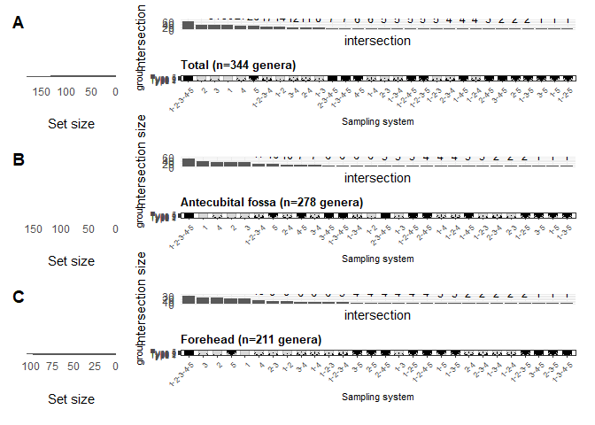<!-- -->

``` r
print(Figure3_filtered)
```

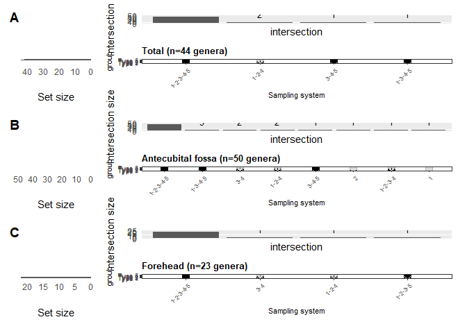<!-- -->

``` r
print(Figure3_summary)
```

```
##              subset retained_genera shared_by_all_five_genera
## 1             Total             344                        59
## 2 Antecubital fossa             278                        48
## 3          Forehead             211                        29
## 4             Total              44                        40
## 5 Antecubital fossa              50                        39
## 6          Forehead              23                        20
##   mean_abundance_cutoff total_reads reads_from_shared_genera
## 1                 0.000      847074                   825080
## 2                 0.000      404034                   385808
## 3                 0.000      443040                   431552
## 4                 0.001      824861                   819208
## 5                 0.001      392576                   383825
## 6                 0.001      433047                   429424
##   shared_genus_relative_abundance_pct              filtering
## 1                            97.40353 No abundance filtering
## 2                            95.48899 No abundance filtering
## 3                            97.40701 No abundance filtering
## 4                            99.31467  Mean abundance >=0.1%
## 5                            97.77088  Mean abundance >=0.1%
## 6                            99.16337  Mean abundance >=0.1%
```

``` r
print(Figure3_membership)
```

```
##                                        Type 1 Type 2 Type 3 Type 4 Type 5
## 2e914ff49c78ff61df377999bbc52463...1     TRUE   TRUE  FALSE  FALSE  FALSE
## ac4224d32dea1c7253ed5070a65a1b3e...2     TRUE  FALSE  FALSE  FALSE  FALSE
## 37640dc68ceb2f67423497241ff862f3...3    FALSE  FALSE  FALSE   TRUE   TRUE
## 3859ddfb4885964844ff7ada513a2597...4    FALSE  FALSE  FALSE   TRUE   TRUE
## 892feb56530bc24bd758934e83f18b92...5    FALSE  FALSE   TRUE   TRUE  FALSE
## d8e59a58b1954757c26b879a9829c4a7...6    FALSE  FALSE  FALSE  FALSE   TRUE
## c456d3718aa91dcf3ef7d19a8499d593...7    FALSE  FALSE  FALSE  FALSE   TRUE
## c14e1054ccbbabd5f6ed8a6dab092c54...8     TRUE  FALSE   TRUE   TRUE   TRUE
## 3270d6c06b6b0f0e2af3d81851a3993f...9    FALSE  FALSE  FALSE   TRUE   TRUE
## 5d3f0656e47a33688c5d82c089cee67a...10   FALSE  FALSE   TRUE  FALSE  FALSE
## e523791eca087d243d36477d28789915...11   FALSE   TRUE  FALSE  FALSE  FALSE
## 39b80e4af59dd44a181b5a148a6f8a0d...12    TRUE   TRUE   TRUE   TRUE  FALSE
## ada74c108a4de9611526f0c0c7ad4fc9...13    TRUE   TRUE   TRUE   TRUE   TRUE
## 10338681707ca5771140ff6bd4937dd3...14   FALSE   TRUE   TRUE  FALSE  FALSE
## 668ddc46cdbec2642f49fddde18308d2...15   FALSE  FALSE  FALSE   TRUE  FALSE
## 856925f916eba95f669698c572f88d93...16    TRUE   TRUE   TRUE   TRUE   TRUE
## 2c38d9d5742202da694d4721608fd637...17    TRUE   TRUE   TRUE   TRUE   TRUE
## e8a982d893c071c22434b8c9bdcaa162...18   FALSE   TRUE  FALSE  FALSE  FALSE
## 82e8fc4d3afec356107df3637c36de02...19   FALSE  FALSE  FALSE  FALSE   TRUE
## 01cef7193e22002921dd48ed9ba9882b...20    TRUE   TRUE   TRUE   TRUE   TRUE
## 30e001262d5e22bc9879c1a6b14058cc...21    TRUE   TRUE   TRUE   TRUE  FALSE
## f86053770615e8c2bed9d08c8218914b...22   FALSE  FALSE   TRUE  FALSE  FALSE
## 0246880f263e5f9d050691d5c089a905...23   FALSE  FALSE   TRUE  FALSE  FALSE
## fd06b5bd8feab452ba90c4c2eb3729ac...24   FALSE   TRUE  FALSE   TRUE  FALSE
## 2e728bead79d32a1b0788c8f2d3d8420...25   FALSE   TRUE  FALSE  FALSE  FALSE
## 963569a5bb9a8b1e06a8096993b64a24...26   FALSE   TRUE  FALSE  FALSE  FALSE
## 11aa9d4b0a51ee2a4e2a067c3db710f6...27    TRUE   TRUE  FALSE  FALSE  FALSE
## 5cbed13e671ef6879845c96f0efcfcae...28   FALSE  FALSE   TRUE  FALSE  FALSE
## 34085f1836e0fbc2e8a1843a65e93757...29    TRUE  FALSE  FALSE  FALSE  FALSE
## c67f047c0ed1a8beade5ac9b982881e5...30    TRUE  FALSE   TRUE  FALSE  FALSE
## 92201a0da9fc3ee6db6f359cdc9ae158...31   FALSE   TRUE  FALSE  FALSE  FALSE
## 2e9cafa6d587316096144e3d099fb30a...32   FALSE   TRUE  FALSE  FALSE  FALSE
## ca9f4bee4554e862e06ba4c488055776...33   FALSE  FALSE  FALSE  FALSE   TRUE
## a0cd40d7714e666b1d764840b3cdf319...34    TRUE  FALSE   TRUE  FALSE  FALSE
## f7c6068b3dede3a9d48719319aa5cc1e...35   FALSE   TRUE  FALSE  FALSE   TRUE
## 7b789ab34a526249c04870ec1e3b14fb...36    TRUE  FALSE  FALSE  FALSE  FALSE
## 17a056ac493560449848261b2f51d68f...37   FALSE   TRUE  FALSE   TRUE   TRUE
## 27325c30c47914898ef234447825ab83...38    TRUE   TRUE  FALSE   TRUE  FALSE
## 0cdb0219ef84707001971bd8592d6a11...39    TRUE   TRUE   TRUE   TRUE  FALSE
## 69ff34f58e584c0b1b02a7bcfdf855fd...40    TRUE   TRUE  FALSE  FALSE  FALSE
## 72558b780028629aa73abc3c75849338...41    TRUE   TRUE   TRUE   TRUE   TRUE
## 15287379f901b0787b04f6432a2f8bcf...42   FALSE  FALSE   TRUE  FALSE  FALSE
## f3c298b72522fa8756d13ae50332f012...43    TRUE   TRUE   TRUE   TRUE   TRUE
## f62c486b44892e1e1254d83edcef4f0b...44    TRUE   TRUE   TRUE   TRUE   TRUE
## 545e02d32bf168637a36e7689eb58894...45   FALSE   TRUE   TRUE  FALSE  FALSE
## 3647fcaddec766838b3532f38d53e49b...46    TRUE  FALSE   TRUE  FALSE  FALSE
## 029c76efcff7044afc7a4d56e859c483...47   FALSE   TRUE  FALSE   TRUE  FALSE
## e7a499f9a323eb7371e4433ae24c2ba5...48    TRUE   TRUE   TRUE   TRUE   TRUE
## ff4a81e61c87662b972b90e3ab36e375...49   FALSE  FALSE   TRUE   TRUE  FALSE
## fe3c004d8197f1b22882116b5be2deda...50    TRUE   TRUE   TRUE   TRUE   TRUE
## fab4e6f2ff0d67c9da977d16fc3cb422...51   FALSE   TRUE   TRUE   TRUE   TRUE
## bd70ff86d44ce073392ba44cc682ed77...52    TRUE  FALSE   TRUE  FALSE  FALSE
## 21aa4b4f658decb90eb33740ce2886c0...53    TRUE  FALSE   TRUE  FALSE   TRUE
## c8a6218790712b8c08f605b865c6e497...54    TRUE  FALSE  FALSE  FALSE  FALSE
## a13dce895add088f18d0e430280854b1...55   FALSE   TRUE   TRUE   TRUE  FALSE
## ca98c2f71fa7860e8be3b69cc0e6c6c1...56   FALSE  FALSE   TRUE  FALSE  FALSE
## 94280c1f9f716fbaaac5ea7d1925a3ac...57    TRUE  FALSE   TRUE   TRUE   TRUE
## 054a3d89b18fe9efb721eae0b64f969b...58   FALSE  FALSE  FALSE  FALSE   TRUE
## 6726658e6ed1b518f3cdae63d51007c1...59   FALSE   TRUE  FALSE  FALSE  FALSE
## 18ceb20f4a0682ada2a5849583d8a6eb...60    TRUE  FALSE   TRUE  FALSE  FALSE
## d5a4ec4339c4955f94811de7690ef425...61    TRUE  FALSE  FALSE  FALSE  FALSE
## 71c05ef4f89bfda417762c6a3a199da5...62    TRUE   TRUE   TRUE  FALSE   TRUE
## a5dd882b4a1e48909e5c51966530bf29...63   FALSE   TRUE   TRUE   TRUE   TRUE
## 92439753fa9d8bf5da75e3ee7c14e69f...64    TRUE  FALSE   TRUE  FALSE  FALSE
## 73948445c2534487d73c1402eb9ca852...65   FALSE  FALSE   TRUE  FALSE  FALSE
## 777af065fba986b3744a73d72c79c51d...66    TRUE   TRUE  FALSE   TRUE   TRUE
## 5de75a73be3109110266de0a2c4b48d4...67   FALSE   TRUE  FALSE  FALSE  FALSE
## dc4c06e76c80792a6dd6a5170e96a392...68    TRUE   TRUE   TRUE   TRUE   TRUE
## e075d7d3b6ae899ef1e8ccba4cd5114e...69    TRUE  FALSE   TRUE   TRUE   TRUE
## 46ec4ed0a75b0fcf231f1e4ff262fa8d...70    TRUE   TRUE   TRUE   TRUE   TRUE
## ee5be990233f99eded70433e365148ee...71    TRUE  FALSE  FALSE   TRUE  FALSE
## d0bbb3cf6f8c4d7a6fdd6a81d94daa81...72   FALSE  FALSE   TRUE  FALSE  FALSE
## 33a4b160e1f1411ea02ae36df2dcc388...73   FALSE  FALSE  FALSE  FALSE   TRUE
## 3f23ceb1ef108f7ce9cc7e5665c1f6af...74    TRUE   TRUE  FALSE   TRUE   TRUE
## f5b86fa349f1d8d5abe6b1f25e437279...75   FALSE  FALSE   TRUE  FALSE  FALSE
## f72abff20162a869f7fb14c9b9468835...76    TRUE  FALSE  FALSE   TRUE  FALSE
## 28791a195fb16e432f328fc38c217a16...77    TRUE   TRUE   TRUE   TRUE   TRUE
## 34f93d4b535472fbbe0ae88becfe4254...78   FALSE   TRUE  FALSE   TRUE  FALSE
## bb22e6d2b4e7939ff1edc50cab5c9130...79    TRUE   TRUE   TRUE   TRUE   TRUE
## ec838891faa3317f3afcd2d38b4e1923...80    TRUE   TRUE  FALSE  FALSE  FALSE
## 28e82ac50faab22d9428d78c36181743...81    TRUE  FALSE  FALSE  FALSE  FALSE
## e423277f6fcd9bead5bf13ade58d4de5...82   FALSE  FALSE   TRUE  FALSE  FALSE
## caa5248c2660878fac2218b81b13b8e0...83   FALSE  FALSE  FALSE  FALSE   TRUE
## 050d46a27980fc3cbc7f1a3d04b66b12...84    TRUE  FALSE  FALSE  FALSE  FALSE
## 126f3c073f21d6632d9d256142537db3...85   FALSE   TRUE   TRUE   TRUE  FALSE
## b237acb7c9ea317b7038f24d96d5d302...86    TRUE   TRUE   TRUE   TRUE  FALSE
## cca62ce55fa1104839106ebc7d1a7667...87   FALSE  FALSE  FALSE  FALSE   TRUE
## 4ceaf0eaf760e1d547cc7b69a0caf8af...88    TRUE   TRUE  FALSE  FALSE   TRUE
## 6bee3eeab5d2aed2aab34621e25b49d8...89    TRUE  FALSE  FALSE  FALSE  FALSE
## 116562121bfd1151c28e32ea067b1228...90    TRUE  FALSE  FALSE  FALSE  FALSE
## c16345411b2428ad706dd067e17bd77d...91    TRUE  FALSE  FALSE  FALSE  FALSE
## 026a1823043132ceb767cb524b84af87...92    TRUE   TRUE   TRUE   TRUE   TRUE
## 20c71ebbcfbabf45f16036be051b7769...93   FALSE   TRUE   TRUE   TRUE   TRUE
## f0a2510f876ac61a2018bf5abf3db6a2...94    TRUE  FALSE  FALSE   TRUE  FALSE
## 9ae36e9a8e7cceb827cfd1fa46652a45...95    TRUE  FALSE  FALSE  FALSE  FALSE
## 59ef38dc6b706ebe3087a9c3c12872bd...96   FALSE  FALSE  FALSE  FALSE   TRUE
## f701cbc5da10b2d9cba3b0728f832f73...97   FALSE  FALSE  FALSE   TRUE  FALSE
## 74aa557dd13c317520912ce37b152b31...98    TRUE   TRUE   TRUE   TRUE   TRUE
## 7db7de8a510d8e855bc4f30b30e33de0...99    TRUE   TRUE  FALSE  FALSE  FALSE
## 0b2fe4fb7db539ff9a4fa9d27c0faa62...100   TRUE  FALSE  FALSE  FALSE  FALSE
## 8459d7cb3a2b19a181aa31512f398869...101  FALSE  FALSE  FALSE   TRUE  FALSE
## 45e3f3f280507375f3d96c07e56be4c3...102  FALSE  FALSE   TRUE   TRUE  FALSE
## 1dd2d03bf672608a258cb4ef5543cad2...103  FALSE  FALSE  FALSE  FALSE   TRUE
## 47197ee817bb57421f861e8b877e0588...104  FALSE  FALSE   TRUE   TRUE   TRUE
## e863f60c2b404781ce435283c0b37574...105  FALSE  FALSE   TRUE   TRUE  FALSE
## 858b9292b21db7fe07ea3cc766b912dc...106  FALSE  FALSE   TRUE  FALSE  FALSE
## 94ba1d038ff0bdf31a29042ca50df39d...107   TRUE   TRUE  FALSE  FALSE  FALSE
## ae7508e0c0f5db07a8e8242c6148c34d...108  FALSE   TRUE  FALSE  FALSE  FALSE
## b4cc697fe846f736906b4d261b088dfd...109  FALSE   TRUE  FALSE  FALSE  FALSE
## 35527ffa9f44ebbf586ab787211da1c3...110  FALSE  FALSE  FALSE   TRUE  FALSE
## a67325486802911e948473f4b8b71ebe...111  FALSE  FALSE  FALSE   TRUE  FALSE
## 1813a356c899840a7219062a1a3f47b5...112  FALSE  FALSE  FALSE   TRUE  FALSE
## de2b4b14636d09e2d4611f822ab82457...113  FALSE  FALSE  FALSE  FALSE   TRUE
## b230581a663e0797c9116d2661cab125...114   TRUE   TRUE   TRUE  FALSE  FALSE
## 4ca87931296e46e2741cdfd5d76d51e4...115  FALSE  FALSE   TRUE   TRUE  FALSE
## ad490013f6967a5e303129f81df260cb...116  FALSE  FALSE  FALSE   TRUE  FALSE
## fe278eabfc85664fcf6e9acd8162be2d...117   TRUE   TRUE  FALSE  FALSE  FALSE
## 93e5a7a097bc4ddfb97c9908b7e32efd...118   TRUE   TRUE   TRUE   TRUE  FALSE
## 50a12e0b6a6399f107bdfcadc93a8cc4...119   TRUE   TRUE  FALSE   TRUE   TRUE
## 300837fe392a9506546f1970bd365d4b...120   TRUE  FALSE  FALSE  FALSE  FALSE
## 88098ab3f8048c851897dbd0bcb5cb7d...121  FALSE  FALSE  FALSE   TRUE  FALSE
## 05fcdbf22abe66e94b0ede4dfd85ca1e...122   TRUE  FALSE  FALSE   TRUE  FALSE
## b765346d065e508c6263c505decbb3f2...123   TRUE   TRUE   TRUE  FALSE   TRUE
## a7d73d00201f5dfac32d5042e3aa7039...124  FALSE  FALSE  FALSE   TRUE  FALSE
## 13fb1106cb988b93d742c82bb067cd7c...125   TRUE  FALSE  FALSE   TRUE  FALSE
## 1422aef8849148a9b52ce185862dc22f...126  FALSE   TRUE  FALSE  FALSE  FALSE
## 1a7e4f61cb855f1cf44b93f02d1e46e3...127   TRUE  FALSE   TRUE  FALSE  FALSE
## b9879da874f023629c4384ada519ba98...128  FALSE  FALSE   TRUE  FALSE  FALSE
## 2f7ab09df42772d54308dfa6e66bdfd0...129   TRUE  FALSE  FALSE  FALSE  FALSE
## c267dc0912cbc6475bb64ff0f47644b0...130   TRUE  FALSE  FALSE  FALSE  FALSE
## 41fbe47dd5c90d3ffeac5d5f7c2cc30d...131   TRUE   TRUE   TRUE   TRUE   TRUE
## dc9e2860e3fa93f9e4bf136144d697d6...132  FALSE  FALSE  FALSE  FALSE   TRUE
## fe00e9dc2b0d57671c5d87b12972291f...133   TRUE   TRUE   TRUE  FALSE  FALSE
## 205b8ebbe28117767c6974e1c4e05f03...134  FALSE  FALSE   TRUE   TRUE   TRUE
## d233b6edb8f37e7f43a781f4ed7c7a7e...135   TRUE  FALSE   TRUE   TRUE  FALSE
## b76595ac6cd24bb842f1374a9733e373...136   TRUE   TRUE   TRUE   TRUE   TRUE
## d28702f527ca84119434a5d089dea094...137   TRUE  FALSE  FALSE  FALSE  FALSE
## 92981a4f9e607d7f28d045957da39fcf...138  FALSE   TRUE  FALSE  FALSE  FALSE
## d4841fd1d61b4703cdd6ce863db17fea...139   TRUE  FALSE   TRUE   TRUE   TRUE
## 85c44a334114a5e2ca8dbe7d74e191d7...140   TRUE   TRUE   TRUE   TRUE   TRUE
## 303f5cdac869c2dc02db6ebe1323e12a...141   TRUE   TRUE   TRUE   TRUE   TRUE
## a433a2d87737d2dbf73ad13321f67911...142   TRUE  FALSE  FALSE   TRUE   TRUE
## 0535f4bb8a671a91b7c6080f796b0bc0...143  FALSE  FALSE   TRUE  FALSE  FALSE
## 3d321b478b7fd39dc8ac6c68a827a622...144  FALSE  FALSE  FALSE   TRUE  FALSE
## d127837f1b6ab3f7bdad8d8d125f0b08...145   TRUE  FALSE  FALSE  FALSE  FALSE
## 926726e3e0db3f70863c3e8a1f495968...146  FALSE   TRUE  FALSE   TRUE  FALSE
## 8565dacf1db3e048ac63f478454923c7...147  FALSE   TRUE  FALSE   TRUE  FALSE
## a6a5c75bcf40728c389d91b17e569cb0...148  FALSE  FALSE   TRUE  FALSE  FALSE
## a1e2b28fb788c9542caf556c169bd434...149  FALSE  FALSE  FALSE   TRUE  FALSE
## a47b8216f72af411c683bfe0846aa555...150   TRUE   TRUE   TRUE   TRUE  FALSE
## 4ed1aaefaefe8f38b7f6a4c1fd82d1ba...151  FALSE  FALSE   TRUE  FALSE  FALSE
## b733b3851a774a99efd0dd4c1d92054c...152   TRUE  FALSE  FALSE   TRUE  FALSE
## 302bf7a5ed63144059d0db8f906a743f...153  FALSE  FALSE   TRUE  FALSE  FALSE
## 8ada8a5b8f21a7dc546f16c295fd64f4...154   TRUE   TRUE  FALSE  FALSE  FALSE
## b0ce3a4407f76fe40d761ea266b304ff...155   TRUE   TRUE   TRUE   TRUE   TRUE
## d8a7df9e8bf0ac6efceee3f0424a5090...156   TRUE   TRUE   TRUE   TRUE   TRUE
## be765e929e8c9e7845dc8abd26cbda3e...157  FALSE   TRUE  FALSE  FALSE  FALSE
## b66b3e7d5986ed8721f7bd4f6538105c...158  FALSE   TRUE  FALSE  FALSE   TRUE
## 5dac0955f00d983d7557e718591f0f42...159   TRUE   TRUE   TRUE   TRUE   TRUE
## fa5d10d0f5b3457021cf635a8268b986...160   TRUE   TRUE   TRUE   TRUE   TRUE
## a354591ad123e5f645c3694abf4089f4...161  FALSE  FALSE   TRUE   TRUE  FALSE
## 87a6bbed6ceb02ec381f45db5ed37984...162  FALSE   TRUE  FALSE  FALSE  FALSE
## 75867d7a16d9647ce25057cc21524cd3...163   TRUE   TRUE   TRUE   TRUE   TRUE
## 1c5d6c2c9b4a7166c7cb496fca023c12...164   TRUE  FALSE  FALSE  FALSE  FALSE
## b7efbc42c9ff68fc2a12b5046976cfe6...165  FALSE  FALSE  FALSE   TRUE   TRUE
## 719f736c916092f6d392c5a46e1091ea...166  FALSE  FALSE  FALSE  FALSE   TRUE
## b90d5c735e4f9bea8175e5eabfd3caab...167  FALSE   TRUE  FALSE  FALSE  FALSE
## 8f120cf4ec104620d09446cdfbd8b7e9...168  FALSE   TRUE   TRUE   TRUE   TRUE
## 20f150dfe46c537edc5310399040afb8...169  FALSE  FALSE  FALSE   TRUE  FALSE
## 0adf67a3e396926259316a14f66e7ca1...170  FALSE  FALSE   TRUE   TRUE  FALSE
## e04521050f0d75fa388bddc4f2f34e56...171   TRUE   TRUE  FALSE   TRUE   TRUE
## d31a407f8ea48b0ffb218c273e96aca7...172   TRUE   TRUE   TRUE  FALSE   TRUE
## 3e50658e9b489006be4573114ca22b59...173  FALSE  FALSE  FALSE   TRUE  FALSE
## 54581694fce0637591ea45b0eff658f0...174  FALSE  FALSE  FALSE  FALSE   TRUE
## 65c9fb2233a8c0d21e99ba69d13d1e6d...175   TRUE   TRUE   TRUE   TRUE   TRUE
## cec2b7d32bc35658a948ffb4c0357677...176  FALSE  FALSE   TRUE   TRUE  FALSE
## 515ecf421a951bc274a7daaa791dc894...177   TRUE   TRUE   TRUE   TRUE   TRUE
## adcae3f5a43e4dca840c01d62e6416a5...178  FALSE   TRUE  FALSE  FALSE  FALSE
## e9725fc74685ef05a1ba39435294042c...179  FALSE   TRUE  FALSE  FALSE  FALSE
## cea0a6f8b58238977831021560f03baf...180  FALSE   TRUE  FALSE  FALSE  FALSE
## b42d663cf6e4bf6e9916cf88ac74a818...181   TRUE   TRUE   TRUE   TRUE   TRUE
## 9366c1f1fa59361f62f702f094ae0c21...182   TRUE  FALSE  FALSE  FALSE  FALSE
## 35d4cbfddf6c9639a996a7877cd4f0f2...183  FALSE  FALSE  FALSE   TRUE  FALSE
## c213f9d573bc251e6187c95f276feca6...184   TRUE   TRUE   TRUE   TRUE  FALSE
## b7b3626747fe84c91b5f419eea29bbdf...185   TRUE   TRUE   TRUE   TRUE  FALSE
## cb87c4f867a6bf086284e61be0ec2f63...186   TRUE   TRUE   TRUE   TRUE  FALSE
## 6cba61242453f471b9c15fdcb5026986...187   TRUE   TRUE   TRUE   TRUE  FALSE
## da9d2bcf5ad7eb890398dee9beaf9949...188  FALSE   TRUE   TRUE   TRUE  FALSE
## 8bad83080a2375457f0c9a882b0518b9...189   TRUE   TRUE   TRUE   TRUE  FALSE
## 49bd242006920acb2126ab0ceac5df84...190  FALSE   TRUE  FALSE  FALSE  FALSE
## 1e143504935212a1de58af7db86e9075...191  FALSE  FALSE  FALSE   TRUE  FALSE
## baec25fd95d764324fe292e10e6f1620...192   TRUE   TRUE   TRUE   TRUE   TRUE
## 6d6ea94f2c732bf7767af01e1308cb38...193  FALSE   TRUE  FALSE  FALSE  FALSE
## 89080b3c5ba6bf78d58df159a692470f...194  FALSE  FALSE  FALSE   TRUE  FALSE
## 6e52e1651130d2a07800abe723ea721e...195   TRUE   TRUE   TRUE   TRUE   TRUE
## 84739218645d09374bcecea50306c590...196   TRUE  FALSE   TRUE   TRUE   TRUE
## 7a1929bf9979112b01541e3fc354d129...197  FALSE   TRUE   TRUE   TRUE   TRUE
## c25c933a077c8f1489487077ae49d897...198   TRUE  FALSE   TRUE   TRUE   TRUE
## 84f932f291b157ef5aaf93a5ea82ebb2...199  FALSE   TRUE  FALSE   TRUE   TRUE
## aa57923408765fc46bc15cbeaa7491a6...200   TRUE   TRUE  FALSE   TRUE  FALSE
## abdb10ef959af94d4fc7574d556e3633...201  FALSE  FALSE  FALSE   TRUE  FALSE
## 97402210ae7735706d9a9a42b71b8fda...202   TRUE   TRUE   TRUE   TRUE   TRUE
## 49bf16e6c356ce0fafd1a644e47ce762...203   TRUE  FALSE  FALSE  FALSE   TRUE
## 1b5f84de8f1ac02d81de16f9b8ae2d0e...204   TRUE   TRUE   TRUE   TRUE   TRUE
## 76c7175da051546f4e9a9e16b80491d0...205  FALSE  FALSE   TRUE   TRUE  FALSE
## fe64ec7791e1fcd2d40f449b7ec5b4bb...206   TRUE   TRUE  FALSE  FALSE  FALSE
## abd0febc117d23cd49b9d4ef431153bc...207  FALSE  FALSE  FALSE  FALSE   TRUE
## bc9fce29d86dd59b106f60bd7b227020...208   TRUE  FALSE  FALSE  FALSE  FALSE
## 670ff01449495039c6e52f5f0fe307b1...209   TRUE  FALSE  FALSE  FALSE  FALSE
## 639fa34b4e7141c951ee83fd68fe2b47...210  FALSE   TRUE   TRUE  FALSE  FALSE
## 75195c7c5253e5a13cb2176aa9f782c2...211   TRUE   TRUE  FALSE  FALSE  FALSE
## 40b48ec694b884aa93cc33fbfb00d625...212  FALSE  FALSE  FALSE   TRUE  FALSE
## 67ea33e6e92c2b3175cf2c5bd905476b...213   TRUE   TRUE   TRUE   TRUE  FALSE
## 9e3c906dc28276c52554085ff636a2a8...214   TRUE   TRUE   TRUE  FALSE  FALSE
## 66b7507662a94e6fba998da71404a5b8...215  FALSE   TRUE  FALSE  FALSE  FALSE
## 64c6c9854a1938f12b659f40a0f6a954...216  FALSE  FALSE   TRUE  FALSE  FALSE
## 4599f62c522946dffd848e0b0d9fca4b...217   TRUE  FALSE   TRUE   TRUE  FALSE
## 342ce74435d2330505ee013a1e0cfe40...218  FALSE   TRUE  FALSE  FALSE  FALSE
## 58eb82260a9cf04183552f4c539e2fac...219   TRUE   TRUE   TRUE   TRUE  FALSE
## b49c1c742ff9a26c0ce116574c094ea7...220  FALSE   TRUE  FALSE  FALSE  FALSE
## 0cbd1ae79969bad86b80d96bf2b6b814...221  FALSE   TRUE   TRUE   TRUE  FALSE
## d8b64490de90a224be2172096edcb67b...222  FALSE  FALSE  FALSE  FALSE   TRUE
## a7382b45b4ef915003f6e6983632974f...223  FALSE  FALSE   TRUE   TRUE  FALSE
## ec788ffe7eee824ad4c2d4519f2eb96b...224   TRUE  FALSE  FALSE  FALSE  FALSE
## eca7f723fb8b7b170b6f546b650537f7...225  FALSE   TRUE  FALSE  FALSE  FALSE
## 82504c984bcb5a584c737c78906bd2bf...226   TRUE   TRUE   TRUE   TRUE   TRUE
## 6899a05aba1c79bb03f4b1df326b5884...227   TRUE   TRUE   TRUE  FALSE   TRUE
## 55129a90f08f521cd6bd80a65b8308fc...228  FALSE  FALSE   TRUE  FALSE  FALSE
## 19045d0398e54e66ed333ad6780ae0d4...229   TRUE   TRUE   TRUE   TRUE   TRUE
## 5f52a8f708db5f6885b892c90f153983...230   TRUE   TRUE  FALSE  FALSE  FALSE
## 906baa19422f87b92ad2957fae66a741...231   TRUE  FALSE  FALSE   TRUE   TRUE
## 1fe1d90a93ffe8b8c2b7b32be0e750ea...232   TRUE   TRUE  FALSE  FALSE  FALSE
## b03c414290fa278a0f09d9b4c819ac40...233  FALSE  FALSE   TRUE  FALSE   TRUE
## 67ebdb997e828699fa913b0ed18ba924...234  FALSE   TRUE  FALSE   TRUE  FALSE
## 806198a51c28a0e3cbb56fd6251ea18e...235  FALSE   TRUE  FALSE   TRUE  FALSE
## 30d17b384b5e354005c2cb37d6aaf069...236   TRUE  FALSE   TRUE   TRUE  FALSE
## a36f517260cdac623044af72be907f03...237  FALSE  FALSE   TRUE  FALSE  FALSE
## ec6e497c2bea91ad44fad5bd08f3a5d2...238   TRUE   TRUE   TRUE  FALSE  FALSE
## abd916b960b81098025c1ca1755c6cc3...239  FALSE  FALSE   TRUE  FALSE  FALSE
## b510eab43bc2ae3ce44ca3332afb6774...240   TRUE   TRUE   TRUE  FALSE   TRUE
## a4bfcc56025d3266ec1c86c82e266e12...241  FALSE   TRUE  FALSE   TRUE  FALSE
## 403eadaf52132415552a3a9990cf2070...242   TRUE  FALSE  FALSE   TRUE   TRUE
## c16bda45083cf985cb674a0320788363...243  FALSE  FALSE   TRUE  FALSE  FALSE
## 394b62243678d5f00cbfb8f1c4a6ee6d...244  FALSE   TRUE  FALSE   TRUE  FALSE
## da903c8d827a0808b8325dd9585b5c08...245   TRUE  FALSE  FALSE   TRUE   TRUE
## 84b98c898e7a9a2d3f9b1be2df4908c7...246   TRUE   TRUE  FALSE   TRUE  FALSE
## 8d8da6172e2c91f26a13e27dea7fcb95...247   TRUE  FALSE  FALSE  FALSE  FALSE
## 01a417c3176de0348b0ca6ceefbd4491...248   TRUE  FALSE   TRUE   TRUE  FALSE
## f74d3e35b55e74c8e5323eeb0f436f14...249  FALSE  FALSE  FALSE  FALSE   TRUE
## 2eb5f39293ce179eff805fa32d12a432...250   TRUE  FALSE  FALSE  FALSE  FALSE
## 94d3ada8c73a636337fccb769efa8b28...251  FALSE  FALSE   TRUE  FALSE  FALSE
## a2e29f5d7001469edc6a394262a51f75...252   TRUE   TRUE   TRUE  FALSE  FALSE
## 5e28fbbd337c610b6bc1e4b000c0342f...253  FALSE   TRUE   TRUE  FALSE  FALSE
## e50d17ad0dc1144b6adebdcc150f3b51...254  FALSE  FALSE  FALSE  FALSE   TRUE
## 8fa0171ff9cdc7f7e3d869c458a4a73a...255  FALSE   TRUE  FALSE  FALSE  FALSE
## 3444f19e0cb194dfbd485cc396c59f71...256  FALSE   TRUE   TRUE   TRUE   TRUE
## 5325c97ed1a497a5a586815b59aed735...257   TRUE   TRUE   TRUE   TRUE   TRUE
## 5d7c35adf23e3104ee8e2886a1194c17...258   TRUE   TRUE   TRUE   TRUE  FALSE
## 2c87af46c878a9884a0e448e106cfe42...259   TRUE   TRUE   TRUE   TRUE  FALSE
## 29426558992083b53aba3b5adfb62ebc...260  FALSE   TRUE  FALSE  FALSE  FALSE
## fadf24138f6bd36ac33ba59dafc1be2b...261  FALSE  FALSE  FALSE  FALSE   TRUE
## ed198d2e3e59eb9b4f0cef8d45e05e98...262  FALSE   TRUE  FALSE  FALSE  FALSE
## 38ce145ffdcca956e2be1b6f332f8afb...263  FALSE   TRUE  FALSE   TRUE  FALSE
## 71ddab1f3aa488f911f2b333353e2f78...264  FALSE  FALSE   TRUE  FALSE  FALSE
## 8513c3d7e955e463f8fb4b0e3f8ca6b0...265  FALSE  FALSE  FALSE   TRUE  FALSE
## 6e84be0d93bffb85cad87ffe27fc41f9...266  FALSE  FALSE   TRUE  FALSE  FALSE
## 9e0c133b35d63be7741321765a951d0e...267  FALSE  FALSE   TRUE   TRUE  FALSE
## 543ac8da8a84103fde70c9ee9ccf3aeb...268   TRUE   TRUE   TRUE   TRUE  FALSE
## 2dba47ded95ae634746f33d9c695e7f9...269   TRUE   TRUE  FALSE  FALSE  FALSE
## b6490793b61729fade75800b9a5746ab...270   TRUE  FALSE  FALSE  FALSE  FALSE
## 9b21b487cca15d9243173e6003fe5f67...271  FALSE  FALSE  FALSE   TRUE  FALSE
## f8e719549495b584e09aed57e8d9b853...272  FALSE  FALSE  FALSE   TRUE  FALSE
## db9c46272955268b239e5d89618d7ac1...273  FALSE  FALSE   TRUE  FALSE  FALSE
## aeecfb2e13eb0e176bff7d58e44422f9...274   TRUE  FALSE  FALSE  FALSE  FALSE
## 259733dd148441d7853462e466b51c86...275  FALSE   TRUE  FALSE  FALSE  FALSE
## 4e9ca07dcaec7e38e8c0689eb78540e3...276  FALSE  FALSE   TRUE  FALSE  FALSE
## 8accb7ac69a09173bb86ac2883b7dff7...277   TRUE  FALSE   TRUE   TRUE  FALSE
## 21967f8f24338037507b06be0cbaa356...278  FALSE  FALSE  FALSE   TRUE  FALSE
## 86d9f851fe319e04da6496f277487456...279  FALSE  FALSE   TRUE  FALSE  FALSE
## 713362abd8c4912d6c7d4caa1e766625...280  FALSE  FALSE   TRUE   TRUE  FALSE
## d2b0b2aee1af0c2d0b268bbdd47e2924...281  FALSE   TRUE  FALSE  FALSE  FALSE
## 5e75994e109e5e60edd869e18ac9e50a...282   TRUE  FALSE   TRUE  FALSE  FALSE
## d78c7661f8e59acd50c80e8f2fd19582...283  FALSE  FALSE  FALSE  FALSE   TRUE
## c9b3032f54d5eae836e9bbc111d61d57...284   TRUE  FALSE  FALSE  FALSE  FALSE
## c89aa29e55284c3120bbcee0177c18b9...285   TRUE  FALSE  FALSE  FALSE  FALSE
## c0948aae3210c6d223a5b3ac7bc18fb0...286  FALSE   TRUE  FALSE  FALSE  FALSE
## d27a5dbc45888651009c7373394586e2...287  FALSE   TRUE  FALSE   TRUE  FALSE
## aa746099ad73c67aac56c81536549595...288  FALSE  FALSE  FALSE  FALSE   TRUE
## 7515c96cc69c940c2521d2ed4ac90adc...289  FALSE  FALSE  FALSE   TRUE  FALSE
## 4518e5b3f462a669d90839f07bd8c881...290  FALSE   TRUE  FALSE  FALSE  FALSE
## dcf66aa40723a77eaf2bb42cb2c63f73...291  FALSE  FALSE  FALSE  FALSE   TRUE
## e26b0fa334d8f338ba34578cb7c0d3cc...292   TRUE   TRUE   TRUE   TRUE   TRUE
## 292254d46addbc010ae77b2aad22c07b...293  FALSE  FALSE  FALSE   TRUE   TRUE
## 5bd3af0138e11ba03030ffee3ff0d14d...294   TRUE   TRUE   TRUE   TRUE  FALSE
## 4748e8a42d43b5abde091a50264f9a92...295   TRUE   TRUE   TRUE   TRUE   TRUE
## 261dfeeb6c011ef257861b2a0fe3bb7d...296  FALSE   TRUE  FALSE   TRUE   TRUE
## 81e7661c8ebb6e0fc435211e9aa6a47c...297   TRUE   TRUE   TRUE   TRUE   TRUE
## 443fb2d16fc7d839c24c5a7a7826dec6...298   TRUE   TRUE   TRUE   TRUE   TRUE
## 07f823ed91fe424a88e175a9101db80f...299  FALSE  FALSE   TRUE  FALSE  FALSE
## db1e0886cb9529333a47b8ff4347c63b...300  FALSE   TRUE   TRUE   TRUE   TRUE
## 21673413c8312614eaf4f3f0e9ac6eba...301  FALSE   TRUE   TRUE  FALSE  FALSE
## 873b0b68e099323e1d2ca5d17606a11d...302   TRUE   TRUE   TRUE   TRUE   TRUE
## e3cf88a0fc4731af23d477c14f7f8de6...303  FALSE   TRUE  FALSE  FALSE  FALSE
## 46b0ba5afe1e2b9268573006c628405a...304  FALSE  FALSE   TRUE  FALSE  FALSE
## bff2858a173d483d7604323d8fc9a6e9...305  FALSE  FALSE  FALSE   TRUE  FALSE
## 9ac455d7d7a26fed46036043403628e6...306  FALSE  FALSE  FALSE   TRUE  FALSE
## c123804c63e25b6390ad734e64c31e6c...307   TRUE   TRUE   TRUE   TRUE   TRUE
## f889bb2bb25f73012084bb11ae950a17...308   TRUE   TRUE   TRUE   TRUE   TRUE
## 0db1ad2d6b4b45fa3e3e40aa9f5ee692...309   TRUE   TRUE   TRUE   TRUE   TRUE
## c8f0916f6fd2f533a204b73879084a4f...310   TRUE   TRUE  FALSE  FALSE  FALSE
## 2235fb3906484370e48c37388c4cd746...311  FALSE  FALSE   TRUE  FALSE  FALSE
## 488029799c26f2d7eaf7df8899ad7c34...312  FALSE   TRUE  FALSE  FALSE  FALSE
## 79c2d824228c4d17533d54fa05f593ed...313  FALSE  FALSE  FALSE  FALSE   TRUE
## 2babd2316a955b8126c1d574928eded1...314   TRUE   TRUE   TRUE   TRUE   TRUE
## 79efcc373159c11685c8a7343b8e0cd9...315  FALSE  FALSE  FALSE  FALSE   TRUE
## cbb091b5e5b0289d04c52c93172f0400...316  FALSE  FALSE  FALSE  FALSE   TRUE
## 978d54ee5abc9bf229fa247683b8d7f2...317   TRUE   TRUE  FALSE   TRUE   TRUE
## f5f63b20073a5689ec99521de809cfa9...318   TRUE  FALSE   TRUE   TRUE   TRUE
## 9fb4d1ef56025a3efd044096543a3686...319   TRUE  FALSE  FALSE  FALSE  FALSE
## 867ea09fd0e8bc911475f9097bd2e57d...320  FALSE  FALSE   TRUE  FALSE  FALSE
## aa84576af3343730c84146140496a807...321   TRUE   TRUE   TRUE   TRUE   TRUE
## 2bec1063c452ea81ad6d1f8ea021d50d...322   TRUE   TRUE   TRUE   TRUE   TRUE
## 041a808460c3e20eb708113a5ae6533d...323   TRUE  FALSE  FALSE  FALSE  FALSE
## f88845e22ed4975c40c05e8f527554b3...324   TRUE   TRUE   TRUE   TRUE   TRUE
## 73664aa4932bcfe5379274e489d0bf1c...325   TRUE   TRUE   TRUE   TRUE   TRUE
## 4961a9855736776cbb628fcf27ee7f72...326  FALSE  FALSE  FALSE   TRUE   TRUE
## 8c78f224069832cd7fd7e9efcf616ab9...327   TRUE   TRUE   TRUE   TRUE   TRUE
## 13b8688bc0b096a8da1566d3bb25a9db...328   TRUE   TRUE   TRUE   TRUE   TRUE
## c3241e1fde3826e45858fd4cd3f070d5...329   TRUE  FALSE   TRUE  FALSE   TRUE
## 8d3243f2860964ff8177daf941fb6068...330  FALSE  FALSE  FALSE   TRUE  FALSE
## 1a917b265c943f0b7fe898239bb29ed5...331  FALSE  FALSE  FALSE  FALSE   TRUE
## 0de497e4baa9d071845afc073d10fba6...332   TRUE   TRUE   TRUE   TRUE   TRUE
## a1d949f27725f089c27c233027c5f692...333   TRUE   TRUE   TRUE   TRUE   TRUE
## 79ab60724f24643048b657b079f00b4b...334  FALSE  FALSE  FALSE   TRUE  FALSE
## e582ed5906dc643509303e1e7de0e8e9...335   TRUE   TRUE   TRUE   TRUE   TRUE
## a8ebe6695f3741b63f135708fa4c894d...336   TRUE   TRUE   TRUE   TRUE   TRUE
## f7734641299f704d4883f5df11e8e3ab...337  FALSE   TRUE  FALSE  FALSE  FALSE
## 78f43f7e335424a99400a11453add8ab...338   TRUE   TRUE  FALSE   TRUE  FALSE
## 33a077fde7c403e6b08c5b967e3df0a1...339   TRUE   TRUE   TRUE   TRUE   TRUE
## daca34875367c76ab8b8452940d60fdf...340   TRUE   TRUE   TRUE   TRUE   TRUE
## 0df52bde0ac287bb20a6c5a9a66201f2...341   TRUE   TRUE   TRUE   TRUE   TRUE
## 8de58ef371630c3e4c24d74a8f7ecf2a...342   TRUE   TRUE   TRUE   TRUE   TRUE
## 04ae6d4e93605dc0fd87868b6069bbbf...343   TRUE   TRUE   TRUE   TRUE   TRUE
## b5abf1472c7313362f3234de5c1a8efa...344   TRUE   TRUE   TRUE   TRUE   TRUE
## 2e914ff49c78ff61df377999bbc52463...345   TRUE   TRUE  FALSE  FALSE  FALSE
## ac4224d32dea1c7253ed5070a65a1b3e...346   TRUE  FALSE  FALSE  FALSE  FALSE
## 37640dc68ceb2f67423497241ff862f3...347  FALSE  FALSE  FALSE   TRUE   TRUE
## 3859ddfb4885964844ff7ada513a2597...348  FALSE  FALSE  FALSE   TRUE  FALSE
## 892feb56530bc24bd758934e83f18b92...349  FALSE  FALSE   TRUE  FALSE  FALSE
## d8e59a58b1954757c26b879a9829c4a7...350  FALSE  FALSE  FALSE  FALSE   TRUE
## c14e1054ccbbabd5f6ed8a6dab092c54...351  FALSE  FALSE   TRUE   TRUE   TRUE
## 3270d6c06b6b0f0e2af3d81851a3993f...352  FALSE  FALSE  FALSE   TRUE   TRUE
## e523791eca087d243d36477d28789915...353  FALSE   TRUE  FALSE  FALSE  FALSE
## 39b80e4af59dd44a181b5a148a6f8a0d...354   TRUE   TRUE   TRUE   TRUE  FALSE
## ada74c108a4de9611526f0c0c7ad4fc9...355   TRUE   TRUE   TRUE   TRUE   TRUE
## 10338681707ca5771140ff6bd4937dd3...356  FALSE  FALSE   TRUE  FALSE  FALSE
## 668ddc46cdbec2642f49fddde18308d2...357  FALSE  FALSE  FALSE   TRUE  FALSE
## 856925f916eba95f669698c572f88d93...358   TRUE   TRUE   TRUE   TRUE   TRUE
## 2c38d9d5742202da694d4721608fd637...359   TRUE   TRUE   TRUE   TRUE   TRUE
## 01cef7193e22002921dd48ed9ba9882b...360   TRUE   TRUE   TRUE   TRUE  FALSE
## 30e001262d5e22bc9879c1a6b14058cc...361   TRUE   TRUE   TRUE   TRUE  FALSE
## f86053770615e8c2bed9d08c8218914b...362  FALSE  FALSE   TRUE  FALSE  FALSE
## 0246880f263e5f9d050691d5c089a905...363  FALSE  FALSE   TRUE  FALSE  FALSE
## fd06b5bd8feab452ba90c4c2eb3729ac...364  FALSE   TRUE  FALSE   TRUE  FALSE
## 2e728bead79d32a1b0788c8f2d3d8420...365  FALSE   TRUE  FALSE  FALSE  FALSE
## 11aa9d4b0a51ee2a4e2a067c3db710f6...366   TRUE  FALSE  FALSE  FALSE  FALSE
## 34085f1836e0fbc2e8a1843a65e93757...367   TRUE  FALSE  FALSE  FALSE  FALSE
## 92201a0da9fc3ee6db6f359cdc9ae158...368  FALSE   TRUE  FALSE  FALSE  FALSE
## 2e9cafa6d587316096144e3d099fb30a...369  FALSE   TRUE  FALSE  FALSE  FALSE
## ca9f4bee4554e862e06ba4c488055776...370  FALSE  FALSE  FALSE  FALSE   TRUE
## a0cd40d7714e666b1d764840b3cdf319...371   TRUE  FALSE   TRUE  FALSE  FALSE
## 7b789ab34a526249c04870ec1e3b14fb...372   TRUE  FALSE  FALSE  FALSE  FALSE
## 17a056ac493560449848261b2f51d68f...373  FALSE   TRUE  FALSE   TRUE   TRUE
## 27325c30c47914898ef234447825ab83...374   TRUE   TRUE  FALSE   TRUE  FALSE
## 0cdb0219ef84707001971bd8592d6a11...375   TRUE   TRUE   TRUE   TRUE  FALSE
## 69ff34f58e584c0b1b02a7bcfdf855fd...376   TRUE   TRUE  FALSE  FALSE  FALSE
## 72558b780028629aa73abc3c75849338...377   TRUE   TRUE   TRUE   TRUE   TRUE
## 15287379f901b0787b04f6432a2f8bcf...378  FALSE  FALSE   TRUE  FALSE  FALSE
## f3c298b72522fa8756d13ae50332f012...379   TRUE   TRUE   TRUE   TRUE   TRUE
## f62c486b44892e1e1254d83edcef4f0b...380   TRUE  FALSE   TRUE   TRUE   TRUE
## 545e02d32bf168637a36e7689eb58894...381  FALSE   TRUE  FALSE  FALSE  FALSE
## 3647fcaddec766838b3532f38d53e49b...382   TRUE  FALSE  FALSE  FALSE  FALSE
## 029c76efcff7044afc7a4d56e859c483...383  FALSE   TRUE  FALSE   TRUE  FALSE
## e7a499f9a323eb7371e4433ae24c2ba5...384   TRUE   TRUE   TRUE   TRUE   TRUE
## fe3c004d8197f1b22882116b5be2deda...385   TRUE   TRUE   TRUE   TRUE   TRUE
## fab4e6f2ff0d67c9da977d16fc3cb422...386  FALSE   TRUE   TRUE   TRUE   TRUE
## bd70ff86d44ce073392ba44cc682ed77...387   TRUE  FALSE  FALSE  FALSE  FALSE
## 21aa4b4f658decb90eb33740ce2886c0...388   TRUE  FALSE   TRUE  FALSE   TRUE
## c8a6218790712b8c08f605b865c6e497...389   TRUE  FALSE  FALSE  FALSE  FALSE
## a13dce895add088f18d0e430280854b1...390  FALSE  FALSE   TRUE   TRUE  FALSE
## 94280c1f9f716fbaaac5ea7d1925a3ac...391  FALSE  FALSE  FALSE  FALSE   TRUE
## 054a3d89b18fe9efb721eae0b64f969b...392  FALSE  FALSE  FALSE  FALSE   TRUE
## 18ceb20f4a0682ada2a5849583d8a6eb...393   TRUE  FALSE   TRUE  FALSE  FALSE
## 71c05ef4f89bfda417762c6a3a199da5...394   TRUE   TRUE  FALSE  FALSE   TRUE
## a5dd882b4a1e48909e5c51966530bf29...395  FALSE  FALSE   TRUE   TRUE   TRUE
## 92439753fa9d8bf5da75e3ee7c14e69f...396   TRUE  FALSE   TRUE  FALSE  FALSE
## 73948445c2534487d73c1402eb9ca852...397  FALSE  FALSE   TRUE  FALSE  FALSE
## 777af065fba986b3744a73d72c79c51d...398   TRUE   TRUE  FALSE   TRUE   TRUE
## 5de75a73be3109110266de0a2c4b48d4...399  FALSE   TRUE  FALSE  FALSE  FALSE
## dc4c06e76c80792a6dd6a5170e96a392...400   TRUE   TRUE   TRUE   TRUE   TRUE
## e075d7d3b6ae899ef1e8ccba4cd5114e...401  FALSE  FALSE   TRUE   TRUE   TRUE
## 46ec4ed0a75b0fcf231f1e4ff262fa8d...402   TRUE   TRUE   TRUE   TRUE   TRUE
## ee5be990233f99eded70433e365148ee...403  FALSE  FALSE  FALSE   TRUE  FALSE
## d0bbb3cf6f8c4d7a6fdd6a81d94daa81...404  FALSE  FALSE   TRUE  FALSE  FALSE
## 33a4b160e1f1411ea02ae36df2dcc388...405  FALSE  FALSE  FALSE  FALSE   TRUE
## 3f23ceb1ef108f7ce9cc7e5665c1f6af...406   TRUE   TRUE  FALSE   TRUE   TRUE
## f72abff20162a869f7fb14c9b9468835...407   TRUE  FALSE  FALSE   TRUE  FALSE
## 28791a195fb16e432f328fc38c217a16...408   TRUE   TRUE   TRUE   TRUE   TRUE
## 34f93d4b535472fbbe0ae88becfe4254...409  FALSE   TRUE  FALSE   TRUE  FALSE
## bb22e6d2b4e7939ff1edc50cab5c9130...410   TRUE   TRUE   TRUE   TRUE   TRUE
## ec838891faa3317f3afcd2d38b4e1923...411   TRUE   TRUE  FALSE  FALSE  FALSE
## 28e82ac50faab22d9428d78c36181743...412   TRUE  FALSE  FALSE  FALSE  FALSE
## 050d46a27980fc3cbc7f1a3d04b66b12...413   TRUE  FALSE  FALSE  FALSE  FALSE
## 126f3c073f21d6632d9d256142537db3...414  FALSE   TRUE   TRUE   TRUE  FALSE
## b237acb7c9ea317b7038f24d96d5d302...415   TRUE   TRUE   TRUE   TRUE  FALSE
## cca62ce55fa1104839106ebc7d1a7667...416  FALSE  FALSE  FALSE  FALSE   TRUE
## 4ceaf0eaf760e1d547cc7b69a0caf8af...417   TRUE  FALSE  FALSE  FALSE  FALSE
## c16345411b2428ad706dd067e17bd77d...418   TRUE  FALSE  FALSE  FALSE  FALSE
## 026a1823043132ceb767cb524b84af87...419   TRUE   TRUE   TRUE   TRUE   TRUE
## 20c71ebbcfbabf45f16036be051b7769...420  FALSE   TRUE   TRUE   TRUE   TRUE
## f0a2510f876ac61a2018bf5abf3db6a2...421   TRUE  FALSE  FALSE  FALSE  FALSE
## 59ef38dc6b706ebe3087a9c3c12872bd...422  FALSE  FALSE  FALSE  FALSE   TRUE
## 74aa557dd13c317520912ce37b152b31...423   TRUE   TRUE   TRUE   TRUE   TRUE
## 0b2fe4fb7db539ff9a4fa9d27c0faa62...424   TRUE  FALSE  FALSE  FALSE  FALSE
## 8459d7cb3a2b19a181aa31512f398869...425  FALSE  FALSE  FALSE   TRUE  FALSE
## 45e3f3f280507375f3d96c07e56be4c3...426  FALSE  FALSE   TRUE   TRUE  FALSE
## 1dd2d03bf672608a258cb4ef5543cad2...427  FALSE  FALSE  FALSE  FALSE   TRUE
## 47197ee817bb57421f861e8b877e0588...428  FALSE  FALSE   TRUE   TRUE   TRUE
## e863f60c2b404781ce435283c0b37574...429  FALSE  FALSE  FALSE   TRUE  FALSE
## 35527ffa9f44ebbf586ab787211da1c3...430  FALSE  FALSE  FALSE   TRUE  FALSE
## a67325486802911e948473f4b8b71ebe...431  FALSE  FALSE  FALSE   TRUE  FALSE
## 1813a356c899840a7219062a1a3f47b5...432  FALSE  FALSE  FALSE   TRUE  FALSE
## b230581a663e0797c9116d2661cab125...433   TRUE  FALSE  FALSE  FALSE  FALSE
## ad490013f6967a5e303129f81df260cb...434  FALSE  FALSE  FALSE   TRUE  FALSE
## 93e5a7a097bc4ddfb97c9908b7e32efd...435   TRUE   TRUE   TRUE   TRUE  FALSE
## 50a12e0b6a6399f107bdfcadc93a8cc4...436   TRUE   TRUE  FALSE   TRUE   TRUE
## 300837fe392a9506546f1970bd365d4b...437   TRUE  FALSE  FALSE  FALSE  FALSE
## 88098ab3f8048c851897dbd0bcb5cb7d...438  FALSE  FALSE  FALSE   TRUE  FALSE
## 05fcdbf22abe66e94b0ede4dfd85ca1e...439   TRUE  FALSE  FALSE  FALSE  FALSE
## b765346d065e508c6263c505decbb3f2...440   TRUE   TRUE   TRUE  FALSE  FALSE
## a7d73d00201f5dfac32d5042e3aa7039...441  FALSE  FALSE  FALSE   TRUE  FALSE
## 13fb1106cb988b93d742c82bb067cd7c...442   TRUE  FALSE  FALSE   TRUE  FALSE
## 1422aef8849148a9b52ce185862dc22f...443  FALSE   TRUE  FALSE  FALSE  FALSE
## 1a7e4f61cb855f1cf44b93f02d1e46e3...444   TRUE  FALSE  FALSE  FALSE  FALSE
## 2f7ab09df42772d54308dfa6e66bdfd0...445   TRUE  FALSE  FALSE  FALSE  FALSE
## c267dc0912cbc6475bb64ff0f47644b0...446   TRUE  FALSE  FALSE  FALSE  FALSE
## 41fbe47dd5c90d3ffeac5d5f7c2cc30d...447   TRUE   TRUE   TRUE   TRUE  FALSE
## fe00e9dc2b0d57671c5d87b12972291f...448   TRUE   TRUE  FALSE  FALSE  FALSE
## 205b8ebbe28117767c6974e1c4e05f03...449  FALSE  FALSE   TRUE   TRUE   TRUE
## d233b6edb8f37e7f43a781f4ed7c7a7e...450   TRUE  FALSE   TRUE   TRUE  FALSE
## b76595ac6cd24bb842f1374a9733e373...451  FALSE   TRUE   TRUE   TRUE   TRUE
## d4841fd1d61b4703cdd6ce863db17fea...452   TRUE  FALSE  FALSE   TRUE   TRUE
## 85c44a334114a5e2ca8dbe7d74e191d7...453   TRUE   TRUE   TRUE   TRUE   TRUE
## 303f5cdac869c2dc02db6ebe1323e12a...454   TRUE   TRUE   TRUE   TRUE   TRUE
## a433a2d87737d2dbf73ad13321f67911...455   TRUE  FALSE  FALSE   TRUE  FALSE
## 0535f4bb8a671a91b7c6080f796b0bc0...456  FALSE  FALSE   TRUE  FALSE  FALSE
## 3d321b478b7fd39dc8ac6c68a827a622...457  FALSE  FALSE  FALSE   TRUE  FALSE
## d127837f1b6ab3f7bdad8d8d125f0b08...458   TRUE  FALSE  FALSE  FALSE  FALSE
## 926726e3e0db3f70863c3e8a1f495968...459  FALSE   TRUE  FALSE   TRUE  FALSE
## 8565dacf1db3e048ac63f478454923c7...460  FALSE   TRUE  FALSE   TRUE  FALSE
## a6a5c75bcf40728c389d91b17e569cb0...461  FALSE  FALSE   TRUE  FALSE  FALSE
## a1e2b28fb788c9542caf556c169bd434...462  FALSE  FALSE  FALSE   TRUE  FALSE
## a47b8216f72af411c683bfe0846aa555...463   TRUE   TRUE   TRUE  FALSE  FALSE
## 4ed1aaefaefe8f38b7f6a4c1fd82d1ba...464  FALSE  FALSE   TRUE  FALSE  FALSE
## b733b3851a774a99efd0dd4c1d92054c...465   TRUE  FALSE  FALSE   TRUE  FALSE
## 302bf7a5ed63144059d0db8f906a743f...466  FALSE  FALSE   TRUE  FALSE  FALSE
## 8ada8a5b8f21a7dc546f16c295fd64f4...467   TRUE   TRUE  FALSE  FALSE  FALSE
## b0ce3a4407f76fe40d761ea266b304ff...468   TRUE   TRUE   TRUE   TRUE   TRUE
## d8a7df9e8bf0ac6efceee3f0424a5090...469   TRUE   TRUE   TRUE   TRUE   TRUE
## be765e929e8c9e7845dc8abd26cbda3e...470  FALSE   TRUE  FALSE  FALSE  FALSE
## b66b3e7d5986ed8721f7bd4f6538105c...471  FALSE  FALSE  FALSE  FALSE   TRUE
## 5dac0955f00d983d7557e718591f0f42...472   TRUE   TRUE   TRUE   TRUE   TRUE
## fa5d10d0f5b3457021cf635a8268b986...473   TRUE   TRUE   TRUE   TRUE   TRUE
## a354591ad123e5f645c3694abf4089f4...474  FALSE  FALSE   TRUE   TRUE  FALSE
## 75867d7a16d9647ce25057cc21524cd3...475   TRUE   TRUE   TRUE   TRUE   TRUE
## 1c5d6c2c9b4a7166c7cb496fca023c12...476   TRUE  FALSE  FALSE  FALSE  FALSE
## b7efbc42c9ff68fc2a12b5046976cfe6...477  FALSE  FALSE  FALSE   TRUE   TRUE
## b90d5c735e4f9bea8175e5eabfd3caab...478  FALSE   TRUE  FALSE  FALSE  FALSE
## 8f120cf4ec104620d09446cdfbd8b7e9...479  FALSE  FALSE   TRUE   TRUE   TRUE
## 20f150dfe46c537edc5310399040afb8...480  FALSE  FALSE  FALSE   TRUE  FALSE
## 0adf67a3e396926259316a14f66e7ca1...481  FALSE  FALSE   TRUE  FALSE  FALSE
## e04521050f0d75fa388bddc4f2f34e56...482  FALSE   TRUE  FALSE   TRUE   TRUE
## d31a407f8ea48b0ffb218c273e96aca7...483   TRUE  FALSE  FALSE  FALSE   TRUE
## 3e50658e9b489006be4573114ca22b59...484  FALSE  FALSE  FALSE   TRUE  FALSE
## 65c9fb2233a8c0d21e99ba69d13d1e6d...485   TRUE   TRUE   TRUE   TRUE   TRUE
## cec2b7d32bc35658a948ffb4c0357677...486  FALSE  FALSE   TRUE   TRUE  FALSE
## 515ecf421a951bc274a7daaa791dc894...487   TRUE   TRUE   TRUE   TRUE   TRUE
## adcae3f5a43e4dca840c01d62e6416a5...488  FALSE   TRUE  FALSE  FALSE  FALSE
## e9725fc74685ef05a1ba39435294042c...489  FALSE   TRUE  FALSE  FALSE  FALSE
## cea0a6f8b58238977831021560f03baf...490  FALSE   TRUE  FALSE  FALSE  FALSE
## b42d663cf6e4bf6e9916cf88ac74a818...491   TRUE   TRUE   TRUE   TRUE   TRUE
## 35d4cbfddf6c9639a996a7877cd4f0f2...492  FALSE  FALSE  FALSE   TRUE  FALSE
## c213f9d573bc251e6187c95f276feca6...493   TRUE  FALSE   TRUE   TRUE  FALSE
## b7b3626747fe84c91b5f419eea29bbdf...494   TRUE   TRUE   TRUE   TRUE  FALSE
## cb87c4f867a6bf086284e61be0ec2f63...495   TRUE   TRUE   TRUE   TRUE  FALSE
## 6cba61242453f471b9c15fdcb5026986...496   TRUE   TRUE   TRUE   TRUE  FALSE
## da9d2bcf5ad7eb890398dee9beaf9949...497  FALSE   TRUE   TRUE   TRUE  FALSE
## 8bad83080a2375457f0c9a882b0518b9...498   TRUE   TRUE   TRUE   TRUE  FALSE
## baec25fd95d764324fe292e10e6f1620...499   TRUE   TRUE   TRUE   TRUE   TRUE
## 89080b3c5ba6bf78d58df159a692470f...500  FALSE  FALSE  FALSE   TRUE  FALSE
## 6e52e1651130d2a07800abe723ea721e...501   TRUE   TRUE   TRUE   TRUE   TRUE
## 84739218645d09374bcecea50306c590...502   TRUE  FALSE   TRUE   TRUE   TRUE
## 7a1929bf9979112b01541e3fc354d129...503  FALSE   TRUE  FALSE   TRUE   TRUE
## c25c933a077c8f1489487077ae49d897...504   TRUE  FALSE   TRUE   TRUE   TRUE
## 84f932f291b157ef5aaf93a5ea82ebb2...505  FALSE   TRUE  FALSE   TRUE   TRUE
## aa57923408765fc46bc15cbeaa7491a6...506   TRUE   TRUE  FALSE   TRUE  FALSE
## 97402210ae7735706d9a9a42b71b8fda...507   TRUE   TRUE   TRUE   TRUE   TRUE
## 1b5f84de8f1ac02d81de16f9b8ae2d0e...508   TRUE   TRUE   TRUE   TRUE   TRUE
## fe64ec7791e1fcd2d40f449b7ec5b4bb...509  FALSE   TRUE  FALSE  FALSE  FALSE
## 639fa34b4e7141c951ee83fd68fe2b47...510  FALSE  FALSE   TRUE  FALSE  FALSE
## 75195c7c5253e5a13cb2176aa9f782c2...511   TRUE   TRUE  FALSE  FALSE  FALSE
## 40b48ec694b884aa93cc33fbfb00d625...512  FALSE  FALSE  FALSE   TRUE  FALSE
## 67ea33e6e92c2b3175cf2c5bd905476b...513   TRUE   TRUE   TRUE   TRUE  FALSE
## 9e3c906dc28276c52554085ff636a2a8...514   TRUE   TRUE   TRUE  FALSE  FALSE
## 66b7507662a94e6fba998da71404a5b8...515  FALSE   TRUE  FALSE  FALSE  FALSE
## 64c6c9854a1938f12b659f40a0f6a954...516  FALSE  FALSE   TRUE  FALSE  FALSE
## 4599f62c522946dffd848e0b0d9fca4b...517   TRUE  FALSE   TRUE   TRUE  FALSE
## 342ce74435d2330505ee013a1e0cfe40...518  FALSE   TRUE  FALSE  FALSE  FALSE
## 58eb82260a9cf04183552f4c539e2fac...519   TRUE   TRUE   TRUE   TRUE  FALSE
## b49c1c742ff9a26c0ce116574c094ea7...520  FALSE   TRUE  FALSE  FALSE  FALSE
## 0cbd1ae79969bad86b80d96bf2b6b814...521  FALSE   TRUE  FALSE   TRUE  FALSE
## d8b64490de90a224be2172096edcb67b...522  FALSE  FALSE  FALSE  FALSE   TRUE
## a7382b45b4ef915003f6e6983632974f...523  FALSE  FALSE   TRUE   TRUE  FALSE
## ec788ffe7eee824ad4c2d4519f2eb96b...524   TRUE  FALSE  FALSE  FALSE  FALSE
## 82504c984bcb5a584c737c78906bd2bf...525   TRUE   TRUE  FALSE   TRUE   TRUE
## 6899a05aba1c79bb03f4b1df326b5884...526   TRUE   TRUE  FALSE  FALSE   TRUE
## 19045d0398e54e66ed333ad6780ae0d4...527   TRUE  FALSE  FALSE   TRUE   TRUE
## 5f52a8f708db5f6885b892c90f153983...528  FALSE   TRUE  FALSE  FALSE  FALSE
## 906baa19422f87b92ad2957fae66a741...529  FALSE  FALSE  FALSE   TRUE   TRUE
## 1fe1d90a93ffe8b8c2b7b32be0e750ea...530   TRUE  FALSE  FALSE  FALSE  FALSE
## b03c414290fa278a0f09d9b4c819ac40...531  FALSE  FALSE   TRUE  FALSE   TRUE
## 67ebdb997e828699fa913b0ed18ba924...532  FALSE   TRUE  FALSE   TRUE  FALSE
## 806198a51c28a0e3cbb56fd6251ea18e...533  FALSE   TRUE  FALSE  FALSE  FALSE
## 30d17b384b5e354005c2cb37d6aaf069...534  FALSE  FALSE  FALSE   TRUE  FALSE
## a36f517260cdac623044af72be907f03...535  FALSE  FALSE   TRUE  FALSE  FALSE
## ec6e497c2bea91ad44fad5bd08f3a5d2...536  FALSE  FALSE   TRUE  FALSE  FALSE
## b510eab43bc2ae3ce44ca3332afb6774...537   TRUE  FALSE   TRUE  FALSE  FALSE
## a4bfcc56025d3266ec1c86c82e266e12...538  FALSE   TRUE  FALSE   TRUE  FALSE
## 403eadaf52132415552a3a9990cf2070...539  FALSE  FALSE  FALSE   TRUE  FALSE
## c16bda45083cf985cb674a0320788363...540  FALSE  FALSE   TRUE  FALSE  FALSE
## 394b62243678d5f00cbfb8f1c4a6ee6d...541  FALSE  FALSE  FALSE   TRUE  FALSE
## da903c8d827a0808b8325dd9585b5c08...542  FALSE  FALSE  FALSE  FALSE   TRUE
## 84b98c898e7a9a2d3f9b1be2df4908c7...543   TRUE   TRUE  FALSE   TRUE  FALSE
## 8d8da6172e2c91f26a13e27dea7fcb95...544   TRUE  FALSE  FALSE  FALSE  FALSE
## 01a417c3176de0348b0ca6ceefbd4491...545   TRUE  FALSE   TRUE   TRUE  FALSE
## f74d3e35b55e74c8e5323eeb0f436f14...546  FALSE  FALSE  FALSE  FALSE   TRUE
## 2eb5f39293ce179eff805fa32d12a432...547   TRUE  FALSE  FALSE  FALSE  FALSE
## a2e29f5d7001469edc6a394262a51f75...548   TRUE  FALSE  FALSE  FALSE  FALSE
## 8fa0171ff9cdc7f7e3d869c458a4a73a...549  FALSE   TRUE  FALSE  FALSE  FALSE
## 3444f19e0cb194dfbd485cc396c59f71...550  FALSE   TRUE   TRUE   TRUE   TRUE
## 5325c97ed1a497a5a586815b59aed735...551   TRUE   TRUE   TRUE   TRUE   TRUE
## 5d7c35adf23e3104ee8e2886a1194c17...552   TRUE  FALSE   TRUE   TRUE  FALSE
## 2c87af46c878a9884a0e448e106cfe42...553   TRUE   TRUE   TRUE   TRUE  FALSE
## 29426558992083b53aba3b5adfb62ebc...554  FALSE   TRUE  FALSE  FALSE  FALSE
## 38ce145ffdcca956e2be1b6f332f8afb...555  FALSE   TRUE  FALSE   TRUE  FALSE
## 71ddab1f3aa488f911f2b333353e2f78...556  FALSE  FALSE   TRUE  FALSE  FALSE
## 8513c3d7e955e463f8fb4b0e3f8ca6b0...557  FALSE  FALSE  FALSE   TRUE  FALSE
## 6e84be0d93bffb85cad87ffe27fc41f9...558  FALSE  FALSE   TRUE  FALSE  FALSE
## 9e0c133b35d63be7741321765a951d0e...559  FALSE  FALSE   TRUE   TRUE  FALSE
## 543ac8da8a84103fde70c9ee9ccf3aeb...560   TRUE   TRUE   TRUE   TRUE  FALSE
## 9b21b487cca15d9243173e6003fe5f67...561  FALSE  FALSE  FALSE   TRUE  FALSE
## f8e719549495b584e09aed57e8d9b853...562  FALSE  FALSE  FALSE   TRUE  FALSE
## db9c46272955268b239e5d89618d7ac1...563  FALSE  FALSE   TRUE  FALSE  FALSE
## 259733dd148441d7853462e466b51c86...564  FALSE   TRUE  FALSE  FALSE  FALSE
## 4e9ca07dcaec7e38e8c0689eb78540e3...565  FALSE  FALSE   TRUE  FALSE  FALSE
## 8accb7ac69a09173bb86ac2883b7dff7...566   TRUE  FALSE   TRUE   TRUE  FALSE
## 21967f8f24338037507b06be0cbaa356...567  FALSE  FALSE  FALSE   TRUE  FALSE
## 86d9f851fe319e04da6496f277487456...568  FALSE  FALSE   TRUE  FALSE  FALSE
## 713362abd8c4912d6c7d4caa1e766625...569  FALSE  FALSE   TRUE   TRUE  FALSE
## d2b0b2aee1af0c2d0b268bbdd47e2924...570  FALSE   TRUE  FALSE  FALSE  FALSE
## 5e75994e109e5e60edd869e18ac9e50a...571   TRUE  FALSE   TRUE  FALSE  FALSE
## c9b3032f54d5eae836e9bbc111d61d57...572   TRUE  FALSE  FALSE  FALSE  FALSE
## c0948aae3210c6d223a5b3ac7bc18fb0...573  FALSE   TRUE  FALSE  FALSE  FALSE
## d27a5dbc45888651009c7373394586e2...574  FALSE   TRUE  FALSE   TRUE  FALSE
## 7515c96cc69c940c2521d2ed4ac90adc...575  FALSE  FALSE  FALSE   TRUE  FALSE
## 4518e5b3f462a669d90839f07bd8c881...576  FALSE   TRUE  FALSE  FALSE  FALSE
## dcf66aa40723a77eaf2bb42cb2c63f73...577  FALSE  FALSE  FALSE  FALSE   TRUE
## e26b0fa334d8f338ba34578cb7c0d3cc...578   TRUE  FALSE  FALSE   TRUE   TRUE
## 292254d46addbc010ae77b2aad22c07b...579  FALSE  FALSE  FALSE   TRUE   TRUE
## 5bd3af0138e11ba03030ffee3ff0d14d...580  FALSE   TRUE   TRUE  FALSE  FALSE
## 4748e8a42d43b5abde091a50264f9a92...581   TRUE   TRUE   TRUE   TRUE   TRUE
## 261dfeeb6c011ef257861b2a0fe3bb7d...582  FALSE  FALSE  FALSE   TRUE   TRUE
## 81e7661c8ebb6e0fc435211e9aa6a47c...583   TRUE   TRUE   TRUE   TRUE   TRUE
## 443fb2d16fc7d839c24c5a7a7826dec6...584   TRUE   TRUE   TRUE   TRUE   TRUE
## 07f823ed91fe424a88e175a9101db80f...585  FALSE  FALSE   TRUE  FALSE  FALSE
## db1e0886cb9529333a47b8ff4347c63b...586  FALSE   TRUE   TRUE   TRUE   TRUE
## 21673413c8312614eaf4f3f0e9ac6eba...587  FALSE   TRUE   TRUE  FALSE  FALSE
## 873b0b68e099323e1d2ca5d17606a11d...588   TRUE  FALSE   TRUE   TRUE   TRUE
## e3cf88a0fc4731af23d477c14f7f8de6...589  FALSE   TRUE  FALSE  FALSE  FALSE
## 46b0ba5afe1e2b9268573006c628405a...590  FALSE  FALSE   TRUE  FALSE  FALSE
## bff2858a173d483d7604323d8fc9a6e9...591  FALSE  FALSE  FALSE   TRUE  FALSE
## 9ac455d7d7a26fed46036043403628e6...592  FALSE  FALSE  FALSE   TRUE  FALSE
## c123804c63e25b6390ad734e64c31e6c...593   TRUE   TRUE   TRUE   TRUE   TRUE
## f889bb2bb25f73012084bb11ae950a17...594   TRUE   TRUE   TRUE   TRUE   TRUE
## 0db1ad2d6b4b45fa3e3e40aa9f5ee692...595   TRUE  FALSE   TRUE   TRUE   TRUE
## 2babd2316a955b8126c1d574928eded1...596   TRUE   TRUE   TRUE   TRUE  FALSE
## 79efcc373159c11685c8a7343b8e0cd9...597  FALSE  FALSE  FALSE  FALSE   TRUE
## cbb091b5e5b0289d04c52c93172f0400...598  FALSE  FALSE  FALSE  FALSE   TRUE
## 978d54ee5abc9bf229fa247683b8d7f2...599   TRUE   TRUE  FALSE   TRUE   TRUE
## f5f63b20073a5689ec99521de809cfa9...600   TRUE  FALSE   TRUE   TRUE   TRUE
## 9fb4d1ef56025a3efd044096543a3686...601   TRUE  FALSE  FALSE  FALSE  FALSE
## aa84576af3343730c84146140496a807...602   TRUE   TRUE   TRUE   TRUE   TRUE
## 2bec1063c452ea81ad6d1f8ea021d50d...603   TRUE   TRUE   TRUE   TRUE   TRUE
## 041a808460c3e20eb708113a5ae6533d...604   TRUE  FALSE  FALSE  FALSE  FALSE
## f88845e22ed4975c40c05e8f527554b3...605   TRUE   TRUE   TRUE   TRUE   TRUE
## 73664aa4932bcfe5379274e489d0bf1c...606   TRUE   TRUE   TRUE   TRUE   TRUE
## 4961a9855736776cbb628fcf27ee7f72...607  FALSE  FALSE  FALSE   TRUE   TRUE
## 8c78f224069832cd7fd7e9efcf616ab9...608   TRUE   TRUE   TRUE   TRUE   TRUE
## 13b8688bc0b096a8da1566d3bb25a9db...609   TRUE   TRUE   TRUE   TRUE   TRUE
## 1a917b265c943f0b7fe898239bb29ed5...610  FALSE  FALSE  FALSE  FALSE   TRUE
## 0de497e4baa9d071845afc073d10fba6...611   TRUE   TRUE   TRUE   TRUE   TRUE
## a1d949f27725f089c27c233027c5f692...612   TRUE   TRUE   TRUE   TRUE   TRUE
## e582ed5906dc643509303e1e7de0e8e9...613   TRUE   TRUE   TRUE   TRUE   TRUE
## a8ebe6695f3741b63f135708fa4c894d...614   TRUE   TRUE   TRUE   TRUE   TRUE
## f7734641299f704d4883f5df11e8e3ab...615  FALSE   TRUE  FALSE  FALSE  FALSE
## 78f43f7e335424a99400a11453add8ab...616   TRUE   TRUE  FALSE   TRUE  FALSE
## 33a077fde7c403e6b08c5b967e3df0a1...617   TRUE   TRUE   TRUE   TRUE   TRUE
## daca34875367c76ab8b8452940d60fdf...618   TRUE   TRUE   TRUE   TRUE   TRUE
## 0df52bde0ac287bb20a6c5a9a66201f2...619   TRUE   TRUE   TRUE   TRUE   TRUE
## 8de58ef371630c3e4c24d74a8f7ecf2a...620   TRUE   TRUE   TRUE   TRUE  FALSE
## 04ae6d4e93605dc0fd87868b6069bbbf...621   TRUE   TRUE   TRUE   TRUE   TRUE
## b5abf1472c7313362f3234de5c1a8efa...622   TRUE   TRUE   TRUE   TRUE   TRUE
## 3859ddfb4885964844ff7ada513a2597...623  FALSE  FALSE  FALSE  FALSE   TRUE
## 892feb56530bc24bd758934e83f18b92...624  FALSE  FALSE  FALSE   TRUE  FALSE
## c456d3718aa91dcf3ef7d19a8499d593...625  FALSE  FALSE  FALSE  FALSE   TRUE
## c14e1054ccbbabd5f6ed8a6dab092c54...626   TRUE  FALSE   TRUE   TRUE   TRUE
## 5d3f0656e47a33688c5d82c089cee67a...627  FALSE  FALSE   TRUE  FALSE  FALSE
## 39b80e4af59dd44a181b5a148a6f8a0d...628   TRUE  FALSE  FALSE  FALSE  FALSE
## ada74c108a4de9611526f0c0c7ad4fc9...629   TRUE   TRUE   TRUE  FALSE   TRUE
## 10338681707ca5771140ff6bd4937dd3...630  FALSE   TRUE  FALSE  FALSE  FALSE
## 856925f916eba95f669698c572f88d93...631   TRUE   TRUE   TRUE   TRUE   TRUE
## 2c38d9d5742202da694d4721608fd637...632   TRUE   TRUE   TRUE   TRUE   TRUE
## e8a982d893c071c22434b8c9bdcaa162...633  FALSE   TRUE  FALSE  FALSE  FALSE
## 82e8fc4d3afec356107df3637c36de02...634  FALSE  FALSE  FALSE  FALSE   TRUE
## 01cef7193e22002921dd48ed9ba9882b...635   TRUE   TRUE   TRUE   TRUE   TRUE
## 30e001262d5e22bc9879c1a6b14058cc...636  FALSE   TRUE  FALSE   TRUE  FALSE
## 963569a5bb9a8b1e06a8096993b64a24...637  FALSE   TRUE  FALSE  FALSE  FALSE
## 11aa9d4b0a51ee2a4e2a067c3db710f6...638  FALSE   TRUE  FALSE  FALSE  FALSE
## 5cbed13e671ef6879845c96f0efcfcae...639  FALSE  FALSE   TRUE  FALSE  FALSE
## c67f047c0ed1a8beade5ac9b982881e5...640   TRUE  FALSE   TRUE  FALSE  FALSE
## f7c6068b3dede3a9d48719319aa5cc1e...641  FALSE   TRUE  FALSE  FALSE   TRUE
## 0cdb0219ef84707001971bd8592d6a11...642  FALSE  FALSE   TRUE  FALSE  FALSE
## 69ff34f58e584c0b1b02a7bcfdf855fd...643  FALSE   TRUE  FALSE  FALSE  FALSE
## 72558b780028629aa73abc3c75849338...644   TRUE   TRUE   TRUE   TRUE   TRUE
## f3c298b72522fa8756d13ae50332f012...645   TRUE   TRUE   TRUE   TRUE   TRUE
## f62c486b44892e1e1254d83edcef4f0b...646  FALSE   TRUE  FALSE  FALSE   TRUE
## 545e02d32bf168637a36e7689eb58894...647  FALSE  FALSE   TRUE  FALSE  FALSE
## 3647fcaddec766838b3532f38d53e49b...648  FALSE  FALSE   TRUE  FALSE  FALSE
## e7a499f9a323eb7371e4433ae24c2ba5...649   TRUE   TRUE   TRUE   TRUE   TRUE
## ff4a81e61c87662b972b90e3ab36e375...650  FALSE  FALSE   TRUE   TRUE  FALSE
## fe3c004d8197f1b22882116b5be2deda...651   TRUE   TRUE   TRUE  FALSE  FALSE
## bd70ff86d44ce073392ba44cc682ed77...652  FALSE  FALSE   TRUE  FALSE  FALSE
## 21aa4b4f658decb90eb33740ce2886c0...653   TRUE  FALSE   TRUE  FALSE  FALSE
## a13dce895add088f18d0e430280854b1...654  FALSE   TRUE   TRUE  FALSE  FALSE
## ca98c2f71fa7860e8be3b69cc0e6c6c1...655  FALSE  FALSE   TRUE  FALSE  FALSE
## 94280c1f9f716fbaaac5ea7d1925a3ac...656   TRUE  FALSE   TRUE   TRUE  FALSE
## 6726658e6ed1b518f3cdae63d51007c1...657  FALSE   TRUE  FALSE  FALSE  FALSE
## 18ceb20f4a0682ada2a5849583d8a6eb...658  FALSE  FALSE   TRUE  FALSE  FALSE
## d5a4ec4339c4955f94811de7690ef425...659   TRUE  FALSE  FALSE  FALSE  FALSE
## 71c05ef4f89bfda417762c6a3a199da5...660  FALSE  FALSE   TRUE  FALSE  FALSE
## a5dd882b4a1e48909e5c51966530bf29...661  FALSE   TRUE  FALSE  FALSE  FALSE
## 777af065fba986b3744a73d72c79c51d...662   TRUE  FALSE  FALSE   TRUE  FALSE
## dc4c06e76c80792a6dd6a5170e96a392...663   TRUE   TRUE   TRUE   TRUE   TRUE
## e075d7d3b6ae899ef1e8ccba4cd5114e...664   TRUE  FALSE  FALSE  FALSE  FALSE
## 46ec4ed0a75b0fcf231f1e4ff262fa8d...665   TRUE   TRUE  FALSE   TRUE   TRUE
## ee5be990233f99eded70433e365148ee...666   TRUE  FALSE  FALSE   TRUE  FALSE
## 3f23ceb1ef108f7ce9cc7e5665c1f6af...667   TRUE  FALSE  FALSE  FALSE   TRUE
## f5b86fa349f1d8d5abe6b1f25e437279...668  FALSE  FALSE   TRUE  FALSE  FALSE
## 28791a195fb16e432f328fc38c217a16...669   TRUE   TRUE   TRUE   TRUE   TRUE
## bb22e6d2b4e7939ff1edc50cab5c9130...670   TRUE  FALSE   TRUE  FALSE  FALSE
## e423277f6fcd9bead5bf13ade58d4de5...671  FALSE  FALSE   TRUE  FALSE  FALSE
## caa5248c2660878fac2218b81b13b8e0...672  FALSE  FALSE  FALSE  FALSE   TRUE
## 126f3c073f21d6632d9d256142537db3...673  FALSE   TRUE   TRUE  FALSE  FALSE
## 4ceaf0eaf760e1d547cc7b69a0caf8af...674  FALSE   TRUE  FALSE  FALSE   TRUE
## 6bee3eeab5d2aed2aab34621e25b49d8...675   TRUE  FALSE  FALSE  FALSE  FALSE
## 116562121bfd1151c28e32ea067b1228...676   TRUE  FALSE  FALSE  FALSE  FALSE
## 026a1823043132ceb767cb524b84af87...677  FALSE  FALSE   TRUE  FALSE   TRUE
## 20c71ebbcfbabf45f16036be051b7769...678  FALSE  FALSE  FALSE  FALSE   TRUE
## f0a2510f876ac61a2018bf5abf3db6a2...679  FALSE  FALSE  FALSE   TRUE  FALSE
## 9ae36e9a8e7cceb827cfd1fa46652a45...680   TRUE  FALSE  FALSE  FALSE  FALSE
## f701cbc5da10b2d9cba3b0728f832f73...681  FALSE  FALSE  FALSE   TRUE  FALSE
## 74aa557dd13c317520912ce37b152b31...682   TRUE   TRUE   TRUE   TRUE  FALSE
## 7db7de8a510d8e855bc4f30b30e33de0...683   TRUE   TRUE  FALSE  FALSE  FALSE
## e863f60c2b404781ce435283c0b37574...684  FALSE  FALSE   TRUE  FALSE  FALSE
## 858b9292b21db7fe07ea3cc766b912dc...685  FALSE  FALSE   TRUE  FALSE  FALSE
## 94ba1d038ff0bdf31a29042ca50df39d...686   TRUE   TRUE  FALSE  FALSE  FALSE
## ae7508e0c0f5db07a8e8242c6148c34d...687  FALSE   TRUE  FALSE  FALSE  FALSE
## b4cc697fe846f736906b4d261b088dfd...688  FALSE   TRUE  FALSE  FALSE  FALSE
## de2b4b14636d09e2d4611f822ab82457...689  FALSE  FALSE  FALSE  FALSE   TRUE
## b230581a663e0797c9116d2661cab125...690   TRUE   TRUE   TRUE  FALSE  FALSE
## 4ca87931296e46e2741cdfd5d76d51e4...691  FALSE  FALSE   TRUE   TRUE  FALSE
## fe278eabfc85664fcf6e9acd8162be2d...692   TRUE   TRUE  FALSE  FALSE  FALSE
## 93e5a7a097bc4ddfb97c9908b7e32efd...693  FALSE   TRUE   TRUE  FALSE  FALSE
## 50a12e0b6a6399f107bdfcadc93a8cc4...694  FALSE   TRUE  FALSE  FALSE  FALSE
## 300837fe392a9506546f1970bd365d4b...695   TRUE  FALSE  FALSE  FALSE  FALSE
## 05fcdbf22abe66e94b0ede4dfd85ca1e...696   TRUE  FALSE  FALSE   TRUE  FALSE
## b765346d065e508c6263c505decbb3f2...697   TRUE  FALSE   TRUE  FALSE   TRUE
## 1422aef8849148a9b52ce185862dc22f...698  FALSE   TRUE  FALSE  FALSE  FALSE
## 1a7e4f61cb855f1cf44b93f02d1e46e3...699  FALSE  FALSE   TRUE  FALSE  FALSE
## b9879da874f023629c4384ada519ba98...700  FALSE  FALSE   TRUE  FALSE  FALSE
## 41fbe47dd5c90d3ffeac5d5f7c2cc30d...701   TRUE   TRUE   TRUE   TRUE   TRUE
## dc9e2860e3fa93f9e4bf136144d697d6...702  FALSE  FALSE  FALSE  FALSE   TRUE
## fe00e9dc2b0d57671c5d87b12972291f...703  FALSE   TRUE   TRUE  FALSE  FALSE
## 205b8ebbe28117767c6974e1c4e05f03...704  FALSE  FALSE   TRUE  FALSE  FALSE
## d233b6edb8f37e7f43a781f4ed7c7a7e...705   TRUE  FALSE  FALSE   TRUE  FALSE
## b76595ac6cd24bb842f1374a9733e373...706   TRUE   TRUE  FALSE   TRUE   TRUE
## d28702f527ca84119434a5d089dea094...707   TRUE  FALSE  FALSE  FALSE  FALSE
## 92981a4f9e607d7f28d045957da39fcf...708  FALSE   TRUE  FALSE  FALSE  FALSE
## d4841fd1d61b4703cdd6ce863db17fea...709  FALSE  FALSE   TRUE  FALSE   TRUE
## 85c44a334114a5e2ca8dbe7d74e191d7...710   TRUE   TRUE   TRUE   TRUE   TRUE
## 303f5cdac869c2dc02db6ebe1323e12a...711   TRUE   TRUE   TRUE   TRUE   TRUE
## a433a2d87737d2dbf73ad13321f67911...712  FALSE  FALSE  FALSE  FALSE   TRUE
## a1e2b28fb788c9542caf556c169bd434...713  FALSE  FALSE  FALSE   TRUE  FALSE
## a47b8216f72af411c683bfe0846aa555...714  FALSE  FALSE   TRUE   TRUE  FALSE
## b0ce3a4407f76fe40d761ea266b304ff...715   TRUE   TRUE   TRUE  FALSE   TRUE
## d8a7df9e8bf0ac6efceee3f0424a5090...716   TRUE  FALSE   TRUE  FALSE   TRUE
## b66b3e7d5986ed8721f7bd4f6538105c...717  FALSE   TRUE  FALSE  FALSE  FALSE
## 5dac0955f00d983d7557e718591f0f42...718   TRUE   TRUE   TRUE   TRUE   TRUE
## fa5d10d0f5b3457021cf635a8268b986...719  FALSE  FALSE  FALSE  FALSE   TRUE
## 87a6bbed6ceb02ec381f45db5ed37984...720  FALSE   TRUE  FALSE  FALSE  FALSE
## 75867d7a16d9647ce25057cc21524cd3...721  FALSE   TRUE  FALSE   TRUE   TRUE
## b7efbc42c9ff68fc2a12b5046976cfe6...722  FALSE  FALSE  FALSE   TRUE  FALSE
## 719f736c916092f6d392c5a46e1091ea...723  FALSE  FALSE  FALSE  FALSE   TRUE
## 8f120cf4ec104620d09446cdfbd8b7e9...724  FALSE   TRUE  FALSE   TRUE   TRUE
## 0adf67a3e396926259316a14f66e7ca1...725  FALSE  FALSE  FALSE   TRUE  FALSE
## e04521050f0d75fa388bddc4f2f34e56...726   TRUE   TRUE  FALSE  FALSE   TRUE
## d31a407f8ea48b0ffb218c273e96aca7...727  FALSE   TRUE   TRUE  FALSE  FALSE
## 54581694fce0637591ea45b0eff658f0...728  FALSE  FALSE  FALSE  FALSE   TRUE
## 65c9fb2233a8c0d21e99ba69d13d1e6d...729   TRUE   TRUE   TRUE   TRUE  FALSE
## cec2b7d32bc35658a948ffb4c0357677...730  FALSE  FALSE   TRUE  FALSE  FALSE
## 515ecf421a951bc274a7daaa791dc894...731   TRUE   TRUE   TRUE   TRUE   TRUE
## b42d663cf6e4bf6e9916cf88ac74a818...732  FALSE  FALSE   TRUE  FALSE   TRUE
## 9366c1f1fa59361f62f702f094ae0c21...733   TRUE  FALSE  FALSE  FALSE  FALSE
## c213f9d573bc251e6187c95f276feca6...734   TRUE   TRUE   TRUE   TRUE  FALSE
## b7b3626747fe84c91b5f419eea29bbdf...735   TRUE   TRUE  FALSE  FALSE  FALSE
## 6cba61242453f471b9c15fdcb5026986...736   TRUE   TRUE   TRUE  FALSE  FALSE
## 8bad83080a2375457f0c9a882b0518b9...737  FALSE  FALSE   TRUE   TRUE  FALSE
## 49bd242006920acb2126ab0ceac5df84...738  FALSE   TRUE  FALSE  FALSE  FALSE
## 1e143504935212a1de58af7db86e9075...739  FALSE  FALSE  FALSE   TRUE  FALSE
## baec25fd95d764324fe292e10e6f1620...740   TRUE   TRUE   TRUE  FALSE  FALSE
## 6d6ea94f2c732bf7767af01e1308cb38...741  FALSE   TRUE  FALSE  FALSE  FALSE
## 6e52e1651130d2a07800abe723ea721e...742   TRUE   TRUE  FALSE  FALSE   TRUE
## 84739218645d09374bcecea50306c590...743  FALSE  FALSE   TRUE   TRUE   TRUE
## 7a1929bf9979112b01541e3fc354d129...744  FALSE   TRUE   TRUE  FALSE  FALSE
## c25c933a077c8f1489487077ae49d897...745  FALSE  FALSE   TRUE   TRUE  FALSE
## abdb10ef959af94d4fc7574d556e3633...746  FALSE  FALSE  FALSE   TRUE  FALSE
## 97402210ae7735706d9a9a42b71b8fda...747  FALSE  FALSE  FALSE  FALSE   TRUE
## 49bf16e6c356ce0fafd1a644e47ce762...748   TRUE  FALSE  FALSE  FALSE   TRUE
## 1b5f84de8f1ac02d81de16f9b8ae2d0e...749  FALSE  FALSE   TRUE  FALSE   TRUE
## 76c7175da051546f4e9a9e16b80491d0...750  FALSE  FALSE   TRUE   TRUE  FALSE
## fe64ec7791e1fcd2d40f449b7ec5b4bb...751   TRUE  FALSE  FALSE  FALSE  FALSE
## abd0febc117d23cd49b9d4ef431153bc...752  FALSE  FALSE  FALSE  FALSE   TRUE
## bc9fce29d86dd59b106f60bd7b227020...753   TRUE  FALSE  FALSE  FALSE  FALSE
## 670ff01449495039c6e52f5f0fe307b1...754   TRUE  FALSE  FALSE  FALSE  FALSE
## 639fa34b4e7141c951ee83fd68fe2b47...755  FALSE   TRUE  FALSE  FALSE  FALSE
## 67ea33e6e92c2b3175cf2c5bd905476b...756   TRUE  FALSE  FALSE   TRUE  FALSE
## 58eb82260a9cf04183552f4c539e2fac...757  FALSE  FALSE   TRUE  FALSE  FALSE
## 0cbd1ae79969bad86b80d96bf2b6b814...758  FALSE   TRUE   TRUE   TRUE  FALSE
## eca7f723fb8b7b170b6f546b650537f7...759  FALSE   TRUE  FALSE  FALSE  FALSE
## 82504c984bcb5a584c737c78906bd2bf...760   TRUE   TRUE   TRUE   TRUE  FALSE
## 6899a05aba1c79bb03f4b1df326b5884...761  FALSE  FALSE   TRUE  FALSE  FALSE
## 55129a90f08f521cd6bd80a65b8308fc...762  FALSE  FALSE   TRUE  FALSE  FALSE
## 19045d0398e54e66ed333ad6780ae0d4...763   TRUE   TRUE   TRUE   TRUE   TRUE
## 5f52a8f708db5f6885b892c90f153983...764   TRUE  FALSE  FALSE  FALSE  FALSE
## 906baa19422f87b92ad2957fae66a741...765   TRUE  FALSE  FALSE  FALSE  FALSE
## 1fe1d90a93ffe8b8c2b7b32be0e750ea...766  FALSE   TRUE  FALSE  FALSE  FALSE
## 806198a51c28a0e3cbb56fd6251ea18e...767  FALSE  FALSE  FALSE   TRUE  FALSE
## 30d17b384b5e354005c2cb37d6aaf069...768   TRUE  FALSE   TRUE  FALSE  FALSE
## ec6e497c2bea91ad44fad5bd08f3a5d2...769   TRUE   TRUE  FALSE  FALSE  FALSE
## abd916b960b81098025c1ca1755c6cc3...770  FALSE  FALSE   TRUE  FALSE  FALSE
## b510eab43bc2ae3ce44ca3332afb6774...771   TRUE   TRUE  FALSE  FALSE   TRUE
## a4bfcc56025d3266ec1c86c82e266e12...772  FALSE   TRUE  FALSE  FALSE  FALSE
## 403eadaf52132415552a3a9990cf2070...773   TRUE  FALSE  FALSE  FALSE   TRUE
## 394b62243678d5f00cbfb8f1c4a6ee6d...774  FALSE   TRUE  FALSE  FALSE  FALSE
## da903c8d827a0808b8325dd9585b5c08...775   TRUE  FALSE  FALSE   TRUE  FALSE
## 84b98c898e7a9a2d3f9b1be2df4908c7...776   TRUE   TRUE  FALSE  FALSE  FALSE
## 94d3ada8c73a636337fccb769efa8b28...777  FALSE  FALSE   TRUE  FALSE  FALSE
## a2e29f5d7001469edc6a394262a51f75...778  FALSE   TRUE   TRUE  FALSE  FALSE
## 5e28fbbd337c610b6bc1e4b000c0342f...779  FALSE   TRUE   TRUE  FALSE  FALSE
## e50d17ad0dc1144b6adebdcc150f3b51...780  FALSE  FALSE  FALSE  FALSE   TRUE
## 3444f19e0cb194dfbd485cc396c59f71...781  FALSE   TRUE  FALSE  FALSE  FALSE
## 5325c97ed1a497a5a586815b59aed735...782   TRUE   TRUE   TRUE   TRUE   TRUE
## 5d7c35adf23e3104ee8e2886a1194c17...783   TRUE   TRUE   TRUE  FALSE  FALSE
## 2c87af46c878a9884a0e448e106cfe42...784   TRUE   TRUE  FALSE   TRUE  FALSE
## fadf24138f6bd36ac33ba59dafc1be2b...785  FALSE  FALSE  FALSE  FALSE   TRUE
## ed198d2e3e59eb9b4f0cef8d45e05e98...786  FALSE   TRUE  FALSE  FALSE  FALSE
## 543ac8da8a84103fde70c9ee9ccf3aeb...787   TRUE  FALSE  FALSE  FALSE  FALSE
## 2dba47ded95ae634746f33d9c695e7f9...788   TRUE   TRUE  FALSE  FALSE  FALSE
## b6490793b61729fade75800b9a5746ab...789   TRUE  FALSE  FALSE  FALSE  FALSE
## aeecfb2e13eb0e176bff7d58e44422f9...790   TRUE  FALSE  FALSE  FALSE  FALSE
## d78c7661f8e59acd50c80e8f2fd19582...791  FALSE  FALSE  FALSE  FALSE   TRUE
## c89aa29e55284c3120bbcee0177c18b9...792   TRUE  FALSE  FALSE  FALSE  FALSE
## aa746099ad73c67aac56c81536549595...793  FALSE  FALSE  FALSE  FALSE   TRUE
## 7515c96cc69c940c2521d2ed4ac90adc...794  FALSE  FALSE  FALSE   TRUE  FALSE
## e26b0fa334d8f338ba34578cb7c0d3cc...795   TRUE   TRUE   TRUE  FALSE  FALSE
## 5bd3af0138e11ba03030ffee3ff0d14d...796   TRUE  FALSE   TRUE   TRUE  FALSE
## 4748e8a42d43b5abde091a50264f9a92...797   TRUE   TRUE   TRUE   TRUE   TRUE
## 261dfeeb6c011ef257861b2a0fe3bb7d...798  FALSE   TRUE  FALSE   TRUE  FALSE
## 81e7661c8ebb6e0fc435211e9aa6a47c...799   TRUE   TRUE  FALSE   TRUE   TRUE
## 443fb2d16fc7d839c24c5a7a7826dec6...800   TRUE   TRUE   TRUE   TRUE   TRUE
## db1e0886cb9529333a47b8ff4347c63b...801  FALSE   TRUE  FALSE   TRUE   TRUE
## 873b0b68e099323e1d2ca5d17606a11d...802  FALSE   TRUE   TRUE  FALSE   TRUE
## 9ac455d7d7a26fed46036043403628e6...803  FALSE  FALSE  FALSE   TRUE  FALSE
## c123804c63e25b6390ad734e64c31e6c...804   TRUE   TRUE   TRUE   TRUE   TRUE
## f889bb2bb25f73012084bb11ae950a17...805   TRUE   TRUE  FALSE   TRUE   TRUE
## 0db1ad2d6b4b45fa3e3e40aa9f5ee692...806   TRUE   TRUE   TRUE   TRUE  FALSE
## c8f0916f6fd2f533a204b73879084a4f...807   TRUE   TRUE  FALSE  FALSE  FALSE
## 2235fb3906484370e48c37388c4cd746...808  FALSE  FALSE   TRUE  FALSE  FALSE
## 488029799c26f2d7eaf7df8899ad7c34...809  FALSE   TRUE  FALSE  FALSE  FALSE
## 79c2d824228c4d17533d54fa05f593ed...810  FALSE  FALSE  FALSE  FALSE   TRUE
## 2babd2316a955b8126c1d574928eded1...811  FALSE   TRUE  FALSE   TRUE   TRUE
## cbb091b5e5b0289d04c52c93172f0400...812  FALSE  FALSE  FALSE  FALSE   TRUE
## 9fb4d1ef56025a3efd044096543a3686...813   TRUE  FALSE  FALSE  FALSE  FALSE
## 867ea09fd0e8bc911475f9097bd2e57d...814  FALSE  FALSE   TRUE  FALSE  FALSE
## aa84576af3343730c84146140496a807...815   TRUE   TRUE  FALSE  FALSE   TRUE
## 2bec1063c452ea81ad6d1f8ea021d50d...816   TRUE   TRUE   TRUE   TRUE   TRUE
## f88845e22ed4975c40c05e8f527554b3...817   TRUE   TRUE  FALSE   TRUE  FALSE
## 73664aa4932bcfe5379274e489d0bf1c...818   TRUE   TRUE   TRUE   TRUE   TRUE
## 8c78f224069832cd7fd7e9efcf616ab9...819   TRUE   TRUE   TRUE   TRUE   TRUE
## 13b8688bc0b096a8da1566d3bb25a9db...820   TRUE   TRUE   TRUE   TRUE   TRUE
## c3241e1fde3826e45858fd4cd3f070d5...821   TRUE  FALSE   TRUE  FALSE   TRUE
## 8d3243f2860964ff8177daf941fb6068...822  FALSE  FALSE  FALSE   TRUE  FALSE
## 0de497e4baa9d071845afc073d10fba6...823   TRUE   TRUE   TRUE   TRUE   TRUE
## a1d949f27725f089c27c233027c5f692...824   TRUE   TRUE   TRUE   TRUE   TRUE
## 79ab60724f24643048b657b079f00b4b...825  FALSE  FALSE  FALSE   TRUE  FALSE
## e582ed5906dc643509303e1e7de0e8e9...826  FALSE   TRUE  FALSE  FALSE   TRUE
## a8ebe6695f3741b63f135708fa4c894d...827  FALSE   TRUE   TRUE   TRUE  FALSE
## 33a077fde7c403e6b08c5b967e3df0a1...828   TRUE   TRUE   TRUE   TRUE   TRUE
## daca34875367c76ab8b8452940d60fdf...829   TRUE   TRUE   TRUE   TRUE   TRUE
## 0df52bde0ac287bb20a6c5a9a66201f2...830   TRUE   TRUE   TRUE   TRUE   TRUE
## 8de58ef371630c3e4c24d74a8f7ecf2a...831  FALSE  FALSE  FALSE  FALSE   TRUE
## 04ae6d4e93605dc0fd87868b6069bbbf...832   TRUE   TRUE   TRUE   TRUE   TRUE
## b5abf1472c7313362f3234de5c1a8efa...833   TRUE   TRUE   TRUE   TRUE   TRUE
## ada74c108a4de9611526f0c0c7ad4fc9...834   TRUE   TRUE   TRUE   TRUE   TRUE
## 856925f916eba95f669698c572f88d93...835   TRUE   TRUE   TRUE   TRUE   TRUE
## 2c38d9d5742202da694d4721608fd637...836   TRUE   TRUE   TRUE   TRUE   TRUE
## 01cef7193e22002921dd48ed9ba9882b...837   TRUE   TRUE   TRUE   TRUE   TRUE
## 72558b780028629aa73abc3c75849338...838   TRUE   TRUE   TRUE   TRUE   TRUE
## f3c298b72522fa8756d13ae50332f012...839   TRUE   TRUE   TRUE   TRUE   TRUE
## e7a499f9a323eb7371e4433ae24c2ba5...840   TRUE   TRUE   TRUE   TRUE   TRUE
## dc4c06e76c80792a6dd6a5170e96a392...841   TRUE   TRUE   TRUE   TRUE   TRUE
## 28791a195fb16e432f328fc38c217a16...842   TRUE   TRUE   TRUE   TRUE   TRUE
## 47197ee817bb57421f861e8b877e0588...843  FALSE  FALSE   TRUE   TRUE   TRUE
## 85c44a334114a5e2ca8dbe7d74e191d7...844   TRUE   TRUE   TRUE   TRUE   TRUE
## 303f5cdac869c2dc02db6ebe1323e12a...845   TRUE   TRUE   TRUE   TRUE   TRUE
## b0ce3a4407f76fe40d761ea266b304ff...846   TRUE   TRUE   TRUE   TRUE   TRUE
## d8a7df9e8bf0ac6efceee3f0424a5090...847   TRUE   TRUE   TRUE   TRUE   TRUE
## 5dac0955f00d983d7557e718591f0f42...848   TRUE   TRUE   TRUE   TRUE   TRUE
## 65c9fb2233a8c0d21e99ba69d13d1e6d...849   TRUE   TRUE   TRUE   TRUE   TRUE
## 515ecf421a951bc274a7daaa791dc894...850   TRUE   TRUE   TRUE   TRUE   TRUE
## 6e52e1651130d2a07800abe723ea721e...851   TRUE   TRUE   TRUE   TRUE   TRUE
## c25c933a077c8f1489487077ae49d897...852   TRUE  FALSE   TRUE   TRUE   TRUE
## aa57923408765fc46bc15cbeaa7491a6...853   TRUE   TRUE  FALSE   TRUE  FALSE
## 97402210ae7735706d9a9a42b71b8fda...854   TRUE   TRUE   TRUE   TRUE   TRUE
## 1b5f84de8f1ac02d81de16f9b8ae2d0e...855   TRUE   TRUE   TRUE   TRUE   TRUE
## 19045d0398e54e66ed333ad6780ae0d4...856   TRUE   TRUE   TRUE   TRUE   TRUE
## 5325c97ed1a497a5a586815b59aed735...857   TRUE   TRUE   TRUE   TRUE   TRUE
## 4748e8a42d43b5abde091a50264f9a92...858   TRUE   TRUE   TRUE   TRUE   TRUE
## 81e7661c8ebb6e0fc435211e9aa6a47c...859   TRUE   TRUE   TRUE   TRUE   TRUE
## 443fb2d16fc7d839c24c5a7a7826dec6...860   TRUE   TRUE   TRUE   TRUE   TRUE
## 873b0b68e099323e1d2ca5d17606a11d...861   TRUE   TRUE   TRUE   TRUE   TRUE
## c123804c63e25b6390ad734e64c31e6c...862   TRUE   TRUE   TRUE   TRUE   TRUE
## f889bb2bb25f73012084bb11ae950a17...863   TRUE   TRUE   TRUE   TRUE   TRUE
## 2bec1063c452ea81ad6d1f8ea021d50d...864   TRUE   TRUE   TRUE   TRUE   TRUE
## f88845e22ed4975c40c05e8f527554b3...865   TRUE   TRUE   TRUE   TRUE   TRUE
## 73664aa4932bcfe5379274e489d0bf1c...866   TRUE   TRUE   TRUE   TRUE   TRUE
## 8c78f224069832cd7fd7e9efcf616ab9...867   TRUE   TRUE   TRUE   TRUE   TRUE
## 13b8688bc0b096a8da1566d3bb25a9db...868   TRUE   TRUE   TRUE   TRUE   TRUE
## 0de497e4baa9d071845afc073d10fba6...869   TRUE   TRUE   TRUE   TRUE   TRUE
## a1d949f27725f089c27c233027c5f692...870   TRUE   TRUE   TRUE   TRUE   TRUE
## a8ebe6695f3741b63f135708fa4c894d...871   TRUE   TRUE   TRUE   TRUE   TRUE
## 78f43f7e335424a99400a11453add8ab...872   TRUE   TRUE  FALSE   TRUE  FALSE
## 33a077fde7c403e6b08c5b967e3df0a1...873   TRUE   TRUE   TRUE   TRUE   TRUE
## daca34875367c76ab8b8452940d60fdf...874   TRUE   TRUE   TRUE   TRUE   TRUE
## 0df52bde0ac287bb20a6c5a9a66201f2...875   TRUE   TRUE   TRUE   TRUE   TRUE
## 04ae6d4e93605dc0fd87868b6069bbbf...876   TRUE   TRUE   TRUE   TRUE   TRUE
## b5abf1472c7313362f3234de5c1a8efa...877   TRUE   TRUE   TRUE   TRUE   TRUE
## ada74c108a4de9611526f0c0c7ad4fc9...878   TRUE   TRUE   TRUE   TRUE   TRUE
## 856925f916eba95f669698c572f88d93...879   TRUE   TRUE   TRUE   TRUE   TRUE
## 2c38d9d5742202da694d4721608fd637...880   TRUE   TRUE   TRUE   TRUE   TRUE
## 72558b780028629aa73abc3c75849338...881   TRUE   TRUE   TRUE   TRUE   TRUE
## f3c298b72522fa8756d13ae50332f012...882   TRUE   TRUE   TRUE   TRUE   TRUE
## e7a499f9a323eb7371e4433ae24c2ba5...883   TRUE   TRUE   TRUE   TRUE   TRUE
## dc4c06e76c80792a6dd6a5170e96a392...884   TRUE   TRUE   TRUE   TRUE   TRUE
## 46ec4ed0a75b0fcf231f1e4ff262fa8d...885   TRUE   TRUE   TRUE   TRUE   TRUE
## 28791a195fb16e432f328fc38c217a16...886   TRUE   TRUE   TRUE   TRUE   TRUE
## 45e3f3f280507375f3d96c07e56be4c3...887  FALSE  FALSE   TRUE   TRUE  FALSE
## 47197ee817bb57421f861e8b877e0588...888  FALSE  FALSE   TRUE   TRUE   TRUE
## 85c44a334114a5e2ca8dbe7d74e191d7...889   TRUE   TRUE   TRUE   TRUE   TRUE
## 303f5cdac869c2dc02db6ebe1323e12a...890   TRUE   TRUE   TRUE   TRUE   TRUE
## b0ce3a4407f76fe40d761ea266b304ff...891   TRUE   TRUE   TRUE   TRUE   TRUE
## d8a7df9e8bf0ac6efceee3f0424a5090...892   TRUE   TRUE   TRUE   TRUE   TRUE
## 5dac0955f00d983d7557e718591f0f42...893   TRUE   TRUE   TRUE   TRUE   TRUE
## fa5d10d0f5b3457021cf635a8268b986...894   TRUE   TRUE   TRUE   TRUE   TRUE
## 65c9fb2233a8c0d21e99ba69d13d1e6d...895   TRUE   TRUE   TRUE   TRUE   TRUE
## cec2b7d32bc35658a948ffb4c0357677...896  FALSE  FALSE   TRUE   TRUE  FALSE
## 515ecf421a951bc274a7daaa791dc894...897   TRUE   TRUE   TRUE   TRUE   TRUE
## b7b3626747fe84c91b5f419eea29bbdf...898   TRUE   TRUE   TRUE   TRUE  FALSE
## 6e52e1651130d2a07800abe723ea721e...899   TRUE   TRUE   TRUE   TRUE   TRUE
## 84739218645d09374bcecea50306c590...900   TRUE  FALSE   TRUE   TRUE   TRUE
## aa57923408765fc46bc15cbeaa7491a6...901   TRUE   TRUE  FALSE   TRUE  FALSE
## 97402210ae7735706d9a9a42b71b8fda...902   TRUE   TRUE   TRUE   TRUE   TRUE
## 1b5f84de8f1ac02d81de16f9b8ae2d0e...903   TRUE   TRUE   TRUE   TRUE   TRUE
## 806198a51c28a0e3cbb56fd6251ea18e...904  FALSE   TRUE  FALSE  FALSE  FALSE
## 5325c97ed1a497a5a586815b59aed735...905   TRUE   TRUE   TRUE   TRUE   TRUE
## 4748e8a42d43b5abde091a50264f9a92...906   TRUE   TRUE   TRUE   TRUE   TRUE
## 81e7661c8ebb6e0fc435211e9aa6a47c...907   TRUE   TRUE   TRUE   TRUE   TRUE
## 443fb2d16fc7d839c24c5a7a7826dec6...908   TRUE   TRUE   TRUE   TRUE   TRUE
## 873b0b68e099323e1d2ca5d17606a11d...909   TRUE  FALSE   TRUE   TRUE   TRUE
## c123804c63e25b6390ad734e64c31e6c...910   TRUE   TRUE   TRUE   TRUE   TRUE
## f889bb2bb25f73012084bb11ae950a17...911   TRUE   TRUE   TRUE   TRUE   TRUE
## f5f63b20073a5689ec99521de809cfa9...912   TRUE  FALSE   TRUE   TRUE   TRUE
## 2bec1063c452ea81ad6d1f8ea021d50d...913   TRUE   TRUE   TRUE   TRUE   TRUE
## 041a808460c3e20eb708113a5ae6533d...914   TRUE  FALSE  FALSE  FALSE  FALSE
## f88845e22ed4975c40c05e8f527554b3...915   TRUE   TRUE   TRUE   TRUE   TRUE
## 73664aa4932bcfe5379274e489d0bf1c...916   TRUE   TRUE   TRUE   TRUE   TRUE
## 8c78f224069832cd7fd7e9efcf616ab9...917   TRUE   TRUE   TRUE   TRUE   TRUE
## 13b8688bc0b096a8da1566d3bb25a9db...918   TRUE   TRUE   TRUE   TRUE   TRUE
## 0de497e4baa9d071845afc073d10fba6...919   TRUE   TRUE   TRUE   TRUE   TRUE
## a1d949f27725f089c27c233027c5f692...920   TRUE   TRUE   TRUE   TRUE   TRUE
## a8ebe6695f3741b63f135708fa4c894d...921   TRUE   TRUE   TRUE   TRUE   TRUE
## 78f43f7e335424a99400a11453add8ab...922   TRUE   TRUE  FALSE   TRUE  FALSE
## 33a077fde7c403e6b08c5b967e3df0a1...923   TRUE   TRUE   TRUE   TRUE   TRUE
## daca34875367c76ab8b8452940d60fdf...924   TRUE   TRUE   TRUE   TRUE   TRUE
## 0df52bde0ac287bb20a6c5a9a66201f2...925   TRUE   TRUE   TRUE   TRUE   TRUE
## 04ae6d4e93605dc0fd87868b6069bbbf...926   TRUE   TRUE   TRUE   TRUE   TRUE
## b5abf1472c7313362f3234de5c1a8efa...927   TRUE   TRUE   TRUE   TRUE   TRUE
## ada74c108a4de9611526f0c0c7ad4fc9...928   TRUE   TRUE   TRUE  FALSE   TRUE
## 2c38d9d5742202da694d4721608fd637...929   TRUE   TRUE   TRUE   TRUE   TRUE
## 01cef7193e22002921dd48ed9ba9882b...930   TRUE   TRUE   TRUE   TRUE   TRUE
## 72558b780028629aa73abc3c75849338...931   TRUE   TRUE   TRUE   TRUE   TRUE
## dc4c06e76c80792a6dd6a5170e96a392...932   TRUE   TRUE   TRUE   TRUE   TRUE
## 28791a195fb16e432f328fc38c217a16...933   TRUE   TRUE   TRUE   TRUE   TRUE
## 85c44a334114a5e2ca8dbe7d74e191d7...934   TRUE   TRUE   TRUE   TRUE   TRUE
## 303f5cdac869c2dc02db6ebe1323e12a...935   TRUE   TRUE   TRUE   TRUE   TRUE
## 5dac0955f00d983d7557e718591f0f42...936   TRUE   TRUE   TRUE   TRUE   TRUE
## 515ecf421a951bc274a7daaa791dc894...937   TRUE   TRUE   TRUE   TRUE   TRUE
## c25c933a077c8f1489487077ae49d897...938  FALSE  FALSE   TRUE   TRUE  FALSE
## 19045d0398e54e66ed333ad6780ae0d4...939   TRUE   TRUE   TRUE   TRUE   TRUE
## 2c87af46c878a9884a0e448e106cfe42...940   TRUE   TRUE  FALSE   TRUE  FALSE
## 443fb2d16fc7d839c24c5a7a7826dec6...941   TRUE   TRUE   TRUE   TRUE   TRUE
## 2bec1063c452ea81ad6d1f8ea021d50d...942   TRUE   TRUE   TRUE   TRUE   TRUE
## 13b8688bc0b096a8da1566d3bb25a9db...943   TRUE   TRUE   TRUE   TRUE   TRUE
## 0de497e4baa9d071845afc073d10fba6...944   TRUE   TRUE   TRUE   TRUE   TRUE
## a1d949f27725f089c27c233027c5f692...945   TRUE   TRUE   TRUE   TRUE   TRUE
## 33a077fde7c403e6b08c5b967e3df0a1...946   TRUE   TRUE   TRUE   TRUE   TRUE
## daca34875367c76ab8b8452940d60fdf...947   TRUE   TRUE   TRUE   TRUE   TRUE
## 0df52bde0ac287bb20a6c5a9a66201f2...948   TRUE   TRUE   TRUE   TRUE   TRUE
## 04ae6d4e93605dc0fd87868b6069bbbf...949   TRUE   TRUE   TRUE   TRUE   TRUE
## b5abf1472c7313362f3234de5c1a8efa...950   TRUE   TRUE   TRUE   TRUE   TRUE
##                                                                taxon_id
## 2e914ff49c78ff61df377999bbc52463...1   2e914ff49c78ff61df377999bbc52463
## ac4224d32dea1c7253ed5070a65a1b3e...2   ac4224d32dea1c7253ed5070a65a1b3e
## 37640dc68ceb2f67423497241ff862f3...3   37640dc68ceb2f67423497241ff862f3
## 3859ddfb4885964844ff7ada513a2597...4   3859ddfb4885964844ff7ada513a2597
## 892feb56530bc24bd758934e83f18b92...5   892feb56530bc24bd758934e83f18b92
## d8e59a58b1954757c26b879a9829c4a7...6   d8e59a58b1954757c26b879a9829c4a7
## c456d3718aa91dcf3ef7d19a8499d593...7   c456d3718aa91dcf3ef7d19a8499d593
## c14e1054ccbbabd5f6ed8a6dab092c54...8   c14e1054ccbbabd5f6ed8a6dab092c54
## 3270d6c06b6b0f0e2af3d81851a3993f...9   3270d6c06b6b0f0e2af3d81851a3993f
## 5d3f0656e47a33688c5d82c089cee67a...10  5d3f0656e47a33688c5d82c089cee67a
## e523791eca087d243d36477d28789915...11  e523791eca087d243d36477d28789915
## 39b80e4af59dd44a181b5a148a6f8a0d...12  39b80e4af59dd44a181b5a148a6f8a0d
## ada74c108a4de9611526f0c0c7ad4fc9...13  ada74c108a4de9611526f0c0c7ad4fc9
## 10338681707ca5771140ff6bd4937dd3...14  10338681707ca5771140ff6bd4937dd3
## 668ddc46cdbec2642f49fddde18308d2...15  668ddc46cdbec2642f49fddde18308d2
## 856925f916eba95f669698c572f88d93...16  856925f916eba95f669698c572f88d93
## 2c38d9d5742202da694d4721608fd637...17  2c38d9d5742202da694d4721608fd637
## e8a982d893c071c22434b8c9bdcaa162...18  e8a982d893c071c22434b8c9bdcaa162
## 82e8fc4d3afec356107df3637c36de02...19  82e8fc4d3afec356107df3637c36de02
## 01cef7193e22002921dd48ed9ba9882b...20  01cef7193e22002921dd48ed9ba9882b
## 30e001262d5e22bc9879c1a6b14058cc...21  30e001262d5e22bc9879c1a6b14058cc
## f86053770615e8c2bed9d08c8218914b...22  f86053770615e8c2bed9d08c8218914b
## 0246880f263e5f9d050691d5c089a905...23  0246880f263e5f9d050691d5c089a905
## fd06b5bd8feab452ba90c4c2eb3729ac...24  fd06b5bd8feab452ba90c4c2eb3729ac
## 2e728bead79d32a1b0788c8f2d3d8420...25  2e728bead79d32a1b0788c8f2d3d8420
## 963569a5bb9a8b1e06a8096993b64a24...26  963569a5bb9a8b1e06a8096993b64a24
## 11aa9d4b0a51ee2a4e2a067c3db710f6...27  11aa9d4b0a51ee2a4e2a067c3db710f6
## 5cbed13e671ef6879845c96f0efcfcae...28  5cbed13e671ef6879845c96f0efcfcae
## 34085f1836e0fbc2e8a1843a65e93757...29  34085f1836e0fbc2e8a1843a65e93757
## c67f047c0ed1a8beade5ac9b982881e5...30  c67f047c0ed1a8beade5ac9b982881e5
## 92201a0da9fc3ee6db6f359cdc9ae158...31  92201a0da9fc3ee6db6f359cdc9ae158
## 2e9cafa6d587316096144e3d099fb30a...32  2e9cafa6d587316096144e3d099fb30a
## ca9f4bee4554e862e06ba4c488055776...33  ca9f4bee4554e862e06ba4c488055776
## a0cd40d7714e666b1d764840b3cdf319...34  a0cd40d7714e666b1d764840b3cdf319
## f7c6068b3dede3a9d48719319aa5cc1e...35  f7c6068b3dede3a9d48719319aa5cc1e
## 7b789ab34a526249c04870ec1e3b14fb...36  7b789ab34a526249c04870ec1e3b14fb
## 17a056ac493560449848261b2f51d68f...37  17a056ac493560449848261b2f51d68f
## 27325c30c47914898ef234447825ab83...38  27325c30c47914898ef234447825ab83
## 0cdb0219ef84707001971bd8592d6a11...39  0cdb0219ef84707001971bd8592d6a11
## 69ff34f58e584c0b1b02a7bcfdf855fd...40  69ff34f58e584c0b1b02a7bcfdf855fd
## 72558b780028629aa73abc3c75849338...41  72558b780028629aa73abc3c75849338
## 15287379f901b0787b04f6432a2f8bcf...42  15287379f901b0787b04f6432a2f8bcf
## f3c298b72522fa8756d13ae50332f012...43  f3c298b72522fa8756d13ae50332f012
## f62c486b44892e1e1254d83edcef4f0b...44  f62c486b44892e1e1254d83edcef4f0b
## 545e02d32bf168637a36e7689eb58894...45  545e02d32bf168637a36e7689eb58894
## 3647fcaddec766838b3532f38d53e49b...46  3647fcaddec766838b3532f38d53e49b
## 029c76efcff7044afc7a4d56e859c483...47  029c76efcff7044afc7a4d56e859c483
## e7a499f9a323eb7371e4433ae24c2ba5...48  e7a499f9a323eb7371e4433ae24c2ba5
## ff4a81e61c87662b972b90e3ab36e375...49  ff4a81e61c87662b972b90e3ab36e375
## fe3c004d8197f1b22882116b5be2deda...50  fe3c004d8197f1b22882116b5be2deda
## fab4e6f2ff0d67c9da977d16fc3cb422...51  fab4e6f2ff0d67c9da977d16fc3cb422
## bd70ff86d44ce073392ba44cc682ed77...52  bd70ff86d44ce073392ba44cc682ed77
## 21aa4b4f658decb90eb33740ce2886c0...53  21aa4b4f658decb90eb33740ce2886c0
## c8a6218790712b8c08f605b865c6e497...54  c8a6218790712b8c08f605b865c6e497
## a13dce895add088f18d0e430280854b1...55  a13dce895add088f18d0e430280854b1
## ca98c2f71fa7860e8be3b69cc0e6c6c1...56  ca98c2f71fa7860e8be3b69cc0e6c6c1
## 94280c1f9f716fbaaac5ea7d1925a3ac...57  94280c1f9f716fbaaac5ea7d1925a3ac
## 054a3d89b18fe9efb721eae0b64f969b...58  054a3d89b18fe9efb721eae0b64f969b
## 6726658e6ed1b518f3cdae63d51007c1...59  6726658e6ed1b518f3cdae63d51007c1
## 18ceb20f4a0682ada2a5849583d8a6eb...60  18ceb20f4a0682ada2a5849583d8a6eb
## d5a4ec4339c4955f94811de7690ef425...61  d5a4ec4339c4955f94811de7690ef425
## 71c05ef4f89bfda417762c6a3a199da5...62  71c05ef4f89bfda417762c6a3a199da5
## a5dd882b4a1e48909e5c51966530bf29...63  a5dd882b4a1e48909e5c51966530bf29
## 92439753fa9d8bf5da75e3ee7c14e69f...64  92439753fa9d8bf5da75e3ee7c14e69f
## 73948445c2534487d73c1402eb9ca852...65  73948445c2534487d73c1402eb9ca852
## 777af065fba986b3744a73d72c79c51d...66  777af065fba986b3744a73d72c79c51d
## 5de75a73be3109110266de0a2c4b48d4...67  5de75a73be3109110266de0a2c4b48d4
## dc4c06e76c80792a6dd6a5170e96a392...68  dc4c06e76c80792a6dd6a5170e96a392
## e075d7d3b6ae899ef1e8ccba4cd5114e...69  e075d7d3b6ae899ef1e8ccba4cd5114e
## 46ec4ed0a75b0fcf231f1e4ff262fa8d...70  46ec4ed0a75b0fcf231f1e4ff262fa8d
## ee5be990233f99eded70433e365148ee...71  ee5be990233f99eded70433e365148ee
## d0bbb3cf6f8c4d7a6fdd6a81d94daa81...72  d0bbb3cf6f8c4d7a6fdd6a81d94daa81
## 33a4b160e1f1411ea02ae36df2dcc388...73  33a4b160e1f1411ea02ae36df2dcc388
## 3f23ceb1ef108f7ce9cc7e5665c1f6af...74  3f23ceb1ef108f7ce9cc7e5665c1f6af
## f5b86fa349f1d8d5abe6b1f25e437279...75  f5b86fa349f1d8d5abe6b1f25e437279
## f72abff20162a869f7fb14c9b9468835...76  f72abff20162a869f7fb14c9b9468835
## 28791a195fb16e432f328fc38c217a16...77  28791a195fb16e432f328fc38c217a16
## 34f93d4b535472fbbe0ae88becfe4254...78  34f93d4b535472fbbe0ae88becfe4254
## bb22e6d2b4e7939ff1edc50cab5c9130...79  bb22e6d2b4e7939ff1edc50cab5c9130
## ec838891faa3317f3afcd2d38b4e1923...80  ec838891faa3317f3afcd2d38b4e1923
## 28e82ac50faab22d9428d78c36181743...81  28e82ac50faab22d9428d78c36181743
## e423277f6fcd9bead5bf13ade58d4de5...82  e423277f6fcd9bead5bf13ade58d4de5
## caa5248c2660878fac2218b81b13b8e0...83  caa5248c2660878fac2218b81b13b8e0
## 050d46a27980fc3cbc7f1a3d04b66b12...84  050d46a27980fc3cbc7f1a3d04b66b12
## 126f3c073f21d6632d9d256142537db3...85  126f3c073f21d6632d9d256142537db3
## b237acb7c9ea317b7038f24d96d5d302...86  b237acb7c9ea317b7038f24d96d5d302
## cca62ce55fa1104839106ebc7d1a7667...87  cca62ce55fa1104839106ebc7d1a7667
## 4ceaf0eaf760e1d547cc7b69a0caf8af...88  4ceaf0eaf760e1d547cc7b69a0caf8af
## 6bee3eeab5d2aed2aab34621e25b49d8...89  6bee3eeab5d2aed2aab34621e25b49d8
## 116562121bfd1151c28e32ea067b1228...90  116562121bfd1151c28e32ea067b1228
## c16345411b2428ad706dd067e17bd77d...91  c16345411b2428ad706dd067e17bd77d
## 026a1823043132ceb767cb524b84af87...92  026a1823043132ceb767cb524b84af87
## 20c71ebbcfbabf45f16036be051b7769...93  20c71ebbcfbabf45f16036be051b7769
## f0a2510f876ac61a2018bf5abf3db6a2...94  f0a2510f876ac61a2018bf5abf3db6a2
## 9ae36e9a8e7cceb827cfd1fa46652a45...95  9ae36e9a8e7cceb827cfd1fa46652a45
## 59ef38dc6b706ebe3087a9c3c12872bd...96  59ef38dc6b706ebe3087a9c3c12872bd
## f701cbc5da10b2d9cba3b0728f832f73...97  f701cbc5da10b2d9cba3b0728f832f73
## 74aa557dd13c317520912ce37b152b31...98  74aa557dd13c317520912ce37b152b31
## 7db7de8a510d8e855bc4f30b30e33de0...99  7db7de8a510d8e855bc4f30b30e33de0
## 0b2fe4fb7db539ff9a4fa9d27c0faa62...100 0b2fe4fb7db539ff9a4fa9d27c0faa62
## 8459d7cb3a2b19a181aa31512f398869...101 8459d7cb3a2b19a181aa31512f398869
## 45e3f3f280507375f3d96c07e56be4c3...102 45e3f3f280507375f3d96c07e56be4c3
## 1dd2d03bf672608a258cb4ef5543cad2...103 1dd2d03bf672608a258cb4ef5543cad2
## 47197ee817bb57421f861e8b877e0588...104 47197ee817bb57421f861e8b877e0588
## e863f60c2b404781ce435283c0b37574...105 e863f60c2b404781ce435283c0b37574
## 858b9292b21db7fe07ea3cc766b912dc...106 858b9292b21db7fe07ea3cc766b912dc
## 94ba1d038ff0bdf31a29042ca50df39d...107 94ba1d038ff0bdf31a29042ca50df39d
## ae7508e0c0f5db07a8e8242c6148c34d...108 ae7508e0c0f5db07a8e8242c6148c34d
## b4cc697fe846f736906b4d261b088dfd...109 b4cc697fe846f736906b4d261b088dfd
## 35527ffa9f44ebbf586ab787211da1c3...110 35527ffa9f44ebbf586ab787211da1c3
## a67325486802911e948473f4b8b71ebe...111 a67325486802911e948473f4b8b71ebe
## 1813a356c899840a7219062a1a3f47b5...112 1813a356c899840a7219062a1a3f47b5
## de2b4b14636d09e2d4611f822ab82457...113 de2b4b14636d09e2d4611f822ab82457
## b230581a663e0797c9116d2661cab125...114 b230581a663e0797c9116d2661cab125
## 4ca87931296e46e2741cdfd5d76d51e4...115 4ca87931296e46e2741cdfd5d76d51e4
## ad490013f6967a5e303129f81df260cb...116 ad490013f6967a5e303129f81df260cb
## fe278eabfc85664fcf6e9acd8162be2d...117 fe278eabfc85664fcf6e9acd8162be2d
## 93e5a7a097bc4ddfb97c9908b7e32efd...118 93e5a7a097bc4ddfb97c9908b7e32efd
## 50a12e0b6a6399f107bdfcadc93a8cc4...119 50a12e0b6a6399f107bdfcadc93a8cc4
## 300837fe392a9506546f1970bd365d4b...120 300837fe392a9506546f1970bd365d4b
## 88098ab3f8048c851897dbd0bcb5cb7d...121 88098ab3f8048c851897dbd0bcb5cb7d
## 05fcdbf22abe66e94b0ede4dfd85ca1e...122 05fcdbf22abe66e94b0ede4dfd85ca1e
## b765346d065e508c6263c505decbb3f2...123 b765346d065e508c6263c505decbb3f2
## a7d73d00201f5dfac32d5042e3aa7039...124 a7d73d00201f5dfac32d5042e3aa7039
## 13fb1106cb988b93d742c82bb067cd7c...125 13fb1106cb988b93d742c82bb067cd7c
## 1422aef8849148a9b52ce185862dc22f...126 1422aef8849148a9b52ce185862dc22f
## 1a7e4f61cb855f1cf44b93f02d1e46e3...127 1a7e4f61cb855f1cf44b93f02d1e46e3
## b9879da874f023629c4384ada519ba98...128 b9879da874f023629c4384ada519ba98
## 2f7ab09df42772d54308dfa6e66bdfd0...129 2f7ab09df42772d54308dfa6e66bdfd0
## c267dc0912cbc6475bb64ff0f47644b0...130 c267dc0912cbc6475bb64ff0f47644b0
## 41fbe47dd5c90d3ffeac5d5f7c2cc30d...131 41fbe47dd5c90d3ffeac5d5f7c2cc30d
## dc9e2860e3fa93f9e4bf136144d697d6...132 dc9e2860e3fa93f9e4bf136144d697d6
## fe00e9dc2b0d57671c5d87b12972291f...133 fe00e9dc2b0d57671c5d87b12972291f
## 205b8ebbe28117767c6974e1c4e05f03...134 205b8ebbe28117767c6974e1c4e05f03
## d233b6edb8f37e7f43a781f4ed7c7a7e...135 d233b6edb8f37e7f43a781f4ed7c7a7e
## b76595ac6cd24bb842f1374a9733e373...136 b76595ac6cd24bb842f1374a9733e373
## d28702f527ca84119434a5d089dea094...137 d28702f527ca84119434a5d089dea094
## 92981a4f9e607d7f28d045957da39fcf...138 92981a4f9e607d7f28d045957da39fcf
## d4841fd1d61b4703cdd6ce863db17fea...139 d4841fd1d61b4703cdd6ce863db17fea
## 85c44a334114a5e2ca8dbe7d74e191d7...140 85c44a334114a5e2ca8dbe7d74e191d7
## 303f5cdac869c2dc02db6ebe1323e12a...141 303f5cdac869c2dc02db6ebe1323e12a
## a433a2d87737d2dbf73ad13321f67911...142 a433a2d87737d2dbf73ad13321f67911
## 0535f4bb8a671a91b7c6080f796b0bc0...143 0535f4bb8a671a91b7c6080f796b0bc0
## 3d321b478b7fd39dc8ac6c68a827a622...144 3d321b478b7fd39dc8ac6c68a827a622
## d127837f1b6ab3f7bdad8d8d125f0b08...145 d127837f1b6ab3f7bdad8d8d125f0b08
## 926726e3e0db3f70863c3e8a1f495968...146 926726e3e0db3f70863c3e8a1f495968
## 8565dacf1db3e048ac63f478454923c7...147 8565dacf1db3e048ac63f478454923c7
## a6a5c75bcf40728c389d91b17e569cb0...148 a6a5c75bcf40728c389d91b17e569cb0
## a1e2b28fb788c9542caf556c169bd434...149 a1e2b28fb788c9542caf556c169bd434
## a47b8216f72af411c683bfe0846aa555...150 a47b8216f72af411c683bfe0846aa555
## 4ed1aaefaefe8f38b7f6a4c1fd82d1ba...151 4ed1aaefaefe8f38b7f6a4c1fd82d1ba
## b733b3851a774a99efd0dd4c1d92054c...152 b733b3851a774a99efd0dd4c1d92054c
## 302bf7a5ed63144059d0db8f906a743f...153 302bf7a5ed63144059d0db8f906a743f
## 8ada8a5b8f21a7dc546f16c295fd64f4...154 8ada8a5b8f21a7dc546f16c295fd64f4
## b0ce3a4407f76fe40d761ea266b304ff...155 b0ce3a4407f76fe40d761ea266b304ff
## d8a7df9e8bf0ac6efceee3f0424a5090...156 d8a7df9e8bf0ac6efceee3f0424a5090
## be765e929e8c9e7845dc8abd26cbda3e...157 be765e929e8c9e7845dc8abd26cbda3e
## b66b3e7d5986ed8721f7bd4f6538105c...158 b66b3e7d5986ed8721f7bd4f6538105c
## 5dac0955f00d983d7557e718591f0f42...159 5dac0955f00d983d7557e718591f0f42
## fa5d10d0f5b3457021cf635a8268b986...160 fa5d10d0f5b3457021cf635a8268b986
## a354591ad123e5f645c3694abf4089f4...161 a354591ad123e5f645c3694abf4089f4
## 87a6bbed6ceb02ec381f45db5ed37984...162 87a6bbed6ceb02ec381f45db5ed37984
## 75867d7a16d9647ce25057cc21524cd3...163 75867d7a16d9647ce25057cc21524cd3
## 1c5d6c2c9b4a7166c7cb496fca023c12...164 1c5d6c2c9b4a7166c7cb496fca023c12
## b7efbc42c9ff68fc2a12b5046976cfe6...165 b7efbc42c9ff68fc2a12b5046976cfe6
## 719f736c916092f6d392c5a46e1091ea...166 719f736c916092f6d392c5a46e1091ea
## b90d5c735e4f9bea8175e5eabfd3caab...167 b90d5c735e4f9bea8175e5eabfd3caab
## 8f120cf4ec104620d09446cdfbd8b7e9...168 8f120cf4ec104620d09446cdfbd8b7e9
## 20f150dfe46c537edc5310399040afb8...169 20f150dfe46c537edc5310399040afb8
## 0adf67a3e396926259316a14f66e7ca1...170 0adf67a3e396926259316a14f66e7ca1
## e04521050f0d75fa388bddc4f2f34e56...171 e04521050f0d75fa388bddc4f2f34e56
## d31a407f8ea48b0ffb218c273e96aca7...172 d31a407f8ea48b0ffb218c273e96aca7
## 3e50658e9b489006be4573114ca22b59...173 3e50658e9b489006be4573114ca22b59
## 54581694fce0637591ea45b0eff658f0...174 54581694fce0637591ea45b0eff658f0
## 65c9fb2233a8c0d21e99ba69d13d1e6d...175 65c9fb2233a8c0d21e99ba69d13d1e6d
## cec2b7d32bc35658a948ffb4c0357677...176 cec2b7d32bc35658a948ffb4c0357677
## 515ecf421a951bc274a7daaa791dc894...177 515ecf421a951bc274a7daaa791dc894
## adcae3f5a43e4dca840c01d62e6416a5...178 adcae3f5a43e4dca840c01d62e6416a5
## e9725fc74685ef05a1ba39435294042c...179 e9725fc74685ef05a1ba39435294042c
## cea0a6f8b58238977831021560f03baf...180 cea0a6f8b58238977831021560f03baf
## b42d663cf6e4bf6e9916cf88ac74a818...181 b42d663cf6e4bf6e9916cf88ac74a818
## 9366c1f1fa59361f62f702f094ae0c21...182 9366c1f1fa59361f62f702f094ae0c21
## 35d4cbfddf6c9639a996a7877cd4f0f2...183 35d4cbfddf6c9639a996a7877cd4f0f2
## c213f9d573bc251e6187c95f276feca6...184 c213f9d573bc251e6187c95f276feca6
## b7b3626747fe84c91b5f419eea29bbdf...185 b7b3626747fe84c91b5f419eea29bbdf
## cb87c4f867a6bf086284e61be0ec2f63...186 cb87c4f867a6bf086284e61be0ec2f63
## 6cba61242453f471b9c15fdcb5026986...187 6cba61242453f471b9c15fdcb5026986
## da9d2bcf5ad7eb890398dee9beaf9949...188 da9d2bcf5ad7eb890398dee9beaf9949
## 8bad83080a2375457f0c9a882b0518b9...189 8bad83080a2375457f0c9a882b0518b9
## 49bd242006920acb2126ab0ceac5df84...190 49bd242006920acb2126ab0ceac5df84
## 1e143504935212a1de58af7db86e9075...191 1e143504935212a1de58af7db86e9075
## baec25fd95d764324fe292e10e6f1620...192 baec25fd95d764324fe292e10e6f1620
## 6d6ea94f2c732bf7767af01e1308cb38...193 6d6ea94f2c732bf7767af01e1308cb38
## 89080b3c5ba6bf78d58df159a692470f...194 89080b3c5ba6bf78d58df159a692470f
## 6e52e1651130d2a07800abe723ea721e...195 6e52e1651130d2a07800abe723ea721e
## 84739218645d09374bcecea50306c590...196 84739218645d09374bcecea50306c590
## 7a1929bf9979112b01541e3fc354d129...197 7a1929bf9979112b01541e3fc354d129
## c25c933a077c8f1489487077ae49d897...198 c25c933a077c8f1489487077ae49d897
## 84f932f291b157ef5aaf93a5ea82ebb2...199 84f932f291b157ef5aaf93a5ea82ebb2
## aa57923408765fc46bc15cbeaa7491a6...200 aa57923408765fc46bc15cbeaa7491a6
## abdb10ef959af94d4fc7574d556e3633...201 abdb10ef959af94d4fc7574d556e3633
## 97402210ae7735706d9a9a42b71b8fda...202 97402210ae7735706d9a9a42b71b8fda
## 49bf16e6c356ce0fafd1a644e47ce762...203 49bf16e6c356ce0fafd1a644e47ce762
## 1b5f84de8f1ac02d81de16f9b8ae2d0e...204 1b5f84de8f1ac02d81de16f9b8ae2d0e
## 76c7175da051546f4e9a9e16b80491d0...205 76c7175da051546f4e9a9e16b80491d0
## fe64ec7791e1fcd2d40f449b7ec5b4bb...206 fe64ec7791e1fcd2d40f449b7ec5b4bb
## abd0febc117d23cd49b9d4ef431153bc...207 abd0febc117d23cd49b9d4ef431153bc
## bc9fce29d86dd59b106f60bd7b227020...208 bc9fce29d86dd59b106f60bd7b227020
## 670ff01449495039c6e52f5f0fe307b1...209 670ff01449495039c6e52f5f0fe307b1
## 639fa34b4e7141c951ee83fd68fe2b47...210 639fa34b4e7141c951ee83fd68fe2b47
## 75195c7c5253e5a13cb2176aa9f782c2...211 75195c7c5253e5a13cb2176aa9f782c2
## 40b48ec694b884aa93cc33fbfb00d625...212 40b48ec694b884aa93cc33fbfb00d625
## 67ea33e6e92c2b3175cf2c5bd905476b...213 67ea33e6e92c2b3175cf2c5bd905476b
## 9e3c906dc28276c52554085ff636a2a8...214 9e3c906dc28276c52554085ff636a2a8
## 66b7507662a94e6fba998da71404a5b8...215 66b7507662a94e6fba998da71404a5b8
## 64c6c9854a1938f12b659f40a0f6a954...216 64c6c9854a1938f12b659f40a0f6a954
## 4599f62c522946dffd848e0b0d9fca4b...217 4599f62c522946dffd848e0b0d9fca4b
## 342ce74435d2330505ee013a1e0cfe40...218 342ce74435d2330505ee013a1e0cfe40
## 58eb82260a9cf04183552f4c539e2fac...219 58eb82260a9cf04183552f4c539e2fac
## b49c1c742ff9a26c0ce116574c094ea7...220 b49c1c742ff9a26c0ce116574c094ea7
## 0cbd1ae79969bad86b80d96bf2b6b814...221 0cbd1ae79969bad86b80d96bf2b6b814
## d8b64490de90a224be2172096edcb67b...222 d8b64490de90a224be2172096edcb67b
## a7382b45b4ef915003f6e6983632974f...223 a7382b45b4ef915003f6e6983632974f
## ec788ffe7eee824ad4c2d4519f2eb96b...224 ec788ffe7eee824ad4c2d4519f2eb96b
## eca7f723fb8b7b170b6f546b650537f7...225 eca7f723fb8b7b170b6f546b650537f7
## 82504c984bcb5a584c737c78906bd2bf...226 82504c984bcb5a584c737c78906bd2bf
## 6899a05aba1c79bb03f4b1df326b5884...227 6899a05aba1c79bb03f4b1df326b5884
## 55129a90f08f521cd6bd80a65b8308fc...228 55129a90f08f521cd6bd80a65b8308fc
## 19045d0398e54e66ed333ad6780ae0d4...229 19045d0398e54e66ed333ad6780ae0d4
## 5f52a8f708db5f6885b892c90f153983...230 5f52a8f708db5f6885b892c90f153983
## 906baa19422f87b92ad2957fae66a741...231 906baa19422f87b92ad2957fae66a741
## 1fe1d90a93ffe8b8c2b7b32be0e750ea...232 1fe1d90a93ffe8b8c2b7b32be0e750ea
## b03c414290fa278a0f09d9b4c819ac40...233 b03c414290fa278a0f09d9b4c819ac40
## 67ebdb997e828699fa913b0ed18ba924...234 67ebdb997e828699fa913b0ed18ba924
## 806198a51c28a0e3cbb56fd6251ea18e...235 806198a51c28a0e3cbb56fd6251ea18e
## 30d17b384b5e354005c2cb37d6aaf069...236 30d17b384b5e354005c2cb37d6aaf069
## a36f517260cdac623044af72be907f03...237 a36f517260cdac623044af72be907f03
## ec6e497c2bea91ad44fad5bd08f3a5d2...238 ec6e497c2bea91ad44fad5bd08f3a5d2
## abd916b960b81098025c1ca1755c6cc3...239 abd916b960b81098025c1ca1755c6cc3
## b510eab43bc2ae3ce44ca3332afb6774...240 b510eab43bc2ae3ce44ca3332afb6774
## a4bfcc56025d3266ec1c86c82e266e12...241 a4bfcc56025d3266ec1c86c82e266e12
## 403eadaf52132415552a3a9990cf2070...242 403eadaf52132415552a3a9990cf2070
## c16bda45083cf985cb674a0320788363...243 c16bda45083cf985cb674a0320788363
## 394b62243678d5f00cbfb8f1c4a6ee6d...244 394b62243678d5f00cbfb8f1c4a6ee6d
## da903c8d827a0808b8325dd9585b5c08...245 da903c8d827a0808b8325dd9585b5c08
## 84b98c898e7a9a2d3f9b1be2df4908c7...246 84b98c898e7a9a2d3f9b1be2df4908c7
## 8d8da6172e2c91f26a13e27dea7fcb95...247 8d8da6172e2c91f26a13e27dea7fcb95
## 01a417c3176de0348b0ca6ceefbd4491...248 01a417c3176de0348b0ca6ceefbd4491
## f74d3e35b55e74c8e5323eeb0f436f14...249 f74d3e35b55e74c8e5323eeb0f436f14
## 2eb5f39293ce179eff805fa32d12a432...250 2eb5f39293ce179eff805fa32d12a432
## 94d3ada8c73a636337fccb769efa8b28...251 94d3ada8c73a636337fccb769efa8b28
## a2e29f5d7001469edc6a394262a51f75...252 a2e29f5d7001469edc6a394262a51f75
## 5e28fbbd337c610b6bc1e4b000c0342f...253 5e28fbbd337c610b6bc1e4b000c0342f
## e50d17ad0dc1144b6adebdcc150f3b51...254 e50d17ad0dc1144b6adebdcc150f3b51
## 8fa0171ff9cdc7f7e3d869c458a4a73a...255 8fa0171ff9cdc7f7e3d869c458a4a73a
## 3444f19e0cb194dfbd485cc396c59f71...256 3444f19e0cb194dfbd485cc396c59f71
## 5325c97ed1a497a5a586815b59aed735...257 5325c97ed1a497a5a586815b59aed735
## 5d7c35adf23e3104ee8e2886a1194c17...258 5d7c35adf23e3104ee8e2886a1194c17
## 2c87af46c878a9884a0e448e106cfe42...259 2c87af46c878a9884a0e448e106cfe42
## 29426558992083b53aba3b5adfb62ebc...260 29426558992083b53aba3b5adfb62ebc
## fadf24138f6bd36ac33ba59dafc1be2b...261 fadf24138f6bd36ac33ba59dafc1be2b
## ed198d2e3e59eb9b4f0cef8d45e05e98...262 ed198d2e3e59eb9b4f0cef8d45e05e98
## 38ce145ffdcca956e2be1b6f332f8afb...263 38ce145ffdcca956e2be1b6f332f8afb
## 71ddab1f3aa488f911f2b333353e2f78...264 71ddab1f3aa488f911f2b333353e2f78
## 8513c3d7e955e463f8fb4b0e3f8ca6b0...265 8513c3d7e955e463f8fb4b0e3f8ca6b0
## 6e84be0d93bffb85cad87ffe27fc41f9...266 6e84be0d93bffb85cad87ffe27fc41f9
## 9e0c133b35d63be7741321765a951d0e...267 9e0c133b35d63be7741321765a951d0e
## 543ac8da8a84103fde70c9ee9ccf3aeb...268 543ac8da8a84103fde70c9ee9ccf3aeb
## 2dba47ded95ae634746f33d9c695e7f9...269 2dba47ded95ae634746f33d9c695e7f9
## b6490793b61729fade75800b9a5746ab...270 b6490793b61729fade75800b9a5746ab
## 9b21b487cca15d9243173e6003fe5f67...271 9b21b487cca15d9243173e6003fe5f67
## f8e719549495b584e09aed57e8d9b853...272 f8e719549495b584e09aed57e8d9b853
## db9c46272955268b239e5d89618d7ac1...273 db9c46272955268b239e5d89618d7ac1
## aeecfb2e13eb0e176bff7d58e44422f9...274 aeecfb2e13eb0e176bff7d58e44422f9
## 259733dd148441d7853462e466b51c86...275 259733dd148441d7853462e466b51c86
## 4e9ca07dcaec7e38e8c0689eb78540e3...276 4e9ca07dcaec7e38e8c0689eb78540e3
## 8accb7ac69a09173bb86ac2883b7dff7...277 8accb7ac69a09173bb86ac2883b7dff7
## 21967f8f24338037507b06be0cbaa356...278 21967f8f24338037507b06be0cbaa356
## 86d9f851fe319e04da6496f277487456...279 86d9f851fe319e04da6496f277487456
## 713362abd8c4912d6c7d4caa1e766625...280 713362abd8c4912d6c7d4caa1e766625
## d2b0b2aee1af0c2d0b268bbdd47e2924...281 d2b0b2aee1af0c2d0b268bbdd47e2924
## 5e75994e109e5e60edd869e18ac9e50a...282 5e75994e109e5e60edd869e18ac9e50a
## d78c7661f8e59acd50c80e8f2fd19582...283 d78c7661f8e59acd50c80e8f2fd19582
## c9b3032f54d5eae836e9bbc111d61d57...284 c9b3032f54d5eae836e9bbc111d61d57
## c89aa29e55284c3120bbcee0177c18b9...285 c89aa29e55284c3120bbcee0177c18b9
## c0948aae3210c6d223a5b3ac7bc18fb0...286 c0948aae3210c6d223a5b3ac7bc18fb0
## d27a5dbc45888651009c7373394586e2...287 d27a5dbc45888651009c7373394586e2
## aa746099ad73c67aac56c81536549595...288 aa746099ad73c67aac56c81536549595
## 7515c96cc69c940c2521d2ed4ac90adc...289 7515c96cc69c940c2521d2ed4ac90adc
## 4518e5b3f462a669d90839f07bd8c881...290 4518e5b3f462a669d90839f07bd8c881
## dcf66aa40723a77eaf2bb42cb2c63f73...291 dcf66aa40723a77eaf2bb42cb2c63f73
## e26b0fa334d8f338ba34578cb7c0d3cc...292 e26b0fa334d8f338ba34578cb7c0d3cc
## 292254d46addbc010ae77b2aad22c07b...293 292254d46addbc010ae77b2aad22c07b
## 5bd3af0138e11ba03030ffee3ff0d14d...294 5bd3af0138e11ba03030ffee3ff0d14d
## 4748e8a42d43b5abde091a50264f9a92...295 4748e8a42d43b5abde091a50264f9a92
## 261dfeeb6c011ef257861b2a0fe3bb7d...296 261dfeeb6c011ef257861b2a0fe3bb7d
## 81e7661c8ebb6e0fc435211e9aa6a47c...297 81e7661c8ebb6e0fc435211e9aa6a47c
## 443fb2d16fc7d839c24c5a7a7826dec6...298 443fb2d16fc7d839c24c5a7a7826dec6
## 07f823ed91fe424a88e175a9101db80f...299 07f823ed91fe424a88e175a9101db80f
## db1e0886cb9529333a47b8ff4347c63b...300 db1e0886cb9529333a47b8ff4347c63b
## 21673413c8312614eaf4f3f0e9ac6eba...301 21673413c8312614eaf4f3f0e9ac6eba
## 873b0b68e099323e1d2ca5d17606a11d...302 873b0b68e099323e1d2ca5d17606a11d
## e3cf88a0fc4731af23d477c14f7f8de6...303 e3cf88a0fc4731af23d477c14f7f8de6
## 46b0ba5afe1e2b9268573006c628405a...304 46b0ba5afe1e2b9268573006c628405a
## bff2858a173d483d7604323d8fc9a6e9...305 bff2858a173d483d7604323d8fc9a6e9
## 9ac455d7d7a26fed46036043403628e6...306 9ac455d7d7a26fed46036043403628e6
## c123804c63e25b6390ad734e64c31e6c...307 c123804c63e25b6390ad734e64c31e6c
## f889bb2bb25f73012084bb11ae950a17...308 f889bb2bb25f73012084bb11ae950a17
## 0db1ad2d6b4b45fa3e3e40aa9f5ee692...309 0db1ad2d6b4b45fa3e3e40aa9f5ee692
## c8f0916f6fd2f533a204b73879084a4f...310 c8f0916f6fd2f533a204b73879084a4f
## 2235fb3906484370e48c37388c4cd746...311 2235fb3906484370e48c37388c4cd746
## 488029799c26f2d7eaf7df8899ad7c34...312 488029799c26f2d7eaf7df8899ad7c34
## 79c2d824228c4d17533d54fa05f593ed...313 79c2d824228c4d17533d54fa05f593ed
## 2babd2316a955b8126c1d574928eded1...314 2babd2316a955b8126c1d574928eded1
## 79efcc373159c11685c8a7343b8e0cd9...315 79efcc373159c11685c8a7343b8e0cd9
## cbb091b5e5b0289d04c52c93172f0400...316 cbb091b5e5b0289d04c52c93172f0400
## 978d54ee5abc9bf229fa247683b8d7f2...317 978d54ee5abc9bf229fa247683b8d7f2
## f5f63b20073a5689ec99521de809cfa9...318 f5f63b20073a5689ec99521de809cfa9
## 9fb4d1ef56025a3efd044096543a3686...319 9fb4d1ef56025a3efd044096543a3686
## 867ea09fd0e8bc911475f9097bd2e57d...320 867ea09fd0e8bc911475f9097bd2e57d
## aa84576af3343730c84146140496a807...321 aa84576af3343730c84146140496a807
## 2bec1063c452ea81ad6d1f8ea021d50d...322 2bec1063c452ea81ad6d1f8ea021d50d
## 041a808460c3e20eb708113a5ae6533d...323 041a808460c3e20eb708113a5ae6533d
## f88845e22ed4975c40c05e8f527554b3...324 f88845e22ed4975c40c05e8f527554b3
## 73664aa4932bcfe5379274e489d0bf1c...325 73664aa4932bcfe5379274e489d0bf1c
## 4961a9855736776cbb628fcf27ee7f72...326 4961a9855736776cbb628fcf27ee7f72
## 8c78f224069832cd7fd7e9efcf616ab9...327 8c78f224069832cd7fd7e9efcf616ab9
## 13b8688bc0b096a8da1566d3bb25a9db...328 13b8688bc0b096a8da1566d3bb25a9db
## c3241e1fde3826e45858fd4cd3f070d5...329 c3241e1fde3826e45858fd4cd3f070d5
## 8d3243f2860964ff8177daf941fb6068...330 8d3243f2860964ff8177daf941fb6068
## 1a917b265c943f0b7fe898239bb29ed5...331 1a917b265c943f0b7fe898239bb29ed5
## 0de497e4baa9d071845afc073d10fba6...332 0de497e4baa9d071845afc073d10fba6
## a1d949f27725f089c27c233027c5f692...333 a1d949f27725f089c27c233027c5f692
## 79ab60724f24643048b657b079f00b4b...334 79ab60724f24643048b657b079f00b4b
## e582ed5906dc643509303e1e7de0e8e9...335 e582ed5906dc643509303e1e7de0e8e9
## a8ebe6695f3741b63f135708fa4c894d...336 a8ebe6695f3741b63f135708fa4c894d
## f7734641299f704d4883f5df11e8e3ab...337 f7734641299f704d4883f5df11e8e3ab
## 78f43f7e335424a99400a11453add8ab...338 78f43f7e335424a99400a11453add8ab
## 33a077fde7c403e6b08c5b967e3df0a1...339 33a077fde7c403e6b08c5b967e3df0a1
## daca34875367c76ab8b8452940d60fdf...340 daca34875367c76ab8b8452940d60fdf
## 0df52bde0ac287bb20a6c5a9a66201f2...341 0df52bde0ac287bb20a6c5a9a66201f2
## 8de58ef371630c3e4c24d74a8f7ecf2a...342 8de58ef371630c3e4c24d74a8f7ecf2a
## 04ae6d4e93605dc0fd87868b6069bbbf...343 04ae6d4e93605dc0fd87868b6069bbbf
## b5abf1472c7313362f3234de5c1a8efa...344 b5abf1472c7313362f3234de5c1a8efa
## 2e914ff49c78ff61df377999bbc52463...345 2e914ff49c78ff61df377999bbc52463
## ac4224d32dea1c7253ed5070a65a1b3e...346 ac4224d32dea1c7253ed5070a65a1b3e
## 37640dc68ceb2f67423497241ff862f3...347 37640dc68ceb2f67423497241ff862f3
## 3859ddfb4885964844ff7ada513a2597...348 3859ddfb4885964844ff7ada513a2597
## 892feb56530bc24bd758934e83f18b92...349 892feb56530bc24bd758934e83f18b92
## d8e59a58b1954757c26b879a9829c4a7...350 d8e59a58b1954757c26b879a9829c4a7
## c14e1054ccbbabd5f6ed8a6dab092c54...351 c14e1054ccbbabd5f6ed8a6dab092c54
## 3270d6c06b6b0f0e2af3d81851a3993f...352 3270d6c06b6b0f0e2af3d81851a3993f
## e523791eca087d243d36477d28789915...353 e523791eca087d243d36477d28789915
## 39b80e4af59dd44a181b5a148a6f8a0d...354 39b80e4af59dd44a181b5a148a6f8a0d
## ada74c108a4de9611526f0c0c7ad4fc9...355 ada74c108a4de9611526f0c0c7ad4fc9
## 10338681707ca5771140ff6bd4937dd3...356 10338681707ca5771140ff6bd4937dd3
## 668ddc46cdbec2642f49fddde18308d2...357 668ddc46cdbec2642f49fddde18308d2
## 856925f916eba95f669698c572f88d93...358 856925f916eba95f669698c572f88d93
## 2c38d9d5742202da694d4721608fd637...359 2c38d9d5742202da694d4721608fd637
## 01cef7193e22002921dd48ed9ba9882b...360 01cef7193e22002921dd48ed9ba9882b
## 30e001262d5e22bc9879c1a6b14058cc...361 30e001262d5e22bc9879c1a6b14058cc
## f86053770615e8c2bed9d08c8218914b...362 f86053770615e8c2bed9d08c8218914b
## 0246880f263e5f9d050691d5c089a905...363 0246880f263e5f9d050691d5c089a905
## fd06b5bd8feab452ba90c4c2eb3729ac...364 fd06b5bd8feab452ba90c4c2eb3729ac
## 2e728bead79d32a1b0788c8f2d3d8420...365 2e728bead79d32a1b0788c8f2d3d8420
## 11aa9d4b0a51ee2a4e2a067c3db710f6...366 11aa9d4b0a51ee2a4e2a067c3db710f6
## 34085f1836e0fbc2e8a1843a65e93757...367 34085f1836e0fbc2e8a1843a65e93757
## 92201a0da9fc3ee6db6f359cdc9ae158...368 92201a0da9fc3ee6db6f359cdc9ae158
## 2e9cafa6d587316096144e3d099fb30a...369 2e9cafa6d587316096144e3d099fb30a
## ca9f4bee4554e862e06ba4c488055776...370 ca9f4bee4554e862e06ba4c488055776
## a0cd40d7714e666b1d764840b3cdf319...371 a0cd40d7714e666b1d764840b3cdf319
## 7b789ab34a526249c04870ec1e3b14fb...372 7b789ab34a526249c04870ec1e3b14fb
## 17a056ac493560449848261b2f51d68f...373 17a056ac493560449848261b2f51d68f
## 27325c30c47914898ef234447825ab83...374 27325c30c47914898ef234447825ab83
## 0cdb0219ef84707001971bd8592d6a11...375 0cdb0219ef84707001971bd8592d6a11
## 69ff34f58e584c0b1b02a7bcfdf855fd...376 69ff34f58e584c0b1b02a7bcfdf855fd
## 72558b780028629aa73abc3c75849338...377 72558b780028629aa73abc3c75849338
## 15287379f901b0787b04f6432a2f8bcf...378 15287379f901b0787b04f6432a2f8bcf
## f3c298b72522fa8756d13ae50332f012...379 f3c298b72522fa8756d13ae50332f012
## f62c486b44892e1e1254d83edcef4f0b...380 f62c486b44892e1e1254d83edcef4f0b
## 545e02d32bf168637a36e7689eb58894...381 545e02d32bf168637a36e7689eb58894
## 3647fcaddec766838b3532f38d53e49b...382 3647fcaddec766838b3532f38d53e49b
## 029c76efcff7044afc7a4d56e859c483...383 029c76efcff7044afc7a4d56e859c483
## e7a499f9a323eb7371e4433ae24c2ba5...384 e7a499f9a323eb7371e4433ae24c2ba5
## fe3c004d8197f1b22882116b5be2deda...385 fe3c004d8197f1b22882116b5be2deda
## fab4e6f2ff0d67c9da977d16fc3cb422...386 fab4e6f2ff0d67c9da977d16fc3cb422
## bd70ff86d44ce073392ba44cc682ed77...387 bd70ff86d44ce073392ba44cc682ed77
## 21aa4b4f658decb90eb33740ce2886c0...388 21aa4b4f658decb90eb33740ce2886c0
## c8a6218790712b8c08f605b865c6e497...389 c8a6218790712b8c08f605b865c6e497
## a13dce895add088f18d0e430280854b1...390 a13dce895add088f18d0e430280854b1
## 94280c1f9f716fbaaac5ea7d1925a3ac...391 94280c1f9f716fbaaac5ea7d1925a3ac
## 054a3d89b18fe9efb721eae0b64f969b...392 054a3d89b18fe9efb721eae0b64f969b
## 18ceb20f4a0682ada2a5849583d8a6eb...393 18ceb20f4a0682ada2a5849583d8a6eb
## 71c05ef4f89bfda417762c6a3a199da5...394 71c05ef4f89bfda417762c6a3a199da5
## a5dd882b4a1e48909e5c51966530bf29...395 a5dd882b4a1e48909e5c51966530bf29
## 92439753fa9d8bf5da75e3ee7c14e69f...396 92439753fa9d8bf5da75e3ee7c14e69f
## 73948445c2534487d73c1402eb9ca852...397 73948445c2534487d73c1402eb9ca852
## 777af065fba986b3744a73d72c79c51d...398 777af065fba986b3744a73d72c79c51d
## 5de75a73be3109110266de0a2c4b48d4...399 5de75a73be3109110266de0a2c4b48d4
## dc4c06e76c80792a6dd6a5170e96a392...400 dc4c06e76c80792a6dd6a5170e96a392
## e075d7d3b6ae899ef1e8ccba4cd5114e...401 e075d7d3b6ae899ef1e8ccba4cd5114e
## 46ec4ed0a75b0fcf231f1e4ff262fa8d...402 46ec4ed0a75b0fcf231f1e4ff262fa8d
## ee5be990233f99eded70433e365148ee...403 ee5be990233f99eded70433e365148ee
## d0bbb3cf6f8c4d7a6fdd6a81d94daa81...404 d0bbb3cf6f8c4d7a6fdd6a81d94daa81
## 33a4b160e1f1411ea02ae36df2dcc388...405 33a4b160e1f1411ea02ae36df2dcc388
## 3f23ceb1ef108f7ce9cc7e5665c1f6af...406 3f23ceb1ef108f7ce9cc7e5665c1f6af
## f72abff20162a869f7fb14c9b9468835...407 f72abff20162a869f7fb14c9b9468835
## 28791a195fb16e432f328fc38c217a16...408 28791a195fb16e432f328fc38c217a16
## 34f93d4b535472fbbe0ae88becfe4254...409 34f93d4b535472fbbe0ae88becfe4254
## bb22e6d2b4e7939ff1edc50cab5c9130...410 bb22e6d2b4e7939ff1edc50cab5c9130
## ec838891faa3317f3afcd2d38b4e1923...411 ec838891faa3317f3afcd2d38b4e1923
## 28e82ac50faab22d9428d78c36181743...412 28e82ac50faab22d9428d78c36181743
## 050d46a27980fc3cbc7f1a3d04b66b12...413 050d46a27980fc3cbc7f1a3d04b66b12
## 126f3c073f21d6632d9d256142537db3...414 126f3c073f21d6632d9d256142537db3
## b237acb7c9ea317b7038f24d96d5d302...415 b237acb7c9ea317b7038f24d96d5d302
## cca62ce55fa1104839106ebc7d1a7667...416 cca62ce55fa1104839106ebc7d1a7667
## 4ceaf0eaf760e1d547cc7b69a0caf8af...417 4ceaf0eaf760e1d547cc7b69a0caf8af
## c16345411b2428ad706dd067e17bd77d...418 c16345411b2428ad706dd067e17bd77d
## 026a1823043132ceb767cb524b84af87...419 026a1823043132ceb767cb524b84af87
## 20c71ebbcfbabf45f16036be051b7769...420 20c71ebbcfbabf45f16036be051b7769
## f0a2510f876ac61a2018bf5abf3db6a2...421 f0a2510f876ac61a2018bf5abf3db6a2
## 59ef38dc6b706ebe3087a9c3c12872bd...422 59ef38dc6b706ebe3087a9c3c12872bd
## 74aa557dd13c317520912ce37b152b31...423 74aa557dd13c317520912ce37b152b31
## 0b2fe4fb7db539ff9a4fa9d27c0faa62...424 0b2fe4fb7db539ff9a4fa9d27c0faa62
## 8459d7cb3a2b19a181aa31512f398869...425 8459d7cb3a2b19a181aa31512f398869
## 45e3f3f280507375f3d96c07e56be4c3...426 45e3f3f280507375f3d96c07e56be4c3
## 1dd2d03bf672608a258cb4ef5543cad2...427 1dd2d03bf672608a258cb4ef5543cad2
## 47197ee817bb57421f861e8b877e0588...428 47197ee817bb57421f861e8b877e0588
## e863f60c2b404781ce435283c0b37574...429 e863f60c2b404781ce435283c0b37574
## 35527ffa9f44ebbf586ab787211da1c3...430 35527ffa9f44ebbf586ab787211da1c3
## a67325486802911e948473f4b8b71ebe...431 a67325486802911e948473f4b8b71ebe
## 1813a356c899840a7219062a1a3f47b5...432 1813a356c899840a7219062a1a3f47b5
## b230581a663e0797c9116d2661cab125...433 b230581a663e0797c9116d2661cab125
## ad490013f6967a5e303129f81df260cb...434 ad490013f6967a5e303129f81df260cb
## 93e5a7a097bc4ddfb97c9908b7e32efd...435 93e5a7a097bc4ddfb97c9908b7e32efd
## 50a12e0b6a6399f107bdfcadc93a8cc4...436 50a12e0b6a6399f107bdfcadc93a8cc4
## 300837fe392a9506546f1970bd365d4b...437 300837fe392a9506546f1970bd365d4b
## 88098ab3f8048c851897dbd0bcb5cb7d...438 88098ab3f8048c851897dbd0bcb5cb7d
## 05fcdbf22abe66e94b0ede4dfd85ca1e...439 05fcdbf22abe66e94b0ede4dfd85ca1e
## b765346d065e508c6263c505decbb3f2...440 b765346d065e508c6263c505decbb3f2
## a7d73d00201f5dfac32d5042e3aa7039...441 a7d73d00201f5dfac32d5042e3aa7039
## 13fb1106cb988b93d742c82bb067cd7c...442 13fb1106cb988b93d742c82bb067cd7c
## 1422aef8849148a9b52ce185862dc22f...443 1422aef8849148a9b52ce185862dc22f
## 1a7e4f61cb855f1cf44b93f02d1e46e3...444 1a7e4f61cb855f1cf44b93f02d1e46e3
## 2f7ab09df42772d54308dfa6e66bdfd0...445 2f7ab09df42772d54308dfa6e66bdfd0
## c267dc0912cbc6475bb64ff0f47644b0...446 c267dc0912cbc6475bb64ff0f47644b0
## 41fbe47dd5c90d3ffeac5d5f7c2cc30d...447 41fbe47dd5c90d3ffeac5d5f7c2cc30d
## fe00e9dc2b0d57671c5d87b12972291f...448 fe00e9dc2b0d57671c5d87b12972291f
## 205b8ebbe28117767c6974e1c4e05f03...449 205b8ebbe28117767c6974e1c4e05f03
## d233b6edb8f37e7f43a781f4ed7c7a7e...450 d233b6edb8f37e7f43a781f4ed7c7a7e
## b76595ac6cd24bb842f1374a9733e373...451 b76595ac6cd24bb842f1374a9733e373
## d4841fd1d61b4703cdd6ce863db17fea...452 d4841fd1d61b4703cdd6ce863db17fea
## 85c44a334114a5e2ca8dbe7d74e191d7...453 85c44a334114a5e2ca8dbe7d74e191d7
## 303f5cdac869c2dc02db6ebe1323e12a...454 303f5cdac869c2dc02db6ebe1323e12a
## a433a2d87737d2dbf73ad13321f67911...455 a433a2d87737d2dbf73ad13321f67911
## 0535f4bb8a671a91b7c6080f796b0bc0...456 0535f4bb8a671a91b7c6080f796b0bc0
## 3d321b478b7fd39dc8ac6c68a827a622...457 3d321b478b7fd39dc8ac6c68a827a622
## d127837f1b6ab3f7bdad8d8d125f0b08...458 d127837f1b6ab3f7bdad8d8d125f0b08
## 926726e3e0db3f70863c3e8a1f495968...459 926726e3e0db3f70863c3e8a1f495968
## 8565dacf1db3e048ac63f478454923c7...460 8565dacf1db3e048ac63f478454923c7
## a6a5c75bcf40728c389d91b17e569cb0...461 a6a5c75bcf40728c389d91b17e569cb0
## a1e2b28fb788c9542caf556c169bd434...462 a1e2b28fb788c9542caf556c169bd434
## a47b8216f72af411c683bfe0846aa555...463 a47b8216f72af411c683bfe0846aa555
## 4ed1aaefaefe8f38b7f6a4c1fd82d1ba...464 4ed1aaefaefe8f38b7f6a4c1fd82d1ba
## b733b3851a774a99efd0dd4c1d92054c...465 b733b3851a774a99efd0dd4c1d92054c
## 302bf7a5ed63144059d0db8f906a743f...466 302bf7a5ed63144059d0db8f906a743f
## 8ada8a5b8f21a7dc546f16c295fd64f4...467 8ada8a5b8f21a7dc546f16c295fd64f4
## b0ce3a4407f76fe40d761ea266b304ff...468 b0ce3a4407f76fe40d761ea266b304ff
## d8a7df9e8bf0ac6efceee3f0424a5090...469 d8a7df9e8bf0ac6efceee3f0424a5090
## be765e929e8c9e7845dc8abd26cbda3e...470 be765e929e8c9e7845dc8abd26cbda3e
## b66b3e7d5986ed8721f7bd4f6538105c...471 b66b3e7d5986ed8721f7bd4f6538105c
## 5dac0955f00d983d7557e718591f0f42...472 5dac0955f00d983d7557e718591f0f42
## fa5d10d0f5b3457021cf635a8268b986...473 fa5d10d0f5b3457021cf635a8268b986
## a354591ad123e5f645c3694abf4089f4...474 a354591ad123e5f645c3694abf4089f4
## 75867d7a16d9647ce25057cc21524cd3...475 75867d7a16d9647ce25057cc21524cd3
## 1c5d6c2c9b4a7166c7cb496fca023c12...476 1c5d6c2c9b4a7166c7cb496fca023c12
## b7efbc42c9ff68fc2a12b5046976cfe6...477 b7efbc42c9ff68fc2a12b5046976cfe6
## b90d5c735e4f9bea8175e5eabfd3caab...478 b90d5c735e4f9bea8175e5eabfd3caab
## 8f120cf4ec104620d09446cdfbd8b7e9...479 8f120cf4ec104620d09446cdfbd8b7e9
## 20f150dfe46c537edc5310399040afb8...480 20f150dfe46c537edc5310399040afb8
## 0adf67a3e396926259316a14f66e7ca1...481 0adf67a3e396926259316a14f66e7ca1
## e04521050f0d75fa388bddc4f2f34e56...482 e04521050f0d75fa388bddc4f2f34e56
## d31a407f8ea48b0ffb218c273e96aca7...483 d31a407f8ea48b0ffb218c273e96aca7
## 3e50658e9b489006be4573114ca22b59...484 3e50658e9b489006be4573114ca22b59
## 65c9fb2233a8c0d21e99ba69d13d1e6d...485 65c9fb2233a8c0d21e99ba69d13d1e6d
## cec2b7d32bc35658a948ffb4c0357677...486 cec2b7d32bc35658a948ffb4c0357677
## 515ecf421a951bc274a7daaa791dc894...487 515ecf421a951bc274a7daaa791dc894
## adcae3f5a43e4dca840c01d62e6416a5...488 adcae3f5a43e4dca840c01d62e6416a5
## e9725fc74685ef05a1ba39435294042c...489 e9725fc74685ef05a1ba39435294042c
## cea0a6f8b58238977831021560f03baf...490 cea0a6f8b58238977831021560f03baf
## b42d663cf6e4bf6e9916cf88ac74a818...491 b42d663cf6e4bf6e9916cf88ac74a818
## 35d4cbfddf6c9639a996a7877cd4f0f2...492 35d4cbfddf6c9639a996a7877cd4f0f2
## c213f9d573bc251e6187c95f276feca6...493 c213f9d573bc251e6187c95f276feca6
## b7b3626747fe84c91b5f419eea29bbdf...494 b7b3626747fe84c91b5f419eea29bbdf
## cb87c4f867a6bf086284e61be0ec2f63...495 cb87c4f867a6bf086284e61be0ec2f63
## 6cba61242453f471b9c15fdcb5026986...496 6cba61242453f471b9c15fdcb5026986
## da9d2bcf5ad7eb890398dee9beaf9949...497 da9d2bcf5ad7eb890398dee9beaf9949
## 8bad83080a2375457f0c9a882b0518b9...498 8bad83080a2375457f0c9a882b0518b9
## baec25fd95d764324fe292e10e6f1620...499 baec25fd95d764324fe292e10e6f1620
## 89080b3c5ba6bf78d58df159a692470f...500 89080b3c5ba6bf78d58df159a692470f
## 6e52e1651130d2a07800abe723ea721e...501 6e52e1651130d2a07800abe723ea721e
## 84739218645d09374bcecea50306c590...502 84739218645d09374bcecea50306c590
## 7a1929bf9979112b01541e3fc354d129...503 7a1929bf9979112b01541e3fc354d129
## c25c933a077c8f1489487077ae49d897...504 c25c933a077c8f1489487077ae49d897
## 84f932f291b157ef5aaf93a5ea82ebb2...505 84f932f291b157ef5aaf93a5ea82ebb2
## aa57923408765fc46bc15cbeaa7491a6...506 aa57923408765fc46bc15cbeaa7491a6
## 97402210ae7735706d9a9a42b71b8fda...507 97402210ae7735706d9a9a42b71b8fda
## 1b5f84de8f1ac02d81de16f9b8ae2d0e...508 1b5f84de8f1ac02d81de16f9b8ae2d0e
## fe64ec7791e1fcd2d40f449b7ec5b4bb...509 fe64ec7791e1fcd2d40f449b7ec5b4bb
## 639fa34b4e7141c951ee83fd68fe2b47...510 639fa34b4e7141c951ee83fd68fe2b47
## 75195c7c5253e5a13cb2176aa9f782c2...511 75195c7c5253e5a13cb2176aa9f782c2
## 40b48ec694b884aa93cc33fbfb00d625...512 40b48ec694b884aa93cc33fbfb00d625
## 67ea33e6e92c2b3175cf2c5bd905476b...513 67ea33e6e92c2b3175cf2c5bd905476b
## 9e3c906dc28276c52554085ff636a2a8...514 9e3c906dc28276c52554085ff636a2a8
## 66b7507662a94e6fba998da71404a5b8...515 66b7507662a94e6fba998da71404a5b8
## 64c6c9854a1938f12b659f40a0f6a954...516 64c6c9854a1938f12b659f40a0f6a954
## 4599f62c522946dffd848e0b0d9fca4b...517 4599f62c522946dffd848e0b0d9fca4b
## 342ce74435d2330505ee013a1e0cfe40...518 342ce74435d2330505ee013a1e0cfe40
## 58eb82260a9cf04183552f4c539e2fac...519 58eb82260a9cf04183552f4c539e2fac
## b49c1c742ff9a26c0ce116574c094ea7...520 b49c1c742ff9a26c0ce116574c094ea7
## 0cbd1ae79969bad86b80d96bf2b6b814...521 0cbd1ae79969bad86b80d96bf2b6b814
## d8b64490de90a224be2172096edcb67b...522 d8b64490de90a224be2172096edcb67b
## a7382b45b4ef915003f6e6983632974f...523 a7382b45b4ef915003f6e6983632974f
## ec788ffe7eee824ad4c2d4519f2eb96b...524 ec788ffe7eee824ad4c2d4519f2eb96b
## 82504c984bcb5a584c737c78906bd2bf...525 82504c984bcb5a584c737c78906bd2bf
## 6899a05aba1c79bb03f4b1df326b5884...526 6899a05aba1c79bb03f4b1df326b5884
## 19045d0398e54e66ed333ad6780ae0d4...527 19045d0398e54e66ed333ad6780ae0d4
## 5f52a8f708db5f6885b892c90f153983...528 5f52a8f708db5f6885b892c90f153983
## 906baa19422f87b92ad2957fae66a741...529 906baa19422f87b92ad2957fae66a741
## 1fe1d90a93ffe8b8c2b7b32be0e750ea...530 1fe1d90a93ffe8b8c2b7b32be0e750ea
## b03c414290fa278a0f09d9b4c819ac40...531 b03c414290fa278a0f09d9b4c819ac40
## 67ebdb997e828699fa913b0ed18ba924...532 67ebdb997e828699fa913b0ed18ba924
## 806198a51c28a0e3cbb56fd6251ea18e...533 806198a51c28a0e3cbb56fd6251ea18e
## 30d17b384b5e354005c2cb37d6aaf069...534 30d17b384b5e354005c2cb37d6aaf069
## a36f517260cdac623044af72be907f03...535 a36f517260cdac623044af72be907f03
## ec6e497c2bea91ad44fad5bd08f3a5d2...536 ec6e497c2bea91ad44fad5bd08f3a5d2
## b510eab43bc2ae3ce44ca3332afb6774...537 b510eab43bc2ae3ce44ca3332afb6774
## a4bfcc56025d3266ec1c86c82e266e12...538 a4bfcc56025d3266ec1c86c82e266e12
## 403eadaf52132415552a3a9990cf2070...539 403eadaf52132415552a3a9990cf2070
## c16bda45083cf985cb674a0320788363...540 c16bda45083cf985cb674a0320788363
## 394b62243678d5f00cbfb8f1c4a6ee6d...541 394b62243678d5f00cbfb8f1c4a6ee6d
## da903c8d827a0808b8325dd9585b5c08...542 da903c8d827a0808b8325dd9585b5c08
## 84b98c898e7a9a2d3f9b1be2df4908c7...543 84b98c898e7a9a2d3f9b1be2df4908c7
## 8d8da6172e2c91f26a13e27dea7fcb95...544 8d8da6172e2c91f26a13e27dea7fcb95
## 01a417c3176de0348b0ca6ceefbd4491...545 01a417c3176de0348b0ca6ceefbd4491
## f74d3e35b55e74c8e5323eeb0f436f14...546 f74d3e35b55e74c8e5323eeb0f436f14
## 2eb5f39293ce179eff805fa32d12a432...547 2eb5f39293ce179eff805fa32d12a432
## a2e29f5d7001469edc6a394262a51f75...548 a2e29f5d7001469edc6a394262a51f75
## 8fa0171ff9cdc7f7e3d869c458a4a73a...549 8fa0171ff9cdc7f7e3d869c458a4a73a
## 3444f19e0cb194dfbd485cc396c59f71...550 3444f19e0cb194dfbd485cc396c59f71
## 5325c97ed1a497a5a586815b59aed735...551 5325c97ed1a497a5a586815b59aed735
## 5d7c35adf23e3104ee8e2886a1194c17...552 5d7c35adf23e3104ee8e2886a1194c17
## 2c87af46c878a9884a0e448e106cfe42...553 2c87af46c878a9884a0e448e106cfe42
## 29426558992083b53aba3b5adfb62ebc...554 29426558992083b53aba3b5adfb62ebc
## 38ce145ffdcca956e2be1b6f332f8afb...555 38ce145ffdcca956e2be1b6f332f8afb
## 71ddab1f3aa488f911f2b333353e2f78...556 71ddab1f3aa488f911f2b333353e2f78
## 8513c3d7e955e463f8fb4b0e3f8ca6b0...557 8513c3d7e955e463f8fb4b0e3f8ca6b0
## 6e84be0d93bffb85cad87ffe27fc41f9...558 6e84be0d93bffb85cad87ffe27fc41f9
## 9e0c133b35d63be7741321765a951d0e...559 9e0c133b35d63be7741321765a951d0e
## 543ac8da8a84103fde70c9ee9ccf3aeb...560 543ac8da8a84103fde70c9ee9ccf3aeb
## 9b21b487cca15d9243173e6003fe5f67...561 9b21b487cca15d9243173e6003fe5f67
## f8e719549495b584e09aed57e8d9b853...562 f8e719549495b584e09aed57e8d9b853
## db9c46272955268b239e5d89618d7ac1...563 db9c46272955268b239e5d89618d7ac1
## 259733dd148441d7853462e466b51c86...564 259733dd148441d7853462e466b51c86
## 4e9ca07dcaec7e38e8c0689eb78540e3...565 4e9ca07dcaec7e38e8c0689eb78540e3
## 8accb7ac69a09173bb86ac2883b7dff7...566 8accb7ac69a09173bb86ac2883b7dff7
## 21967f8f24338037507b06be0cbaa356...567 21967f8f24338037507b06be0cbaa356
## 86d9f851fe319e04da6496f277487456...568 86d9f851fe319e04da6496f277487456
## 713362abd8c4912d6c7d4caa1e766625...569 713362abd8c4912d6c7d4caa1e766625
## d2b0b2aee1af0c2d0b268bbdd47e2924...570 d2b0b2aee1af0c2d0b268bbdd47e2924
## 5e75994e109e5e60edd869e18ac9e50a...571 5e75994e109e5e60edd869e18ac9e50a
## c9b3032f54d5eae836e9bbc111d61d57...572 c9b3032f54d5eae836e9bbc111d61d57
## c0948aae3210c6d223a5b3ac7bc18fb0...573 c0948aae3210c6d223a5b3ac7bc18fb0
## d27a5dbc45888651009c7373394586e2...574 d27a5dbc45888651009c7373394586e2
## 7515c96cc69c940c2521d2ed4ac90adc...575 7515c96cc69c940c2521d2ed4ac90adc
## 4518e5b3f462a669d90839f07bd8c881...576 4518e5b3f462a669d90839f07bd8c881
## dcf66aa40723a77eaf2bb42cb2c63f73...577 dcf66aa40723a77eaf2bb42cb2c63f73
## e26b0fa334d8f338ba34578cb7c0d3cc...578 e26b0fa334d8f338ba34578cb7c0d3cc
## 292254d46addbc010ae77b2aad22c07b...579 292254d46addbc010ae77b2aad22c07b
## 5bd3af0138e11ba03030ffee3ff0d14d...580 5bd3af0138e11ba03030ffee3ff0d14d
## 4748e8a42d43b5abde091a50264f9a92...581 4748e8a42d43b5abde091a50264f9a92
## 261dfeeb6c011ef257861b2a0fe3bb7d...582 261dfeeb6c011ef257861b2a0fe3bb7d
## 81e7661c8ebb6e0fc435211e9aa6a47c...583 81e7661c8ebb6e0fc435211e9aa6a47c
## 443fb2d16fc7d839c24c5a7a7826dec6...584 443fb2d16fc7d839c24c5a7a7826dec6
## 07f823ed91fe424a88e175a9101db80f...585 07f823ed91fe424a88e175a9101db80f
## db1e0886cb9529333a47b8ff4347c63b...586 db1e0886cb9529333a47b8ff4347c63b
## 21673413c8312614eaf4f3f0e9ac6eba...587 21673413c8312614eaf4f3f0e9ac6eba
## 873b0b68e099323e1d2ca5d17606a11d...588 873b0b68e099323e1d2ca5d17606a11d
## e3cf88a0fc4731af23d477c14f7f8de6...589 e3cf88a0fc4731af23d477c14f7f8de6
## 46b0ba5afe1e2b9268573006c628405a...590 46b0ba5afe1e2b9268573006c628405a
## bff2858a173d483d7604323d8fc9a6e9...591 bff2858a173d483d7604323d8fc9a6e9
## 9ac455d7d7a26fed46036043403628e6...592 9ac455d7d7a26fed46036043403628e6
## c123804c63e25b6390ad734e64c31e6c...593 c123804c63e25b6390ad734e64c31e6c
## f889bb2bb25f73012084bb11ae950a17...594 f889bb2bb25f73012084bb11ae950a17
## 0db1ad2d6b4b45fa3e3e40aa9f5ee692...595 0db1ad2d6b4b45fa3e3e40aa9f5ee692
## 2babd2316a955b8126c1d574928eded1...596 2babd2316a955b8126c1d574928eded1
## 79efcc373159c11685c8a7343b8e0cd9...597 79efcc373159c11685c8a7343b8e0cd9
## cbb091b5e5b0289d04c52c93172f0400...598 cbb091b5e5b0289d04c52c93172f0400
## 978d54ee5abc9bf229fa247683b8d7f2...599 978d54ee5abc9bf229fa247683b8d7f2
## f5f63b20073a5689ec99521de809cfa9...600 f5f63b20073a5689ec99521de809cfa9
## 9fb4d1ef56025a3efd044096543a3686...601 9fb4d1ef56025a3efd044096543a3686
## aa84576af3343730c84146140496a807...602 aa84576af3343730c84146140496a807
## 2bec1063c452ea81ad6d1f8ea021d50d...603 2bec1063c452ea81ad6d1f8ea021d50d
## 041a808460c3e20eb708113a5ae6533d...604 041a808460c3e20eb708113a5ae6533d
## f88845e22ed4975c40c05e8f527554b3...605 f88845e22ed4975c40c05e8f527554b3
## 73664aa4932bcfe5379274e489d0bf1c...606 73664aa4932bcfe5379274e489d0bf1c
## 4961a9855736776cbb628fcf27ee7f72...607 4961a9855736776cbb628fcf27ee7f72
## 8c78f224069832cd7fd7e9efcf616ab9...608 8c78f224069832cd7fd7e9efcf616ab9
## 13b8688bc0b096a8da1566d3bb25a9db...609 13b8688bc0b096a8da1566d3bb25a9db
## 1a917b265c943f0b7fe898239bb29ed5...610 1a917b265c943f0b7fe898239bb29ed5
## 0de497e4baa9d071845afc073d10fba6...611 0de497e4baa9d071845afc073d10fba6
## a1d949f27725f089c27c233027c5f692...612 a1d949f27725f089c27c233027c5f692
## e582ed5906dc643509303e1e7de0e8e9...613 e582ed5906dc643509303e1e7de0e8e9
## a8ebe6695f3741b63f135708fa4c894d...614 a8ebe6695f3741b63f135708fa4c894d
## f7734641299f704d4883f5df11e8e3ab...615 f7734641299f704d4883f5df11e8e3ab
## 78f43f7e335424a99400a11453add8ab...616 78f43f7e335424a99400a11453add8ab
## 33a077fde7c403e6b08c5b967e3df0a1...617 33a077fde7c403e6b08c5b967e3df0a1
## daca34875367c76ab8b8452940d60fdf...618 daca34875367c76ab8b8452940d60fdf
## 0df52bde0ac287bb20a6c5a9a66201f2...619 0df52bde0ac287bb20a6c5a9a66201f2
## 8de58ef371630c3e4c24d74a8f7ecf2a...620 8de58ef371630c3e4c24d74a8f7ecf2a
## 04ae6d4e93605dc0fd87868b6069bbbf...621 04ae6d4e93605dc0fd87868b6069bbbf
## b5abf1472c7313362f3234de5c1a8efa...622 b5abf1472c7313362f3234de5c1a8efa
## 3859ddfb4885964844ff7ada513a2597...623 3859ddfb4885964844ff7ada513a2597
## 892feb56530bc24bd758934e83f18b92...624 892feb56530bc24bd758934e83f18b92
## c456d3718aa91dcf3ef7d19a8499d593...625 c456d3718aa91dcf3ef7d19a8499d593
## c14e1054ccbbabd5f6ed8a6dab092c54...626 c14e1054ccbbabd5f6ed8a6dab092c54
## 5d3f0656e47a33688c5d82c089cee67a...627 5d3f0656e47a33688c5d82c089cee67a
## 39b80e4af59dd44a181b5a148a6f8a0d...628 39b80e4af59dd44a181b5a148a6f8a0d
## ada74c108a4de9611526f0c0c7ad4fc9...629 ada74c108a4de9611526f0c0c7ad4fc9
## 10338681707ca5771140ff6bd4937dd3...630 10338681707ca5771140ff6bd4937dd3
## 856925f916eba95f669698c572f88d93...631 856925f916eba95f669698c572f88d93
## 2c38d9d5742202da694d4721608fd637...632 2c38d9d5742202da694d4721608fd637
## e8a982d893c071c22434b8c9bdcaa162...633 e8a982d893c071c22434b8c9bdcaa162
## 82e8fc4d3afec356107df3637c36de02...634 82e8fc4d3afec356107df3637c36de02
## 01cef7193e22002921dd48ed9ba9882b...635 01cef7193e22002921dd48ed9ba9882b
## 30e001262d5e22bc9879c1a6b14058cc...636 30e001262d5e22bc9879c1a6b14058cc
## 963569a5bb9a8b1e06a8096993b64a24...637 963569a5bb9a8b1e06a8096993b64a24
## 11aa9d4b0a51ee2a4e2a067c3db710f6...638 11aa9d4b0a51ee2a4e2a067c3db710f6
## 5cbed13e671ef6879845c96f0efcfcae...639 5cbed13e671ef6879845c96f0efcfcae
## c67f047c0ed1a8beade5ac9b982881e5...640 c67f047c0ed1a8beade5ac9b982881e5
## f7c6068b3dede3a9d48719319aa5cc1e...641 f7c6068b3dede3a9d48719319aa5cc1e
## 0cdb0219ef84707001971bd8592d6a11...642 0cdb0219ef84707001971bd8592d6a11
## 69ff34f58e584c0b1b02a7bcfdf855fd...643 69ff34f58e584c0b1b02a7bcfdf855fd
## 72558b780028629aa73abc3c75849338...644 72558b780028629aa73abc3c75849338
## f3c298b72522fa8756d13ae50332f012...645 f3c298b72522fa8756d13ae50332f012
## f62c486b44892e1e1254d83edcef4f0b...646 f62c486b44892e1e1254d83edcef4f0b
## 545e02d32bf168637a36e7689eb58894...647 545e02d32bf168637a36e7689eb58894
## 3647fcaddec766838b3532f38d53e49b...648 3647fcaddec766838b3532f38d53e49b
## e7a499f9a323eb7371e4433ae24c2ba5...649 e7a499f9a323eb7371e4433ae24c2ba5
## ff4a81e61c87662b972b90e3ab36e375...650 ff4a81e61c87662b972b90e3ab36e375
## fe3c004d8197f1b22882116b5be2deda...651 fe3c004d8197f1b22882116b5be2deda
## bd70ff86d44ce073392ba44cc682ed77...652 bd70ff86d44ce073392ba44cc682ed77
## 21aa4b4f658decb90eb33740ce2886c0...653 21aa4b4f658decb90eb33740ce2886c0
## a13dce895add088f18d0e430280854b1...654 a13dce895add088f18d0e430280854b1
## ca98c2f71fa7860e8be3b69cc0e6c6c1...655 ca98c2f71fa7860e8be3b69cc0e6c6c1
## 94280c1f9f716fbaaac5ea7d1925a3ac...656 94280c1f9f716fbaaac5ea7d1925a3ac
## 6726658e6ed1b518f3cdae63d51007c1...657 6726658e6ed1b518f3cdae63d51007c1
## 18ceb20f4a0682ada2a5849583d8a6eb...658 18ceb20f4a0682ada2a5849583d8a6eb
## d5a4ec4339c4955f94811de7690ef425...659 d5a4ec4339c4955f94811de7690ef425
## 71c05ef4f89bfda417762c6a3a199da5...660 71c05ef4f89bfda417762c6a3a199da5
## a5dd882b4a1e48909e5c51966530bf29...661 a5dd882b4a1e48909e5c51966530bf29
## 777af065fba986b3744a73d72c79c51d...662 777af065fba986b3744a73d72c79c51d
## dc4c06e76c80792a6dd6a5170e96a392...663 dc4c06e76c80792a6dd6a5170e96a392
## e075d7d3b6ae899ef1e8ccba4cd5114e...664 e075d7d3b6ae899ef1e8ccba4cd5114e
## 46ec4ed0a75b0fcf231f1e4ff262fa8d...665 46ec4ed0a75b0fcf231f1e4ff262fa8d
## ee5be990233f99eded70433e365148ee...666 ee5be990233f99eded70433e365148ee
## 3f23ceb1ef108f7ce9cc7e5665c1f6af...667 3f23ceb1ef108f7ce9cc7e5665c1f6af
## f5b86fa349f1d8d5abe6b1f25e437279...668 f5b86fa349f1d8d5abe6b1f25e437279
## 28791a195fb16e432f328fc38c217a16...669 28791a195fb16e432f328fc38c217a16
## bb22e6d2b4e7939ff1edc50cab5c9130...670 bb22e6d2b4e7939ff1edc50cab5c9130
## e423277f6fcd9bead5bf13ade58d4de5...671 e423277f6fcd9bead5bf13ade58d4de5
## caa5248c2660878fac2218b81b13b8e0...672 caa5248c2660878fac2218b81b13b8e0
## 126f3c073f21d6632d9d256142537db3...673 126f3c073f21d6632d9d256142537db3
## 4ceaf0eaf760e1d547cc7b69a0caf8af...674 4ceaf0eaf760e1d547cc7b69a0caf8af
## 6bee3eeab5d2aed2aab34621e25b49d8...675 6bee3eeab5d2aed2aab34621e25b49d8
## 116562121bfd1151c28e32ea067b1228...676 116562121bfd1151c28e32ea067b1228
## 026a1823043132ceb767cb524b84af87...677 026a1823043132ceb767cb524b84af87
## 20c71ebbcfbabf45f16036be051b7769...678 20c71ebbcfbabf45f16036be051b7769
## f0a2510f876ac61a2018bf5abf3db6a2...679 f0a2510f876ac61a2018bf5abf3db6a2
## 9ae36e9a8e7cceb827cfd1fa46652a45...680 9ae36e9a8e7cceb827cfd1fa46652a45
## f701cbc5da10b2d9cba3b0728f832f73...681 f701cbc5da10b2d9cba3b0728f832f73
## 74aa557dd13c317520912ce37b152b31...682 74aa557dd13c317520912ce37b152b31
## 7db7de8a510d8e855bc4f30b30e33de0...683 7db7de8a510d8e855bc4f30b30e33de0
## e863f60c2b404781ce435283c0b37574...684 e863f60c2b404781ce435283c0b37574
## 858b9292b21db7fe07ea3cc766b912dc...685 858b9292b21db7fe07ea3cc766b912dc
## 94ba1d038ff0bdf31a29042ca50df39d...686 94ba1d038ff0bdf31a29042ca50df39d
## ae7508e0c0f5db07a8e8242c6148c34d...687 ae7508e0c0f5db07a8e8242c6148c34d
## b4cc697fe846f736906b4d261b088dfd...688 b4cc697fe846f736906b4d261b088dfd
## de2b4b14636d09e2d4611f822ab82457...689 de2b4b14636d09e2d4611f822ab82457
## b230581a663e0797c9116d2661cab125...690 b230581a663e0797c9116d2661cab125
## 4ca87931296e46e2741cdfd5d76d51e4...691 4ca87931296e46e2741cdfd5d76d51e4
## fe278eabfc85664fcf6e9acd8162be2d...692 fe278eabfc85664fcf6e9acd8162be2d
## 93e5a7a097bc4ddfb97c9908b7e32efd...693 93e5a7a097bc4ddfb97c9908b7e32efd
## 50a12e0b6a6399f107bdfcadc93a8cc4...694 50a12e0b6a6399f107bdfcadc93a8cc4
## 300837fe392a9506546f1970bd365d4b...695 300837fe392a9506546f1970bd365d4b
## 05fcdbf22abe66e94b0ede4dfd85ca1e...696 05fcdbf22abe66e94b0ede4dfd85ca1e
## b765346d065e508c6263c505decbb3f2...697 b765346d065e508c6263c505decbb3f2
## 1422aef8849148a9b52ce185862dc22f...698 1422aef8849148a9b52ce185862dc22f
## 1a7e4f61cb855f1cf44b93f02d1e46e3...699 1a7e4f61cb855f1cf44b93f02d1e46e3
## b9879da874f023629c4384ada519ba98...700 b9879da874f023629c4384ada519ba98
## 41fbe47dd5c90d3ffeac5d5f7c2cc30d...701 41fbe47dd5c90d3ffeac5d5f7c2cc30d
## dc9e2860e3fa93f9e4bf136144d697d6...702 dc9e2860e3fa93f9e4bf136144d697d6
## fe00e9dc2b0d57671c5d87b12972291f...703 fe00e9dc2b0d57671c5d87b12972291f
## 205b8ebbe28117767c6974e1c4e05f03...704 205b8ebbe28117767c6974e1c4e05f03
## d233b6edb8f37e7f43a781f4ed7c7a7e...705 d233b6edb8f37e7f43a781f4ed7c7a7e
## b76595ac6cd24bb842f1374a9733e373...706 b76595ac6cd24bb842f1374a9733e373
## d28702f527ca84119434a5d089dea094...707 d28702f527ca84119434a5d089dea094
## 92981a4f9e607d7f28d045957da39fcf...708 92981a4f9e607d7f28d045957da39fcf
## d4841fd1d61b4703cdd6ce863db17fea...709 d4841fd1d61b4703cdd6ce863db17fea
## 85c44a334114a5e2ca8dbe7d74e191d7...710 85c44a334114a5e2ca8dbe7d74e191d7
## 303f5cdac869c2dc02db6ebe1323e12a...711 303f5cdac869c2dc02db6ebe1323e12a
## a433a2d87737d2dbf73ad13321f67911...712 a433a2d87737d2dbf73ad13321f67911
## a1e2b28fb788c9542caf556c169bd434...713 a1e2b28fb788c9542caf556c169bd434
## a47b8216f72af411c683bfe0846aa555...714 a47b8216f72af411c683bfe0846aa555
## b0ce3a4407f76fe40d761ea266b304ff...715 b0ce3a4407f76fe40d761ea266b304ff
## d8a7df9e8bf0ac6efceee3f0424a5090...716 d8a7df9e8bf0ac6efceee3f0424a5090
## b66b3e7d5986ed8721f7bd4f6538105c...717 b66b3e7d5986ed8721f7bd4f6538105c
## 5dac0955f00d983d7557e718591f0f42...718 5dac0955f00d983d7557e718591f0f42
## fa5d10d0f5b3457021cf635a8268b986...719 fa5d10d0f5b3457021cf635a8268b986
## 87a6bbed6ceb02ec381f45db5ed37984...720 87a6bbed6ceb02ec381f45db5ed37984
## 75867d7a16d9647ce25057cc21524cd3...721 75867d7a16d9647ce25057cc21524cd3
## b7efbc42c9ff68fc2a12b5046976cfe6...722 b7efbc42c9ff68fc2a12b5046976cfe6
## 719f736c916092f6d392c5a46e1091ea...723 719f736c916092f6d392c5a46e1091ea
## 8f120cf4ec104620d09446cdfbd8b7e9...724 8f120cf4ec104620d09446cdfbd8b7e9
## 0adf67a3e396926259316a14f66e7ca1...725 0adf67a3e396926259316a14f66e7ca1
## e04521050f0d75fa388bddc4f2f34e56...726 e04521050f0d75fa388bddc4f2f34e56
## d31a407f8ea48b0ffb218c273e96aca7...727 d31a407f8ea48b0ffb218c273e96aca7
## 54581694fce0637591ea45b0eff658f0...728 54581694fce0637591ea45b0eff658f0
## 65c9fb2233a8c0d21e99ba69d13d1e6d...729 65c9fb2233a8c0d21e99ba69d13d1e6d
## cec2b7d32bc35658a948ffb4c0357677...730 cec2b7d32bc35658a948ffb4c0357677
## 515ecf421a951bc274a7daaa791dc894...731 515ecf421a951bc274a7daaa791dc894
## b42d663cf6e4bf6e9916cf88ac74a818...732 b42d663cf6e4bf6e9916cf88ac74a818
## 9366c1f1fa59361f62f702f094ae0c21...733 9366c1f1fa59361f62f702f094ae0c21
## c213f9d573bc251e6187c95f276feca6...734 c213f9d573bc251e6187c95f276feca6
## b7b3626747fe84c91b5f419eea29bbdf...735 b7b3626747fe84c91b5f419eea29bbdf
## 6cba61242453f471b9c15fdcb5026986...736 6cba61242453f471b9c15fdcb5026986
## 8bad83080a2375457f0c9a882b0518b9...737 8bad83080a2375457f0c9a882b0518b9
## 49bd242006920acb2126ab0ceac5df84...738 49bd242006920acb2126ab0ceac5df84
## 1e143504935212a1de58af7db86e9075...739 1e143504935212a1de58af7db86e9075
## baec25fd95d764324fe292e10e6f1620...740 baec25fd95d764324fe292e10e6f1620
## 6d6ea94f2c732bf7767af01e1308cb38...741 6d6ea94f2c732bf7767af01e1308cb38
## 6e52e1651130d2a07800abe723ea721e...742 6e52e1651130d2a07800abe723ea721e
## 84739218645d09374bcecea50306c590...743 84739218645d09374bcecea50306c590
## 7a1929bf9979112b01541e3fc354d129...744 7a1929bf9979112b01541e3fc354d129
## c25c933a077c8f1489487077ae49d897...745 c25c933a077c8f1489487077ae49d897
## abdb10ef959af94d4fc7574d556e3633...746 abdb10ef959af94d4fc7574d556e3633
## 97402210ae7735706d9a9a42b71b8fda...747 97402210ae7735706d9a9a42b71b8fda
## 49bf16e6c356ce0fafd1a644e47ce762...748 49bf16e6c356ce0fafd1a644e47ce762
## 1b5f84de8f1ac02d81de16f9b8ae2d0e...749 1b5f84de8f1ac02d81de16f9b8ae2d0e
## 76c7175da051546f4e9a9e16b80491d0...750 76c7175da051546f4e9a9e16b80491d0
## fe64ec7791e1fcd2d40f449b7ec5b4bb...751 fe64ec7791e1fcd2d40f449b7ec5b4bb
## abd0febc117d23cd49b9d4ef431153bc...752 abd0febc117d23cd49b9d4ef431153bc
## bc9fce29d86dd59b106f60bd7b227020...753 bc9fce29d86dd59b106f60bd7b227020
## 670ff01449495039c6e52f5f0fe307b1...754 670ff01449495039c6e52f5f0fe307b1
## 639fa34b4e7141c951ee83fd68fe2b47...755 639fa34b4e7141c951ee83fd68fe2b47
## 67ea33e6e92c2b3175cf2c5bd905476b...756 67ea33e6e92c2b3175cf2c5bd905476b
## 58eb82260a9cf04183552f4c539e2fac...757 58eb82260a9cf04183552f4c539e2fac
## 0cbd1ae79969bad86b80d96bf2b6b814...758 0cbd1ae79969bad86b80d96bf2b6b814
## eca7f723fb8b7b170b6f546b650537f7...759 eca7f723fb8b7b170b6f546b650537f7
## 82504c984bcb5a584c737c78906bd2bf...760 82504c984bcb5a584c737c78906bd2bf
## 6899a05aba1c79bb03f4b1df326b5884...761 6899a05aba1c79bb03f4b1df326b5884
## 55129a90f08f521cd6bd80a65b8308fc...762 55129a90f08f521cd6bd80a65b8308fc
## 19045d0398e54e66ed333ad6780ae0d4...763 19045d0398e54e66ed333ad6780ae0d4
## 5f52a8f708db5f6885b892c90f153983...764 5f52a8f708db5f6885b892c90f153983
## 906baa19422f87b92ad2957fae66a741...765 906baa19422f87b92ad2957fae66a741
## 1fe1d90a93ffe8b8c2b7b32be0e750ea...766 1fe1d90a93ffe8b8c2b7b32be0e750ea
## 806198a51c28a0e3cbb56fd6251ea18e...767 806198a51c28a0e3cbb56fd6251ea18e
## 30d17b384b5e354005c2cb37d6aaf069...768 30d17b384b5e354005c2cb37d6aaf069
## ec6e497c2bea91ad44fad5bd08f3a5d2...769 ec6e497c2bea91ad44fad5bd08f3a5d2
## abd916b960b81098025c1ca1755c6cc3...770 abd916b960b81098025c1ca1755c6cc3
## b510eab43bc2ae3ce44ca3332afb6774...771 b510eab43bc2ae3ce44ca3332afb6774
## a4bfcc56025d3266ec1c86c82e266e12...772 a4bfcc56025d3266ec1c86c82e266e12
## 403eadaf52132415552a3a9990cf2070...773 403eadaf52132415552a3a9990cf2070
## 394b62243678d5f00cbfb8f1c4a6ee6d...774 394b62243678d5f00cbfb8f1c4a6ee6d
## da903c8d827a0808b8325dd9585b5c08...775 da903c8d827a0808b8325dd9585b5c08
## 84b98c898e7a9a2d3f9b1be2df4908c7...776 84b98c898e7a9a2d3f9b1be2df4908c7
## 94d3ada8c73a636337fccb769efa8b28...777 94d3ada8c73a636337fccb769efa8b28
## a2e29f5d7001469edc6a394262a51f75...778 a2e29f5d7001469edc6a394262a51f75
## 5e28fbbd337c610b6bc1e4b000c0342f...779 5e28fbbd337c610b6bc1e4b000c0342f
## e50d17ad0dc1144b6adebdcc150f3b51...780 e50d17ad0dc1144b6adebdcc150f3b51
## 3444f19e0cb194dfbd485cc396c59f71...781 3444f19e0cb194dfbd485cc396c59f71
## 5325c97ed1a497a5a586815b59aed735...782 5325c97ed1a497a5a586815b59aed735
## 5d7c35adf23e3104ee8e2886a1194c17...783 5d7c35adf23e3104ee8e2886a1194c17
## 2c87af46c878a9884a0e448e106cfe42...784 2c87af46c878a9884a0e448e106cfe42
## fadf24138f6bd36ac33ba59dafc1be2b...785 fadf24138f6bd36ac33ba59dafc1be2b
## ed198d2e3e59eb9b4f0cef8d45e05e98...786 ed198d2e3e59eb9b4f0cef8d45e05e98
## 543ac8da8a84103fde70c9ee9ccf3aeb...787 543ac8da8a84103fde70c9ee9ccf3aeb
## 2dba47ded95ae634746f33d9c695e7f9...788 2dba47ded95ae634746f33d9c695e7f9
## b6490793b61729fade75800b9a5746ab...789 b6490793b61729fade75800b9a5746ab
## aeecfb2e13eb0e176bff7d58e44422f9...790 aeecfb2e13eb0e176bff7d58e44422f9
## d78c7661f8e59acd50c80e8f2fd19582...791 d78c7661f8e59acd50c80e8f2fd19582
## c89aa29e55284c3120bbcee0177c18b9...792 c89aa29e55284c3120bbcee0177c18b9
## aa746099ad73c67aac56c81536549595...793 aa746099ad73c67aac56c81536549595
## 7515c96cc69c940c2521d2ed4ac90adc...794 7515c96cc69c940c2521d2ed4ac90adc
## e26b0fa334d8f338ba34578cb7c0d3cc...795 e26b0fa334d8f338ba34578cb7c0d3cc
## 5bd3af0138e11ba03030ffee3ff0d14d...796 5bd3af0138e11ba03030ffee3ff0d14d
## 4748e8a42d43b5abde091a50264f9a92...797 4748e8a42d43b5abde091a50264f9a92
## 261dfeeb6c011ef257861b2a0fe3bb7d...798 261dfeeb6c011ef257861b2a0fe3bb7d
## 81e7661c8ebb6e0fc435211e9aa6a47c...799 81e7661c8ebb6e0fc435211e9aa6a47c
## 443fb2d16fc7d839c24c5a7a7826dec6...800 443fb2d16fc7d839c24c5a7a7826dec6
## db1e0886cb9529333a47b8ff4347c63b...801 db1e0886cb9529333a47b8ff4347c63b
## 873b0b68e099323e1d2ca5d17606a11d...802 873b0b68e099323e1d2ca5d17606a11d
## 9ac455d7d7a26fed46036043403628e6...803 9ac455d7d7a26fed46036043403628e6
## c123804c63e25b6390ad734e64c31e6c...804 c123804c63e25b6390ad734e64c31e6c
## f889bb2bb25f73012084bb11ae950a17...805 f889bb2bb25f73012084bb11ae950a17
## 0db1ad2d6b4b45fa3e3e40aa9f5ee692...806 0db1ad2d6b4b45fa3e3e40aa9f5ee692
## c8f0916f6fd2f533a204b73879084a4f...807 c8f0916f6fd2f533a204b73879084a4f
## 2235fb3906484370e48c37388c4cd746...808 2235fb3906484370e48c37388c4cd746
## 488029799c26f2d7eaf7df8899ad7c34...809 488029799c26f2d7eaf7df8899ad7c34
## 79c2d824228c4d17533d54fa05f593ed...810 79c2d824228c4d17533d54fa05f593ed
## 2babd2316a955b8126c1d574928eded1...811 2babd2316a955b8126c1d574928eded1
## cbb091b5e5b0289d04c52c93172f0400...812 cbb091b5e5b0289d04c52c93172f0400
## 9fb4d1ef56025a3efd044096543a3686...813 9fb4d1ef56025a3efd044096543a3686
## 867ea09fd0e8bc911475f9097bd2e57d...814 867ea09fd0e8bc911475f9097bd2e57d
## aa84576af3343730c84146140496a807...815 aa84576af3343730c84146140496a807
## 2bec1063c452ea81ad6d1f8ea021d50d...816 2bec1063c452ea81ad6d1f8ea021d50d
## f88845e22ed4975c40c05e8f527554b3...817 f88845e22ed4975c40c05e8f527554b3
## 73664aa4932bcfe5379274e489d0bf1c...818 73664aa4932bcfe5379274e489d0bf1c
## 8c78f224069832cd7fd7e9efcf616ab9...819 8c78f224069832cd7fd7e9efcf616ab9
## 13b8688bc0b096a8da1566d3bb25a9db...820 13b8688bc0b096a8da1566d3bb25a9db
## c3241e1fde3826e45858fd4cd3f070d5...821 c3241e1fde3826e45858fd4cd3f070d5
## 8d3243f2860964ff8177daf941fb6068...822 8d3243f2860964ff8177daf941fb6068
## 0de497e4baa9d071845afc073d10fba6...823 0de497e4baa9d071845afc073d10fba6
## a1d949f27725f089c27c233027c5f692...824 a1d949f27725f089c27c233027c5f692
## 79ab60724f24643048b657b079f00b4b...825 79ab60724f24643048b657b079f00b4b
## e582ed5906dc643509303e1e7de0e8e9...826 e582ed5906dc643509303e1e7de0e8e9
## a8ebe6695f3741b63f135708fa4c894d...827 a8ebe6695f3741b63f135708fa4c894d
## 33a077fde7c403e6b08c5b967e3df0a1...828 33a077fde7c403e6b08c5b967e3df0a1
## daca34875367c76ab8b8452940d60fdf...829 daca34875367c76ab8b8452940d60fdf
## 0df52bde0ac287bb20a6c5a9a66201f2...830 0df52bde0ac287bb20a6c5a9a66201f2
## 8de58ef371630c3e4c24d74a8f7ecf2a...831 8de58ef371630c3e4c24d74a8f7ecf2a
## 04ae6d4e93605dc0fd87868b6069bbbf...832 04ae6d4e93605dc0fd87868b6069bbbf
## b5abf1472c7313362f3234de5c1a8efa...833 b5abf1472c7313362f3234de5c1a8efa
## ada74c108a4de9611526f0c0c7ad4fc9...834 ada74c108a4de9611526f0c0c7ad4fc9
## 856925f916eba95f669698c572f88d93...835 856925f916eba95f669698c572f88d93
## 2c38d9d5742202da694d4721608fd637...836 2c38d9d5742202da694d4721608fd637
## 01cef7193e22002921dd48ed9ba9882b...837 01cef7193e22002921dd48ed9ba9882b
## 72558b780028629aa73abc3c75849338...838 72558b780028629aa73abc3c75849338
## f3c298b72522fa8756d13ae50332f012...839 f3c298b72522fa8756d13ae50332f012
## e7a499f9a323eb7371e4433ae24c2ba5...840 e7a499f9a323eb7371e4433ae24c2ba5
## dc4c06e76c80792a6dd6a5170e96a392...841 dc4c06e76c80792a6dd6a5170e96a392
## 28791a195fb16e432f328fc38c217a16...842 28791a195fb16e432f328fc38c217a16
## 47197ee817bb57421f861e8b877e0588...843 47197ee817bb57421f861e8b877e0588
## 85c44a334114a5e2ca8dbe7d74e191d7...844 85c44a334114a5e2ca8dbe7d74e191d7
## 303f5cdac869c2dc02db6ebe1323e12a...845 303f5cdac869c2dc02db6ebe1323e12a
## b0ce3a4407f76fe40d761ea266b304ff...846 b0ce3a4407f76fe40d761ea266b304ff
## d8a7df9e8bf0ac6efceee3f0424a5090...847 d8a7df9e8bf0ac6efceee3f0424a5090
## 5dac0955f00d983d7557e718591f0f42...848 5dac0955f00d983d7557e718591f0f42
## 65c9fb2233a8c0d21e99ba69d13d1e6d...849 65c9fb2233a8c0d21e99ba69d13d1e6d
## 515ecf421a951bc274a7daaa791dc894...850 515ecf421a951bc274a7daaa791dc894
## 6e52e1651130d2a07800abe723ea721e...851 6e52e1651130d2a07800abe723ea721e
## c25c933a077c8f1489487077ae49d897...852 c25c933a077c8f1489487077ae49d897
## aa57923408765fc46bc15cbeaa7491a6...853 aa57923408765fc46bc15cbeaa7491a6
## 97402210ae7735706d9a9a42b71b8fda...854 97402210ae7735706d9a9a42b71b8fda
## 1b5f84de8f1ac02d81de16f9b8ae2d0e...855 1b5f84de8f1ac02d81de16f9b8ae2d0e
## 19045d0398e54e66ed333ad6780ae0d4...856 19045d0398e54e66ed333ad6780ae0d4
## 5325c97ed1a497a5a586815b59aed735...857 5325c97ed1a497a5a586815b59aed735
## 4748e8a42d43b5abde091a50264f9a92...858 4748e8a42d43b5abde091a50264f9a92
## 81e7661c8ebb6e0fc435211e9aa6a47c...859 81e7661c8ebb6e0fc435211e9aa6a47c
## 443fb2d16fc7d839c24c5a7a7826dec6...860 443fb2d16fc7d839c24c5a7a7826dec6
## 873b0b68e099323e1d2ca5d17606a11d...861 873b0b68e099323e1d2ca5d17606a11d
## c123804c63e25b6390ad734e64c31e6c...862 c123804c63e25b6390ad734e64c31e6c
## f889bb2bb25f73012084bb11ae950a17...863 f889bb2bb25f73012084bb11ae950a17
## 2bec1063c452ea81ad6d1f8ea021d50d...864 2bec1063c452ea81ad6d1f8ea021d50d
## f88845e22ed4975c40c05e8f527554b3...865 f88845e22ed4975c40c05e8f527554b3
## 73664aa4932bcfe5379274e489d0bf1c...866 73664aa4932bcfe5379274e489d0bf1c
## 8c78f224069832cd7fd7e9efcf616ab9...867 8c78f224069832cd7fd7e9efcf616ab9
## 13b8688bc0b096a8da1566d3bb25a9db...868 13b8688bc0b096a8da1566d3bb25a9db
## 0de497e4baa9d071845afc073d10fba6...869 0de497e4baa9d071845afc073d10fba6
## a1d949f27725f089c27c233027c5f692...870 a1d949f27725f089c27c233027c5f692
## a8ebe6695f3741b63f135708fa4c894d...871 a8ebe6695f3741b63f135708fa4c894d
## 78f43f7e335424a99400a11453add8ab...872 78f43f7e335424a99400a11453add8ab
## 33a077fde7c403e6b08c5b967e3df0a1...873 33a077fde7c403e6b08c5b967e3df0a1
## daca34875367c76ab8b8452940d60fdf...874 daca34875367c76ab8b8452940d60fdf
## 0df52bde0ac287bb20a6c5a9a66201f2...875 0df52bde0ac287bb20a6c5a9a66201f2
## 04ae6d4e93605dc0fd87868b6069bbbf...876 04ae6d4e93605dc0fd87868b6069bbbf
## b5abf1472c7313362f3234de5c1a8efa...877 b5abf1472c7313362f3234de5c1a8efa
## ada74c108a4de9611526f0c0c7ad4fc9...878 ada74c108a4de9611526f0c0c7ad4fc9
## 856925f916eba95f669698c572f88d93...879 856925f916eba95f669698c572f88d93
## 2c38d9d5742202da694d4721608fd637...880 2c38d9d5742202da694d4721608fd637
## 72558b780028629aa73abc3c75849338...881 72558b780028629aa73abc3c75849338
## f3c298b72522fa8756d13ae50332f012...882 f3c298b72522fa8756d13ae50332f012
## e7a499f9a323eb7371e4433ae24c2ba5...883 e7a499f9a323eb7371e4433ae24c2ba5
## dc4c06e76c80792a6dd6a5170e96a392...884 dc4c06e76c80792a6dd6a5170e96a392
## 46ec4ed0a75b0fcf231f1e4ff262fa8d...885 46ec4ed0a75b0fcf231f1e4ff262fa8d
## 28791a195fb16e432f328fc38c217a16...886 28791a195fb16e432f328fc38c217a16
## 45e3f3f280507375f3d96c07e56be4c3...887 45e3f3f280507375f3d96c07e56be4c3
## 47197ee817bb57421f861e8b877e0588...888 47197ee817bb57421f861e8b877e0588
## 85c44a334114a5e2ca8dbe7d74e191d7...889 85c44a334114a5e2ca8dbe7d74e191d7
## 303f5cdac869c2dc02db6ebe1323e12a...890 303f5cdac869c2dc02db6ebe1323e12a
## b0ce3a4407f76fe40d761ea266b304ff...891 b0ce3a4407f76fe40d761ea266b304ff
## d8a7df9e8bf0ac6efceee3f0424a5090...892 d8a7df9e8bf0ac6efceee3f0424a5090
## 5dac0955f00d983d7557e718591f0f42...893 5dac0955f00d983d7557e718591f0f42
## fa5d10d0f5b3457021cf635a8268b986...894 fa5d10d0f5b3457021cf635a8268b986
## 65c9fb2233a8c0d21e99ba69d13d1e6d...895 65c9fb2233a8c0d21e99ba69d13d1e6d
## cec2b7d32bc35658a948ffb4c0357677...896 cec2b7d32bc35658a948ffb4c0357677
## 515ecf421a951bc274a7daaa791dc894...897 515ecf421a951bc274a7daaa791dc894
## b7b3626747fe84c91b5f419eea29bbdf...898 b7b3626747fe84c91b5f419eea29bbdf
## 6e52e1651130d2a07800abe723ea721e...899 6e52e1651130d2a07800abe723ea721e
## 84739218645d09374bcecea50306c590...900 84739218645d09374bcecea50306c590
## aa57923408765fc46bc15cbeaa7491a6...901 aa57923408765fc46bc15cbeaa7491a6
## 97402210ae7735706d9a9a42b71b8fda...902 97402210ae7735706d9a9a42b71b8fda
## 1b5f84de8f1ac02d81de16f9b8ae2d0e...903 1b5f84de8f1ac02d81de16f9b8ae2d0e
## 806198a51c28a0e3cbb56fd6251ea18e...904 806198a51c28a0e3cbb56fd6251ea18e
## 5325c97ed1a497a5a586815b59aed735...905 5325c97ed1a497a5a586815b59aed735
## 4748e8a42d43b5abde091a50264f9a92...906 4748e8a42d43b5abde091a50264f9a92
## 81e7661c8ebb6e0fc435211e9aa6a47c...907 81e7661c8ebb6e0fc435211e9aa6a47c
## 443fb2d16fc7d839c24c5a7a7826dec6...908 443fb2d16fc7d839c24c5a7a7826dec6
## 873b0b68e099323e1d2ca5d17606a11d...909 873b0b68e099323e1d2ca5d17606a11d
## c123804c63e25b6390ad734e64c31e6c...910 c123804c63e25b6390ad734e64c31e6c
## f889bb2bb25f73012084bb11ae950a17...911 f889bb2bb25f73012084bb11ae950a17
## f5f63b20073a5689ec99521de809cfa9...912 f5f63b20073a5689ec99521de809cfa9
## 2bec1063c452ea81ad6d1f8ea021d50d...913 2bec1063c452ea81ad6d1f8ea021d50d
## 041a808460c3e20eb708113a5ae6533d...914 041a808460c3e20eb708113a5ae6533d
## f88845e22ed4975c40c05e8f527554b3...915 f88845e22ed4975c40c05e8f527554b3
## 73664aa4932bcfe5379274e489d0bf1c...916 73664aa4932bcfe5379274e489d0bf1c
## 8c78f224069832cd7fd7e9efcf616ab9...917 8c78f224069832cd7fd7e9efcf616ab9
## 13b8688bc0b096a8da1566d3bb25a9db...918 13b8688bc0b096a8da1566d3bb25a9db
## 0de497e4baa9d071845afc073d10fba6...919 0de497e4baa9d071845afc073d10fba6
## a1d949f27725f089c27c233027c5f692...920 a1d949f27725f089c27c233027c5f692
## a8ebe6695f3741b63f135708fa4c894d...921 a8ebe6695f3741b63f135708fa4c894d
## 78f43f7e335424a99400a11453add8ab...922 78f43f7e335424a99400a11453add8ab
## 33a077fde7c403e6b08c5b967e3df0a1...923 33a077fde7c403e6b08c5b967e3df0a1
## daca34875367c76ab8b8452940d60fdf...924 daca34875367c76ab8b8452940d60fdf
## 0df52bde0ac287bb20a6c5a9a66201f2...925 0df52bde0ac287bb20a6c5a9a66201f2
## 04ae6d4e93605dc0fd87868b6069bbbf...926 04ae6d4e93605dc0fd87868b6069bbbf
## b5abf1472c7313362f3234de5c1a8efa...927 b5abf1472c7313362f3234de5c1a8efa
## ada74c108a4de9611526f0c0c7ad4fc9...928 ada74c108a4de9611526f0c0c7ad4fc9
## 2c38d9d5742202da694d4721608fd637...929 2c38d9d5742202da694d4721608fd637
## 01cef7193e22002921dd48ed9ba9882b...930 01cef7193e22002921dd48ed9ba9882b
## 72558b780028629aa73abc3c75849338...931 72558b780028629aa73abc3c75849338
## dc4c06e76c80792a6dd6a5170e96a392...932 dc4c06e76c80792a6dd6a5170e96a392
## 28791a195fb16e432f328fc38c217a16...933 28791a195fb16e432f328fc38c217a16
## 85c44a334114a5e2ca8dbe7d74e191d7...934 85c44a334114a5e2ca8dbe7d74e191d7
## 303f5cdac869c2dc02db6ebe1323e12a...935 303f5cdac869c2dc02db6ebe1323e12a
## 5dac0955f00d983d7557e718591f0f42...936 5dac0955f00d983d7557e718591f0f42
## 515ecf421a951bc274a7daaa791dc894...937 515ecf421a951bc274a7daaa791dc894
## c25c933a077c8f1489487077ae49d897...938 c25c933a077c8f1489487077ae49d897
## 19045d0398e54e66ed333ad6780ae0d4...939 19045d0398e54e66ed333ad6780ae0d4
## 2c87af46c878a9884a0e448e106cfe42...940 2c87af46c878a9884a0e448e106cfe42
## 443fb2d16fc7d839c24c5a7a7826dec6...941 443fb2d16fc7d839c24c5a7a7826dec6
## 2bec1063c452ea81ad6d1f8ea021d50d...942 2bec1063c452ea81ad6d1f8ea021d50d
## 13b8688bc0b096a8da1566d3bb25a9db...943 13b8688bc0b096a8da1566d3bb25a9db
## 0de497e4baa9d071845afc073d10fba6...944 0de497e4baa9d071845afc073d10fba6
## a1d949f27725f089c27c233027c5f692...945 a1d949f27725f089c27c233027c5f692
## 33a077fde7c403e6b08c5b967e3df0a1...946 33a077fde7c403e6b08c5b967e3df0a1
## daca34875367c76ab8b8452940d60fdf...947 daca34875367c76ab8b8452940d60fdf
## 0df52bde0ac287bb20a6c5a9a66201f2...948 0df52bde0ac287bb20a6c5a9a66201f2
## 04ae6d4e93605dc0fd87868b6069bbbf...949 04ae6d4e93605dc0fd87868b6069bbbf
## b5abf1472c7313362f3234de5c1a8efa...950 b5abf1472c7313362f3234de5c1a8efa
##                                                                                     Genus
## 2e914ff49c78ff61df377999bbc52463...1                                          Marmoricola
## ac4224d32dea1c7253ed5070a65a1b3e...2                                         Nocardioides
## 37640dc68ceb2f67423497241ff862f3...3                                       Friedmanniella
## 3859ddfb4885964844ff7ada513a2597...4                                         Microlunatus
## 892feb56530bc24bd758934e83f18b92...5                                          Micropruina
## d8e59a58b1954757c26b879a9829c4a7...6                                        Tessaracoccus
## c456d3718aa91dcf3ef7d19a8499d593...7                                          Naumannella
## c14e1054ccbbabd5f6ed8a6dab092c54...8                                     Marinilutecoccus
## 3270d6c06b6b0f0e2af3d81851a3993f...9                                            Scardovia
## 5d3f0656e47a33688c5d82c089cee67a...10                                          Mobiluncus
## e523791eca087d243d36477d28789915...11                                         Varibaculum
## 39b80e4af59dd44a181b5a148a6f8a0d...12                                    Actinomycetaceae
## ada74c108a4de9611526f0c0c7ad4fc9...13                                         Actinomyces
## 10338681707ca5771140ff6bd4937dd3...14                                           Georgenia
## 668ddc46cdbec2642f49fddde18308d2...15                                     Propioniciclava
## 856925f916eba95f669698c572f88d93...16                              Propionibacteriaceae_f
## 2c38d9d5742202da694d4721608fd637...17                                       Cutibacterium
## e8a982d893c071c22434b8c9bdcaa162...18                                   Propionibacterium
## 82e8fc4d3afec356107df3637c36de02...19                             Pseudopropionibacterium
## 01cef7193e22002921dd48ed9ba9882b...20                                         Antricoccus
## 30e001262d5e22bc9879c1a6b14058cc...21                                         Nakamurella
## f86053770615e8c2bed9d08c8218914b...22                                        Nocardiopsis
## 0246880f263e5f9d050691d5c089a905...23                                           Jiangella
## fd06b5bd8feab452ba90c4c2eb3729ac...24                                Micromonosporaceae_f
## 2e728bead79d32a1b0788c8f2d3d8420...25                                         Babeliaceae
## 963569a5bb9a8b1e06a8096993b64a24...26                    Acidobacteriaceae_(Subgroup_1)_f
## 11aa9d4b0a51ee2a4e2a067c3db710f6...27                                     JGI_0001001-H03
## 5cbed13e671ef6879845c96f0efcfcae...28                                         Aridibacter
## 34085f1836e0fbc2e8a1843a65e93757...29                                       Oscillibacter
## c67f047c0ed1a8beade5ac9b982881e5...30                                  Oscillospiraceae_f
## 92201a0da9fc3ee6db6f359cdc9ae158...31                                    Colidextribacter
## 2e9cafa6d587316096144e3d099fb30a...32                                      Incertae_Sedis
## ca9f4bee4554e862e06ba4c488055776...33                       Christensenellaceae_R-7_group
## a0cd40d7714e666b1d764840b3cdf319...34                                  Clostridia_UCG-014
## f7c6068b3dede3a9d48719319aa5cc1e...35                                               Dorea
## 7b789ab34a526249c04870ec1e3b14fb...36                                      Stomatobaculum
## 17a056ac493560449848261b2f51d68f...37                                        Oribacterium
## 27325c30c47914898ef234447825ab83...38                                   Lachnospiraceae_f
## 0cdb0219ef84707001971bd8592d6a11...39                       Lachnospiraceae_NK4A136_group
## 69ff34f58e584c0b1b02a7bcfdf855fd...40                                 Lachnoanaerobaculum
## 72558b780028629aa73abc3c75849338...41                                        Anaerococcus
## 15287379f901b0787b04f6432a2f8bcf...42                                          Fenollaria
## f3c298b72522fa8756d13ae50332f012...43                                          Finegoldia
## f62c486b44892e1e1254d83edcef4f0b...44                                          Parvimonas
## 545e02d32bf168637a36e7689eb58894...45                                           Ezakiella
## 3647fcaddec766838b3532f38d53e49b...46                                         Family_XI_f
## 029c76efcff7044afc7a4d56e859c483...47                                         Tissierella
## e7a499f9a323eb7371e4433ae24c2ba5...48                                       Peptoniphilus
## ff4a81e61c87662b972b90e3ab36e375...49                        [Eubacterium]_saphenum_group
## fe3c004d8197f1b22882116b5be2deda...50                                       Mogibacterium
## fab4e6f2ff0d67c9da977d16fc3cb422...51                         [Eubacterium]_nodatum_group
## bd70ff86d44ce073392ba44cc682ed77...52                                             S5-A14a
## 21aa4b4f658decb90eb33740ce2886c0...53                          [Eubacterium]_brachy_group
## c8a6218790712b8c08f605b865c6e497...54                                    Paeniclostridium
## a13dce895add088f18d0e430280854b1...55                                          Romboutsia
## ca98c2f71fa7860e8be3b69cc0e6c6c1...56                             Peptostreptococcaceae_f
## 94280c1f9f716fbaaac5ea7d1925a3ac...57                                  Peptostreptococcus
## 054a3d89b18fe9efb721eae0b64f969b...58                                          Filifactor
## 6726658e6ed1b518f3cdae63d51007c1...59                                       Proteocatella
## 18ceb20f4a0682ada2a5849583d8a6eb...60                         Clostridium_sensu_stricto_1
## d5a4ec4339c4955f94811de7690ef425...61                                        Leptotrichia
## 71c05ef4f89bfda417762c6a3a199da5...62                                       Fusobacterium
## a5dd882b4a1e48909e5c51966530bf29...63                                        Turicibacter
## 92439753fa9d8bf5da75e3ee7c14e69f...64                                        Anaeroplasma
## 73948445c2534487d73c1402eb9ca852...65                                           Bulleidia
## 777af065fba986b3744a73d72c79c51d...66                                       Solobacterium
## 5de75a73be3109110266de0a2c4b48d4...67                         Erysipelotrichaceae_UCG-003
## dc4c06e76c80792a6dd6a5170e96a392...68                                       Streptococcus
## e075d7d3b6ae899ef1e8ccba4cd5114e...69                                         Lactococcus
## 46ec4ed0a75b0fcf231f1e4ff262fa8d...70                                            P5D1-392
## ee5be990233f99eded70433e365148ee...71                                   Lactobacillales_o
## d0bbb3cf6f8c4d7a6fdd6a81d94daa81...72                                 Marinilactibacillus
## 33a4b160e1f1411ea02ae36df2dcc388...73                                     Alkalibacterium
## 3f23ceb1ef108f7ce9cc7e5665c1f6af...74                                         Atopostipes
## f5b86fa349f1d8d5abe6b1f25e437279...75                                        Salinicoccus
## f72abff20162a869f7fb14c9b9468835...76                                      Jeotgalicoccus
## 28791a195fb16e432f328fc38c217a16...77                                      Staphylococcus
## 34f93d4b535472fbbe0ae88becfe4254...78                                       Fictibacillus
## bb22e6d2b4e7939ff1edc50cab5c9130...79                                            Bacillus
## ec838891faa3317f3afcd2d38b4e1923...80                                       Bacillaceae_f
## 28e82ac50faab22d9428d78c36181743...81                                      Hydrogenispora
## e423277f6fcd9bead5bf13ade58d4de5...82                                       Brevibacillus
## caa5248c2660878fac2218b81b13b8e0...83                                      Lysinibacillus
## 050d46a27980fc3cbc7f1a3d04b66b12...84                                    Planococcaceae_f
## 126f3c073f21d6632d9d256142537db3...85                                        Sporosarcina
## b237acb7c9ea317b7038f24d96d5d302...86                                       Anoxybacillus
## cca62ce55fa1104839106ebc7d1a7667...87                                       Paenibacillus
## 4ceaf0eaf760e1d547cc7b69a0caf8af...88                                         Leuconostoc
## 6bee3eeab5d2aed2aab34621e25b49d8...89                                               HT002
## 116562121bfd1151c28e32ea067b1228...90                                  Lactobacillaceae_f
## c16345411b2428ad706dd067e17bd77d...91                                           Facklamia
## 026a1823043132ceb767cb524b84af87...92                                         Eremococcus
## 20c71ebbcfbabf45f16036be051b7769...93                                             Gemella
## f0a2510f876ac61a2018bf5abf3db6a2...94                                          Dubosiella
## 9ae36e9a8e7cceb827cfd1fa46652a45...95                                         Veillonella
## 59ef38dc6b706ebe3087a9c3c12872bd...96                                           Sporomusa
## f701cbc5da10b2d9cba3b0728f832f73...97                                            AKYG1722
## 74aa557dd13c317520912ce37b152b31...98                                        JG30-KF-CM45
## 7db7de8a510d8e855bc4f30b30e33de0...99                                           Treponema
## 0b2fe4fb7db539ff9a4fa9d27c0faa62...100                               Nodosilinea_PCC-7104
## 8459d7cb3a2b19a181aa31512f398869...101                                         EcFYyy-200
## 45e3f3f280507375f3d96c07e56be4c3...102                               Pleurocapsa_PCC-7319
## 1dd2d03bf672608a258cb4ef5543cad2...103                                 Cyanobacteriales_o
## 47197ee817bb57421f861e8b877e0588...104                             Chroococcidiopsaceae_f
## e863f60c2b404781ce435283c0b37574...105                                 Calothrix_PCC-6303
## 858b9292b21db7fe07ea3cc766b912dc...106                                         Taibaiella
## 94ba1d038ff0bdf31a29042ca50df39d...107                                       Haoranjiania
## ae7508e0c0f5db07a8e8242c6148c34d...108                                         Lacibacter
## b4cc697fe846f736906b4d261b088dfd...109                                       Hymenobacter
## 35527ffa9f44ebbf586ab787211da1c3...110                                        Dyadobacter
## a67325486802911e948473f4b8b71ebe...111                                          Spirosoma
## 1813a356c899840a7219062a1a3f47b5...112                                    Spirosomaceae_f
## de2b4b14636d09e2d4611f822ab82457...113                                      Bacteroidia_c
## b230581a663e0797c9116d2661cab125...114                                   Sphingobacterium
## 4ca87931296e46e2741cdfd5d76d51e4...115                                         Pedobacter
## ad490013f6967a5e303129f81df260cb...116                                           Nubsella
## fe278eabfc85664fcf6e9acd8162be2d...117                                      Porphyromonas
## 93e5a7a097bc4ddfb97c9908b7e32efd...118                                   Prevotellaceae_f
## 50a12e0b6a6399f107bdfcadc93a8cc4...119                                         Prevotella
## 300837fe392a9506546f1970bd365d4b...120                                       Prevotella_7
## 88098ab3f8048c851897dbd0bcb5cb7d...121                             Prevotellaceae_UCG-001
## 05fcdbf22abe66e94b0ede4dfd85ca1e...122                                     Alloprevotella
## b765346d065e508c6263c505decbb3f2...123                                     Muribaculaceae
## a7d73d00201f5dfac32d5042e3aa7039...124                        Rikenellaceae_RC9_gut_group
## 13fb1106cb988b93d742c82bb067cd7c...125                                          Alistipes
## 1422aef8849148a9b52ce185862dc22f...126                                     Capnocytophaga
## 1a7e4f61cb855f1cf44b93f02d1e46e3...127                                     Flavobacterium
## b9879da874f023629c4384ada519ba98...128                                         Fluviicola
## 2f7ab09df42772d54308dfa6e66bdfd0...129                                       Empedobacter
## c267dc0912cbc6475bb64ff0f47644b0...130                                         Bergeyella
## 41fbe47dd5c90d3ffeac5d5f7c2cc30d...131                                   Chryseobacterium
## dc9e2860e3fa93f9e4bf136144d697d6...132                                    Weeksellaceae_f
## fe00e9dc2b0d57671c5d87b12972291f...133                                    Cloacibacterium
## 205b8ebbe28117767c6974e1c4e05f03...134                                               LWQ8
## d233b6edb8f37e7f43a781f4ed7c7a7e...135                                Saccharimonadales_o
## b76595ac6cd24bb842f1374a9733e373...136                                  Saccharimonadales
## d28702f527ca84119434a5d089dea094...137                                               TM7x
## 92981a4f9e607d7f28d045957da39fcf...138                               Saccharimonadaceae_f
## d4841fd1d61b4703cdd6ce863db17fea...139                                 Saccharimonadaceae
## 85c44a334114a5e2ca8dbe7d74e191d7...140                                               TM7a
## 303f5cdac869c2dc02db6ebe1323e12a...141                                        Deinococcus
## a433a2d87737d2dbf73ad13321f67911...142                                            Thermus
## 0535f4bb8a671a91b7c6080f796b0bc0...143                                    JGI_0000069-P22
## 3d321b478b7fd39dc8ac6c68a827a622...144                                         Arcobacter
## d127837f1b6ab3f7bdad8d8d125f0b08...145                                       Helicobacter
## 926726e3e0db3f70863c3e8a1f495968...146                           Candidatus_Alysiosphaera
## 8565dacf1db3e048ac63f478454923c7...147                                           Nordella
## a6a5c75bcf40728c389d91b17e569cb0...148                                         Reyranella
## a1e2b28fb788c9542caf556c169bd434...149                                     Hyphomicrobium
## a47b8216f72af411c683bfe0846aa555...150                                      Pedomicrobium
## 4ed1aaefaefe8f38b7f6a4c1fd82d1ba...151                                Hyphomicrobiaceae_f
## b733b3851a774a99efd0dd4c1d92054c...152                                      Phreatobacter
## 302bf7a5ed63144059d0db8f906a743f...153                                       Amb-16S-1323
## 8ada8a5b8f21a7dc546f16c295fd64f4...154                                  Pseudorhodoplanes
## b0ce3a4407f76fe40d761ea266b304ff...155                                         Microvirga
## d8a7df9e8bf0ac6efceee3f0424a5090...156                                 Beijerinckiaceae_f
## be765e929e8c9e7845dc8abd26cbda3e...157                                          28-YEA-48
## b66b3e7d5986ed8721f7bd4f6538105c...158                                        1174-901-12
## 5dac0955f00d983d7557e718591f0f42...159                     Methylobacterium-Methylorubrum
## fa5d10d0f5b3457021cf635a8268b986...160                                              Bosea
## a354591ad123e5f645c3694abf4089f4...161                                   Rhodopseudomonas
## 87a6bbed6ceb02ec381f45db5ed37984...162                                             Afipia
## 75867d7a16d9647ce25057cc21524cd3...163                                Xanthobacteraceae_f
## 1c5d6c2c9b4a7166c7cb496fca023c12...164                                     Bradyrhizobium
## b7efbc42c9ff68fc2a12b5046976cfe6...165                                  Psychroglaciecola
## 719f736c916092f6d392c5a46e1091ea...166                                  Hyphomonadaceae_f
## b90d5c735e4f9bea8175e5eabfd3caab...167                                      Asticcacaulis
## 8f120cf4ec104620d09446cdfbd8b7e9...168                                 Caulobacteraceae_f
## 20f150dfe46c537edc5310399040afb8...169                                   Caulobacteraceae
## 0adf67a3e396926259316a14f66e7ca1...170                                      Brevundimonas
## e04521050f0d75fa388bddc4f2f34e56...171                                        Caulobacter
## d31a407f8ea48b0ffb218c273e96aca7...172                                   Phenylobacterium
## 3e50658e9b489006be4573114ca22b59...173                                   Rubellimicrobium
## 54581694fce0637591ea45b0eff658f0...174                                 Rhodobacteraceae_f
## 65c9fb2233a8c0d21e99ba69d13d1e6d...175                                      Haematobacter
## cec2b7d32bc35658a948ffb4c0357677...176                                        Amaricoccus
## 515ecf421a951bc274a7daaa791dc894...177                                         Paracoccus
## adcae3f5a43e4dca840c01d62e6416a5...178                                    Pleomorphomonas
## e9725fc74685ef05a1ba39435294042c...179                                   Pseudaminobacter
## cea0a6f8b58238977831021560f03baf...180                                        Aminobacter
## b42d663cf6e4bf6e9916cf88ac74a818...181                                     Rhizobiaceae_f
## 9366c1f1fa59361f62f702f094ae0c21...182                                        Aliihoeflea
## 35d4cbfddf6c9639a996a7877cd4f0f2...183                                       Ciceribacter
## c213f9d573bc251e6187c95f276feca6...184                                           Shinella
## b7b3626747fe84c91b5f419eea29bbdf...185                                            Ensifer
## cb87c4f867a6bf086284e61be0ec2f63...186                                         Aureimonas
## 6cba61242453f471b9c15fdcb5026986...187 Allorhizobium-Neorhizobium-Pararhizobium-Rhizobium
## da9d2bcf5ad7eb890398dee9beaf9949...188                                      Devosiaceae_f
## 8bad83080a2375457f0c9a882b0518b9...189                                            Devosia
## 49bd242006920acb2126ab0ceac5df84...190                                              D05-2
## 1e143504935212a1de58af7db86e9075...191                              Alphaproteobacteria_c
## baec25fd95d764324fe292e10e6f1620...192                                       Sphingomonas
## 6d6ea94f2c732bf7767af01e1308cb38...193                                        Rhizorhapis
## 89080b3c5ba6bf78d58df159a692470f...194                                          MN_122.2a
## 6e52e1651130d2a07800abe723ea721e...195                                Sphingomonadaceae_f
## 84739218645d09374bcecea50306c590...196                                        Sphingobium
## 7a1929bf9979112b01541e3fc354d129...197                                       Qipengyuania
## c25c933a077c8f1489487077ae49d897...198                                    Novosphingobium
## 84f932f291b157ef5aaf93a5ea82ebb2...199                                       Sphingopyxis
## aa57923408765fc46bc15cbeaa7491a6...200                                        Skermanella
## abdb10ef959af94d4fc7574d556e3633...201                                         Rickettsia
## 97402210ae7735706d9a9a42b71b8fda...202                                 Acetobacteraceae_f
## 49bf16e6c356ce0fafd1a644e47ce762...203                                         Bacteria_k
## 1b5f84de8f1ac02d81de16f9b8ae2d0e...204                                         Roseomonas
## 76c7175da051546f4e9a9e16b80491d0...205                            Craurococcus-Caldovatus
## fe64ec7791e1fcd2d40f449b7ec5b4bb...206                                         Muricoccus
## abd0febc117d23cd49b9d4ef431153bc...207                                        Rhodovarius
## bc9fce29d86dd59b106f60bd7b227020...208                                           Belnapia
## 670ff01449495039c6e52f5f0fe307b1...209                                         Acidocella
## 639fa34b4e7141c951ee83fd68fe2b47...210                                  Gluconacetobacter
## 75195c7c5253e5a13cb2176aa9f782c2...211                                              Asaia
## 40b48ec694b884aa93cc33fbfb00d625...212                                            Kozakia
## 67ea33e6e92c2b3175cf2c5bd905476b...213                                        Acetobacter
## 9e3c906dc28276c52554085ff636a2a8...214                                      Rickettsiella
## 66b7507662a94e6fba998da71404a5b8...215                                            Nevskia
## 64c6c9854a1938f12b659f40a0f6a954...216                                  Vulcaniibacterium
## 4599f62c522946dffd848e0b0d9fca4b...217                                        Xanthomonas
## 342ce74435d2330505ee013a1e0cfe40...218                                  Pseudoxanthomonas
## 58eb82260a9cf04183552f4c539e2fac...219                                   Stenotrophomonas
## b49c1c742ff9a26c0ce116574c094ea7...220                                                SN8
## 0cbd1ae79969bad86b80d96bf2b6b814...221                                         Luteimonas
## d8b64490de90a224be2172096edcb67b...222                                 Xanthomonadaceae_f
## a7382b45b4ef915003f6e6983632974f...223                                         Lysobacter
## ec788ffe7eee824ad4c2d4519f2eb96b...224                                  Burkholderiales_o
## eca7f723fb8b7b170b6f546b650537f7...225                                            Thauera
## 82504c984bcb5a584c737c78906bd2bf...226                                           Massilia
## 6899a05aba1c79bb03f4b1df326b5884...227                                          Neisseria
## 55129a90f08f521cd6bd80a65b8308fc...228                                      Methylophilus
## 19045d0398e54e66ed333ad6780ae0d4...229                                    Neisseriaceae_f
## 5f52a8f708db5f6885b892c90f153983...230                                    Hydrogenophilus
## 906baa19422f87b92ad2957fae66a741...231                                  Methyloversatilis
## 1fe1d90a93ffe8b8c2b7b32be0e750ea...232                                        Cupriavidus
## b03c414290fa278a0f09d9b4c819ac40...233                                          Ralstonia
## 67ebdb997e828699fa913b0ed18ba924...234                                            Ottowia
## 806198a51c28a0e3cbb56fd6251ea18e...235                                          Comamonas
## 30d17b384b5e354005c2cb37d6aaf069...236                                   Comamonadaceae_f
## a36f517260cdac623044af72be907f03...237                                            Delftia
## ec6e497c2bea91ad44fad5bd08f3a5d2...238                                         Xenophilus
## abd916b960b81098025c1ca1755c6cc3...239                                         Variovorax
## b510eab43bc2ae3ce44ca3332afb6774...240                                         Acidovorax
## a4bfcc56025d3266ec1c86c82e266e12...241                                      Aquabacterium
## 403eadaf52132415552a3a9990cf2070...242                                        Tepidimonas
## c16bda45083cf985cb674a0320788363...243                                          Pelomonas
## 394b62243678d5f00cbfb8f1c4a6ee6d...244                                       Schlegelella
## da903c8d827a0808b8325dd9585b5c08...245         Burkholderia-Caballeronia-Paraburkholderia
## 84b98c898e7a9a2d3f9b1be2df4908c7...246                                          Lautropia
## 8d8da6172e2c91f26a13e27dea7fcb95...247                                           Coxiella
## 01a417c3176de0348b0ca6ceefbd4491...248                                         Legionella
## f74d3e35b55e74c8e5323eeb0f436f14...249                                       Methylomonas
## 2eb5f39293ce179eff805fa32d12a432...250                                      Alishewanella
## 94d3ada8c73a636337fccb769efa8b28...251                                 Enterobacterales_o
## a2e29f5d7001469edc6a394262a51f75...252                                      Erwiniaceae_f
## 5e28fbbd337c610b6bc1e4b000c0342f...253                               Enterobacteriaceae_f
## e50d17ad0dc1144b6adebdcc150f3b51...254                                            Pantoea
## 8fa0171ff9cdc7f7e3d869c458a4a73a...255                                         Raoultella
## 3444f19e0cb194dfbd485cc396c59f71...256                                        Haemophilus
## 5325c97ed1a497a5a586815b59aed735...257                                      Enhydrobacter
## 5d7c35adf23e3104ee8e2886a1194c17...258                                      Acinetobacter
## 2c87af46c878a9884a0e448e106cfe42...259                                        Pseudomonas
## 29426558992083b53aba3b5adfb62ebc...260                                         Cellvibrio
## fadf24138f6bd36ac33ba59dafc1be2b...261                                    Thiopseudomonas
## ed198d2e3e59eb9b4f0cef8d45e05e98...262                                    Myxococcaceae_f
## 38ce145ffdcca956e2be1b6f332f8afb...263                                       Bdellovibrio
## 71ddab1f3aa488f911f2b333353e2f78...264                                   Oligoflexaceae_f
## 8513c3d7e955e463f8fb4b0e3f8ca6b0...265                                Gastranaerophilales
## 6e84be0d93bffb85cad87ffe27fc41f9...266                                 Coriobacteriales_o
## 9e0c133b35d63be7741321765a951d0e...267                                          Olsenella
## 543ac8da8a84103fde70c9ee9ccf3aeb...268                                          Atopobium
## 2dba47ded95ae634746f33d9c695e7f9...269                                    Armatimonadales
## b6490793b61729fade75800b9a5746ab...270                                    Hydrogenobacter
## 9b21b487cca15d9243173e6003fe5f67...271                                Gemmatimonadaceae_f
## f8e719549495b584e09aed57e8d9b853...272                                       Gemmatimonas
## db9c46272955268b239e5d89618d7ac1...273                                     Berkelbacteria
## aeecfb2e13eb0e176bff7d58e44422f9...274                                    Abditibacterium
## 259733dd148441d7853462e466b51c86...275                                             SM1A02
## 4e9ca07dcaec7e38e8c0689eb78540e3...276                                      Paludisphaera
## 8accb7ac69a09173bb86ac2883b7dff7...277                                   Isosphaeraceae_f
## 21967f8f24338037507b06be0cbaa356...278                                          Pirellula
## 86d9f851fe319e04da6496f277487456...279                                    Pirellulaceae_f
## 713362abd8c4912d6c7d4caa1e766625...280                                       Pir4_lineage
## d2b0b2aee1af0c2d0b268bbdd47e2924...281                                      Gemmataceae_f
## 5e75994e109e5e60edd869e18ac9e50a...282                                            Gemmata
## d78c7661f8e59acd50c80e8f2fd19582...283                                      Fimbriiglobus
## c9b3032f54d5eae836e9bbc111d61d57...284                                            SH-PL14
## c89aa29e55284c3120bbcee0177c18b9...285                                 Planctomycetales_o
## c0948aae3210c6d223a5b3ac7bc18fb0...286                                   Planctomicrobium
## d27a5dbc45888651009c7373394586e2...287                                   Planctomycetes_c
## aa746099ad73c67aac56c81536549595...288                                    Thermoleophilum
## 7515c96cc69c940c2521d2ed4ac90adc...289                                              67-14
## 4518e5b3f462a669d90839f07bd8c881...290                                       Conexibacter
## dcf66aa40723a77eaf2bb42cb2c63f73...291                                       Patulibacter
## e26b0fa334d8f338ba34578cb7c0d3cc...292                                   Parviterribacter
## 292254d46addbc010ae77b2aad22c07b...293                                   Microtrichales_o
## 5bd3af0138e11ba03030ffee3ff0d14d...294                                   Acidimicrobiia_c
## 4748e8a42d43b5abde091a50264f9a92...295                                       Blastococcus
## 261dfeeb6c011ef257861b2a0fe3bb7d...296                                     Brevibacterium
## 81e7661c8ebb6e0fc435211e9aa6a47c...297                                            Kocuria
## 443fb2d16fc7d839c24c5a7a7826dec6...298                                             Rothia
## 07f823ed91fe424a88e175a9101db80f...299                                         Kytococcus
## db1e0886cb9529333a47b8ff4347c63b...300                               Intrasporangiaceae_f
## 21673413c8312614eaf4f3f0e9ac6eba...301                                           Knoellia
## 873b0b68e099323e1d2ca5d17606a11d...302                                  Pseudoclavibacter
## e3cf88a0fc4731af23d477c14f7f8de6...303                                         Galbitalea
## 46b0ba5afe1e2b9268573006c628405a...304                                       Plantibacter
## bff2858a173d483d7604323d8fc9a6e9...305                               Diaminobutyricimonas
## 9ac455d7d7a26fed46036043403628e6...306                                         Agrococcus
## c123804c63e25b6390ad734e64c31e6c...307                                     Microbacterium
## f889bb2bb25f73012084bb11ae950a17...308                                Microbacteriaceae_f
## 0db1ad2d6b4b45fa3e3e40aa9f5ee692...309                                         Janibacter
## c8f0916f6fd2f533a204b73879084a4f...310                                       Cellulomonas
## 2235fb3906484370e48c37388c4cd746...311                                  Promicromonospora
## 488029799c26f2d7eaf7df8899ad7c34...312                                 Cellulosimicrobium
## 79c2d824228c4d17533d54fa05f593ed...313                                        Terrabacter
## 2babd2316a955b8126c1d574928eded1...314                                     Arsenicicoccus
## 79efcc373159c11685c8a7343b8e0cd9...315                                    Ornithinicoccus
## cbb091b5e5b0289d04c52c93172f0400...316                                 Ornithinimicrobium
## 978d54ee5abc9bf229fa247683b8d7f2...317                                        Dermabacter
## f5f63b20073a5689ec99521de809cfa9...318                                    Brachybacterium
## 9fb4d1ef56025a3efd044096543a3686...319                                        Leucobacter
## 867ea09fd0e8bc911475f9097bd2e57d...320                                       Arthrobacter
## aa84576af3343730c84146140496a807...321                                  Calidifontibacter
## 2bec1063c452ea81ad6d1f8ea021d50d...322                                            Yimella
## 041a808460c3e20eb708113a5ae6533d...323                                       Mobilicoccus
## f88845e22ed4975c40c05e8f527554b3...324                                        Piscicoccus
## 73664aa4932bcfe5379274e489d0bf1c...325                                        Micrococcus
## 4961a9855736776cbb628fcf27ee7f72...326                                   Actinobacteria_c
## 8c78f224069832cd7fd7e9efcf616ab9...327                                        Dermacoccus
## 13b8688bc0b096a8da1566d3bb25a9db...328                                         Williamsia
## c3241e1fde3826e45858fd4cd3f070d5...329                                       Streptomyces
## 8d3243f2860964ff8177daf941fb6068...330                                      Lechevalieria
## 1a917b265c943f0b7fe898239bb29ed5...331                                           Millisia
## 0de497e4baa9d071845afc073d10fba6...332                                           Gordonia
## a1d949f27725f089c27c233027c5f692...333                                        Rhodococcus
## 79ab60724f24643048b657b079f00b4b...334                                Corynebacteriales_o
## e582ed5906dc643509303e1e7de0e8e9...335                                  Actinomycetospora
## a8ebe6695f3741b63f135708fa4c894d...336                                     Pseudonocardia
## f7734641299f704d4883f5df11e8e3ab...337                                           Nocardia
## 78f43f7e335424a99400a11453add8ab...338                                       Tsukamurella
## 33a077fde7c403e6b08c5b967e3df0a1...339                                      Mycobacterium
## daca34875367c76ab8b8452940d60fdf...340                                            Dietzia
## 0df52bde0ac287bb20a6c5a9a66201f2...341                                         Lawsonella
## 8de58ef371630c3e4c24d74a8f7ecf2a...342                                 Corynebacteriaceae
## 04ae6d4e93605dc0fd87868b6069bbbf...343                               Corynebacteriaceae_f
## b5abf1472c7313362f3234de5c1a8efa...344                                    Corynebacterium
## 2e914ff49c78ff61df377999bbc52463...345                                        Marmoricola
## ac4224d32dea1c7253ed5070a65a1b3e...346                                       Nocardioides
## 37640dc68ceb2f67423497241ff862f3...347                                     Friedmanniella
## 3859ddfb4885964844ff7ada513a2597...348                                       Microlunatus
## 892feb56530bc24bd758934e83f18b92...349                                        Micropruina
## d8e59a58b1954757c26b879a9829c4a7...350                                      Tessaracoccus
## c14e1054ccbbabd5f6ed8a6dab092c54...351                                   Marinilutecoccus
## 3270d6c06b6b0f0e2af3d81851a3993f...352                                          Scardovia
## e523791eca087d243d36477d28789915...353                                        Varibaculum
## 39b80e4af59dd44a181b5a148a6f8a0d...354                                   Actinomycetaceae
## ada74c108a4de9611526f0c0c7ad4fc9...355                                        Actinomyces
## 10338681707ca5771140ff6bd4937dd3...356                                          Georgenia
## 668ddc46cdbec2642f49fddde18308d2...357                                    Propioniciclava
## 856925f916eba95f669698c572f88d93...358                             Propionibacteriaceae_f
## 2c38d9d5742202da694d4721608fd637...359                                      Cutibacterium
## 01cef7193e22002921dd48ed9ba9882b...360                                        Antricoccus
## 30e001262d5e22bc9879c1a6b14058cc...361                                        Nakamurella
## f86053770615e8c2bed9d08c8218914b...362                                       Nocardiopsis
## 0246880f263e5f9d050691d5c089a905...363                                          Jiangella
## fd06b5bd8feab452ba90c4c2eb3729ac...364                               Micromonosporaceae_f
## 2e728bead79d32a1b0788c8f2d3d8420...365                                        Babeliaceae
## 11aa9d4b0a51ee2a4e2a067c3db710f6...366                                    JGI_0001001-H03
## 34085f1836e0fbc2e8a1843a65e93757...367                                      Oscillibacter
## 92201a0da9fc3ee6db6f359cdc9ae158...368                                   Colidextribacter
## 2e9cafa6d587316096144e3d099fb30a...369                                     Incertae_Sedis
## ca9f4bee4554e862e06ba4c488055776...370                      Christensenellaceae_R-7_group
## a0cd40d7714e666b1d764840b3cdf319...371                                 Clostridia_UCG-014
## 7b789ab34a526249c04870ec1e3b14fb...372                                     Stomatobaculum
## 17a056ac493560449848261b2f51d68f...373                                       Oribacterium
## 27325c30c47914898ef234447825ab83...374                                  Lachnospiraceae_f
## 0cdb0219ef84707001971bd8592d6a11...375                      Lachnospiraceae_NK4A136_group
## 69ff34f58e584c0b1b02a7bcfdf855fd...376                                Lachnoanaerobaculum
## 72558b780028629aa73abc3c75849338...377                                       Anaerococcus
## 15287379f901b0787b04f6432a2f8bcf...378                                         Fenollaria
## f3c298b72522fa8756d13ae50332f012...379                                         Finegoldia
## f62c486b44892e1e1254d83edcef4f0b...380                                         Parvimonas
## 545e02d32bf168637a36e7689eb58894...381                                          Ezakiella
## 3647fcaddec766838b3532f38d53e49b...382                                        Family_XI_f
## 029c76efcff7044afc7a4d56e859c483...383                                        Tissierella
## e7a499f9a323eb7371e4433ae24c2ba5...384                                      Peptoniphilus
## fe3c004d8197f1b22882116b5be2deda...385                                      Mogibacterium
## fab4e6f2ff0d67c9da977d16fc3cb422...386                        [Eubacterium]_nodatum_group
## bd70ff86d44ce073392ba44cc682ed77...387                                            S5-A14a
## 21aa4b4f658decb90eb33740ce2886c0...388                         [Eubacterium]_brachy_group
## c8a6218790712b8c08f605b865c6e497...389                                   Paeniclostridium
## a13dce895add088f18d0e430280854b1...390                                         Romboutsia
## 94280c1f9f716fbaaac5ea7d1925a3ac...391                                 Peptostreptococcus
## 054a3d89b18fe9efb721eae0b64f969b...392                                         Filifactor
## 18ceb20f4a0682ada2a5849583d8a6eb...393                        Clostridium_sensu_stricto_1
## 71c05ef4f89bfda417762c6a3a199da5...394                                      Fusobacterium
## a5dd882b4a1e48909e5c51966530bf29...395                                       Turicibacter
## 92439753fa9d8bf5da75e3ee7c14e69f...396                                       Anaeroplasma
## 73948445c2534487d73c1402eb9ca852...397                                          Bulleidia
## 777af065fba986b3744a73d72c79c51d...398                                      Solobacterium
## 5de75a73be3109110266de0a2c4b48d4...399                        Erysipelotrichaceae_UCG-003
## dc4c06e76c80792a6dd6a5170e96a392...400                                      Streptococcus
## e075d7d3b6ae899ef1e8ccba4cd5114e...401                                        Lactococcus
## 46ec4ed0a75b0fcf231f1e4ff262fa8d...402                                           P5D1-392
## ee5be990233f99eded70433e365148ee...403                                  Lactobacillales_o
## d0bbb3cf6f8c4d7a6fdd6a81d94daa81...404                                Marinilactibacillus
## 33a4b160e1f1411ea02ae36df2dcc388...405                                    Alkalibacterium
## 3f23ceb1ef108f7ce9cc7e5665c1f6af...406                                        Atopostipes
## f72abff20162a869f7fb14c9b9468835...407                                     Jeotgalicoccus
## 28791a195fb16e432f328fc38c217a16...408                                     Staphylococcus
## 34f93d4b535472fbbe0ae88becfe4254...409                                      Fictibacillus
## bb22e6d2b4e7939ff1edc50cab5c9130...410                                           Bacillus
## ec838891faa3317f3afcd2d38b4e1923...411                                      Bacillaceae_f
## 28e82ac50faab22d9428d78c36181743...412                                     Hydrogenispora
## 050d46a27980fc3cbc7f1a3d04b66b12...413                                   Planococcaceae_f
## 126f3c073f21d6632d9d256142537db3...414                                       Sporosarcina
## b237acb7c9ea317b7038f24d96d5d302...415                                      Anoxybacillus
## cca62ce55fa1104839106ebc7d1a7667...416                                      Paenibacillus
## 4ceaf0eaf760e1d547cc7b69a0caf8af...417                                        Leuconostoc
## c16345411b2428ad706dd067e17bd77d...418                                          Facklamia
## 026a1823043132ceb767cb524b84af87...419                                        Eremococcus
## 20c71ebbcfbabf45f16036be051b7769...420                                            Gemella
## f0a2510f876ac61a2018bf5abf3db6a2...421                                         Dubosiella
## 59ef38dc6b706ebe3087a9c3c12872bd...422                                          Sporomusa
## 74aa557dd13c317520912ce37b152b31...423                                       JG30-KF-CM45
## 0b2fe4fb7db539ff9a4fa9d27c0faa62...424                               Nodosilinea_PCC-7104
## 8459d7cb3a2b19a181aa31512f398869...425                                         EcFYyy-200
## 45e3f3f280507375f3d96c07e56be4c3...426                               Pleurocapsa_PCC-7319
## 1dd2d03bf672608a258cb4ef5543cad2...427                                 Cyanobacteriales_o
## 47197ee817bb57421f861e8b877e0588...428                             Chroococcidiopsaceae_f
## e863f60c2b404781ce435283c0b37574...429                                 Calothrix_PCC-6303
## 35527ffa9f44ebbf586ab787211da1c3...430                                        Dyadobacter
## a67325486802911e948473f4b8b71ebe...431                                          Spirosoma
## 1813a356c899840a7219062a1a3f47b5...432                                    Spirosomaceae_f
## b230581a663e0797c9116d2661cab125...433                                   Sphingobacterium
## ad490013f6967a5e303129f81df260cb...434                                           Nubsella
## 93e5a7a097bc4ddfb97c9908b7e32efd...435                                   Prevotellaceae_f
## 50a12e0b6a6399f107bdfcadc93a8cc4...436                                         Prevotella
## 300837fe392a9506546f1970bd365d4b...437                                       Prevotella_7
## 88098ab3f8048c851897dbd0bcb5cb7d...438                             Prevotellaceae_UCG-001
## 05fcdbf22abe66e94b0ede4dfd85ca1e...439                                     Alloprevotella
## b765346d065e508c6263c505decbb3f2...440                                     Muribaculaceae
## a7d73d00201f5dfac32d5042e3aa7039...441                        Rikenellaceae_RC9_gut_group
## 13fb1106cb988b93d742c82bb067cd7c...442                                          Alistipes
## 1422aef8849148a9b52ce185862dc22f...443                                     Capnocytophaga
## 1a7e4f61cb855f1cf44b93f02d1e46e3...444                                     Flavobacterium
## 2f7ab09df42772d54308dfa6e66bdfd0...445                                       Empedobacter
## c267dc0912cbc6475bb64ff0f47644b0...446                                         Bergeyella
## 41fbe47dd5c90d3ffeac5d5f7c2cc30d...447                                   Chryseobacterium
## fe00e9dc2b0d57671c5d87b12972291f...448                                    Cloacibacterium
## 205b8ebbe28117767c6974e1c4e05f03...449                                               LWQ8
## d233b6edb8f37e7f43a781f4ed7c7a7e...450                                Saccharimonadales_o
## b76595ac6cd24bb842f1374a9733e373...451                                  Saccharimonadales
## d4841fd1d61b4703cdd6ce863db17fea...452                                 Saccharimonadaceae
## 85c44a334114a5e2ca8dbe7d74e191d7...453                                               TM7a
## 303f5cdac869c2dc02db6ebe1323e12a...454                                        Deinococcus
## a433a2d87737d2dbf73ad13321f67911...455                                            Thermus
## 0535f4bb8a671a91b7c6080f796b0bc0...456                                    JGI_0000069-P22
## 3d321b478b7fd39dc8ac6c68a827a622...457                                         Arcobacter
## d127837f1b6ab3f7bdad8d8d125f0b08...458                                       Helicobacter
## 926726e3e0db3f70863c3e8a1f495968...459                           Candidatus_Alysiosphaera
## 8565dacf1db3e048ac63f478454923c7...460                                           Nordella
## a6a5c75bcf40728c389d91b17e569cb0...461                                         Reyranella
## a1e2b28fb788c9542caf556c169bd434...462                                     Hyphomicrobium
## a47b8216f72af411c683bfe0846aa555...463                                      Pedomicrobium
## 4ed1aaefaefe8f38b7f6a4c1fd82d1ba...464                                Hyphomicrobiaceae_f
## b733b3851a774a99efd0dd4c1d92054c...465                                      Phreatobacter
## 302bf7a5ed63144059d0db8f906a743f...466                                       Amb-16S-1323
## 8ada8a5b8f21a7dc546f16c295fd64f4...467                                  Pseudorhodoplanes
## b0ce3a4407f76fe40d761ea266b304ff...468                                         Microvirga
## d8a7df9e8bf0ac6efceee3f0424a5090...469                                 Beijerinckiaceae_f
## be765e929e8c9e7845dc8abd26cbda3e...470                                          28-YEA-48
## b66b3e7d5986ed8721f7bd4f6538105c...471                                        1174-901-12
## 5dac0955f00d983d7557e718591f0f42...472                     Methylobacterium-Methylorubrum
## fa5d10d0f5b3457021cf635a8268b986...473                                              Bosea
## a354591ad123e5f645c3694abf4089f4...474                                   Rhodopseudomonas
## 75867d7a16d9647ce25057cc21524cd3...475                                Xanthobacteraceae_f
## 1c5d6c2c9b4a7166c7cb496fca023c12...476                                     Bradyrhizobium
## b7efbc42c9ff68fc2a12b5046976cfe6...477                                  Psychroglaciecola
## b90d5c735e4f9bea8175e5eabfd3caab...478                                      Asticcacaulis
## 8f120cf4ec104620d09446cdfbd8b7e9...479                                 Caulobacteraceae_f
## 20f150dfe46c537edc5310399040afb8...480                                   Caulobacteraceae
## 0adf67a3e396926259316a14f66e7ca1...481                                      Brevundimonas
## e04521050f0d75fa388bddc4f2f34e56...482                                        Caulobacter
## d31a407f8ea48b0ffb218c273e96aca7...483                                   Phenylobacterium
## 3e50658e9b489006be4573114ca22b59...484                                   Rubellimicrobium
## 65c9fb2233a8c0d21e99ba69d13d1e6d...485                                      Haematobacter
## cec2b7d32bc35658a948ffb4c0357677...486                                        Amaricoccus
## 515ecf421a951bc274a7daaa791dc894...487                                         Paracoccus
## adcae3f5a43e4dca840c01d62e6416a5...488                                    Pleomorphomonas
## e9725fc74685ef05a1ba39435294042c...489                                   Pseudaminobacter
## cea0a6f8b58238977831021560f03baf...490                                        Aminobacter
## b42d663cf6e4bf6e9916cf88ac74a818...491                                     Rhizobiaceae_f
## 35d4cbfddf6c9639a996a7877cd4f0f2...492                                       Ciceribacter
## c213f9d573bc251e6187c95f276feca6...493                                           Shinella
## b7b3626747fe84c91b5f419eea29bbdf...494                                            Ensifer
## cb87c4f867a6bf086284e61be0ec2f63...495                                         Aureimonas
## 6cba61242453f471b9c15fdcb5026986...496 Allorhizobium-Neorhizobium-Pararhizobium-Rhizobium
## da9d2bcf5ad7eb890398dee9beaf9949...497                                      Devosiaceae_f
## 8bad83080a2375457f0c9a882b0518b9...498                                            Devosia
## baec25fd95d764324fe292e10e6f1620...499                                       Sphingomonas
## 89080b3c5ba6bf78d58df159a692470f...500                                          MN_122.2a
## 6e52e1651130d2a07800abe723ea721e...501                                Sphingomonadaceae_f
## 84739218645d09374bcecea50306c590...502                                        Sphingobium
## 7a1929bf9979112b01541e3fc354d129...503                                       Qipengyuania
## c25c933a077c8f1489487077ae49d897...504                                    Novosphingobium
## 84f932f291b157ef5aaf93a5ea82ebb2...505                                       Sphingopyxis
## aa57923408765fc46bc15cbeaa7491a6...506                                        Skermanella
## 97402210ae7735706d9a9a42b71b8fda...507                                 Acetobacteraceae_f
## 1b5f84de8f1ac02d81de16f9b8ae2d0e...508                                         Roseomonas
## fe64ec7791e1fcd2d40f449b7ec5b4bb...509                                         Muricoccus
## 639fa34b4e7141c951ee83fd68fe2b47...510                                  Gluconacetobacter
## 75195c7c5253e5a13cb2176aa9f782c2...511                                              Asaia
## 40b48ec694b884aa93cc33fbfb00d625...512                                            Kozakia
## 67ea33e6e92c2b3175cf2c5bd905476b...513                                        Acetobacter
## 9e3c906dc28276c52554085ff636a2a8...514                                      Rickettsiella
## 66b7507662a94e6fba998da71404a5b8...515                                            Nevskia
## 64c6c9854a1938f12b659f40a0f6a954...516                                  Vulcaniibacterium
## 4599f62c522946dffd848e0b0d9fca4b...517                                        Xanthomonas
## 342ce74435d2330505ee013a1e0cfe40...518                                  Pseudoxanthomonas
## 58eb82260a9cf04183552f4c539e2fac...519                                   Stenotrophomonas
## b49c1c742ff9a26c0ce116574c094ea7...520                                                SN8
## 0cbd1ae79969bad86b80d96bf2b6b814...521                                         Luteimonas
## d8b64490de90a224be2172096edcb67b...522                                 Xanthomonadaceae_f
## a7382b45b4ef915003f6e6983632974f...523                                         Lysobacter
## ec788ffe7eee824ad4c2d4519f2eb96b...524                                  Burkholderiales_o
## 82504c984bcb5a584c737c78906bd2bf...525                                           Massilia
## 6899a05aba1c79bb03f4b1df326b5884...526                                          Neisseria
## 19045d0398e54e66ed333ad6780ae0d4...527                                    Neisseriaceae_f
## 5f52a8f708db5f6885b892c90f153983...528                                    Hydrogenophilus
## 906baa19422f87b92ad2957fae66a741...529                                  Methyloversatilis
## 1fe1d90a93ffe8b8c2b7b32be0e750ea...530                                        Cupriavidus
## b03c414290fa278a0f09d9b4c819ac40...531                                          Ralstonia
## 67ebdb997e828699fa913b0ed18ba924...532                                            Ottowia
## 806198a51c28a0e3cbb56fd6251ea18e...533                                          Comamonas
## 30d17b384b5e354005c2cb37d6aaf069...534                                   Comamonadaceae_f
## a36f517260cdac623044af72be907f03...535                                            Delftia
## ec6e497c2bea91ad44fad5bd08f3a5d2...536                                         Xenophilus
## b510eab43bc2ae3ce44ca3332afb6774...537                                         Acidovorax
## a4bfcc56025d3266ec1c86c82e266e12...538                                      Aquabacterium
## 403eadaf52132415552a3a9990cf2070...539                                        Tepidimonas
## c16bda45083cf985cb674a0320788363...540                                          Pelomonas
## 394b62243678d5f00cbfb8f1c4a6ee6d...541                                       Schlegelella
## da903c8d827a0808b8325dd9585b5c08...542         Burkholderia-Caballeronia-Paraburkholderia
## 84b98c898e7a9a2d3f9b1be2df4908c7...543                                          Lautropia
## 8d8da6172e2c91f26a13e27dea7fcb95...544                                           Coxiella
## 01a417c3176de0348b0ca6ceefbd4491...545                                         Legionella
## f74d3e35b55e74c8e5323eeb0f436f14...546                                       Methylomonas
## 2eb5f39293ce179eff805fa32d12a432...547                                      Alishewanella
## a2e29f5d7001469edc6a394262a51f75...548                                      Erwiniaceae_f
## 8fa0171ff9cdc7f7e3d869c458a4a73a...549                                         Raoultella
## 3444f19e0cb194dfbd485cc396c59f71...550                                        Haemophilus
## 5325c97ed1a497a5a586815b59aed735...551                                      Enhydrobacter
## 5d7c35adf23e3104ee8e2886a1194c17...552                                      Acinetobacter
## 2c87af46c878a9884a0e448e106cfe42...553                                        Pseudomonas
## 29426558992083b53aba3b5adfb62ebc...554                                         Cellvibrio
## 38ce145ffdcca956e2be1b6f332f8afb...555                                       Bdellovibrio
## 71ddab1f3aa488f911f2b333353e2f78...556                                   Oligoflexaceae_f
## 8513c3d7e955e463f8fb4b0e3f8ca6b0...557                                Gastranaerophilales
## 6e84be0d93bffb85cad87ffe27fc41f9...558                                 Coriobacteriales_o
## 9e0c133b35d63be7741321765a951d0e...559                                          Olsenella
## 543ac8da8a84103fde70c9ee9ccf3aeb...560                                          Atopobium
## 9b21b487cca15d9243173e6003fe5f67...561                                Gemmatimonadaceae_f
## f8e719549495b584e09aed57e8d9b853...562                                       Gemmatimonas
## db9c46272955268b239e5d89618d7ac1...563                                     Berkelbacteria
## 259733dd148441d7853462e466b51c86...564                                             SM1A02
## 4e9ca07dcaec7e38e8c0689eb78540e3...565                                      Paludisphaera
## 8accb7ac69a09173bb86ac2883b7dff7...566                                   Isosphaeraceae_f
## 21967f8f24338037507b06be0cbaa356...567                                          Pirellula
## 86d9f851fe319e04da6496f277487456...568                                    Pirellulaceae_f
## 713362abd8c4912d6c7d4caa1e766625...569                                       Pir4_lineage
## d2b0b2aee1af0c2d0b268bbdd47e2924...570                                      Gemmataceae_f
## 5e75994e109e5e60edd869e18ac9e50a...571                                            Gemmata
## c9b3032f54d5eae836e9bbc111d61d57...572                                            SH-PL14
## c0948aae3210c6d223a5b3ac7bc18fb0...573                                   Planctomicrobium
## d27a5dbc45888651009c7373394586e2...574                                   Planctomycetes_c
## 7515c96cc69c940c2521d2ed4ac90adc...575                                              67-14
## 4518e5b3f462a669d90839f07bd8c881...576                                       Conexibacter
## dcf66aa40723a77eaf2bb42cb2c63f73...577                                       Patulibacter
## e26b0fa334d8f338ba34578cb7c0d3cc...578                                   Parviterribacter
## 292254d46addbc010ae77b2aad22c07b...579                                   Microtrichales_o
## 5bd3af0138e11ba03030ffee3ff0d14d...580                                   Acidimicrobiia_c
## 4748e8a42d43b5abde091a50264f9a92...581                                       Blastococcus
## 261dfeeb6c011ef257861b2a0fe3bb7d...582                                     Brevibacterium
## 81e7661c8ebb6e0fc435211e9aa6a47c...583                                            Kocuria
## 443fb2d16fc7d839c24c5a7a7826dec6...584                                             Rothia
## 07f823ed91fe424a88e175a9101db80f...585                                         Kytococcus
## db1e0886cb9529333a47b8ff4347c63b...586                               Intrasporangiaceae_f
## 21673413c8312614eaf4f3f0e9ac6eba...587                                           Knoellia
## 873b0b68e099323e1d2ca5d17606a11d...588                                  Pseudoclavibacter
## e3cf88a0fc4731af23d477c14f7f8de6...589                                         Galbitalea
## 46b0ba5afe1e2b9268573006c628405a...590                                       Plantibacter
## bff2858a173d483d7604323d8fc9a6e9...591                               Diaminobutyricimonas
## 9ac455d7d7a26fed46036043403628e6...592                                         Agrococcus
## c123804c63e25b6390ad734e64c31e6c...593                                     Microbacterium
## f889bb2bb25f73012084bb11ae950a17...594                                Microbacteriaceae_f
## 0db1ad2d6b4b45fa3e3e40aa9f5ee692...595                                         Janibacter
## 2babd2316a955b8126c1d574928eded1...596                                     Arsenicicoccus
## 79efcc373159c11685c8a7343b8e0cd9...597                                    Ornithinicoccus
## cbb091b5e5b0289d04c52c93172f0400...598                                 Ornithinimicrobium
## 978d54ee5abc9bf229fa247683b8d7f2...599                                        Dermabacter
## f5f63b20073a5689ec99521de809cfa9...600                                    Brachybacterium
## 9fb4d1ef56025a3efd044096543a3686...601                                        Leucobacter
## aa84576af3343730c84146140496a807...602                                  Calidifontibacter
## 2bec1063c452ea81ad6d1f8ea021d50d...603                                            Yimella
## 041a808460c3e20eb708113a5ae6533d...604                                       Mobilicoccus
## f88845e22ed4975c40c05e8f527554b3...605                                        Piscicoccus
## 73664aa4932bcfe5379274e489d0bf1c...606                                        Micrococcus
## 4961a9855736776cbb628fcf27ee7f72...607                                   Actinobacteria_c
## 8c78f224069832cd7fd7e9efcf616ab9...608                                        Dermacoccus
## 13b8688bc0b096a8da1566d3bb25a9db...609                                         Williamsia
## 1a917b265c943f0b7fe898239bb29ed5...610                                           Millisia
## 0de497e4baa9d071845afc073d10fba6...611                                           Gordonia
## a1d949f27725f089c27c233027c5f692...612                                        Rhodococcus
## e582ed5906dc643509303e1e7de0e8e9...613                                  Actinomycetospora
## a8ebe6695f3741b63f135708fa4c894d...614                                     Pseudonocardia
## f7734641299f704d4883f5df11e8e3ab...615                                           Nocardia
## 78f43f7e335424a99400a11453add8ab...616                                       Tsukamurella
## 33a077fde7c403e6b08c5b967e3df0a1...617                                      Mycobacterium
## daca34875367c76ab8b8452940d60fdf...618                                            Dietzia
## 0df52bde0ac287bb20a6c5a9a66201f2...619                                         Lawsonella
## 8de58ef371630c3e4c24d74a8f7ecf2a...620                                 Corynebacteriaceae
## 04ae6d4e93605dc0fd87868b6069bbbf...621                               Corynebacteriaceae_f
## b5abf1472c7313362f3234de5c1a8efa...622                                    Corynebacterium
## 3859ddfb4885964844ff7ada513a2597...623                                       Microlunatus
## 892feb56530bc24bd758934e83f18b92...624                                        Micropruina
## c456d3718aa91dcf3ef7d19a8499d593...625                                        Naumannella
## c14e1054ccbbabd5f6ed8a6dab092c54...626                                   Marinilutecoccus
## 5d3f0656e47a33688c5d82c089cee67a...627                                         Mobiluncus
## 39b80e4af59dd44a181b5a148a6f8a0d...628                                   Actinomycetaceae
## ada74c108a4de9611526f0c0c7ad4fc9...629                                        Actinomyces
## 10338681707ca5771140ff6bd4937dd3...630                                          Georgenia
## 856925f916eba95f669698c572f88d93...631                             Propionibacteriaceae_f
## 2c38d9d5742202da694d4721608fd637...632                                      Cutibacterium
## e8a982d893c071c22434b8c9bdcaa162...633                                  Propionibacterium
## 82e8fc4d3afec356107df3637c36de02...634                            Pseudopropionibacterium
## 01cef7193e22002921dd48ed9ba9882b...635                                        Antricoccus
## 30e001262d5e22bc9879c1a6b14058cc...636                                        Nakamurella
## 963569a5bb9a8b1e06a8096993b64a24...637                   Acidobacteriaceae_(Subgroup_1)_f
## 11aa9d4b0a51ee2a4e2a067c3db710f6...638                                    JGI_0001001-H03
## 5cbed13e671ef6879845c96f0efcfcae...639                                        Aridibacter
## c67f047c0ed1a8beade5ac9b982881e5...640                                 Oscillospiraceae_f
## f7c6068b3dede3a9d48719319aa5cc1e...641                                              Dorea
## 0cdb0219ef84707001971bd8592d6a11...642                      Lachnospiraceae_NK4A136_group
## 69ff34f58e584c0b1b02a7bcfdf855fd...643                                Lachnoanaerobaculum
## 72558b780028629aa73abc3c75849338...644                                       Anaerococcus
## f3c298b72522fa8756d13ae50332f012...645                                         Finegoldia
## f62c486b44892e1e1254d83edcef4f0b...646                                         Parvimonas
## 545e02d32bf168637a36e7689eb58894...647                                          Ezakiella
## 3647fcaddec766838b3532f38d53e49b...648                                        Family_XI_f
## e7a499f9a323eb7371e4433ae24c2ba5...649                                      Peptoniphilus
## ff4a81e61c87662b972b90e3ab36e375...650                       [Eubacterium]_saphenum_group
## fe3c004d8197f1b22882116b5be2deda...651                                      Mogibacterium
## bd70ff86d44ce073392ba44cc682ed77...652                                            S5-A14a
## 21aa4b4f658decb90eb33740ce2886c0...653                         [Eubacterium]_brachy_group
## a13dce895add088f18d0e430280854b1...654                                         Romboutsia
## ca98c2f71fa7860e8be3b69cc0e6c6c1...655                            Peptostreptococcaceae_f
## 94280c1f9f716fbaaac5ea7d1925a3ac...656                                 Peptostreptococcus
## 6726658e6ed1b518f3cdae63d51007c1...657                                      Proteocatella
## 18ceb20f4a0682ada2a5849583d8a6eb...658                        Clostridium_sensu_stricto_1
## d5a4ec4339c4955f94811de7690ef425...659                                       Leptotrichia
## 71c05ef4f89bfda417762c6a3a199da5...660                                      Fusobacterium
## a5dd882b4a1e48909e5c51966530bf29...661                                       Turicibacter
## 777af065fba986b3744a73d72c79c51d...662                                      Solobacterium
## dc4c06e76c80792a6dd6a5170e96a392...663                                      Streptococcus
## e075d7d3b6ae899ef1e8ccba4cd5114e...664                                        Lactococcus
## 46ec4ed0a75b0fcf231f1e4ff262fa8d...665                                           P5D1-392
## ee5be990233f99eded70433e365148ee...666                                  Lactobacillales_o
## 3f23ceb1ef108f7ce9cc7e5665c1f6af...667                                        Atopostipes
## f5b86fa349f1d8d5abe6b1f25e437279...668                                       Salinicoccus
## 28791a195fb16e432f328fc38c217a16...669                                     Staphylococcus
## bb22e6d2b4e7939ff1edc50cab5c9130...670                                           Bacillus
## e423277f6fcd9bead5bf13ade58d4de5...671                                      Brevibacillus
## caa5248c2660878fac2218b81b13b8e0...672                                     Lysinibacillus
## 126f3c073f21d6632d9d256142537db3...673                                       Sporosarcina
## 4ceaf0eaf760e1d547cc7b69a0caf8af...674                                        Leuconostoc
## 6bee3eeab5d2aed2aab34621e25b49d8...675                                              HT002
## 116562121bfd1151c28e32ea067b1228...676                                 Lactobacillaceae_f
## 026a1823043132ceb767cb524b84af87...677                                        Eremococcus
## 20c71ebbcfbabf45f16036be051b7769...678                                            Gemella
## f0a2510f876ac61a2018bf5abf3db6a2...679                                         Dubosiella
## 9ae36e9a8e7cceb827cfd1fa46652a45...680                                        Veillonella
## f701cbc5da10b2d9cba3b0728f832f73...681                                           AKYG1722
## 74aa557dd13c317520912ce37b152b31...682                                       JG30-KF-CM45
## 7db7de8a510d8e855bc4f30b30e33de0...683                                          Treponema
## e863f60c2b404781ce435283c0b37574...684                                 Calothrix_PCC-6303
## 858b9292b21db7fe07ea3cc766b912dc...685                                         Taibaiella
## 94ba1d038ff0bdf31a29042ca50df39d...686                                       Haoranjiania
## ae7508e0c0f5db07a8e8242c6148c34d...687                                         Lacibacter
## b4cc697fe846f736906b4d261b088dfd...688                                       Hymenobacter
## de2b4b14636d09e2d4611f822ab82457...689                                      Bacteroidia_c
## b230581a663e0797c9116d2661cab125...690                                   Sphingobacterium
## 4ca87931296e46e2741cdfd5d76d51e4...691                                         Pedobacter
## fe278eabfc85664fcf6e9acd8162be2d...692                                      Porphyromonas
## 93e5a7a097bc4ddfb97c9908b7e32efd...693                                   Prevotellaceae_f
## 50a12e0b6a6399f107bdfcadc93a8cc4...694                                         Prevotella
## 300837fe392a9506546f1970bd365d4b...695                                       Prevotella_7
## 05fcdbf22abe66e94b0ede4dfd85ca1e...696                                     Alloprevotella
## b765346d065e508c6263c505decbb3f2...697                                     Muribaculaceae
## 1422aef8849148a9b52ce185862dc22f...698                                     Capnocytophaga
## 1a7e4f61cb855f1cf44b93f02d1e46e3...699                                     Flavobacterium
## b9879da874f023629c4384ada519ba98...700                                         Fluviicola
## 41fbe47dd5c90d3ffeac5d5f7c2cc30d...701                                   Chryseobacterium
## dc9e2860e3fa93f9e4bf136144d697d6...702                                    Weeksellaceae_f
## fe00e9dc2b0d57671c5d87b12972291f...703                                    Cloacibacterium
## 205b8ebbe28117767c6974e1c4e05f03...704                                               LWQ8
## d233b6edb8f37e7f43a781f4ed7c7a7e...705                                Saccharimonadales_o
## b76595ac6cd24bb842f1374a9733e373...706                                  Saccharimonadales
## d28702f527ca84119434a5d089dea094...707                                               TM7x
## 92981a4f9e607d7f28d045957da39fcf...708                               Saccharimonadaceae_f
## d4841fd1d61b4703cdd6ce863db17fea...709                                 Saccharimonadaceae
## 85c44a334114a5e2ca8dbe7d74e191d7...710                                               TM7a
## 303f5cdac869c2dc02db6ebe1323e12a...711                                        Deinococcus
## a433a2d87737d2dbf73ad13321f67911...712                                            Thermus
## a1e2b28fb788c9542caf556c169bd434...713                                     Hyphomicrobium
## a47b8216f72af411c683bfe0846aa555...714                                      Pedomicrobium
## b0ce3a4407f76fe40d761ea266b304ff...715                                         Microvirga
## d8a7df9e8bf0ac6efceee3f0424a5090...716                                 Beijerinckiaceae_f
## b66b3e7d5986ed8721f7bd4f6538105c...717                                        1174-901-12
## 5dac0955f00d983d7557e718591f0f42...718                     Methylobacterium-Methylorubrum
## fa5d10d0f5b3457021cf635a8268b986...719                                              Bosea
## 87a6bbed6ceb02ec381f45db5ed37984...720                                             Afipia
## 75867d7a16d9647ce25057cc21524cd3...721                                Xanthobacteraceae_f
## b7efbc42c9ff68fc2a12b5046976cfe6...722                                  Psychroglaciecola
## 719f736c916092f6d392c5a46e1091ea...723                                  Hyphomonadaceae_f
## 8f120cf4ec104620d09446cdfbd8b7e9...724                                 Caulobacteraceae_f
## 0adf67a3e396926259316a14f66e7ca1...725                                      Brevundimonas
## e04521050f0d75fa388bddc4f2f34e56...726                                        Caulobacter
## d31a407f8ea48b0ffb218c273e96aca7...727                                   Phenylobacterium
## 54581694fce0637591ea45b0eff658f0...728                                 Rhodobacteraceae_f
## 65c9fb2233a8c0d21e99ba69d13d1e6d...729                                      Haematobacter
## cec2b7d32bc35658a948ffb4c0357677...730                                        Amaricoccus
## 515ecf421a951bc274a7daaa791dc894...731                                         Paracoccus
## b42d663cf6e4bf6e9916cf88ac74a818...732                                     Rhizobiaceae_f
## 9366c1f1fa59361f62f702f094ae0c21...733                                        Aliihoeflea
## c213f9d573bc251e6187c95f276feca6...734                                           Shinella
## b7b3626747fe84c91b5f419eea29bbdf...735                                            Ensifer
## 6cba61242453f471b9c15fdcb5026986...736 Allorhizobium-Neorhizobium-Pararhizobium-Rhizobium
## 8bad83080a2375457f0c9a882b0518b9...737                                            Devosia
## 49bd242006920acb2126ab0ceac5df84...738                                              D05-2
## 1e143504935212a1de58af7db86e9075...739                              Alphaproteobacteria_c
## baec25fd95d764324fe292e10e6f1620...740                                       Sphingomonas
## 6d6ea94f2c732bf7767af01e1308cb38...741                                        Rhizorhapis
## 6e52e1651130d2a07800abe723ea721e...742                                Sphingomonadaceae_f
## 84739218645d09374bcecea50306c590...743                                        Sphingobium
## 7a1929bf9979112b01541e3fc354d129...744                                       Qipengyuania
## c25c933a077c8f1489487077ae49d897...745                                    Novosphingobium
## abdb10ef959af94d4fc7574d556e3633...746                                         Rickettsia
## 97402210ae7735706d9a9a42b71b8fda...747                                 Acetobacteraceae_f
## 49bf16e6c356ce0fafd1a644e47ce762...748                                         Bacteria_k
## 1b5f84de8f1ac02d81de16f9b8ae2d0e...749                                         Roseomonas
## 76c7175da051546f4e9a9e16b80491d0...750                            Craurococcus-Caldovatus
## fe64ec7791e1fcd2d40f449b7ec5b4bb...751                                         Muricoccus
## abd0febc117d23cd49b9d4ef431153bc...752                                        Rhodovarius
## bc9fce29d86dd59b106f60bd7b227020...753                                           Belnapia
## 670ff01449495039c6e52f5f0fe307b1...754                                         Acidocella
## 639fa34b4e7141c951ee83fd68fe2b47...755                                  Gluconacetobacter
## 67ea33e6e92c2b3175cf2c5bd905476b...756                                        Acetobacter
## 58eb82260a9cf04183552f4c539e2fac...757                                   Stenotrophomonas
## 0cbd1ae79969bad86b80d96bf2b6b814...758                                         Luteimonas
## eca7f723fb8b7b170b6f546b650537f7...759                                            Thauera
## 82504c984bcb5a584c737c78906bd2bf...760                                           Massilia
## 6899a05aba1c79bb03f4b1df326b5884...761                                          Neisseria
## 55129a90f08f521cd6bd80a65b8308fc...762                                      Methylophilus
## 19045d0398e54e66ed333ad6780ae0d4...763                                    Neisseriaceae_f
## 5f52a8f708db5f6885b892c90f153983...764                                    Hydrogenophilus
## 906baa19422f87b92ad2957fae66a741...765                                  Methyloversatilis
## 1fe1d90a93ffe8b8c2b7b32be0e750ea...766                                        Cupriavidus
## 806198a51c28a0e3cbb56fd6251ea18e...767                                          Comamonas
## 30d17b384b5e354005c2cb37d6aaf069...768                                   Comamonadaceae_f
## ec6e497c2bea91ad44fad5bd08f3a5d2...769                                         Xenophilus
## abd916b960b81098025c1ca1755c6cc3...770                                         Variovorax
## b510eab43bc2ae3ce44ca3332afb6774...771                                         Acidovorax
## a4bfcc56025d3266ec1c86c82e266e12...772                                      Aquabacterium
## 403eadaf52132415552a3a9990cf2070...773                                        Tepidimonas
## 394b62243678d5f00cbfb8f1c4a6ee6d...774                                       Schlegelella
## da903c8d827a0808b8325dd9585b5c08...775         Burkholderia-Caballeronia-Paraburkholderia
## 84b98c898e7a9a2d3f9b1be2df4908c7...776                                          Lautropia
## 94d3ada8c73a636337fccb769efa8b28...777                                 Enterobacterales_o
## a2e29f5d7001469edc6a394262a51f75...778                                      Erwiniaceae_f
## 5e28fbbd337c610b6bc1e4b000c0342f...779                               Enterobacteriaceae_f
## e50d17ad0dc1144b6adebdcc150f3b51...780                                            Pantoea
## 3444f19e0cb194dfbd485cc396c59f71...781                                        Haemophilus
## 5325c97ed1a497a5a586815b59aed735...782                                      Enhydrobacter
## 5d7c35adf23e3104ee8e2886a1194c17...783                                      Acinetobacter
## 2c87af46c878a9884a0e448e106cfe42...784                                        Pseudomonas
## fadf24138f6bd36ac33ba59dafc1be2b...785                                    Thiopseudomonas
## ed198d2e3e59eb9b4f0cef8d45e05e98...786                                    Myxococcaceae_f
## 543ac8da8a84103fde70c9ee9ccf3aeb...787                                          Atopobium
## 2dba47ded95ae634746f33d9c695e7f9...788                                    Armatimonadales
## b6490793b61729fade75800b9a5746ab...789                                    Hydrogenobacter
## aeecfb2e13eb0e176bff7d58e44422f9...790                                    Abditibacterium
## d78c7661f8e59acd50c80e8f2fd19582...791                                      Fimbriiglobus
## c89aa29e55284c3120bbcee0177c18b9...792                                 Planctomycetales_o
## aa746099ad73c67aac56c81536549595...793                                    Thermoleophilum
## 7515c96cc69c940c2521d2ed4ac90adc...794                                              67-14
## e26b0fa334d8f338ba34578cb7c0d3cc...795                                   Parviterribacter
## 5bd3af0138e11ba03030ffee3ff0d14d...796                                   Acidimicrobiia_c
## 4748e8a42d43b5abde091a50264f9a92...797                                       Blastococcus
## 261dfeeb6c011ef257861b2a0fe3bb7d...798                                     Brevibacterium
## 81e7661c8ebb6e0fc435211e9aa6a47c...799                                            Kocuria
## 443fb2d16fc7d839c24c5a7a7826dec6...800                                             Rothia
## db1e0886cb9529333a47b8ff4347c63b...801                               Intrasporangiaceae_f
## 873b0b68e099323e1d2ca5d17606a11d...802                                  Pseudoclavibacter
## 9ac455d7d7a26fed46036043403628e6...803                                         Agrococcus
## c123804c63e25b6390ad734e64c31e6c...804                                     Microbacterium
## f889bb2bb25f73012084bb11ae950a17...805                                Microbacteriaceae_f
## 0db1ad2d6b4b45fa3e3e40aa9f5ee692...806                                         Janibacter
## c8f0916f6fd2f533a204b73879084a4f...807                                       Cellulomonas
## 2235fb3906484370e48c37388c4cd746...808                                  Promicromonospora
## 488029799c26f2d7eaf7df8899ad7c34...809                                 Cellulosimicrobium
## 79c2d824228c4d17533d54fa05f593ed...810                                        Terrabacter
## 2babd2316a955b8126c1d574928eded1...811                                     Arsenicicoccus
## cbb091b5e5b0289d04c52c93172f0400...812                                 Ornithinimicrobium
## 9fb4d1ef56025a3efd044096543a3686...813                                        Leucobacter
## 867ea09fd0e8bc911475f9097bd2e57d...814                                       Arthrobacter
## aa84576af3343730c84146140496a807...815                                  Calidifontibacter
## 2bec1063c452ea81ad6d1f8ea021d50d...816                                            Yimella
## f88845e22ed4975c40c05e8f527554b3...817                                        Piscicoccus
## 73664aa4932bcfe5379274e489d0bf1c...818                                        Micrococcus
## 8c78f224069832cd7fd7e9efcf616ab9...819                                        Dermacoccus
## 13b8688bc0b096a8da1566d3bb25a9db...820                                         Williamsia
## c3241e1fde3826e45858fd4cd3f070d5...821                                       Streptomyces
## 8d3243f2860964ff8177daf941fb6068...822                                      Lechevalieria
## 0de497e4baa9d071845afc073d10fba6...823                                           Gordonia
## a1d949f27725f089c27c233027c5f692...824                                        Rhodococcus
## 79ab60724f24643048b657b079f00b4b...825                                Corynebacteriales_o
## e582ed5906dc643509303e1e7de0e8e9...826                                  Actinomycetospora
## a8ebe6695f3741b63f135708fa4c894d...827                                     Pseudonocardia
## 33a077fde7c403e6b08c5b967e3df0a1...828                                      Mycobacterium
## daca34875367c76ab8b8452940d60fdf...829                                            Dietzia
## 0df52bde0ac287bb20a6c5a9a66201f2...830                                         Lawsonella
## 8de58ef371630c3e4c24d74a8f7ecf2a...831                                 Corynebacteriaceae
## 04ae6d4e93605dc0fd87868b6069bbbf...832                               Corynebacteriaceae_f
## b5abf1472c7313362f3234de5c1a8efa...833                                    Corynebacterium
## ada74c108a4de9611526f0c0c7ad4fc9...834                                        Actinomyces
## 856925f916eba95f669698c572f88d93...835                             Propionibacteriaceae_f
## 2c38d9d5742202da694d4721608fd637...836                                      Cutibacterium
## 01cef7193e22002921dd48ed9ba9882b...837                                        Antricoccus
## 72558b780028629aa73abc3c75849338...838                                       Anaerococcus
## f3c298b72522fa8756d13ae50332f012...839                                         Finegoldia
## e7a499f9a323eb7371e4433ae24c2ba5...840                                      Peptoniphilus
## dc4c06e76c80792a6dd6a5170e96a392...841                                      Streptococcus
## 28791a195fb16e432f328fc38c217a16...842                                     Staphylococcus
## 47197ee817bb57421f861e8b877e0588...843                             Chroococcidiopsaceae_f
## 85c44a334114a5e2ca8dbe7d74e191d7...844                                               TM7a
## 303f5cdac869c2dc02db6ebe1323e12a...845                                        Deinococcus
## b0ce3a4407f76fe40d761ea266b304ff...846                                         Microvirga
## d8a7df9e8bf0ac6efceee3f0424a5090...847                                 Beijerinckiaceae_f
## 5dac0955f00d983d7557e718591f0f42...848                     Methylobacterium-Methylorubrum
## 65c9fb2233a8c0d21e99ba69d13d1e6d...849                                      Haematobacter
## 515ecf421a951bc274a7daaa791dc894...850                                         Paracoccus
## 6e52e1651130d2a07800abe723ea721e...851                                Sphingomonadaceae_f
## c25c933a077c8f1489487077ae49d897...852                                    Novosphingobium
## aa57923408765fc46bc15cbeaa7491a6...853                                        Skermanella
## 97402210ae7735706d9a9a42b71b8fda...854                                 Acetobacteraceae_f
## 1b5f84de8f1ac02d81de16f9b8ae2d0e...855                                         Roseomonas
## 19045d0398e54e66ed333ad6780ae0d4...856                                    Neisseriaceae_f
## 5325c97ed1a497a5a586815b59aed735...857                                      Enhydrobacter
## 4748e8a42d43b5abde091a50264f9a92...858                                       Blastococcus
## 81e7661c8ebb6e0fc435211e9aa6a47c...859                                            Kocuria
## 443fb2d16fc7d839c24c5a7a7826dec6...860                                             Rothia
## 873b0b68e099323e1d2ca5d17606a11d...861                                  Pseudoclavibacter
## c123804c63e25b6390ad734e64c31e6c...862                                     Microbacterium
## f889bb2bb25f73012084bb11ae950a17...863                                Microbacteriaceae_f
## 2bec1063c452ea81ad6d1f8ea021d50d...864                                            Yimella
## f88845e22ed4975c40c05e8f527554b3...865                                        Piscicoccus
## 73664aa4932bcfe5379274e489d0bf1c...866                                        Micrococcus
## 8c78f224069832cd7fd7e9efcf616ab9...867                                        Dermacoccus
## 13b8688bc0b096a8da1566d3bb25a9db...868                                         Williamsia
## 0de497e4baa9d071845afc073d10fba6...869                                           Gordonia
## a1d949f27725f089c27c233027c5f692...870                                        Rhodococcus
## a8ebe6695f3741b63f135708fa4c894d...871                                     Pseudonocardia
## 78f43f7e335424a99400a11453add8ab...872                                       Tsukamurella
## 33a077fde7c403e6b08c5b967e3df0a1...873                                      Mycobacterium
## daca34875367c76ab8b8452940d60fdf...874                                            Dietzia
## 0df52bde0ac287bb20a6c5a9a66201f2...875                                         Lawsonella
## 04ae6d4e93605dc0fd87868b6069bbbf...876                               Corynebacteriaceae_f
## b5abf1472c7313362f3234de5c1a8efa...877                                    Corynebacterium
## ada74c108a4de9611526f0c0c7ad4fc9...878                                        Actinomyces
## 856925f916eba95f669698c572f88d93...879                             Propionibacteriaceae_f
## 2c38d9d5742202da694d4721608fd637...880                                      Cutibacterium
## 72558b780028629aa73abc3c75849338...881                                       Anaerococcus
## f3c298b72522fa8756d13ae50332f012...882                                         Finegoldia
## e7a499f9a323eb7371e4433ae24c2ba5...883                                      Peptoniphilus
## dc4c06e76c80792a6dd6a5170e96a392...884                                      Streptococcus
## 46ec4ed0a75b0fcf231f1e4ff262fa8d...885                                           P5D1-392
## 28791a195fb16e432f328fc38c217a16...886                                     Staphylococcus
## 45e3f3f280507375f3d96c07e56be4c3...887                               Pleurocapsa_PCC-7319
## 47197ee817bb57421f861e8b877e0588...888                             Chroococcidiopsaceae_f
## 85c44a334114a5e2ca8dbe7d74e191d7...889                                               TM7a
## 303f5cdac869c2dc02db6ebe1323e12a...890                                        Deinococcus
## b0ce3a4407f76fe40d761ea266b304ff...891                                         Microvirga
## d8a7df9e8bf0ac6efceee3f0424a5090...892                                 Beijerinckiaceae_f
## 5dac0955f00d983d7557e718591f0f42...893                     Methylobacterium-Methylorubrum
## fa5d10d0f5b3457021cf635a8268b986...894                                              Bosea
## 65c9fb2233a8c0d21e99ba69d13d1e6d...895                                      Haematobacter
## cec2b7d32bc35658a948ffb4c0357677...896                                        Amaricoccus
## 515ecf421a951bc274a7daaa791dc894...897                                         Paracoccus
## b7b3626747fe84c91b5f419eea29bbdf...898                                            Ensifer
## 6e52e1651130d2a07800abe723ea721e...899                                Sphingomonadaceae_f
## 84739218645d09374bcecea50306c590...900                                        Sphingobium
## aa57923408765fc46bc15cbeaa7491a6...901                                        Skermanella
## 97402210ae7735706d9a9a42b71b8fda...902                                 Acetobacteraceae_f
## 1b5f84de8f1ac02d81de16f9b8ae2d0e...903                                         Roseomonas
## 806198a51c28a0e3cbb56fd6251ea18e...904                                          Comamonas
## 5325c97ed1a497a5a586815b59aed735...905                                      Enhydrobacter
## 4748e8a42d43b5abde091a50264f9a92...906                                       Blastococcus
## 81e7661c8ebb6e0fc435211e9aa6a47c...907                                            Kocuria
## 443fb2d16fc7d839c24c5a7a7826dec6...908                                             Rothia
## 873b0b68e099323e1d2ca5d17606a11d...909                                  Pseudoclavibacter
## c123804c63e25b6390ad734e64c31e6c...910                                     Microbacterium
## f889bb2bb25f73012084bb11ae950a17...911                                Microbacteriaceae_f
## f5f63b20073a5689ec99521de809cfa9...912                                    Brachybacterium
## 2bec1063c452ea81ad6d1f8ea021d50d...913                                            Yimella
## 041a808460c3e20eb708113a5ae6533d...914                                       Mobilicoccus
## f88845e22ed4975c40c05e8f527554b3...915                                        Piscicoccus
## 73664aa4932bcfe5379274e489d0bf1c...916                                        Micrococcus
## 8c78f224069832cd7fd7e9efcf616ab9...917                                        Dermacoccus
## 13b8688bc0b096a8da1566d3bb25a9db...918                                         Williamsia
## 0de497e4baa9d071845afc073d10fba6...919                                           Gordonia
## a1d949f27725f089c27c233027c5f692...920                                        Rhodococcus
## a8ebe6695f3741b63f135708fa4c894d...921                                     Pseudonocardia
## 78f43f7e335424a99400a11453add8ab...922                                       Tsukamurella
## 33a077fde7c403e6b08c5b967e3df0a1...923                                      Mycobacterium
## daca34875367c76ab8b8452940d60fdf...924                                            Dietzia
## 0df52bde0ac287bb20a6c5a9a66201f2...925                                         Lawsonella
## 04ae6d4e93605dc0fd87868b6069bbbf...926                               Corynebacteriaceae_f
## b5abf1472c7313362f3234de5c1a8efa...927                                    Corynebacterium
## ada74c108a4de9611526f0c0c7ad4fc9...928                                        Actinomyces
## 2c38d9d5742202da694d4721608fd637...929                                      Cutibacterium
## 01cef7193e22002921dd48ed9ba9882b...930                                        Antricoccus
## 72558b780028629aa73abc3c75849338...931                                       Anaerococcus
## dc4c06e76c80792a6dd6a5170e96a392...932                                      Streptococcus
## 28791a195fb16e432f328fc38c217a16...933                                     Staphylococcus
## 85c44a334114a5e2ca8dbe7d74e191d7...934                                               TM7a
## 303f5cdac869c2dc02db6ebe1323e12a...935                                        Deinococcus
## 5dac0955f00d983d7557e718591f0f42...936                     Methylobacterium-Methylorubrum
## 515ecf421a951bc274a7daaa791dc894...937                                         Paracoccus
## c25c933a077c8f1489487077ae49d897...938                                    Novosphingobium
## 19045d0398e54e66ed333ad6780ae0d4...939                                    Neisseriaceae_f
## 2c87af46c878a9884a0e448e106cfe42...940                                        Pseudomonas
## 443fb2d16fc7d839c24c5a7a7826dec6...941                                             Rothia
## 2bec1063c452ea81ad6d1f8ea021d50d...942                                            Yimella
## 13b8688bc0b096a8da1566d3bb25a9db...943                                         Williamsia
## 0de497e4baa9d071845afc073d10fba6...944                                           Gordonia
## a1d949f27725f089c27c233027c5f692...945                                        Rhodococcus
## 33a077fde7c403e6b08c5b967e3df0a1...946                                      Mycobacterium
## daca34875367c76ab8b8452940d60fdf...947                                            Dietzia
## 0df52bde0ac287bb20a6c5a9a66201f2...948                                         Lawsonella
## 04ae6d4e93605dc0fd87868b6069bbbf...949                               Corynebacteriaceae_f
## b5abf1472c7313362f3234de5c1a8efa...950                                    Corynebacterium
##                                                   subset              filtering
## 2e914ff49c78ff61df377999bbc52463...1               Total No abundance filtering
## ac4224d32dea1c7253ed5070a65a1b3e...2               Total No abundance filtering
## 37640dc68ceb2f67423497241ff862f3...3               Total No abundance filtering
## 3859ddfb4885964844ff7ada513a2597...4               Total No abundance filtering
## 892feb56530bc24bd758934e83f18b92...5               Total No abundance filtering
## d8e59a58b1954757c26b879a9829c4a7...6               Total No abundance filtering
## c456d3718aa91dcf3ef7d19a8499d593...7               Total No abundance filtering
## c14e1054ccbbabd5f6ed8a6dab092c54...8               Total No abundance filtering
## 3270d6c06b6b0f0e2af3d81851a3993f...9               Total No abundance filtering
## 5d3f0656e47a33688c5d82c089cee67a...10              Total No abundance filtering
## e523791eca087d243d36477d28789915...11              Total No abundance filtering
## 39b80e4af59dd44a181b5a148a6f8a0d...12              Total No abundance filtering
## ada74c108a4de9611526f0c0c7ad4fc9...13              Total No abundance filtering
## 10338681707ca5771140ff6bd4937dd3...14              Total No abundance filtering
## 668ddc46cdbec2642f49fddde18308d2...15              Total No abundance filtering
## 856925f916eba95f669698c572f88d93...16              Total No abundance filtering
## 2c38d9d5742202da694d4721608fd637...17              Total No abundance filtering
## e8a982d893c071c22434b8c9bdcaa162...18              Total No abundance filtering
## 82e8fc4d3afec356107df3637c36de02...19              Total No abundance filtering
## 01cef7193e22002921dd48ed9ba9882b...20              Total No abundance filtering
## 30e001262d5e22bc9879c1a6b14058cc...21              Total No abundance filtering
## f86053770615e8c2bed9d08c8218914b...22              Total No abundance filtering
## 0246880f263e5f9d050691d5c089a905...23              Total No abundance filtering
## fd06b5bd8feab452ba90c4c2eb3729ac...24              Total No abundance filtering
## 2e728bead79d32a1b0788c8f2d3d8420...25              Total No abundance filtering
## 963569a5bb9a8b1e06a8096993b64a24...26              Total No abundance filtering
## 11aa9d4b0a51ee2a4e2a067c3db710f6...27              Total No abundance filtering
## 5cbed13e671ef6879845c96f0efcfcae...28              Total No abundance filtering
## 34085f1836e0fbc2e8a1843a65e93757...29              Total No abundance filtering
## c67f047c0ed1a8beade5ac9b982881e5...30              Total No abundance filtering
## 92201a0da9fc3ee6db6f359cdc9ae158...31              Total No abundance filtering
## 2e9cafa6d587316096144e3d099fb30a...32              Total No abundance filtering
## ca9f4bee4554e862e06ba4c488055776...33              Total No abundance filtering
## a0cd40d7714e666b1d764840b3cdf319...34              Total No abundance filtering
## f7c6068b3dede3a9d48719319aa5cc1e...35              Total No abundance filtering
## 7b789ab34a526249c04870ec1e3b14fb...36              Total No abundance filtering
## 17a056ac493560449848261b2f51d68f...37              Total No abundance filtering
## 27325c30c47914898ef234447825ab83...38              Total No abundance filtering
## 0cdb0219ef84707001971bd8592d6a11...39              Total No abundance filtering
## 69ff34f58e584c0b1b02a7bcfdf855fd...40              Total No abundance filtering
## 72558b780028629aa73abc3c75849338...41              Total No abundance filtering
## 15287379f901b0787b04f6432a2f8bcf...42              Total No abundance filtering
## f3c298b72522fa8756d13ae50332f012...43              Total No abundance filtering
## f62c486b44892e1e1254d83edcef4f0b...44              Total No abundance filtering
## 545e02d32bf168637a36e7689eb58894...45              Total No abundance filtering
## 3647fcaddec766838b3532f38d53e49b...46              Total No abundance filtering
## 029c76efcff7044afc7a4d56e859c483...47              Total No abundance filtering
## e7a499f9a323eb7371e4433ae24c2ba5...48              Total No abundance filtering
## ff4a81e61c87662b972b90e3ab36e375...49              Total No abundance filtering
## fe3c004d8197f1b22882116b5be2deda...50              Total No abundance filtering
## fab4e6f2ff0d67c9da977d16fc3cb422...51              Total No abundance filtering
## bd70ff86d44ce073392ba44cc682ed77...52              Total No abundance filtering
## 21aa4b4f658decb90eb33740ce2886c0...53              Total No abundance filtering
## c8a6218790712b8c08f605b865c6e497...54              Total No abundance filtering
## a13dce895add088f18d0e430280854b1...55              Total No abundance filtering
## ca98c2f71fa7860e8be3b69cc0e6c6c1...56              Total No abundance filtering
## 94280c1f9f716fbaaac5ea7d1925a3ac...57              Total No abundance filtering
## 054a3d89b18fe9efb721eae0b64f969b...58              Total No abundance filtering
## 6726658e6ed1b518f3cdae63d51007c1...59              Total No abundance filtering
## 18ceb20f4a0682ada2a5849583d8a6eb...60              Total No abundance filtering
## d5a4ec4339c4955f94811de7690ef425...61              Total No abundance filtering
## 71c05ef4f89bfda417762c6a3a199da5...62              Total No abundance filtering
## a5dd882b4a1e48909e5c51966530bf29...63              Total No abundance filtering
## 92439753fa9d8bf5da75e3ee7c14e69f...64              Total No abundance filtering
## 73948445c2534487d73c1402eb9ca852...65              Total No abundance filtering
## 777af065fba986b3744a73d72c79c51d...66              Total No abundance filtering
## 5de75a73be3109110266de0a2c4b48d4...67              Total No abundance filtering
## dc4c06e76c80792a6dd6a5170e96a392...68              Total No abundance filtering
## e075d7d3b6ae899ef1e8ccba4cd5114e...69              Total No abundance filtering
## 46ec4ed0a75b0fcf231f1e4ff262fa8d...70              Total No abundance filtering
## ee5be990233f99eded70433e365148ee...71              Total No abundance filtering
## d0bbb3cf6f8c4d7a6fdd6a81d94daa81...72              Total No abundance filtering
## 33a4b160e1f1411ea02ae36df2dcc388...73              Total No abundance filtering
## 3f23ceb1ef108f7ce9cc7e5665c1f6af...74              Total No abundance filtering
## f5b86fa349f1d8d5abe6b1f25e437279...75              Total No abundance filtering
## f72abff20162a869f7fb14c9b9468835...76              Total No abundance filtering
## 28791a195fb16e432f328fc38c217a16...77              Total No abundance filtering
## 34f93d4b535472fbbe0ae88becfe4254...78              Total No abundance filtering
## bb22e6d2b4e7939ff1edc50cab5c9130...79              Total No abundance filtering
## ec838891faa3317f3afcd2d38b4e1923...80              Total No abundance filtering
## 28e82ac50faab22d9428d78c36181743...81              Total No abundance filtering
## e423277f6fcd9bead5bf13ade58d4de5...82              Total No abundance filtering
## caa5248c2660878fac2218b81b13b8e0...83              Total No abundance filtering
## 050d46a27980fc3cbc7f1a3d04b66b12...84              Total No abundance filtering
## 126f3c073f21d6632d9d256142537db3...85              Total No abundance filtering
## b237acb7c9ea317b7038f24d96d5d302...86              Total No abundance filtering
## cca62ce55fa1104839106ebc7d1a7667...87              Total No abundance filtering
## 4ceaf0eaf760e1d547cc7b69a0caf8af...88              Total No abundance filtering
## 6bee3eeab5d2aed2aab34621e25b49d8...89              Total No abundance filtering
## 116562121bfd1151c28e32ea067b1228...90              Total No abundance filtering
## c16345411b2428ad706dd067e17bd77d...91              Total No abundance filtering
## 026a1823043132ceb767cb524b84af87...92              Total No abundance filtering
## 20c71ebbcfbabf45f16036be051b7769...93              Total No abundance filtering
## f0a2510f876ac61a2018bf5abf3db6a2...94              Total No abundance filtering
## 9ae36e9a8e7cceb827cfd1fa46652a45...95              Total No abundance filtering
## 59ef38dc6b706ebe3087a9c3c12872bd...96              Total No abundance filtering
## f701cbc5da10b2d9cba3b0728f832f73...97              Total No abundance filtering
## 74aa557dd13c317520912ce37b152b31...98              Total No abundance filtering
## 7db7de8a510d8e855bc4f30b30e33de0...99              Total No abundance filtering
## 0b2fe4fb7db539ff9a4fa9d27c0faa62...100             Total No abundance filtering
## 8459d7cb3a2b19a181aa31512f398869...101             Total No abundance filtering
## 45e3f3f280507375f3d96c07e56be4c3...102             Total No abundance filtering
## 1dd2d03bf672608a258cb4ef5543cad2...103             Total No abundance filtering
## 47197ee817bb57421f861e8b877e0588...104             Total No abundance filtering
## e863f60c2b404781ce435283c0b37574...105             Total No abundance filtering
## 858b9292b21db7fe07ea3cc766b912dc...106             Total No abundance filtering
## 94ba1d038ff0bdf31a29042ca50df39d...107             Total No abundance filtering
## ae7508e0c0f5db07a8e8242c6148c34d...108             Total No abundance filtering
## b4cc697fe846f736906b4d261b088dfd...109             Total No abundance filtering
## 35527ffa9f44ebbf586ab787211da1c3...110             Total No abundance filtering
## a67325486802911e948473f4b8b71ebe...111             Total No abundance filtering
## 1813a356c899840a7219062a1a3f47b5...112             Total No abundance filtering
## de2b4b14636d09e2d4611f822ab82457...113             Total No abundance filtering
## b230581a663e0797c9116d2661cab125...114             Total No abundance filtering
## 4ca87931296e46e2741cdfd5d76d51e4...115             Total No abundance filtering
## ad490013f6967a5e303129f81df260cb...116             Total No abundance filtering
## fe278eabfc85664fcf6e9acd8162be2d...117             Total No abundance filtering
## 93e5a7a097bc4ddfb97c9908b7e32efd...118             Total No abundance filtering
## 50a12e0b6a6399f107bdfcadc93a8cc4...119             Total No abundance filtering
## 300837fe392a9506546f1970bd365d4b...120             Total No abundance filtering
## 88098ab3f8048c851897dbd0bcb5cb7d...121             Total No abundance filtering
## 05fcdbf22abe66e94b0ede4dfd85ca1e...122             Total No abundance filtering
## b765346d065e508c6263c505decbb3f2...123             Total No abundance filtering
## a7d73d00201f5dfac32d5042e3aa7039...124             Total No abundance filtering
## 13fb1106cb988b93d742c82bb067cd7c...125             Total No abundance filtering
## 1422aef8849148a9b52ce185862dc22f...126             Total No abundance filtering
## 1a7e4f61cb855f1cf44b93f02d1e46e3...127             Total No abundance filtering
## b9879da874f023629c4384ada519ba98...128             Total No abundance filtering
## 2f7ab09df42772d54308dfa6e66bdfd0...129             Total No abundance filtering
## c267dc0912cbc6475bb64ff0f47644b0...130             Total No abundance filtering
## 41fbe47dd5c90d3ffeac5d5f7c2cc30d...131             Total No abundance filtering
## dc9e2860e3fa93f9e4bf136144d697d6...132             Total No abundance filtering
## fe00e9dc2b0d57671c5d87b12972291f...133             Total No abundance filtering
## 205b8ebbe28117767c6974e1c4e05f03...134             Total No abundance filtering
## d233b6edb8f37e7f43a781f4ed7c7a7e...135             Total No abundance filtering
## b76595ac6cd24bb842f1374a9733e373...136             Total No abundance filtering
## d28702f527ca84119434a5d089dea094...137             Total No abundance filtering
## 92981a4f9e607d7f28d045957da39fcf...138             Total No abundance filtering
## d4841fd1d61b4703cdd6ce863db17fea...139             Total No abundance filtering
## 85c44a334114a5e2ca8dbe7d74e191d7...140             Total No abundance filtering
## 303f5cdac869c2dc02db6ebe1323e12a...141             Total No abundance filtering
## a433a2d87737d2dbf73ad13321f67911...142             Total No abundance filtering
## 0535f4bb8a671a91b7c6080f796b0bc0...143             Total No abundance filtering
## 3d321b478b7fd39dc8ac6c68a827a622...144             Total No abundance filtering
## d127837f1b6ab3f7bdad8d8d125f0b08...145             Total No abundance filtering
## 926726e3e0db3f70863c3e8a1f495968...146             Total No abundance filtering
## 8565dacf1db3e048ac63f478454923c7...147             Total No abundance filtering
## a6a5c75bcf40728c389d91b17e569cb0...148             Total No abundance filtering
## a1e2b28fb788c9542caf556c169bd434...149             Total No abundance filtering
## a47b8216f72af411c683bfe0846aa555...150             Total No abundance filtering
## 4ed1aaefaefe8f38b7f6a4c1fd82d1ba...151             Total No abundance filtering
## b733b3851a774a99efd0dd4c1d92054c...152             Total No abundance filtering
## 302bf7a5ed63144059d0db8f906a743f...153             Total No abundance filtering
## 8ada8a5b8f21a7dc546f16c295fd64f4...154             Total No abundance filtering
## b0ce3a4407f76fe40d761ea266b304ff...155             Total No abundance filtering
## d8a7df9e8bf0ac6efceee3f0424a5090...156             Total No abundance filtering
## be765e929e8c9e7845dc8abd26cbda3e...157             Total No abundance filtering
## b66b3e7d5986ed8721f7bd4f6538105c...158             Total No abundance filtering
## 5dac0955f00d983d7557e718591f0f42...159             Total No abundance filtering
## fa5d10d0f5b3457021cf635a8268b986...160             Total No abundance filtering
## a354591ad123e5f645c3694abf4089f4...161             Total No abundance filtering
## 87a6bbed6ceb02ec381f45db5ed37984...162             Total No abundance filtering
## 75867d7a16d9647ce25057cc21524cd3...163             Total No abundance filtering
## 1c5d6c2c9b4a7166c7cb496fca023c12...164             Total No abundance filtering
## b7efbc42c9ff68fc2a12b5046976cfe6...165             Total No abundance filtering
## 719f736c916092f6d392c5a46e1091ea...166             Total No abundance filtering
## b90d5c735e4f9bea8175e5eabfd3caab...167             Total No abundance filtering
## 8f120cf4ec104620d09446cdfbd8b7e9...168             Total No abundance filtering
## 20f150dfe46c537edc5310399040afb8...169             Total No abundance filtering
## 0adf67a3e396926259316a14f66e7ca1...170             Total No abundance filtering
## e04521050f0d75fa388bddc4f2f34e56...171             Total No abundance filtering
## d31a407f8ea48b0ffb218c273e96aca7...172             Total No abundance filtering
## 3e50658e9b489006be4573114ca22b59...173             Total No abundance filtering
## 54581694fce0637591ea45b0eff658f0...174             Total No abundance filtering
## 65c9fb2233a8c0d21e99ba69d13d1e6d...175             Total No abundance filtering
## cec2b7d32bc35658a948ffb4c0357677...176             Total No abundance filtering
## 515ecf421a951bc274a7daaa791dc894...177             Total No abundance filtering
## adcae3f5a43e4dca840c01d62e6416a5...178             Total No abundance filtering
## e9725fc74685ef05a1ba39435294042c...179             Total No abundance filtering
## cea0a6f8b58238977831021560f03baf...180             Total No abundance filtering
## b42d663cf6e4bf6e9916cf88ac74a818...181             Total No abundance filtering
## 9366c1f1fa59361f62f702f094ae0c21...182             Total No abundance filtering
## 35d4cbfddf6c9639a996a7877cd4f0f2...183             Total No abundance filtering
## c213f9d573bc251e6187c95f276feca6...184             Total No abundance filtering
## b7b3626747fe84c91b5f419eea29bbdf...185             Total No abundance filtering
## cb87c4f867a6bf086284e61be0ec2f63...186             Total No abundance filtering
## 6cba61242453f471b9c15fdcb5026986...187             Total No abundance filtering
## da9d2bcf5ad7eb890398dee9beaf9949...188             Total No abundance filtering
## 8bad83080a2375457f0c9a882b0518b9...189             Total No abundance filtering
## 49bd242006920acb2126ab0ceac5df84...190             Total No abundance filtering
## 1e143504935212a1de58af7db86e9075...191             Total No abundance filtering
## baec25fd95d764324fe292e10e6f1620...192             Total No abundance filtering
## 6d6ea94f2c732bf7767af01e1308cb38...193             Total No abundance filtering
## 89080b3c5ba6bf78d58df159a692470f...194             Total No abundance filtering
## 6e52e1651130d2a07800abe723ea721e...195             Total No abundance filtering
## 84739218645d09374bcecea50306c590...196             Total No abundance filtering
## 7a1929bf9979112b01541e3fc354d129...197             Total No abundance filtering
## c25c933a077c8f1489487077ae49d897...198             Total No abundance filtering
## 84f932f291b157ef5aaf93a5ea82ebb2...199             Total No abundance filtering
## aa57923408765fc46bc15cbeaa7491a6...200             Total No abundance filtering
## abdb10ef959af94d4fc7574d556e3633...201             Total No abundance filtering
## 97402210ae7735706d9a9a42b71b8fda...202             Total No abundance filtering
## 49bf16e6c356ce0fafd1a644e47ce762...203             Total No abundance filtering
## 1b5f84de8f1ac02d81de16f9b8ae2d0e...204             Total No abundance filtering
## 76c7175da051546f4e9a9e16b80491d0...205             Total No abundance filtering
## fe64ec7791e1fcd2d40f449b7ec5b4bb...206             Total No abundance filtering
## abd0febc117d23cd49b9d4ef431153bc...207             Total No abundance filtering
## bc9fce29d86dd59b106f60bd7b227020...208             Total No abundance filtering
## 670ff01449495039c6e52f5f0fe307b1...209             Total No abundance filtering
## 639fa34b4e7141c951ee83fd68fe2b47...210             Total No abundance filtering
## 75195c7c5253e5a13cb2176aa9f782c2...211             Total No abundance filtering
## 40b48ec694b884aa93cc33fbfb00d625...212             Total No abundance filtering
## 67ea33e6e92c2b3175cf2c5bd905476b...213             Total No abundance filtering
## 9e3c906dc28276c52554085ff636a2a8...214             Total No abundance filtering
## 66b7507662a94e6fba998da71404a5b8...215             Total No abundance filtering
## 64c6c9854a1938f12b659f40a0f6a954...216             Total No abundance filtering
## 4599f62c522946dffd848e0b0d9fca4b...217             Total No abundance filtering
## 342ce74435d2330505ee013a1e0cfe40...218             Total No abundance filtering
## 58eb82260a9cf04183552f4c539e2fac...219             Total No abundance filtering
## b49c1c742ff9a26c0ce116574c094ea7...220             Total No abundance filtering
## 0cbd1ae79969bad86b80d96bf2b6b814...221             Total No abundance filtering
## d8b64490de90a224be2172096edcb67b...222             Total No abundance filtering
## a7382b45b4ef915003f6e6983632974f...223             Total No abundance filtering
## ec788ffe7eee824ad4c2d4519f2eb96b...224             Total No abundance filtering
## eca7f723fb8b7b170b6f546b650537f7...225             Total No abundance filtering
## 82504c984bcb5a584c737c78906bd2bf...226             Total No abundance filtering
## 6899a05aba1c79bb03f4b1df326b5884...227             Total No abundance filtering
## 55129a90f08f521cd6bd80a65b8308fc...228             Total No abundance filtering
## 19045d0398e54e66ed333ad6780ae0d4...229             Total No abundance filtering
## 5f52a8f708db5f6885b892c90f153983...230             Total No abundance filtering
## 906baa19422f87b92ad2957fae66a741...231             Total No abundance filtering
## 1fe1d90a93ffe8b8c2b7b32be0e750ea...232             Total No abundance filtering
## b03c414290fa278a0f09d9b4c819ac40...233             Total No abundance filtering
## 67ebdb997e828699fa913b0ed18ba924...234             Total No abundance filtering
## 806198a51c28a0e3cbb56fd6251ea18e...235             Total No abundance filtering
## 30d17b384b5e354005c2cb37d6aaf069...236             Total No abundance filtering
## a36f517260cdac623044af72be907f03...237             Total No abundance filtering
## ec6e497c2bea91ad44fad5bd08f3a5d2...238             Total No abundance filtering
## abd916b960b81098025c1ca1755c6cc3...239             Total No abundance filtering
## b510eab43bc2ae3ce44ca3332afb6774...240             Total No abundance filtering
## a4bfcc56025d3266ec1c86c82e266e12...241             Total No abundance filtering
## 403eadaf52132415552a3a9990cf2070...242             Total No abundance filtering
## c16bda45083cf985cb674a0320788363...243             Total No abundance filtering
## 394b62243678d5f00cbfb8f1c4a6ee6d...244             Total No abundance filtering
## da903c8d827a0808b8325dd9585b5c08...245             Total No abundance filtering
## 84b98c898e7a9a2d3f9b1be2df4908c7...246             Total No abundance filtering
## 8d8da6172e2c91f26a13e27dea7fcb95...247             Total No abundance filtering
## 01a417c3176de0348b0ca6ceefbd4491...248             Total No abundance filtering
## f74d3e35b55e74c8e5323eeb0f436f14...249             Total No abundance filtering
## 2eb5f39293ce179eff805fa32d12a432...250             Total No abundance filtering
## 94d3ada8c73a636337fccb769efa8b28...251             Total No abundance filtering
## a2e29f5d7001469edc6a394262a51f75...252             Total No abundance filtering
## 5e28fbbd337c610b6bc1e4b000c0342f...253             Total No abundance filtering
## e50d17ad0dc1144b6adebdcc150f3b51...254             Total No abundance filtering
## 8fa0171ff9cdc7f7e3d869c458a4a73a...255             Total No abundance filtering
## 3444f19e0cb194dfbd485cc396c59f71...256             Total No abundance filtering
## 5325c97ed1a497a5a586815b59aed735...257             Total No abundance filtering
## 5d7c35adf23e3104ee8e2886a1194c17...258             Total No abundance filtering
## 2c87af46c878a9884a0e448e106cfe42...259             Total No abundance filtering
## 29426558992083b53aba3b5adfb62ebc...260             Total No abundance filtering
## fadf24138f6bd36ac33ba59dafc1be2b...261             Total No abundance filtering
## ed198d2e3e59eb9b4f0cef8d45e05e98...262             Total No abundance filtering
## 38ce145ffdcca956e2be1b6f332f8afb...263             Total No abundance filtering
## 71ddab1f3aa488f911f2b333353e2f78...264             Total No abundance filtering
## 8513c3d7e955e463f8fb4b0e3f8ca6b0...265             Total No abundance filtering
## 6e84be0d93bffb85cad87ffe27fc41f9...266             Total No abundance filtering
## 9e0c133b35d63be7741321765a951d0e...267             Total No abundance filtering
## 543ac8da8a84103fde70c9ee9ccf3aeb...268             Total No abundance filtering
## 2dba47ded95ae634746f33d9c695e7f9...269             Total No abundance filtering
## b6490793b61729fade75800b9a5746ab...270             Total No abundance filtering
## 9b21b487cca15d9243173e6003fe5f67...271             Total No abundance filtering
## f8e719549495b584e09aed57e8d9b853...272             Total No abundance filtering
## db9c46272955268b239e5d89618d7ac1...273             Total No abundance filtering
## aeecfb2e13eb0e176bff7d58e44422f9...274             Total No abundance filtering
## 259733dd148441d7853462e466b51c86...275             Total No abundance filtering
## 4e9ca07dcaec7e38e8c0689eb78540e3...276             Total No abundance filtering
## 8accb7ac69a09173bb86ac2883b7dff7...277             Total No abundance filtering
## 21967f8f24338037507b06be0cbaa356...278             Total No abundance filtering
## 86d9f851fe319e04da6496f277487456...279             Total No abundance filtering
## 713362abd8c4912d6c7d4caa1e766625...280             Total No abundance filtering
## d2b0b2aee1af0c2d0b268bbdd47e2924...281             Total No abundance filtering
## 5e75994e109e5e60edd869e18ac9e50a...282             Total No abundance filtering
## d78c7661f8e59acd50c80e8f2fd19582...283             Total No abundance filtering
## c9b3032f54d5eae836e9bbc111d61d57...284             Total No abundance filtering
## c89aa29e55284c3120bbcee0177c18b9...285             Total No abundance filtering
## c0948aae3210c6d223a5b3ac7bc18fb0...286             Total No abundance filtering
## d27a5dbc45888651009c7373394586e2...287             Total No abundance filtering
## aa746099ad73c67aac56c81536549595...288             Total No abundance filtering
## 7515c96cc69c940c2521d2ed4ac90adc...289             Total No abundance filtering
## 4518e5b3f462a669d90839f07bd8c881...290             Total No abundance filtering
## dcf66aa40723a77eaf2bb42cb2c63f73...291             Total No abundance filtering
## e26b0fa334d8f338ba34578cb7c0d3cc...292             Total No abundance filtering
## 292254d46addbc010ae77b2aad22c07b...293             Total No abundance filtering
## 5bd3af0138e11ba03030ffee3ff0d14d...294             Total No abundance filtering
## 4748e8a42d43b5abde091a50264f9a92...295             Total No abundance filtering
## 261dfeeb6c011ef257861b2a0fe3bb7d...296             Total No abundance filtering
## 81e7661c8ebb6e0fc435211e9aa6a47c...297             Total No abundance filtering
## 443fb2d16fc7d839c24c5a7a7826dec6...298             Total No abundance filtering
## 07f823ed91fe424a88e175a9101db80f...299             Total No abundance filtering
## db1e0886cb9529333a47b8ff4347c63b...300             Total No abundance filtering
## 21673413c8312614eaf4f3f0e9ac6eba...301             Total No abundance filtering
## 873b0b68e099323e1d2ca5d17606a11d...302             Total No abundance filtering
## e3cf88a0fc4731af23d477c14f7f8de6...303             Total No abundance filtering
## 46b0ba5afe1e2b9268573006c628405a...304             Total No abundance filtering
## bff2858a173d483d7604323d8fc9a6e9...305             Total No abundance filtering
## 9ac455d7d7a26fed46036043403628e6...306             Total No abundance filtering
## c123804c63e25b6390ad734e64c31e6c...307             Total No abundance filtering
## f889bb2bb25f73012084bb11ae950a17...308             Total No abundance filtering
## 0db1ad2d6b4b45fa3e3e40aa9f5ee692...309             Total No abundance filtering
## c8f0916f6fd2f533a204b73879084a4f...310             Total No abundance filtering
## 2235fb3906484370e48c37388c4cd746...311             Total No abundance filtering
## 488029799c26f2d7eaf7df8899ad7c34...312             Total No abundance filtering
## 79c2d824228c4d17533d54fa05f593ed...313             Total No abundance filtering
## 2babd2316a955b8126c1d574928eded1...314             Total No abundance filtering
## 79efcc373159c11685c8a7343b8e0cd9...315             Total No abundance filtering
## cbb091b5e5b0289d04c52c93172f0400...316             Total No abundance filtering
## 978d54ee5abc9bf229fa247683b8d7f2...317             Total No abundance filtering
## f5f63b20073a5689ec99521de809cfa9...318             Total No abundance filtering
## 9fb4d1ef56025a3efd044096543a3686...319             Total No abundance filtering
## 867ea09fd0e8bc911475f9097bd2e57d...320             Total No abundance filtering
## aa84576af3343730c84146140496a807...321             Total No abundance filtering
## 2bec1063c452ea81ad6d1f8ea021d50d...322             Total No abundance filtering
## 041a808460c3e20eb708113a5ae6533d...323             Total No abundance filtering
## f88845e22ed4975c40c05e8f527554b3...324             Total No abundance filtering
## 73664aa4932bcfe5379274e489d0bf1c...325             Total No abundance filtering
## 4961a9855736776cbb628fcf27ee7f72...326             Total No abundance filtering
## 8c78f224069832cd7fd7e9efcf616ab9...327             Total No abundance filtering
## 13b8688bc0b096a8da1566d3bb25a9db...328             Total No abundance filtering
## c3241e1fde3826e45858fd4cd3f070d5...329             Total No abundance filtering
## 8d3243f2860964ff8177daf941fb6068...330             Total No abundance filtering
## 1a917b265c943f0b7fe898239bb29ed5...331             Total No abundance filtering
## 0de497e4baa9d071845afc073d10fba6...332             Total No abundance filtering
## a1d949f27725f089c27c233027c5f692...333             Total No abundance filtering
## 79ab60724f24643048b657b079f00b4b...334             Total No abundance filtering
## e582ed5906dc643509303e1e7de0e8e9...335             Total No abundance filtering
## a8ebe6695f3741b63f135708fa4c894d...336             Total No abundance filtering
## f7734641299f704d4883f5df11e8e3ab...337             Total No abundance filtering
## 78f43f7e335424a99400a11453add8ab...338             Total No abundance filtering
## 33a077fde7c403e6b08c5b967e3df0a1...339             Total No abundance filtering
## daca34875367c76ab8b8452940d60fdf...340             Total No abundance filtering
## 0df52bde0ac287bb20a6c5a9a66201f2...341             Total No abundance filtering
## 8de58ef371630c3e4c24d74a8f7ecf2a...342             Total No abundance filtering
## 04ae6d4e93605dc0fd87868b6069bbbf...343             Total No abundance filtering
## b5abf1472c7313362f3234de5c1a8efa...344             Total No abundance filtering
## 2e914ff49c78ff61df377999bbc52463...345 Antecubital fossa No abundance filtering
## ac4224d32dea1c7253ed5070a65a1b3e...346 Antecubital fossa No abundance filtering
## 37640dc68ceb2f67423497241ff862f3...347 Antecubital fossa No abundance filtering
## 3859ddfb4885964844ff7ada513a2597...348 Antecubital fossa No abundance filtering
## 892feb56530bc24bd758934e83f18b92...349 Antecubital fossa No abundance filtering
## d8e59a58b1954757c26b879a9829c4a7...350 Antecubital fossa No abundance filtering
## c14e1054ccbbabd5f6ed8a6dab092c54...351 Antecubital fossa No abundance filtering
## 3270d6c06b6b0f0e2af3d81851a3993f...352 Antecubital fossa No abundance filtering
## e523791eca087d243d36477d28789915...353 Antecubital fossa No abundance filtering
## 39b80e4af59dd44a181b5a148a6f8a0d...354 Antecubital fossa No abundance filtering
## ada74c108a4de9611526f0c0c7ad4fc9...355 Antecubital fossa No abundance filtering
## 10338681707ca5771140ff6bd4937dd3...356 Antecubital fossa No abundance filtering
## 668ddc46cdbec2642f49fddde18308d2...357 Antecubital fossa No abundance filtering
## 856925f916eba95f669698c572f88d93...358 Antecubital fossa No abundance filtering
## 2c38d9d5742202da694d4721608fd637...359 Antecubital fossa No abundance filtering
## 01cef7193e22002921dd48ed9ba9882b...360 Antecubital fossa No abundance filtering
## 30e001262d5e22bc9879c1a6b14058cc...361 Antecubital fossa No abundance filtering
## f86053770615e8c2bed9d08c8218914b...362 Antecubital fossa No abundance filtering
## 0246880f263e5f9d050691d5c089a905...363 Antecubital fossa No abundance filtering
## fd06b5bd8feab452ba90c4c2eb3729ac...364 Antecubital fossa No abundance filtering
## 2e728bead79d32a1b0788c8f2d3d8420...365 Antecubital fossa No abundance filtering
## 11aa9d4b0a51ee2a4e2a067c3db710f6...366 Antecubital fossa No abundance filtering
## 34085f1836e0fbc2e8a1843a65e93757...367 Antecubital fossa No abundance filtering
## 92201a0da9fc3ee6db6f359cdc9ae158...368 Antecubital fossa No abundance filtering
## 2e9cafa6d587316096144e3d099fb30a...369 Antecubital fossa No abundance filtering
## ca9f4bee4554e862e06ba4c488055776...370 Antecubital fossa No abundance filtering
## a0cd40d7714e666b1d764840b3cdf319...371 Antecubital fossa No abundance filtering
## 7b789ab34a526249c04870ec1e3b14fb...372 Antecubital fossa No abundance filtering
## 17a056ac493560449848261b2f51d68f...373 Antecubital fossa No abundance filtering
## 27325c30c47914898ef234447825ab83...374 Antecubital fossa No abundance filtering
## 0cdb0219ef84707001971bd8592d6a11...375 Antecubital fossa No abundance filtering
## 69ff34f58e584c0b1b02a7bcfdf855fd...376 Antecubital fossa No abundance filtering
## 72558b780028629aa73abc3c75849338...377 Antecubital fossa No abundance filtering
## 15287379f901b0787b04f6432a2f8bcf...378 Antecubital fossa No abundance filtering
## f3c298b72522fa8756d13ae50332f012...379 Antecubital fossa No abundance filtering
## f62c486b44892e1e1254d83edcef4f0b...380 Antecubital fossa No abundance filtering
## 545e02d32bf168637a36e7689eb58894...381 Antecubital fossa No abundance filtering
## 3647fcaddec766838b3532f38d53e49b...382 Antecubital fossa No abundance filtering
## 029c76efcff7044afc7a4d56e859c483...383 Antecubital fossa No abundance filtering
## e7a499f9a323eb7371e4433ae24c2ba5...384 Antecubital fossa No abundance filtering
## fe3c004d8197f1b22882116b5be2deda...385 Antecubital fossa No abundance filtering
## fab4e6f2ff0d67c9da977d16fc3cb422...386 Antecubital fossa No abundance filtering
## bd70ff86d44ce073392ba44cc682ed77...387 Antecubital fossa No abundance filtering
## 21aa4b4f658decb90eb33740ce2886c0...388 Antecubital fossa No abundance filtering
## c8a6218790712b8c08f605b865c6e497...389 Antecubital fossa No abundance filtering
## a13dce895add088f18d0e430280854b1...390 Antecubital fossa No abundance filtering
## 94280c1f9f716fbaaac5ea7d1925a3ac...391 Antecubital fossa No abundance filtering
## 054a3d89b18fe9efb721eae0b64f969b...392 Antecubital fossa No abundance filtering
## 18ceb20f4a0682ada2a5849583d8a6eb...393 Antecubital fossa No abundance filtering
## 71c05ef4f89bfda417762c6a3a199da5...394 Antecubital fossa No abundance filtering
## a5dd882b4a1e48909e5c51966530bf29...395 Antecubital fossa No abundance filtering
## 92439753fa9d8bf5da75e3ee7c14e69f...396 Antecubital fossa No abundance filtering
## 73948445c2534487d73c1402eb9ca852...397 Antecubital fossa No abundance filtering
## 777af065fba986b3744a73d72c79c51d...398 Antecubital fossa No abundance filtering
## 5de75a73be3109110266de0a2c4b48d4...399 Antecubital fossa No abundance filtering
## dc4c06e76c80792a6dd6a5170e96a392...400 Antecubital fossa No abundance filtering
## e075d7d3b6ae899ef1e8ccba4cd5114e...401 Antecubital fossa No abundance filtering
## 46ec4ed0a75b0fcf231f1e4ff262fa8d...402 Antecubital fossa No abundance filtering
## ee5be990233f99eded70433e365148ee...403 Antecubital fossa No abundance filtering
## d0bbb3cf6f8c4d7a6fdd6a81d94daa81...404 Antecubital fossa No abundance filtering
## 33a4b160e1f1411ea02ae36df2dcc388...405 Antecubital fossa No abundance filtering
## 3f23ceb1ef108f7ce9cc7e5665c1f6af...406 Antecubital fossa No abundance filtering
## f72abff20162a869f7fb14c9b9468835...407 Antecubital fossa No abundance filtering
## 28791a195fb16e432f328fc38c217a16...408 Antecubital fossa No abundance filtering
## 34f93d4b535472fbbe0ae88becfe4254...409 Antecubital fossa No abundance filtering
## bb22e6d2b4e7939ff1edc50cab5c9130...410 Antecubital fossa No abundance filtering
## ec838891faa3317f3afcd2d38b4e1923...411 Antecubital fossa No abundance filtering
## 28e82ac50faab22d9428d78c36181743...412 Antecubital fossa No abundance filtering
## 050d46a27980fc3cbc7f1a3d04b66b12...413 Antecubital fossa No abundance filtering
## 126f3c073f21d6632d9d256142537db3...414 Antecubital fossa No abundance filtering
## b237acb7c9ea317b7038f24d96d5d302...415 Antecubital fossa No abundance filtering
## cca62ce55fa1104839106ebc7d1a7667...416 Antecubital fossa No abundance filtering
## 4ceaf0eaf760e1d547cc7b69a0caf8af...417 Antecubital fossa No abundance filtering
## c16345411b2428ad706dd067e17bd77d...418 Antecubital fossa No abundance filtering
## 026a1823043132ceb767cb524b84af87...419 Antecubital fossa No abundance filtering
## 20c71ebbcfbabf45f16036be051b7769...420 Antecubital fossa No abundance filtering
## f0a2510f876ac61a2018bf5abf3db6a2...421 Antecubital fossa No abundance filtering
## 59ef38dc6b706ebe3087a9c3c12872bd...422 Antecubital fossa No abundance filtering
## 74aa557dd13c317520912ce37b152b31...423 Antecubital fossa No abundance filtering
## 0b2fe4fb7db539ff9a4fa9d27c0faa62...424 Antecubital fossa No abundance filtering
## 8459d7cb3a2b19a181aa31512f398869...425 Antecubital fossa No abundance filtering
## 45e3f3f280507375f3d96c07e56be4c3...426 Antecubital fossa No abundance filtering
## 1dd2d03bf672608a258cb4ef5543cad2...427 Antecubital fossa No abundance filtering
## 47197ee817bb57421f861e8b877e0588...428 Antecubital fossa No abundance filtering
## e863f60c2b404781ce435283c0b37574...429 Antecubital fossa No abundance filtering
## 35527ffa9f44ebbf586ab787211da1c3...430 Antecubital fossa No abundance filtering
## a67325486802911e948473f4b8b71ebe...431 Antecubital fossa No abundance filtering
## 1813a356c899840a7219062a1a3f47b5...432 Antecubital fossa No abundance filtering
## b230581a663e0797c9116d2661cab125...433 Antecubital fossa No abundance filtering
## ad490013f6967a5e303129f81df260cb...434 Antecubital fossa No abundance filtering
## 93e5a7a097bc4ddfb97c9908b7e32efd...435 Antecubital fossa No abundance filtering
## 50a12e0b6a6399f107bdfcadc93a8cc4...436 Antecubital fossa No abundance filtering
## 300837fe392a9506546f1970bd365d4b...437 Antecubital fossa No abundance filtering
## 88098ab3f8048c851897dbd0bcb5cb7d...438 Antecubital fossa No abundance filtering
## 05fcdbf22abe66e94b0ede4dfd85ca1e...439 Antecubital fossa No abundance filtering
## b765346d065e508c6263c505decbb3f2...440 Antecubital fossa No abundance filtering
## a7d73d00201f5dfac32d5042e3aa7039...441 Antecubital fossa No abundance filtering
## 13fb1106cb988b93d742c82bb067cd7c...442 Antecubital fossa No abundance filtering
## 1422aef8849148a9b52ce185862dc22f...443 Antecubital fossa No abundance filtering
## 1a7e4f61cb855f1cf44b93f02d1e46e3...444 Antecubital fossa No abundance filtering
## 2f7ab09df42772d54308dfa6e66bdfd0...445 Antecubital fossa No abundance filtering
## c267dc0912cbc6475bb64ff0f47644b0...446 Antecubital fossa No abundance filtering
## 41fbe47dd5c90d3ffeac5d5f7c2cc30d...447 Antecubital fossa No abundance filtering
## fe00e9dc2b0d57671c5d87b12972291f...448 Antecubital fossa No abundance filtering
## 205b8ebbe28117767c6974e1c4e05f03...449 Antecubital fossa No abundance filtering
## d233b6edb8f37e7f43a781f4ed7c7a7e...450 Antecubital fossa No abundance filtering
## b76595ac6cd24bb842f1374a9733e373...451 Antecubital fossa No abundance filtering
## d4841fd1d61b4703cdd6ce863db17fea...452 Antecubital fossa No abundance filtering
## 85c44a334114a5e2ca8dbe7d74e191d7...453 Antecubital fossa No abundance filtering
## 303f5cdac869c2dc02db6ebe1323e12a...454 Antecubital fossa No abundance filtering
## a433a2d87737d2dbf73ad13321f67911...455 Antecubital fossa No abundance filtering
## 0535f4bb8a671a91b7c6080f796b0bc0...456 Antecubital fossa No abundance filtering
## 3d321b478b7fd39dc8ac6c68a827a622...457 Antecubital fossa No abundance filtering
## d127837f1b6ab3f7bdad8d8d125f0b08...458 Antecubital fossa No abundance filtering
## 926726e3e0db3f70863c3e8a1f495968...459 Antecubital fossa No abundance filtering
## 8565dacf1db3e048ac63f478454923c7...460 Antecubital fossa No abundance filtering
## a6a5c75bcf40728c389d91b17e569cb0...461 Antecubital fossa No abundance filtering
## a1e2b28fb788c9542caf556c169bd434...462 Antecubital fossa No abundance filtering
## a47b8216f72af411c683bfe0846aa555...463 Antecubital fossa No abundance filtering
## 4ed1aaefaefe8f38b7f6a4c1fd82d1ba...464 Antecubital fossa No abundance filtering
## b733b3851a774a99efd0dd4c1d92054c...465 Antecubital fossa No abundance filtering
## 302bf7a5ed63144059d0db8f906a743f...466 Antecubital fossa No abundance filtering
## 8ada8a5b8f21a7dc546f16c295fd64f4...467 Antecubital fossa No abundance filtering
## b0ce3a4407f76fe40d761ea266b304ff...468 Antecubital fossa No abundance filtering
## d8a7df9e8bf0ac6efceee3f0424a5090...469 Antecubital fossa No abundance filtering
## be765e929e8c9e7845dc8abd26cbda3e...470 Antecubital fossa No abundance filtering
## b66b3e7d5986ed8721f7bd4f6538105c...471 Antecubital fossa No abundance filtering
## 5dac0955f00d983d7557e718591f0f42...472 Antecubital fossa No abundance filtering
## fa5d10d0f5b3457021cf635a8268b986...473 Antecubital fossa No abundance filtering
## a354591ad123e5f645c3694abf4089f4...474 Antecubital fossa No abundance filtering
## 75867d7a16d9647ce25057cc21524cd3...475 Antecubital fossa No abundance filtering
## 1c5d6c2c9b4a7166c7cb496fca023c12...476 Antecubital fossa No abundance filtering
## b7efbc42c9ff68fc2a12b5046976cfe6...477 Antecubital fossa No abundance filtering
## b90d5c735e4f9bea8175e5eabfd3caab...478 Antecubital fossa No abundance filtering
## 8f120cf4ec104620d09446cdfbd8b7e9...479 Antecubital fossa No abundance filtering
## 20f150dfe46c537edc5310399040afb8...480 Antecubital fossa No abundance filtering
## 0adf67a3e396926259316a14f66e7ca1...481 Antecubital fossa No abundance filtering
## e04521050f0d75fa388bddc4f2f34e56...482 Antecubital fossa No abundance filtering
## d31a407f8ea48b0ffb218c273e96aca7...483 Antecubital fossa No abundance filtering
## 3e50658e9b489006be4573114ca22b59...484 Antecubital fossa No abundance filtering
## 65c9fb2233a8c0d21e99ba69d13d1e6d...485 Antecubital fossa No abundance filtering
## cec2b7d32bc35658a948ffb4c0357677...486 Antecubital fossa No abundance filtering
## 515ecf421a951bc274a7daaa791dc894...487 Antecubital fossa No abundance filtering
## adcae3f5a43e4dca840c01d62e6416a5...488 Antecubital fossa No abundance filtering
## e9725fc74685ef05a1ba39435294042c...489 Antecubital fossa No abundance filtering
## cea0a6f8b58238977831021560f03baf...490 Antecubital fossa No abundance filtering
## b42d663cf6e4bf6e9916cf88ac74a818...491 Antecubital fossa No abundance filtering
## 35d4cbfddf6c9639a996a7877cd4f0f2...492 Antecubital fossa No abundance filtering
## c213f9d573bc251e6187c95f276feca6...493 Antecubital fossa No abundance filtering
## b7b3626747fe84c91b5f419eea29bbdf...494 Antecubital fossa No abundance filtering
## cb87c4f867a6bf086284e61be0ec2f63...495 Antecubital fossa No abundance filtering
## 6cba61242453f471b9c15fdcb5026986...496 Antecubital fossa No abundance filtering
## da9d2bcf5ad7eb890398dee9beaf9949...497 Antecubital fossa No abundance filtering
## 8bad83080a2375457f0c9a882b0518b9...498 Antecubital fossa No abundance filtering
## baec25fd95d764324fe292e10e6f1620...499 Antecubital fossa No abundance filtering
## 89080b3c5ba6bf78d58df159a692470f...500 Antecubital fossa No abundance filtering
## 6e52e1651130d2a07800abe723ea721e...501 Antecubital fossa No abundance filtering
## 84739218645d09374bcecea50306c590...502 Antecubital fossa No abundance filtering
## 7a1929bf9979112b01541e3fc354d129...503 Antecubital fossa No abundance filtering
## c25c933a077c8f1489487077ae49d897...504 Antecubital fossa No abundance filtering
## 84f932f291b157ef5aaf93a5ea82ebb2...505 Antecubital fossa No abundance filtering
## aa57923408765fc46bc15cbeaa7491a6...506 Antecubital fossa No abundance filtering
## 97402210ae7735706d9a9a42b71b8fda...507 Antecubital fossa No abundance filtering
## 1b5f84de8f1ac02d81de16f9b8ae2d0e...508 Antecubital fossa No abundance filtering
## fe64ec7791e1fcd2d40f449b7ec5b4bb...509 Antecubital fossa No abundance filtering
## 639fa34b4e7141c951ee83fd68fe2b47...510 Antecubital fossa No abundance filtering
## 75195c7c5253e5a13cb2176aa9f782c2...511 Antecubital fossa No abundance filtering
## 40b48ec694b884aa93cc33fbfb00d625...512 Antecubital fossa No abundance filtering
## 67ea33e6e92c2b3175cf2c5bd905476b...513 Antecubital fossa No abundance filtering
## 9e3c906dc28276c52554085ff636a2a8...514 Antecubital fossa No abundance filtering
## 66b7507662a94e6fba998da71404a5b8...515 Antecubital fossa No abundance filtering
## 64c6c9854a1938f12b659f40a0f6a954...516 Antecubital fossa No abundance filtering
## 4599f62c522946dffd848e0b0d9fca4b...517 Antecubital fossa No abundance filtering
## 342ce74435d2330505ee013a1e0cfe40...518 Antecubital fossa No abundance filtering
## 58eb82260a9cf04183552f4c539e2fac...519 Antecubital fossa No abundance filtering
## b49c1c742ff9a26c0ce116574c094ea7...520 Antecubital fossa No abundance filtering
## 0cbd1ae79969bad86b80d96bf2b6b814...521 Antecubital fossa No abundance filtering
## d8b64490de90a224be2172096edcb67b...522 Antecubital fossa No abundance filtering
## a7382b45b4ef915003f6e6983632974f...523 Antecubital fossa No abundance filtering
## ec788ffe7eee824ad4c2d4519f2eb96b...524 Antecubital fossa No abundance filtering
## 82504c984bcb5a584c737c78906bd2bf...525 Antecubital fossa No abundance filtering
## 6899a05aba1c79bb03f4b1df326b5884...526 Antecubital fossa No abundance filtering
## 19045d0398e54e66ed333ad6780ae0d4...527 Antecubital fossa No abundance filtering
## 5f52a8f708db5f6885b892c90f153983...528 Antecubital fossa No abundance filtering
## 906baa19422f87b92ad2957fae66a741...529 Antecubital fossa No abundance filtering
## 1fe1d90a93ffe8b8c2b7b32be0e750ea...530 Antecubital fossa No abundance filtering
## b03c414290fa278a0f09d9b4c819ac40...531 Antecubital fossa No abundance filtering
## 67ebdb997e828699fa913b0ed18ba924...532 Antecubital fossa No abundance filtering
## 806198a51c28a0e3cbb56fd6251ea18e...533 Antecubital fossa No abundance filtering
## 30d17b384b5e354005c2cb37d6aaf069...534 Antecubital fossa No abundance filtering
## a36f517260cdac623044af72be907f03...535 Antecubital fossa No abundance filtering
## ec6e497c2bea91ad44fad5bd08f3a5d2...536 Antecubital fossa No abundance filtering
## b510eab43bc2ae3ce44ca3332afb6774...537 Antecubital fossa No abundance filtering
## a4bfcc56025d3266ec1c86c82e266e12...538 Antecubital fossa No abundance filtering
## 403eadaf52132415552a3a9990cf2070...539 Antecubital fossa No abundance filtering
## c16bda45083cf985cb674a0320788363...540 Antecubital fossa No abundance filtering
## 394b62243678d5f00cbfb8f1c4a6ee6d...541 Antecubital fossa No abundance filtering
## da903c8d827a0808b8325dd9585b5c08...542 Antecubital fossa No abundance filtering
## 84b98c898e7a9a2d3f9b1be2df4908c7...543 Antecubital fossa No abundance filtering
## 8d8da6172e2c91f26a13e27dea7fcb95...544 Antecubital fossa No abundance filtering
## 01a417c3176de0348b0ca6ceefbd4491...545 Antecubital fossa No abundance filtering
## f74d3e35b55e74c8e5323eeb0f436f14...546 Antecubital fossa No abundance filtering
## 2eb5f39293ce179eff805fa32d12a432...547 Antecubital fossa No abundance filtering
## a2e29f5d7001469edc6a394262a51f75...548 Antecubital fossa No abundance filtering
## 8fa0171ff9cdc7f7e3d869c458a4a73a...549 Antecubital fossa No abundance filtering
## 3444f19e0cb194dfbd485cc396c59f71...550 Antecubital fossa No abundance filtering
## 5325c97ed1a497a5a586815b59aed735...551 Antecubital fossa No abundance filtering
## 5d7c35adf23e3104ee8e2886a1194c17...552 Antecubital fossa No abundance filtering
## 2c87af46c878a9884a0e448e106cfe42...553 Antecubital fossa No abundance filtering
## 29426558992083b53aba3b5adfb62ebc...554 Antecubital fossa No abundance filtering
## 38ce145ffdcca956e2be1b6f332f8afb...555 Antecubital fossa No abundance filtering
## 71ddab1f3aa488f911f2b333353e2f78...556 Antecubital fossa No abundance filtering
## 8513c3d7e955e463f8fb4b0e3f8ca6b0...557 Antecubital fossa No abundance filtering
## 6e84be0d93bffb85cad87ffe27fc41f9...558 Antecubital fossa No abundance filtering
## 9e0c133b35d63be7741321765a951d0e...559 Antecubital fossa No abundance filtering
## 543ac8da8a84103fde70c9ee9ccf3aeb...560 Antecubital fossa No abundance filtering
## 9b21b487cca15d9243173e6003fe5f67...561 Antecubital fossa No abundance filtering
## f8e719549495b584e09aed57e8d9b853...562 Antecubital fossa No abundance filtering
## db9c46272955268b239e5d89618d7ac1...563 Antecubital fossa No abundance filtering
## 259733dd148441d7853462e466b51c86...564 Antecubital fossa No abundance filtering
## 4e9ca07dcaec7e38e8c0689eb78540e3...565 Antecubital fossa No abundance filtering
## 8accb7ac69a09173bb86ac2883b7dff7...566 Antecubital fossa No abundance filtering
## 21967f8f24338037507b06be0cbaa356...567 Antecubital fossa No abundance filtering
## 86d9f851fe319e04da6496f277487456...568 Antecubital fossa No abundance filtering
## 713362abd8c4912d6c7d4caa1e766625...569 Antecubital fossa No abundance filtering
## d2b0b2aee1af0c2d0b268bbdd47e2924...570 Antecubital fossa No abundance filtering
## 5e75994e109e5e60edd869e18ac9e50a...571 Antecubital fossa No abundance filtering
## c9b3032f54d5eae836e9bbc111d61d57...572 Antecubital fossa No abundance filtering
## c0948aae3210c6d223a5b3ac7bc18fb0...573 Antecubital fossa No abundance filtering
## d27a5dbc45888651009c7373394586e2...574 Antecubital fossa No abundance filtering
## 7515c96cc69c940c2521d2ed4ac90adc...575 Antecubital fossa No abundance filtering
## 4518e5b3f462a669d90839f07bd8c881...576 Antecubital fossa No abundance filtering
## dcf66aa40723a77eaf2bb42cb2c63f73...577 Antecubital fossa No abundance filtering
## e26b0fa334d8f338ba34578cb7c0d3cc...578 Antecubital fossa No abundance filtering
## 292254d46addbc010ae77b2aad22c07b...579 Antecubital fossa No abundance filtering
## 5bd3af0138e11ba03030ffee3ff0d14d...580 Antecubital fossa No abundance filtering
## 4748e8a42d43b5abde091a50264f9a92...581 Antecubital fossa No abundance filtering
## 261dfeeb6c011ef257861b2a0fe3bb7d...582 Antecubital fossa No abundance filtering
## 81e7661c8ebb6e0fc435211e9aa6a47c...583 Antecubital fossa No abundance filtering
## 443fb2d16fc7d839c24c5a7a7826dec6...584 Antecubital fossa No abundance filtering
## 07f823ed91fe424a88e175a9101db80f...585 Antecubital fossa No abundance filtering
## db1e0886cb9529333a47b8ff4347c63b...586 Antecubital fossa No abundance filtering
## 21673413c8312614eaf4f3f0e9ac6eba...587 Antecubital fossa No abundance filtering
## 873b0b68e099323e1d2ca5d17606a11d...588 Antecubital fossa No abundance filtering
## e3cf88a0fc4731af23d477c14f7f8de6...589 Antecubital fossa No abundance filtering
## 46b0ba5afe1e2b9268573006c628405a...590 Antecubital fossa No abundance filtering
## bff2858a173d483d7604323d8fc9a6e9...591 Antecubital fossa No abundance filtering
## 9ac455d7d7a26fed46036043403628e6...592 Antecubital fossa No abundance filtering
## c123804c63e25b6390ad734e64c31e6c...593 Antecubital fossa No abundance filtering
## f889bb2bb25f73012084bb11ae950a17...594 Antecubital fossa No abundance filtering
## 0db1ad2d6b4b45fa3e3e40aa9f5ee692...595 Antecubital fossa No abundance filtering
## 2babd2316a955b8126c1d574928eded1...596 Antecubital fossa No abundance filtering
## 79efcc373159c11685c8a7343b8e0cd9...597 Antecubital fossa No abundance filtering
## cbb091b5e5b0289d04c52c93172f0400...598 Antecubital fossa No abundance filtering
## 978d54ee5abc9bf229fa247683b8d7f2...599 Antecubital fossa No abundance filtering
## f5f63b20073a5689ec99521de809cfa9...600 Antecubital fossa No abundance filtering
## 9fb4d1ef56025a3efd044096543a3686...601 Antecubital fossa No abundance filtering
## aa84576af3343730c84146140496a807...602 Antecubital fossa No abundance filtering
## 2bec1063c452ea81ad6d1f8ea021d50d...603 Antecubital fossa No abundance filtering
## 041a808460c3e20eb708113a5ae6533d...604 Antecubital fossa No abundance filtering
## f88845e22ed4975c40c05e8f527554b3...605 Antecubital fossa No abundance filtering
## 73664aa4932bcfe5379274e489d0bf1c...606 Antecubital fossa No abundance filtering
## 4961a9855736776cbb628fcf27ee7f72...607 Antecubital fossa No abundance filtering
## 8c78f224069832cd7fd7e9efcf616ab9...608 Antecubital fossa No abundance filtering
## 13b8688bc0b096a8da1566d3bb25a9db...609 Antecubital fossa No abundance filtering
## 1a917b265c943f0b7fe898239bb29ed5...610 Antecubital fossa No abundance filtering
## 0de497e4baa9d071845afc073d10fba6...611 Antecubital fossa No abundance filtering
## a1d949f27725f089c27c233027c5f692...612 Antecubital fossa No abundance filtering
## e582ed5906dc643509303e1e7de0e8e9...613 Antecubital fossa No abundance filtering
## a8ebe6695f3741b63f135708fa4c894d...614 Antecubital fossa No abundance filtering
## f7734641299f704d4883f5df11e8e3ab...615 Antecubital fossa No abundance filtering
## 78f43f7e335424a99400a11453add8ab...616 Antecubital fossa No abundance filtering
## 33a077fde7c403e6b08c5b967e3df0a1...617 Antecubital fossa No abundance filtering
## daca34875367c76ab8b8452940d60fdf...618 Antecubital fossa No abundance filtering
## 0df52bde0ac287bb20a6c5a9a66201f2...619 Antecubital fossa No abundance filtering
## 8de58ef371630c3e4c24d74a8f7ecf2a...620 Antecubital fossa No abundance filtering
## 04ae6d4e93605dc0fd87868b6069bbbf...621 Antecubital fossa No abundance filtering
## b5abf1472c7313362f3234de5c1a8efa...622 Antecubital fossa No abundance filtering
## 3859ddfb4885964844ff7ada513a2597...623          Forehead No abundance filtering
## 892feb56530bc24bd758934e83f18b92...624          Forehead No abundance filtering
## c456d3718aa91dcf3ef7d19a8499d593...625          Forehead No abundance filtering
## c14e1054ccbbabd5f6ed8a6dab092c54...626          Forehead No abundance filtering
## 5d3f0656e47a33688c5d82c089cee67a...627          Forehead No abundance filtering
## 39b80e4af59dd44a181b5a148a6f8a0d...628          Forehead No abundance filtering
## ada74c108a4de9611526f0c0c7ad4fc9...629          Forehead No abundance filtering
## 10338681707ca5771140ff6bd4937dd3...630          Forehead No abundance filtering
## 856925f916eba95f669698c572f88d93...631          Forehead No abundance filtering
## 2c38d9d5742202da694d4721608fd637...632          Forehead No abundance filtering
## e8a982d893c071c22434b8c9bdcaa162...633          Forehead No abundance filtering
## 82e8fc4d3afec356107df3637c36de02...634          Forehead No abundance filtering
## 01cef7193e22002921dd48ed9ba9882b...635          Forehead No abundance filtering
## 30e001262d5e22bc9879c1a6b14058cc...636          Forehead No abundance filtering
## 963569a5bb9a8b1e06a8096993b64a24...637          Forehead No abundance filtering
## 11aa9d4b0a51ee2a4e2a067c3db710f6...638          Forehead No abundance filtering
## 5cbed13e671ef6879845c96f0efcfcae...639          Forehead No abundance filtering
## c67f047c0ed1a8beade5ac9b982881e5...640          Forehead No abundance filtering
## f7c6068b3dede3a9d48719319aa5cc1e...641          Forehead No abundance filtering
## 0cdb0219ef84707001971bd8592d6a11...642          Forehead No abundance filtering
## 69ff34f58e584c0b1b02a7bcfdf855fd...643          Forehead No abundance filtering
## 72558b780028629aa73abc3c75849338...644          Forehead No abundance filtering
## f3c298b72522fa8756d13ae50332f012...645          Forehead No abundance filtering
## f62c486b44892e1e1254d83edcef4f0b...646          Forehead No abundance filtering
## 545e02d32bf168637a36e7689eb58894...647          Forehead No abundance filtering
## 3647fcaddec766838b3532f38d53e49b...648          Forehead No abundance filtering
## e7a499f9a323eb7371e4433ae24c2ba5...649          Forehead No abundance filtering
## ff4a81e61c87662b972b90e3ab36e375...650          Forehead No abundance filtering
## fe3c004d8197f1b22882116b5be2deda...651          Forehead No abundance filtering
## bd70ff86d44ce073392ba44cc682ed77...652          Forehead No abundance filtering
## 21aa4b4f658decb90eb33740ce2886c0...653          Forehead No abundance filtering
## a13dce895add088f18d0e430280854b1...654          Forehead No abundance filtering
## ca98c2f71fa7860e8be3b69cc0e6c6c1...655          Forehead No abundance filtering
## 94280c1f9f716fbaaac5ea7d1925a3ac...656          Forehead No abundance filtering
## 6726658e6ed1b518f3cdae63d51007c1...657          Forehead No abundance filtering
## 18ceb20f4a0682ada2a5849583d8a6eb...658          Forehead No abundance filtering
## d5a4ec4339c4955f94811de7690ef425...659          Forehead No abundance filtering
## 71c05ef4f89bfda417762c6a3a199da5...660          Forehead No abundance filtering
## a5dd882b4a1e48909e5c51966530bf29...661          Forehead No abundance filtering
## 777af065fba986b3744a73d72c79c51d...662          Forehead No abundance filtering
## dc4c06e76c80792a6dd6a5170e96a392...663          Forehead No abundance filtering
## e075d7d3b6ae899ef1e8ccba4cd5114e...664          Forehead No abundance filtering
## 46ec4ed0a75b0fcf231f1e4ff262fa8d...665          Forehead No abundance filtering
## ee5be990233f99eded70433e365148ee...666          Forehead No abundance filtering
## 3f23ceb1ef108f7ce9cc7e5665c1f6af...667          Forehead No abundance filtering
## f5b86fa349f1d8d5abe6b1f25e437279...668          Forehead No abundance filtering
## 28791a195fb16e432f328fc38c217a16...669          Forehead No abundance filtering
## bb22e6d2b4e7939ff1edc50cab5c9130...670          Forehead No abundance filtering
## e423277f6fcd9bead5bf13ade58d4de5...671          Forehead No abundance filtering
## caa5248c2660878fac2218b81b13b8e0...672          Forehead No abundance filtering
## 126f3c073f21d6632d9d256142537db3...673          Forehead No abundance filtering
## 4ceaf0eaf760e1d547cc7b69a0caf8af...674          Forehead No abundance filtering
## 6bee3eeab5d2aed2aab34621e25b49d8...675          Forehead No abundance filtering
## 116562121bfd1151c28e32ea067b1228...676          Forehead No abundance filtering
## 026a1823043132ceb767cb524b84af87...677          Forehead No abundance filtering
## 20c71ebbcfbabf45f16036be051b7769...678          Forehead No abundance filtering
## f0a2510f876ac61a2018bf5abf3db6a2...679          Forehead No abundance filtering
## 9ae36e9a8e7cceb827cfd1fa46652a45...680          Forehead No abundance filtering
## f701cbc5da10b2d9cba3b0728f832f73...681          Forehead No abundance filtering
## 74aa557dd13c317520912ce37b152b31...682          Forehead No abundance filtering
## 7db7de8a510d8e855bc4f30b30e33de0...683          Forehead No abundance filtering
## e863f60c2b404781ce435283c0b37574...684          Forehead No abundance filtering
## 858b9292b21db7fe07ea3cc766b912dc...685          Forehead No abundance filtering
## 94ba1d038ff0bdf31a29042ca50df39d...686          Forehead No abundance filtering
## ae7508e0c0f5db07a8e8242c6148c34d...687          Forehead No abundance filtering
## b4cc697fe846f736906b4d261b088dfd...688          Forehead No abundance filtering
## de2b4b14636d09e2d4611f822ab82457...689          Forehead No abundance filtering
## b230581a663e0797c9116d2661cab125...690          Forehead No abundance filtering
## 4ca87931296e46e2741cdfd5d76d51e4...691          Forehead No abundance filtering
## fe278eabfc85664fcf6e9acd8162be2d...692          Forehead No abundance filtering
## 93e5a7a097bc4ddfb97c9908b7e32efd...693          Forehead No abundance filtering
## 50a12e0b6a6399f107bdfcadc93a8cc4...694          Forehead No abundance filtering
## 300837fe392a9506546f1970bd365d4b...695          Forehead No abundance filtering
## 05fcdbf22abe66e94b0ede4dfd85ca1e...696          Forehead No abundance filtering
## b765346d065e508c6263c505decbb3f2...697          Forehead No abundance filtering
## 1422aef8849148a9b52ce185862dc22f...698          Forehead No abundance filtering
## 1a7e4f61cb855f1cf44b93f02d1e46e3...699          Forehead No abundance filtering
## b9879da874f023629c4384ada519ba98...700          Forehead No abundance filtering
## 41fbe47dd5c90d3ffeac5d5f7c2cc30d...701          Forehead No abundance filtering
## dc9e2860e3fa93f9e4bf136144d697d6...702          Forehead No abundance filtering
## fe00e9dc2b0d57671c5d87b12972291f...703          Forehead No abundance filtering
## 205b8ebbe28117767c6974e1c4e05f03...704          Forehead No abundance filtering
## d233b6edb8f37e7f43a781f4ed7c7a7e...705          Forehead No abundance filtering
## b76595ac6cd24bb842f1374a9733e373...706          Forehead No abundance filtering
## d28702f527ca84119434a5d089dea094...707          Forehead No abundance filtering
## 92981a4f9e607d7f28d045957da39fcf...708          Forehead No abundance filtering
## d4841fd1d61b4703cdd6ce863db17fea...709          Forehead No abundance filtering
## 85c44a334114a5e2ca8dbe7d74e191d7...710          Forehead No abundance filtering
## 303f5cdac869c2dc02db6ebe1323e12a...711          Forehead No abundance filtering
## a433a2d87737d2dbf73ad13321f67911...712          Forehead No abundance filtering
## a1e2b28fb788c9542caf556c169bd434...713          Forehead No abundance filtering
## a47b8216f72af411c683bfe0846aa555...714          Forehead No abundance filtering
## b0ce3a4407f76fe40d761ea266b304ff...715          Forehead No abundance filtering
## d8a7df9e8bf0ac6efceee3f0424a5090...716          Forehead No abundance filtering
## b66b3e7d5986ed8721f7bd4f6538105c...717          Forehead No abundance filtering
## 5dac0955f00d983d7557e718591f0f42...718          Forehead No abundance filtering
## fa5d10d0f5b3457021cf635a8268b986...719          Forehead No abundance filtering
## 87a6bbed6ceb02ec381f45db5ed37984...720          Forehead No abundance filtering
## 75867d7a16d9647ce25057cc21524cd3...721          Forehead No abundance filtering
## b7efbc42c9ff68fc2a12b5046976cfe6...722          Forehead No abundance filtering
## 719f736c916092f6d392c5a46e1091ea...723          Forehead No abundance filtering
## 8f120cf4ec104620d09446cdfbd8b7e9...724          Forehead No abundance filtering
## 0adf67a3e396926259316a14f66e7ca1...725          Forehead No abundance filtering
## e04521050f0d75fa388bddc4f2f34e56...726          Forehead No abundance filtering
## d31a407f8ea48b0ffb218c273e96aca7...727          Forehead No abundance filtering
## 54581694fce0637591ea45b0eff658f0...728          Forehead No abundance filtering
## 65c9fb2233a8c0d21e99ba69d13d1e6d...729          Forehead No abundance filtering
## cec2b7d32bc35658a948ffb4c0357677...730          Forehead No abundance filtering
## 515ecf421a951bc274a7daaa791dc894...731          Forehead No abundance filtering
## b42d663cf6e4bf6e9916cf88ac74a818...732          Forehead No abundance filtering
## 9366c1f1fa59361f62f702f094ae0c21...733          Forehead No abundance filtering
## c213f9d573bc251e6187c95f276feca6...734          Forehead No abundance filtering
## b7b3626747fe84c91b5f419eea29bbdf...735          Forehead No abundance filtering
## 6cba61242453f471b9c15fdcb5026986...736          Forehead No abundance filtering
## 8bad83080a2375457f0c9a882b0518b9...737          Forehead No abundance filtering
## 49bd242006920acb2126ab0ceac5df84...738          Forehead No abundance filtering
## 1e143504935212a1de58af7db86e9075...739          Forehead No abundance filtering
## baec25fd95d764324fe292e10e6f1620...740          Forehead No abundance filtering
## 6d6ea94f2c732bf7767af01e1308cb38...741          Forehead No abundance filtering
## 6e52e1651130d2a07800abe723ea721e...742          Forehead No abundance filtering
## 84739218645d09374bcecea50306c590...743          Forehead No abundance filtering
## 7a1929bf9979112b01541e3fc354d129...744          Forehead No abundance filtering
## c25c933a077c8f1489487077ae49d897...745          Forehead No abundance filtering
## abdb10ef959af94d4fc7574d556e3633...746          Forehead No abundance filtering
## 97402210ae7735706d9a9a42b71b8fda...747          Forehead No abundance filtering
## 49bf16e6c356ce0fafd1a644e47ce762...748          Forehead No abundance filtering
## 1b5f84de8f1ac02d81de16f9b8ae2d0e...749          Forehead No abundance filtering
## 76c7175da051546f4e9a9e16b80491d0...750          Forehead No abundance filtering
## fe64ec7791e1fcd2d40f449b7ec5b4bb...751          Forehead No abundance filtering
## abd0febc117d23cd49b9d4ef431153bc...752          Forehead No abundance filtering
## bc9fce29d86dd59b106f60bd7b227020...753          Forehead No abundance filtering
## 670ff01449495039c6e52f5f0fe307b1...754          Forehead No abundance filtering
## 639fa34b4e7141c951ee83fd68fe2b47...755          Forehead No abundance filtering
## 67ea33e6e92c2b3175cf2c5bd905476b...756          Forehead No abundance filtering
## 58eb82260a9cf04183552f4c539e2fac...757          Forehead No abundance filtering
## 0cbd1ae79969bad86b80d96bf2b6b814...758          Forehead No abundance filtering
## eca7f723fb8b7b170b6f546b650537f7...759          Forehead No abundance filtering
## 82504c984bcb5a584c737c78906bd2bf...760          Forehead No abundance filtering
## 6899a05aba1c79bb03f4b1df326b5884...761          Forehead No abundance filtering
## 55129a90f08f521cd6bd80a65b8308fc...762          Forehead No abundance filtering
## 19045d0398e54e66ed333ad6780ae0d4...763          Forehead No abundance filtering
## 5f52a8f708db5f6885b892c90f153983...764          Forehead No abundance filtering
## 906baa19422f87b92ad2957fae66a741...765          Forehead No abundance filtering
## 1fe1d90a93ffe8b8c2b7b32be0e750ea...766          Forehead No abundance filtering
## 806198a51c28a0e3cbb56fd6251ea18e...767          Forehead No abundance filtering
## 30d17b384b5e354005c2cb37d6aaf069...768          Forehead No abundance filtering
## ec6e497c2bea91ad44fad5bd08f3a5d2...769          Forehead No abundance filtering
## abd916b960b81098025c1ca1755c6cc3...770          Forehead No abundance filtering
## b510eab43bc2ae3ce44ca3332afb6774...771          Forehead No abundance filtering
## a4bfcc56025d3266ec1c86c82e266e12...772          Forehead No abundance filtering
## 403eadaf52132415552a3a9990cf2070...773          Forehead No abundance filtering
## 394b62243678d5f00cbfb8f1c4a6ee6d...774          Forehead No abundance filtering
## da903c8d827a0808b8325dd9585b5c08...775          Forehead No abundance filtering
## 84b98c898e7a9a2d3f9b1be2df4908c7...776          Forehead No abundance filtering
## 94d3ada8c73a636337fccb769efa8b28...777          Forehead No abundance filtering
## a2e29f5d7001469edc6a394262a51f75...778          Forehead No abundance filtering
## 5e28fbbd337c610b6bc1e4b000c0342f...779          Forehead No abundance filtering
## e50d17ad0dc1144b6adebdcc150f3b51...780          Forehead No abundance filtering
## 3444f19e0cb194dfbd485cc396c59f71...781          Forehead No abundance filtering
## 5325c97ed1a497a5a586815b59aed735...782          Forehead No abundance filtering
## 5d7c35adf23e3104ee8e2886a1194c17...783          Forehead No abundance filtering
## 2c87af46c878a9884a0e448e106cfe42...784          Forehead No abundance filtering
## fadf24138f6bd36ac33ba59dafc1be2b...785          Forehead No abundance filtering
## ed198d2e3e59eb9b4f0cef8d45e05e98...786          Forehead No abundance filtering
## 543ac8da8a84103fde70c9ee9ccf3aeb...787          Forehead No abundance filtering
## 2dba47ded95ae634746f33d9c695e7f9...788          Forehead No abundance filtering
## b6490793b61729fade75800b9a5746ab...789          Forehead No abundance filtering
## aeecfb2e13eb0e176bff7d58e44422f9...790          Forehead No abundance filtering
## d78c7661f8e59acd50c80e8f2fd19582...791          Forehead No abundance filtering
## c89aa29e55284c3120bbcee0177c18b9...792          Forehead No abundance filtering
## aa746099ad73c67aac56c81536549595...793          Forehead No abundance filtering
## 7515c96cc69c940c2521d2ed4ac90adc...794          Forehead No abundance filtering
## e26b0fa334d8f338ba34578cb7c0d3cc...795          Forehead No abundance filtering
## 5bd3af0138e11ba03030ffee3ff0d14d...796          Forehead No abundance filtering
## 4748e8a42d43b5abde091a50264f9a92...797          Forehead No abundance filtering
## 261dfeeb6c011ef257861b2a0fe3bb7d...798          Forehead No abundance filtering
## 81e7661c8ebb6e0fc435211e9aa6a47c...799          Forehead No abundance filtering
## 443fb2d16fc7d839c24c5a7a7826dec6...800          Forehead No abundance filtering
## db1e0886cb9529333a47b8ff4347c63b...801          Forehead No abundance filtering
## 873b0b68e099323e1d2ca5d17606a11d...802          Forehead No abundance filtering
## 9ac455d7d7a26fed46036043403628e6...803          Forehead No abundance filtering
## c123804c63e25b6390ad734e64c31e6c...804          Forehead No abundance filtering
## f889bb2bb25f73012084bb11ae950a17...805          Forehead No abundance filtering
## 0db1ad2d6b4b45fa3e3e40aa9f5ee692...806          Forehead No abundance filtering
## c8f0916f6fd2f533a204b73879084a4f...807          Forehead No abundance filtering
## 2235fb3906484370e48c37388c4cd746...808          Forehead No abundance filtering
## 488029799c26f2d7eaf7df8899ad7c34...809          Forehead No abundance filtering
## 79c2d824228c4d17533d54fa05f593ed...810          Forehead No abundance filtering
## 2babd2316a955b8126c1d574928eded1...811          Forehead No abundance filtering
## cbb091b5e5b0289d04c52c93172f0400...812          Forehead No abundance filtering
## 9fb4d1ef56025a3efd044096543a3686...813          Forehead No abundance filtering
## 867ea09fd0e8bc911475f9097bd2e57d...814          Forehead No abundance filtering
## aa84576af3343730c84146140496a807...815          Forehead No abundance filtering
## 2bec1063c452ea81ad6d1f8ea021d50d...816          Forehead No abundance filtering
## f88845e22ed4975c40c05e8f527554b3...817          Forehead No abundance filtering
## 73664aa4932bcfe5379274e489d0bf1c...818          Forehead No abundance filtering
## 8c78f224069832cd7fd7e9efcf616ab9...819          Forehead No abundance filtering
## 13b8688bc0b096a8da1566d3bb25a9db...820          Forehead No abundance filtering
## c3241e1fde3826e45858fd4cd3f070d5...821          Forehead No abundance filtering
## 8d3243f2860964ff8177daf941fb6068...822          Forehead No abundance filtering
## 0de497e4baa9d071845afc073d10fba6...823          Forehead No abundance filtering
## a1d949f27725f089c27c233027c5f692...824          Forehead No abundance filtering
## 79ab60724f24643048b657b079f00b4b...825          Forehead No abundance filtering
## e582ed5906dc643509303e1e7de0e8e9...826          Forehead No abundance filtering
## a8ebe6695f3741b63f135708fa4c894d...827          Forehead No abundance filtering
## 33a077fde7c403e6b08c5b967e3df0a1...828          Forehead No abundance filtering
## daca34875367c76ab8b8452940d60fdf...829          Forehead No abundance filtering
## 0df52bde0ac287bb20a6c5a9a66201f2...830          Forehead No abundance filtering
## 8de58ef371630c3e4c24d74a8f7ecf2a...831          Forehead No abundance filtering
## 04ae6d4e93605dc0fd87868b6069bbbf...832          Forehead No abundance filtering
## b5abf1472c7313362f3234de5c1a8efa...833          Forehead No abundance filtering
## ada74c108a4de9611526f0c0c7ad4fc9...834             Total  Mean abundance >=0.1%
## 856925f916eba95f669698c572f88d93...835             Total  Mean abundance >=0.1%
## 2c38d9d5742202da694d4721608fd637...836             Total  Mean abundance >=0.1%
## 01cef7193e22002921dd48ed9ba9882b...837             Total  Mean abundance >=0.1%
## 72558b780028629aa73abc3c75849338...838             Total  Mean abundance >=0.1%
## f3c298b72522fa8756d13ae50332f012...839             Total  Mean abundance >=0.1%
## e7a499f9a323eb7371e4433ae24c2ba5...840             Total  Mean abundance >=0.1%
## dc4c06e76c80792a6dd6a5170e96a392...841             Total  Mean abundance >=0.1%
## 28791a195fb16e432f328fc38c217a16...842             Total  Mean abundance >=0.1%
## 47197ee817bb57421f861e8b877e0588...843             Total  Mean abundance >=0.1%
## 85c44a334114a5e2ca8dbe7d74e191d7...844             Total  Mean abundance >=0.1%
## 303f5cdac869c2dc02db6ebe1323e12a...845             Total  Mean abundance >=0.1%
## b0ce3a4407f76fe40d761ea266b304ff...846             Total  Mean abundance >=0.1%
## d8a7df9e8bf0ac6efceee3f0424a5090...847             Total  Mean abundance >=0.1%
## 5dac0955f00d983d7557e718591f0f42...848             Total  Mean abundance >=0.1%
## 65c9fb2233a8c0d21e99ba69d13d1e6d...849             Total  Mean abundance >=0.1%
## 515ecf421a951bc274a7daaa791dc894...850             Total  Mean abundance >=0.1%
## 6e52e1651130d2a07800abe723ea721e...851             Total  Mean abundance >=0.1%
## c25c933a077c8f1489487077ae49d897...852             Total  Mean abundance >=0.1%
## aa57923408765fc46bc15cbeaa7491a6...853             Total  Mean abundance >=0.1%
## 97402210ae7735706d9a9a42b71b8fda...854             Total  Mean abundance >=0.1%
## 1b5f84de8f1ac02d81de16f9b8ae2d0e...855             Total  Mean abundance >=0.1%
## 19045d0398e54e66ed333ad6780ae0d4...856             Total  Mean abundance >=0.1%
## 5325c97ed1a497a5a586815b59aed735...857             Total  Mean abundance >=0.1%
## 4748e8a42d43b5abde091a50264f9a92...858             Total  Mean abundance >=0.1%
## 81e7661c8ebb6e0fc435211e9aa6a47c...859             Total  Mean abundance >=0.1%
## 443fb2d16fc7d839c24c5a7a7826dec6...860             Total  Mean abundance >=0.1%
## 873b0b68e099323e1d2ca5d17606a11d...861             Total  Mean abundance >=0.1%
## c123804c63e25b6390ad734e64c31e6c...862             Total  Mean abundance >=0.1%
## f889bb2bb25f73012084bb11ae950a17...863             Total  Mean abundance >=0.1%
## 2bec1063c452ea81ad6d1f8ea021d50d...864             Total  Mean abundance >=0.1%
## f88845e22ed4975c40c05e8f527554b3...865             Total  Mean abundance >=0.1%
## 73664aa4932bcfe5379274e489d0bf1c...866             Total  Mean abundance >=0.1%
## 8c78f224069832cd7fd7e9efcf616ab9...867             Total  Mean abundance >=0.1%
## 13b8688bc0b096a8da1566d3bb25a9db...868             Total  Mean abundance >=0.1%
## 0de497e4baa9d071845afc073d10fba6...869             Total  Mean abundance >=0.1%
## a1d949f27725f089c27c233027c5f692...870             Total  Mean abundance >=0.1%
## a8ebe6695f3741b63f135708fa4c894d...871             Total  Mean abundance >=0.1%
## 78f43f7e335424a99400a11453add8ab...872             Total  Mean abundance >=0.1%
## 33a077fde7c403e6b08c5b967e3df0a1...873             Total  Mean abundance >=0.1%
## daca34875367c76ab8b8452940d60fdf...874             Total  Mean abundance >=0.1%
## 0df52bde0ac287bb20a6c5a9a66201f2...875             Total  Mean abundance >=0.1%
## 04ae6d4e93605dc0fd87868b6069bbbf...876             Total  Mean abundance >=0.1%
## b5abf1472c7313362f3234de5c1a8efa...877             Total  Mean abundance >=0.1%
## ada74c108a4de9611526f0c0c7ad4fc9...878 Antecubital fossa  Mean abundance >=0.1%
## 856925f916eba95f669698c572f88d93...879 Antecubital fossa  Mean abundance >=0.1%
## 2c38d9d5742202da694d4721608fd637...880 Antecubital fossa  Mean abundance >=0.1%
## 72558b780028629aa73abc3c75849338...881 Antecubital fossa  Mean abundance >=0.1%
## f3c298b72522fa8756d13ae50332f012...882 Antecubital fossa  Mean abundance >=0.1%
## e7a499f9a323eb7371e4433ae24c2ba5...883 Antecubital fossa  Mean abundance >=0.1%
## dc4c06e76c80792a6dd6a5170e96a392...884 Antecubital fossa  Mean abundance >=0.1%
## 46ec4ed0a75b0fcf231f1e4ff262fa8d...885 Antecubital fossa  Mean abundance >=0.1%
## 28791a195fb16e432f328fc38c217a16...886 Antecubital fossa  Mean abundance >=0.1%
## 45e3f3f280507375f3d96c07e56be4c3...887 Antecubital fossa  Mean abundance >=0.1%
## 47197ee817bb57421f861e8b877e0588...888 Antecubital fossa  Mean abundance >=0.1%
## 85c44a334114a5e2ca8dbe7d74e191d7...889 Antecubital fossa  Mean abundance >=0.1%
## 303f5cdac869c2dc02db6ebe1323e12a...890 Antecubital fossa  Mean abundance >=0.1%
## b0ce3a4407f76fe40d761ea266b304ff...891 Antecubital fossa  Mean abundance >=0.1%
## d8a7df9e8bf0ac6efceee3f0424a5090...892 Antecubital fossa  Mean abundance >=0.1%
## 5dac0955f00d983d7557e718591f0f42...893 Antecubital fossa  Mean abundance >=0.1%
## fa5d10d0f5b3457021cf635a8268b986...894 Antecubital fossa  Mean abundance >=0.1%
## 65c9fb2233a8c0d21e99ba69d13d1e6d...895 Antecubital fossa  Mean abundance >=0.1%
## cec2b7d32bc35658a948ffb4c0357677...896 Antecubital fossa  Mean abundance >=0.1%
## 515ecf421a951bc274a7daaa791dc894...897 Antecubital fossa  Mean abundance >=0.1%
## b7b3626747fe84c91b5f419eea29bbdf...898 Antecubital fossa  Mean abundance >=0.1%
## 6e52e1651130d2a07800abe723ea721e...899 Antecubital fossa  Mean abundance >=0.1%
## 84739218645d09374bcecea50306c590...900 Antecubital fossa  Mean abundance >=0.1%
## aa57923408765fc46bc15cbeaa7491a6...901 Antecubital fossa  Mean abundance >=0.1%
## 97402210ae7735706d9a9a42b71b8fda...902 Antecubital fossa  Mean abundance >=0.1%
## 1b5f84de8f1ac02d81de16f9b8ae2d0e...903 Antecubital fossa  Mean abundance >=0.1%
## 806198a51c28a0e3cbb56fd6251ea18e...904 Antecubital fossa  Mean abundance >=0.1%
## 5325c97ed1a497a5a586815b59aed735...905 Antecubital fossa  Mean abundance >=0.1%
## 4748e8a42d43b5abde091a50264f9a92...906 Antecubital fossa  Mean abundance >=0.1%
## 81e7661c8ebb6e0fc435211e9aa6a47c...907 Antecubital fossa  Mean abundance >=0.1%
## 443fb2d16fc7d839c24c5a7a7826dec6...908 Antecubital fossa  Mean abundance >=0.1%
## 873b0b68e099323e1d2ca5d17606a11d...909 Antecubital fossa  Mean abundance >=0.1%
## c123804c63e25b6390ad734e64c31e6c...910 Antecubital fossa  Mean abundance >=0.1%
## f889bb2bb25f73012084bb11ae950a17...911 Antecubital fossa  Mean abundance >=0.1%
## f5f63b20073a5689ec99521de809cfa9...912 Antecubital fossa  Mean abundance >=0.1%
## 2bec1063c452ea81ad6d1f8ea021d50d...913 Antecubital fossa  Mean abundance >=0.1%
## 041a808460c3e20eb708113a5ae6533d...914 Antecubital fossa  Mean abundance >=0.1%
## f88845e22ed4975c40c05e8f527554b3...915 Antecubital fossa  Mean abundance >=0.1%
## 73664aa4932bcfe5379274e489d0bf1c...916 Antecubital fossa  Mean abundance >=0.1%
## 8c78f224069832cd7fd7e9efcf616ab9...917 Antecubital fossa  Mean abundance >=0.1%
## 13b8688bc0b096a8da1566d3bb25a9db...918 Antecubital fossa  Mean abundance >=0.1%
## 0de497e4baa9d071845afc073d10fba6...919 Antecubital fossa  Mean abundance >=0.1%
## a1d949f27725f089c27c233027c5f692...920 Antecubital fossa  Mean abundance >=0.1%
## a8ebe6695f3741b63f135708fa4c894d...921 Antecubital fossa  Mean abundance >=0.1%
## 78f43f7e335424a99400a11453add8ab...922 Antecubital fossa  Mean abundance >=0.1%
## 33a077fde7c403e6b08c5b967e3df0a1...923 Antecubital fossa  Mean abundance >=0.1%
## daca34875367c76ab8b8452940d60fdf...924 Antecubital fossa  Mean abundance >=0.1%
## 0df52bde0ac287bb20a6c5a9a66201f2...925 Antecubital fossa  Mean abundance >=0.1%
## 04ae6d4e93605dc0fd87868b6069bbbf...926 Antecubital fossa  Mean abundance >=0.1%
## b5abf1472c7313362f3234de5c1a8efa...927 Antecubital fossa  Mean abundance >=0.1%
## ada74c108a4de9611526f0c0c7ad4fc9...928          Forehead  Mean abundance >=0.1%
## 2c38d9d5742202da694d4721608fd637...929          Forehead  Mean abundance >=0.1%
## 01cef7193e22002921dd48ed9ba9882b...930          Forehead  Mean abundance >=0.1%
## 72558b780028629aa73abc3c75849338...931          Forehead  Mean abundance >=0.1%
## dc4c06e76c80792a6dd6a5170e96a392...932          Forehead  Mean abundance >=0.1%
## 28791a195fb16e432f328fc38c217a16...933          Forehead  Mean abundance >=0.1%
## 85c44a334114a5e2ca8dbe7d74e191d7...934          Forehead  Mean abundance >=0.1%
## 303f5cdac869c2dc02db6ebe1323e12a...935          Forehead  Mean abundance >=0.1%
## 5dac0955f00d983d7557e718591f0f42...936          Forehead  Mean abundance >=0.1%
## 515ecf421a951bc274a7daaa791dc894...937          Forehead  Mean abundance >=0.1%
## c25c933a077c8f1489487077ae49d897...938          Forehead  Mean abundance >=0.1%
## 19045d0398e54e66ed333ad6780ae0d4...939          Forehead  Mean abundance >=0.1%
## 2c87af46c878a9884a0e448e106cfe42...940          Forehead  Mean abundance >=0.1%
## 443fb2d16fc7d839c24c5a7a7826dec6...941          Forehead  Mean abundance >=0.1%
## 2bec1063c452ea81ad6d1f8ea021d50d...942          Forehead  Mean abundance >=0.1%
## 13b8688bc0b096a8da1566d3bb25a9db...943          Forehead  Mean abundance >=0.1%
## 0de497e4baa9d071845afc073d10fba6...944          Forehead  Mean abundance >=0.1%
## a1d949f27725f089c27c233027c5f692...945          Forehead  Mean abundance >=0.1%
## 33a077fde7c403e6b08c5b967e3df0a1...946          Forehead  Mean abundance >=0.1%
## daca34875367c76ab8b8452940d60fdf...947          Forehead  Mean abundance >=0.1%
## 0df52bde0ac287bb20a6c5a9a66201f2...948          Forehead  Mean abundance >=0.1%
## 04ae6d4e93605dc0fd87868b6069bbbf...949          Forehead  Mean abundance >=0.1%
## b5abf1472c7313362f3234de5c1a8efa...950          Forehead  Mean abundance >=0.1%
```

``` r
# 4. Save the inspected objects
png(
  file.path(figure_dir, "Figure3_UpSet_Genus_unfiltered.png"),
  width = 7.5, height = 11.5, units = "in", res = 600, bg = "white"
)
print(Figure3_unfiltered)
dev.off()
```

```
## png 
##   2
```

``` r
png(
  file.path(figure_dir, "Figure3_UpSet_Genus_0.1pct.png"),
  width = 7.5, height = 11.5, units = "in", res = 600, bg = "white"
)
print(Figure3_filtered)
dev.off()
```

```
## png 
##   2
```

``` r
tiff(
  file.path(figure_dir, "Figure3_UpSet_Genus_unfiltered.tiff"),
  width = 7.5, height = 11.5, units = "in", res = 600,
  compression = "lzw", bg = "white"
)
print(Figure3_unfiltered)
dev.off()
```

```
## png 
##   2
```

``` r
tiff(
  file.path(figure_dir, "Figure3_UpSet_Genus_0.1pct.tiff"),
  width = 7.5, height = 11.5, units = "in", res = 600,
  compression = "lzw", bg = "white"
)
print(Figure3_filtered)
dev.off()
```

```
## png 
##   2
```

``` r
write.csv(
  Figure3_summary,
  file.path(table_dir, "Figure3_Genus_shared_all_five_summary.csv"),
  row.names = FALSE
)
write.csv(
  Figure3_membership,
  file.path(table_dir, "Figure3_Genus_membership.csv"),
  row.names = FALSE
)
```

# Figure S1 — participant-level taxonomic composition


``` r
# 5. Figure S1: participant-level composition at three taxonomic ranks
# -----------------------------------------------------------------------------

# Genus and Species use the existing taxa_plot() function directly so the
# phylum-specific palette and Other grouping exactly follow functions.R.
# 1. Data processing
composition_ranks <- c("Phylum", "Genus", "Species")
participant_composition <- list()
participant_colours <- list()
major_taxa_by_rank <- list()

# Phylum panel: one colour from the same phylum palettes used by taxa_plot().
phy_phylum <- tax_glom(phy, taxrank = "Phylum", NArm = FALSE)
phy_phylum_relative <- transform_sample_counts(phy_phylum, function(x) x / sum(x))
major_phylum_ids <- taxa_names(phy_phylum_relative)[
  taxa_sums(phy_phylum_relative) / nsamples(phy_phylum_relative) > 0.01
]
phylum_data <- psmelt(phy_phylum) %>%
  mutate(Phylum = ifelse(OTU %in% major_phylum_ids, as.character(Phylum), "Other")) %>%
  left_join(swab_key, by = "swab_type2")
phylum_palette_name <- c(
  Actinobacteriota = "Reds", Actinomycetota = "Reds",
  Firmicutes = "Blues", Bacillota = "Blues",
  Bacteroidota = "Purples", Proteobacteria = "Greens",
  Pseudomonadota = "Greens", Fusobacteriota = "YlOrBr"
)
major_phyla <- setdiff(sort(unique(phylum_data$Phylum)), "Other")
phylum_colours <- setNames(vapply(major_phyla, function(phylum) {
  palette_name <- if (phylum %in% names(phylum_palette_name)) {
    phylum_palette_name[[phylum]]
  } else {
    "BrBG"
  }
  rev(brewer.pal(9, palette_name))[5]
}, character(1)), major_phyla)
phylum_colours <- c(phylum_colours, Other = "#D3D3D3")
phylum_data$Phylum <- factor(phylum_data$Phylum, levels = names(phylum_colours))

# Genus and Species panels use the original taxa_plot() result directly.
phy_genus_s1 <- tax_glom(phy, taxrank = "Genus", NArm = FALSE)
phy_genus_s1_relative <- transform_sample_counts(phy_genus_s1, function(x) x / sum(x))
major_genus_s1_ids <- taxa_names(phy_genus_s1_relative)[
  taxa_sums(phy_genus_s1_relative) / nsamples(phy_genus_s1_relative) > 0.01
]
genus_s1 <- taxa_plot(
  psmelt(phy_genus_s1), "Genus", major_genus_s1_ids,
  "swab_type2", "Actinobacteriota"
)
genus_s1_data <- genus_s1$data$df %>% left_join(swab_key, by = "swab_type2")

phy_species_s1 <- tax_glom(phy, taxrank = "Species", NArm = FALSE)
phy_species_s1_relative <- transform_sample_counts(phy_species_s1, function(x) x / sum(x))
major_species_s1_ids <- taxa_names(phy_species_s1_relative)[
  taxa_sums(phy_species_s1_relative) / nsamples(phy_species_s1_relative) > 0.01
]
species_s1 <- taxa_plot(
  psmelt(phy_species_s1), "Species", major_species_s1_ids,
  "swab_type2", "Actinobacteriota"
)
species_s1_data <- species_s1$data$df %>% left_join(swab_key, by = "swab_type2")

participant_composition <- list(
  Phylum = phylum_data, Genus = genus_s1_data, Species = species_s1_data
)
participant_colours <- list(
  Phylum = phylum_colours, Genus = genus_s1$color, Species = species_s1$color
)
major_taxa_by_rank <- list(
  Phylum = unique(as.character(tax_table(phy_phylum)[major_phylum_ids, "Phylum"])),
  Genus = unique(as.character(tax_table(phy_genus_s1)[major_genus_s1_ids, "Genus"])),
  Species = unique(as.character(tax_table(phy_species_s1)[major_species_s1_ids, "Species"]))
)

# 2. Visualisation
s1_A <- ggplot(phylum_data, aes(Type, Abundance, fill = Phylum)) +
  geom_col(position = "fill", width = 0.92) +
  facet_grid(site_group ~ subject_id) +
  scale_fill_manual(values = phylum_colours, drop = FALSE) +
  scale_y_continuous(labels = scales::percent_format(accuracy = 1), expand = c(0, 0)) +
  labs(x = NULL, y = "Relative abundance (%)", fill = "Phylum") +
  theme_manuscript(base_size = 7) +
  theme(axis.text.x = element_text(size = 6),
        strip.background = element_rect(fill = "white", colour = "black"),
        legend.text = element_text(size = 6))

s1_B <- ggplot(genus_s1_data, aes(Type, Abundance, fill = Genus)) +
  geom_col(position = "fill", width = 0.92) +
  facet_grid(site_group ~ subject_id) +
  scale_fill_manual(values = genus_s1$color, drop = FALSE) +
  scale_y_continuous(labels = scales::percent_format(accuracy = 1), expand = c(0, 0)) +
  labs(x = NULL, y = "Relative abundance (%)", fill = "Genus") +
  theme_manuscript(base_size = 7) +
  theme(axis.text.x = element_text(size = 6),
        strip.background = element_rect(fill = "white", colour = "black"),
        legend.text = element_text(size = 6))

s1_C <- ggplot(species_s1_data, aes(Type, Abundance, fill = Species)) +
  geom_col(position = "fill", width = 0.92) +
  facet_grid(site_group ~ subject_id) +
  scale_fill_manual(values = species_s1$color, drop = FALSE) +
  scale_y_continuous(labels = scales::percent_format(accuracy = 1), expand = c(0, 0)) +
  labs(x = NULL, y = "Relative abundance (%)", fill = "Species") +
  theme_manuscript(base_size = 7) +
  theme(axis.text.x = element_text(size = 6),
        strip.background = element_rect(fill = "white", colour = "black"),
        legend.text = element_text(size = 6))

FigureS1 <- (s1_A / s1_B / s1_C) +
  plot_annotation(tag_levels = "A") &
  theme(plot.tag = element_text(size = 16, face = "bold"))

# 3. Inspect
print(FigureS1)
```

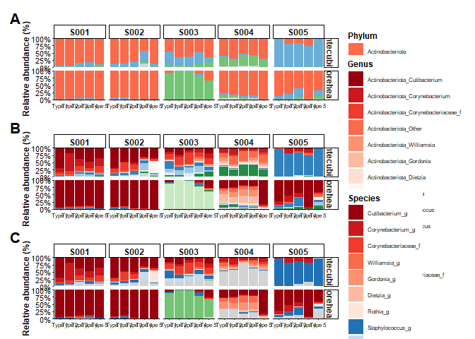<!-- -->

``` r
print(major_taxa_by_rank)
```

```
## $Phylum
## [1] "Actinobacteriota" "Firmicutes"       "Proteobacteria"  
## 
## $Genus
##  [1] "Cutibacterium"        "Streptococcus"        "Staphylococcus"      
##  [4] "Neisseriaceae_f"      "Rothia"               "Williamsia"          
##  [7] "Gordonia"             "Dietzia"              "Corynebacteriaceae_f"
## [10] "Corynebacterium"     
## 
## $Species
##  [1] "Cutibacterium_g"      "Streptococcus_g"      "Staphylococcus_g"    
##  [4] "Neisseriaceae_f"      "Rothia_g"             "Williamsia_g"        
##  [7] "Gordonia_g"           "Dietzia_g"            "Corynebacteriaceae_f"
## [10] "Corynebacterium_g"
```

``` r
# 4. Save the inspected object
ggsave(
  file.path(figure_dir, "FigureS1_participant_composition.png"),
  plot = FigureS1, width = 10.7, height = 10.8, dpi = 600,
  bg = "white", limitsize = FALSE
)
ggsave(
  file.path(figure_dir, "FigureS1_participant_composition.tiff"),
  plot = FigureS1, width = 10.7, height = 10.8, dpi = 600,
  compression = "lzw", bg = "white", limitsize = FALSE
)
```

# Figure S2 — UniFrac distance clustering


``` r
# Tables S3-S6 use the same taxa as Figure S1: global mean relative abundance >1%.
# "Others" is included in composition tables only, not in pairwise testing.
# 1. Data processing
type_levels <- paste0("Type ", 1:5)
type_columns <- paste0("Type", 1:5)
rank_relative_data <- list()

for (rank in composition_ranks) {
  ps_rank <- tax_glom(phy, taxrank = rank, NArm = FALSE)
  ps_rank <- transform_sample_counts(ps_rank, function(x) x / sum(x))
  rank_data <- psmelt(ps_rank) %>%
    left_join(swab_key, by = "swab_type2") %>%
    transmute(
      Sample,
      subject_id,
      site_group,
      Type,
      Rank = rank,
      Taxa = as.character(.data[[rank]]),
      Abundance = Abundance * 100
    )
  rank_relative_data[[rank]] <- rank_data
}
relative_long <- bind_rows(rank_relative_data)

# 2. Relative-abundance tables
relative_tables <- list()
pairwise_tables <- list()
comparisons <- combn(type_levels, 2, simplify = FALSE)

for (site in c("Antecubital", "Forehead")) {
  site_rows <- list()

  for (rank in composition_ranks) {
    selected_taxa <- major_taxa_by_rank[[rank]]
    current <- relative_long %>%
      filter(site_group == site, Rank == rank)

    selected <- current %>%
      filter(Taxa %in% selected_taxa) %>%
      group_by(Rank, Taxa, Type) %>%
      summarise(Relative_abundance = mean(Abundance), .groups = "drop")

    others <- current %>%
      group_by(Rank, Sample, Type) %>%
      summarise(
        Relative_abundance = 100 - sum(Abundance[Taxa %in% selected_taxa]),
        .groups = "drop"
      ) %>%
      group_by(Rank, Type) %>%
      summarise(Relative_abundance = mean(Relative_abundance), .groups = "drop") %>%
      mutate(Taxa = "Others")

    site_rows[[rank]] <- bind_rows(selected, others)
  }

  relative_tables[[site]] <- bind_rows(site_rows) %>%
    mutate(Type = gsub(" ", "", as.character(Type))) %>%
    pivot_wider(
      names_from = Type,
      values_from = Relative_abundance,
      values_fill = 0
    ) %>%
    mutate(Average = rowMeans(across(all_of(type_columns)))) %>%
    arrange(factor(Rank, levels = composition_ranks), desc(Average)) %>%
    mutate(across(where(is.numeric), ~round(.x, 2)))

  # 3. Friedman omnibus plus ID-aligned paired post-hoc comparisons
  test_data <- relative_long %>%
    filter(
      site_group == site,
      Taxa %in% unlist(major_taxa_by_rank, use.names = FALSE)
    ) %>%
    group_by(site_group, subject_id, Type, Rank, Taxa) %>%
    summarise(Abundance = sum(Abundance), .groups = "drop")

  test_rows <- list()
  row_index <- 1

  for (rank in composition_ranks) {
    rank_taxa <- major_taxa_by_rank[[rank]]

    for (taxon in rank_taxa) {
      current <- test_data %>%
        filter(Rank == rank, Taxa == taxon)

      result <- repeated_test(current, "Abundance", paste(rank, taxon, sep = ": "), site)
      result_row <- data.frame(Rank = rank, Taxa = taxon,
        Friedman_p = result$omnibus$p, Kendall_W = result$omnibus$Kendall_W)
      for (i in seq_len(nrow(result$pairs))) {
        pair <- result$pairs[i, ]
        result_row[[paste(pair$group1, pair$group2, sep = " vs ")]] <- pair$p.adj
      }

      test_rows[[row_index]] <- result_row
      row_index <- row_index + 1
    }
  }

  pairwise_tables[[site]] <- bind_rows(test_rows)

}

TableS3 <- relative_tables$Antecubital
TableS4 <- relative_tables$Forehead
TableS5 <- pairwise_tables$Antecubital
TableS6 <- pairwise_tables$Forehead

# 4. Inspect
print(TableS3)
```

```
## # A tibble: 26 × 8
##    Rank   Taxa                 Type1 Type2 Type3 Type4 Type5 Average
##    <chr>  <chr>                <dbl> <dbl> <dbl> <dbl> <dbl>   <dbl>
##  1 Phylum Actinobacteriota     58.1  67.0  59.7  52.1  63.0    60.0 
##  2 Phylum Firmicutes           33.9  26.7  30.7  34.3  27      30.5 
##  3 Phylum Proteobacteria        7.08  5.74  8.51  9.92  9.65    8.18
##  4 Phylum Others                0.89  0.58  1.08  3.72  0.4     1.33
##  5 Genus  Staphylococcus       28.2  21.1  19.5  19.9  23.3    22.4 
##  6 Genus  Cutibacterium        31.6  19.2  19.9  17.4  19.0    21.4 
##  7 Genus  Others               15.2  16.1  23.0  25.3  17.7    19.4 
##  8 Genus  Corynebacterium       7.86 21.5  11.7  11.4  11.8    12.8 
##  9 Genus  Corynebacteriaceae_f  7.73 14.6  15.2   7.05 11.2    11.2 
## 10 Genus  Streptococcus         2.56  4.06  6.99 10.6   2.99    5.44
## # ℹ 16 more rows
```

``` r
print(TableS4)
```

```
## # A tibble: 26 × 8
##    Rank   Taxa             Type1 Type2 Type3 Type4 Type5 Average
##    <chr>  <chr>            <dbl> <dbl> <dbl> <dbl> <dbl>   <dbl>
##  1 Phylum Actinobacteriota 73.8  71.3  68.9  77.6  79.5    74.2 
##  2 Phylum Proteobacteria   19.9  21.6  21.5  16.6  15.2    19.0 
##  3 Phylum Firmicutes        5.2   5.8   8.88  5     4.97    5.97
##  4 Phylum Others            1.14  1.31  0.65  0.86  0.27    0.84
##  5 Genus  Cutibacterium    59.1  51.8  49.8  61.1  69.3    58.2 
##  6 Genus  Neisseriaceae_f  17.7  19.8  19.4  15.8  12.1    17.0 
##  7 Genus  Others            6.1   7.23  5.65  4.72  6.46    6.03
##  8 Genus  Staphylococcus    3.35  4.54  8.11  4.52  2.4     4.58
##  9 Genus  Gordonia          4.93  3.91  5.08  4.69  0.4     3.8 
## 10 Genus  Corynebacterium   2.95  5.41  3.95  2.04  2.06    3.28
## # ℹ 16 more rows
```

``` r
print(TableS5)
```

```
##       Rank                 Taxa Friedman_p Kendall_W Type 1 vs Type 2
## 1   Phylum     Actinobacteriota 0.21780288 0.2880000        0.5917662
## 2   Phylum           Firmicutes 0.52493095 0.1600000        0.5917662
## 3   Phylum       Proteobacteria 0.09157819 0.4000000        0.7370482
## 4    Genus        Cutibacterium 0.91579942 0.0480000        1.0000000
## 5    Genus        Streptococcus 0.05816905 0.4560000        0.3550597
## 6    Genus       Staphylococcus 0.34492555 0.2240000        0.5905823
## 7    Genus      Neisseriaceae_f 0.14920724 0.3379310        0.9277334
## 8    Genus               Rothia 0.15946035 0.3292929        1.0000000
## 9    Genus           Williamsia 0.80879214 0.0800000        0.8341177
## 10   Genus             Gordonia 0.03559048 0.5152542        0.4638667
## 11   Genus              Dietzia 0.63916271 0.1265306        1.0000000
## 12   Genus Corynebacteriaceae_f 0.10584440 0.3818182        0.2641136
## 13   Genus      Corynebacterium 0.29142643 0.2480000        0.5614253
## 14 Species      Cutibacterium_g 0.91579942 0.0480000        1.0000000
## 15 Species      Streptococcus_g 0.05816905 0.4560000        0.3550597
## 16 Species     Staphylococcus_g 0.34492555 0.2240000        0.5905823
## 17 Species      Neisseriaceae_f 0.14920724 0.3379310        0.9277334
## 18 Species             Rothia_g 0.15946035 0.3292929        1.0000000
## 19 Species         Williamsia_g 0.80879214 0.0800000        0.8341177
## 20 Species           Gordonia_g 0.03559048 0.5152542        0.4638667
## 21 Species            Dietzia_g 0.63916271 0.1265306        1.0000000
## 22 Species Corynebacteriaceae_f 0.10584440 0.3818182        0.2641136
## 23 Species    Corynebacterium_g 0.29142643 0.2480000        0.5614253
##    Type 1 vs Type 3 Type 1 vs Type 4 Type 1 vs Type 5 Type 2 vs Type 3
## 1         0.7874065        0.7874065        0.7874065        0.5282271
## 2         0.7370482        1.0000000        0.5917662        0.5917662
## 3         0.7370482        0.2952911        0.7370482        0.8748961
## 4         1.0000000        1.0000000        1.0000000        1.0000000
## 5         0.1968608        0.3550597        0.6551539        0.1968608
## 6         0.5917662        1.0000000        0.5917662        1.0000000
## 7         0.9277334        0.9277334        0.9277334        1.0000000
## 8         0.5031066        0.5031066        0.6974871        0.5614253
## 9         0.8551321        0.8341177        0.8551321        0.8551321
## 10        0.4638667        0.3024153        0.3024153        1.0000000
## 11        1.0000000        1.0000000        1.0000000        1.0000000
## 12        0.3550597        0.8748961        0.6974871        0.8748961
## 13        0.5614253        0.6974871        0.9842581        0.5614253
## 14        1.0000000        1.0000000        1.0000000        1.0000000
## 15        0.1968608        0.3550597        0.6551539        0.1968608
## 16        0.5917662        1.0000000        0.5917662        1.0000000
## 17        0.9277334        0.9277334        0.9277334        1.0000000
## 18        0.5031066        0.5031066        0.6974871        0.5614253
## 19        0.8551321        0.8341177        0.8551321        0.8551321
## 20        0.4638667        0.3024153        0.3024153        1.0000000
## 21        1.0000000        1.0000000        1.0000000        1.0000000
## 22        0.3550597        0.8748961        0.6974871        0.8748961
## 23        0.5614253        0.6974871        0.9842581        0.5614253
##    Type 2 vs Type 4 Type 2 vs Type 5 Type 3 vs Type 4 Type 3 vs Type 5
## 1         0.5282271        0.7874065        0.7874065        0.7874065
## 2         0.7017817        1.0000000        0.7370482        0.7370482
## 3         0.3521514        0.2952911        0.7370482        0.7370482
## 4         1.0000000        1.0000000        1.0000000        1.0000000
## 5         0.1968608        0.6551539        1.0000000        0.5978460
## 6         1.0000000        1.0000000        1.0000000        1.0000000
## 7         1.0000000        1.0000000        1.0000000        1.0000000
## 8         0.5031066        0.5031066        1.0000000        1.0000000
## 9         0.8341177        0.8341177        0.8341177        0.8341177
## 10        0.3024153        0.3024153        0.3024153        0.3024153
## 11        1.0000000        1.0000000        1.0000000        1.0000000
## 12        0.2641136        1.0000000        0.2641136        0.8423408
## 13        0.5614253        0.5614253        1.0000000        1.0000000
## 14        1.0000000        1.0000000        1.0000000        1.0000000
## 15        0.1968608        0.6551539        1.0000000        0.5978460
## 16        1.0000000        1.0000000        1.0000000        1.0000000
## 17        1.0000000        1.0000000        1.0000000        1.0000000
## 18        0.5031066        0.5031066        1.0000000        1.0000000
## 19        0.8341177        0.8341177        0.8341177        0.8341177
## 20        0.3024153        0.3024153        0.3024153        0.3024153
## 21        1.0000000        1.0000000        1.0000000        1.0000000
## 22        0.2641136        1.0000000        0.2641136        0.8423408
## 23        0.5614253        0.5614253        1.0000000        1.0000000
##    Type 4 vs Type 5
## 1         0.7874065
## 2         0.7370482
## 3         1.0000000
## 4         1.0000000
## 5         0.4678544
## 6         1.0000000
## 7         1.0000000
## 8         1.0000000
## 9         0.8341177
## 10        0.6487582
## 11        1.0000000
## 12        0.2641136
## 13        0.8423408
## 14        1.0000000
## 15        0.4678544
## 16        1.0000000
## 17        1.0000000
## 18        1.0000000
## 19        0.8341177
## 20        0.6487582
## 21        1.0000000
## 22        0.2641136
## 23        0.8423408
```

``` r
print(TableS6)
```

```
##       Rank                 Taxa Friedman_p  Kendall_W Type 1 vs Type 2
## 1   Phylum     Actinobacteriota 0.14236720 0.34400000        0.5614253
## 2   Phylum           Firmicutes 0.27520488 0.25600000        1.0000000
## 3   Phylum       Proteobacteria 0.27484930 0.25617978        0.9501468
## 4    Genus        Cutibacterium 0.12568912 0.36000000        0.4438246
## 5    Genus        Streptococcus 0.74393330 0.09777778        0.8551321
## 6    Genus       Staphylococcus 0.23107824 0.28000000        0.5978460
## 7    Genus      Neisseriaceae_f 0.03303532 0.52413793        0.2592132
## 8    Genus               Rothia 0.74066380 0.09866667        1.0000000
## 9    Genus           Williamsia 0.50824368 0.16521739        1.0000000
## 10   Genus             Gordonia 0.69496297 0.11111111        1.0000000
## 11   Genus              Dietzia 0.98247690 0.02000000        1.0000000
## 12   Genus Corynebacteriaceae_f 0.34492555 0.22400000        0.5917662
## 13   Genus      Corynebacterium 0.57810373 0.14400000        0.9357089
## 14 Species      Cutibacterium_g 0.12568912 0.36000000        0.4438246
## 15 Species      Streptococcus_g 0.74393330 0.09777778        0.8551321
## 16 Species     Staphylococcus_g 0.23107824 0.28000000        0.5978460
## 17 Species      Neisseriaceae_f 0.03303532 0.52413793        0.2592132
## 18 Species             Rothia_g 0.74066380 0.09866667        1.0000000
## 19 Species         Williamsia_g 0.50824368 0.16521739        1.0000000
## 20 Species           Gordonia_g 0.69496297 0.11111111        1.0000000
## 21 Species            Dietzia_g 0.98247690 0.02000000        1.0000000
## 22 Species Corynebacteriaceae_f 0.34492555 0.22400000        0.5917662
## 23 Species    Corynebacterium_g 0.57810373 0.14400000        0.9357089
##    Type 1 vs Type 3 Type 1 vs Type 4 Type 1 vs Type 5 Type 2 vs Type 3
## 1         0.8748961        0.5614253        0.6974871        1.0000000
## 2         1.0000000        1.0000000        1.0000000        1.0000000
## 3         0.9501468        0.3344942        0.9501468        1.0000000
## 4         0.4438246        1.0000000        0.4649914        0.4649914
## 5         0.8551321        0.8551321        0.8551321        0.8551321
## 6         0.5978460        0.7370482        0.5978460        0.5978460
## 7         0.4696423        0.2592132        0.2592132        0.4696423
## 8         1.0000000        1.0000000        1.0000000        1.0000000
## 9         1.0000000        1.0000000        1.0000000        1.0000000
## 10        1.0000000        1.0000000        1.0000000        1.0000000
## 11        1.0000000        1.0000000        1.0000000        1.0000000
## 12        1.0000000        1.0000000        1.0000000        1.0000000
## 13        0.9357089        1.0000000        1.0000000        0.5905823
## 14        0.4438246        1.0000000        0.4649914        0.4649914
## 15        0.8551321        0.8551321        0.8551321        0.8551321
## 16        0.5978460        0.7370482        0.5978460        0.5978460
## 17        0.4696423        0.2592132        0.2592132        0.4696423
## 18        1.0000000        1.0000000        1.0000000        1.0000000
## 19        1.0000000        1.0000000        1.0000000        1.0000000
## 20        1.0000000        1.0000000        1.0000000        1.0000000
## 21        1.0000000        1.0000000        1.0000000        1.0000000
## 22        1.0000000        1.0000000        1.0000000        1.0000000
## 23        0.9357089        1.0000000        1.0000000        0.5905823
##    Type 2 vs Type 4 Type 2 vs Type 5 Type 3 vs Type 4 Type 3 vs Type 5
## 1         0.5282271        0.5614253        0.7370482        0.5282271
## 2         1.0000000        1.0000000        1.0000000        0.5905823
## 3         0.3344942        0.9501468        0.3344942        0.9501468
## 4         0.4649914        0.4649914        0.4438246        0.4438246
## 5         0.8551321        0.8551321        0.8551321        0.8551321
## 6         1.0000000        0.5978460        1.0000000        0.5905823
## 7         0.2592132        0.2592132        0.2592132        0.2592132
## 8         1.0000000        1.0000000        1.0000000        1.0000000
## 9         1.0000000        1.0000000        1.0000000        1.0000000
## 10        1.0000000        1.0000000        1.0000000        1.0000000
## 11        1.0000000        1.0000000        1.0000000        1.0000000
## 12        0.2952911        1.0000000        0.2952911        1.0000000
## 13        0.9827309        1.0000000        0.9827309        1.0000000
## 14        0.4649914        0.4649914        0.4438246        0.4438246
## 15        0.8551321        0.8551321        0.8551321        0.8551321
## 16        1.0000000        0.5978460        1.0000000        0.5905823
## 17        0.2592132        0.2592132        0.2592132        0.2592132
## 18        1.0000000        1.0000000        1.0000000        1.0000000
## 19        1.0000000        1.0000000        1.0000000        1.0000000
## 20        1.0000000        1.0000000        1.0000000        1.0000000
## 21        1.0000000        1.0000000        1.0000000        1.0000000
## 22        0.2952911        1.0000000        0.2952911        1.0000000
## 23        0.9827309        1.0000000        0.9827309        1.0000000
##    Type 4 vs Type 5
## 1         0.7370482
## 2         1.0000000
## 3         0.9501468
## 4         0.4649914
## 5         0.8551321
## 6         0.5978460
## 7         1.0000000
## 8         1.0000000
## 9         1.0000000
## 10        1.0000000
## 11        1.0000000
## 12        1.0000000
## 13        0.9827309
## 14        0.4649914
## 15        0.8551321
## 16        0.5978460
## 17        1.0000000
## 18        1.0000000
## 19        1.0000000
## 20        1.0000000
## 21        1.0000000
## 22        1.0000000
## 23        0.9827309
```

``` r
# 5. Save the inspected tables
write.csv(
  TableS3,
  file.path(table_dir, "TableS3_Antecubital_relative_abundance_taxa_over_1pct.csv"),
  row.names = FALSE, na = "N/A"
)
write.csv(
  TableS4,
  file.path(table_dir, "TableS4_Forehead_relative_abundance_taxa_over_1pct.csv"),
  row.names = FALSE, na = "N/A"
)
write.csv(
  TableS5,
  file.path(table_dir, "TableS5_Antecubital_pairwise_taxa_over_1pct.csv"),
  row.names = FALSE, na = "N/A"
)
write.csv(
  TableS6,
  file.path(table_dir, "TableS6_Forehead_pairwise_taxa_over_1pct.csv"),
  row.names = FALSE, na = "N/A"
)
```


``` r
# 6. Figure S2: distance heatmaps by site
# -----------------------------------------------------------------------------

subject_annotation_col <- subject_col
swab_annotation_col <- type_col

# 1. Data processing and heatmap construction
heatmap_settings <- data.frame(
  panel = c("A", "B", "C", "D"),
  site = c("Antecubital", "Antecubital", "Forehead", "Forehead"),
  method = c("unifrac", "wunifrac", "unifrac", "wunifrac"),
  title = c(
    "Antecubital Unweighted UniFrac",
    "Antecubital Weighted UniFrac",
    "Forehead Unweighted UniFrac",
    "Forehead Weighted UniFrac"
  )
)

heatmap_panels <- list()

for (i in seq_len(nrow(heatmap_settings))) {
  current <- heatmap_settings[i, ]
  keep <- sample_names(phy_rar)[
    as.character(sample_data(phy_rar)$site_group) == current$site
  ]
  ps_site <- prune_samples(keep, phy_rar)
  ps_site <- prune_taxa(taxa_sums(ps_site) > 0, ps_site)

  distance_matrix <- as.matrix(
    phyloseq::distance(ps_site, method = current$method)
  )
  metadata <- data.frame(sample_data(ps_site), check.names = FALSE) %>%
    rownames_to_column("sample_name") %>%
    left_join(swab_key, by = "swab_type2")

  annotation <- data.frame(
    Subject = metadata$subject_id,
    Swab_type = metadata$Type
  )
  rownames(annotation) <- metadata$sample_name

  heatmap_panels[[current$panel]] <- wrap_elements(
    full = pheatmap(
      distance_matrix,
      silent = TRUE,
      clustering_method = "complete",
      annotation_col = annotation,
      annotation_row = annotation,
      annotation_colors = list(
        Subject = subject_col,
        Swab_type = type_col
      ),
      show_rownames = TRUE,
      show_colnames = TRUE,
      fontsize = 6,
      border_color = NA,
      main = current$title
    )$gtable
  )
}

# 2. Assemble and inspect
FigureS2 <- (
  (heatmap_panels$A | heatmap_panels$B) /
    (heatmap_panels$C | heatmap_panels$D)
) +
  plot_annotation(tag_levels = "A") &
  theme(plot.tag = element_text(size = 16, face = "bold"))

print(FigureS2)
```

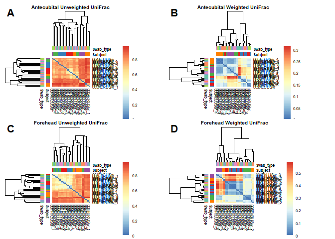<!-- -->

``` r
# 3. Save the inspected object
ggsave(
  file.path(figure_dir, "FigureS2_UniFrac_heatmaps.png"),
  plot = FigureS2, width = 10.5, height = 8.5, dpi = 600,
  bg = "white", limitsize = FALSE
)
ggsave(
  file.path(figure_dir, "FigureS2_UniFrac_heatmaps.tiff"),
  plot = FigureS2, width = 10.5, height = 8.5, dpi = 600,
  compression = "lzw", bg = "white", limitsize = FALSE
)
```

# Figure S3 — participant-level alpha and beta diversity


``` r
# 7. Figure S3: participant-level alpha and beta diversity
# -----------------------------------------------------------------------------

# 1. Data processing
alpha_s3 <- estimate_richness(
  phy_rar, measures = c("Shannon", "Observed")
) %>%
  rownames_to_column("sample_name") %>%
  mutate(sample_name = sub("^X", "", sample_name)) %>%
  left_join(meta_rar, by = "sample_name") %>%
  pivot_longer(
    c(Shannon, Observed),
    names_to = "Index",
    values_to = "Value"
  ) %>%
  mutate(
    Index = factor(
      Index,
      levels = c("Shannon", "Observed"),
      labels = c("Shannon index", "Observed ASVs")
    )
  )

# Descriptive participant summaries; no independent-replicate claim for swabs.
FigureS3_alpha_statistics <- alpha_s3 %>%
  group_by(site_group, Index, subject_id) %>%
  summarise(n_swabs = n(), median = median(Value), IQR = IQR(Value),
            .groups = "drop")

# 2. Alpha-diversity plots
s3_A <- alpha_plot(
  filter(alpha_s3, site_group == "Antecubital"),
  x_var = "subject_id",
  fill_var = "subject_id",
  shape_var = "Type",
  site_title = "Antecubital fossa",
  y_title = "Alpha diversity",
  paired = FALSE,
  show_legend = TRUE
) + scale_fill_manual(values = subject_col, drop = FALSE)

s3_B <- alpha_plot(
  filter(alpha_s3, site_group == "Forehead"),
  x_var = "subject_id",
  fill_var = "subject_id",
  shape_var = "Type",
  site_title = "Forehead",
  y_title = "Alpha diversity",
  paired = FALSE,
  show_legend = FALSE
) + scale_fill_manual(values = subject_col, drop = FALSE)

# 3. Beta-diversity statistics and plots
s3_C_result <- beta_plot(
  phy_rar, "Antecubital", "unifrac", "subject_id",
  "subject_id", "Type", NULL,
  "Antecubital fossa", "Unweighted UniFrac", FALSE
)
s3_D_result <- beta_plot(
  phy_rar, "Antecubital", "wunifrac", "subject_id",
  "subject_id", "Type", NULL,
  "Antecubital fossa", "Weighted UniFrac", TRUE
)
s3_E_result <- beta_plot(
  phy_rar, "Forehead", "unifrac", "subject_id",
  "subject_id", "Type", NULL,
  "Forehead", "Unweighted UniFrac", FALSE
)
s3_F_result <- beta_plot(
  phy_rar, "Forehead", "wunifrac", "subject_id",
  "subject_id", "Type", NULL,
  "Forehead", "Weighted UniFrac", TRUE
)

s3_C <- s3_C_result$plot +
  scale_colour_manual(values = subject_col, drop = FALSE)
s3_D <- s3_D_result$plot +
  scale_colour_manual(values = subject_col, drop = FALSE)
s3_E <- s3_E_result$plot +
  scale_colour_manual(values = subject_col, drop = FALSE)
s3_F <- s3_F_result$plot +
  scale_colour_manual(values = subject_col, drop = FALSE)

FigureS3_PERMANOVA <- bind_rows(
  s3_C_result$permanova,
  s3_D_result$permanova,
  s3_E_result$permanova,
  s3_F_result$permanova
)

# 4. Assemble and inspect
FigureS3 <- (
  wrap_elements(full = (s3_A | s3_B)) /
    wrap_elements(full = (s3_C | s3_D)) /
    wrap_elements(full = (s3_E | s3_F))
) +
  plot_annotation(tag_levels = "A") &
  theme(plot.tag = element_text(size = 16, face = "bold"))

print(FigureS3)
```

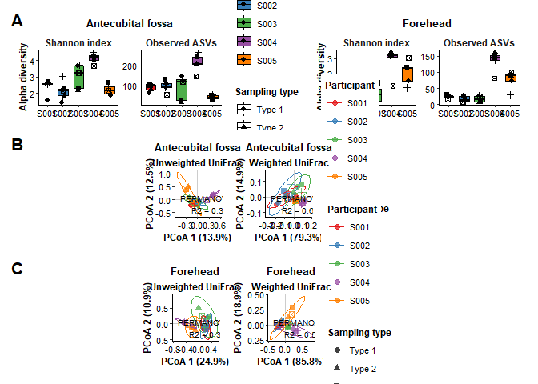<!-- -->

``` r
print(FigureS3_alpha_statistics)
```

```
## # A tibble: 20 × 6
##    site_group  Index         subject_id n_swabs  median      IQR
##    <chr>       <fct>         <chr>        <int>   <dbl>    <dbl>
##  1 Antecubital Shannon index S001             5   2.58    0.0805
##  2 Antecubital Shannon index S002             5   2.16    0.405 
##  3 Antecubital Shannon index S003             5   3.23    1.38  
##  4 Antecubital Shannon index S004             5   4.21    0.318 
##  5 Antecubital Shannon index S005             5   2.17    0.418 
##  6 Antecubital Observed ASVs S001             5 101      21     
##  7 Antecubital Observed ASVs S002             5  91      21     
##  8 Antecubital Observed ASVs S003             5 117     107     
##  9 Antecubital Observed ASVs S004             5 208      35     
## 10 Antecubital Observed ASVs S005             5  37      18     
## 11 Forehead    Shannon index S001             5   0.440   0.270 
## 12 Forehead    Shannon index S002             5   0.115   0.329 
## 13 Forehead    Shannon index S003             5   0.573   0.802 
## 14 Forehead    Shannon index S004             5   3.18    0.124 
## 15 Forehead    Shannon index S005             5   2.33    0.919 
## 16 Forehead    Observed ASVs S001             5  25       4     
## 17 Forehead    Observed ASVs S002             5  13      15     
## 18 Forehead    Observed ASVs S003             5  16      18     
## 19 Forehead    Observed ASVs S004             5 144      16     
## 20 Forehead    Observed ASVs S005             5  89      17
```

``` r
print(FigureS3_PERMANOVA)
```

```
##                site           distance   variable        R2        F p_value
## 1 Antecubital fossa Unweighted UniFrac subject_id 0.3412932 2.590630      NA
## 2 Antecubital fossa   Weighted UniFrac subject_id 0.6561788 9.542443      NA
## 3          Forehead Unweighted UniFrac subject_id 0.3956440 3.273269      NA
## 4          Forehead   Weighted UniFrac subject_id 0.5960578 7.378008      NA
```

``` r
# 5. Save the inspected objects
ggsave(
  file.path(figure_dir, "FigureS3_participant_alpha_beta.png"),
  plot = FigureS3, width = 10, height = 10, dpi = 600,
  bg = "white", limitsize = FALSE
)
ggsave(
  file.path(figure_dir, "FigureS3_participant_alpha_beta.tiff"),
  plot = FigureS3, width = 10, height = 10, dpi = 600,
  compression = "lzw", bg = "white", limitsize = FALSE
)
write.csv(
  FigureS3_alpha_statistics,
  file.path(table_dir, "FigureS3_alpha_participant_descriptive.csv"),
  row.names = FALSE
)
write.csv(
  FigureS3_PERMANOVA,
  file.path(table_dir, "FigureS3_PERMANOVA.csv"),
  row.names = FALSE
)
write.csv(
  swab_key,
  file.path(table_dir, "Swab_type_key.csv"),
  row.names = FALSE
)
```

# Final figure preview

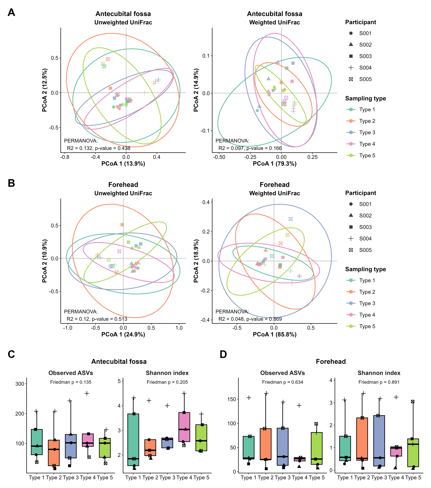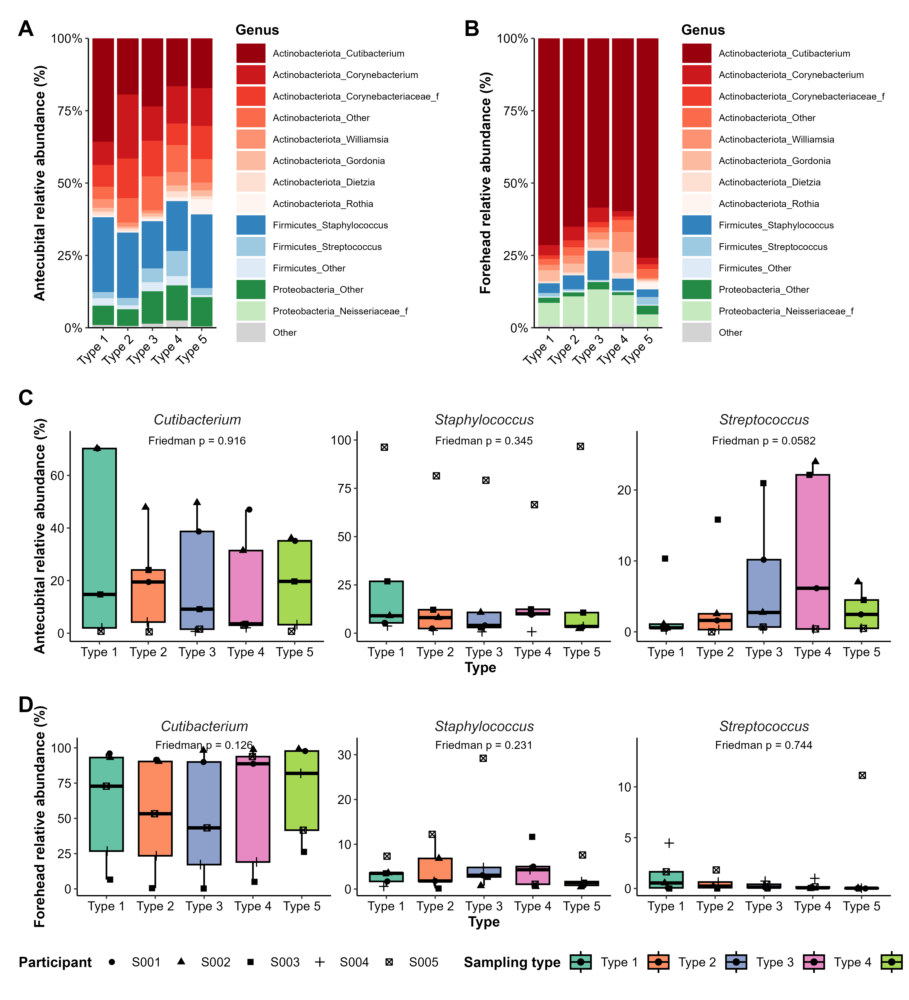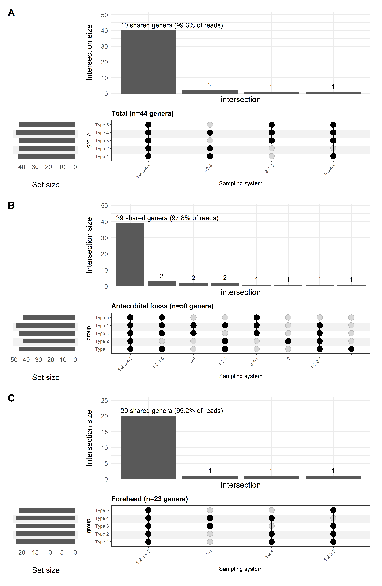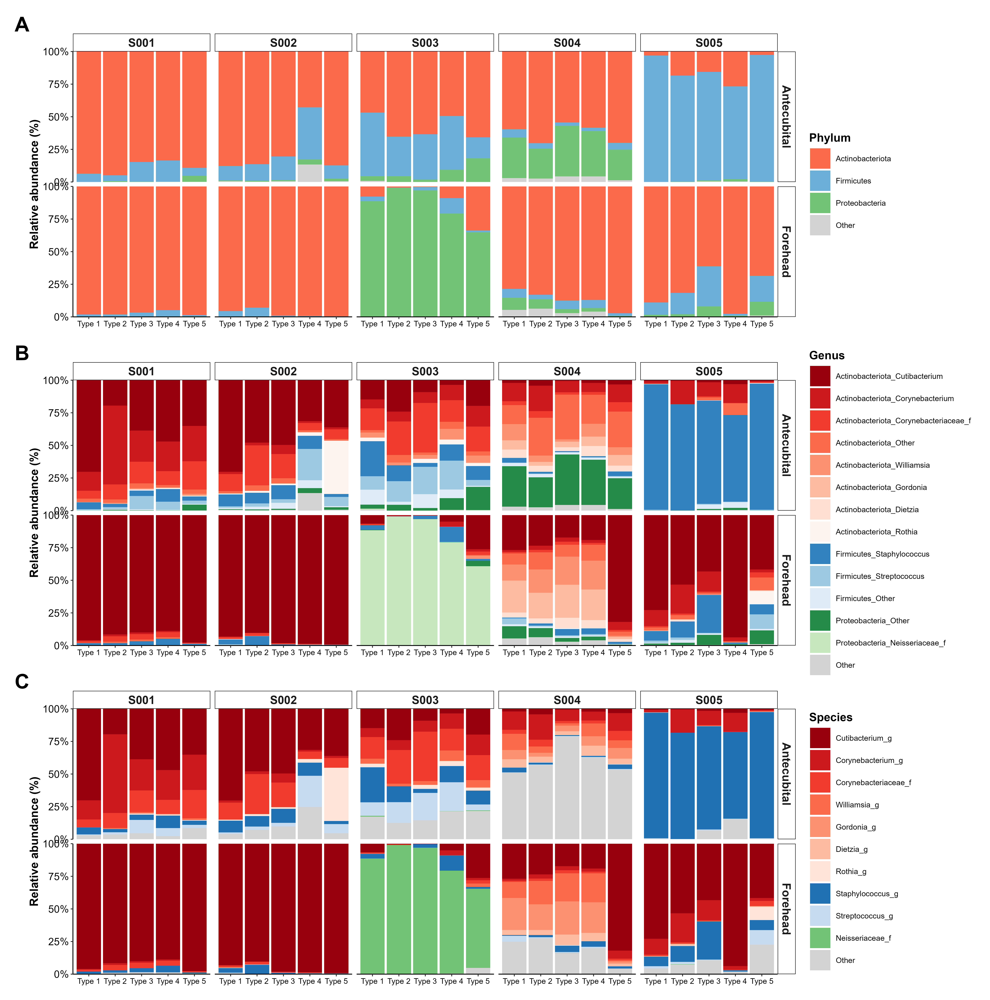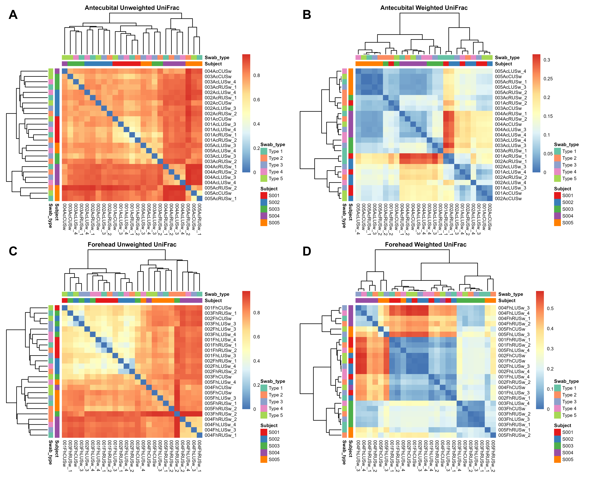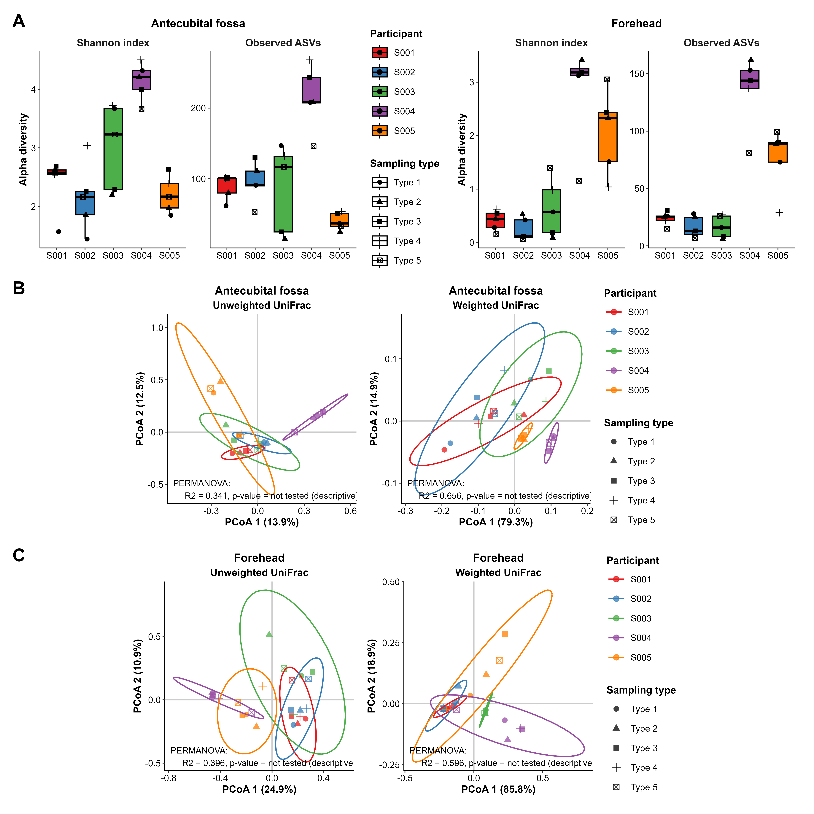

# Table 3. PERMANOVA results for bacterial community variation based on weighted UniFrac distance (9,999 permutations). 


``` r
# Fri Aug 14 10:51:08 2026 ------------------------------


set.seed(42)
dist <- phyloseq::distance(phy_rar, method = "wunifrac")
```

```
## Warning in matrix(tree$edge[order(tree$edge[, 1]), ][, 2], byrow = TRUE, : data
## length [3371] is not a sub-multiple or multiple of the number of rows [1686]
```

``` r
dist2 <- phyloseq::distance(phy_rar, method = "unifrac")
```

```
## Warning in matrix(tree$edge[order(tree$edge[, 1]), ][, 2], byrow = TRUE, : data
## length [3371] is not a sub-multiple or multiple of the number of rows [1686]
```

``` r
meta   <- phy_rar %>% sample_data() %>% data.frame()

meta$swab_type
```

```
##  [1] "Eswab"   "Puritan" "Omni"    "Copan"   "Puritan" "Eswab"   "Puritan"
##  [8] "Omni"    "Copan"   "Puritan" "Eswab"   "Puritan" "Omni"    "Copan"  
## [15] "Puritan" "Eswab"   "Puritan" "Omni"    "Copan"   "Puritan" "Eswab"  
## [22] "Puritan" "Omni"    "Copan"   "Puritan" "Eswab"   "Puritan" "Omni"   
## [29] "Copan"   "Puritan" "Eswab"   "Puritan" "Omni"    "Copan"   "Puritan"
## [36] "Eswab"   "Puritan" "Omni"    "Copan"   "Puritan" "Eswab"   "Puritan"
## [43] "Omni"    "Copan"   "Puritan" "Eswab"   "Puritan" "Omni"    "Copan"  
## [50] "Puritan"
```

``` r
meta2 <- meta %>% 
  mutate(
    `Collection_medium` = case_when(
      swab_type2 %in% c("Puritan_gel", "Copan") ~  "Gel",
      swab_type2 %in% "Puritan_buffer" ~ "buffer",
      swab_type2 %in% "Omni" ~ "Omni_buffer",
      swab_type2 %in% "Eswab" ~ "Eswab_buffer"
      ),
    `Swab_material` = case_when(
      swab_type %in%  "Eswab" ~  "Nylon",
      swab_type %in%  "Omni" ~ "Polyester",
      swab_type %in% "Puritan" ~ "Polyurethane foam",
      swab_type %in% "Copan" ~"Rayon"
      )
    )      
```


``` r
# # PERMANOVA
# set.seed(42)
# Perm1    <- adonis2(
#   dist ~ subject_id + swab_type2 + site_group + Collection_medium + Swab_material,
#   data         = meta2,
#   permutations = 9999,
#   # strata = meta2$SubjectID,
#   by ="margin"
# ) 
# 
# set.seed(42)
# 
# Perm <- adonis2(
#   dist ~ subject_id + swab_type2 + site_group +  Collection_medium + Swab_material,
#   data = meta2,
#   permutations = 9999,
#   strata = meta2$SubjectID,
#   by = "terms"
# )
# 
# 
# set.seed(42)
# Perm2    <- adonis2(
#   dist ~ subject_id + swab_type2 + site_group + Collection_medium + Swab_material,
#   data         = meta2,
#   permutations = 9999,
#   # strata = meta2$SubjectID,
#   # by ="margin"
#     by = "terms"
# ) 
#  
```


``` r
# System/material/medium labels may change only within participant and site.
set.seed(42)
system_permutations <- permute::shuffleSet(nrow(meta2), nset = 9999,
  control = permute::how(blocks = interaction(meta2$subject_id, meta2$site_group)))
# Site labels are exchanged as complete five-system bundles within participant.
set.seed(42)
site_permutations <- t(replicate(9999, {
  idx <- seq_len(nrow(meta2))
  for (id in unique(meta2$subject_id)) {
    if (sample(c(FALSE, TRUE), 1)) {
      rows <- which(meta2$subject_id == id)
      for (r in rows) {
        partner <- which(meta2$subject_id == id &
          meta2$swab_type2 == meta2$swab_type2[r] &
          meta2$site_group != meta2$site_group[r])
        stopifnot(length(partner) == 1)
        idx[r] <- partner
      }
    }
  }
  idx
}))
df5 <- adonis2(dist ~ Collection_medium, data = meta2, permutations = system_permutations)
df1 <- adonis2(dist ~ subject_id, data = meta2, permutations = 0)
df2 <- adonis2(dist ~ site_group, data = meta2, permutations = site_permutations)
df3 <- adonis2(dist ~ swab_type2, data = meta2, permutations = system_permutations)
df4 <- adonis2(dist ~ Swab_material, data = meta2, permutations = system_permutations)
df1$`Pr(>F)`[1] <- NA_real_

univar_per <- data.frame(
  variable = c("Participant identity", "Anatomical site", "Sampling system", "Swab-tip material", "Collection medium"),
  df = c(df1$Df[1], df2$Df[1],  df3$Df[1], df4$Df[1], df5$Df[1]),
  `F` = c(df1$`F`[1], df2$`F`[1],  df3$`F`[1], df4$`F`[1], df5$`F`[1]),
  R2 = c(df1$R2[1], df2$R2[1], df3$R2[1], df4$R2[1], df5$R2[1]),
  `p-value` = c(df1$`Pr(>F)`[1], df2$`Pr(>F)`[1], df3$`Pr(>F)`[1], df4$`Pr(>F)`[1], df5$`Pr(>F)`[1])
)


univar_per$q.value <- p.adjust(univar_per$p.value, "fdr")

write.csv(
    univar_per,
    file.path(table_dir, "Table3_permanova_BH.csv"),
    row.names = FALSE
  )
```
## Depth 

``` r
sum(sample_sums(phy)) # 847074
```

```
## [1] 847074
```

``` r
summary(sample_sums(phy))
```

```
##    Min. 1st Qu.  Median    Mean 3rd Qu.    Max. 
##    5876   12330   17413   16941   21164   31707
```

``` r
  # Min. 1st Qu.  Median    Mean 3rd Qu.    Max. 
  #  5876   12330   17413   16941   21164   31707 

sd(sample_sums(phy))  #  6055.549
```

```
## [1] 6055.549
```

``` r
# Table S3: sequencing depth and observed taxonomic richness
# Species-level output is intentionally excluded from the revised manuscript.

# 1. Overall summary
ps_sub <- prune_taxa(taxa_sums(phy) > 0, phy)
reads <- sample_sums(ps_sub)
tax_df <- as.data.frame(tax_table(ps_sub), stringsAsFactors = FALSE)

depth_rows <- list(
  data.frame(
    Scope = "Overall",
    Site = "All",
    Sampling_system = "All",
    N_samples = nsamples(ps_sub),
    Total_reads = sum(reads),
    Mean_Reads = round(mean(reads), 1),
    SD_Reads = round(sd(reads), 1),
    ASV_Count = ntaxa(ps_sub),
    Phylum_Count = n_distinct(na.omit(tax_df$Phylum)),
    Genus_Count = n_distinct(na.omit(tax_df$Genus))
  )
)
#     Scope Site Sampling_system N_samples Total_reads Mean_Reads SD_Reads ASV_Count Phylum_Count Genus_Count
# 1 Overall  All             All        50      847074    16941.5   6055.5      1780           21         344


# 2. Anatomical-site summaries
row_index <- 2
for (site_value in c("Ac", "Fh")) {
  keep <- sample_names(phy)[
    as.character(sample_data(phy)$site_id) == site_value
  ]
  ps_sub <- prune_samples(keep, phy)
  ps_sub <- prune_taxa(taxa_sums(ps_sub) > 0, ps_sub)
  reads <- sample_sums(ps_sub)
  tax_df <- as.data.frame(tax_table(ps_sub), stringsAsFactors = FALSE)

  depth_rows[[row_index]] <- data.frame(
    Scope = "Anatomical site",
    Site = site_value,
    Sampling_system = "All",
    N_samples = nsamples(ps_sub),
    Total_reads = sum(reads),
    Mean_Reads = round(mean(reads), 1),
    SD_Reads = round(sd(reads), 1),
    ASV_Count = ntaxa(ps_sub),
    Phylum_Count = n_distinct(na.omit(tax_df$Phylum)),
    Genus_Count = n_distinct(na.omit(tax_df$Genus))
  )
  row_index <- row_index + 1
}

# 3. Site-by-sampling-system summaries
for (site_value in c("Ac", "Fh")) {
  for (i in seq_len(nrow(swab_key))) {
    swab_value <- swab_key$swab_type2[i]
    type_value <- as.character(swab_key$Type[i])
    keep <- sample_names(phy)[
      as.character(sample_data(phy)$site_id) == site_value &
        as.character(sample_data(phy)$swab_type2) == swab_value
    ]
    ps_sub <- prune_samples(keep, phy)
    ps_sub <- prune_taxa(taxa_sums(ps_sub) > 0, ps_sub)
    reads <- sample_sums(ps_sub)
    tax_df <- as.data.frame(tax_table(ps_sub), stringsAsFactors = FALSE)

    depth_rows[[row_index]] <- data.frame(
      Scope = "Anatomical site x sampling system",
      Site = site_value,
      Sampling_system = type_value,
      N_samples = nsamples(ps_sub),
      Total_reads = sum(reads),
      Mean_Reads = round(mean(reads), 1),
      SD_Reads = round(sd(reads), 1),
      ASV_Count = ntaxa(ps_sub),
      Phylum_Count = n_distinct(na.omit(tax_df$Phylum)),
      Genus_Count = n_distinct(na.omit(tax_df$Genus))
    )
    row_index <- row_index + 1
  }
}

table_s3_depth <- bind_rows(depth_rows) %>%
  mutate(
    Site = factor(Site, levels = c("All", "Ac", "Fh")),
    Sampling_system = factor(
      Sampling_system,
      levels = c("All", paste0("Type ", 1:5))
    )
  ) %>%
  arrange(Site, Sampling_system) %>%
  mutate(
    Site = as.character(Site),
    Sampling_system = as.character(Sampling_system)
  )

# 4. Inspect
print(table_s3_depth)
```

```
##                                Scope Site Sampling_system N_samples Total_reads
## 1                            Overall  All             All        50      847074
## 2                    Anatomical site   Ac             All        25      404034
## 3  Anatomical site x sampling system   Ac          Type 1         5       96624
## 4  Anatomical site x sampling system   Ac          Type 2         5       79099
## 5  Anatomical site x sampling system   Ac          Type 3         5       81060
## 6  Anatomical site x sampling system   Ac          Type 4         5       76555
## 7  Anatomical site x sampling system   Ac          Type 5         5       70696
## 8                    Anatomical site   Fh             All        25      443040
## 9  Anatomical site x sampling system   Fh          Type 1         5       86214
## 10 Anatomical site x sampling system   Fh          Type 2         5       91864
## 11 Anatomical site x sampling system   Fh          Type 3         5       93332
## 12 Anatomical site x sampling system   Fh          Type 4         5       83230
## 13 Anatomical site x sampling system   Fh          Type 5         5       88400
##    Mean_Reads SD_Reads ASV_Count Phylum_Count Genus_Count
## 1     16941.5   6055.5      1780           21         344
## 2     16161.4   5090.2      1348           15         278
## 3     19324.8   3407.0       495           12         140
## 4     15819.8   4818.9       405           11         134
## 5     16212.0   7125.4       503           10         133
## 6     15311.0   5906.8       572           12         162
## 7     14139.2   4036.9       374            9         105
## 8     17721.6   6905.7       788           17         211
## 9     17242.8   9524.0       270           14          98
## 10    18372.8   7761.3       276           11         105
## 11    18666.4   7057.5       266           10          98
## 12    16646.0   6286.5       203            7          77
## 13    17680.0   6517.8       213            8          80
```

``` r
#                                Scope Site Sampling_system N_samples Total_reads Mean_Reads SD_Reads ASV_Count Phylum_Count Genus_Count
# 1                            Overall  All             All        50      847074    16941.5   6055.5      1780           21         344
# 2                    Anatomical site   Ac             All        25      404034    16161.4   5090.2      1348           15         278
# 3  Anatomical site x sampling system   Ac          Type 1         5       96624    19324.8   3407.0       495           12         140
# 4  Anatomical site x sampling system   Ac          Type 2         5       79099    15819.8   4818.9       405           11         134
# 5  Anatomical site x sampling system   Ac          Type 3         5       81060    16212.0   7125.4       503           10         133
# 6  Anatomical site x sampling system   Ac          Type 4         5       76555    15311.0   5906.8       572           12         162
# 7  Anatomical site x sampling system   Ac          Type 5         5       70696    14139.2   4036.9       374            9         105
# 8                    Anatomical site   Fh             All        25      443040    17721.6   6905.7       788           17         211
# 9  Anatomical site x sampling system   Fh          Type 1         5       86214    17242.8   9524.0       270           14          98
# 10 Anatomical site x sampling system   Fh          Type 2         5       91864    18372.8   7761.3       276           11         105
# 11 Anatomical site x sampling system   Fh          Type 3         5       93332    18666.4   7057.5       266           10          98
# 12 Anatomical site x sampling system   Fh          Type 4         5       83230    16646.0   6286.5       203            7          77
# 13 Anatomical site x sampling system   Fh          Type 5         5       88400    17680.0   6517.8       213            8          80

# 5. Save the inspected table
write.csv(
  table_s3_depth,
  file.path(table_dir, "TableS3_sequencing_depth_by_site_and_sampling_system.csv"),
  row.names = FALSE
)
```


## DNA Conc

``` r
meta <- readxl::read_xlsx("../Paper/HN00182797_Original_Sample_QC_and_NGS_Library_QC.xlsx")


meta
```

```
## # A tibble: 55 × 20
##      No. Sample_Name Sample_Category Order_Number Assay   Original_QC_Conc_ng_uL
##    <dbl> <chr>       <chr>           <chr>        <chr>                    <dbl>
##  1     1 001AcRUSw_1 Skin sample     HN00182797   16S rR…                   0.49
##  2     2 001AcRUSw_2 Skin sample     HN00182797   16S rR…                   0.52
##  3     3 001AcLUSw_3 Skin sample     HN00182797   16S rR…                   0.52
##  4     4 001AcLUSw_4 Skin sample     HN00182797   16S rR…                   0.51
##  5     5 001AcCUSw   Skin sample     HN00182797   16S rR…                   0.56
##  6     6 001FhRUSw_1 Skin sample     HN00182797   16S rR…                   0.5 
##  7     7 001FhRUSw_2 Skin sample     HN00182797   16S rR…                   0.55
##  8     8 001FhLUSw_3 Skin sample     HN00182797   16S rR…                   0.51
##  9     9 001FhLUSw_4 Skin sample     HN00182797   16S rR…                   0.55
## 10    10 001FhCUSw   Skin sample     HN00182797   16S rR…                   0.55
## # ℹ 45 more rows
## # ℹ 14 more variables: Original_QC_Add_Volume_uL <dbl>,
## #   Original_QC_Final_Volume_uL <dbl>, Original_QC_Total_Amount_ug <dbl>,
## #   Original_QC_Result <chr>, Original_QC_Source_Page <dbl>,
## #   Library_Type <chr>, Library_QC_Conc_ng_uL <dbl>, Library_QC_Conc_nM <lgl>,
## #   Library_QC_Size_bp <dbl>, Library_QC_Result <chr>,
## #   Library_QC_Comment <chr>, Library_QC_Source_Page <dbl>, …
```


## Statistic test


``` r
ps_sub <- prune_taxa(taxa_sums(phy) > 0, phy)
df <- data.frame(sample_data(ps_sub))
df$Depth <- sample_sums(ps_sub)
meta[, c("Sample_Name", "Original_QC_Conc_ng_uL")]
```

```
## # A tibble: 55 × 2
##    Sample_Name Original_QC_Conc_ng_uL
##    <chr>                        <dbl>
##  1 001AcRUSw_1                   0.49
##  2 001AcRUSw_2                   0.52
##  3 001AcLUSw_3                   0.52
##  4 001AcLUSw_4                   0.51
##  5 001AcCUSw                     0.56
##  6 001FhRUSw_1                   0.5 
##  7 001FhRUSw_2                   0.55
##  8 001FhLUSw_3                   0.51
##  9 001FhLUSw_4                   0.55
## 10 001FhCUSw                     0.55
## # ℹ 45 more rows
```

``` r
dna_meta <- meta %>% select(Sample_Name, Original_QC_Conc_ng_uL)
if (anyDuplicated(dna_meta$Sample_Name)) stop("Duplicate DNA QC sample IDs")
df2 <- left_join(df, dna_meta, by = c("sample_id" = "Sample_Name"))
write.csv(df2 %>% select(sample_id, subject_id, site_group, swab_type2, Depth,
                        Original_QC_Conc_ng_uL),
          file.path(table_dir, "DNA_read_metadata_join_audit.csv"), row.names = FALSE)
```


### Friedman and paired post-hoc tests for DNA concentration and retained reads


``` r
df2 <- df2 %>% left_join(swab_key, by = "swab_type2")
stopifnot(!anyDuplicated(df2[c("subject_id", "site_group", "Type")]))
for (site in c("Antecubital", "Forehead")) {
  current <- filter(df2, site_group == site)
  for (variable in c("Depth", "Original_QC_Conc_ng_uL")) {
    result <- repeated_test(current, variable, variable, site)
    print(result$omnibus)
    print(result$pairs)
  }
}
```

```
##    site_group Endpoint n_complete excluded_participants
## 1 Antecubital    Depth          5                      
##                               method statistic df         p Kendall_W
## 1 Friedman chi-squared approximation      3.68  4 0.4510415     0.184
##     site_group Endpoint group1 group2 n_pairs median_paired_difference
## 1  Antecubital    Depth Type 1 Type 2       5                     2397
## 2  Antecubital    Depth Type 1 Type 3       5                     4983
## 3  Antecubital    Depth Type 1 Type 4       5                     3320
## 4  Antecubital    Depth Type 1 Type 5       5                     2502
## 5  Antecubital    Depth Type 2 Type 3       5                    -1587
## 6  Antecubital    Depth Type 2 Type 4       5                    -3250
## 7  Antecubital    Depth Type 2 Type 5       5                      174
## 8  Antecubital    Depth Type 3 Type 4       5                     -309
## 9  Antecubital    Depth Type 3 Type 5       5                      382
## 10 Antecubital    Depth Type 4 Type 5       5                     2045
##             p     p.adj p.adj.signif
## 1  0.10564543 0.5282271           ns
## 2  0.28071267 0.7017817           ns
## 3  0.28071267 0.7017817           ns
## 4  0.05905823 0.5282271           ns
## 5  1.00000000 1.0000000           ns
## 6  1.00000000 1.0000000           ns
## 7  0.78740649 1.0000000           ns
## 8  1.00000000 1.0000000           ns
## 9  0.78740649 1.0000000           ns
## 10 0.41849223 0.8369845           ns
##    site_group               Endpoint n_complete excluded_participants
## 1 Antecubital Original_QC_Conc_ng_uL          5                      
##                               method statistic df        p Kendall_W
## 1 Friedman chi-squared approximation  6.085106  4 0.192882 0.3042553
##     site_group               Endpoint group1 group2 n_pairs
## 1  Antecubital Original_QC_Conc_ng_uL Type 1 Type 2       5
## 2  Antecubital Original_QC_Conc_ng_uL Type 1 Type 3       5
## 3  Antecubital Original_QC_Conc_ng_uL Type 1 Type 4       5
## 4  Antecubital Original_QC_Conc_ng_uL Type 1 Type 5       5
## 5  Antecubital Original_QC_Conc_ng_uL Type 2 Type 3       5
## 6  Antecubital Original_QC_Conc_ng_uL Type 2 Type 4       5
## 7  Antecubital Original_QC_Conc_ng_uL Type 2 Type 5       5
## 8  Antecubital Original_QC_Conc_ng_uL Type 3 Type 4       5
## 9  Antecubital Original_QC_Conc_ng_uL Type 3 Type 5       5
## 10 Antecubital Original_QC_Conc_ng_uL Type 4 Type 5       5
##    median_paired_difference          p     p.adj p.adj.signif
## 1                      0.00 1.00000000 1.0000000           ns
## 2                     -0.01 1.00000000 1.0000000           ns
## 3                     -0.02 0.78645704 1.0000000           ns
## 4                     -0.04 0.27630292 0.6907573           ns
## 5                      0.00 0.78926803 1.0000000           ns
## 6                      0.00 1.00000000 1.0000000           ns
## 7                     -0.04 0.05905823 0.5282271           ns
## 8                      0.01 0.58793675 1.0000000           ns
## 9                     -0.04 0.10564543 0.5282271           ns
## 10                    -0.05 0.18144921 0.6048307           ns
##   site_group Endpoint n_complete excluded_participants
## 1   Forehead    Depth          5                      
##                               method statistic df         p Kendall_W
## 1 Friedman chi-squared approximation      1.44  4 0.8372139     0.072
##    site_group Endpoint group1 group2 n_pairs median_paired_difference         p
## 1    Forehead    Depth Type 1 Type 2       5                    -1234 1.0000000
## 2    Forehead    Depth Type 1 Type 3       5                    -4844 0.5896386
## 3    Forehead    Depth Type 1 Type 4       5                    -3061 1.0000000
## 4    Forehead    Depth Type 1 Type 5       5                      544 1.0000000
## 5    Forehead    Depth Type 2 Type 3       5                     2517 1.0000000
## 6    Forehead    Depth Type 2 Type 4       5                     3729 0.5896386
## 7    Forehead    Depth Type 2 Type 5       5                     2799 0.7874065
## 8    Forehead    Depth Type 3 Type 4       5                     1804 0.7874065
## 9    Forehead    Depth Type 3 Type 5       5                     3209 0.5896386
## 10   Forehead    Depth Type 4 Type 5       5                     1753 0.7874065
##    p.adj p.adj.signif
## 1      1           ns
## 2      1           ns
## 3      1           ns
## 4      1           ns
## 5      1           ns
## 6      1           ns
## 7      1           ns
## 8      1           ns
## 9      1           ns
## 10     1           ns
##   site_group               Endpoint n_complete excluded_participants
## 1   Forehead Original_QC_Conc_ng_uL          5                      
##                               method statistic df         p Kendall_W
## 1 Friedman chi-squared approximation  5.318681  4 0.2561332 0.2659341
##    site_group               Endpoint group1 group2 n_pairs
## 1    Forehead Original_QC_Conc_ng_uL Type 1 Type 2       5
## 2    Forehead Original_QC_Conc_ng_uL Type 1 Type 3       5
## 3    Forehead Original_QC_Conc_ng_uL Type 1 Type 4       5
## 4    Forehead Original_QC_Conc_ng_uL Type 1 Type 5       5
## 5    Forehead Original_QC_Conc_ng_uL Type 2 Type 3       5
## 6    Forehead Original_QC_Conc_ng_uL Type 2 Type 4       5
## 7    Forehead Original_QC_Conc_ng_uL Type 2 Type 5       5
## 8    Forehead Original_QC_Conc_ng_uL Type 3 Type 4       5
## 9    Forehead Original_QC_Conc_ng_uL Type 3 Type 5       5
## 10   Forehead Original_QC_Conc_ng_uL Type 4 Type 5       5
##    median_paired_difference          p     p.adj p.adj.signif
## 1                     -0.03 0.49822485 0.8303748           ns
## 2                     -0.01 0.20124262 0.6708087           ns
## 3                      0.00 0.85513214 0.9501468           ns
## 4                     -0.05 0.05905823 0.4875627           ns
## 5                     -0.01 1.00000000 1.0000000           ns
## 6                      0.00 0.85513214 0.9501468           ns
## 7                     -0.01 0.36131043 0.7226209           ns
## 8                      0.00 0.58388242 0.8341177           ns
## 9                     -0.03 0.09751254 0.4875627           ns
## 10                    -0.01 0.36131043 0.7226209           ns
```

``` r
# Secondary analysis uses one two-site mean per participant and sampling system.
combined <- df2 %>% group_by(subject_id, Type) %>%
  summarise(across(c(Depth, Original_QC_Conc_ng_uL),
    ~ if (length(.x) == 2 && all(is.finite(.x))) mean(.x) else NA_real_),
    .groups = "drop")
for (variable in c("Depth", "Original_QC_Conc_ng_uL")) {
  result <- repeated_test(combined, variable, variable, "Two-site mean (secondary)")
  print(result$omnibus)
  print(result$pairs)
}
```

```
##                  site_group Endpoint n_complete excluded_participants
## 1 Two-site mean (secondary)    Depth          5                      
##                               method statistic df         p Kendall_W
## 1 Friedman chi-squared approximation      2.08  4 0.7210476     0.104
##                   site_group Endpoint group1 group2 n_pairs
## 1  Two-site mean (secondary)    Depth Type 1 Type 2       5
## 2  Two-site mean (secondary)    Depth Type 1 Type 3       5
## 3  Two-site mean (secondary)    Depth Type 1 Type 4       5
## 4  Two-site mean (secondary)    Depth Type 1 Type 5       5
## 5  Two-site mean (secondary)    Depth Type 2 Type 3       5
## 6  Two-site mean (secondary)    Depth Type 2 Type 4       5
## 7  Two-site mean (secondary)    Depth Type 2 Type 5       5
## 8  Two-site mean (secondary)    Depth Type 3 Type 4       5
## 9  Two-site mean (secondary)    Depth Type 3 Type 5       5
## 10 Two-site mean (secondary)    Depth Type 4 Type 5       5
##    median_paired_difference         p     p.adj p.adj.signif
## 1                    2805.5 0.4184922 0.9827309           ns
## 2                     294.0 0.7874065 1.0000000           ns
## 3                    4062.5 0.4184922 0.9827309           ns
## 4                    1866.5 0.2807127 0.9827309           ns
## 5                    -541.0 0.5896386 0.9827309           ns
## 6                    4316.0 1.0000000 1.0000000           ns
## 7                    -939.0 1.0000000 1.0000000           ns
## 8                    3851.0 0.5896386 0.9827309           ns
## 9                     913.0 0.5896386 0.9827309           ns
## 10                    100.0 1.0000000 1.0000000           ns
##                  site_group               Endpoint n_complete
## 1 Two-site mean (secondary) Original_QC_Conc_ng_uL          5
##   excluded_participants                             method statistic df
## 1                       Friedman chi-squared approximation  8.701031  4
##            p Kendall_W
## 1 0.06902251 0.4350515
##                   site_group               Endpoint group1 group2 n_pairs
## 1  Two-site mean (secondary) Original_QC_Conc_ng_uL Type 1 Type 2       5
## 2  Two-site mean (secondary) Original_QC_Conc_ng_uL Type 1 Type 3       5
## 3  Two-site mean (secondary) Original_QC_Conc_ng_uL Type 1 Type 4       5
## 4  Two-site mean (secondary) Original_QC_Conc_ng_uL Type 1 Type 5       5
## 5  Two-site mean (secondary) Original_QC_Conc_ng_uL Type 2 Type 3       5
## 6  Two-site mean (secondary) Original_QC_Conc_ng_uL Type 2 Type 4       5
## 7  Two-site mean (secondary) Original_QC_Conc_ng_uL Type 2 Type 5       5
## 8  Two-site mean (secondary) Original_QC_Conc_ng_uL Type 3 Type 4       5
## 9  Two-site mean (secondary) Original_QC_Conc_ng_uL Type 3 Type 5       5
## 10 Two-site mean (secondary) Original_QC_Conc_ng_uL Type 4 Type 5       5
##    median_paired_difference          p     p.adj p.adj.signif
## 1                     0.015 0.78740649 0.9842581           ns
## 2                     0.000 0.58071216 0.9778140           ns
## 3                    -0.010 0.89225049 0.9913894           ns
## 4                    -0.045 0.10034825 0.2508706           ns
## 5                    -0.005 1.00000000 1.0000000           ns
## 6                     0.005 0.58793675 0.9778140           ns
## 7                    -0.020 0.10034825 0.2508706           ns
## 8                     0.005 0.68446982 0.9778140           ns
## 9                    -0.035 0.05905823 0.2508706           ns
## 10                   -0.025 0.05905823 0.2508706           ns
```

### Complete statistical results and session information


``` r
friedman_results <- bind_rows(lapply(repeated_results, function(x) x$omnibus)) %>%
  mutate(Family = case_when(grepl("^Alpha:", Endpoint) ~ "Alpha",
                           Endpoint %in% c("Depth", "Original_QC_Conc_ng_uL") ~ "DNA/read",
                           grepl("^Selected genus:", Endpoint) ~ "Selected genus",
                           TRUE ~ sub(":.*", "", Endpoint))) %>%
  group_by(site_group, Family) %>%
  mutate(q_BH = p.adjust(p, "BH")) %>% ungroup()
paired_results <- bind_rows(lapply(repeated_results, function(x) x$pairs))
print(friedman_results)
```

```
## # A tibble: 62 × 11
##    site_group  Endpoint  n_complete excluded_participants method statistic    df
##    <chr>       <chr>          <int> <chr>                 <chr>      <dbl> <dbl>
##  1 Antecubital Alpha: S…          5 ""                    Fried…      5.92     4
##  2 Antecubital Alpha: O…          5 ""                    Fried…      7.02     4
##  3 Forehead    Alpha: S…          5 ""                    Fried…      1.12     4
##  4 Forehead    Alpha: O…          5 ""                    Fried…      2.56     4
##  5 Antecubital Selected…          5 ""                    Fried…      0.96     4
##  6 Antecubital Selected…          5 ""                    Fried…      4.48     4
##  7 Antecubital Selected…          5 ""                    Fried…      9.12     4
##  8 Forehead    Selected…          5 ""                    Fried…      7.2      4
##  9 Forehead    Selected…          5 ""                    Fried…      5.6      4
## 10 Forehead    Selected…          5 ""                    Fried…      1.96     4
## # ℹ 52 more rows
## # ℹ 4 more variables: p <dbl>, Kendall_W <dbl>, Family <chr>, q_BH <dbl>
```

``` r
print(paired_results)
```

```
##                    site_group                       Endpoint group1 group2
## 1                 Antecubital           Alpha: Shannon index Type 1 Type 2
## 2                 Antecubital           Alpha: Shannon index Type 1 Type 3
## 3                 Antecubital           Alpha: Shannon index Type 1 Type 4
## 4                 Antecubital           Alpha: Shannon index Type 1 Type 5
## 5                 Antecubital           Alpha: Shannon index Type 2 Type 3
## 6                 Antecubital           Alpha: Shannon index Type 2 Type 4
## 7                 Antecubital           Alpha: Shannon index Type 2 Type 5
## 8                 Antecubital           Alpha: Shannon index Type 3 Type 4
## 9                 Antecubital           Alpha: Shannon index Type 3 Type 5
## 10                Antecubital           Alpha: Shannon index Type 4 Type 5
## 11                Antecubital           Alpha: Observed ASVs Type 1 Type 2
## 12                Antecubital           Alpha: Observed ASVs Type 1 Type 3
## 13                Antecubital           Alpha: Observed ASVs Type 1 Type 4
## 14                Antecubital           Alpha: Observed ASVs Type 1 Type 5
## 15                Antecubital           Alpha: Observed ASVs Type 2 Type 3
## 16                Antecubital           Alpha: Observed ASVs Type 2 Type 4
## 17                Antecubital           Alpha: Observed ASVs Type 2 Type 5
## 18                Antecubital           Alpha: Observed ASVs Type 3 Type 4
## 19                Antecubital           Alpha: Observed ASVs Type 3 Type 5
## 20                Antecubital           Alpha: Observed ASVs Type 4 Type 5
## 21                   Forehead           Alpha: Shannon index Type 1 Type 2
## 22                   Forehead           Alpha: Shannon index Type 1 Type 3
## 23                   Forehead           Alpha: Shannon index Type 1 Type 4
## 24                   Forehead           Alpha: Shannon index Type 1 Type 5
## 25                   Forehead           Alpha: Shannon index Type 2 Type 3
## 26                   Forehead           Alpha: Shannon index Type 2 Type 4
## 27                   Forehead           Alpha: Shannon index Type 2 Type 5
## 28                   Forehead           Alpha: Shannon index Type 3 Type 4
## 29                   Forehead           Alpha: Shannon index Type 3 Type 5
## 30                   Forehead           Alpha: Shannon index Type 4 Type 5
## 31                   Forehead           Alpha: Observed ASVs Type 1 Type 2
## 32                   Forehead           Alpha: Observed ASVs Type 1 Type 3
## 33                   Forehead           Alpha: Observed ASVs Type 1 Type 4
## 34                   Forehead           Alpha: Observed ASVs Type 1 Type 5
## 35                   Forehead           Alpha: Observed ASVs Type 2 Type 3
## 36                   Forehead           Alpha: Observed ASVs Type 2 Type 4
## 37                   Forehead           Alpha: Observed ASVs Type 2 Type 5
## 38                   Forehead           Alpha: Observed ASVs Type 3 Type 4
## 39                   Forehead           Alpha: Observed ASVs Type 3 Type 5
## 40                   Forehead           Alpha: Observed ASVs Type 4 Type 5
## 41                Antecubital  Selected genus: Cutibacterium Type 1 Type 2
## 42                Antecubital  Selected genus: Cutibacterium Type 1 Type 3
## 43                Antecubital  Selected genus: Cutibacterium Type 1 Type 4
## 44                Antecubital  Selected genus: Cutibacterium Type 1 Type 5
## 45                Antecubital  Selected genus: Cutibacterium Type 2 Type 3
## 46                Antecubital  Selected genus: Cutibacterium Type 2 Type 4
## 47                Antecubital  Selected genus: Cutibacterium Type 2 Type 5
## 48                Antecubital  Selected genus: Cutibacterium Type 3 Type 4
## 49                Antecubital  Selected genus: Cutibacterium Type 3 Type 5
## 50                Antecubital  Selected genus: Cutibacterium Type 4 Type 5
## 51                Antecubital Selected genus: Staphylococcus Type 1 Type 2
## 52                Antecubital Selected genus: Staphylococcus Type 1 Type 3
## 53                Antecubital Selected genus: Staphylococcus Type 1 Type 4
## 54                Antecubital Selected genus: Staphylococcus Type 1 Type 5
## 55                Antecubital Selected genus: Staphylococcus Type 2 Type 3
## 56                Antecubital Selected genus: Staphylococcus Type 2 Type 4
## 57                Antecubital Selected genus: Staphylococcus Type 2 Type 5
## 58                Antecubital Selected genus: Staphylococcus Type 3 Type 4
## 59                Antecubital Selected genus: Staphylococcus Type 3 Type 5
## 60                Antecubital Selected genus: Staphylococcus Type 4 Type 5
## 61                Antecubital  Selected genus: Streptococcus Type 1 Type 2
## 62                Antecubital  Selected genus: Streptococcus Type 1 Type 3
## 63                Antecubital  Selected genus: Streptococcus Type 1 Type 4
## 64                Antecubital  Selected genus: Streptococcus Type 1 Type 5
## 65                Antecubital  Selected genus: Streptococcus Type 2 Type 3
## 66                Antecubital  Selected genus: Streptococcus Type 2 Type 4
## 67                Antecubital  Selected genus: Streptococcus Type 2 Type 5
## 68                Antecubital  Selected genus: Streptococcus Type 3 Type 4
## 69                Antecubital  Selected genus: Streptococcus Type 3 Type 5
## 70                Antecubital  Selected genus: Streptococcus Type 4 Type 5
## 71                   Forehead  Selected genus: Cutibacterium Type 1 Type 2
## 72                   Forehead  Selected genus: Cutibacterium Type 1 Type 3
## 73                   Forehead  Selected genus: Cutibacterium Type 1 Type 4
## 74                   Forehead  Selected genus: Cutibacterium Type 1 Type 5
## 75                   Forehead  Selected genus: Cutibacterium Type 2 Type 3
## 76                   Forehead  Selected genus: Cutibacterium Type 2 Type 4
## 77                   Forehead  Selected genus: Cutibacterium Type 2 Type 5
## 78                   Forehead  Selected genus: Cutibacterium Type 3 Type 4
## 79                   Forehead  Selected genus: Cutibacterium Type 3 Type 5
## 80                   Forehead  Selected genus: Cutibacterium Type 4 Type 5
## 81                   Forehead Selected genus: Staphylococcus Type 1 Type 2
## 82                   Forehead Selected genus: Staphylococcus Type 1 Type 3
## 83                   Forehead Selected genus: Staphylococcus Type 1 Type 4
## 84                   Forehead Selected genus: Staphylococcus Type 1 Type 5
## 85                   Forehead Selected genus: Staphylococcus Type 2 Type 3
## 86                   Forehead Selected genus: Staphylococcus Type 2 Type 4
## 87                   Forehead Selected genus: Staphylococcus Type 2 Type 5
## 88                   Forehead Selected genus: Staphylococcus Type 3 Type 4
## 89                   Forehead Selected genus: Staphylococcus Type 3 Type 5
## 90                   Forehead Selected genus: Staphylococcus Type 4 Type 5
## 91                   Forehead  Selected genus: Streptococcus Type 1 Type 2
## 92                   Forehead  Selected genus: Streptococcus Type 1 Type 3
## 93                   Forehead  Selected genus: Streptococcus Type 1 Type 4
## 94                   Forehead  Selected genus: Streptococcus Type 1 Type 5
## 95                   Forehead  Selected genus: Streptococcus Type 2 Type 3
## 96                   Forehead  Selected genus: Streptococcus Type 2 Type 4
## 97                   Forehead  Selected genus: Streptococcus Type 2 Type 5
## 98                   Forehead  Selected genus: Streptococcus Type 3 Type 4
## 99                   Forehead  Selected genus: Streptococcus Type 3 Type 5
## 100                  Forehead  Selected genus: Streptococcus Type 4 Type 5
## 101               Antecubital       Phylum: Actinobacteriota Type 1 Type 2
## 102               Antecubital       Phylum: Actinobacteriota Type 1 Type 3
## 103               Antecubital       Phylum: Actinobacteriota Type 1 Type 4
## 104               Antecubital       Phylum: Actinobacteriota Type 1 Type 5
## 105               Antecubital       Phylum: Actinobacteriota Type 2 Type 3
## 106               Antecubital       Phylum: Actinobacteriota Type 2 Type 4
## 107               Antecubital       Phylum: Actinobacteriota Type 2 Type 5
## 108               Antecubital       Phylum: Actinobacteriota Type 3 Type 4
## 109               Antecubital       Phylum: Actinobacteriota Type 3 Type 5
## 110               Antecubital       Phylum: Actinobacteriota Type 4 Type 5
## 111               Antecubital             Phylum: Firmicutes Type 1 Type 2
## 112               Antecubital             Phylum: Firmicutes Type 1 Type 3
## 113               Antecubital             Phylum: Firmicutes Type 1 Type 4
## 114               Antecubital             Phylum: Firmicutes Type 1 Type 5
## 115               Antecubital             Phylum: Firmicutes Type 2 Type 3
## 116               Antecubital             Phylum: Firmicutes Type 2 Type 4
## 117               Antecubital             Phylum: Firmicutes Type 2 Type 5
## 118               Antecubital             Phylum: Firmicutes Type 3 Type 4
## 119               Antecubital             Phylum: Firmicutes Type 3 Type 5
## 120               Antecubital             Phylum: Firmicutes Type 4 Type 5
## 121               Antecubital         Phylum: Proteobacteria Type 1 Type 2
## 122               Antecubital         Phylum: Proteobacteria Type 1 Type 3
## 123               Antecubital         Phylum: Proteobacteria Type 1 Type 4
## 124               Antecubital         Phylum: Proteobacteria Type 1 Type 5
## 125               Antecubital         Phylum: Proteobacteria Type 2 Type 3
## 126               Antecubital         Phylum: Proteobacteria Type 2 Type 4
## 127               Antecubital         Phylum: Proteobacteria Type 2 Type 5
## 128               Antecubital         Phylum: Proteobacteria Type 3 Type 4
## 129               Antecubital         Phylum: Proteobacteria Type 3 Type 5
## 130               Antecubital         Phylum: Proteobacteria Type 4 Type 5
## 131               Antecubital           Genus: Cutibacterium Type 1 Type 2
## 132               Antecubital           Genus: Cutibacterium Type 1 Type 3
## 133               Antecubital           Genus: Cutibacterium Type 1 Type 4
## 134               Antecubital           Genus: Cutibacterium Type 1 Type 5
## 135               Antecubital           Genus: Cutibacterium Type 2 Type 3
## 136               Antecubital           Genus: Cutibacterium Type 2 Type 4
## 137               Antecubital           Genus: Cutibacterium Type 2 Type 5
## 138               Antecubital           Genus: Cutibacterium Type 3 Type 4
## 139               Antecubital           Genus: Cutibacterium Type 3 Type 5
## 140               Antecubital           Genus: Cutibacterium Type 4 Type 5
## 141               Antecubital           Genus: Streptococcus Type 1 Type 2
## 142               Antecubital           Genus: Streptococcus Type 1 Type 3
## 143               Antecubital           Genus: Streptococcus Type 1 Type 4
## 144               Antecubital           Genus: Streptococcus Type 1 Type 5
## 145               Antecubital           Genus: Streptococcus Type 2 Type 3
## 146               Antecubital           Genus: Streptococcus Type 2 Type 4
## 147               Antecubital           Genus: Streptococcus Type 2 Type 5
## 148               Antecubital           Genus: Streptococcus Type 3 Type 4
## 149               Antecubital           Genus: Streptococcus Type 3 Type 5
## 150               Antecubital           Genus: Streptococcus Type 4 Type 5
## 151               Antecubital          Genus: Staphylococcus Type 1 Type 2
## 152               Antecubital          Genus: Staphylococcus Type 1 Type 3
## 153               Antecubital          Genus: Staphylococcus Type 1 Type 4
## 154               Antecubital          Genus: Staphylococcus Type 1 Type 5
## 155               Antecubital          Genus: Staphylococcus Type 2 Type 3
## 156               Antecubital          Genus: Staphylococcus Type 2 Type 4
## 157               Antecubital          Genus: Staphylococcus Type 2 Type 5
## 158               Antecubital          Genus: Staphylococcus Type 3 Type 4
## 159               Antecubital          Genus: Staphylococcus Type 3 Type 5
## 160               Antecubital          Genus: Staphylococcus Type 4 Type 5
## 161               Antecubital         Genus: Neisseriaceae_f Type 1 Type 2
## 162               Antecubital         Genus: Neisseriaceae_f Type 1 Type 3
## 163               Antecubital         Genus: Neisseriaceae_f Type 1 Type 4
## 164               Antecubital         Genus: Neisseriaceae_f Type 1 Type 5
## 165               Antecubital         Genus: Neisseriaceae_f Type 2 Type 3
## 166               Antecubital         Genus: Neisseriaceae_f Type 2 Type 4
## 167               Antecubital         Genus: Neisseriaceae_f Type 2 Type 5
## 168               Antecubital         Genus: Neisseriaceae_f Type 3 Type 4
## 169               Antecubital         Genus: Neisseriaceae_f Type 3 Type 5
## 170               Antecubital         Genus: Neisseriaceae_f Type 4 Type 5
## 171               Antecubital                  Genus: Rothia Type 1 Type 2
## 172               Antecubital                  Genus: Rothia Type 1 Type 3
## 173               Antecubital                  Genus: Rothia Type 1 Type 4
## 174               Antecubital                  Genus: Rothia Type 1 Type 5
## 175               Antecubital                  Genus: Rothia Type 2 Type 3
## 176               Antecubital                  Genus: Rothia Type 2 Type 4
## 177               Antecubital                  Genus: Rothia Type 2 Type 5
## 178               Antecubital                  Genus: Rothia Type 3 Type 4
## 179               Antecubital                  Genus: Rothia Type 3 Type 5
## 180               Antecubital                  Genus: Rothia Type 4 Type 5
## 181               Antecubital              Genus: Williamsia Type 1 Type 2
## 182               Antecubital              Genus: Williamsia Type 1 Type 3
## 183               Antecubital              Genus: Williamsia Type 1 Type 4
## 184               Antecubital              Genus: Williamsia Type 1 Type 5
## 185               Antecubital              Genus: Williamsia Type 2 Type 3
## 186               Antecubital              Genus: Williamsia Type 2 Type 4
## 187               Antecubital              Genus: Williamsia Type 2 Type 5
## 188               Antecubital              Genus: Williamsia Type 3 Type 4
## 189               Antecubital              Genus: Williamsia Type 3 Type 5
## 190               Antecubital              Genus: Williamsia Type 4 Type 5
## 191               Antecubital                Genus: Gordonia Type 1 Type 2
## 192               Antecubital                Genus: Gordonia Type 1 Type 3
## 193               Antecubital                Genus: Gordonia Type 1 Type 4
## 194               Antecubital                Genus: Gordonia Type 1 Type 5
## 195               Antecubital                Genus: Gordonia Type 2 Type 3
## 196               Antecubital                Genus: Gordonia Type 2 Type 4
## 197               Antecubital                Genus: Gordonia Type 2 Type 5
## 198               Antecubital                Genus: Gordonia Type 3 Type 4
## 199               Antecubital                Genus: Gordonia Type 3 Type 5
## 200               Antecubital                Genus: Gordonia Type 4 Type 5
## 201               Antecubital                 Genus: Dietzia Type 1 Type 2
## 202               Antecubital                 Genus: Dietzia Type 1 Type 3
## 203               Antecubital                 Genus: Dietzia Type 1 Type 4
## 204               Antecubital                 Genus: Dietzia Type 1 Type 5
## 205               Antecubital                 Genus: Dietzia Type 2 Type 3
## 206               Antecubital                 Genus: Dietzia Type 2 Type 4
## 207               Antecubital                 Genus: Dietzia Type 2 Type 5
## 208               Antecubital                 Genus: Dietzia Type 3 Type 4
## 209               Antecubital                 Genus: Dietzia Type 3 Type 5
## 210               Antecubital                 Genus: Dietzia Type 4 Type 5
## 211               Antecubital    Genus: Corynebacteriaceae_f Type 1 Type 2
## 212               Antecubital    Genus: Corynebacteriaceae_f Type 1 Type 3
## 213               Antecubital    Genus: Corynebacteriaceae_f Type 1 Type 4
## 214               Antecubital    Genus: Corynebacteriaceae_f Type 1 Type 5
## 215               Antecubital    Genus: Corynebacteriaceae_f Type 2 Type 3
## 216               Antecubital    Genus: Corynebacteriaceae_f Type 2 Type 4
## 217               Antecubital    Genus: Corynebacteriaceae_f Type 2 Type 5
## 218               Antecubital    Genus: Corynebacteriaceae_f Type 3 Type 4
## 219               Antecubital    Genus: Corynebacteriaceae_f Type 3 Type 5
## 220               Antecubital    Genus: Corynebacteriaceae_f Type 4 Type 5
## 221               Antecubital         Genus: Corynebacterium Type 1 Type 2
## 222               Antecubital         Genus: Corynebacterium Type 1 Type 3
## 223               Antecubital         Genus: Corynebacterium Type 1 Type 4
## 224               Antecubital         Genus: Corynebacterium Type 1 Type 5
## 225               Antecubital         Genus: Corynebacterium Type 2 Type 3
## 226               Antecubital         Genus: Corynebacterium Type 2 Type 4
## 227               Antecubital         Genus: Corynebacterium Type 2 Type 5
## 228               Antecubital         Genus: Corynebacterium Type 3 Type 4
## 229               Antecubital         Genus: Corynebacterium Type 3 Type 5
## 230               Antecubital         Genus: Corynebacterium Type 4 Type 5
## 231               Antecubital       Species: Cutibacterium_g Type 1 Type 2
## 232               Antecubital       Species: Cutibacterium_g Type 1 Type 3
## 233               Antecubital       Species: Cutibacterium_g Type 1 Type 4
## 234               Antecubital       Species: Cutibacterium_g Type 1 Type 5
## 235               Antecubital       Species: Cutibacterium_g Type 2 Type 3
## 236               Antecubital       Species: Cutibacterium_g Type 2 Type 4
## 237               Antecubital       Species: Cutibacterium_g Type 2 Type 5
## 238               Antecubital       Species: Cutibacterium_g Type 3 Type 4
## 239               Antecubital       Species: Cutibacterium_g Type 3 Type 5
## 240               Antecubital       Species: Cutibacterium_g Type 4 Type 5
## 241               Antecubital       Species: Streptococcus_g Type 1 Type 2
## 242               Antecubital       Species: Streptococcus_g Type 1 Type 3
## 243               Antecubital       Species: Streptococcus_g Type 1 Type 4
## 244               Antecubital       Species: Streptococcus_g Type 1 Type 5
## 245               Antecubital       Species: Streptococcus_g Type 2 Type 3
## 246               Antecubital       Species: Streptococcus_g Type 2 Type 4
## 247               Antecubital       Species: Streptococcus_g Type 2 Type 5
## 248               Antecubital       Species: Streptococcus_g Type 3 Type 4
## 249               Antecubital       Species: Streptococcus_g Type 3 Type 5
## 250               Antecubital       Species: Streptococcus_g Type 4 Type 5
## 251               Antecubital      Species: Staphylococcus_g Type 1 Type 2
## 252               Antecubital      Species: Staphylococcus_g Type 1 Type 3
## 253               Antecubital      Species: Staphylococcus_g Type 1 Type 4
## 254               Antecubital      Species: Staphylococcus_g Type 1 Type 5
## 255               Antecubital      Species: Staphylococcus_g Type 2 Type 3
## 256               Antecubital      Species: Staphylococcus_g Type 2 Type 4
## 257               Antecubital      Species: Staphylococcus_g Type 2 Type 5
## 258               Antecubital      Species: Staphylococcus_g Type 3 Type 4
## 259               Antecubital      Species: Staphylococcus_g Type 3 Type 5
## 260               Antecubital      Species: Staphylococcus_g Type 4 Type 5
## 261               Antecubital       Species: Neisseriaceae_f Type 1 Type 2
## 262               Antecubital       Species: Neisseriaceae_f Type 1 Type 3
## 263               Antecubital       Species: Neisseriaceae_f Type 1 Type 4
## 264               Antecubital       Species: Neisseriaceae_f Type 1 Type 5
## 265               Antecubital       Species: Neisseriaceae_f Type 2 Type 3
## 266               Antecubital       Species: Neisseriaceae_f Type 2 Type 4
## 267               Antecubital       Species: Neisseriaceae_f Type 2 Type 5
## 268               Antecubital       Species: Neisseriaceae_f Type 3 Type 4
## 269               Antecubital       Species: Neisseriaceae_f Type 3 Type 5
## 270               Antecubital       Species: Neisseriaceae_f Type 4 Type 5
## 271               Antecubital              Species: Rothia_g Type 1 Type 2
## 272               Antecubital              Species: Rothia_g Type 1 Type 3
## 273               Antecubital              Species: Rothia_g Type 1 Type 4
## 274               Antecubital              Species: Rothia_g Type 1 Type 5
## 275               Antecubital              Species: Rothia_g Type 2 Type 3
## 276               Antecubital              Species: Rothia_g Type 2 Type 4
## 277               Antecubital              Species: Rothia_g Type 2 Type 5
## 278               Antecubital              Species: Rothia_g Type 3 Type 4
## 279               Antecubital              Species: Rothia_g Type 3 Type 5
## 280               Antecubital              Species: Rothia_g Type 4 Type 5
## 281               Antecubital          Species: Williamsia_g Type 1 Type 2
## 282               Antecubital          Species: Williamsia_g Type 1 Type 3
## 283               Antecubital          Species: Williamsia_g Type 1 Type 4
## 284               Antecubital          Species: Williamsia_g Type 1 Type 5
## 285               Antecubital          Species: Williamsia_g Type 2 Type 3
## 286               Antecubital          Species: Williamsia_g Type 2 Type 4
## 287               Antecubital          Species: Williamsia_g Type 2 Type 5
## 288               Antecubital          Species: Williamsia_g Type 3 Type 4
## 289               Antecubital          Species: Williamsia_g Type 3 Type 5
## 290               Antecubital          Species: Williamsia_g Type 4 Type 5
## 291               Antecubital            Species: Gordonia_g Type 1 Type 2
## 292               Antecubital            Species: Gordonia_g Type 1 Type 3
## 293               Antecubital            Species: Gordonia_g Type 1 Type 4
## 294               Antecubital            Species: Gordonia_g Type 1 Type 5
## 295               Antecubital            Species: Gordonia_g Type 2 Type 3
## 296               Antecubital            Species: Gordonia_g Type 2 Type 4
## 297               Antecubital            Species: Gordonia_g Type 2 Type 5
## 298               Antecubital            Species: Gordonia_g Type 3 Type 4
## 299               Antecubital            Species: Gordonia_g Type 3 Type 5
## 300               Antecubital            Species: Gordonia_g Type 4 Type 5
## 301               Antecubital             Species: Dietzia_g Type 1 Type 2
## 302               Antecubital             Species: Dietzia_g Type 1 Type 3
## 303               Antecubital             Species: Dietzia_g Type 1 Type 4
## 304               Antecubital             Species: Dietzia_g Type 1 Type 5
## 305               Antecubital             Species: Dietzia_g Type 2 Type 3
## 306               Antecubital             Species: Dietzia_g Type 2 Type 4
## 307               Antecubital             Species: Dietzia_g Type 2 Type 5
## 308               Antecubital             Species: Dietzia_g Type 3 Type 4
## 309               Antecubital             Species: Dietzia_g Type 3 Type 5
## 310               Antecubital             Species: Dietzia_g Type 4 Type 5
## 311               Antecubital  Species: Corynebacteriaceae_f Type 1 Type 2
## 312               Antecubital  Species: Corynebacteriaceae_f Type 1 Type 3
## 313               Antecubital  Species: Corynebacteriaceae_f Type 1 Type 4
## 314               Antecubital  Species: Corynebacteriaceae_f Type 1 Type 5
## 315               Antecubital  Species: Corynebacteriaceae_f Type 2 Type 3
## 316               Antecubital  Species: Corynebacteriaceae_f Type 2 Type 4
## 317               Antecubital  Species: Corynebacteriaceae_f Type 2 Type 5
## 318               Antecubital  Species: Corynebacteriaceae_f Type 3 Type 4
## 319               Antecubital  Species: Corynebacteriaceae_f Type 3 Type 5
## 320               Antecubital  Species: Corynebacteriaceae_f Type 4 Type 5
## 321               Antecubital     Species: Corynebacterium_g Type 1 Type 2
## 322               Antecubital     Species: Corynebacterium_g Type 1 Type 3
## 323               Antecubital     Species: Corynebacterium_g Type 1 Type 4
## 324               Antecubital     Species: Corynebacterium_g Type 1 Type 5
## 325               Antecubital     Species: Corynebacterium_g Type 2 Type 3
## 326               Antecubital     Species: Corynebacterium_g Type 2 Type 4
## 327               Antecubital     Species: Corynebacterium_g Type 2 Type 5
## 328               Antecubital     Species: Corynebacterium_g Type 3 Type 4
## 329               Antecubital     Species: Corynebacterium_g Type 3 Type 5
## 330               Antecubital     Species: Corynebacterium_g Type 4 Type 5
## 331                  Forehead       Phylum: Actinobacteriota Type 1 Type 2
## 332                  Forehead       Phylum: Actinobacteriota Type 1 Type 3
## 333                  Forehead       Phylum: Actinobacteriota Type 1 Type 4
## 334                  Forehead       Phylum: Actinobacteriota Type 1 Type 5
## 335                  Forehead       Phylum: Actinobacteriota Type 2 Type 3
## 336                  Forehead       Phylum: Actinobacteriota Type 2 Type 4
## 337                  Forehead       Phylum: Actinobacteriota Type 2 Type 5
## 338                  Forehead       Phylum: Actinobacteriota Type 3 Type 4
## 339                  Forehead       Phylum: Actinobacteriota Type 3 Type 5
## 340                  Forehead       Phylum: Actinobacteriota Type 4 Type 5
## 341                  Forehead             Phylum: Firmicutes Type 1 Type 2
## 342                  Forehead             Phylum: Firmicutes Type 1 Type 3
## 343                  Forehead             Phylum: Firmicutes Type 1 Type 4
## 344                  Forehead             Phylum: Firmicutes Type 1 Type 5
## 345                  Forehead             Phylum: Firmicutes Type 2 Type 3
## 346                  Forehead             Phylum: Firmicutes Type 2 Type 4
## 347                  Forehead             Phylum: Firmicutes Type 2 Type 5
## 348                  Forehead             Phylum: Firmicutes Type 3 Type 4
## 349                  Forehead             Phylum: Firmicutes Type 3 Type 5
## 350                  Forehead             Phylum: Firmicutes Type 4 Type 5
## 351                  Forehead         Phylum: Proteobacteria Type 1 Type 2
## 352                  Forehead         Phylum: Proteobacteria Type 1 Type 3
## 353                  Forehead         Phylum: Proteobacteria Type 1 Type 4
## 354                  Forehead         Phylum: Proteobacteria Type 1 Type 5
## 355                  Forehead         Phylum: Proteobacteria Type 2 Type 3
## 356                  Forehead         Phylum: Proteobacteria Type 2 Type 4
## 357                  Forehead         Phylum: Proteobacteria Type 2 Type 5
## 358                  Forehead         Phylum: Proteobacteria Type 3 Type 4
## 359                  Forehead         Phylum: Proteobacteria Type 3 Type 5
## 360                  Forehead         Phylum: Proteobacteria Type 4 Type 5
## 361                  Forehead           Genus: Cutibacterium Type 1 Type 2
## 362                  Forehead           Genus: Cutibacterium Type 1 Type 3
## 363                  Forehead           Genus: Cutibacterium Type 1 Type 4
## 364                  Forehead           Genus: Cutibacterium Type 1 Type 5
## 365                  Forehead           Genus: Cutibacterium Type 2 Type 3
## 366                  Forehead           Genus: Cutibacterium Type 2 Type 4
## 367                  Forehead           Genus: Cutibacterium Type 2 Type 5
## 368                  Forehead           Genus: Cutibacterium Type 3 Type 4
## 369                  Forehead           Genus: Cutibacterium Type 3 Type 5
## 370                  Forehead           Genus: Cutibacterium Type 4 Type 5
## 371                  Forehead           Genus: Streptococcus Type 1 Type 2
## 372                  Forehead           Genus: Streptococcus Type 1 Type 3
## 373                  Forehead           Genus: Streptococcus Type 1 Type 4
## 374                  Forehead           Genus: Streptococcus Type 1 Type 5
## 375                  Forehead           Genus: Streptococcus Type 2 Type 3
## 376                  Forehead           Genus: Streptococcus Type 2 Type 4
## 377                  Forehead           Genus: Streptococcus Type 2 Type 5
## 378                  Forehead           Genus: Streptococcus Type 3 Type 4
## 379                  Forehead           Genus: Streptococcus Type 3 Type 5
## 380                  Forehead           Genus: Streptococcus Type 4 Type 5
## 381                  Forehead          Genus: Staphylococcus Type 1 Type 2
## 382                  Forehead          Genus: Staphylococcus Type 1 Type 3
## 383                  Forehead          Genus: Staphylococcus Type 1 Type 4
## 384                  Forehead          Genus: Staphylococcus Type 1 Type 5
## 385                  Forehead          Genus: Staphylococcus Type 2 Type 3
## 386                  Forehead          Genus: Staphylococcus Type 2 Type 4
## 387                  Forehead          Genus: Staphylococcus Type 2 Type 5
## 388                  Forehead          Genus: Staphylococcus Type 3 Type 4
## 389                  Forehead          Genus: Staphylococcus Type 3 Type 5
## 390                  Forehead          Genus: Staphylococcus Type 4 Type 5
## 391                  Forehead         Genus: Neisseriaceae_f Type 1 Type 2
## 392                  Forehead         Genus: Neisseriaceae_f Type 1 Type 3
## 393                  Forehead         Genus: Neisseriaceae_f Type 1 Type 4
## 394                  Forehead         Genus: Neisseriaceae_f Type 1 Type 5
## 395                  Forehead         Genus: Neisseriaceae_f Type 2 Type 3
## 396                  Forehead         Genus: Neisseriaceae_f Type 2 Type 4
## 397                  Forehead         Genus: Neisseriaceae_f Type 2 Type 5
## 398                  Forehead         Genus: Neisseriaceae_f Type 3 Type 4
## 399                  Forehead         Genus: Neisseriaceae_f Type 3 Type 5
## 400                  Forehead         Genus: Neisseriaceae_f Type 4 Type 5
## 401                  Forehead                  Genus: Rothia Type 1 Type 2
## 402                  Forehead                  Genus: Rothia Type 1 Type 3
## 403                  Forehead                  Genus: Rothia Type 1 Type 4
## 404                  Forehead                  Genus: Rothia Type 1 Type 5
## 405                  Forehead                  Genus: Rothia Type 2 Type 3
## 406                  Forehead                  Genus: Rothia Type 2 Type 4
## 407                  Forehead                  Genus: Rothia Type 2 Type 5
## 408                  Forehead                  Genus: Rothia Type 3 Type 4
## 409                  Forehead                  Genus: Rothia Type 3 Type 5
## 410                  Forehead                  Genus: Rothia Type 4 Type 5
## 411                  Forehead              Genus: Williamsia Type 1 Type 2
## 412                  Forehead              Genus: Williamsia Type 1 Type 3
## 413                  Forehead              Genus: Williamsia Type 1 Type 4
## 414                  Forehead              Genus: Williamsia Type 1 Type 5
## 415                  Forehead              Genus: Williamsia Type 2 Type 3
## 416                  Forehead              Genus: Williamsia Type 2 Type 4
## 417                  Forehead              Genus: Williamsia Type 2 Type 5
## 418                  Forehead              Genus: Williamsia Type 3 Type 4
## 419                  Forehead              Genus: Williamsia Type 3 Type 5
## 420                  Forehead              Genus: Williamsia Type 4 Type 5
## 421                  Forehead                Genus: Gordonia Type 1 Type 2
## 422                  Forehead                Genus: Gordonia Type 1 Type 3
## 423                  Forehead                Genus: Gordonia Type 1 Type 4
## 424                  Forehead                Genus: Gordonia Type 1 Type 5
## 425                  Forehead                Genus: Gordonia Type 2 Type 3
## 426                  Forehead                Genus: Gordonia Type 2 Type 4
## 427                  Forehead                Genus: Gordonia Type 2 Type 5
## 428                  Forehead                Genus: Gordonia Type 3 Type 4
## 429                  Forehead                Genus: Gordonia Type 3 Type 5
## 430                  Forehead                Genus: Gordonia Type 4 Type 5
## 431                  Forehead                 Genus: Dietzia Type 1 Type 2
## 432                  Forehead                 Genus: Dietzia Type 1 Type 3
## 433                  Forehead                 Genus: Dietzia Type 1 Type 4
## 434                  Forehead                 Genus: Dietzia Type 1 Type 5
## 435                  Forehead                 Genus: Dietzia Type 2 Type 3
## 436                  Forehead                 Genus: Dietzia Type 2 Type 4
## 437                  Forehead                 Genus: Dietzia Type 2 Type 5
## 438                  Forehead                 Genus: Dietzia Type 3 Type 4
## 439                  Forehead                 Genus: Dietzia Type 3 Type 5
## 440                  Forehead                 Genus: Dietzia Type 4 Type 5
## 441                  Forehead    Genus: Corynebacteriaceae_f Type 1 Type 2
## 442                  Forehead    Genus: Corynebacteriaceae_f Type 1 Type 3
## 443                  Forehead    Genus: Corynebacteriaceae_f Type 1 Type 4
## 444                  Forehead    Genus: Corynebacteriaceae_f Type 1 Type 5
## 445                  Forehead    Genus: Corynebacteriaceae_f Type 2 Type 3
## 446                  Forehead    Genus: Corynebacteriaceae_f Type 2 Type 4
## 447                  Forehead    Genus: Corynebacteriaceae_f Type 2 Type 5
## 448                  Forehead    Genus: Corynebacteriaceae_f Type 3 Type 4
## 449                  Forehead    Genus: Corynebacteriaceae_f Type 3 Type 5
## 450                  Forehead    Genus: Corynebacteriaceae_f Type 4 Type 5
## 451                  Forehead         Genus: Corynebacterium Type 1 Type 2
## 452                  Forehead         Genus: Corynebacterium Type 1 Type 3
## 453                  Forehead         Genus: Corynebacterium Type 1 Type 4
## 454                  Forehead         Genus: Corynebacterium Type 1 Type 5
## 455                  Forehead         Genus: Corynebacterium Type 2 Type 3
## 456                  Forehead         Genus: Corynebacterium Type 2 Type 4
## 457                  Forehead         Genus: Corynebacterium Type 2 Type 5
## 458                  Forehead         Genus: Corynebacterium Type 3 Type 4
## 459                  Forehead         Genus: Corynebacterium Type 3 Type 5
## 460                  Forehead         Genus: Corynebacterium Type 4 Type 5
## 461                  Forehead       Species: Cutibacterium_g Type 1 Type 2
## 462                  Forehead       Species: Cutibacterium_g Type 1 Type 3
## 463                  Forehead       Species: Cutibacterium_g Type 1 Type 4
## 464                  Forehead       Species: Cutibacterium_g Type 1 Type 5
## 465                  Forehead       Species: Cutibacterium_g Type 2 Type 3
## 466                  Forehead       Species: Cutibacterium_g Type 2 Type 4
## 467                  Forehead       Species: Cutibacterium_g Type 2 Type 5
## 468                  Forehead       Species: Cutibacterium_g Type 3 Type 4
## 469                  Forehead       Species: Cutibacterium_g Type 3 Type 5
## 470                  Forehead       Species: Cutibacterium_g Type 4 Type 5
## 471                  Forehead       Species: Streptococcus_g Type 1 Type 2
## 472                  Forehead       Species: Streptococcus_g Type 1 Type 3
## 473                  Forehead       Species: Streptococcus_g Type 1 Type 4
## 474                  Forehead       Species: Streptococcus_g Type 1 Type 5
## 475                  Forehead       Species: Streptococcus_g Type 2 Type 3
## 476                  Forehead       Species: Streptococcus_g Type 2 Type 4
## 477                  Forehead       Species: Streptococcus_g Type 2 Type 5
## 478                  Forehead       Species: Streptococcus_g Type 3 Type 4
## 479                  Forehead       Species: Streptococcus_g Type 3 Type 5
## 480                  Forehead       Species: Streptococcus_g Type 4 Type 5
## 481                  Forehead      Species: Staphylococcus_g Type 1 Type 2
## 482                  Forehead      Species: Staphylococcus_g Type 1 Type 3
## 483                  Forehead      Species: Staphylococcus_g Type 1 Type 4
## 484                  Forehead      Species: Staphylococcus_g Type 1 Type 5
## 485                  Forehead      Species: Staphylococcus_g Type 2 Type 3
## 486                  Forehead      Species: Staphylococcus_g Type 2 Type 4
## 487                  Forehead      Species: Staphylococcus_g Type 2 Type 5
## 488                  Forehead      Species: Staphylococcus_g Type 3 Type 4
## 489                  Forehead      Species: Staphylococcus_g Type 3 Type 5
## 490                  Forehead      Species: Staphylococcus_g Type 4 Type 5
## 491                  Forehead       Species: Neisseriaceae_f Type 1 Type 2
## 492                  Forehead       Species: Neisseriaceae_f Type 1 Type 3
## 493                  Forehead       Species: Neisseriaceae_f Type 1 Type 4
## 494                  Forehead       Species: Neisseriaceae_f Type 1 Type 5
## 495                  Forehead       Species: Neisseriaceae_f Type 2 Type 3
## 496                  Forehead       Species: Neisseriaceae_f Type 2 Type 4
## 497                  Forehead       Species: Neisseriaceae_f Type 2 Type 5
## 498                  Forehead       Species: Neisseriaceae_f Type 3 Type 4
## 499                  Forehead       Species: Neisseriaceae_f Type 3 Type 5
## 500                  Forehead       Species: Neisseriaceae_f Type 4 Type 5
## 501                  Forehead              Species: Rothia_g Type 1 Type 2
## 502                  Forehead              Species: Rothia_g Type 1 Type 3
## 503                  Forehead              Species: Rothia_g Type 1 Type 4
## 504                  Forehead              Species: Rothia_g Type 1 Type 5
## 505                  Forehead              Species: Rothia_g Type 2 Type 3
## 506                  Forehead              Species: Rothia_g Type 2 Type 4
## 507                  Forehead              Species: Rothia_g Type 2 Type 5
## 508                  Forehead              Species: Rothia_g Type 3 Type 4
## 509                  Forehead              Species: Rothia_g Type 3 Type 5
## 510                  Forehead              Species: Rothia_g Type 4 Type 5
## 511                  Forehead          Species: Williamsia_g Type 1 Type 2
## 512                  Forehead          Species: Williamsia_g Type 1 Type 3
## 513                  Forehead          Species: Williamsia_g Type 1 Type 4
## 514                  Forehead          Species: Williamsia_g Type 1 Type 5
## 515                  Forehead          Species: Williamsia_g Type 2 Type 3
## 516                  Forehead          Species: Williamsia_g Type 2 Type 4
## 517                  Forehead          Species: Williamsia_g Type 2 Type 5
## 518                  Forehead          Species: Williamsia_g Type 3 Type 4
## 519                  Forehead          Species: Williamsia_g Type 3 Type 5
## 520                  Forehead          Species: Williamsia_g Type 4 Type 5
## 521                  Forehead            Species: Gordonia_g Type 1 Type 2
## 522                  Forehead            Species: Gordonia_g Type 1 Type 3
## 523                  Forehead            Species: Gordonia_g Type 1 Type 4
## 524                  Forehead            Species: Gordonia_g Type 1 Type 5
## 525                  Forehead            Species: Gordonia_g Type 2 Type 3
## 526                  Forehead            Species: Gordonia_g Type 2 Type 4
## 527                  Forehead            Species: Gordonia_g Type 2 Type 5
## 528                  Forehead            Species: Gordonia_g Type 3 Type 4
## 529                  Forehead            Species: Gordonia_g Type 3 Type 5
## 530                  Forehead            Species: Gordonia_g Type 4 Type 5
## 531                  Forehead             Species: Dietzia_g Type 1 Type 2
## 532                  Forehead             Species: Dietzia_g Type 1 Type 3
## 533                  Forehead             Species: Dietzia_g Type 1 Type 4
## 534                  Forehead             Species: Dietzia_g Type 1 Type 5
## 535                  Forehead             Species: Dietzia_g Type 2 Type 3
## 536                  Forehead             Species: Dietzia_g Type 2 Type 4
## 537                  Forehead             Species: Dietzia_g Type 2 Type 5
## 538                  Forehead             Species: Dietzia_g Type 3 Type 4
## 539                  Forehead             Species: Dietzia_g Type 3 Type 5
## 540                  Forehead             Species: Dietzia_g Type 4 Type 5
## 541                  Forehead  Species: Corynebacteriaceae_f Type 1 Type 2
## 542                  Forehead  Species: Corynebacteriaceae_f Type 1 Type 3
## 543                  Forehead  Species: Corynebacteriaceae_f Type 1 Type 4
## 544                  Forehead  Species: Corynebacteriaceae_f Type 1 Type 5
## 545                  Forehead  Species: Corynebacteriaceae_f Type 2 Type 3
## 546                  Forehead  Species: Corynebacteriaceae_f Type 2 Type 4
## 547                  Forehead  Species: Corynebacteriaceae_f Type 2 Type 5
## 548                  Forehead  Species: Corynebacteriaceae_f Type 3 Type 4
## 549                  Forehead  Species: Corynebacteriaceae_f Type 3 Type 5
## 550                  Forehead  Species: Corynebacteriaceae_f Type 4 Type 5
## 551                  Forehead     Species: Corynebacterium_g Type 1 Type 2
## 552                  Forehead     Species: Corynebacterium_g Type 1 Type 3
## 553                  Forehead     Species: Corynebacterium_g Type 1 Type 4
## 554                  Forehead     Species: Corynebacterium_g Type 1 Type 5
## 555                  Forehead     Species: Corynebacterium_g Type 2 Type 3
## 556                  Forehead     Species: Corynebacterium_g Type 2 Type 4
## 557                  Forehead     Species: Corynebacterium_g Type 2 Type 5
## 558                  Forehead     Species: Corynebacterium_g Type 3 Type 4
## 559                  Forehead     Species: Corynebacterium_g Type 3 Type 5
## 560                  Forehead     Species: Corynebacterium_g Type 4 Type 5
## 561               Antecubital                          Depth Type 1 Type 2
## 562               Antecubital                          Depth Type 1 Type 3
## 563               Antecubital                          Depth Type 1 Type 4
## 564               Antecubital                          Depth Type 1 Type 5
## 565               Antecubital                          Depth Type 2 Type 3
## 566               Antecubital                          Depth Type 2 Type 4
## 567               Antecubital                          Depth Type 2 Type 5
## 568               Antecubital                          Depth Type 3 Type 4
## 569               Antecubital                          Depth Type 3 Type 5
## 570               Antecubital                          Depth Type 4 Type 5
## 571               Antecubital         Original_QC_Conc_ng_uL Type 1 Type 2
## 572               Antecubital         Original_QC_Conc_ng_uL Type 1 Type 3
## 573               Antecubital         Original_QC_Conc_ng_uL Type 1 Type 4
## 574               Antecubital         Original_QC_Conc_ng_uL Type 1 Type 5
## 575               Antecubital         Original_QC_Conc_ng_uL Type 2 Type 3
## 576               Antecubital         Original_QC_Conc_ng_uL Type 2 Type 4
## 577               Antecubital         Original_QC_Conc_ng_uL Type 2 Type 5
## 578               Antecubital         Original_QC_Conc_ng_uL Type 3 Type 4
## 579               Antecubital         Original_QC_Conc_ng_uL Type 3 Type 5
## 580               Antecubital         Original_QC_Conc_ng_uL Type 4 Type 5
## 581                  Forehead                          Depth Type 1 Type 2
## 582                  Forehead                          Depth Type 1 Type 3
## 583                  Forehead                          Depth Type 1 Type 4
## 584                  Forehead                          Depth Type 1 Type 5
## 585                  Forehead                          Depth Type 2 Type 3
## 586                  Forehead                          Depth Type 2 Type 4
## 587                  Forehead                          Depth Type 2 Type 5
## 588                  Forehead                          Depth Type 3 Type 4
## 589                  Forehead                          Depth Type 3 Type 5
## 590                  Forehead                          Depth Type 4 Type 5
## 591                  Forehead         Original_QC_Conc_ng_uL Type 1 Type 2
## 592                  Forehead         Original_QC_Conc_ng_uL Type 1 Type 3
## 593                  Forehead         Original_QC_Conc_ng_uL Type 1 Type 4
## 594                  Forehead         Original_QC_Conc_ng_uL Type 1 Type 5
## 595                  Forehead         Original_QC_Conc_ng_uL Type 2 Type 3
## 596                  Forehead         Original_QC_Conc_ng_uL Type 2 Type 4
## 597                  Forehead         Original_QC_Conc_ng_uL Type 2 Type 5
## 598                  Forehead         Original_QC_Conc_ng_uL Type 3 Type 4
## 599                  Forehead         Original_QC_Conc_ng_uL Type 3 Type 5
## 600                  Forehead         Original_QC_Conc_ng_uL Type 4 Type 5
## 601 Two-site mean (secondary)                          Depth Type 1 Type 2
## 602 Two-site mean (secondary)                          Depth Type 1 Type 3
## 603 Two-site mean (secondary)                          Depth Type 1 Type 4
## 604 Two-site mean (secondary)                          Depth Type 1 Type 5
## 605 Two-site mean (secondary)                          Depth Type 2 Type 3
## 606 Two-site mean (secondary)                          Depth Type 2 Type 4
## 607 Two-site mean (secondary)                          Depth Type 2 Type 5
## 608 Two-site mean (secondary)                          Depth Type 3 Type 4
## 609 Two-site mean (secondary)                          Depth Type 3 Type 5
## 610 Two-site mean (secondary)                          Depth Type 4 Type 5
## 611 Two-site mean (secondary)         Original_QC_Conc_ng_uL Type 1 Type 2
## 612 Two-site mean (secondary)         Original_QC_Conc_ng_uL Type 1 Type 3
## 613 Two-site mean (secondary)         Original_QC_Conc_ng_uL Type 1 Type 4
## 614 Two-site mean (secondary)         Original_QC_Conc_ng_uL Type 1 Type 5
## 615 Two-site mean (secondary)         Original_QC_Conc_ng_uL Type 2 Type 3
## 616 Two-site mean (secondary)         Original_QC_Conc_ng_uL Type 2 Type 4
## 617 Two-site mean (secondary)         Original_QC_Conc_ng_uL Type 2 Type 5
## 618 Two-site mean (secondary)         Original_QC_Conc_ng_uL Type 3 Type 4
## 619 Two-site mean (secondary)         Original_QC_Conc_ng_uL Type 3 Type 5
## 620 Two-site mean (secondary)         Original_QC_Conc_ng_uL Type 4 Type 5
##     n_pairs median_paired_difference          p     p.adj p.adj.signif
## 1         5            -1.257786e-01 0.78740649 0.7874065           ns
## 2         5            -7.897401e-01 0.78740649 0.7874065           ns
## 3         5            -5.441872e-01 0.05905823 0.3521514           ns
## 4         5            -3.205842e-01 0.58963855 0.7370482           ns
## 5         5            -9.624277e-02 0.28071267 0.5614253           ns
## 6         5            -4.184086e-01 0.10564543 0.3521514           ns
## 7         5            -1.948056e-01 0.58963855 0.7370482           ns
## 8         5            -5.003142e-01 0.28071267 0.5614253           ns
## 9         5             1.127620e-01 0.58963855 0.7370482           ns
## 10        5             4.949590e-01 0.10564543 0.3521514           ns
## 11        5             0.000000e+00 1.00000000 1.0000000           ns
## 12        5            -3.500000e+01 0.58963855 0.7370482           ns
## 13        5            -1.700000e+01 0.28071267 0.6974871           ns
## 14        5             3.000000e+01 0.41849223 0.6974871           ns
## 15        5            -2.200000e+01 0.05905823 0.4540562           ns
## 16        5            -2.900000e+01 0.13621687 0.4540562           ns
## 17        5            -8.000000e+00 1.00000000 1.0000000           ns
## 18        5            -3.000000e+00 0.58963855 0.7370482           ns
## 19        5             1.800000e+01 0.41849223 0.6974871           ns
## 20        5             2.100000e+01 0.10034825 0.4540562           ns
## 21        5            -1.613634e-01 0.41849223 1.0000000           ns
## 22        5            -5.706563e-02 1.00000000 1.0000000           ns
## 23        5            -1.236910e-01 1.00000000 1.0000000           ns
## 24        5             1.263288e-01 1.00000000 1.0000000           ns
## 25        5            -9.444080e-02 0.78740649 1.0000000           ns
## 26        5             1.681424e-01 0.78740649 1.0000000           ns
## 27        5             2.876922e-01 1.00000000 1.0000000           ns
## 28        5            -6.662536e-02 0.78740649 1.0000000           ns
## 29        5             5.021374e-02 1.00000000 1.0000000           ns
## 30        5             2.764418e-02 0.78740649 1.0000000           ns
## 31        5             1.000000e+00 1.00000000 1.0000000           ns
## 32        5             8.000000e+00 0.78740649 0.8748961           ns
## 33        5             1.600000e+01 0.17752985 0.8748961           ns
## 34        5             1.100000e+01 0.58963855 0.8748961           ns
## 35        5            -1.000000e+00 0.78740649 0.8748961           ns
## 36        5             1.500000e+01 0.28071267 0.8748961           ns
## 37        5             1.000000e+01 0.68446982 0.8748961           ns
## 38        5             7.000000e+00 0.41849223 0.8748961           ns
## 39        5             6.000000e+00 0.78740649 0.8748961           ns
## 40        5             3.000000e+00 0.58963855 0.8748961           ns
## 41        5             2.110691e-03 0.58963855 1.0000000           ns
## 42        5             5.605417e-02 0.10564543 1.0000000           ns
## 43        5             1.117244e-01 0.28071267 1.0000000           ns
## 44        5             2.513865e-05 0.58963855 1.0000000           ns
## 45        5            -1.019821e-02 1.00000000 1.0000000           ns
## 46        5             2.167265e-02 1.00000000 1.0000000           ns
## 47        5             9.892311e-03 0.78740649 1.0000000           ns
## 48        5            -1.386768e-02 1.00000000 1.0000000           ns
## 49        5             8.112655e-03 0.78740649 1.0000000           ns
## 50        5            -1.178034e-02 0.78740649 1.0000000           ns
## 51        5             2.932335e-02 0.05905823 0.5905823           ns
## 52        5             3.018553e-02 0.17752985 0.5917662           ns
## 53        5             2.961042e-02 0.41849223 1.0000000           ns
## 54        5             2.138488e-02 0.17752985 0.5917662           ns
## 55        5             7.526743e-03 0.78740649 1.0000000           ns
## 56        5            -2.473914e-03 1.00000000 1.0000000           ns
## 57        5            -7.938467e-03 0.78740649 1.0000000           ns
## 58        5            -5.751109e-04 1.00000000 1.0000000           ns
## 59        5            -2.785561e-02 0.58963855 1.0000000           ns
## 60        5             1.728283e-02 1.00000000 1.0000000           ns
## 61        5            -1.035093e-02 0.17752985 0.3550597           ns
## 62        5            -1.643756e-02 0.05905823 0.1968608           ns
## 63        5            -5.572920e-02 0.17752985 0.3550597           ns
## 64        5            -2.390601e-03 0.58963855 0.6551539           ns
## 65        5            -6.827048e-03 0.05905823 0.1968608           ns
## 66        5            -4.537827e-02 0.05905823 0.1968608           ns
## 67        5            -4.853145e-03 0.58963855 0.6551539           ns
## 68        5             3.237511e-04 1.00000000 1.0000000           ns
## 69        5             1.973903e-03 0.41849223 0.5978460           ns
## 70        5             3.688054e-02 0.28071267 0.4678544           ns
## 71        5             4.468321e-02 0.05905823 0.4438246           ns
## 72        5             6.316353e-02 0.10564543 0.4438246           ns
## 73        5             1.582303e-02 1.00000000 1.0000000           ns
## 74        5            -6.003531e-02 0.41849223 0.4649914           ns
## 75        5             1.572812e-02 0.41849223 0.4649914           ns
## 76        5            -4.512085e-02 0.28071267 0.4649914           ns
## 77        5            -8.791198e-02 0.28071267 0.4649914           ns
## 78        5            -1.851363e-02 0.17752985 0.4438246           ns
## 79        5            -7.765256e-02 0.17752985 0.4438246           ns
## 80        5            -9.022959e-02 0.41849223 0.4649914           ns
## 81        5            -1.139310e-02 0.41849223 0.5978460           ns
## 82        5            -1.373703e-02 0.41849223 0.5978460           ns
## 83        5            -3.318132e-02 0.58963855 0.7370482           ns
## 84        5             8.741565e-03 0.41849223 0.5978460           ns
## 85        5            -2.584181e-02 0.41849223 0.5978460           ns
## 86        5            -2.584716e-02 1.00000000 1.0000000           ns
## 87        5             9.664480e-03 0.28071267 0.5978460           ns
## 88        5             1.941468e-03 1.00000000 1.0000000           ns
## 89        5             2.247860e-02 0.05905823 0.5905823           ns
## 90        5             2.649123e-02 0.41849223 0.5978460           ns
## 91        5             0.000000e+00 0.58388242 0.8551321           ns
## 92        5             4.572986e-03 0.20124262 0.8551321           ns
## 93        5             5.336667e-03 0.28071267 0.8551321           ns
## 94        5             6.307755e-04 0.85513214 0.8551321           ns
## 95        5             0.000000e+00 0.58388242 0.8551321           ns
## 96        5             1.156836e-04 0.78740649 0.8551321           ns
## 97        5             7.789895e-04 0.85513214 0.8551321           ns
## 98        5             6.459695e-04 0.78740649 0.8551321           ns
## 99        5             4.273896e-04 0.85513214 0.8551321           ns
## 100       5             4.743833e-04 0.78740649 0.8551321           ns
## 101       5            -1.068220e+01 0.17752985 0.5917662           ns
## 102       5             5.193064e+00 0.78740649 0.7874065           ns
## 103       5             1.259753e+00 0.78740649 0.7874065           ns
## 104       5             4.235710e-01 0.78740649 0.7874065           ns
## 105       5             5.905654e+00 0.05905823 0.5282271           ns
## 106       5             1.194195e+01 0.10564543 0.5282271           ns
## 107       5             2.335485e-01 0.58963855 0.7874065           ns
## 108       5             1.168255e+00 0.58963855 0.7874065           ns
## 109       5            -4.422347e+00 0.41849223 0.7874065           ns
## 110       5            -1.170840e+01 0.41849223 0.7874065           ns
## 111       5             2.127370e+00 0.10564543 0.5917662           ns
## 112       5             3.867809e+00 0.58963855 0.7370482           ns
## 113       5             3.740324e+00 1.00000000 1.0000000           ns
## 114       5             9.978269e-01 0.17752985 0.5917662           ns
## 115       5            -4.337129e+00 0.17752985 0.5917662           ns
## 116       5            -1.087044e+01 0.28071267 0.7017817           ns
## 117       5            -9.121671e-01 1.00000000 1.0000000           ns
## 118       5            -1.133918e+00 0.41849223 0.7370482           ns
## 119       5             7.947618e+00 0.58963855 0.7370482           ns
## 120       5             9.907171e+00 0.58963855 0.7370482           ns
## 121       5            -1.118769e-01 0.58963855 0.7370482           ns
## 122       5            -3.053896e-01 0.41849223 0.7370482           ns
## 123       5            -3.290397e+00 0.05905823 0.2952911           ns
## 124       5            -1.438323e+00 0.41849223 0.7370482           ns
## 125       5            -1.935128e-01 0.78740649 0.8748961           ns
## 126       5            -3.178521e+00 0.10564543 0.3521514           ns
## 127       5            -1.326446e+00 0.05905823 0.2952911           ns
## 128       5            -9.088980e-01 0.58963855 0.7370482           ns
## 129       5            -1.132933e+00 0.58963855 0.7370482           ns
## 130       5             1.546821e+00 1.00000000 1.0000000           ns
## 131       5             2.110691e-01 0.58963855 1.0000000           ns
## 132       5             5.605417e+00 0.10564543 1.0000000           ns
## 133       5             1.117244e+01 0.28071267 1.0000000           ns
## 134       5             2.513865e-03 0.58963855 1.0000000           ns
## 135       5            -1.019821e+00 1.00000000 1.0000000           ns
## 136       5             2.167265e+00 1.00000000 1.0000000           ns
## 137       5             9.892311e-01 0.78740649 1.0000000           ns
## 138       5            -1.386768e+00 1.00000000 1.0000000           ns
## 139       5             8.112655e-01 0.78740649 1.0000000           ns
## 140       5            -1.178034e+00 0.78740649 1.0000000           ns
## 141       5            -1.035093e+00 0.17752985 0.3550597           ns
## 142       5            -1.643756e+00 0.05905823 0.1968608           ns
## 143       5            -5.572920e+00 0.17752985 0.3550597           ns
## 144       5            -2.390601e-01 0.58963855 0.6551539           ns
## 145       5            -6.827048e-01 0.05905823 0.1968608           ns
## 146       5            -4.537827e+00 0.05905823 0.1968608           ns
## 147       5            -4.853145e-01 0.58963855 0.6551539           ns
## 148       5             3.237511e-02 1.00000000 1.0000000           ns
## 149       5             1.973903e-01 0.41849223 0.5978460           ns
## 150       5             3.688054e+00 0.28071267 0.4678544           ns
## 151       5             2.932335e+00 0.05905823 0.5905823           ns
## 152       5             3.018553e+00 0.17752985 0.5917662           ns
## 153       5             2.961042e+00 0.41849223 1.0000000           ns
## 154       5             2.138488e+00 0.17752985 0.5917662           ns
## 155       5             7.526743e-01 0.78740649 1.0000000           ns
## 156       5            -2.473914e-01 1.00000000 1.0000000           ns
## 157       5            -7.938467e-01 0.78740649 1.0000000           ns
## 158       5            -5.751109e-02 1.00000000 1.0000000           ns
## 159       5            -2.785561e+00 0.58963855 1.0000000           ns
## 160       5             1.728283e+00 1.00000000 1.0000000           ns
## 161       5             0.000000e+00 0.37109337 0.9277334           ns
## 162       5             0.000000e+00 0.37109337 0.9277334           ns
## 163       5             0.000000e+00 0.37109337 0.9277334           ns
## 164       5             0.000000e+00 0.37109337 0.9277334           ns
## 165       5             0.000000e+00 1.00000000 1.0000000           ns
## 166       5             0.000000e+00 1.00000000 1.0000000           ns
## 167       5             0.000000e+00 1.00000000 1.0000000           ns
## 168       5             0.000000e+00 1.00000000 1.0000000           ns
## 169       5             0.000000e+00 1.00000000 1.0000000           ns
## 170       5             0.000000e+00 1.00000000 1.0000000           ns
## 171       5            -1.498428e-01 1.00000000 1.0000000           ns
## 172       5            -4.217897e-01 0.10564543 0.5031066           ns
## 173       5            -8.310475e-01 0.17752985 0.5031066           ns
## 174       5            -3.042935e-01 0.41849223 0.6974871           ns
## 175       5            -1.300390e-01 0.28071267 0.5614253           ns
## 176       5            -6.812046e-01 0.20124262 0.5031066           ns
## 177       5            -3.278742e-01 0.05905823 0.5031066           ns
## 178       5             5.821932e-02 0.78740649 1.0000000           ns
## 179       5            -4.643899e-02 1.00000000 1.0000000           ns
## 180       5            -1.764780e-01 1.00000000 1.0000000           ns
## 181       5             0.000000e+00 0.58388242 0.8341177           ns
## 182       5             0.000000e+00 0.85513214 0.8551321           ns
## 183       5            -1.401214e-01 0.58388242 0.8341177           ns
## 184       5            -1.253761e-01 0.85513214 0.8551321           ns
## 185       5            -1.302184e-02 0.85513214 0.8551321           ns
## 186       5             0.000000e+00 0.58388242 0.8341177           ns
## 187       5            -6.925174e-01 0.20124262 0.8341177           ns
## 188       5             0.000000e+00 0.58388242 0.8341177           ns
## 189       5            -3.124902e-01 0.20124262 0.8341177           ns
## 190       5             1.474531e-02 0.36131043 0.8341177           ns
## 191       5             0.000000e+00 0.37109337 0.4638667           ns
## 192       5             0.000000e+00 0.37109337 0.4638667           ns
## 193       5            -7.026669e-02 0.18144921 0.3024153           ns
## 194       5            -4.544164e-02 0.18144921 0.3024153           ns
## 195       5             0.000000e+00 1.00000000 1.0000000           ns
## 196       5            -1.089833e-01 0.18144921 0.3024153           ns
## 197       5            -4.544164e-02 0.18144921 0.3024153           ns
## 198       5            -1.089833e-01 0.18144921 0.3024153           ns
## 199       5            -4.544164e-02 0.18144921 0.3024153           ns
## 200       5            -1.751029e-02 0.58388242 0.6487582           ns
## 201       5             0.000000e+00 0.37109337 1.0000000           ns
## 202       5             0.000000e+00 1.00000000 1.0000000           ns
## 203       5             0.000000e+00 1.00000000 1.0000000           ns
## 204       5             0.000000e+00 1.00000000 1.0000000           ns
## 205       5             0.000000e+00 1.00000000 1.0000000           ns
## 206       5             0.000000e+00 1.00000000 1.0000000           ns
## 207       5             0.000000e+00 1.00000000 1.0000000           ns
## 208       5             0.000000e+00 1.00000000 1.0000000           ns
## 209       5            -1.122873e-01 0.18144921 1.0000000           ns
## 210       5             0.000000e+00 1.00000000 1.0000000           ns
## 211       5            -5.449481e+00 0.10034825 0.2641136           ns
## 212       5            -5.701383e+00 0.17752985 0.3550597           ns
## 213       5             1.843032e-02 0.78740649 0.8748961           ns
## 214       5            -2.494477e+00 0.41849223 0.6974871           ns
## 215       5            -7.639792e-01 0.78740649 0.8748961           ns
## 216       5             2.955520e+00 0.10564543 0.2641136           ns
## 217       5            -7.500315e-01 1.00000000 1.0000000           ns
## 218       5             5.911032e+00 0.10564543 0.2641136           ns
## 219       5             1.394768e-02 0.58963855 0.8423408           ns
## 220       5            -2.512907e+00 0.05905823 0.2641136           ns
## 221       5            -5.373622e+00 0.05905823 0.5614253           ns
## 222       5            -5.213468e+00 0.28071267 0.5614253           ns
## 223       5            -4.845195e+00 0.41849223 0.6974871           ns
## 224       5             1.573668e-01 0.78740649 0.9842581           ns
## 225       5             7.010779e+00 0.28071267 0.5614253           ns
## 226       5             3.423224e+00 0.28071267 0.5614253           ns
## 227       5             5.831769e+00 0.28071267 0.5614253           ns
## 228       5             1.157122e+00 1.00000000 1.0000000           ns
## 229       5            -3.165459e+00 1.00000000 1.0000000           ns
## 230       5            -4.104399e+00 0.58963855 0.8423408           ns
## 231       5             2.110691e-01 0.58963855 1.0000000           ns
## 232       5             5.605417e+00 0.10564543 1.0000000           ns
## 233       5             1.117244e+01 0.28071267 1.0000000           ns
## 234       5             2.513865e-03 0.58963855 1.0000000           ns
## 235       5            -1.019821e+00 1.00000000 1.0000000           ns
## 236       5             2.167265e+00 1.00000000 1.0000000           ns
## 237       5             9.892311e-01 0.78740649 1.0000000           ns
## 238       5            -1.386768e+00 1.00000000 1.0000000           ns
## 239       5             8.112655e-01 0.78740649 1.0000000           ns
## 240       5            -1.178034e+00 0.78740649 1.0000000           ns
## 241       5            -1.035093e+00 0.17752985 0.3550597           ns
## 242       5            -1.643756e+00 0.05905823 0.1968608           ns
## 243       5            -5.572920e+00 0.17752985 0.3550597           ns
## 244       5            -2.390601e-01 0.58963855 0.6551539           ns
## 245       5            -6.827048e-01 0.05905823 0.1968608           ns
## 246       5            -4.537827e+00 0.05905823 0.1968608           ns
## 247       5            -4.853145e-01 0.58963855 0.6551539           ns
## 248       5             3.237511e-02 1.00000000 1.0000000           ns
## 249       5             1.973903e-01 0.41849223 0.5978460           ns
## 250       5             3.688054e+00 0.28071267 0.4678544           ns
## 251       5             2.932335e+00 0.05905823 0.5905823           ns
## 252       5             3.018553e+00 0.17752985 0.5917662           ns
## 253       5             2.961042e+00 0.41849223 1.0000000           ns
## 254       5             2.138488e+00 0.17752985 0.5917662           ns
## 255       5             7.526743e-01 0.78740649 1.0000000           ns
## 256       5            -2.473914e-01 1.00000000 1.0000000           ns
## 257       5            -7.938467e-01 0.78740649 1.0000000           ns
## 258       5            -5.751109e-02 1.00000000 1.0000000           ns
## 259       5            -2.785561e+00 0.58963855 1.0000000           ns
## 260       5             1.728283e+00 1.00000000 1.0000000           ns
## 261       5             0.000000e+00 0.37109337 0.9277334           ns
## 262       5             0.000000e+00 0.37109337 0.9277334           ns
## 263       5             0.000000e+00 0.37109337 0.9277334           ns
## 264       5             0.000000e+00 0.37109337 0.9277334           ns
## 265       5             0.000000e+00 1.00000000 1.0000000           ns
## 266       5             0.000000e+00 1.00000000 1.0000000           ns
## 267       5             0.000000e+00 1.00000000 1.0000000           ns
## 268       5             0.000000e+00 1.00000000 1.0000000           ns
## 269       5             0.000000e+00 1.00000000 1.0000000           ns
## 270       5             0.000000e+00 1.00000000 1.0000000           ns
## 271       5            -1.498428e-01 1.00000000 1.0000000           ns
## 272       5            -4.217897e-01 0.10564543 0.5031066           ns
## 273       5            -8.310475e-01 0.17752985 0.5031066           ns
## 274       5            -3.042935e-01 0.41849223 0.6974871           ns
## 275       5            -1.300390e-01 0.28071267 0.5614253           ns
## 276       5            -6.812046e-01 0.20124262 0.5031066           ns
## 277       5            -3.278742e-01 0.05905823 0.5031066           ns
## 278       5             5.821932e-02 0.78740649 1.0000000           ns
## 279       5            -4.643899e-02 1.00000000 1.0000000           ns
## 280       5            -1.764780e-01 1.00000000 1.0000000           ns
## 281       5             0.000000e+00 0.58388242 0.8341177           ns
## 282       5             0.000000e+00 0.85513214 0.8551321           ns
## 283       5            -1.401214e-01 0.58388242 0.8341177           ns
## 284       5            -1.253761e-01 0.85513214 0.8551321           ns
## 285       5            -1.302184e-02 0.85513214 0.8551321           ns
## 286       5             0.000000e+00 0.58388242 0.8341177           ns
## 287       5            -6.925174e-01 0.20124262 0.8341177           ns
## 288       5             0.000000e+00 0.58388242 0.8341177           ns
## 289       5            -3.124902e-01 0.20124262 0.8341177           ns
## 290       5             1.474531e-02 0.36131043 0.8341177           ns
## 291       5             0.000000e+00 0.37109337 0.4638667           ns
## 292       5             0.000000e+00 0.37109337 0.4638667           ns
## 293       5            -7.026669e-02 0.18144921 0.3024153           ns
## 294       5            -4.544164e-02 0.18144921 0.3024153           ns
## 295       5             0.000000e+00 1.00000000 1.0000000           ns
## 296       5            -1.089833e-01 0.18144921 0.3024153           ns
## 297       5            -4.544164e-02 0.18144921 0.3024153           ns
## 298       5            -1.089833e-01 0.18144921 0.3024153           ns
## 299       5            -4.544164e-02 0.18144921 0.3024153           ns
## 300       5            -1.751029e-02 0.58388242 0.6487582           ns
## 301       5             0.000000e+00 0.37109337 1.0000000           ns
## 302       5             0.000000e+00 1.00000000 1.0000000           ns
## 303       5             0.000000e+00 1.00000000 1.0000000           ns
## 304       5             0.000000e+00 1.00000000 1.0000000           ns
## 305       5             0.000000e+00 1.00000000 1.0000000           ns
## 306       5             0.000000e+00 1.00000000 1.0000000           ns
## 307       5             0.000000e+00 1.00000000 1.0000000           ns
## 308       5             0.000000e+00 1.00000000 1.0000000           ns
## 309       5            -1.122873e-01 0.18144921 1.0000000           ns
## 310       5             0.000000e+00 1.00000000 1.0000000           ns
## 311       5            -5.449481e+00 0.10034825 0.2641136           ns
## 312       5            -5.701383e+00 0.17752985 0.3550597           ns
## 313       5             1.843032e-02 0.78740649 0.8748961           ns
## 314       5            -2.494477e+00 0.41849223 0.6974871           ns
## 315       5            -7.639792e-01 0.78740649 0.8748961           ns
## 316       5             2.955520e+00 0.10564543 0.2641136           ns
## 317       5            -7.500315e-01 1.00000000 1.0000000           ns
## 318       5             5.911032e+00 0.10564543 0.2641136           ns
## 319       5             1.394768e-02 0.58963855 0.8423408           ns
## 320       5            -2.512907e+00 0.05905823 0.2641136           ns
## 321       5            -5.373622e+00 0.05905823 0.5614253           ns
## 322       5            -5.213468e+00 0.28071267 0.5614253           ns
## 323       5            -4.845195e+00 0.41849223 0.6974871           ns
## 324       5             1.573668e-01 0.78740649 0.9842581           ns
## 325       5             7.010779e+00 0.28071267 0.5614253           ns
## 326       5             3.423224e+00 0.28071267 0.5614253           ns
## 327       5             5.831769e+00 0.28071267 0.5614253           ns
## 328       5             1.157122e+00 1.00000000 1.0000000           ns
## 329       5            -3.165459e+00 1.00000000 1.0000000           ns
## 330       5            -4.104399e+00 0.58963855 0.8423408           ns
## 331       5             2.593658e+00 0.28071267 0.5614253           ns
## 332       5             1.484599e+00 0.78740649 0.8748961           ns
## 333       5            -3.996182e+00 0.17752985 0.5614253           ns
## 334       5            -4.039629e+00 0.41849223 0.6974871           ns
## 335       5             6.051963e-01 1.00000000 1.0000000           ns
## 336       5            -6.589840e+00 0.10564543 0.5282271           ns
## 337       5            -6.633287e+00 0.28071267 0.5614253           ns
## 338       5            -3.370445e-01 0.58963855 0.7370482           ns
## 339       5            -7.303008e+00 0.05905823 0.5282271           ns
## 340       5            -3.856749e+00 0.58963855 0.7370482           ns
## 341       5            -1.232416e-01 1.00000000 1.0000000           ns
## 342       5            -1.692143e-01 0.78740649 1.0000000           ns
## 343       5             4.631702e-01 1.00000000 1.0000000           ns
## 344       5             2.092057e+00 0.58963855 1.0000000           ns
## 345       5            -2.584181e+00 0.41849223 1.0000000           ns
## 346       5            -2.644480e+00 1.00000000 1.0000000           ns
## 347       5             1.088861e+00 0.78740649 1.0000000           ns
## 348       5             2.811956e-01 1.00000000 1.0000000           ns
## 349       5             2.444251e+00 0.05905823 0.5905823           ns
## 350       5             4.148718e+00 0.58963855 1.0000000           ns
## 351       5             0.000000e+00 0.85513214 0.9501468           ns
## 352       5             0.000000e+00 0.58388242 0.9501468           ns
## 353       5             3.509761e-01 0.10034825 0.3344942           ns
## 354       5             8.113590e-02 0.78740649 0.9501468           ns
## 355       5             0.000000e+00 1.00000000 1.0000000           ns
## 356       5             9.596338e-01 0.10034825 0.3344942           ns
## 357       5             1.930353e-02 0.78740649 0.9501468           ns
## 358       5             1.070492e-01 0.10034825 0.3344942           ns
## 359       5             4.569456e-02 0.78740649 0.9501468           ns
## 360       5             0.000000e+00 0.85513214 0.9501468           ns
## 361       5             4.468321e+00 0.05905823 0.4438246           ns
## 362       5             6.316353e+00 0.10564543 0.4438246           ns
## 363       5             1.582303e+00 1.00000000 1.0000000           ns
## 364       5            -6.003531e+00 0.41849223 0.4649914           ns
## 365       5             1.572812e+00 0.41849223 0.4649914           ns
## 366       5            -4.512085e+00 0.28071267 0.4649914           ns
## 367       5            -8.791198e+00 0.28071267 0.4649914           ns
## 368       5            -1.851363e+00 0.17752985 0.4438246           ns
## 369       5            -7.765256e+00 0.17752985 0.4438246           ns
## 370       5            -9.022959e+00 0.41849223 0.4649914           ns
## 371       5             0.000000e+00 0.58388242 0.8551321           ns
## 372       5             4.572986e-01 0.20124262 0.8551321           ns
## 373       5             5.336667e-01 0.28071267 0.8551321           ns
## 374       5             6.307755e-02 0.85513214 0.8551321           ns
## 375       5             0.000000e+00 0.58388242 0.8551321           ns
## 376       5             1.156836e-02 0.78740649 0.8551321           ns
## 377       5             7.789895e-02 0.85513214 0.8551321           ns
## 378       5             6.459695e-02 0.78740649 0.8551321           ns
## 379       5             4.273896e-02 0.85513214 0.8551321           ns
## 380       5             4.743833e-02 0.78740649 0.8551321           ns
## 381       5            -1.139310e+00 0.41849223 0.5978460           ns
## 382       5            -1.373703e+00 0.41849223 0.5978460           ns
## 383       5            -3.318132e+00 0.58963855 0.7370482           ns
## 384       5             8.741565e-01 0.41849223 0.5978460           ns
## 385       5            -2.584181e+00 0.41849223 0.5978460           ns
## 386       5            -2.584716e+00 1.00000000 1.0000000           ns
## 387       5             9.664480e-01 0.28071267 0.5978460           ns
## 388       5             1.941468e-01 1.00000000 1.0000000           ns
## 389       5             2.247860e+00 0.05905823 0.5905823           ns
## 390       5             2.649123e+00 0.41849223 0.5978460           ns
## 391       5            -6.031301e-02 0.18144921 0.2592132           ns
## 392       5             0.000000e+00 0.42267807 0.4696423           ns
## 393       5             2.268603e-02 0.18144921 0.2592132           ns
## 394       5             2.268603e-02 0.18144921 0.2592132           ns
## 395       5             0.000000e+00 0.42267807 0.4696423           ns
## 396       5             8.299903e-02 0.18144921 0.2592132           ns
## 397       5             8.299903e-02 0.18144921 0.2592132           ns
## 398       5             1.899480e-02 0.18144921 0.2592132           ns
## 399       5             1.899480e-02 0.18144921 0.2592132           ns
## 400       5             0.000000e+00 1.00000000 1.0000000           ns
## 401       5             9.461633e-03 0.85513214 1.0000000           ns
## 402       5             9.461633e-03 1.00000000 1.0000000           ns
## 403       5             9.461633e-03 0.58388242 1.0000000           ns
## 404       5             9.461633e-03 0.85513214 1.0000000           ns
## 405       5             0.000000e+00 1.00000000 1.0000000           ns
## 406       5             0.000000e+00 0.78926803 1.0000000           ns
## 407       5             0.000000e+00 1.00000000 1.0000000           ns
## 408       5             0.000000e+00 0.78926803 1.0000000           ns
## 409       5             0.000000e+00 1.00000000 1.0000000           ns
## 410       5             0.000000e+00 1.00000000 1.0000000           ns
## 411       5             0.000000e+00 1.00000000 1.0000000           ns
## 412       5             0.000000e+00 1.00000000 1.0000000           ns
## 413       5             0.000000e+00 0.37109337 1.0000000           ns
## 414       5             0.000000e+00 1.00000000 1.0000000           ns
## 415       5             0.000000e+00 1.00000000 1.0000000           ns
## 416       5             0.000000e+00 0.37109337 1.0000000           ns
## 417       5             0.000000e+00 1.00000000 1.0000000           ns
## 418       5             0.000000e+00 0.37109337 1.0000000           ns
## 419       5             0.000000e+00 1.00000000 1.0000000           ns
## 420       5             0.000000e+00 1.00000000 1.0000000           ns
## 421       5             0.000000e+00 0.37109337 1.0000000           ns
## 422       5             0.000000e+00 1.00000000 1.0000000           ns
## 423       5             0.000000e+00 0.37109337 1.0000000           ns
## 424       5             0.000000e+00 1.00000000 1.0000000           ns
## 425       5             0.000000e+00 1.00000000 1.0000000           ns
## 426       5             0.000000e+00 1.00000000 1.0000000           ns
## 427       5             0.000000e+00 1.00000000 1.0000000           ns
## 428       5             0.000000e+00 1.00000000 1.0000000           ns
## 429       5             0.000000e+00 1.00000000 1.0000000           ns
## 430       5             0.000000e+00 1.00000000 1.0000000           ns
## 431       5             0.000000e+00 1.00000000 1.0000000           ns
## 432       5             0.000000e+00 1.00000000 1.0000000           ns
## 433       5             0.000000e+00 1.00000000 1.0000000           ns
## 434       5             0.000000e+00 1.00000000 1.0000000           ns
## 435       5             0.000000e+00 1.00000000 1.0000000           ns
## 436       5             0.000000e+00 1.00000000 1.0000000           ns
## 437       5             0.000000e+00 0.37109337 1.0000000           ns
## 438       5             0.000000e+00 1.00000000 1.0000000           ns
## 439       5             0.000000e+00 1.00000000 1.0000000           ns
## 440       5             0.000000e+00 1.00000000 1.0000000           ns
## 441       5            -7.355110e-01 0.17752985 0.5917662           ns
## 442       5             1.830856e-01 0.78740649 1.0000000           ns
## 443       5             9.378997e-01 0.78740649 1.0000000           ns
## 444       5            -3.529197e-01 0.58963855 1.0000000           ns
## 445       5             2.948042e-01 0.58963855 1.0000000           ns
## 446       5             4.718122e-01 0.05905823 0.2952911           ns
## 447       5             5.265171e-01 1.00000000 1.0000000           ns
## 448       5             3.533563e-01 0.05905823 0.2952911           ns
## 449       5             5.292184e-01 1.00000000 1.0000000           ns
## 450       5             5.470489e-02 1.00000000 1.0000000           ns
## 451       5            -9.712111e-01 0.28071267 0.9357089           ns
## 452       5            -7.890567e-01 0.28071267 0.9357089           ns
## 453       5            -5.499368e-01 0.78740649 1.0000000           ns
## 454       5             3.536113e-01 1.00000000 1.0000000           ns
## 455       5             8.842710e-02 0.05905823 0.5905823           ns
## 456       5             4.212743e-01 0.41849223 0.9827309           ns
## 457       5             9.265694e-02 1.00000000 1.0000000           ns
## 458       5             2.391199e-01 0.58963855 0.9827309           ns
## 459       5             1.015435e-02 1.00000000 1.0000000           ns
## 460       5             6.941236e-01 0.58963855 0.9827309           ns
## 461       5             4.468321e+00 0.05905823 0.4438246           ns
## 462       5             6.316353e+00 0.10564543 0.4438246           ns
## 463       5             1.582303e+00 1.00000000 1.0000000           ns
## 464       5            -6.003531e+00 0.41849223 0.4649914           ns
## 465       5             1.572812e+00 0.41849223 0.4649914           ns
## 466       5            -4.512085e+00 0.28071267 0.4649914           ns
## 467       5            -8.791198e+00 0.28071267 0.4649914           ns
## 468       5            -1.851363e+00 0.17752985 0.4438246           ns
## 469       5            -7.765256e+00 0.17752985 0.4438246           ns
## 470       5            -9.022959e+00 0.41849223 0.4649914           ns
## 471       5             0.000000e+00 0.58388242 0.8551321           ns
## 472       5             4.572986e-01 0.20124262 0.8551321           ns
## 473       5             5.336667e-01 0.28071267 0.8551321           ns
## 474       5             6.307755e-02 0.85513214 0.8551321           ns
## 475       5             0.000000e+00 0.58388242 0.8551321           ns
## 476       5             1.156836e-02 0.78740649 0.8551321           ns
## 477       5             7.789895e-02 0.85513214 0.8551321           ns
## 478       5             6.459695e-02 0.78740649 0.8551321           ns
## 479       5             4.273896e-02 0.85513214 0.8551321           ns
## 480       5             4.743833e-02 0.78740649 0.8551321           ns
## 481       5            -1.139310e+00 0.41849223 0.5978460           ns
## 482       5            -1.373703e+00 0.41849223 0.5978460           ns
## 483       5            -3.318132e+00 0.58963855 0.7370482           ns
## 484       5             8.741565e-01 0.41849223 0.5978460           ns
## 485       5            -2.584181e+00 0.41849223 0.5978460           ns
## 486       5            -2.584716e+00 1.00000000 1.0000000           ns
## 487       5             9.664480e-01 0.28071267 0.5978460           ns
## 488       5             1.941468e-01 1.00000000 1.0000000           ns
## 489       5             2.247860e+00 0.05905823 0.5905823           ns
## 490       5             2.649123e+00 0.41849223 0.5978460           ns
## 491       5            -6.031301e-02 0.18144921 0.2592132           ns
## 492       5             0.000000e+00 0.42267807 0.4696423           ns
## 493       5             2.268603e-02 0.18144921 0.2592132           ns
## 494       5             2.268603e-02 0.18144921 0.2592132           ns
## 495       5             0.000000e+00 0.42267807 0.4696423           ns
## 496       5             8.299903e-02 0.18144921 0.2592132           ns
## 497       5             8.299903e-02 0.18144921 0.2592132           ns
## 498       5             1.899480e-02 0.18144921 0.2592132           ns
## 499       5             1.899480e-02 0.18144921 0.2592132           ns
## 500       5             0.000000e+00 1.00000000 1.0000000           ns
## 501       5             9.461633e-03 0.85513214 1.0000000           ns
## 502       5             9.461633e-03 1.00000000 1.0000000           ns
## 503       5             9.461633e-03 0.58388242 1.0000000           ns
## 504       5             9.461633e-03 0.85513214 1.0000000           ns
## 505       5             0.000000e+00 1.00000000 1.0000000           ns
## 506       5             0.000000e+00 0.78926803 1.0000000           ns
## 507       5             0.000000e+00 1.00000000 1.0000000           ns
## 508       5             0.000000e+00 0.78926803 1.0000000           ns
## 509       5             0.000000e+00 1.00000000 1.0000000           ns
## 510       5             0.000000e+00 1.00000000 1.0000000           ns
## 511       5             0.000000e+00 1.00000000 1.0000000           ns
## 512       5             0.000000e+00 1.00000000 1.0000000           ns
## 513       5             0.000000e+00 0.37109337 1.0000000           ns
## 514       5             0.000000e+00 1.00000000 1.0000000           ns
## 515       5             0.000000e+00 1.00000000 1.0000000           ns
## 516       5             0.000000e+00 0.37109337 1.0000000           ns
## 517       5             0.000000e+00 1.00000000 1.0000000           ns
## 518       5             0.000000e+00 0.37109337 1.0000000           ns
## 519       5             0.000000e+00 1.00000000 1.0000000           ns
## 520       5             0.000000e+00 1.00000000 1.0000000           ns
## 521       5             0.000000e+00 0.37109337 1.0000000           ns
## 522       5             0.000000e+00 1.00000000 1.0000000           ns
## 523       5             0.000000e+00 0.37109337 1.0000000           ns
## 524       5             0.000000e+00 1.00000000 1.0000000           ns
## 525       5             0.000000e+00 1.00000000 1.0000000           ns
## 526       5             0.000000e+00 1.00000000 1.0000000           ns
## 527       5             0.000000e+00 1.00000000 1.0000000           ns
## 528       5             0.000000e+00 1.00000000 1.0000000           ns
## 529       5             0.000000e+00 1.00000000 1.0000000           ns
## 530       5             0.000000e+00 1.00000000 1.0000000           ns
## 531       5             0.000000e+00 1.00000000 1.0000000           ns
## 532       5             0.000000e+00 1.00000000 1.0000000           ns
## 533       5             0.000000e+00 1.00000000 1.0000000           ns
## 534       5             0.000000e+00 1.00000000 1.0000000           ns
## 535       5             0.000000e+00 1.00000000 1.0000000           ns
## 536       5             0.000000e+00 1.00000000 1.0000000           ns
## 537       5             0.000000e+00 0.37109337 1.0000000           ns
## 538       5             0.000000e+00 1.00000000 1.0000000           ns
## 539       5             0.000000e+00 1.00000000 1.0000000           ns
## 540       5             0.000000e+00 1.00000000 1.0000000           ns
## 541       5            -7.355110e-01 0.17752985 0.5917662           ns
## 542       5             1.830856e-01 0.78740649 1.0000000           ns
## 543       5             9.378997e-01 0.78740649 1.0000000           ns
## 544       5            -3.529197e-01 0.58963855 1.0000000           ns
## 545       5             2.948042e-01 0.58963855 1.0000000           ns
## 546       5             4.718122e-01 0.05905823 0.2952911           ns
## 547       5             5.265171e-01 1.00000000 1.0000000           ns
## 548       5             3.533563e-01 0.05905823 0.2952911           ns
## 549       5             5.292184e-01 1.00000000 1.0000000           ns
## 550       5             5.470489e-02 1.00000000 1.0000000           ns
## 551       5            -9.712111e-01 0.28071267 0.9357089           ns
## 552       5            -7.890567e-01 0.28071267 0.9357089           ns
## 553       5            -5.499368e-01 0.78740649 1.0000000           ns
## 554       5             3.536113e-01 1.00000000 1.0000000           ns
## 555       5             8.842710e-02 0.05905823 0.5905823           ns
## 556       5             4.212743e-01 0.41849223 0.9827309           ns
## 557       5             9.265694e-02 1.00000000 1.0000000           ns
## 558       5             2.391199e-01 0.58963855 0.9827309           ns
## 559       5             1.015435e-02 1.00000000 1.0000000           ns
## 560       5             6.941236e-01 0.58963855 0.9827309           ns
## 561       5             2.397000e+03 0.10564543 0.5282271           ns
## 562       5             4.983000e+03 0.28071267 0.7017817           ns
## 563       5             3.320000e+03 0.28071267 0.7017817           ns
## 564       5             2.502000e+03 0.05905823 0.5282271           ns
## 565       5            -1.587000e+03 1.00000000 1.0000000           ns
## 566       5            -3.250000e+03 1.00000000 1.0000000           ns
## 567       5             1.740000e+02 0.78740649 1.0000000           ns
## 568       5            -3.090000e+02 1.00000000 1.0000000           ns
## 569       5             3.820000e+02 0.78740649 1.0000000           ns
## 570       5             2.045000e+03 0.41849223 0.8369845           ns
## 571       5             0.000000e+00 1.00000000 1.0000000           ns
## 572       5            -1.000000e-02 1.00000000 1.0000000           ns
## 573       5            -2.000000e-02 0.78645704 1.0000000           ns
## 574       5            -4.000000e-02 0.27630292 0.6907573           ns
## 575       5             0.000000e+00 0.78926803 1.0000000           ns
## 576       5             0.000000e+00 1.00000000 1.0000000           ns
## 577       5            -4.000000e-02 0.05905823 0.5282271           ns
## 578       5             1.000000e-02 0.58793675 1.0000000           ns
## 579       5            -4.000000e-02 0.10564543 0.5282271           ns
## 580       5            -5.000000e-02 0.18144921 0.6048307           ns
## 581       5            -1.234000e+03 1.00000000 1.0000000           ns
## 582       5            -4.844000e+03 0.58963855 1.0000000           ns
## 583       5            -3.061000e+03 1.00000000 1.0000000           ns
## 584       5             5.440000e+02 1.00000000 1.0000000           ns
## 585       5             2.517000e+03 1.00000000 1.0000000           ns
## 586       5             3.729000e+03 0.58963855 1.0000000           ns
## 587       5             2.799000e+03 0.78740649 1.0000000           ns
## 588       5             1.804000e+03 0.78740649 1.0000000           ns
## 589       5             3.209000e+03 0.58963855 1.0000000           ns
## 590       5             1.753000e+03 0.78740649 1.0000000           ns
## 591       5            -3.000000e-02 0.49822485 0.8303748           ns
## 592       5            -1.000000e-02 0.20124262 0.6708087           ns
## 593       5             0.000000e+00 0.85513214 0.9501468           ns
## 594       5            -5.000000e-02 0.05905823 0.4875627           ns
## 595       5            -1.000000e-02 1.00000000 1.0000000           ns
## 596       5             0.000000e+00 0.85513214 0.9501468           ns
## 597       5            -1.000000e-02 0.36131043 0.7226209           ns
## 598       5             0.000000e+00 0.58388242 0.8341177           ns
## 599       5            -3.000000e-02 0.09751254 0.4875627           ns
## 600       5            -1.000000e-02 0.36131043 0.7226209           ns
## 601       5             2.805500e+03 0.41849223 0.9827309           ns
## 602       5             2.940000e+02 0.78740649 1.0000000           ns
## 603       5             4.062500e+03 0.41849223 0.9827309           ns
## 604       5             1.866500e+03 0.28071267 0.9827309           ns
## 605       5            -5.410000e+02 0.58963855 0.9827309           ns
## 606       5             4.316000e+03 1.00000000 1.0000000           ns
## 607       5            -9.390000e+02 1.00000000 1.0000000           ns
## 608       5             3.851000e+03 0.58963855 0.9827309           ns
## 609       5             9.130000e+02 0.58963855 0.9827309           ns
## 610       5             1.000000e+02 1.00000000 1.0000000           ns
## 611       5             1.500000e-02 0.78740649 0.9842581           ns
## 612       5             0.000000e+00 0.58071216 0.9778140           ns
## 613       5            -1.000000e-02 0.89225049 0.9913894           ns
## 614       5            -4.500000e-02 0.10034825 0.2508706           ns
## 615       5            -5.000000e-03 1.00000000 1.0000000           ns
## 616       5             5.000000e-03 0.58793675 0.9778140           ns
## 617       5            -2.000000e-02 0.10034825 0.2508706           ns
## 618       5             5.000000e-03 0.68446982 0.9778140           ns
## 619       5            -3.500000e-02 0.05905823 0.2508706           ns
## 620       5            -2.500000e-02 0.05905823 0.2508706           ns
```

``` r
write.csv(friedman_results, file.path(table_dir, "Friedman_omnibus_all_endpoints.csv"), row.names = FALSE)
write.csv(paired_results, file.path(table_dir, "Paired_Wilcoxon_posthoc_BH.csv"), row.names = FALSE)
saveRDS(list(friedman = friedman_results, posthoc = paired_results,
             permanova = univar_per, session = sessionInfo()),
        file.path(table_dir, "statistical_results.rds"))
sessionInfo()
```

```
## R version 4.4.1 (2024-06-14 ucrt)
## Platform: x86_64-w64-mingw32/x64
## Running under: Windows 10 x64 (build 19045)
## 
## Matrix products: default
## 
## 
## locale:
## [1] LC_COLLATE=English_United States.utf8 
## [2] LC_CTYPE=English_United States.utf8   
## [3] LC_MONETARY=English_United States.utf8
## [4] LC_NUMERIC=C                          
## [5] LC_TIME=English_United States.utf8    
## 
## time zone: Asia/Seoul
## tzcode source: internal
## 
## attached base packages:
## [1] stats     graphics  grDevices utils     datasets  methods   base     
## 
## other attached packages:
##  [1] ggpubr_0.6.3       RColorBrewer_1.1-3 pheatmap_1.0.13    ComplexUpset_1.3.3
##  [5] patchwork_1.3.2    ggplot2_3.5.2      tibble_3.3.1       tidyr_1.3.2       
##  [9] dplyr_1.2.1        vegan_2.7-5        permute_0.9-10     phyloseq_1.50.0   
## 
## loaded via a namespace (and not attached):
##  [1] ade4_1.7-24             tidyselect_1.2.1        farver_2.1.2           
##  [4] Biostrings_2.74.1       fastmap_1.2.0           digest_0.6.39          
##  [7] lifecycle_1.0.5         cluster_2.1.8.2         survival_3.8-6         
## [10] magrittr_2.0.5          compiler_4.4.1          rlang_1.2.0            
## [13] sass_0.4.10             tools_4.4.1             utf8_1.2.6             
## [16] igraph_2.3.2            yaml_2.3.12             data.table_1.18.4      
## [19] knitr_1.51              ggsignif_0.6.4          labeling_0.4.3         
## [22] plyr_1.8.9              abind_1.4-8             withr_3.0.2            
## [25] purrr_1.2.2             BiocGenerics_0.52.0     grid_4.4.1             
## [28] stats4_4.4.1            multtest_2.62.0         biomformat_1.34.0      
## [31] colorspace_2.1-2        Rhdf5lib_1.28.0         scales_1.4.0           
## [34] iterators_1.0.14        MASS_7.3-65             cli_3.6.6              
## [37] rmarkdown_2.31          crayon_1.5.3            ragg_1.5.2             
## [40] generics_0.1.4          otel_0.2.0              httr_1.4.8             
## [43] reshape2_1.4.5          readxl_1.5.0            ape_5.8-1              
## [46] cachem_1.1.0            rhdf5_2.50.2            stringr_1.6.0          
## [49] zlibbioc_1.52.0         splines_4.4.1           parallel_4.4.1         
## [52] cellranger_1.1.0        XVector_0.46.0          vctrs_0.7.3            
## [55] Matrix_1.7-5            carData_3.0-6           jsonlite_2.0.0         
## [58] car_3.1-5               IRanges_2.40.1          S4Vectors_0.44.0       
## [61] rstatix_0.7.3           Formula_1.2-5           systemfonts_1.3.2      
## [64] foreach_1.5.2           jquerylib_0.1.4         glue_1.8.1             
## [67] codetools_0.2-20        stringi_1.8.7           gtable_0.3.6           
## [70] GenomeInfoDb_1.42.3     UCSC.utils_1.2.0        pillar_1.11.1          
## [73] htmltools_0.5.9         rhdf5filters_1.18.1     GenomeInfoDbData_1.2.13
## [76] R6_2.6.1                textshaping_1.0.5       evaluate_1.0.5         
## [79] lattice_0.22-6          Biobase_2.66.0          png_0.1-9              
## [82] backports_1.5.1         broom_1.0.13            bslib_0.11.0           
## [85] Rcpp_1.1.1-1.1          nlme_3.1-169            mgcv_1.9-3             
## [88] xfun_0.58               pkgconfig_2.0.3
```
